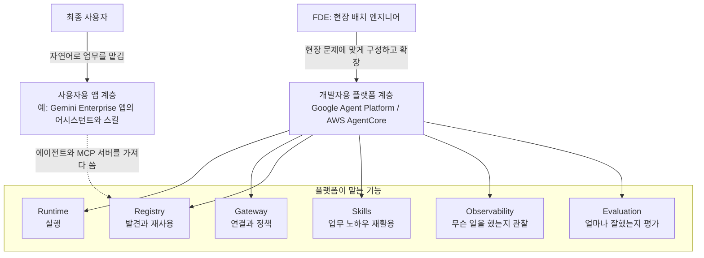
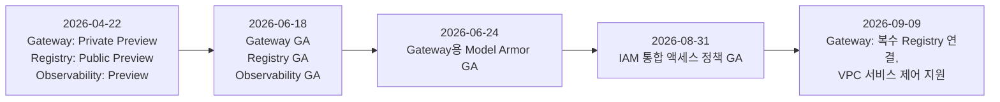
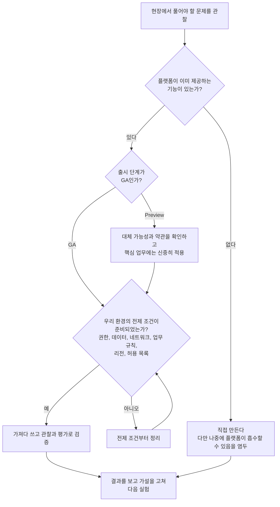

- 기준일: 2026년 10월 12일
- 대상 글: [「단상 — AI는 진화하고, 개발자는 무엇을 해야 할까?」](https://www.facebook.com/share/p/19pcYQAqdU/) (Google Gemini Enterprise·Agent Platform, AWS AgentCore, FDE 이야기)


```
단상

AI는 진화하고, 개발자는 무엇을 해야 할까?

요즘 AI 릴리스 노트를 읽다 보면 숨이 찹니다.

어제 Preview였던 기능이 GA가 되고, 오늘 배운 기술은 내일 더 편리한 기능으로 등장합니다.

Google의 Gemini Enterprise와 Agent Platform, AWS의 AgentCore까지.

도대체 언제 다 공부하고 써보라는 걸까요? 😅

그런데 자세히 들여다보니 재미있는 변화가 보입니다.

새로운 기능이 모두 최종 사용자를 위한 것은 아닙니다.

어떤 기능은 사용자가 자연어로 업무를 맡길 수 있게 하고, 또 다른 기능은 FDE(Forward Deployed Engineer)가 현장에서 플랫폼을 더 쉽게 확장하도록 돕습니다.

Agent Runtime은 실행을, Gateway는 연결과 정책을, Registry는 발견과 재사용을, Skills는 업무 노하우의 재활용을 돕습니다.

Observability와 Evaluation은 에이전트가 무슨 일을 했고 얼마나 잘했는지 확인하게 해줍니다.

예전에는 에이전트 하나를 만들기 위해 개발자가 인증, 연결, 실행, 로깅까지 직접 해결해야 했습니다.

이제 플랫폼이 점점 그 부담을 가져가고 있습니다.

덕분에 FDE는 인프라를 새로 만드는 대신 현장의 문제를 관찰하고, 가설을 세우고, 빠르게 실험하는 데 더 집중할 수 있습니다.

하지만 여기서 착각하면 안 됩니다.

GA가 됐다고 우리 회사에서 바로 사용할 수 있는 것은 아닙니다.

권한, 데이터, 네트워크, 업무 규칙은 여전히 준비해야 합니다. Preview와 GA도 구분해야 합니다.

플랫폼이 좋아진다고 현장의 문제가 저절로 해결되지는 않습니다.

오히려 개발자에게 더 중요한 역량은 새로운 기능을 얼마나 많이 아느냐보다, 어떤 문제에 어떤 기능을 적용하고 무엇을 직접 만들어야 하는지 판단하는 능력이 아닐까요?

사용자에게는 복잡한 기술이 보이지 않아야 하고, FDE에게는 그 복잡함을 쉽게 연결하고 확장할 수 있는 환경이 필요합니다.

AI가 발전할수록 개발자가 할 일이 사라지는 것이 아니라, 개발자가 집중해야 할 일이 달라지는 것 같습니다.

이제는 코드를 얼마나 많이 작성했느냐보다, 얼마나 적게 다시 만들고 얼마나 많은 문제를 해결했느냐가 더 중요해지는 시대입니다.

오늘도 릴리스 노트를 읽다가 생각했습니다.

기술을 따라가는 것도 바쁜데, 이제는 기술을 잘 안 만드는 것도 실력이겠구나. ☕

#AgenticAI #FDE #GeminiEnterprise #AgentCore #PlatformEngineering #AIDLC

https://www.facebook.com/share/p/19pcYQAqdU/

```

---

## 0. 이 문서를 읽는 방법

이 문서는 글에 나오는 문장들이 실제 제품 문서와 릴리스 노트에서 어떻게 확인되는지를 하나씩 따라가며 설명합니다. 글쓴이의 주장 가운데 "관찰"에 해당하는 부분은 공식 릴리스 노트로 대조했고, "의견"에 해당하는 부분은 의견이라고 표시했습니다.

먼저 알려 드릴 점이 두 가지 있습니다. 첫째, 글에 달린 Facebook 링크는 사이트가 자동 접근을 허용하지 않아 열람하지 못했습니다. 그래서 이 문서는 전달해 주신 본문 텍스트만을 기준으로 작성했습니다. 둘째, 제품 정보는 Google Cloud와 AWS의 공식 릴리스 노트(각각 2026년 10월 9일, 10월 중 갱신본)를 중심으로 확인했고, 공식 문서에서 확인되지 않는 내용은 "확인하지 못했다"고 적었습니다. 5장은 해설과 의견이 섞인 장이므로 이 점을 장 첫머리에 다시 밝혀 두었습니다.

---

## 1. 한눈에 보기

글의 핵심은 세 문장으로 줄일 수 있습니다.

첫째, AI 플랫폼의 기능이 너무 빨리 쏟아져서 따라가기 벅찹니다. 둘째, 그런데 그 기능들은 사용자용과 개발자(FDE)용으로 나뉘며, 인증·연결·실행·로깅처럼 개발자가 직접 만들던 부분을 플랫폼이 점점 가져가고 있습니다. 셋째, 그래서 개발자의 실력은 "얼마나 많이 만들었나"보다 "무엇을 만들지 않고 가져다 쓸지, 무엇을 직접 만들지 판단하는 힘"으로 이동하고 있다는 것입니다.

글에서 말한 구성요소들을 하나의 그림으로 정리하면 다음과 같습니다. 이 그림은 두 회사 문서에 공통으로 등장하는 역할 분담을 단순화한 것이며, 제품마다 세부 이름과 범위는 다릅니다.



---

## 2. 글의 구조 읽기

글은 크게 네 덩어리로 흘러갑니다.

**첫 번째 덩어리는 피로감의 고백입니다.** 릴리스 노트를 읽으면 숨이 찬다는 표현으로 시작해서, Preview가 어제 GA가 되고 오늘 배운 기술이 내일 더 편한 기능으로 대체되는 속도를 이야기합니다. 여기서 말하는 Preview와 GA는 클라우드 제품의 출시 단계를 가리킵니다. Preview는 시험 공개 단계, GA(General Availability)는 정식 출시 단계입니다.

**두 번째 덩어리는 관찰입니다.** 새 기능이 모두 최종 사용자용은 아니라는 점입니다. 어떤 기능은 사용자가 자연어로 일을 맡기게 해 주고, 어떤 기능은 FDE가 현장에서 플랫폼을 쉽게 확장하게 해 줍니다. 이어서 Runtime, Gateway, Registry, Skills, Observability, Evaluation 여섯 가지의 역할을 한 줄씩 정의합니다.

**세 번째 덩어리는 경고입니다.** GA가 되었다고 우리 회사에서 바로 쓸 수 있는 것은 아니며, 권한·데이터·네트워크·업무 규칙은 여전히 준비해야 한다는 내용입니다.

**네 번째 덩어리는 결론 겸 의견입니다.** 개발자에게 중요한 역량은 새 기능을 얼마나 아느냐가 아니라 어떤 문제에 어떤 기능을 적용하고 무엇을 직접 만들지 판단하는 능력이라는 것, 그리고 "기술을 잘 안 만드는 것도 실력"이라는 마지막 문장입니다.

---

## 3. 먼저 알아 둘 용어와 배경

### 3-1. FDE(Forward Deployed Engineer)란

FDE는 고객 조직 안이나 고객 곁에 배치되어, 그 고객의 실제 운영 환경에서 소프트웨어를 만들고 배포하는 고객 대면형 소프트웨어 엔지니어를 말합니다. 위키백과와 여러 2026년 해설 자료가 이 정의를 공통으로 사용합니다. 역할은 Palantir가 만든 것으로 널리 소개되는데, 시기는 자료마다 2000년대 중반부터 2010년대 초까지로 서로 다르게 적혀 있어서 정확한 연도는 단정하지 않겠습니다.

2026년에 이 역할이 다시 주목받는 이유를 해설 자료들은 AI에서 찾습니다. 한 해설은 AI가 "데모하기는 쉽고 배포하기는 어렵기" 때문에 현장 배치형 엔지니어가 필요해졌다고 설명하고, 위키백과는 OpenAI가 2026년에 고객 조직에 FDE를 투입하는 대규모 기업 AI 도입 사업을 시작했다고 기록합니다. 글에서 FDE가 "플랫폼 위에서 현장 문제를 풀어내는 사람"으로 등장하는 것은 이런 맥락과 맞닿아 있습니다.

### 3-2. Gemini Enterprise와 Agent Platform은 다른 것이다

글은 "Google의 Gemini Enterprise와 Agent Platform"이라고 둘을 나란히 적었는데, 이 둘은 서로 다른 제품이라는 점이 글의 논지를 이해하는 열쇠입니다.

**Gemini Enterprise**는 직원이 쓰는 앱 쪽 제품입니다. 릴리스 노트에는 어시스턴트 채팅, 음성 입력, 프로젝트(파일을 올려 질문하는 작업 공간), Canvas(문서와 슬라이드 편집), 스킬 만들기, 워크플로 빌더 같은 최종 사용자 기능이 보입니다. 관리자가 기능 토글을 켜야 사용자에게 열리는 구조라는 점도 반복해서 나옵니다.

**Gemini Enterprise Agent Platform**은 개발자 쪽 플랫폼입니다. 2026년 4월 22일 릴리스 노트에 따르면 Vertex AI가 이 플랫폼의 일부가 되었고, 기존의 Agent Engine은 Agent Runtime으로 이름이 바뀌었습니다. 공식 개요 문서는 이 플랫폼을 Build, Scale, Govern, Optimize 네 기둥으로 설명합니다. 에이전트를 만들고(ADK), 실행·확장하고(Runtime, Sessions, Memory Bank), 통제하고(Gateway, Registry, Identity, 정책), 개선하는(평가) 도구가 여기에 모여 있습니다.

그러니 글이 말한 "새로운 기능이 모두 최종 사용자를 위한 것은 아니다"는 문장은, 같은 Google 안에서도 Gemini Enterprise는 사용자 쪽, Agent Platform은 FDE 쪽이라는 구분으로 실제로 확인됩니다.

### 3-3. AWS AgentCore

Amazon Bedrock AgentCore는 에이전트를 안전하게 만들고 배포하고 운영하기 위한 AWS의 플랫폼입니다. AWS 공지에 따르면 2025년 10월 13일에 정식 출시(GA)되었고, 당시부터 Runtime, Gateway, Observability 등이 포함되었습니다. 현재 개발자 가이드는 Runtime, Memory, Gateway, Identity, Code Interpreter, Browser, Observability, Evaluations, Policy, Registry, Payments 등으로 구성된 모듈형 묶음으로 설명합니다. 서비스를 따로 쓸 수도 있고 조합해서 쓸 수도 있다는 것이 AWS의 설명입니다.

### 3-4. AIDLC(AI-DLC)

글 끝의 해시태그 AIDLC는 AWS가 2025년에 소개한 AI-Driven Development Life Cycle을 가리키는 것으로 보는 것이 일반적입니다. 여러 해설 자료는 이를 계획·설계·구현·운영 전반에서 AI가 실행을 주도하고, 사람은 방향 설정·승인·검증의 결정권을 갖는 개발 방법론으로 설명합니다. 스프린트 대신 몇 시간에서 며칠 단위의 "볼트(bolt)"라는 짧은 주기를 쓴다는 점이 특징으로 자주 언급됩니다. 다만 글의 본문에는 AIDLC가 직접 설명되지 않으므로, 글쓴이가 어떤 의미로 붙였는지는 본문만으로는 확정할 수 없습니다.

---

## 4. 글의 문장을 하나씩 사실 확인하기

### 4-1. "어제 Preview였던 기능이 GA가 된다"

과장이 아니라 실제 일정으로 확인됩니다. Google Agent Platform의 세 가지 핵심 기능이 대표적입니다. 2026년 4월 22일 초기 릴리스에서 Agent Gateway는 Private Preview, Agent Registry는 Public Preview, Agent Observability는 Preview로 공개되었습니다. 그리고 6월 18일에 이 셋이 모두 GA가 되었습니다. 약 8주 만입니다.



AWS도 비슷한 속도를 보입니다. AgentCore harness는 4월에 Public Preview로 나온 뒤 6월 릴리스 노트에서 GA가 되었고, AWS Agent Registry는 4월에 Preview로 시작해 8월 릴리스 노트에서 GA가 되었습니다. AgentCore Evaluations는 2026년 3월 31일에 GA가 되었습니다.

기능이 GA가 된 뒤에도 변화는 계속됩니다. 예를 들어 Google Agent Platform 릴리스 노트는 Gateway의 VPC 연결 방식을 9월 8일에 "connectivity template"이라는 새 구성으로 바꾸었고, AWS는 9월에 새 세대 AgentCore Runtime을 내놓았습니다. 글에서 "오늘 배운 기술이 내일 더 편리한 기능으로 등장한다"고 한 감각은 이런 변화와 일치합니다.

### 4-2. "새로운 기능이 모두 최종 사용자를 위한 것은 아니다"

3-2에서 본 것처럼 확인됩니다. 같은 시기 Gemini Enterprise 릴리스 노트에는 사용자 기능이 이어집니다. 9월 17일에는 채팅창 음성 입력이 GA가 되었고, 9월 4일에는 프로젝트 기능이 GA가 되었으며, 9월 3일에는 워크플로 빌더가 GA가 되었습니다. 반면 Agent Platform 릴리스 노트에는 Gateway의 VPC 연결 템플릿, Agent Runtime의 OpenTelemetry 지표, 샌드박스의 CMEK와 Private Service Connect 같은 개발자·운영자용 항목이 나옵니다.

한 가지 흥미로운 지점은 두 영역이 연결되어 있다는 것입니다. 6월 25일 Gemini Enterprise 릴리스 노트에 따르면, 관리자는 Gemini Enterprise 안에서 Agent Registry의 에이전트와 사용자 지정 MCP 서버를 가져와 앱에 추가할 수 있고, Agent Gateway가 관리하는 egress 정책으로 그 트래픽에 허용·거부 권한을 설정할 수 있습니다. 사용자는 앱만 보지만, 뒤에서는 FDE가 다루는 계층이 받치고 있는 셈입니다.

### 4-3. 여섯 가지 구성요소의 역할 확인

글은 각 요소를 한 줄로 정의했습니다. 두 회사의 공식 문서가 각 정의를 어떻게 뒷받침하는지 차례로 보겠습니다.

#### Runtime은 실행을 돕는다

Google은 Agent Runtime이 최대 7일의 장시간 작업, 1초 미만의 콜드 스타트, 1분 미만의 프로비저닝, 사용자 지정 컨테이너 배포를 지원한다고 4월 22일 릴리스 노트에 적었습니다. 5월 19일에는 에이전트의 불변 리비전을 만들고 트래픽을 나누어 카나리 배포를 할 수 있는 기능이 Public Preview로 공개되었습니다.

AWS는 AgentCore Runtime을 서버리스 microVM 컴퓨트로 설명합니다. 9월에 공개된 새 Runtime은 테스트에서 200MB~2GB 크기의 컨테이너 배포물 기준 P75 콜드 스타트가 약 1.9~2.0초로, 이전 버전의 5.4~30초보다 짧았다고 AWS가 밝혔습니다. 다만 이 새 Runtime은 us-east-1, us-east-2, us-west-2, eu-west-1, ap-northeast-1 다섯 리전에서만 쓸 수 있습니다. 8월에는 고객 계정의 EC2 위에서 최대 14일간 지속되는 세션을 지원하는 "Instances" 컴퓨트 유형도 추가되었습니다.

#### Gateway는 연결과 정책을 돕는다

Google은 Agent Gateway를 사용자와 에이전트, 에이전트와 도구, 에이전트끼리의 모든 연결을 보호하고 통제하는 네트워킹 구성요소로 설명합니다. 6월 24일에는 게이트웨이를 통과하는 프롬프트와 응답에 Model Armor 보안 가드레일을 적용하는 기능이 GA가 되었습니다. 8월 31일에 GA가 된 IAM 통합 액세스 정책은 도구 이름, 읽기 전용 여부, HTTP 메서드, URL 경로 같은 조건(CEL)으로 허용·거부 규칙을 정하고, 실제 차단 전에 dry-run으로 먼저 평가해 볼 수 있게 합니다.

AWS AgentCore Gateway는 API와 Lambda 함수를 에이전트용 도구로 바꿔 주고 기존 MCP 서버에도 연결하는 서비스로 출발했습니다. 2026년에는 HTTP 패스스루 대상, 모델 제공자 추론 대상, 호출자·도구·모델 단위의 요청 수와 토큰 수 제한, "런타임이 게이트웨이를 통한 호출만 받도록" 강제하는 기능이 더해졌습니다. 10월에는 사설 인증기관(CA)이 서명한 인증서를 쓰는 대상에 직접 연결하는 기능도 나왔습니다. "연결과 정책"이라는 글의 정의는 양쪽 모두에서 그대로 확인됩니다.

#### Registry는 발견과 재사용을 돕는다

Google은 Agent Registry를 에이전트와 MCP 서버를 등록·검색·통제하는 중앙 카탈로그로 설명하고, 6월 18일 GA 때 v1 API, A2A 프로토콜 1.0 지원, Terraform 지원을 함께 공개했습니다. 9월 9일부터는 하나의 Agent Gateway에 전역 Registry 하나와 리전 또는 멀티 리전 Registry 하나, 최대 두 개를 연결할 수 있습니다.

AWS Agent Registry는 에이전트, 도구, 스킬, MCP 서버, 사용자 지정 리소스를 담는 비공개 통제형 카탈로그로 소개됩니다. 8월 GA 때 AWS Organizations 멤버 계정의 Runtime과 Gateway를 자동으로 발견해 한곳에 모으는 기능, 고객 관리 KMS 키 암호화, AWS RAM을 통한 계정 간 공유, PrivateLink 지원이 함께 공개되었습니다. 이 8월 릴리스 노트에는 아홉 개 리전에서 쓸 수 있다고 적혀 있습니다.

#### Skills는 업무 노하우 재활용을 돕는다

Google Gemini Enterprise에서 스킬은 어시스턴트가 특정 작업을 하도록 돕는 재사용 가능한 사용자 지정 지침입니다. 8월 13일 릴리스 노트에 따르면 최종 사용자가 스킬을 만들고 올리고 공유할 수 있고, 관리자는 스킬 사용 설정과 공유 승인을 관리합니다. 개발자 쪽에서는 Agent Platform의 Skill Registry가 지침, 코드, 문서를 담은 자기완결형 패키지로 스킬을 보관·검색하게 해 주며, 5월 19일 릴리스 노트 기준 Public Preview입니다. 이후 이 기능의 GA 공지는 이번에 확인한 릴리스 노트에서 찾지 못했습니다.

AWS는 6월에 GA가 된 AgentCore harness에 AWS가 큐레이션한 스킬 카탈로그를 토글 하나로 켜는 기능을 넣었고, 8월에는 평가 쪽에 스킬 전용 평가자 두 가지를 추가했습니다. 하나는 에이전트가 과제에 맞는 스킬을 골랐는지(SkillSelectionAccuracy), 다른 하나는 불러온 스킬의 지시를 얼마나 충실히 따랐는지(SkillInstructionFollowing)를 판정합니다. 스킬이 "재사용되는 노하우"라는 정의가 맞는다는 것과 함께, 스킬을 만들었다고 끝이 아니라 잘 쓰이는지도 따로 측정해야 한다는 점이 제품 기능으로 드러납니다.

#### Observability는 에이전트가 무슨 일을 했는지 보여 준다

Google은 6월 18일에 Agent Observability를 GA로 공개하면서, 새로 배포한 ADK 에이전트에는 OpenTelemetry 추적이 기본으로 켜지고, 세션 실행을 단계별로 살펴보고 트레이스 스팬의 방향성 비순환 그래프(DAG)를 볼 수 있다고 밝혔습니다. 9월 30일에는 Agent Gateway와 Cloud Trace를 연동하는 기능이 Preview로 나와, 요청이 에이전트에서 게이트웨이를 거쳐 도구·에이전트·MCP 서버로 가는 전 과정을 추적할 수 있게 되었습니다.

AWS AgentCore Observability는 OpenTelemetry와 호환되며 Amazon CloudWatch 위에서 대시보드와 추적을 제공하고, Datadog 같은 외부 관측 도구와도 연동된다고 2025년 GA 공지에 적혀 있습니다.

#### Evaluation은 얼마나 잘했는지 확인하게 한다

Google은 Agent and Model Evaluations의 GA를 Google Developers Blog로 알렸습니다. 같은 평가 정의를 오프라인 실험과 운영 트래픽을 채점하는 온라인 모니터에서 그대로 쓸 수 있고, 평가 사례를 자동 생성하며, 사용자 시뮬레이터가 여러 턴의 대화를 대신 진행한다는 점이 특징으로 소개됩니다.

AWS AgentCore Evaluations는 3월 31일에 GA가 되었고, 내장 평가자 13종, 운영 트래픽을 지속적으로 채점하는 온라인 평가, CI/CD 회귀 테스트에 쓰는 온디맨드 평가를 제공합니다. 6월에는 개선 제안(Recommendations), 일괄 평가(Batch Evaluations), A/B 테스트가 GA가 되어 "관찰 → 평가 → 개선 → 배포"의 고리를 이루게 되었고, 반복되는 실패 패턴을 찾아 주는 Failure Insights는 같은 달 Public Preview로 공개되었습니다.

### 4-4. "플랫폼이 점점 그 부담을 가져가고 있다"

인증, 연결, 실행, 로깅을 개발자가 직접 하던 시절과 비교하면 이 문장도 근거가 있습니다. 인증과 관련해서 Google은 4월에 Agent Identity를 GA로 내놓았습니다. 이 기능은 에이전트가 MCP 서버나 클라우드 리소스에 스스로 또는 최종 사용자를 대신해 안전하게 인증하게 합니다. AWS는 4월에 AgentCore Identity에 On-Behalf-Of 토큰 교환을 추가했고, 9월에는 사용자가 에이전트의 자원 접근에 동의하는 호스팅 방식의 Consent Portal을 공개했습니다. 로깅과 관찰은 위에서 본 Observability가, 실행은 Runtime이, 연결은 Gateway가 담당합니다.

다만 "부담이 사라진다"가 아니라 "부담이 이동한다"에 가깝습니다. 공식 문서를 보면 플랫폼은 기능과 통제 수단을 제공하지만, 그 수단을 어떻게 설정할지는 여전히 고객의 몫입니다. 이 점이 다음 항목의 경고로 이어집니다.

### 4-5. "GA가 됐다고 우리 회사에서 바로 사용할 수 있는 것은 아니다"

글의 이 경고는 릴리스 노트 곳곳에서 구체적인 사례로 뒷받침됩니다. 권한, 데이터, 네트워크, 업무 규칙으로 나누어 보겠습니다.

**GA라는 표시와 실제 사용 가능 여부는 다를 수 있습니다.** Gemini Enterprise의 스킬은 6월 17일에 "GA with allowlist", 즉 허용 목록에 올라야 쓸 수 있는 GA로 공지되었습니다. 7월 9일에는 관리자용 "Enable skills" 토글이 아직 없으며 Google 계정 담당자에게 문의해야 한다는 정정이 나왔고, 8월 13일에야 관리자가 스킬과 스킬 공유 설정을 켜는 일반적인 GA로 정리되었습니다. 워크플로 에이전트도 6월 18일에는 허용 목록 GA였다가 9월 3일에 Workflow Builder GA가 되었습니다.

**권한 측면에서는 관리자의 선택이 필요합니다.** Gemini Enterprise의 Canvas, 프로젝트, 음성 입력 같은 기능은 GA 공지에 모두 관리자가 토글을 켜야 사용자에게 열린다고 적혀 있습니다. 9월 28일에는 앱과 데이터 저장소 단위의 세분화된 IAM 권한이 추가되어, 조직이 누구에게 무엇을 열어 줄지 직접 설계할 여지가 커졌습니다.

**데이터와 네트워크 측면에서는 사전 조건이 명시됩니다.** Gemini Enterprise의 사용자 지정 MCP 서버 데이터 저장소는 기본적으로 꺼져 있고, 조직 정책 관리자가 제약 조건을 제거해야 쓸 수 있습니다. Agent Gateway의 VPC 서비스 제어는 2026년 9월 8일 이후 생성되었고 connectivity template으로 VPC 연결을 구성한 배포에서만 지원된다고 릴리스 노트가 못 박았습니다. 또한 VPC 서비스 제어 경계를 적용하려면 템플릿을 ALL_TRAFFIC 모드로 구성해야 합니다. AWS 쪽도 새 Runtime은 다섯 개 리전에서만, Agent Registry는 아홉 개 리전에서만 쓸 수 있다고 명시합니다. Google Agent Registry GA 공지에는 알려진 제한으로 Access Transparency와 Access Approval이 지원되지 않고, 데이터 거주 규정 준수 보고를 위한 탐지 통제가 제한적이라고 적혀 있습니다.

**업무 규칙은 결국 고객이 정의해야 합니다.** Google의 시맨틱 거버넌스 정책은 에이전트의 도구 호출이 사용자 의도와 조직의 업무 규칙에 맞는지를 실행 시점에 평가하는 기능인데, 그 규칙을 영어 같은 자연어로 쓰는 것은 고객입니다. 이 기능은 6월 29일 Preview로 공개되었고 9월 25일에는 VPC 서비스 제어 지원도 Preview로 추가되었습니다. AWS의 Evaluations도 내장 평가자를 제공하지만 평가용 데이터셋과 기대 동작은 팀이 정해야 합니다. 플랫폼이 평가 "도구"를 주어도, 무엇이 좋은 결과인지는 현장이 정해야 하는 것입니다.

### 4-6. "Preview와 GA도 구분해야 한다"

이 문장이 중요한 이유는, 지금도 핵심 영역에 Preview 상태의 기능이 남아 있기 때문입니다. 이번에 확인한 공식 릴리스 노트 기준으로 Preview(또는 그에 준하는 제한 상태)로 표시된 예는 다음과 같습니다.

Google 쪽에서는 Skill Registry(Public Preview, 5월 19일), Managed Agents API(Preview), 에이전트 리비전과 트래픽 분할(Public Preview), 시맨틱 거버넌스 정책과 그 VPC 서비스 제어 지원(Preview), Agent Gateway와 Cloud Trace 연동(Preview 9월 30일), 새 Agent Identity API(6월 18일 Preview, 기존 IAM Connectors API를 대체), 지연 시간에 민감하지 않은 백그라운드 에이전트 작업을 한가한 시간대에 실행하도록 예약하고 토큰을 50% 할인하는 deferred tier(Preview, 9월 2일)가 있습니다. AWS 쪽에서는 Failure Insights(6월 Public Preview)와 AgentCore Payments(5월 Preview로 소개)가 있습니다. Payments의 이후 GA 여부는 이번에 확인한 문서에서 단정할 수 없었습니다.

Preview 기능에 서비스 수준 약속(SLA)이나 약관이 어떻게 적용되는지는 이번에 확인하지 않았습니다. 제품마다 다를 수 있으므로, 도입 전에 해당 기능의 공식 페이지에서 단계와 약관을 직접 확인하시기 바랍니다.

비용도 따로 확인할 대목입니다. Google 릴리스 노트에는 9월 1일부터 Agent Platform 컴퓨트 SKU에 세션과 Memory Bank 컴퓨트 계량이 적용된다는 "agent metering" 가격 변경이 올라와 있습니다. 플랫폼이 부담을 가져간 만큼 사용량 기반 요금 항목도 함께 생긴다는 뜻이므로, 제품 선택 때 기능만이 아니라 과금 방식도 같이 봐야 합니다.

---

## 5. 해설과 의견: 개발자에게 무엇이 달라지는가

> 이 장은 앞의 사실 확인을 바탕으로 한 **해설**이며, 사실 주장과 의견을 구분해서 적었습니다. 공식 문서가 "그렇게 해야 한다"고 말한 내용이 아니라, 문서에서 확인된 사실로부터 글의 논지를 이해하기 위해 풀어 쓴 것입니다.

### 5-1. 글의 결론은 "역할의 이동"이라는 주장이다

글은 개발자가 할 일이 사라지는 것이 아니라 집중해야 할 일이 달라진다고 말합니다. 4장에서 확인한 사실만으로 이 주장을 지지하는 근거를 정리하면 이렇습니다. 실행 환경, 인증, 관찰 도구, 평가 도구, 스킬 카탈로그, 에이전트 카탈로그는 플랫폼이 제공하는 쪽으로 옮겨 갔습니다. 반면 그 도구들을 어떤 권한 구조에 맞춰 열지, 어떤 데이터에 연결할지, 어떤 규칙을 정책으로 쓸지, 무엇을 "잘한 결과"로 볼지는 현장 맥락을 아는 사람만 정할 수 있습니다. 글이 FDE를 "현장의 문제를 관찰하고, 가설을 세우고, 빠르게 실험하는" 사람으로 그린 것은 이 남은 영역과 정확히 겹칩니다.

### 5-2. "안 만드는 것도 실력"을 판단 순서로 풀어 보기

마지막 문장은 감탄처럼 들리지만, 실무에서는 판단 순서로 바꿀 수 있습니다. 아래 흐름은 글의 문장들(어떤 문제에 어떤 기능을 쓸지, GA인지 Preview인지, 권한·데이터·네트워크·업무 규칙이 준비되었는지)을 순서대로 늘어놓은 **제안**입니다. 제품 공식 절차가 아닙니다.



이 순서에서 "안 만든다"는 판단이 실력이 되는 이유는, 4장에서 본 것처럼 플랫폼 기능이 몇 주 단위로 바뀌기 때문입니다. 오늘 직접 만든 연결 코드나 로깅 코드가 몇 달 뒤 플랫폼의 기본 기능과 겹칠 가능성이 현실적으로 존재합니다. 다만 이것은 가능성이지 모든 경우에 해당하는 법칙은 아닙니다. 반대로 플랫폼이 제공한다고 해서 무조건 쓰는 것이 정답도 아닙니다. Preview 단계이거나 우리 리전·네트워크 조건과 맞지 않으면 직접 구현이 합리적일 수 있습니다.

### 5-3. 그래서 "코드를 얼마나 많이 썼느냐"의 기준이 바뀐다는 말

글은 "얼마나 적게 다시 만들고 얼마나 많은 문제를 해결했느냐"를 새 기준으로 제시합니다. 이를 지지하는 방향의 공식 사실은 앞서 본 대로 플랫폼의 공통 기능이 늘고 있다는 점입니다. 하지만 이것이 업계 전체의 평가 기준이 이미 그렇게 바뀌었다는 증거는 이번 조사에서 찾지 못했습니다. 이 문장은 글쓴이의 관점으로 읽는 것이 정확합니다.

### 5-4. 사용자에게는 복잡함이 보이지 않아야 한다는 말

글은 사용자에게는 복잡한 기술이 보이지 않아야 하고 FDE에게는 복잡함을 쉽게 연결하고 확장하는 환경이 필요하다고 말합니다. 제품 구조에서 이 분업은 확인됩니다. 사용자는 Gemini Enterprise 앱에서 자연어로 일을 맡기고, 관리자와 FDE는 Registry·Gateway·정책으로 무엇이 연결되고 무엇이 막히는지를 통제합니다. 6월 25일 Gemini Enterprise 노트에서 본 것처럼 같은 에이전트와 MCP 서버를 앱 사용자는 목록에서 고르기만 하고, 뒤에서는 egress 정책이 허용 여부를 정하는 구조입니다.

---

## 6. 현장에서 바로 써먹을 점검 질문

이 장도 해설의 연장입니다. 새 기능을 접할 때 다음 질문에 차례로 답해 보면 글의 경고를 실무로 옮길 수 있습니다.

먼저 그 기능이 풀려는 문제가 우리 현장의 실제 문제인지 묻습니다. 다음으로 공식 릴리스 노트에서 그 기능의 출시 단계가 Preview인지 GA인지, 그리고 "allowlist" 같은 조건이 붙어 있는지 확인합니다. 그다음 우리 조직의 리전, 데이터 거주 요건, VPC 구성, 조직 정책이 그 기능의 전제 조건과 맞는지 봅니다. 이어서 누가 어떤 권한으로 그 기능을 켤 수 있고, 에이전트가 접근할 수 있는 도구와 데이터의 범위를 누가 정하는지 정리합니다. 마지막으로 그 기능이 제대로 동작하는지를 관찰과 평가로 어떻게 확인할지, 비용이 어떤 단위로 계량되는지를 미리 정해 둡니다. 이 다섯 단계 가운데 앞의 두 가지는 릴리스 노트만 읽어도 확인되고, 나머지는 우리 조직 내부에서만 답할 수 있다는 점이 글이 말한 "플랫폼이 좋아져도 현장의 문제는 저절로 해결되지 않는다"의 실체입니다.

---

## 7. 이 문서의 한계

이번 조사에서 확인하지 못했거나 단정하지 않은 내용을 정리합니다. Facebook 원문은 접근이 막혀 열람하지 못했고 전달받은 본문만 사용했습니다. 글에 나온 "Skills" 항목 가운데 Google의 Skill Registry는 5월 19일 Public Preview 이후의 상태를 이번 릴리스 노트에서 확인하지 못했습니다. AgentCore Payments의 현재 출시 단계도 확인하지 못했습니다. FDE 역할의 기원 연도는 자료마다 달라 단정하지 않았습니다. Google Agent Platform의 Evaluation GA 시점은 공식 개발자 블로그 글이 GA를 알렸다는 사실만 확인했으며, 정확한 날짜는 이 문서에서 단정하지 않았습니다. 마지막으로 두 회사의 릴리스 노트는 계속 갱신되므로, 도입 결정 직전에는 해당 기능의 공식 페이지를 다시 확인해야 합니다.

---

## 8. 출처

아래 출처는 모두 2026년 10월 12일 기준으로 열람한 공식 문서 또는 해설 자료입니다.

**Google 공식 문서**

- Gemini Enterprise Agent Platform release notes (마지막 갱신 2026-10-09): https://docs.cloud.google.com/gemini-enterprise-agent-platform/release-notes
- Gemini Enterprise release notes: https://docs.cloud.google.com/gemini/enterprise/docs/release-notes
- Agent Platform overview: https://docs.cloud.google.com/gemini-enterprise-agent-platform/overview
- Evaluate your agents (Agent Platform 문서): https://docs.cloud.google.com/gemini-enterprise-agent-platform/optimize/evaluation/evaluate-agents
- Agent and Model Evaluations in Gemini Enterprise Agent Platform are now GA (Google Developers Blog): https://developers.googleblog.com/en/agent-and-model-evaluations-in-gemini-enterprise-agent-platform-are-now-ga/

**AWS 공식 문서**

- Release notes for Amazon Bedrock AgentCore: https://docs.aws.amazon.com/bedrock-agentcore/latest/devguide/release-notes.html
- Amazon Bedrock AgentCore is now generally available (2025-10-13): https://aws.amazon.com/about-aws/whats-new/2025/10/amazon-bedrock-agentcore-available
- The new AgentCore Runtime is now available (2026-09): https://aws.amazon.com/about-aws/whats-new/2026/09/new-agentcore-runtime-generally-available/
- Amazon Bedrock AgentCore Evaluations GA 공지(2026-03-31): https://aws.amazon.com/it/about-aws/whats-new/2026/03/agentcore-evaluations-generally-available/
- AgentCore overview: https://docs.aws.amazon.com/bedrock-agentcore/latest/devguide/what-is-bedrock-agentcore.html
- AgentCore pricing: https://aws.amazon.com/bedrock/agentcore/pricing/

**FDE와 AI-DLC 해설 자료**

- Forward Deployed Engineer (Wikipedia): https://en.wikipedia.org/wiki/Forward_Deployed_Engineer
- What Is a Forward Deployed Engineer? The 2026 FDE Guide (Valletta Software, 2026-08-12): https://vallettasoftware.com/blog/post/forward-deployed-engineer
- What is a forward deployed engineer? (Paraform): https://www.paraform.com/insights/what-is-a-forward-deployed-engineer
- What Is the AI-Driven Development Lifecycle (AI-DLC)? (Jellyfish): https://jellyfish.co/library/ai-driven-development-lifecycle/
- What is AI-DLC? (Wiz Academy): https://wiz.io/academy/ai-security/ai-driven-development-lifecycle-ai-dlc
- awslabs/aidlc-workflows 문서: https://awslabs.github.io/aidlc-workflows/guide/00-introduction/
