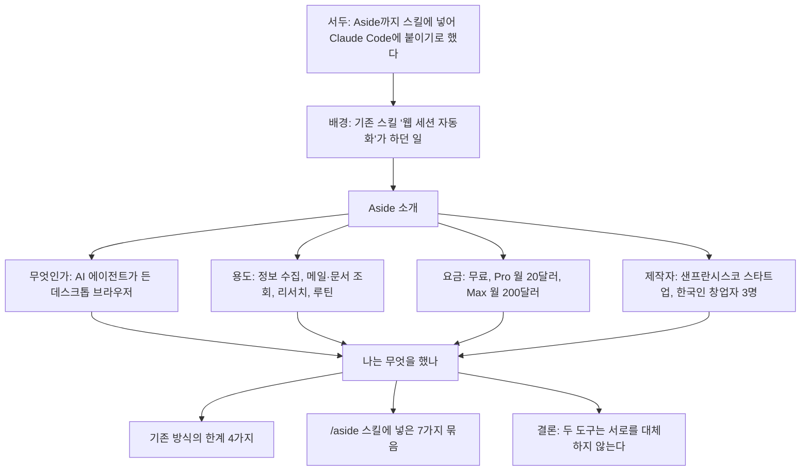
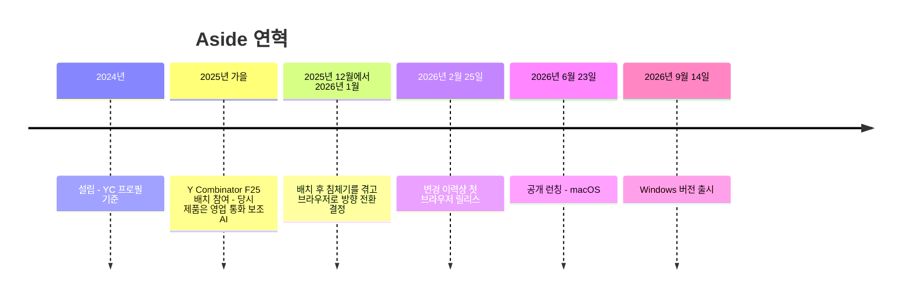
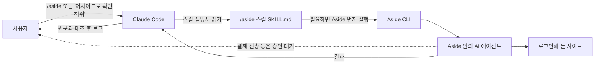
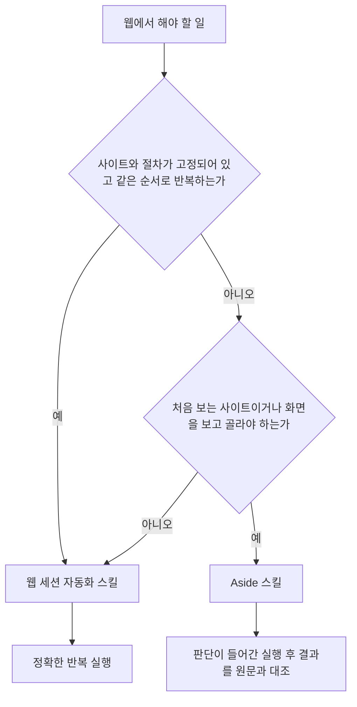
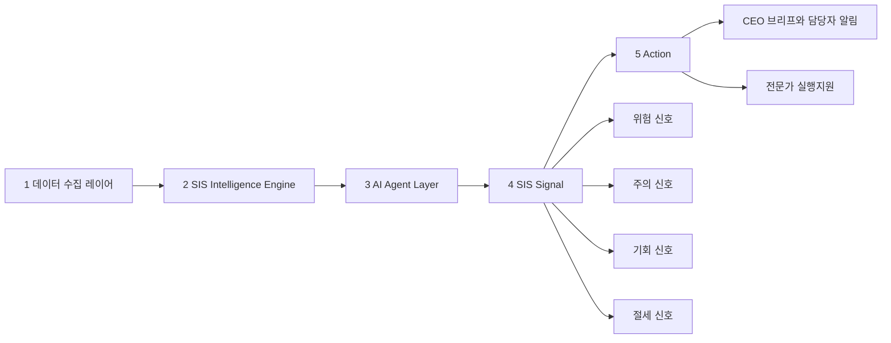

- **작성 기준일**: 2026년 10월 12일
- **해설 대상**: 선웅규 님이 페이스북에 올린 ["웹 세션 자동화를 넘어서 Aside까지, 스킬에 넣어서 Claude Code에게 붙여 주기로 한다"](https://www.facebook.com/share/1S8oL7P3BZ/) 게시글
- **작성 원칙**: 게시글 본문을 먼저 정리하고, 본문이 말하는 사실(제품 기능, 요금, 회사, 출시 시점)은 Aside 공식 사이트·공식 도움말·Y Combinator 프로필·언론 보도로 하나씩 대조했습니다. 확인하지 못한 부분은 "확인하지 못했다"고 적었고, 추측으로 채우지 않았습니다. 근거는 본문 곳곳의 대괄호 번호와 맨 아래 출처 목록으로 연결됩니다.

---

## 0. 먼저 한눈에 보기

이 게시글은 한 문장으로 요약하면 이렇습니다. 글쓴이는 Claude Code(터미널에서 AI에게 일을 시키는 도구)에 "웹 세션 자동화"라는 자작 스킬을 붙여 써 왔는데, 이 방식에 한계가 분명해서 **Aside라는 AI 브라우저를 새 스킬(`/aside`)로 추가했고**, 그 Aside가 무엇인지 네 가지 질문(무엇인가, 어디에 쓰는가, 얼마인가, 누가 만들었나)으로 정리해 두었다는 내용입니다.

여기서 핵심 개념은 두 가지입니다. 하나는 **정해 둔 순서대로 버튼을 누르는 자동화**이고, 다른 하나는 **AI가 화면을 보고 스스로 판단해서 움직이는 자동화**입니다. 글쓴이는 앞의 것을 "웹 세션 자동화", 뒤의 것을 "Aside"라고 부르고, 둘이 서로를 대체하지 않으며 역할을 나눠 맡는다고 결론짓습니다.

공식 자료로 대조해 보면 게시글의 큰 줄기는 모두 사실과 맞습니다. 다만 세부에서 알아 두면 좋은 차이가 몇 가지 있습니다. 회사 이름 표기가 자료마다 다르다는 점, Max 요금제의 사용량 배수가 공식 페이지와 도움말에서 다르게 적혀 있다는 점, 그리고 게시글이 쓰던 시점과 달리 지금은 Windows 정식 버전이 나와 있다는 점입니다. 이 차이는 9장에 표로 정리했습니다.

---

## 1. 게시글은 어떤 순서로 이야기하는가

게시글은 크게 다섯 덩어리입니다. 서두에서 결론(Aside를 스킬에 넣기로 했다)을 먼저 밝히고, 배경(기존 스킬이 무엇이었는지)을 설명한 뒤, Aside 소개 네 항목(정의·용도·요금·제작자)을 나열하고, 마지막으로 "내가 이것으로 무엇을 했나"에서 실제로 스킬에 넣은 것과 두 도구의 역할 분담을 말합니다.

이 글에서 가장 정보 밀도가 높은 곳은 "나는 이것으로 무엇을 했나" 부분입니다. 앞의 Aside 소개는 제품 설명이고, 이 마지막 부분이 글쓴이의 실제 작업 경험이기 때문입니다.

---

## 2. 글쓴이가 먼저 쓰던 도구: "웹 세션 자동화"

### 2.1 무엇을 하는 스킬이었나

글쓴이가 만든 "웹 세션 자동화"는, 본인이 이미 로그인해 둔 크롬 브라우저를 프로그램이 대신 조작하는 스킬입니다. 게시글에 적힌 용도는 파일 올리기와 내려받기, ChatGPT·Gemini에 질문하기, 유튜브에 영상 올리기, 페이스북 글 올리기 등입니다. 사람이 마우스로 하던 일을 코드가 대신 한다고 이해하면 됩니다.

여기서 "스킬"은 Claude Code가 필요할 때 읽어 들이는 지침 묶음입니다. 폴더 하나에 `SKILL.md`라는 설명 파일과 필요한 스크립트를 넣어 두면, Claude Code가 그 설명을 보고 해당 작업을 수행합니다. 저자의 작업 기록을 보면 이번 Aside 스킬도 `.claude/skills/aside` 폴더 아래 `SKILL.md`로 들어 있습니다.

### 2.2 왜 부족했나: 글쓴이가 꼽은 네 가지 한계

게시글은 이 방식을 "AI가 판단하지 않고, 정해 둔 버튼을 정해 둔 순서로 누르는 방식"이라고 규정한 뒤 한계를 네 가지로 듭니다.

**첫째, 사이트마다 전용 코드를 따로 만들어야 합니다.** 카카오, 유튜브, 페이스북이 각각 다른 코드라서, 처음 보는 사이트는 바로 시킬 수 없습니다.

**둘째, 사이트 화면이 바뀌면 코드가 깨집니다.** 글쓴이는 이번에 공공데이터 활용신청 스킬이 사이트 개편 때문에 버튼을 못 찾아 오작동한 일을 예로 듭니다. 정해 둔 위치의 버튼을 누르는 방식이므로, 버튼이 옮겨지거나 이름이 바뀌면 곧바로 실패한다는 뜻입니다.

**셋째, 정해 둔 크롬 한 개에서만 돌아갑니다.** 평소 쓰는 브라우저는 조작하지 못하고, 그 크롬이 비정상 종료되면 로그인이 풀려 다시 인증해야 합니다.

**넷째, 화면을 보고 판단하지 못합니다.** 목록에서 필요한 공고만 골라 읽는 일처럼 판단이 필요한 작업은 별도로 코드를 짜 줘야 합니다.

이 네 가지는 모두 글쓴이 본인이 겪은 문제를 서술한 것이므로 제3자가 검증할 수 있는 사실은 아닙니다. 다만 "정해진 위치와 순서를 가정하는 자동화는 화면이 바뀌면 깨지기 쉽다"는 일반적인 성격과는 잘 들어맞는 설명입니다.

---

## 3. Aside란 무엇인가

### 3.1 정의

게시글은 Aside를 "AI 에이전트가 들어 있는 데스크톱 웹 브라우저"라고 소개합니다. 공식 자료와 일치합니다. Aside는 Chromium을 기반으로 한 브라우저이며, 사이드바에 AI 채팅을 붙인 형태가 아니라 **사용자가 이미 로그인해 둔 사이트와 계정을 AI가 그대로 이용해 일하는 구조**입니다 [15][16]. 공식 소개문도 같은 취지로, 이메일·대시보드·내부 도구·문서·스프레드시트 안에서 작업을 이어 가며, 몇 분 또는 몇 시간 걸리는 작업도 계속 진행한다고 설명합니다 [14].

### 3.2 "연동 없이 브라우저 자체가 연동이다"

Aside의 가장 큰 설계 철학은 별도 연동(통합)을 만들지 않는다는 점입니다. 보통의 AI 에이전트는 Gmail, Slack, Notion마다 연결 설정을 해야 하는데, Aside는 사람이 웹에서 하듯 해당 사이트에 들어가 직접 작업합니다 [14]. 공동 창업자 Chanhee Lee는 EO 매거진 인터뷰에서 이 아이디어가 나온 배경을 "고객마다 지식이 Notion, GitHub, 스프레드시트 등 제각각이라 커넥터를 만들 시간이 모자랐고, 그래서 브라우저가 곧 연동이면 어떨까 하는 농담에서 출발했다"고 설명했습니다 [17].

### 3.3 AI가 화면을 "보고" 움직이는 방식

게시글은 "AI가 검색하고, 페이지를 열고, 클릭하고, 내용을 읽어서 결과를 가져온다"고 적습니다. 기술적으로는 Aside가 Playwright 스타일의 자바스크립트 코드를 직접 작성해 브라우저를 제어하는 구조로 알려져 있습니다. Aside가 공개한 기술 글은 스스로를 "사실상 코딩 에이전트"라고 부르며 Playwright JS로 브라우저를 제어한다고 밝힙니다 [23]. 게시글의 "코드 조작: Playwright 스타일 자바스크립트 실행"이 바로 이 기능을 스킬에 연결한 부분입니다. 공식 도움말에도 `aside repl` 명령이 있어, 직접 페이지를 점검하거나 파일을 내려받거나 결정론적인 브라우저 단계를 실행할 때 쓰도록 안내합니다 [2].

### 3.4 로그인, 비밀번호, 승인: 게시글이 말한 안전장치

게시글에는 세 가지 안전 원칙이 있습니다. 비밀번호 원문은 AI에게 보이지 않고, 인증번호와 본인 확인은 사람이 직접 하며, 결제와 전송은 승인을 기다린다는 것입니다. 하나씩 공식 문서와 맞춰 보겠습니다.

**비밀번호 원문 비공개.** 공식 도움말에 따르면 Aside Vault라는 내장 비밀번호 관리자가 로그인 정보를 저장하고 자동 입력으로 로그인하며, 에이전트는 "로그인 동작"을 쓸 수 있을 뿐 비밀번호 원문은 받지 않습니다 [5]. 에이전트에게 열어 줄 범위도 `Always allow`, `While unlocked`, `Never` 세 가지 중에서 사용자가 정하고, 시크릿(incognito) 세션에서는 에이전트가 비밀번호 관리자를 쓸 수 없습니다 [5].

**인증번호·본인 확인은 사람이.** 도움말은 사이트가 MFA, 패스키 승인, CAPTCHA, 신원 확인을 요구하면 사용자가 보이는 단계를 직접 마친 뒤 작업을 이어 가게 하라고 안내합니다 [5]. 한편 같은 문서는 Vault가 패스키·FIDO2·TOTP 요청을 지원한다고도 적고 있고, 출시 영상에는 패스키로 로그인하는 장면이 나옵니다 [17][20]. 즉 공식 문서에 "사람이 마무리하는 단계"와 "Vault가 지원하는 방식"이 함께 적혀 있으므로, 어떤 인증이 어디까지 자동으로 처리되는지는 이 자료만으로 단정할 수 없습니다. 게시글의 표현(사람이 직접 한다)은 공식 안내문과 같은 방향입니다.

**결제·전송은 승인 대기.** 도움말은 결제, 게시, 메시지 같은 민감한 동작은 "작업이 승인을 요구하도록 설정된 경우" 사용자 확인을 기다려야 한다고 표현합니다 [5]. Product Hunt 출시 토론에서 공동 창업자는 "Final confirm"을 켜면 중대한 동작 전에 먼저 묻는다고 답했습니다 [20]. 따라서 게시글의 문장은 대체로 맞지만, 정확히는 **승인 설정이 켜져 있을 때** 그렇게 동작한다고 이해하는 편이 안전합니다.

### 3.5 파일과 권한: 세 가지 모드

작업을 시작할 때 권한 모드를 고르는데, 읽기 전용(`Read only`)은 브라우저와 파일 맥락을 볼 수만 있고 파일을 바꾸지 않습니다. `Guard`는 승인한 폴더 안에서 일하고 다른 폴더는 묻고 접근하며 새 작업의 기본값입니다. `Full access`는 컴퓨터 어디든 읽고 쓸 수 있지만 저장된 비밀번호 값은 여전히 노출되지 않습니다 [4][7]. 게시글이 스킬 옵션으로 꼽은 "권한 수준"이 이것입니다.

### 3.6 기억(메모리)

Aside는 브라우징 기록과 대화·작업 내용에서 기억을 만들어 맥락으로 씁니다. 설정에서 메모리를 끄거나, 에피소드 기억 보존 기간을 `Never forget`, 30일, 90일 중에서 고를 수 있습니다 [10]. 인터뷰에서 Chanhee Lee는 사용자들이 가장 많이 언급한 기능이 메모리였다고 말했습니다. 매번 "내가 누구고 어떤 서비스를 쓰는지"를 알려 줄 필요 없이 "해 줘"라고만 하면 된다는 점입니다 [17].

개인정보 측면에서는 두 가지를 같이 알아 두면 좋습니다. 회사 측은 모든 것이 로컬 기기에 남고, 비밀번호 검증용 개인 키는 사용자의 기기에만 있어 회사가 복호화할 수 없다고 설명합니다 [17]. 반면 공식 개인정보 도움말에는 분석 정보 공유(Analytics sharing)의 기본값이 "켜짐"으로 적혀 있어, 이를 원치 않으면 설정에서 직접 꺼야 합니다 [11].

### 3.7 어디서 쓰나: 설치와 개발자 도구

게시글은 "윈도우용 설치 파일이 있고, 터미널에서 명령으로 부릴 수 있는 CLI가 따로 있다"고 말합니다.

**Windows.** Aside는 2026년 6월 23일 macOS로 먼저 나왔고, 2026년 9월 14일에 Windows 버전이 공개되었습니다 [15][16]. 변경 이력에도 v1.0.914.1에서 "Windows에서 정식으로 사용할 수 있다"고 적혀 있고, 이후 Windows 10 화면 효과 문제 등 안정화 수정이 이어지고 있습니다 [13]. 참고로 공식 도움말의 시작하기 문서에는 아직 macOS 15.0 이상만 지원 요건으로 적혀 있습니다 [12]. 문서가 출시 속도를 따라가지 못한 것으로 보이지만, 이 부분은 확인되는 사실이 아니라 문서 상태에 대한 관찰입니다.

**CLI.** CLI는 브라우저와 별개로 설치합니다. macOS는 `curl` 한 줄, Windows는 서명을 확인하는 PowerShell 스크립트를 쓰며, 설치 후 `aside "작업 내용"`처럼 한 줄로 작업을 시작할 수 있습니다. 이어서 하려면 `--session <세션 ID>`, 계정을 고르려면 `--account`를 씁니다 [2]. 게시글이 스킬에 넣었다는 "계정 선택"과 "이어하기"가 이 옵션들에 대응합니다.

**MCP.** `aside mcp`로 Aside를 다른 에이전트나 코딩 도구에 MCP 서버로 연결할 수 있고, `mcp.json`에 설정하는 예시도 공식 문서에 있습니다 [2]. 이 경로로 연결된 외부 에이전트가 쓰는 탭은 사이드바의 "Agent Tabs" 그룹으로 모입니다 [13].

---

## 4. Aside의 용도: 게시글에 적힌 것과 실제 범위

게시글은 용도를 네 줄로 정리합니다. API가 없는 게시판·뉴스·공고를 돌며 정보를 모으는 일, Gmail 검색과 답장 초안·구글 시트와 문서 읽기·Slack/Notion/LinkedIn/YouTube 조회, 여러 출처를 대조하는 리서치, 정해진 시간에 같은 작업을 돌리는 루틴입니다.

공식 자료로 보면 이 네 가지는 모두 Aside의 설명과 맞지만, 한 가지 구분이 필요합니다. 두 번째 줄의 구체적인 사이트 이름(Gmail, 구글 시트·문서, Slack, Notion, LinkedIn, YouTube)은 **저자가 자기 스킬에 사이트별 기능으로 넣은 목록**입니다. Aside 자체는 "연동 없이 로그인된 어떤 사이트든" 다루는 구조이므로, 공식적으로 지원 사이트가 이 여섯 개로 한정된다는 뜻이 아닙니다 [14][19].

**리서치와 Ultrabrowse.** 여러 출처를 대조하는 리서치는 Aside의 `Ultrabrowse` 모드가 겨냥하는 영역입니다. 공식 도움말은 인용이 필요한 조사, 제품 비교, 이전 계획 수립, 여러 사이트에 걸친 보안·규정·가격 점검 같은 작업에 쓰라고 안내하고, 단일 페이지 질문이나 기본 검색에는 일반 작업을 권합니다 [8]. 앱의 모델 선택기에서 `Reasoning` 아래에 나타나며, Free 요금제에서는 Pro로 올리라는 안내가 보입니다 [8]. 게시글이 "사고 수준(최고 모드인 ultrabrowse 포함)"이라고 한 것이 이것입니다.

**루틴.** 루틴에는 두 종류가 있습니다. 크론(cron) 루틴은 정해진 일정마다 새 작업을 시작하고, 하트비트(heartbeat) 루틴은 이미 있는 대화를 깨워 이어서 진행합니다. 겹치는 실행은 건너뛰고, 대상 대화를 쓸 수 없으면 루틴을 일시 정지합니다. Free는 활성 루틴 3개까지, Pro는 무제한입니다 [6]. 앱이 루틴 후보를 제안하는 기능도 있습니다 [6].

**작업 중 방향 바꾸기.** 작업이 진행 중일 때 새 메시지를 보내는 방식은 두 가지입니다. `Queue`는 새 메시지를 저장해 두었다가 현재 실행이 끝난 뒤 적용하고, `Steer`는 진행 중인 실행에 바로 끼워 넣어 방향을 바꿉니다 [7]. 게시글 스킬 목록의 "중간에 방향 바꾸기, 대기열 추가"가 이 두 기능에 대응합니다.

---

## 5. 사용 요금

게시글의 요금 설명은 공식 가격 페이지와 일치합니다 [1].

| 구분 | 월 요금 | 포함 내용 |
| --- | --- | --- |
| Free | 0달러 | 보유 구독 연결 사용, 월 500크레딧, 루틴 최대 3개, 내장 비밀번호 관리자, 개인화 메모리 |
| Pro | 20달러 | Free의 모든 것, Free 대비 3배 사용량, Ultrabrowse, 루틴 무제한, Channels(원격 제어), Cloud handoff |
| Max | 200달러 | Pro의 모든 것, Free 대비 40배 사용량(가격 페이지 기준), 얼리 액세스 프로그램 |
| Enterprise | 문의 | 팀 공용 계정에서 에이전트를 돌리는 조직용, 앱·크론·내부 도구에서 에이전트 실행 시작, 좌석·결제 관리, 공용 프로필과 금고 접근 통제 |

연간 결제는 20퍼센트 할인으로 표시됩니다 [1].

**쓰던 구독을 연결할 수 있다**는 게시글의 말도 사실입니다. 공식 도움말은 모델 제공자를 세 종류로 나눕니다. Aside 요금제에 포함된 모델, 이미 결제 중인 구독(ChatGPT Plus·Pro, Claude Pro·Max, GitHub Copilot)을 OAuth로 연결하는 방식, 그리고 본인 API 키(Anthropic, OpenAI, OpenRouter, Google, xAI 등)를 쓰는 방식입니다 [9]. 구독이나 API 키를 연결해 쓰는 모델의 비용은 해당 제공자 쪽 계정에서 청구되고, Aside 크레딧은 Aside 요금제 모델에만 쓰입니다 [3].

**알아 둘 점 하나.** Max 요금제의 사용량 배수가 가격 페이지에는 "Free의 40배", 도움말 구독 문서에는 "30배"로 서로 다르게 적혀 있습니다 [1][3]. 어느 쪽이 최신인지는 이 자료만으로 알 수 없으므로, 결제 전에 가격 페이지의 현재 표기를 확인하시길 권합니다. 또한 게시글에는 없지만, 제3자 가격 분석 글은 Aside 클라우드 크레딧의 단가가 공개되어 있지 않다고 지적했습니다 [22].

---

## 6. 누가 만들었나

### 6.1 회사와 창업자

게시글은 "미국 샌프란시스코에 있는 스타트업(At Your Side Inc.)", 창업자는 한국인 세 명 김준·이찬희·이상훈, 2025년 가을 Y Combinator 배치 참여, 2026년 6월 공개 런칭이라고 적었습니다.

Y Combinator 회사 페이지는 Aside가 2024년에 Jun Kim, Chanhee Lee, Sanghun Lee에 의해 세워졌고 2025년 가을(F25) 배치 소속이며 샌프란시스코에 있다고 확인해 줍니다. 직책은 Jun Kim이 CEO, Chanhee Lee가 CPO, Sanghun Lee가 CTO이고, 팀 규모는 8명으로 표시되며 엔지니어링·마케팅·디자인 직군을 채용 중입니다 [14]. 두 사람(Jun, Chanhee)이 한국 마케팅 분석 회사 Airbridge.io의 창립·초기 엔지니어 출신이라는 소개도 같은 페이지에 있습니다 [14].

로마자 이름은 게시글의 한글 이름과 일치합니다. 다만 "한국인 세 명"이라는 국적 표현은 제가 확인한 자료 중에서는 Chanhee Lee가 인터뷰에서 "한국에서 27년을 살았다"고 말한 부분과 인터뷰가 한국어로 진행되었다는 점으로만 뒷받침되고, 세 명 모두의 국적을 직접 적은 자료는 찾지 못했습니다 [17].

### 6.2 회사 이름 표기가 다르다

게시글은 "At Your Side Inc."로 적었습니다. 공식 CLI 설치 문서의 서명 확인 코드에는 게시자가 `AT YOUR SIDE INC`(샌프란시스코, 캘리포니아)로 되어 있어 게시글과 일치합니다 [2]. 그런데 Aside 공식 웹사이트의 저작권 표기는 "Aside Computer Inc."입니다 [1][19]. 서로 다른 표기가 공식 자료에 함께 있으므로, 법인명을 인용해야 하는 글이라면 둘 중 어느 쪽을 쓸지 확인이 필요합니다. 어느 쪽이 정확한 현재 법인명인지는 제가 확인하지 못했습니다.

### 6.3 연혁

런칭 이전 제품은 영업 통화 중 답변을 찾아 주는 AI 보조 도구였습니다 [14]. EO 매거진 인터뷰에 따르면 팀은 YC 지원에 일곱 번 도전해 합격했고, 배치 종료 후 의욕을 잃은 시기를 거쳐 1월에 마지막 전환으로 AI 브라우저를 택했습니다. 이후 5명이 5개월 동안 만들어 6월 23일에 공개했고, 광고 없이 올린 출시 글이 X에서 약 160만 조회를 기록했다고 합니다. 2주 시점에 사용자 2만 명, 이전 제품을 접을 만큼의 매출이 있었다는 설명도 같은 기사에 나옵니다 [17]. 이 수치들은 매체가 인터뷰와 공개 자료를 바탕으로 쓴 것이며, 회사가 독립적으로 감사받은 수치는 아닙니다.

런칭 영상에서는 에이전트가 은행 계좌에 들어가 이체 내역을 읽고, 쓰지 않는 구독 서비스를 찾아 해지하는 장면이 화제가 되었다고 인터뷰어와 창업자가 함께 말합니다 [17].

---

## 7. 성능 주장은 어디까지 확인되는가

게시글에는 없지만 Aside를 이해할 때 반드시 같이 알아야 할 부분이어서 따로 적습니다. Aside는 공식 페이지에서 브라우저 에이전트 벤치마크(Online-Mind2Web, BU-Bench-V1, Odysseys) 세 곳에서 1위라고 내세웁니다. 대표 수치는 Online-Mind2Web 99.0퍼센트(300개 중 297개 통과)이고, 같은 표에서 Browser Use 97.7퍼센트, GPT-5.4 92.8퍼센트, Claude Opus 4.8 84.0퍼센트, ChatGPT Atlas 70.0퍼센트로 비교합니다 [19].

공개된 결과 저장소에는 설정까지 적혀 있습니다. Aside 하네스에 gpt-5.5 모델을 높은 사고 수준·빠른 모드로 연결했고, 채점은 gpt-5.4가 자동 평가(LLM grading)로 맡았으며, 실패 2건과 사이트 재고 문제로 불가능 판정 1건이 있었습니다 [18]. 코드와 결과를 공개했다는 점은 장점이지만, 이 결과는 **회사 자체 저장소의 자체 보고**입니다. 제3자 리뷰도 "감사받은 리더보드가 아니라 자기 주장"이라고 선을 그었고 [22], 창업자 본인도 Mind2Web 공동 저자와 검증을 진행 중이며 몇 주 안에 Hugging Face에 올라갈 것이라고 8월 인터뷰에서 말했습니다 [17]. 제가 검색한 범위에서는 그 독립 검증이 완료되었다는 소식은 확인하지 못했습니다.

이 말은 성능이 거짓이라는 뜻이 아니라, "공식 수치를 그대로 객관적 사실처럼 인용하면 안 되고 출처가 자체 발표임을 밝혀야 한다"는 뜻입니다.

---

## 8. 저자가 만든 `/aside` 스킬은 무엇을 담았나

### 8.1 동작 방식

게시글에 따르면 스킬 이름은 `/aside`이고, Claude Code에서 `/aside`를 입력하면 바로 불러낼 수 있습니다. "어사이드로 이 게시판 확인해줘"처럼 평소 말투로 요청해도 Claude Code가 스킬을 읽고 Aside에게 일을 시킵니다. Aside가 꺼져 있으면 스킬이 먼저 켠 뒤 실행한다고 합니다. 마지막 동작(꺼져 있으면 먼저 켠다)은 저자가 자기 스킬에 넣은 동작에 대한 설명이라, 공식 문서로는 확인되지 않는 **저자 측 서술**입니다.

### 8.2 스킬에 넣은 일곱 가지 묶음

게시글이 나열한 일곱 묶음을 공식 기능과 대응시켜 풀어 보면 다음과 같습니다.

첫째 **작업 시키기**는 로그인된 사이트에서의 웹 작업, 파일 다운로드, 폼 작성 준비입니다. 폼은 "작성 준비"까지라는 표현이 중요한데, 제출은 사람이 확인하게 하겠다는 저자의 의도로 읽힙니다.

둘째 **옵션**은 모델, 속도, 사고 수준(Ultrabrowse 포함), 권한 수준, 계정 선택입니다. 앞서 본 작업 설정과 `--account` 옵션이 여기에 해당합니다 [2][7][8].

셋째 **세션 제어**는 목록 보기, 이어하기, 중간에 방향 바꾸기, 대기열 추가, 중지, 보관, 삭제입니다. `--session`, `Steer`, `Queue`가 대응하고 [2][7], 중지·보관·삭제의 구체적 명령은 제가 본 공식 문서에서는 확인하지 못했습니다.

넷째 **코드 조작**은 Playwright 스타일 자바스크립트 실행으로, `aside repl`에 해당합니다 [2].

다섯째 **사이트별 기능**은 구글 문서·시트·Gmail·검색, Slack, Notion, LinkedIn, YouTube입니다. 4장에서 설명했듯 이는 저자가 정리한 사용 예이지 Aside의 지원 한계는 아닙니다.

여섯째 **기타**는 메모리 읽기, 예약 루틴, 슬랙·텔레그램·디스코드 연결, 비밀번호 관리자 연동, 모델과 구독 설정입니다. 메모리·루틴·비밀번호 관리자·구독 설정은 공식 문서로 확인됩니다 [3][5][6][10]. 슬랙·텔레그램·디스코드 연결은 가격 페이지의 Pro 항목 "Channels(원격 제어)"와 같은 계열의 기능으로 짐작되지만, 이 세 플랫폼이 공식 지원 목록이라는 표기는 제가 본 문서에서 찾지 못했습니다 [1].

일곱째 **안전 규칙**은 이 스킬에서 가장 눈에 띄는 부분입니다. 돈이 걸린 일은 하지 않고, 메일은 초안까지만 쓰고, Aside가 내놓는 결과는 원문과 대조한다는 세 가지입니다. 이는 **제품의 한계가 아니라 저자가 스스로 건 제한**입니다. Aside는 장보기 주문이나 구독 해지처럼 실제 결제·계정 작업을 해내는 것을 홍보 장면으로 쓰기 때문입니다 [17][20]. 저자는 그보다 훨씬 보수적인 사용 규칙을 스킬에 넣어 둔 셈이고, AI가 낸 결과를 원문과 대조한다는 규칙도 에이전트 출력의 오류 가능성을 전제한 합리적 습관입니다.

### 8.3 작업 기록에서 보이는 점

저자의 Claude Code 작업 기록을 보면, 스킬을 만든 뒤에도 일부 기능을 실제로 검증하는 중이었다는 흔적이 있습니다. 예약 루틴처럼 아직 "미검증"으로 스킬에 표시해 둔 항목이 있고, 닫힌 작업 창 때문에 예약 실행이 실패한 일이 있어 다음 예약 실행으로 원인을 확인하겠다는 내용이 나옵니다. 이는 저자 본인의 진행 기록이며 제가 독립적으로 재현한 것이 아닙니다. 다만 게시글이 주장하는 것은 "만들었다"가 아니라 "스킬에 넣어서 붙여 주기로 한다"이므로, 완성 선언이 아니라 **적용을 시작한 단계의 보고**로 읽는 것이 정확합니다.

---

## 9. 게시글 주장 대조표

| 게시글의 말 | 확인 결과 | 메모 |
| --- | --- | --- |
| Aside는 AI 에이전트가 든 데스크톱 브라우저 | 일치 | Chromium 기반, 로그인된 사이트에서 직접 작업 [14][15] |
| 비밀번호 원문은 AI에게 보이지 않는다 | 일치 | Aside Vault가 자동 입력, 에이전트는 원문 미수신 [5] |
| 인증번호·본인 확인은 사람이 직접 한다 | 대체로 일치 | 문서가 사람이 마치라고 안내하나 패스키·TOTP 지원도 함께 적힘 [5] |
| 결제·전송은 승인을 기다린다 | 대체로 일치 | 승인 요구 설정이 켜진 경우 기준 [5][20] |
| 윈도우용 설치 파일, 별도 CLI가 있다 | 일치 | Windows 정식 출시 2026-09-14, CLI 별도 설치 [2][13][15] |
| 무료(루틴 3개, 월 500크레딧), Pro 월 20달러, Max 월 200달러 | 일치 | Max 사용량 배수는 40배와 30배로 문서 간 불일치 [1][3] |
| Claude·ChatGPT 구독을 연결해 쓸 수 있다 | 일치 | Claude Pro·Max, ChatGPT Plus·Pro 연결 [9] |
| 샌프란시스코 스타트업, At Your Side Inc. | 부분 일치 | 샌프란시스코는 일치, 법인명은 사이트 표기가 Aside Computer Inc.로 다름 [2][14] |
| 창업자 김준·이찬희·이상훈 | 일치 | Jun Kim, Chanhee Lee, Sanghun Lee [14] |
| 2025년 가을 YC 배치 참여 | 일치 | Fall 2025 [14] |
| 2026년 6월 공개 런칭 | 일치 | 6월 23일 [17][21] |
| 창업자 세 명 모두 한국인 | 일부만 확인 | Chanhee Lee의 발언으로만 뒷받침 [17] |
| 슬랙·텔레그램·디스코드 연결 | 확인하지 못함 | Channels 기능은 확인, 세 플랫폼 지원은 미확인 [1] |

---

## 10. 두 도구의 역할 분담

게시글의 결론은 "두 도구는 서로를 대체하지 않는다"입니다. 정해진 순서로 정확히 반복해야 하는 일은 웹 세션 자동화가, 사이트가 다양하거나 판단이 필요한 일은 Aside가 맡는다는 것입니다. 이 결론은 설계 관점에서도 설득력이 있습니다.

정해진 순서의 자동화는 사이트가 바뀌지 않는 한 같은 결과를 빠르게 냅니다. 모델 호출이 필요 없으므로 비용과 변동성이 낮습니다. 반면 AI 에이전트는 낯선 화면도 처리하지만, 실행할 때마다 경로가 조금씩 달라질 수 있고 모델 사용량(크레딧)이 들며 결과를 검토해야 합니다. 두 방식의 장단점이 서로 반대 방향이라서 역할을 나누는 것이 자연스럽습니다.

위 흐름도는 게시글의 분담 원칙을 도식화한 것이며, 두 도구를 고르는 공식 기준이 아니라 이 글의 해석입니다.

---

## 11. 부록: 함께 제공된 같은 저자의 다른 자료 "선명 SIS" 운영모델

함께 전달된 자료에는 같은 저자의 고정 게시물(9월 22일, "AI 콘텐츠" 분류)도 있습니다. Aside 게시글과는 별개의 주제이므로 짧게만 정리합니다. 이 내용은 게시물 자체의 서술을 옮긴 것이며, 서비스의 실제 출시 여부나 시장 성과를 제가 확인한 것이 아닙니다.

저자는 "AI ERP 기반 회계·세무 서비스 및 경영지원서비스 운영계획 초안"을 만들었다고 소개했고, 종합 다이어그램에는 "GPT-5.6 Sol이 작성한 초안"이라는 표기가 있습니다. 서비스 이름은 **선명 SIS**(Sunmyung Intelligent Startup Service)로, "AI 및 지식서비스 스타트업을 위한 AI ERP와 맞춤형 선제적 광폭 경영지원 서비스"라고 정의됩니다. 주요 내용은 다음과 같습니다.

대상 고객은 AI 관련 사업 또는 지식서비스업 소기업(창업기업 중심)이고 제조업은 제외하며, 목표는 3년 안에 5,000개 기업 확보입니다. 과금은 기본서비스를 1년 단위 정액으로 정해 매월 분할 납부하고 일시납이면 2개월분을 차감하며, 기장대행을 함께 맡기면 별도 요금, 부대서비스는 종류별 협의입니다. 서비스는 3층 구조로, 회계장부 기장 자문과 세무 자문·신고 대행을 하는 **SIS CORE**, AI 에이전트가 상시 분석해 선제적 경영 신호를 주는 **SIS RADAR**, 회계·세무·자금·투자·정부지원·노무·법무·IP·전략을 돕는 **전문가 실행지원**으로 나뉩니다. 기장대행은 원칙적으로 제외하고 필요하면 별도로 합니다.

작동 구조는 5단계입니다. ERP 핵심 데이터, 기업 추가 데이터, 외부 환경 데이터, 대표의 경영 의도 데이터를 모으고(1), 정규화·결합·비즈니스 맥락 이해·분석 예측·기업별 규칙 적용을 하는 SIS Intelligence Engine을 거쳐(2), 세무·자금·비용·매출·채권·급여·투자·R&D·계약·CEO 의사결정을 맡은 AI 에이전트 열 개가 일하고(3), 위험·주의·기회·절세 네 가지 신호를 만들어(4), CEO 브리프와 담당자 알림, 전문가 실행지원으로 이어집니다(5). 기대 효과로는 리스크 조기경보, 현금흐름 안정, 절세 기회 발굴, 자금조달·지원사업 연계, 의사결정 고도화, 성장 지원을 듭니다. 고객 전환 흐름은 무료 경영진단, AI ERP 도입, 기본서비스 구독, 상시분석, 맞춤형 부대서비스 확장 순입니다.

게시물 프로필에는 저자가 선명AX Lab, 파인더월드, 삼일회계법인, 연세대학교 소속(이력)으로 표시되어 있고, 공인회계사로 소개되어 있습니다. 이 부분은 프로필에 적힌 그대로이며 제가 별도로 확인한 사항은 아닙니다.

---

## 12. 정리

이 게시글은 "AI가 브라우저를 대신 쓰는 방식"이 두 가지로 갈린다는 점을 현장 경험으로 보여 줍니다. 정해진 절차를 코드로 재현하는 방식은 빠르고 값싸지만 화면이 바뀌면 깨지고, AI가 화면을 보고 판단하는 방식은 낯선 사이트에도 적응하지만 결과를 검토해야 합니다. 저자는 둘을 대립시키지 않고 하나의 작업대에 올려 두고 일의 성격에 따라 고릅니다. 그 연결 고리가 Claude Code의 스킬이며, `/aside`는 Aside CLI를 Claude Code가 부릴 수 있게 만든 어댑터입니다.

Aside 자체에 대해서는 세 가지를 기억하면 충분합니다. 첫째, 연동을 만드는 대신 로그인된 브라우저를 그대로 쓰는 구조라서 어떤 사이트에도 말로 시킬 수 있습니다. 둘째, 비밀번호는 AI에게 노출하지 않고 민감한 동작은 승인 설정으로 통제하지만, 설정과 권한 모드를 직접 확인해야 합니다. 셋째, 벤치마크 1위 등 성능 수치는 회사의 자체 발표이므로 인용할 때 출처를 밝혀야 합니다.

---

## 출처

공식 자료

- [1] Aside 가격 페이지 — https://aside.com/pricing
- [2] Aside 도움말: CLI, MCP, REPL 사용 — https://docs.aside.com/help/developers
- [3] Aside 도움말: 구독 관리 — https://docs.aside.com/help/subscription
- [4] Aside 도움말: 에이전트 권한 설정 — https://docs.aside.com/help/security
- [5] Aside 도움말: 비밀번호 관리자(Aside Vault) — https://docs.aside.com/help/password-manager
- [6] Aside 도움말: 루틴 — https://docs.aside.com/help/automation
- [7] Aside 도움말: 작업 실행 — https://docs.aside.com/help/tasks
- [8] Aside 도움말: Ultrabrowse — https://docs.aside.com/help/ultrabrowse
- [9] Aside 도움말: AI 제공자 설정 — https://docs.aside.com/help/ai
- [10] Aside 도움말: 메모리 — https://docs.aside.com/help/memory
- [11] Aside 도움말: 개인정보와 로컬 데이터 — https://docs.aside.com/help/privacy
- [12] Aside 도움말: 시작하기 — https://docs.aside.com/help/get-started
- [13] Aside 브라우저 변경 이력 — https://docs.aside.com/changelog/native
- [14] Y Combinator 회사 페이지: Aside — https://www.ycombinator.com/companies/aside
- [18] Aside 벤치마크 결과 저장소 — https://github.com/at-inc/aside-benchmarks
- [19] Aside 브라우저 에이전트 소개 — https://aside.com/features/browser-agent
- [23] Aside 기술 글 "How we built the SOTA browser agent that outperforms Fable" — https://aside.com/blog/how-we-built-the-sota-browser-agent-that-outperforms-fable (저장소에서 링크됨, 본문은 제3자 사본으로 열람)

보도·인터뷰·제3자 자료

- [15] RuntimeWire, "Aside brings its browser agent to Windows, where Chrome already lives" (2026-09-14) — https://runtimewire.com/article/aside-ai-browser-launches-windows-app
- [16] PiunikaWeb, "Aside rolls out Windows version with near-total Mac feature parity" (2026-09-14) — https://piunikaweb.com/2026/09/14/aside-ai-browser-windows-release/
- [17] EO Magazine, "Aside: The AI Browser Born From the Post-YC Blues" (2026-08-10, Chanhee Lee 인터뷰) — https://www.eomag.io/article/aside-chanhee-lee
- [20] Product Hunt, Aside 출시 페이지 — https://www.producthunt.com/products/aside-6
- [21] Jun Kim(@hyojun_at) X 출시 게시글 (2026-06-23) — https://x.com/hyojun_at/status/2069497198879048131
- [22] eesel, "Aside AI browser review" 및 "Aside AI browser pricing" — https://eesel.ai/blog/aside-ai-browser-review , https://www.eesel.ai/blog/aside-ai-browser-pricing

게시글 원문은 사용자가 전달한 텍스트와 페이스북 공유 링크(https://www.facebook.com/share/1S8oL7P3BZ/)를 기준으로 했습니다.
