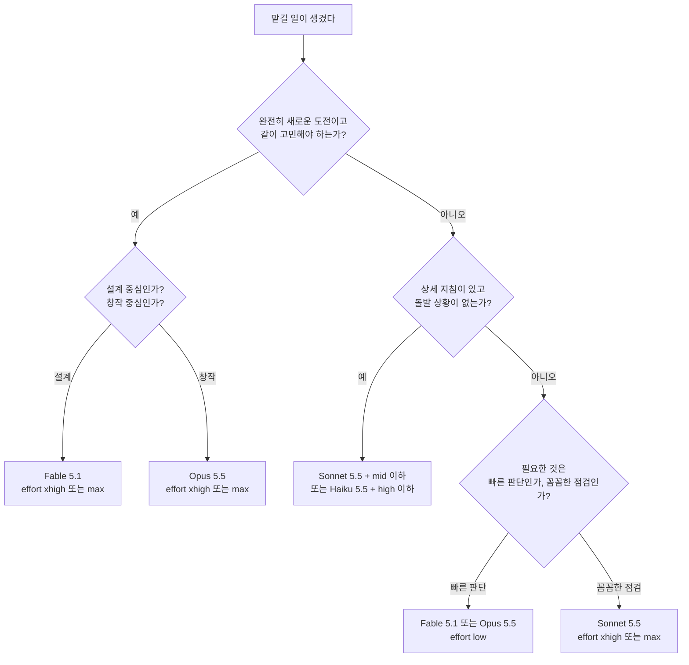
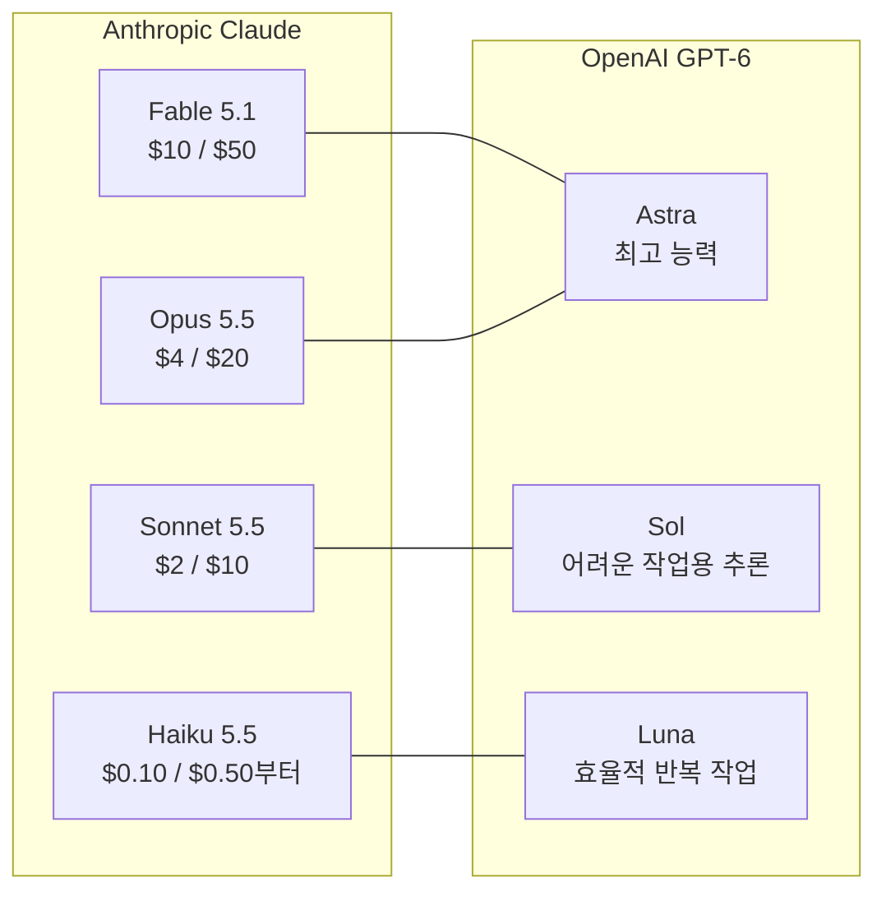
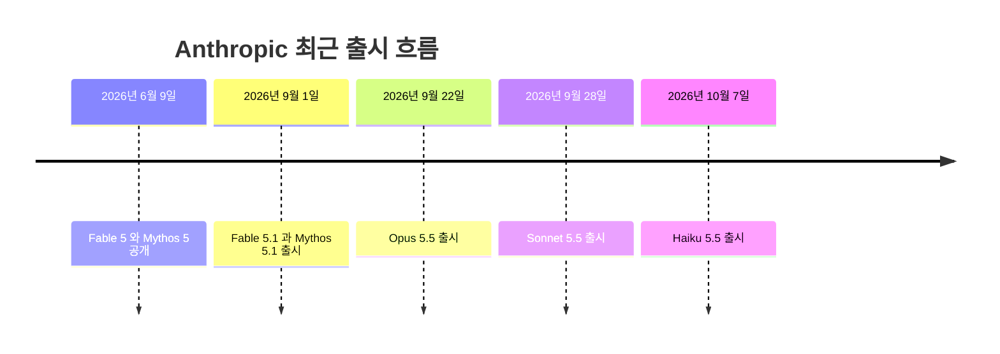

- 작성 기준일: 2026년 10월 13일
- 대상 글: X([oikon48](https://x.com/oikon48/status/2109798255542583356) 게시물 링크)와 페이스북 공유 게시물에서 소개된 "Model과 Effort 설정 기준" 글

> 
> 아 이거 넘 귀엽고 재밌네요. https://x.com/oikon48/status/2109798255542583356
> 
> Model & Effort 설정 기준과 관련해서 저 나름의 룰을 공유드리면...
> 
> Model 은 지능, Effort 는 얼마나 오래 고민/생각하느냐 이다보니...
> 
> 오래 고민해봐야 더 나은 답이 나올거로 안보이고 똘똘한 사람이 쓱 빠르게 보고 첫번에 결정한게 맞겠다 싶으면 Fable 5.1 / Opus 5.5 에 Effort low 로 설정.
> 
> 많이 똑똑할 필요는 없지만 꼼꼼하게 요모조모 체크해야할 때는 Sonnet 5.5 에 Effort xhigh / max. 
> 
> 어떻게 해야하는 지 상세지침 다 있고 돌발 상황도 없을거라서 순발력을 발휘해 고민할 일도 없을 때는 Sonnet 5.5 에 Effort mid 이하 내지는, Haiku 5.5 에 Effort high 이하.
> 
> 완전 새로운 도전이고 일 시키는 이용자도 이래저래 확정된게 별로 없어서 같이 고민해야 하고, 고민의 방향이나 종류도 다양하게 해보면서 상호 연결고리까지도 고려해야하는 경우... 설계에 집중된 태스크라면 Fable 5.1 에 Effort xhigh / max, 설계보다는 창작에 좀 더 집중되어 있다면 Opus 5.5 에 Effort xhigh / max.
> 
> 정답이라는 건 없지만 소잡는 칼을 닭잡는 데에 쓰는 건 이래저래 손해(시간, 최종 토큰 비용 모두)이고, 박사급 인재가 필요한 일을 일반 초등학생에게 맡겨봐야 일이 제대로 진행이 안되니 Model과 Effort 의 조합 운영은 AI agent 를 쓰는데에 꽤 중요한 포인트입니다.
> 
> OpenAI 에서는 Astra 가 Fable 과 Opus 언저리, Sol 이 Sonnet, Luna 가 Haiku 와 같은 티어로 보시면 되고, 사실상 Terra 는 쓸 일이 없는... Claude 5.5 패밀리가 나오면서 소위 하극상이 발생했고 타브랜드와의 비됴 구도도 좀 꼬였는데 지금 테스트중일 Fable 5.5 가 나오면 좀 정리가 될 듯하네요. 
> 
> OpenAI 는 Astra 로 민심을 잠깐 잡았는데 Opus 5.5 가 역대급 걸작 (과거 4.6 처럼)으로 나와서...
> 
> 여튼, Model 과 Effort 의 조합은 얼마나 똑똑한 AI 가 얼마나 더 많은 시간 고민하게 할 것인가로 이해하시는 것이 가장 적절하고, 시킬 일의 성격에 따라 사람한테 시킨다면 어떨까로 생각해 보시고 거의 같은 기준으로 적용해서 시키시면 보통은 잘 해냅니다.
> 
> #ai #agent #model #effort #gonnector #고넥터
> 
> https://www.facebook.com/share/p/19aEag6AYq/
> 

---

## 0. 이 문서를 읽기 전에

공유해 주신 두 링크(X, 페이스북)는 두 사이트 모두 자동 접근을 허용하지 않아 원문 페이지를 직접 열어 보지 못했습니다. 그래서 이 문서는 메시지에 붙여 주신 글의 본문을 분석 대상으로 삼았습니다. 그 본문이 말하는 모델 이름, 출시 시점, 가격, 기본 effort 값, 경쟁사 대응 관계 같은 사실관계는 Anthropic 공식 문서와 2026년 9~10월에 나온 외부 보도·분석 글을 검색해서 하나씩 대조했습니다.

문서 안에서는 세 가지를 구분해서 적었습니다. 공식 문서나 복수의 출처로 확인된 사실은 단정형으로 썼습니다. 글쓴이 개인의 경험칙이나 평가는 "글쓴이의 견해"라고 밝혔습니다. 확인되지 않은 소문은 "미확인"이라고 밝혔습니다. 근거를 찾지 못한 내용은 추측으로 메우지 않고 그대로 비워 두었습니다.

---

## 1. 한눈에 보는 요약

공유해 주신 글의 핵심 주장은 이렇습니다. AI 에이전트에게 일을 시킬 때는 모델을 "얼마나 똑똑한 사람인가"로, effort를 "그 사람이 얼마나 오래 고민하게 할 것인가"로 이해하고, 일의 성격에 따라 둘을 조합하라는 것입니다. 소를 잡는 칼로 닭을 잡으면 시간과 토큰 비용이 낭비되고, 박사급 인재가 필요한 일을 초등학생에게 맡기면 일이 진행되지 않는다는 비유가 이 주장의 뼈대입니다.

이 주장은 Anthropic 공식 문서의 방향과 잘 맞습니다. 공식 모델 선택 가이드는 effort를 조절하는 것이 모델을 바꾸는 것보다 나은 수단인 경우가 많다고 직접 말합니다. 다만 "effort는 얼마나 오래 생각하느냐"라는 설명은 직관적인 단순화입니다. 공식 문서에서 effort는 생각뿐 아니라 응답 텍스트와 도구 호출을 포함한 모든 출력 토큰에 영향을 주는 신호로 정의됩니다. 이 차이는 에이전트를 운영할 때 실제로 중요하므로 4장에서 따로 설명합니다.

글에 나오는 사실관계 중 대부분은 확인되었습니다. 확인되지 않은 것은 "지금 테스트 중인 Fable 5.5"입니다. 2026년 10월 초까지 Anthropic은 Fable 5.5라는 모델을 공식 발표하지 않았고, 이 이름은 커뮤니티의 추정과 제보에서 나온 것입니다.

---

## 2. 용어부터 정리하기

### 2.1 Model: 어떤 두뇌를 쓰는가

모델은 어떤 크기와 능력의 AI를 쓸 것인가를 정하는 선택입니다. 2026년 10월 13일 현재 Anthropic의 최신 라인업은 네 개입니다.

| 모델 | 출시일 | API 모델 ID | 가격(100만 토큰당 입력/출력) | 기본 effort(API) |
|---|---|---|---|---|
| Claude Fable 5.1 | 2026-09-01 | claude-fable-5-1 | $10 / $50 | high |
| Claude Opus 5.5 | 2026-09-22 | claude-opus-5-5 | $4 / $20 | medium |
| Claude Sonnet 5.5 | 2026-09-28 | claude-sonnet-5-5 | $2 / $10 | high |
| Claude Haiku 5.5 | 2026-10-07 | claude-haiku-5-5 | 10만 토큰 이하 $0.10 / $0.50부터 | medium |

Sonnet 5.5는 API에서는 high가 기본이지만 Claude Code와 Claude 앱에서는 medium이 기본입니다. Haiku 5.5의 가격은 요청 크기가 10만 토큰을 넘으면 달라지는 구간제이고, 위 숫자는 10만 토큰 이하 구간입니다. 참고로 이전 세대인 Haiku 4.5는 $1 / $5였습니다.

Fable 5.1은 Mythos급 모델 계열에 속하며, Anthropic 공식 문서는 이를 "모든 고객에게 열려 있는 가장 능력이 높은 모델"이라고 소개합니다. 같은 능력을 가진 Mythos 5.1은 별도 검증 프로그램을 통과한 조직에만 제공됩니다.

### 2.2 Effort: 얼마나 힘을 쏟게 할 것인가

effort는 같은 모델 안에서 지능과 속도·비용을 맞바꾸는 단일 조절 장치입니다. 공식 문서는 다섯 단계를 이렇게 설명합니다.

가장 낮은 `low`는 상당한 토큰 절약과 약간의 능력 저하를 맞바꾸는 단계로, 하위 에이전트(subagent) 같은 단순 작업에 맞습니다. `medium`은 적당한 절약과 균형을 이루는 단계입니다. `high`는 작업이 필요로 하는 만큼 토큰을 쓰는 단계로 복잡한 추론, 어려운 코딩, 에이전트 작업에 쓰입니다. `xhigh`는 30분 넘게 이어지는 장기 에이전트·코딩 작업처럼 토큰 예산이 수백만 단위인 일을 위한 단계입니다. `max`는 토큰 사용에 제약을 두지 않는 최대 능력 단계입니다.

네 모델 모두 다섯 단계를 지원합니다. Haiku 5.5는 effort 조절이 가능한 최초의 Haiku 계열 모델이라는 점이 이번 세대의 변화입니다.

---

## 3. 현재 라인업의 위치와 공식 선택 기준

Anthropic의 공식 모델 선택 가이드는 "대부분의 워크로드는 Claude Opus 5.5에서 시작한다"는 문장으로 선택 매트릭스를 엽니다. 그리고 용도별로 이렇게 안내합니다.

가장 높은 능력이 필요할 때는 Fable 5.1입니다. 몇 시간씩 도는 에이전트 세션, 여러 단계의 심층 리서치, 분석을 끝까지 밀고 가서 문서·스프레드시트·발표자료로 마무리하는 일이 예시로 나옵니다. 복잡한 에이전트형 코딩과 기업 업무에는 Opus 5.5가 맞고, 몇 시간짜리 자율 코딩 에이전트, 대규모 리팩터링, 복잡한 시스템 엔지니어링이 예시입니다. 일상적인 코딩·에이전트·기업 업무에서 속도와 능력을 함께 원할 때는 Sonnet 5.5가, 가장 낮은 지연과 가격이 필요할 때는 Haiku 5.5가 맞습니다. 실시간 애플리케이션, 대량 처리, 하위 에이전트 작업이 Haiku의 예시입니다.

가이드는 시작 방식도 두 가지로 나눕니다. 효율 우선 방식은 Haiku 5.5에서 시작해서 부족한 부분이 확인될 때만 올라가는 것이고, 능력 우선 방식은 Opus 5.5에서 시작해서 평가 결과가 허락하는 만큼 effort를 낮추거나 모델을 내려가는 것입니다. 능력 우선 방식의 마지막 단계에서는 `xhigh`나 `max` effort에서도 어려운 추론이나 장기 에이전트 작업이 부족할 때 Fable 5.1로 올라가라고 안내합니다.

이 가이드에서 가장 눈여겨볼 문장은 effort 항목에 있습니다. "effort 조정이 모델 교체보다 나은 수단인 경우가 많다"는 문장입니다. 공유해 주신 글이 모델과 effort의 "조합 운영"을 강조하는 것과 같은 방향입니다.

---

## 4. 글쓴이의 네 가지 규칙을 공식 문서와 대조하기

아래는 글쓴이가 제시한 규칙 네 가지입니다. 이 규칙들은 글쓴이 본인의 경험칙입니다. 공식 문서가 같은 규칙을 말하는 것은 아니며, 방향이 일치하는지 아닌지를 문서 근거와 함께 따져 보았습니다.

### 4.1 규칙 1: 빠르게 보고 첫 판단이 맞겠다 싶은 일은 Fable 5.1 / Opus 5.5 + low

똑똑한 사람이 쓱 보고 한 번에 결정하는 편이 나은 일, 즉 오래 고민한다고 답이 더 좋아질 것 같지 않은 일에는 큰 모델을 쓰되 effort를 낮추라는 규칙입니다.

공식 문서와 방향이 맞는 대목이 있습니다. Fable 5의 effort 설명에는 낮은 effort에서도 성능이 좋고 이전 세대 모델의 `xhigh`를 넘는 경우도 많다는 내용이 있습니다. Fable 5.1 가이드는 `high`로 시작해서, 평가 결과 품질이 유지되는 것이 확인되면 루틴하거나 지연에 민감한 작업에서 `medium`이나 `low`로 내려가라고 권합니다. 즉 큰 모델에서 effort를 낮추는 것 자체는 공식적으로도 인정되는 운용입니다. 다만 공식 문서는 "품질이 유지되는지 평가로 확인한 뒤"라는 조건을 붙입니다. 글쓴이의 규칙은 그 판단을 사람의 감(이 일은 오래 생각할 필요가 없다)으로 대신하는 것이므로, 이 점은 알고 쓰셔야 합니다.

### 4.2 규칙 2: 많이 똑똑할 필요는 없지만 꼼꼼히 체크할 일은 Sonnet 5.5 + xhigh / max

지능보다 꼼꼼함이 필요한 일에는 중간 모델에 높은 effort를 조합하라는 규칙입니다.

공식 문서는 Sonnet 5.5에 대해 `xhigh`나 `max`는 평가 결과에서 품질 향상이 확인되는 곳에만 쓰라고 안내합니다. 글쓴이의 규칙은 이 안내와 충돌하지는 않지만, "높을수록 좋다"고 읽으면 안 된다는 증거가 있습니다. Sonnet 5.5 출시를 다룬 외부 분석 글(ComputingForGeeks)에 따르면, 한 벤치마크에서 Sonnet 5.5는 `max`에서 46.2%로, `xhigh`의 52.1%보다 낮았고 Anthropic 자신의 각주에도 그렇게 적혀 있다고 합니다. 또 같은 글은 Artificial Analysis의 측정에서 `max` 설정의 Sonnet 5.5가 과제당 비용이 Sonnet 5보다 약 50% 높게 나왔다고 전합니다. Claude Opus 4.7 문서에는 `max`가 일부 작업에서 과잉 사고(overthinking)로 이어질 수 있다는 설명도 있습니다. 따라서 꼼꼼한 점검이 목적이라면 `xhigh`에서 먼저 시험해 보고, `max`는 그 위에서 이득이 확인될 때 쓰는 편이 안전합니다.

### 4.3 규칙 3: 상세 지침이 다 있고 돌발 상황이 없는 일은 Sonnet 5.5 + mid 이하, 또는 Haiku 5.5 + high 이하

절차가 완전히 정해져 있고 순발력을 발휘할 일이 없다면 싸고 빠른 쪽을 쓰라는 규칙입니다. 공식 문서와 가장 잘 맞는 규칙입니다.

Sonnet 5.5 가이드는 잘 명세된 에이전트형 코딩에는 `medium`으로 시작하고 더 어렵거나 긴 작업에서 `high`로 올라가라고 안내합니다. 채팅처럼 지연에 민감한 작업은 `medium`이나 `low`에서 시작하라고 합니다. Haiku 5.5는 `medium`이 기본이고, `low`는 채팅·짧은 도구 작업·단순 대량 요청에, `high`는 지식 업무·긴 에이전트 작업·엄격한 지시 준수가 필요한 일에 쓰라고 합니다.

여기서 하나 짚어 둘 점이 있습니다. Haiku 5.5 가이드는 긴 에이전트 프롬프트에서 `low`일 때 모델이 검색을 건너뛰거나 일찍 멈추거나 검증을 생략할 가능성이 높아진다고 경고합니다. 글쓴이의 "high 이하"라는 표현은 맞지만, 지침이 길고 검증 단계가 중요한 작업이라면 `low`까지 내리는 것은 공식 경고와 부딪힙니다.

Haiku가 Sonnet을 완전히 대체하지 못한다는 점도 데이터로 확인됩니다. 외부 분석(LaoZhang 블로그가 Artificial Analysis 수치를 인용)에 따르면 같은 effort에서 Haiku 5.5는 과제당 비용이 Sonnet 5.5보다 약 10~26배 저렴하고 점수는 7~13점 낮으며, Anthropic이 공개한 8개 벤치마크에서는 Sonnet 5.5가 모두 앞섰다고 합니다. 즉 "정해진 일을 싸게"에는 Haiku가 맞지만, 판단이 조금이라도 필요한 일에는 Sonnet이 안전합니다.

### 4.4 규칙 4: 완전히 새롭고 같이 고민해야 하는 일은 설계면 Fable 5.1 + xhigh / max, 창작이면 Opus 5.5 + xhigh / max

요구사항이 확정되지 않았고 사용자와 에이전트가 함께 방향을 잡아야 하는 일에는 가장 강한 모델에 높은 effort를 쓰라는 규칙입니다. 설계 중심이면 Fable, 창작 중심이면 Opus로 나눈 부분이 글쓴이 고유의 구분입니다.

공식 문서는 Fable 5.1을 몇 시간씩 도는 에이전트 세션과 다단계 심층 리서치에 맞는 모델로 소개하므로, 어렵고 긴 설계형 작업에 Fable을 쓴다는 방향은 공식 안내와 일치합니다. 반면 "창작에는 Opus"라는 구분을 뒷받침하는 공식 문서는 찾지 못했습니다. 다만 외부 평가에서 Opus 5.5의 글쓰기에 대한 반응은 있습니다. Anthropic은 Opus 5.5가 이전 모델보다 자연스럽게 소통한다고 밝혔고, Hacker News의 한 사용자는 Claude Opus 5 / Fable의 글쓰기 문체 때문에 Astra로 옮겨 갔다며 Opus 5.5가 이 점을 개선했는지 시험해 보겠다고 썼습니다. 이는 개별 사용자의 체감이므로, 글쓴이의 Opus 선호는 견해로 분류하는 것이 맞습니다.

effort 면에서 한 가지 덧붙입니다. Opus 5.5의 기본 effort는 `medium`이고, 공식 문서는 Opus 5에서 effort 값을 그대로 옮겨 오지 말고 새로 실험하라고 권합니다. Opus 5.5의 `xhigh`·`max`가 Opus 5의 같은 이름 단계와 같은 양의 생각을 뜻하지는 않기 때문입니다.

---

## 5. 조합을 고르는 흐름

글쓴이의 네 규칙을 질문 순서로 재구성하면 아래와 같습니다. 이 순서도는 글쓴이의 규칙을 정리한 것이며 공식 문서의 의사결정 트리가 아닙니다.

이 구조를 두 축으로 읽으면 이해가 쉽습니다. 한 축은 "일이 요구하는 지능의 크기"이고 다른 축은 "일이 요구하는 숙고의 양"입니다. 지능이 많이 필요하고 숙고는 적게 필요하면 큰 모델에 낮은 effort, 지능은 적게 필요하고 숙고가 많이 필요하면 중간 모델에 높은 effort, 둘 다 많이 필요하면 큰 모델에 높은 effort, 둘 다 적게 필요하면 작은 모델에 낮거나 중간인 effort를 씁니다. 글쓴이가 "사람에게 시킨다면 어떨까로 생각해 보라"고 한 것은 이 두 축을 사람 비유로 옮긴 것입니다. 뛰어난 선배가 한눈에 판단하는 일, 성실한 신입이 하나하나 점검하는 일, 매뉴얼대로 처리하는 일, 전문가 여럿이 머리를 맞대는 일이 각각 네 칸에 대응합니다.

---

## 6. effort를 "오래 고민"으로만 이해하면 놓치는 것

글쓴이의 정의는 직관적이고 실용적입니다. 다만 공식 문서의 정의는 조금 더 넓습니다.

공식 문서에 따르면 effort는 응답 텍스트와 설명, 도구 호출과 그 인자, 생각(thinking)이 켜져 있을 때의 생각까지 모든 출력 토큰에 영향을 줍니다. 또한 effort는 엄격한 토큰 예산이 아니라 행동 신호입니다. 낮은 effort에서도 충분히 어려운 문제에는 모델이 여전히 생각하지만, 같은 문제에 대해 높은 effort보다 덜 생각한다고 설명합니다.

에이전트 작업에서는 이 차이가 눈에 보이게 나타납니다. 공식 문서는 낮은 effort일 때 모델이 여러 작업을 더 적은 도구 호출로 묶고, 도구 호출 횟수 자체를 줄이고, 서문 없이 바로 행동하고, 완료 후 간결하게 확인만 하는 경향이 있다고 설명합니다. 반대로 높은 effort에서는 도구 호출이 늘고, 행동 전에 계획을 설명하고, 변경 사항을 상세히 요약하고, 코드 주석도 더 충실히 단다고 합니다. 즉 effort는 "생각 시간"이자 "얼마나 꼼꼼히 확인하며 움직이는가"이기도 합니다. 규칙 2에서 "꼼꼼하게 요모조모 체크할 일에 높은 effort"를 쓰는 것이 합리적인 이유가 여기에 있습니다.

비용 면에서도 effort는 크게 작용합니다. 한 외부 글(Chris Alarcon)에 따르면 Claude 데스크톱 앱의 effort 메뉴에서 Max에는 "4배 이상의 사용량"이라는 경고가 붙어 있었다고 합니다. 그러므로 `max`는 습관적으로 켜 두는 설정이 아닙니다.

마지막으로 운영상의 주의점이 하나 있습니다. 같은 대화 안에서 top-level effort 값을 중간에 바꾸면 프롬프트 캐시가 무효화됩니다. Fable 5.1, Mythos 5.1, Opus 5.5, Opus 5, Sonnet 5.5, Haiku 5.5는 "메시지별 effort 변경"(베타 기능)을 지원하며, 이 방식은 캐시를 보존합니다. 한 작업 안에서 어려운 구간은 높게, 단순한 구간은 낮게 바꾸고 싶다면 이 기능이 정답입니다.

---

## 7. "하극상"과 Opus 5.5

글에서 "Claude 5.5 패밀리가 나오면서 하극상이 발생했다"는 대목은 사실관계로 뒷받침됩니다. 하극상이란 하위 모델이 상위 모델을 앞지른다는 뜻입니다.

Fable 5.1은 2026년 9월 1일에, Opus 5.5는 3주 뒤인 9월 22일에 나왔습니다. Anthropic은 Opus 5.5가 대부분의 작업에서 Fable 5.1과 같은 수준으로 수행되며 토큰당 가격은 60% 저렴하다고 밝혔습니다. 발표 시점의 벤치마크 표(제조사 보고, 외부 정리본 기준)에서 Opus 5.5는 Terminal-Bench 4.0에서 66.4% 대 55.8%(Opus는 xhigh), CursorBench 4.0에서 57.8% 대 51.8%(Opus는 max), GDPval-AA에서 1846 대 1735 Elo(Opus는 max)로 Fable 5.1을 앞섰다고 정리됩니다.

몇 가지 단서를 함께 적어 둡니다. 첫째, 이 수치는 제조사가 보고한 것이고 Opus는 높은 effort로 측정되었습니다. 둘째, Anthropic 자신이 "실제 사용에서는 Opus 5.5와 Fable 5.1의 격차가 점수가 시사하는 것보다 좁다"고 밝혔습니다. 셋째, Anthropic의 선택 가이드는 여전히 Fable 5.1을 "가장 능력이 높은 모델"로 부르며, 어려운 추론이나 장기 에이전트 작업에서 Opus의 `xhigh`·`max`가 부족할 때의 상위 선택지로 남겨 두었습니다. 따라서 "Fable이 쓸모없어졌다"는 아니고 "Fable로 올라가야 하는 경우가 좁아졌다"에 가깝습니다. 넷째, 글에서 Opus 5.5를 "과거 4.6처럼 역대급 걸작"이라고 부른 부분은 글쓴이의 평가이며, 이 문서에서 검증할 수 있는 사실은 위의 벤치마크 비교까지입니다.

요금제 면에서도 선택이 달라집니다. 외부 글(Chris Alarcon, Anthropic 요금 페이지 인용)에 따르면 Pro 요금제에서 Opus는 플랜 한도 안에 포함되지만 Fable 5.1은 사용 크레딧으로 과금되고, Max에서는 Fable이 주간 한도의 최대 50%까지 쓸 수 있습니다. 구독으로 쓰는 사용자에게는 이 조건도 모델 선택에 영향을 줍니다.

---

## 8. OpenAI와의 대응 관계

글은 OpenAI에서 Astra가 Fable과 Opus 언저리, Sol이 Sonnet, Luna가 Haiku에 해당하고 Terra는 쓸 일이 없다고 설명합니다.

OpenAI GPT-6 계열의 구성은 이렇게 확인됩니다. OpenRouter 문서에 따르면 GPT-6는 세 개 티어로 나오며 각각 pro 변형이 있습니다. 가장 높은 능력의 Astra, 까다로운 작업에 강한 추론을 제공하는 Sol, 규모 있는 반복 작업에 효율적인 Luna입니다. 외부 분석(Respan)에 따르면 Sol과 Luna는 9월 22일에 나왔고 Astra는 같은 달 초에 먼저 나왔으며, 가격은 모든 항목에서 Astra가 Sol의 5배, Sol이 Luna의 20배입니다.

Terra는 GPT-6가 아니라 그 앞 세대인 GPT-5.6(2026년 7월 9일 출시)의 중간 티어였습니다. GPT-5.6에서는 Sol이 플래그십, Terra가 균형형, Luna가 경량형이었습니다. GPT-6에서는 Astra가 Sol 위에 새로 놓였고 Terra가 라인업에 없기 때문에, 글의 "Terra는 쓸 일이 없다"는 말은 GPT-6 계열 안에서는 구조적으로 맞습니다. 다만 GPT-5.6 Terra 모델 자체가 사라진 것은 아닙니다.

이 대응 관계가 글쓴이만의 분류인지도 확인해 봤습니다. 비교 표를 보면 업계의 짝짓기와 크게 다르지 않습니다. Opus 5.5 발표의 벤치마크 표에는 GPT-6 Astra가 비교 대상으로 올라 있고(Chris Alarcon에 따르면 Astra가 AutomationBench와 Terminal-Bench-Science 두 항목에서 앞섰습니다), Sonnet 5.5 정리 글의 표에는 GPT-6 Sol이, Haiku 5.5 정리 글의 표에는 GPT-6 Luna가 비교 대상으로 들어 있습니다. 가격 위계도 Anthropic 쪽과 닮았습니다. 다만 같은 급이라는 것은 포지셔닝의 대응이지 성능이 같다는 뜻은 아닙니다.

선은 "포지셔닝이 대응한다"는 뜻이며 동등한 성능을 뜻하지 않습니다.

---

## 9. Fable 5.5에 대해 확인된 것과 확인되지 않은 것

글에는 "지금 테스트 중일 Fable 5.5가 나오면 좀 정리가 될 듯하다"는 대목이 있습니다.

검색으로 확인한 현재 상태는 이렇습니다. Anthropic은 Fable 5.5라는 이름의 모델을 공식 발표한 적이 없습니다. 2026년 10월 7일에 모델 문서와 요금표 등을 점검한 외부 글들도 Fable 5.5의 모델 ID, 가격, 시스템 카드, 문서 항목이 없다고 보고합니다. 공식 모델 디렉터리에는 Fable 5.1이 최신 Fable로 올라 있습니다.

그럼에도 소문은 있습니다. 일부 사용자가 Fable 5.1을 선택했는데 더 새로운 모델이 응답하는 것 같다고 주장하고, 10월 5일에는 Claude Code가 고정된 버전이 아니라 "롤링 Fable" 선택을 저장한다는 제보가 있었으며, 이를 테스트의 가능한 징후로 해석하는 글도 있었습니다. 그러나 이 모두는 Anthropic이 확인하지 않은 주장입니다. 비공개 테스트가 불가능하다는 증거가 없는 만큼 가능성을 배제할 수도 없지만, 공식 사실로 쓸 수도 없다는 것이 정확한 정리입니다. 한 외부 글은 9월 22일 발표 문구가 Sonnet 5.5와 Haiku 5.5가 곧 나온다고만 하고 Fable을 언급하지 않았다고 짚었고, 실제로 Sonnet 5.5와 Haiku 5.5가 이후 출시되었습니다.

Fable 5에서 5.1까지는 84일이 걸렸다고 외부 글(CellCog)이 계산했습니다. 이 간격으로 다음 출시를 예측할 수는 있겠지만, 그것은 추측이므로 이 문서에서는 예측하지 않습니다.

---

## 10. 실전 적용 요령

앞의 내용을 바탕으로 실제 운영에서 쓸 수 있는 요령을 정리합니다. 아래의 1~3은 공식 문서에 근거한 것이고, 4는 글쓴이의 비유를 운영 원칙으로 옮긴 것입니다.

첫째, 처음부터 정답을 고르려 하지 말고 평가로 확인하십시오. 공식 가이드는 일관되게 "자신의 평가 세트로 effort를 훑어보라(effort sweep)"고 말합니다. 특히 Opus 5.5와 Sonnet 5.5는 이전 세대와 effort 눈금의 의미가 재조정되었으므로 이전 설정을 그대로 가져오면 안 됩니다. 글쓴이의 규칙은 출발점으로는 훌륭하지만 정답표는 아닙니다. 글쓴이 스스로도 "정답이라는 건 없다"고 썼습니다.

둘째, 기본값을 알고 시작하십시오. Opus 5.5와 Haiku 5.5는 `medium`, Fable 5.1은 `high`, Sonnet 5.5는 API에서 `high`이고 Claude Code와 앱에서는 `medium`입니다. 기본값으로 아무 설정 없이 호출하면 "그 모델의 기본 균형점"에서 일하게 됩니다. 규칙 1처럼 `low`로 내리거나 규칙 4처럼 `xhigh`·`max`로 올리는 것은 이 기본값에서 의도적으로 벗어나는 선택입니다.

셋째, 높은 effort에서는 출력 한도를 넉넉하게 잡으십시오. 공식 문서는 `high` 이상에서 `max_tokens`를 크게 설정하라고 안내합니다. 생각과 응답 텍스트가 모두 이 한도에 포함되기 때문입니다.

넷째, 일을 사람에게 시킨다고 상상해 보십시오. 이 일이 한 번 훑어보고 결정하면 되는 일인지, 체크리스트를 하나씩 확인해야 하는 일인지, 매뉴얼대로 하면 되는 일인지, 아직 정답이 없어서 같이 고민해야 하는 일인지를 먼저 분류하면 모델과 effort의 조합은 대체로 자연스럽게 따라옵니다.

---

## 11. 정리: 확인된 사실과 견해의 구분

확인된 사실로 쓸 수 있는 것은 다음과 같습니다. Fable 5.1, Opus 5.5, Sonnet 5.5, Haiku 5.5의 출시일과 모델 ID·가격·기본 effort, effort 다섯 단계의 공식 정의와 모델별 권장 시작점, "대부분의 워크로드는 Opus 5.5에서 시작한다"는 공식 선택 가이드, effort가 텍스트·도구 호출·생각 모두에 영향을 준다는 점, GPT-6의 Astra·Sol·Luna 3티어 구성과 Terra가 GPT-5.6의 티어라는 점, 그리고 Anthropic이 Fable 5.5를 공식 발표하지 않았다는 점입니다.

글쓴이의 견해로 분류할 것은 다음과 같습니다. 구체적인 모델·effort 조합 규칙 네 가지, 설계는 Fable이고 창작은 Opus라는 구분, Opus 5.5가 역대급 걸작이라는 평가, OpenAI가 Astra로 민심을 잠깐 잡았다는 진단입니다. 이 견해들은 공식 문서와 방향이 맞는 부분이 많지만, 그 자체가 검증된 사실은 아닙니다.

미확인으로 남은 것은 Fable 5.5의 테스트 여부와 출시 시점입니다.

---

## 출처

공식 문서는 다음과 같습니다.

- Claude Platform Docs, "Choosing the right model" — https://platform.claude.com/docs/en/about-claude/models/choosing-a-model
- Claude Platform Docs, "Effort" — https://platform.claude.com/docs/en/build-with-claude/effort
- OpenRouter 문서, "GPT-6 Migration Guide" — https://openrouter.ai/docs/cookbook/evaluate-and-optimize/model-migrations/gpt-6.md
- OpenClaw 문서, OpenAI 모델 참조 — https://docs.openclaw.ai/providers/openai/models.md

외부 보도와 분석 글은 다음과 같습니다.

- Chris Alarcon, "Claude Opus 5.5 vs Fable 5.1: Which One to Use Now, and Which Plan Gets It" (2026-09-22) — https://christopheralarcon.com/blog/claude-opus-5-5-vs-fable/
- TechJack Solutions, "Claude Opus 5.5 vs Claude Fable 5.1" — https://techjacksolutions.com/?p=89312
- AI IDE List, Claude Opus 5.5와 Fable 5.1 비교 (2026-09-25 확인) — https://aiidelist.com/zh/models/compare/claude-opus-5-5-vs-claude-fable-5-1
- ComputingForGeeks, "What is new in Claude Sonnet 5.5" — https://computingforgeeks.com/?p=172199
- gori.me, Claude Sonnet 5.5 발표 기사 — https://gori.me/?p=170776
- braindetox.kr, "Claude Haiku 5.5 가격표 읽기" — https://braindetox.kr/posts/claude_haiku_5_5_release_pricing_2026.html
- 9to5Mac 계열 보도(LetsDataScience 재게재), Haiku 5.5 출시 — https://letsdatascience.com/news/anthropic-releases-claude-haiku-55-with-lower-prices-and-eff-f698c663
- AICatchup, Haiku 5.5 출시 정리 — https://aicatchup.com/news/claude-haiku-5-5
- LaoZhang 블로그, Haiku 5.5와 Sonnet 5.5 비교 — https://blog.laozhang.ai/zh/posts/claude-haiku-5-5-vs-sonnet-5-5
- Respan, "GPT-6 Sol vs Luna vs Astra" — https://www.respan.ai/articles/gpt-6-sol-vs-luna-vs-astra
- APIYI 문서, "GPT-5.6 Series Launch: Sol, Terra and Luna" — https://docs.apiyi.com/en/news/gpt-5-6-launch.md
- Kingy AI, "Claude Fable 5.5: Hidden rollout claims remain unverified" — https://kingy.ai/blog/claude-fable-5-5/
- Emergent, "Claude Fable 5.5 Release Date: What's Actually Confirmed" (2026-10-05 기준) — https://emergent.sh/news/claude-fable-5-5-release-date
- CellCog, "Fable 5.5 Release Date: Rumors, the Renaming, the Facts" — https://cellcog.ai/blog/fable-5-5-release-date/
- Wikipedia, "Claude Mythos" — https://en.wikipedia.org/wiki/Claude_Mythos
