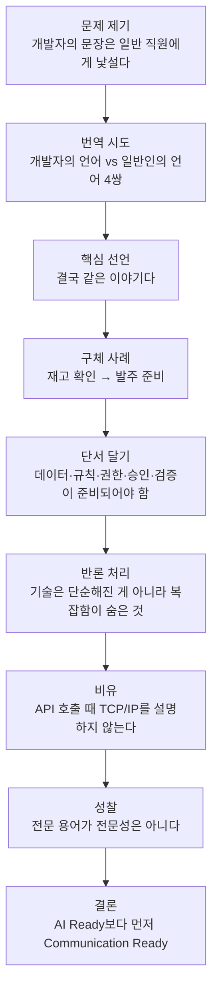
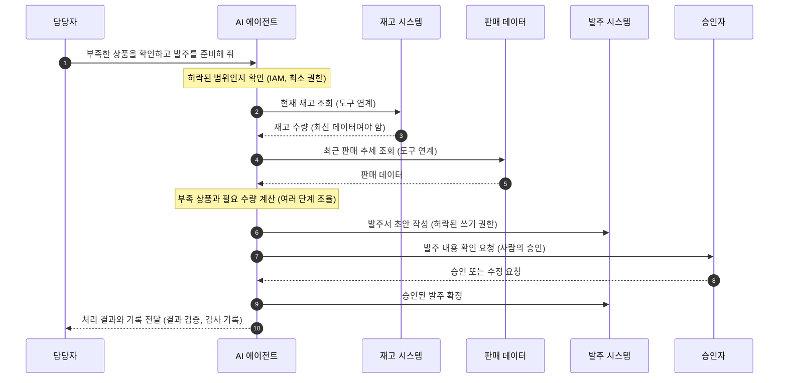

> 이 문서는 짧은 단상 한 편을 문장 단위로 풀어 읽고, 글에 등장하는 핵심 용어(AI Ready, 오케스트레이션, 업무 도구 연계, IAM·거버넌스, 사람의 승인)가 2026년 10월 현재 실제로 어떤 의미와 흐름을 갖는지 최신 자료로 확인해 덧붙인 해설서입니다. 확인되지 않은 내용은 넣지 않았고, 출처가 2차 자료인 경우에는 본문에 그렇게 밝혔습니다.

```
단상 

기술을 아는 것과 설명할 수 있는 것은 다르다

개발자들과 이야기하다 보면 어려운 용어가 너무나 자연스럽게 나온다.

“에이전트는 AI Ready 조건을 충족한 운영환경의 데이터를 오케스트레이션해야 합니다.”

개발자 입장에서는 꽤 그럴듯한 문장이다. 😄

그런데 일반 직원에게 이렇게 이야기하면 어떨까?

AI Ready가 뭔지, 오케스트레이션은 또 뭔지, 그래서 무엇이 좋아진다는 건지 설명이 필요하다.

같은 내용을 조금 다르게 표현해 보았다.

개발자의 언어
- AI Ready 환경을 구축한다.
- 운영 데이터와 업무 도구를 연계한다.
- 에이전트가 워크플로우를 오케스트레이션한다.
- IAM과 거버넌스로 실행을 통제한다.

일반인의 언어
- AI도 회사에서 일할 수 있게 준비한다.
- AI가 필요한 정보를 찾고 시스템을 사용할 수 있게 한다.
- 여러 단계의 일을 AI가 순서대로 처리한다.
- 허락받은 일만 하고 중요한 결정은 사람에게 확인받는다.

결국 같은 이야기다.

예전에는 사람이 재고 시스템을 열고, 판매 데이터를 확인하고, 발주 시스템에 입력했다.

이제는 AI에게 “부족한 상품을 확인하고 발주를 준비해 줘”라고 요청할 수 있는 환경을 만드는 것이다.

물론 최신 데이터, 업무 규칙, 접근 권한, 승인 절차, 결과 검증이 준비되어 있어야 한다.

기술은 단순해진 것이 아니다.

오히려 보이지 않는 곳에서는 더 복잡한 기술이 움직인다.

다만 그 복잡함을 사용자가 모두 이해할 필요는 없다.

생각해 보면 우리가 API를 호출할 때마다 TCP/IP부터 설명하지 않는 것과 비슷하다.

요즘 나 역시 기술을 이해하는 것과 기술을 쉽게 설명하는 것은 전혀 다른 역량이라는 생각이 든다.

전문 용어를 많이 사용하는 것이 전문성은 아니다.

어려운 기술을 쉽게 설명할 수 있을 때, 비로소 기술이 현업의 언어가 된다.

그리고 AI 시대의 개발자에게 필요한 역량도 하나 더 늘어난 것 같다.

코드를 잘 작성하는 능력뿐 아니라, 기술을 사람의 일과 연결해 설명하는 능력.

어쩌면 AI Ready보다 먼저 필요한 것은 우리의 Communication Ready인지도 모르겠다. ☕

#데리언의단상 #AIReady #AIAgent #SoftwareEngineering #DigitalTransformation

https://www.facebook.com/share/p/1M3y3LHBwi/

```

---

## 1. 한눈에 보는 요약

이 글은 "기술을 깊이 아는 사람이, 그 기술을 모르는 사람의 말로 설명하는 일은 별개의 능력"이라는 이야기입니다. 글쓴이는 개발자들이 쓰는 문장 하나를 먼저 보여 줍니다. "에이전트는 AI Ready 조건을 충족한 운영환경의 데이터를 오케스트레이션해야 합니다." 개발자에게는 자연스럽지만, 일반 직원에게는 AI Ready가 무엇인지, 오케스트레이션이 무엇인지, 그래서 내 일이 어떻게 달라지는지가 한 번에 전달되지 않습니다.

그래서 글쓴이는 같은 내용을 두 가지 언어로 나란히 적습니다. 하나는 개발자의 언어, 다른 하나는 일반인의 언어입니다. 결론은 분명합니다. 두 문장 묶음은 같은 이야기를 하고 있고, 기술이 단순해진 것이 아니라 복잡함이 보이지 않는 곳으로 내려갔을 뿐이며, 사용자는 그 복잡함을 전부 알 필요가 없다는 것입니다. 마지막으로 글쓴이는 AI 시대 개발자에게 필요한 역량이 하나 늘었다고 말합니다. 코드를 잘 쓰는 능력에 더해, 기술을 사람의 일과 연결해 설명하는 능력입니다. 그리고 "AI Ready보다 먼저 필요한 것은 Communication Ready인지도 모르겠다"는 재치 있는 문장으로 마무리합니다.

---

## 2. 글의 구조 한눈에 보기

글은 문제 제기에서 시작해 번역, 사례, 반론 처리, 성찰, 결론으로 흘러갑니다. 아래 도표는 그 흐름을 정리한 것입니다.



이 구조에서 눈여겨볼 곳은 다섯 번째 단계입니다. 글쓴이는 "쉽게 설명한다"는 말이 "대충 설명한다"로 오해받지 않도록, 쉬운 말 뒤에 실제로 필요한 조건들(최신 데이터, 업무 규칙, 접근 권한, 승인 절차, 결과 검증)을 한 문장으로 짚어 둡니다. 쉽게 말하되 거짓 없이 말하겠다는 태도가 이 한 문장에 담겨 있습니다.

---

## 3. 도입부 읽기: 왜 이 문장은 어려운가

도입부의 예시 문장은 "에이전트는 AI Ready 조건을 충족한 운영환경의 데이터를 오케스트레이션해야 합니다"입니다. 이 한 문장 안에는 일반 직원이 막히는 지점이 네 군데 있습니다.

첫째는 **에이전트**입니다. 질문에 답만 하는 챗봇이 아니라, 목표를 받으면 여러 단계를 스스로 계획하고 도구를 써서 실행하는 AI를 가리킵니다. 둘째는 **AI Ready**입니다. 문자 그대로는 "AI가 쓸 준비가 되었다"는 뜻인데, 무엇이 준비되었다는 것인지가 빠져 있습니다. 셋째는 **운영환경**입니다. 시험용이 아니라 실제 업무가 돌아가는 시스템을 뜻합니다. 넷째는 **오케스트레이션**입니다. 악단의 지휘처럼 여러 부분이 순서와 박자를 맞추도록 조율한다는 뜻의 비유 표현입니다.

개발자에게는 이 네 단어가 하나의 그림으로 바로 연결되지만, 그림을 공유하지 않는 사람에게는 단어 네 개가 벽 네 개로 보입니다. 글쓴이가 문제 삼는 것은 용어 자체가 아니라, 그림이 공유되지 않은 상태에서 용어만 전달되는 상황입니다.

---

## 4. 번역표 해설: 네 쌍의 문장을 하나씩 풀기

글쓴이가 제시한 번역표는 다음과 같습니다.

| 개발자의 언어 | 일반인의 언어 |
|---|---|
| AI Ready 환경을 구축한다 | AI도 회사에서 일할 수 있게 준비한다 |
| 운영 데이터와 업무 도구를 연계한다 | AI가 필요한 정보를 찾고 시스템을 사용할 수 있게 한다 |
| 에이전트가 워크플로우를 오케스트레이션한다 | 여러 단계의 일을 AI가 순서대로 처리한다 |
| IAM과 거버넌스로 실행을 통제한다 | 허락받은 일만 하고 중요한 결정은 사람에게 확인받는다 |

이 네 줄은 서로 독립된 항목이 아니라, AI가 회사에서 일하기 위해 갖춰야 할 네 가지 조건에 해당합니다. 아래에서 각각을 풀고, 2026년 현재 실제 업계와 제도에서 어떤 움직임이 있는지 함께 확인합니다.

### 4-1. "AI도 회사에서 일할 수 있게 준비한다" — AI Ready

**쉬운 설명.** 새 직원이 입사하면 사번과 메일 계정이 나오고, 업무 매뉴얼과 자료 위치를 안내받아야 일을 시작할 수 있습니다. AI도 마찬가지입니다. 회사 안의 자료가 정리되어 있고, 어디에 무엇이 있는지 찾을 수 있고, 믿을 만한 최신 상태여야 AI가 제대로 일합니다. 자료가 낡았거나 부서마다 제각각이면 AI는 그 낡고 제각각인 자료를 근거로 그럴듯하지만 틀린 결과를 빠르게 대량으로 만들어 냅니다.

**업계의 정의.** 데이터 업계 자료는 AI-ready data를 "통합되고, 정제되고, 구조화되고, 통제되고, 찾을 수 있도록 만들어져서 AI 시스템이 사람의 중개 없이도 안정적으로 쓸 수 있는 기업 데이터"로 설명합니다. 이 설명은 2026년에 정의가 넓어졌다고 덧붙입니다. 예전에는 데이터 과학자가 쓰는 데이터를 뜻했지만, 이제는 예측 모델, 생성형 AI, 그리고 실행 중에 데이터를 스스로 찾아 호출하는 AI 에이전트까지 포괄한다는 것입니다. 이 정의는 데이터 통합 업체 Nexla의 글에 따른 것으로, 업체가 내놓은 해설이라는 점은 감안해서 읽어야 합니다.

**왜 중요한가.** 시장조사 기관 Gartner는 2025년 2월 자사 보도자료에서 2026년까지 AI-ready 데이터의 뒷받침이 없는 AI 프로젝트의 60%를 기업들이 포기할 것이라고 예측했습니다. 같은 자료와 이를 인용한 여러 글은 Gartner 조사에서 조직의 63%가 AI에 맞는 데이터 관리 방식을 갖추지 못했거나 갖췄는지 확신하지 못한다고 답했다고 전합니다. 또 Gartner는 2026년 8월 25일자 "Foundations of AI-Ready Data"라는 요약문에서 AI-ready 데이터는 한 번의 데이터 준비 작업으로 달성될 수 없다고 밝혔습니다. 글쓴이가 마지막에 단서로 붙인 "최신 데이터"라는 표현이 단순한 수사가 아니라는 점을 뒷받침하는 대목입니다. 한 번 정리해 두면 끝나는 일이 아니라, 계속 관리해야 하는 일이라는 뜻입니다.

### 4-2. "AI가 필요한 정보를 찾고 시스템을 사용할 수 있게 한다" — 데이터·도구 연계

**쉬운 설명.** 아무리 똑똑한 직원도 재고 시스템에 로그인할 방법이 없으면 재고를 확인할 수 없습니다. AI도 회사의 시스템에 "연결되는 통로"가 있어야 정보를 찾고 도구를 쓸 수 있습니다. 예전에는 AI 앱과 시스템을 하나씩 따로 이어 붙여야 했는데, 이 연결 방식을 공통 규격으로 만들자는 흐름이 최근 몇 년 사이에 크게 진행되었습니다.

**공통 규격, MCP.** 그 대표 사례가 Model Context Protocol, 줄여서 MCP입니다. Anthropic이 2024년 11월 25일 공개했고, 한 용어 해설 자료는 이를 AI 애플리케이션이 외부 도구, 데이터 원천, 프롬프트 템플릿과 연결되는 방식을 표준화한 개방형 프로토콜로 설명합니다. 2025년 12월 9일 Anthropic은 MCP를 Linux Foundation 산하의 Agentic AI Foundation(AAIF)에 기부했습니다. Anthropic 공식 발표에 따르면 AAIF는 Anthropic, Block, OpenAI가 공동 설립했고 Google, Microsoft, AWS, Cloudflare, Bloomberg가 지원합니다. 규모를 보여 주는 수치도 있습니다. 2026년 3월 25일 Anthropic이 월간 SDK 다운로드 9,700만 건을 넘었다고 알렸다는 보도가 있고, 2026년 7월 28일에는 프로토콜 수준의 세션 추적을 없애 상태를 갖지 않는(stateless) 구조로 바꾼, 출시 이래 가장 큰 규격 개정이 있었다고 위키백과와 용어 해설 자료가 전합니다.

여기서 글쓴이의 비유가 다시 의미를 갖습니다. MCP는 AI가 도구와 대화하는 "공통 콘센트"에 가깝습니다. 일반 직원이 콘센트 내부 배선을 알 필요가 없듯, "AI가 시스템을 쓸 수 있게 해 둔다"는 말만 이해하면 충분합니다.

**아직 남은 숙제.** 다만 연결이 쉬워졌다고 안전해진 것은 아닙니다. MCP 생태계를 정리한 한 글은 인증과 권한 부여, 즉 누가 무엇을 할 수 있는지에 관한 세밀한 통제가 기업 환경에서 MCP의 가장 큰 공백으로 꼽힌다고 전합니다. 이 숙제는 바로 다음 4-4에서 다루는 IAM과 거버넌스의 영역으로 이어집니다.

### 4-3. "여러 단계의 일을 AI가 순서대로 처리한다" — 오케스트레이션

**쉬운 설명.** 오케스트라에서 지휘자는 악기를 직접 연주하지 않습니다. 누가 언제 들어가야 하는지, 지금 어디까지 진행되었는지를 관리합니다. 업무에서도 한 가지 일이 "재고 조회 → 판매 추세 확인 → 부족 수량 계산 → 발주서 작성"처럼 여러 단계로 이어질 때, 각 단계를 맡은 AI나 도구를 순서에 맞게 부르고 그 결과를 다음 단계로 넘기는 역할이 오케스트레이션입니다.

**업계의 정의.** 에이전트 플랫폼 업체들의 2026년 5월 해설은 이를 어떤 에이전트나 도구가 요청의 각 단계를 맡을지 정하고, 전문 에이전트 사이의 인수인계를 관리하고, 여러 단계에 걸친 상태를 추적하는 조율 계층으로 설명합니다. 또 하나의 AI가 질문에 답하는 정도라면 오케스트레이션이 필요 없지만, 여러 에이전트가 협력해 복잡한 일을 처리할 때는 어느 에이전트가 무엇을 맡을지, 언제 협업할지, 언제 사람의 검토가 필요한지를 오케스트레이터가 결정한다고 설명합니다. 마지막 대목, 즉 "언제 사람의 검토가 필요한지"가 오케스트레이션의 정의 안에 이미 들어 있다는 점이 글쓴이의 네 번째 번역 문장과 맞닿아 있습니다.

**규모감.** 시장 전망도 확인됩니다. Gartner는 2026년 말까지 기업용 애플리케이션의 40%가 특정 업무용 AI 에이전트를 내장할 것이라고, 2025년의 5% 미만에서 크게 늘어난다고 예측했다는 점이 여러 2차 자료에 인용되어 있습니다. 다만 이것은 예측치이며, 실제 도입률은 별도로 확인해야 합니다. 한편 같은 Gartner는 반대편의 경고도 내놓았습니다. 2027년 말까지 에이전틱 AI 프로젝트의 40% 넘게가 비용 증가, 불분명한 사업 가치, 부족한 위험 통제 때문에 취소될 것이라는 예측입니다. 기대와 경고가 함께 존재한다는 사실은, 이 분야에서 "쉽게 설명하는 능력"이 단순한 편의가 아니라 프로젝트의 성패를 좌우하는 요소라는 점을 보여 줍니다. 현업이 무엇을 기대할 수 있고 무엇은 아직 어려운지를 공유하지 못하면, 기대와 현실의 격차가 곧 취소 사유가 되기 때문입니다.

### 4-4. "허락받은 일만 하고 중요한 결정은 사람에게 확인받는다" — IAM, 거버넌스, 사람의 승인

네 문장 가운데 가장 중요하고, 최근 1년 사이 움직임이 가장 두드러진 부분입니다.

**쉬운 설명.** 회사에는 직원마다 열 수 있는 문이 정해져 있습니다. 신입사원이 재무 금고를 열 수는 없고, 거액의 결제는 팀장 결재를 받아야 합니다. IAM(Identity and Access Management, 신원·접근 관리)은 "누가 누구이며 무엇을 할 수 있는가"를 정하는 장치이고, 거버넌스는 그 규칙을 정하고 지켜지는지 감시하는 체계입니다. AI에게도 똑같은 원칙을 적용하자는 것입니다. 글쓴이가 쓴 "허락받은 일만 하고 중요한 결정은 사람에게 확인받는다"는 문장은 이 두 가지, 즉 최소 권한과 사람의 승인을 일상어로 옮긴 것입니다.

**왜 AI에게 따로 필요한가.** 2026년 3월 19일 Google Cloud의 글은 에이전트 거버넌스를 IAM에서 시작하라고 권하면서, 에이전트의 권한을 그 에이전트의 목적과 현재 사용자의 의도에 맞게 동적으로 맞추는 방식으로 최소 권한 개념을 확장해야 한다고 설명합니다. 또 같은 글은 AI 에이전트를 사람 직원과 똑같이 취급하라는 뜻은 아니며, 에이전트의 신원에는 사람 사용자와 워크로드(프로그램)의 성격이 함께 있다고 짚습니다. 에이전트의 행동을 그 에이전트를 지시한 사람과 연결해 기록하는 복합 신원도 권고합니다. 쉽게 말해 "AI가 한 일"이 아니라 "누구의 지시를 받은 AI가 한 일"로 남겨야 책임 소재가 분명해진다는 이야기입니다.

**각국 보안기관의 공동 지침.** 2026년 5월 1일 미국 CISA와 NSA, 호주, 캐나다, 뉴질랜드, 영국의 사이버보안 기관 등 6개 기관이 "Careful Adoption of Agentic AI Services"라는 공동 지침을 냈습니다. 에이전틱 AI만을 다룬 최초의 다국 정부 보안 지침이라고 Cloud Security Alliance의 분석 노트가 전합니다. 이 지침은 위험을 권한, 설계·구성, 행동, 구조, 책임의 다섯 범주로 나누고, 기존의 제로 트러스트, 다층 방어, 최소 권한 체계를 에이전틱 AI에 확장 적용하라는 입장을 취합니다. 지침 제목이 "회피"가 아니라 "신중한 도입"이라는 점도 눈여겨볼 만합니다. AI를 쓰지 말라는 것이 아니라, 통제하면서 쓰라는 메시지입니다.

**승인 절차의 구체적 모습.** 보안 업계 자료들은 결제, 삭제, 외부 발송, 권한 변경 같은 되돌리기 어려운 행동에는 지정된 사람 승인자를 거치도록 권합니다. 신원 관리 업체 Ping Identity의 소개 자료는 에이전트가 사용자를 "사칭"하는 것이 아니라 인증된 "위임"으로 일하게 하고, 민감한 행동에는 별도 경로의 승인을 요구하는 방식을 설명합니다. 이는 특정 업체의 제품 소개이므로 방식의 예시로만 참고하면 됩니다. 신원 표준 쪽에서는 NIST 산하 NCCoE가 2026년 2월 5일 소프트웨어·AI 에이전트 신원 도입 촉진 과제를 시작했고, IETF에서는 2026년 3월 2일 AIMS(Agent Identity Management System) 초안이 공개되었다고 한 기술 블로그가 정리했습니다. 이 두 건은 해당 블로그를 통한 확인이므로, 원문 확인이 필요하면 NIST와 IETF 사이트를 직접 보시길 권합니다.

**한국의 제도 환경.** 우리나라에서는 인공지능기본법이 2026년 1월 22일 시행되었습니다. 법령 정보에 따르면 이 법은 투명성 확보 의무와 안전성 확보 의무를 규정하고, 사람의 생명·신체의 안전과 기본권에 중대한 영향을 미칠 우려가 있는 고영향 인공지능 사업자에게 위험관리방안 수립, 설명 방안 수립, 이용자 보호방안 수립, 사람의 관리·감독, 관련 문서의 작성·보관 등을 요구합니다. 시행 당시 정부 설명을 전한 보도에 따르면 고영향 AI로 분류되려면 법이 정한 영역에서 쓰이면서 최종 의사결정에 사람이 개입하지 않는 자동 시스템이어야 하고, 단순 보조·추천 목적의 AI는 규제 대상에서 제외된다고 합니다. 또한 법 시행 후 최소 1년은 조사나 과태료 부과를 하지 않는 유예 기간이 운영된다고 합니다. 제도 설명은 법령 본문과 정부 발표를 우선해서 확인하시길 바랍니다. 이 흐름은 글쓴이의 마지막 문장 "중요한 결정은 사람에게 확인받는다"가 단순한 권고가 아니라 제도와 보안 지침이 공통으로 가리키는 방향이라는 점을 보여 줍니다.

---

## 5. 같은 이야기, 두 개의 언어: 재고 발주 사례

글쓴이는 추상적인 설명 뒤에 구체적인 장면을 놓습니다. 예전에는 사람이 재고 시스템을 열고, 판매 데이터를 확인하고, 발주 시스템에 입력했습니다. 이제는 AI에게 "부족한 상품을 확인하고 발주를 준비해 줘"라고 요청할 수 있는 환경을 만드는 중이라는 이야기입니다.

이 장면 속에 앞에서 풀어 본 네 가지 조건이 모두 들어 있습니다. 아래 흐름도에서 각 단계가 어느 조건에 해당하는지 함께 표시했습니다.



도표에서 눈여겨볼 점은 AI가 "발주서 초안"까지는 스스로 만들지만 "발주 확정"은 승인자의 확인을 거친다는 것입니다. 글쓴이가 문장을 "발주해 줘"가 아니라 "발주를 **준비**해 줘"로 쓴 것도 우연이 아닌 듯합니다. 준비는 AI가, 확정은 사람이 맡는 분업을 문장 안에 담은 셈입니다. 이 구체적인 분업 방식은 글쓴이가 예시로 든 것이고, 실제 회사에서 어디까지를 AI에게 맡기고 어디부터 승인을 받을지는 회사의 업무 규칙과 위험도에 따라 달라집니다.

글쓴이가 필요하다고 짚은 다섯 가지 조건은 도표 속 표시와 다음과 같이 대응됩니다.

| 글쓴이가 든 조건 | 쉬운 의미 | 도표 속 위치 |
|---|---|---|
| 최신 데이터 | 낡은 재고 수량으로 발주하지 않도록 | 2번 재고 응답 |
| 업무 규칙 | 발주 기준, 최소 수량, 거래처 조건 등 | 계산 단계 |
| 접근 권한 | AI가 열 수 있는 문만 열도록 | 첫 번째 확인 단계 |
| 승인 절차 | 확정 전에 사람이 확인 | 승인자 단계 |
| 결과 검증 | 결과가 맞는지 확인하고 기록 남기기 | 마지막 전달 단계 |

---

## 6. "기술은 단순해진 것이 아니다": 복잡함은 어디로 갔는가

글의 가장 철학적인 대목입니다. 글쓴이는 "기술은 단순해진 것이 아니라, 보이지 않는 곳에서는 더 복잡한 기술이 움직인다"고 말합니다. 앞서 본 자료들이 이 말을 뒷받침합니다. AI에게 일을 시키는 한 문장 뒤에는 데이터 준비 상태, 시스템 연결 규격, 단계별 조율, 신원과 권한 통제, 승인과 기록이라는 층이 겹겹이 있습니다. 쉬워진 것은 사용자가 마주하는 입구이지, 그 뒤의 구조가 아닙니다.

글쓴이는 여기서 TCP/IP 비유를 듭니다. "우리가 API를 호출할 때마다 TCP/IP부터 설명하지 않는 것과 비슷하다"는 문장입니다. 이 비유가 적절한 이유는 두 가지입니다. 하나는 우리가 이미 복잡함을 숨기는 기술에 익숙하다는 점입니다. 인터넷 기반 서비스를 쓰면서 통신 규약을 아는 사람은 많지 않지만 서비스는 문제없이 쓰입니다. 다른 하나는 비유의 방향입니다. 이 비유는 "설명을 생략해도 된다"가 아니라 "사용자의 목적에 필요한 층까지만 설명하면 된다"는 뜻으로 읽는 것이 정확합니다. 사용자는 TCP/IP를 몰라도 되지만, 개발자는 알아야 하고 필요할 때 설명할 수 있어야 하기 때문입니다.

덧붙이면, 이 비유는 현재 업계의 표현과도 겹칩니다. MCP가 에이전틱 AI의 TCP/IP 같은 기반 규격으로 자리 잡았다는 식의 평가가 일부 분석 글에 등장합니다. 다만 이는 해당 매체의 해석이고 단정할 수 있는 사실은 아닙니다. 확실하게 말할 수 있는 것은, MCP가 중립적인 재단 아래로 옮겨 가 업계 전반이 참여하는 공통 규격이 되어 간다는 점까지입니다.

---

## 7. 결론부 읽기: 전문성과 용어의 관계

글쓴이는 "전문 용어를 많이 사용하는 것이 전문성은 아니다. 어려운 기술을 쉽게 설명할 수 있을 때 비로소 기술이 현업의 언어가 된다"고 말합니다. 이 문장은 두 가지 층으로 읽힙니다.

첫 번째 층은 소통의 문제입니다. 용어를 아는 것과 개념을 이해하는 것은 다르고, 개념을 이해하는 것과 상대의 상황에 맞게 설명하는 것은 또 다릅니다. 사용자가 이해하지 못하면 도입 효과도 기대하기 어렵습니다. 앞서 본 Gartner의 "40% 취소" 예측이 비용, 사업 가치, 위험 통제를 이유로 든 것도, 결국 현업과 기술팀이 같은 그림을 보고 있는지의 문제와 연결됩니다. 이 연결은 제가 덧붙인 해석이며, Gartner가 소통 부족을 직접 원인으로 든 것은 아니라는 점은 분명히 해 둡니다.

두 번째 층은 개발자의 역할 변화입니다. 글쓴이는 AI 시대 개발자에게 필요한 역량이 하나 더 늘었다고 느낀다고 씁니다. 코드를 잘 쓰는 능력에 더해, 기술을 사람의 일과 연결해 설명하는 능력입니다. 이 문장은 주관적 소회로 쓰인 것이므로 통계로 검증할 대상은 아닙니다. 다만 본문에서 확인한 흐름, 즉 AI가 사람의 업무 안으로 들어올수록 권한, 승인, 책임에 대한 합의가 필요해진다는 흐름과는 방향이 같습니다. 그 합의는 기술 용어만으로는 만들어지지 않고, 현업과 보안, 법무, 개발이 같은 말로 이야기할 수 있어야 만들어집니다.

마지막 문장 "AI Ready보다 먼저 필요한 것은 우리의 Communication Ready인지도 모르겠다"는 말놀이이면서 동시에 순서에 대한 제안입니다. AI가 일할 준비(AI Ready)를 하기 전에, 그 준비가 무엇이고 왜 필요한지를 사람들이 서로 이해할 준비가 먼저라는 것입니다. 글쓴이가 "인지도 모르겠다"고 단정을 피한 점도 눈에 띕니다. 개인의 생각임을 분명히 하는 겸손한 어조입니다.

---

## 8. 이 글에서 얻을 수 있는 실용적 힌트

아래는 글의 내용을 바탕으로 제가 정리한 활용 제안이며, 글쓴이가 직접 한 말과는 구분해서 읽어 주세요.

1. **용어를 먼저 쓰지 말고 장면을 먼저 보여 주기.** 글쓴이가 "재고 확인 후 발주 준비" 장면으로 설명한 것처럼, 상대의 일상 업무 장면에서 출발하면 용어는 나중에 붙여도 늦지 않습니다.
2. **번역표 만들기.** 팀 안에서 자주 쓰는 용어 5~10개에 대해 "개발자의 언어 / 일반인의 언어" 표를 만들어 두면 설명 품질이 일정해집니다.
3. **쉬운 말에도 조건 붙이기.** "AI가 알아서 합니다"로 끝내지 말고, 글쓴이처럼 데이터, 규칙, 권한, 승인, 검증이라는 전제를 한 문장으로 함께 말하면 기대 수준이 맞춰집니다.
4. **어디까지 AI가 하고 어디부터 사람이 확인하는지 먼저 그어 두기.** 준비는 AI, 확정은 사람이라는 식으로 경계를 밝히면 현업의 불안이 줄어듭니다. 경계의 위치는 업무별로 따로 정해야 합니다.

---

## 9. 용어 사전

| 용어 | 쉬운 설명 |
|---|---|
| AI Ready | AI가 믿고 쓸 수 있도록 데이터와 환경이 정리된 상태. 한 번으로 끝나지 않고 계속 관리해야 함 |
| 에이전트 | 목표를 받으면 여러 단계를 계획하고 도구를 써서 실행하는 AI |
| 오케스트레이션 | 여러 단계와 여러 AI·도구가 순서와 박자에 맞게 일하도록 조율하는 것 |
| 워크플로우 | 업무가 진행되는 단계의 흐름 |
| MCP | AI 앱이 외부 도구와 데이터에 연결되는 방식을 표준화한 개방형 규격 |
| IAM | 누가 누구이며 무엇을 할 수 있는지를 정하고 관리하는 장치 |
| 최소 권한 | 일에 꼭 필요한 만큼의 권한만 주는 원칙 |
| 거버넌스 | 규칙을 정하고 지켜지는지 점검하고 책임을 가리는 체계 |
| 휴먼 인 더 루프 | 중요한 단계에 사람이 직접 확인·승인으로 참여하는 방식 |
| 고영향 AI | 인공지능기본법이 정한, 생명·안전·기본권에 중대한 영향을 줄 수 있는 영역의 AI |

---

## 10. 출처

본 문서의 최신 정보는 2026년 10월 13일 웹 검색으로 확인했으며, 제품·업체 자료는 해당 업체의 관점이 반영될 수 있습니다.

- Gartner, "Lack of AI-Ready Data Puts AI Projects at Risk" (2025-02-26): https://www.gartner.com/en/newsroom/press-releases/2025-02-26-lack-of-ai-ready-data-puts-ai-projects-at-risk
- Gartner Insights Abstract, "Foundations of AI-Ready Data" (2026-08-25): https://www.gartner.com/en/documents/8303253
- Nexla, "What is AI-Ready Data? A 2026 Definition": https://nexla.com/what-is-ai-ready-data/
- Rasa, "10 Best AI Agent Orchestration Tools in 2026" (2026-05-18): https://rasa.com/blog/agent-orchestration-tools
- Teneo.ai, "AI Agent Orchestration Platforms" (Gartner 40% 전망 인용): https://www.teneo.ai/blog/ai-agent-orchestration-platforms
- Gartner 예측 "Over 40% of agentic AI projects will be canceled by end of 2027" 보도: https://outsourcing-today.ro/?p=13473
- Anthropic, "Donating the Model Context Protocol and establishing the Agentic AI Foundation": https://www.anthropic.com/news/donating-the-model-context-protocol-and-establishing-of-the-agentic-ai-foundation
- Wikipedia, "Model Context Protocol": https://en.wikipedia.org/wiki/Model_Context_Protocol
- Forkast, "Model Context Protocol (MCP)" 용어 해설 (2026-09-16 갱신): https://forkast.news/glossary/model-context-protocol/
- Google Cloud, "These 4 AI governance tips help counter shadow agents" (2026-03-19): https://cloud.google.com/transform/these-4-ai-governance-tips-help-counter-shadow-agents
- Cloud Security Alliance, "Five Eyes Issues First Joint Agentic AI Security Guidance" (2026-05-03): https://labs.cloudsecurityalliance.org/research/csa-research-note-cisa-agentic-ai-guidance
- Ping Identity, "Identity for AI" 웨비나 소개: https://webinars.pingidentity.com/ping-identity/identity-for-ai-enabling-and-securing-ai-agents-at-scale
- Noqta, "AI Agent Identity: The NHI Crisis Enterprises Ignore" (2026-06-07, NIST NCCoE·IETF AIMS 언급): https://noqta.tn/en/blog/ai-agent-identity-non-human-identity-iam-2026
- 인공지능 발전과 신뢰 기반 조성 등에 관한 기본법 개요 (시행 2026-01-22): https://wikidocs.net/296589
- 아주경제, "AI 기본법 내일부터 시행" (2026-01-21): https://www.ajunews.com/view/20260121110211455
- 벤처스퀘어, 인공지능기본법 의무 정리: https://www.venturesquare.net/1007115/

---

작성일자: 2026년 10월 13일
