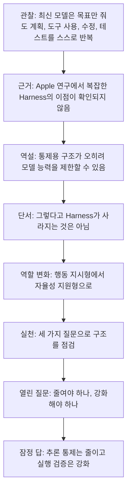
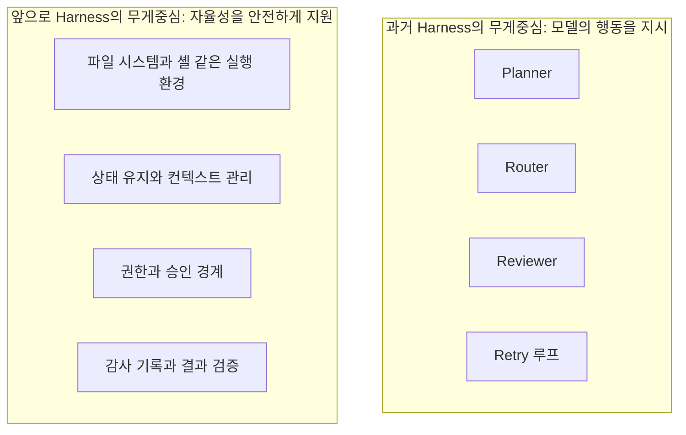
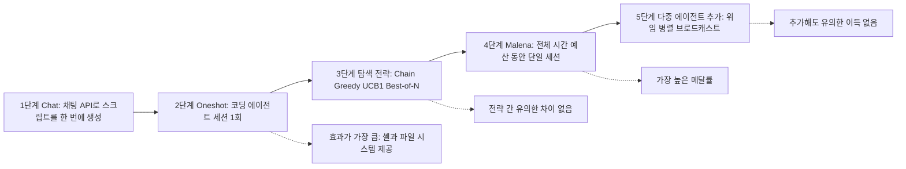
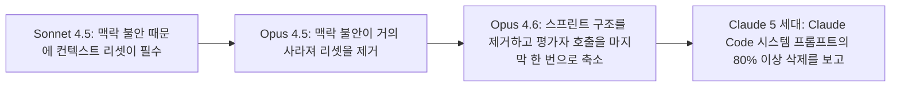
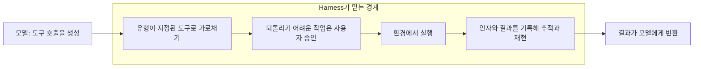
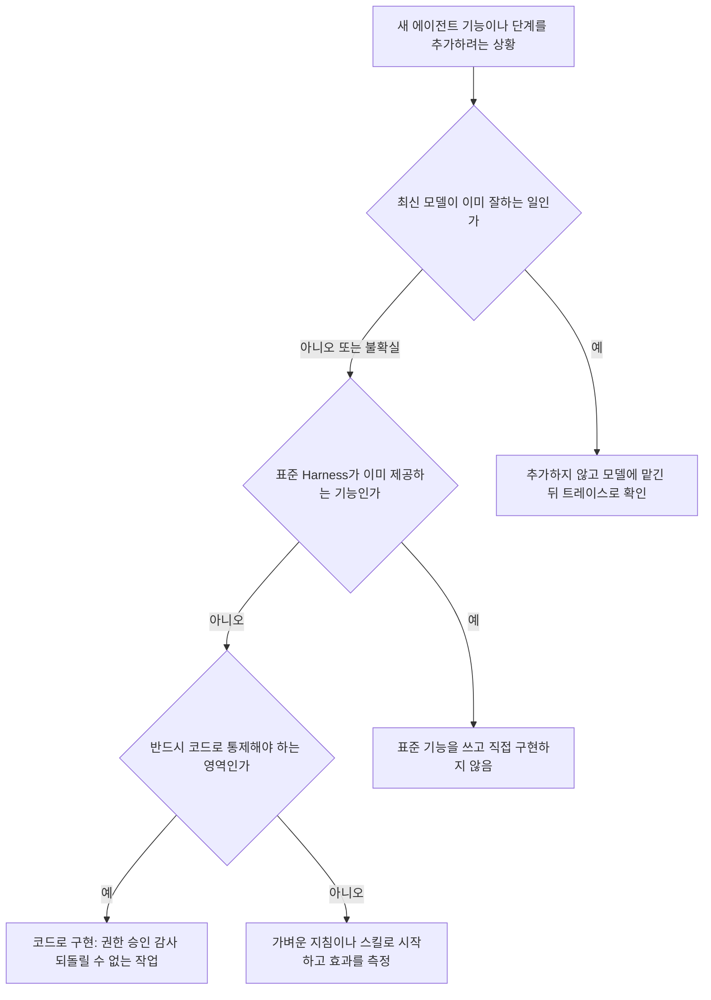

> 작성일: 2026-10-14
> 대상: "데리언의 단상" 시리즈 게시글 「LLM이 똑똑해지면 Harness는 실직할까?」
> 방법: 게시글의 주장을 하나씩 분해하고, 인용된 Apple 연구 원문(arXiv)과 Anthropic·LangChain 등의 공개 자료를 직접 열람해 대조했습니다.


```
단상

LLM이 똑똑해지면 Harness는 실직할까?

최근 최신 LLM 사용기를 듣다가 흥미로운 이야기를 접했습니다.

“이제 모델이 너무 똑똑해서 Harness가 필요 없을 정도다.”

처음에는 조금 의아했습니다.

우리는 LLM이 부족한 부분을 보완하기 위해 Planner, Router, Reviewer, Retry 등 여러 역할을 나누고 복잡한 실행 구조를 만들어 왔습니다.

그런데 최신 모델은 목표만 알려줘도 스스로 계획하고, 도구를 사용하고, 코드를 수정하고, 테스트까지 반복합니다.

심지어 Apple의 연구에서는 특정 ML 엔지니어링 과제에서 복잡한 Harness가 단순한 구성보다 유의미한 이점을 보이지 못했다는 결과도 나왔습니다.

그렇다면 우리가 열심히 만든 Harness는 기술 부채가 되는 걸까요?

여기서 재미있는 역설이 생깁니다.

LLM을 잘 제어하려고 만든 구조가 오히려 LLM의 능력을 제한할 수도 있다는 것입니다.

과거에는 모델이 실수할까 봐 개발자가 모든 절차를 설계했습니다.

하지만 이제는 모델이 스스로 해결할 수 있는 문제까지 우리가 코드로 통제하고 있는 건 아닌지 돌아볼 필요가 있습니다.

물론 Harness가 사라진다는 이야기는 아닙니다.

모델이 아무리 똑똑해져도 파일을 읽고, 도구를 실행하고, 상태를 유지할 환경은 필요합니다.

기업 환경에서는 권한, 보안, 감사, 승인, 검증도 빼놓을 수 없습니다.

다만 역할이 달라지는 것 같습니다.

모델의 행동을 세밀하게 지시하는 Harness에서, 모델이 안전하게 자율성을 발휘하도록 지원하는 Harness로.

저는 앞으로 에이전트를 만들 때 세 가지를 먼저 질문하려고 합니다.

1. 이 기능은 최신 LLM이 이미 잘하는 일인가?
2. 표준 Harness가 제공하는 기능을 다시 만들고 있지는 않은가?
3. 반드시 코드로 통제해야 하는 영역인가?


에이전트가 많다고 똑똑한 것도 아니고, Harness가 복잡하다고 성능이 좋은 것도 아닙니다.

어쩌면 앞으로 개발자의 실력은 얼마나 복잡한 구조를 만들었느냐보다, 얼마나 불필요한 구조를 걷어낼 수 있느냐로 평가받을지도 모르겠습니다.

그런데 한 가지 논쟁거리가 남습니다.

LLM이 더 똑똑해질수록 Harness를 줄여야 할까요? 아니면 더 강력한 Harness가 필요할까요?

저는 둘 다 맞을 수 있다고 생각합니다.

추론을 통제하는 코드는 줄이고, 실행을 검증하는 체계는 강화해야 하니까요.

여러분은 어떻게 생각하시나요?

#데리언의단상 #LLM #AgenticAI #HarnessEngineering #AIEngineering #SoftwareArchitecture

https://www.facebook.com/share/1Dp1RSWRvN/
```

---

## 0. 이 문서를 읽는 방법

이 문서는 게시글이 무엇을 말하는지 풀어 설명하는 데서 끝나지 않고, 각 주장이 실제 자료로 얼마나 뒷받침되는지를 함께 따져 봅니다. 그래서 문장마다 근거의 성격을 구분해 표시했습니다.

| 표시 | 의미 |
|---|---|
| **[1차 확인]** | 논문 원문이나 공식 블로그 본문을 직접 열어 확인한 내용 |
| **[벤더 주장]** | 해당 기업이 자사 제품·평가로 측정해 발표한 내용. 독립적인 재현은 확인하지 못함 |
| **[2차 보고]** | 뉴스, 블로그, 요약 글을 통해 확인한 내용. 원문을 직접 열지 못함 |
| **[해석]** | 위 근거를 바탕으로 이 문서가 내린 판단이나 권고 |

확인하지 못한 부분과 근거가 약한 부분은 마지막 11장에 따로 모아 두었습니다.

---

## 1. 한 문단 요약

게시글의 요지는 이렇습니다. 최근 모델은 목표만 알려 줘도 스스로 계획하고, 도구를 쓰고, 코드를 고치고, 테스트를 반복합니다. 그렇다면 부족한 모델을 보완하려고 만든 Planner, Router, Reviewer, Retry 같은 구조가 이제는 능력을 가두는 짐이 될 수 있습니다. 그렇다고 Harness가 사라지는 것은 아니고, 모델의 행동을 세밀하게 지시하던 역할에서 모델이 안전하게 자율성을 발휘하도록 받쳐 주는 역할로 바뀝니다. 작성자는 그래서 새 에이전트를 만들 때 "이미 모델이 잘하는 일인가", "표준 Harness가 주는 기능을 다시 만드는가", "반드시 코드로 통제해야 하는가"를 먼저 묻겠다고 하고, 마지막에는 "Harness를 줄여야 하나, 더 강하게 해야 하나"라는 질문을 독자에게 던집니다.

검증 결과를 먼저 말씀드리면, 이 주장의 뼈대는 1차 자료와 잘 맞습니다. 다만 근거로 든 Apple 연구는 적용 범위가 좁으니(자율 ML 엔지니어링 과제, 오픈 웨이트 모델 중심), 그 결과를 "모든 에이전트에서 Harness가 필요 없다"로 넓혀 읽으면 안 됩니다. 이 점은 4장과 10장에서 자세히 다룹니다.

---

## 2. 게시글의 논리 구조

게시글은 하나의 흐름으로 읽힙니다. 먼저 관찰이 있고, 근거가 나오고, 역설이 제시되고, 단서가 붙고, 새로운 정의가 나오고, 실천 질문 세 개가 이어지고, 열린 질문으로 끝납니다.



이 흐름에서 눈여겨볼 점은 작성자가 "Harness는 쓸모없다"는 단순한 주장으로 끝내지 않았다는 것입니다. 역설을 먼저 세우고, 곧바로 단서를 달아 균형을 잡고, 마지막에는 두 입장이 모두 맞을 수 있다는 절충안에 도달합니다. 6장과 9장에서 보겠지만, 이 절충안은 공개된 자료의 흐름과 대체로 일치합니다.

---

## 3. 용어 정리: Harness란 무엇인가

**Harness**는 LLM(모델) 바깥에서 모델이 일할 수 있게 감싸는 소프트웨어 전체를 가리킵니다. Anthropic은 이를 모델 주위를 둘러싼 소프트웨어 뼈대로 설명하며, 에이전트 루프, 도구, 컨텍스트 관리, 가드레일이 여기에 들어간다고 봅니다. **[1차 확인]** (Anthropic 블로그, 2026-04-02) 업계에서 자주 쓰는 표현인 "Agent = Model + Harness"는 이 정의를 한 줄로 줄인 것입니다.

게시글이 언급한 구성 요소를 풀어 쓰면 다음과 같습니다.

- **Planner**: 목표를 하위 작업으로 쪼개는 역할
- **Router**: 요청을 알맞은 에이전트나 도구로 보내는 역할
- **Reviewer**: 결과를 검토하고 승인하거나 반려하는 역할
- **Retry**: 실패했을 때 다시 시도하는 루프

여기서 한 가지 구분이 중요합니다. 게시글이 비판적으로 보는 것은 주로 앞의 네 가지처럼 **모델의 판단을 대신하는 오케스트레이션 코드**입니다. 반면 "파일을 읽고, 도구를 실행하고, 상태를 유지할 환경"은 모델이 일하려면 반드시 필요한 부분이라서 게시글도 남겨 두어야 한다고 말합니다. 이 구분은 뒤에서 계속 쓰이므로 두 층으로 나눠서 기억해 두시면 좋습니다.



> 비유 (사실 주장이 아니라 이해를 돕기 위한 설명입니다): 신입 직원에게는 업무 매뉴얼을 한 줄씩 쥐여 주지만, 숙련된 직원에게는 목표와 권한 범위만 주고 결재선(승인·감사)은 그대로 유지합니다. 게시글이 말하는 변화는 매뉴얼은 줄이되 결재선은 지키는 쪽에 가깝습니다.

---

## 4. 근거 ① Apple 연구: 무엇을, 어떻게 비교했나

### 4.1 논문 개요 **[1차 확인]**

게시글이 말하는 "Apple의 연구"는 다음 논문입니다.

- 제목: *How Much of a Harness Does a Strong Agent Need for Autonomous ML Engineering?*
- 저자: Kirill Brilliantov, Alejandro Hernández-Cano, Emmanuel Abbé (소속은 EPFL과 Apple로 표기. Hernández-Cano의 연구는 Apple 인턴 기간에 수행됨)
- 공개: arXiv 제출 2026-09-30, 논문 표기 날짜 2026-10-01, Apple Machine Learning Research 사이트에 2026년 10월 게재

게시글은 "Apple의 연구"라고 줄여 썼는데, 소속 표기가 EPFL과 Apple 두 곳이므로 엄밀히는 "EPFL–Apple 공동 표기 연구"라고 하는 편이 정확합니다. 다만 Apple 연구 사이트에 정식으로 게재된 논문이어서 게시글의 표현이 틀렸다고 보기는 어렵습니다.

### 4.2 연구가 던진 질문

자율 머신러닝 엔지니어링(MLE) 에이전트는 데이터를 탐색하고, 코드를 짜서 돌리고, 검증 점수를 보며 모델을 개선하는 일을 수 시간에서 하루 가까이 반복합니다. 이 분야의 에이전트들은 점점 정교한 장치를 얹어 왔습니다. 해법 후보를 나무 구조로 탐색하는 트리 탐색, 여러 해법을 경쟁시키는 집단 구조, 메모리 계층, 전문화된 에이전트 팀 같은 것들입니다. 논문은 이 장치들이 두 가지 전제에 기대고 있다고 봅니다.

첫째는 "채팅 한 번의 응답은 자기가 쓴 코드를 실행하거나 데이터를 살펴보거나 오류에 반응할 수 없으니, Harness가 대신 해 줘야 한다"는 전제입니다. 둘째는 "MLE는 장기 과제라서 별도의 메모리·컨텍스트 관리가 필요하다"는 전제입니다. 논문은 요즘 모델이 도구 사용을 중심으로 사후 학습되어 하나의 세션 안에서 파일을 읽고 쓰고 코드를 실행하고 디버깅할 수 있고, 백만 토큰급 컨텍스트가 현실적인 비용이 되었다면 이 전제를 다시 따져 볼 때가 되었다고 말합니다.

### 4.3 실험 설계: 사다리 오르기

논문은 모델, 하드웨어, 시간 예산을 고정한 상태에서 Harness 개입을 하나씩 얹어 가며 효과를 쟀습니다. 모든 개입을 하나의 코드베이스에서 같은 방식으로 다시 구현해서, 차이가 구현 세부가 아니라 개입의 종류에서 나오도록 했습니다. 사다리의 맨 위에 놓인 최소 구성이 **Malena**(저자들이 "ML 엔지니어 에이전트 기준선"이라고 부른 구성)입니다.



각 단계가 무엇인지 풀어 쓰면 다음과 같습니다.

- **Chat**: 채팅 API에 문제와 데이터 요약을 주고 완성된 스크립트를 텍스트로 받습니다. 실행에 실패하면 오류 로그를 다시 보내 고쳐 쓰게 합니다. 모델은 도구가 없습니다.
- **Oneshot**: 코딩 에이전트 세션을 한 번 띄워, 작업 디렉터리 안에서 파일을 읽고 쓰고 코드를 실행하고 디버깅하게 합니다.
- **탐색 전략(Chain, Greedy, UCB1, Best-of-N)**: Oneshot 단위를 이어 붙여 해법을 개선하는 방식입니다. Chain은 직전 결과에서 계속 개선하고, Greedy는 검증 점수가 가장 높은 결과를 부모로 삼고, UCB1은 탐험과 활용을 절충하고, Best-of-N은 서로 독립된 시도를 여러 번 합니다.
- **Malena**: 시간 예산 전체에 걸쳐 단 하나의 세션이 돌고, 턴이 끝나면 남은 시간을 알려 주며 계속하라고 짧게 재촉할 뿐입니다. 탐색과 활용의 균형, 자신이 쌓는 지식 관리를 모델이 스스로 합니다.
- **다중 에이전트 개입**: 하위 에이전트에 위임하기(D), 같은 기계에서 Malena 세 개를 병렬로 돌리기(P3), 에이전트끼리 메시지를 뿌리기(B)를 Malena 위에 얹어 봅니다.

### 4.4 핵심 결과 **[1차 확인]**

**첫째, 코딩 에이전트 환경 자체가 압도적으로 중요했습니다.** 논문은 모델에게 채팅 인터페이스 대신 셸과 파일 시스템을 쥐여 주는 것이 측정한 모든 효과 중 단연 가장 크다고 보고합니다. GLM 5.2와 Kimi K3 같은 상위 모델은 실행 환경에 직접 접근할 때 성능이 크게 올랐고, 더 약한 Gemma 4 31B도 이득을 봤습니다. 저자들은 이를 두고 이 설정에서는 모델 크기보다 도구 사용의 숙련도가 더 중요해 보인다고 해석합니다.

**둘째, 그 위에 얹은 장치들은 유의미한 이득을 주지 못했습니다.** 탐색 전략 네 가지는 서로 비교해도 통계적으로 유의한 차이가 없었습니다(가장 큰 차이가 UCB1과 Best-of-N 사이의 백분위 2.71점이었는데, 95% 신뢰구간이 −1.44에서 +6.60이라 0을 포함합니다). 반면 Malena는 모든 수동 탐색 방식보다 메달률이 유의하게 높았습니다.

**셋째, 다중 에이전트 장치를 더하면 이득이 없거나 오히려 나빠졌습니다.** 아래는 어려운 14개 과제 묶음에서 24시간 예산으로 측정한 자가 선택 기준 메달률입니다.

| 구성 | 메달률(자가 선택) | 95% 신뢰구간 |
|---|---|---|
| Malena 기본 | 55.7% | 48.2 ~ 62.9 |
| + 하위 에이전트 위임(D) | 45.2% | 38.1 ~ 54.8 |
| + 병렬 3개(P3) | 52.4% | 42.8 ~ 61.9 |
| + 브로드캐스트 + 병렬(B+P3) | 33.3% | 23.8 ~ 40.5 |

논문은 기본 Malena가 시도한 어떤 개입보다도 유의하게 나쁘지 않다고 정리합니다. 병렬로 돌리면 오라클 선택 기준의 상한은 올라가지만, 자가 선택과 오라클 사이의 격차가 함께 커져서 최종 결과는 비슷해졌습니다.

**넷째, 실제 공개 Harness 네 종과 정면 비교해도 결과가 같았습니다.** MLEvolve, AiScientist, Arbor, ScienceFlow를 같은 모델, 같은 하드웨어, 같은 시간 예산에서 돌려 비교했습니다. MLE-bench 30개 과제에서 17개 (Harness, 모델) 조합, NatureBench 40개 과제에서 6개 조합을 봤을 때 Malena는 모든 조합에서 같거나 더 좋았고, 예외는 작은 모델인 Gemma 4 31B에서 MLEvolve가 평균 추정치로 앞선 경우 하나뿐이었으며 이때도 신뢰구간은 겹쳤습니다. NatureBench 비교에서도 Kimi K3 기준으로는 AiScientist의 평균값이 근소하게 높은 경우(27.1% 대 26.7%)가 있어서, 정확한 표현은 "압도"가 아니라 "대등하거나 우위"입니다. 결론부는 GLM 5.2 기준으로 Malena가 대회의 62.5%에서 메달을 받았고 가장 좋은 외부 Harness는 47.1%였다고 적습니다.

**다섯째, 트레이스 분석이 이유를 보여 줍니다.** 기존 Harness가 코드로 박아 두던 탐색(후보 트리, 정체 시 새 아이디어로 전환 등)을 Malena는 스스로 수행했습니다. 먼저 전체 단계를 아우르는 일반 파이프라인을 만든 뒤, 남은 시간을 코드 패치를 대상으로 한 일종의 하이퍼파라미터 탐색에 쓰고, 이미 만든 체크포인트와 유틸리티 코드를 재사용했습니다. 후반부에는 앙상블과 의사 라벨링(pseudo-labeling) 같은 기법으로 성능 지향적으로 이동했고, 두 모델에서 각각 독립적으로 의사 라벨링을 재발견한 사례도 부록에 기록돼 있습니다.

### 4.5 이 결과가 게시글에 주는 의미

게시글은 "특정 ML 엔지니어링 과제에서 복잡한 Harness가 단순한 구성보다 유의미한 이점을 보이지 못했다"고 썼는데, 이 문장은 논문 내용과 정확히 맞습니다. "특정 과제"라는 한정어를 붙인 것도 적절합니다. 이 연구의 결과를 다른 영역으로 확대하는 것은 연구가 보증하는 범위를 넘습니다.

### 4.6 반드시 함께 읽어야 할 단서들 **[1차 확인]**

논문 안에는 "Harness는 필요 없다"로 단순화하면 놓치게 되는 내용이 여럿 있습니다.

1. **"최소 Harness"는 "Harness 없음"이 아닙니다.** 논문에서 말하는 Harness는 모델에 코드를 묻고, 실행하고, 탐색을 조율하는 바깥 프로그램(트리 탐색, 다중 에이전트 오케스트레이터 등)입니다. Malena는 이런 오케스트레이션이 없는 대신, OpenCode라는 코딩 에이전트 프레임워크 위에서 돌고, 직접 만든 도구 세 개(제출 등록, 남은 시간·자원 조회, 백그라운드 작업 관리)를 쥐고 있습니다. 실행 가능한 명령을 허용 목록으로 제한하고, 메모리가 부족해지기 직전에 명령을 강제 종료하는 감시 장치도 씁니다. 3장의 두 층으로 말하면, 위의 "행동 지시층"은 걷어 냈지만 아래의 "실행·안전 지원층"은 남긴 것입니다. 이는 게시글의 결론("역할이 달라진다")과 같은 방향입니다.
2. **일부 지원 장치는 실제로 성능을 좌우했습니다.** 남은 시간과 자원을 알려 주는 시스템 도구를 빼면 24시간 실험에서 성능이 떨어졌고, 논문은 에이전트가 이 도구 없이는 시간 추적을 제대로 못 하는 것으로 해석합니다. 반대로 시간 경과를 주기적으로 알려 주는 넛지(nudge)를 추가하면 성능이 나빠졌습니다. 즉 "무엇을 걷어낼지"는 직관이 아니라 측정으로 정해야 합니다.
3. **약한 모델은 여전히 Harness의 도움을 받습니다.** 논문은 약한 모델은 손으로 짠 워크플로 사전 지식의 도움을 여전히 받지만, 에이전트 역량이 커질수록 평범한 에이전트 루프가 그 격차를 메운다고 정리합니다. 실제로 Gemma 4 31B에서는 백분위 기준으로 Best-of-N이 Malena보다 유의하게 높았습니다(메달률은 Malena가 높음).
4. **비용은 더 쌀 수도, 더 비쌀 수도 있습니다.** GLM 5.2 기준 모델링된 추론 비용은 Malena가 약 $12.12, AiScientist가 약 $1.95로 Malena가 약 6.2배였습니다. 하나의 긴 세션이 이전 컨텍스트를 매 턴 다시 보내기 때문입니다. 다만 24시간 A100 임대 비용이 $24에서 $85 수준이라 전체 비용은 하드웨어가 지배한다고 논문은 적습니다.
5. **컨텍스트가 좁아지면 약해집니다.** 컨텍스트를 64k로 인위적으로 제한한 실험에서 Malena의 자가 선택 메달률이 57.5%에서 50.0%로 내려갔습니다(신뢰구간은 겹침). 저자들은 하드 컨텍스트 한계 근처에서 동작하는 데 민감하다고 해석합니다.
6. **검증(선택) 문제는 남아 있습니다.** Best-of-N은 검증 점수로 고른 결과가 실제 최고 결과보다 백분위 기준 약 6.8점 낮았고, 저자들은 이 격차를 줄이는 전략이 Harness 설계에서 우선순위가 되어야 한다고 직접 적습니다. 게시글의 "실행을 검증하는 체계는 강화해야 한다"는 결론과 연결되는 대목입니다.
7. **저자들이 밝힌 한계**: MLE-bench는 알려진 과제 준비 문제와 공개 Kaggle 기반이라는 오염 가능성이 있어 네 개 과제를 고치고 오염 여부를 직접 점검했으며 NatureBench를 추가했습니다. 일부 결과는 신뢰구간이 넓어 효과 크기에 대한 강한 주장은 어렵다고 인정합니다(더 약한 "나쁘지 않다"는 주장은 뒷받침된다고 봅니다). 대부분의 개입이 단일 워커 안에서 이뤄져 정교한 에이전트 간 조율 프로토콜은 후속 과제로 남겼고, Malena와 비교 대상 사이의 튜닝 노력이 비대칭일 가능성도 인정합니다. 결론의 범위는 "현재의 MLE 벤치마크"로 한정됩니다.
8. **사용한 모델은 오픈 웨이트 모델 중심입니다.** 부록에 따르면 백본은 GLM 5.2, Kimi K3, DeepSeek V4 계열, Gemma 4 31B, GPT OSS 120B 등이며 vLLM으로 로컬에서 서빙했습니다. Anthropic·OpenAI의 최신 상용 모델로 같은 실험을 한 것이 아니므로, "최신 상용 모델도 똑같다"고 말할 근거는 이 논문에 없습니다.

### 4.7 논문이 인용한 관련 연구 **[2차 보고: 논문 인용 경유]**

논문 서론은 이웃 영역의 근거도 든다고 밝힙니다. 소프트웨어 엔지니어링 Harness 35개 릴리스를 비교한 연구에서 고정된 백본 대비 SWE-bench에서 통계적으로 유의한 개선이 없었다는 보고, 잘 프롬프트한 단일 에이전트가 다중 에이전트 워크플로와 맞먹을 수 있다는 보고, 다중 에이전트 실패는 능력보다 조율에서 나온다는 보고 등입니다. 저는 이 인용 문헌들의 원문은 열어 보지 못했으므로, 논문이 이렇게 소개했다는 사실까지만 전합니다.

---

## 5. 근거 ② Anthropic이 공개한 자체 경험

Apple 논문 외에, 게시글의 "역설"을 뒷받침하는 가장 직접적인 자료는 Harness를 가장 활발하게 설계해 온 기업 중 하나인 Anthropic의 공개 글들입니다. 모두 **[벤더 주장]** 이면서 본문은 **[1차 확인]** 한 자료이고, 자사 모델에 대한 자사 측정이라는 점은 감안해야 합니다.

### 5.1 Harness 구성요소는 "가정"이고, 가정은 낡는다

Anthropic은 2026-03-24 엔지니어링 글(Prithvi Rajasekaran 작성)에서 이렇게 정리합니다. Harness의 모든 구성요소는 모델이 혼자서는 못 하는 일에 대한 가정을 담고 있고, 그 가정은 틀렸을 수도 있고 모델이 좋아지면 빠르게 낡을 수 있다는 것입니다. 2026-04-02 블로그(Lance Martin 작성)도 같은 취지로, 가정이 낡는다는 점을 출발점으로 삼습니다.

### 5.2 실제로 걷어낸 구성요소들

이 글의 가장 값진 점은 추상적 주장이 아니라 실제로 무엇을 어느 모델에서 걷어냈는지 기록했다는 것입니다.



- **컨텍스트 리셋**: Sonnet 4.5는 컨텍스트 한계가 가까워졌다고 느끼면 작업을 서둘러 마무리하는 "맥락 불안"을 보였고, 압축(compaction)만으로는 충분하지 않아서 컨텍스트를 비우고 구조화된 인수인계 문서로 새 에이전트에 넘기는 리셋이 필수였다고 합니다. 그런데 Opus 4.5에서는 이 행동이 대체로 사라져 리셋을 하네스에서 완전히 뺐다고 합니다. 이 리셋은 "모델이 부족해서" 만든 구조가 모델 개선으로 죽은 코드가 된 전형적인 사례입니다.
- **스프린트 구조**: 작업을 한 기능씩 쪼개 모델이 일관성을 유지하게 돕던 구조입니다. Opus 4.6 출시 후 이를 제거했고, 빌더가 두 시간 넘게 분해 없이 일관되게 작업했다고 보고합니다.
- **평가자(Evaluator)**: 매 스프린트가 아니라 실행 끝에 한 번만 호출하도록 줄였습니다. 저자는 평가자가 고정된 예/아니오 결정이 아니라, 과제가 현재 모델이 혼자 안정적으로 해내는 범위의 바깥에 있을 때 비용 값을 한다고 정리합니다.

### 5.3 그러나 걷어내기는 쉽지 않았다

같은 글에는 게시글의 "얼마나 불필요한 구조를 걷어낼 수 있느냐"라는 대목에 반드시 붙여 읽어야 할 내용이 있습니다. 저자는 처음에 Harness를 급진적으로 줄이고 새로운 아이디어를 시도해 봤지만 원래 성능을 재현하지 못했고, 어떤 부분이 실제로 하중을 받는지 구분하기도 어려웠다고 적습니다. 그래서 한 번에 한 구성요소만 제거하며 결과 변화를 보는 체계적 방식으로 바꿨다고 합니다. 즉 걷어내는 능력은 "과감하게 지우는 능력"이 아니라 "지운 효과를 측정하는 능력"에 가깝습니다. **[해석]**

### 5.4 걷어낸 뒤에도 남은 가치

Opus 4.6 기반 최신 Harness로 브라우저용 음악 제작 프로그램(DAW)을 만든 실험은 약 3시간 50분, 토큰 비용 약 $124.70이 들었고, 평가자는 여전히 실제 빈틈을 잡아냈습니다. 예를 들어 오디오 녹음이 버튼만 있고 실제 마이크 캡처는 없는 상태(스텁), 클립 분할·크기 조절 미구현을 지적했습니다. 또 Opus 4.5 시절 실험에서는 단일 에이전트 실행(20분, $9)은 핵심 기능이 동작하지 않았지만 전체 Harness 실행(6시간, $200)은 동작했다고 하는데, 비용이 20배 이상 든 대신 결과 품질 차이가 즉각 드러났다고 저자는 적습니다. 즉 구조를 줄이는 것이 늘 정답이 아니고, 모델의 한계선에 걸린 과제에서는 구조가 여전히 값을 합니다.

### 5.5 세 가지 설계 패턴 (2026-04-02)

같은 해 4월 Anthropic 블로그는 Harness 설계를 세 패턴으로 정리합니다.

1. **모델이 이미 아는 도구에 기대라.** 모델이 잘 아는 bash와 텍스트 편집기를 기반으로 삼으라는 것입니다. 에이전트 스킬, 프로그램형 도구 호출, 메모리 도구 모두 이 두 도구의 조합으로 만들어진다고 설명합니다.
2. **무엇을 그만할 수 있는지 물어라.** 오케스트레이션 결정을 Harness에서 모델로 옮기라는 취지입니다. 예를 들어 코드 실행 도구를 주면 모델이 도구 결과를 걸러서 넘길지 스스로 정할 수 있고, 글에 따르면 Opus 4.6이 자기 도구 출력을 걸러 쓰게 했을 때 BrowseComp 정확도가 45.3%에서 61.6%로 올랐습니다. 압축 예산을 늘렸을 때 Sonnet 4.5는 43%에서 정체했지만 Opus 4.5는 68%, Opus 4.6은 84%까지 올랐다고도 합니다. 스킬로 컨텍스트를 점진적으로 공개하고, 메모리 폴더로 모델이 스스로 기억할 내용을 고르게 하는 것도 같은 맥락입니다.
3. **경계는 신중하게 정하라.** Harness는 UX, 비용, 보안을 강제하는 구조도 제공한다는 것입니다. 이 패턴은 7장에서 자세히 다룹니다.

### 5.6 Claude Code 시스템 프롬프트 80% 삭제 (2026-07-24)

2026-07-24 Anthropic 블로그(Thariq Shihipar 작성, "Claude 5 세대 모델을 위한 컨텍스트 엔지니어링의 새 규칙")는 Claude Opus 5와 Claude Fable 5용으로 Claude Code 시스템 프롬프트의 80% 이상을 삭제하고도 코딩 평가에서 측정 가능한 손실이 없었다고 보고합니다. 이 글이 claude.com 블로그에 같은 날짜로 올라와 있다는 것은 직접 확인했습니다. 다만 글 본문은 제가 직접 열지 못했고, 아래 내용은 인용·요약한 여러 2차 자료로 확인했습니다. **[2차 보고 + 벤더 주장]**

- 핵심 변화: 규칙 나열에서 판단 위임으로 바뀌었습니다. "주석을 달지 마라" 같은 일률적 금지 대신 "주변 코드와 같은 밀도·이름·관용구로 써라"처럼 기준을 서술합니다. 예시 중심에서 인터페이스 설계 중심으로, 모든 정보를 앞에 몰아넣기에서 필요할 때 불러오는 점진적 공개로, 손으로 관리하는 CLAUDE.md에서 자동 메모리로 옮겼다고 정리됩니다.
- 함께 공개된 `claude doctor` 명령은 사용자 쪽 스킬과 CLAUDE.md가 과도한지 점검해 줍니다.
- 주의점: 80%라는 수치는 Anthropic이 자사 코딩 평가에서 측정한 자기 보고이고 독립적으로 재현되지 않았다는 점이 2차 분석들에서 지적됩니다. 프롬프트 diff, 토큰 수, 평가 세트, 방법론이 공개되지 않았다는 분석도 있습니다. 적용 대상은 공식 글 표기상 Opus 5와 Fable 5 세대이며, 일부 2차 자료는 Sonnet 5까지 포함하는 것처럼 쓰지만 공식 표기와 달라서 이 문서는 공식 표기만 따릅니다. 이 수치는 "프롬프트(지시문)"의 감량이지 오케스트레이션 코드나 권한 체계의 감량이 아니라는 점도 구분해야 합니다.

---

## 6. 게시글의 "역설"을 해부하다

게시글은 "LLM을 잘 제어하려고 만든 구조가 오히려 LLM의 능력을 제한할 수도 있다"는 역설을 제시합니다. 이 말이 왜 성립할 수 있는지, 자료에 비추어 세 갈래로 풀어 보겠습니다.

**첫째, 판단의 위치가 잘못 놓일 수 있습니다.** Anthropic은 도구 결과를 전부 컨텍스트에 흘려보내라고 정한 Harness는 사실 모델이 더 잘 내릴 수 있는 오케스트레이션 결정을 대신 내리는 셈이라고 설명합니다. 같은 이유로 "다음 단계는 이것이다"라고 코드로 못 박은 Planner나 Router는 모델이 더 나은 경로를 알아도 그 경로를 막습니다. **[1차 확인]**

**둘째, 구조 자체가 새로운 실패 지점이 됩니다.** Apple 논문에서 에이전트끼리 메시지를 주고받게 하는 구성(B+P3)은 메달률이 55.7%에서 33.3%로 내려갔습니다(신뢰구간은 넓지만 논문의 쌍체 비교에서는 유의했습니다). Anthropic도 컨텍스트 리셋이 오케스트레이션 복잡도, 토큰 오버헤드, 지연을 더한다고 인정합니다. 구조는 공짜가 아니라는 뜻입니다. **[1차 확인]**

**셋째, 구조가 모델의 새 능력을 가로막을 수 있습니다.** Anthropic은 과거 모델용 구조를 계속 들고 가는 것이 병목이 될 수 있어서 가지치기해야 한다고 말하고, 2026-07 글은 자사의 시스템 프롬프트와 CLAUDE.md, 스킬이 Claude Code를 과도하게 제약하고 있었다고 인정합니다(이 문장은 2차 자료의 인용을 통해 확인). **[벤더 주장]**

그러나 이 역설에는 반드시 따라붙는 반례가 있습니다. 다음 장에서 정리합니다.

---

## 7. "Harness는 사라지지 않는다": 남는 것과 달라지는 것

### 7.1 Harness가 여전히 성능을 좌우한다는 반대 근거

게시글이 단서를 달아 둔 것은 옳은 판단입니다. 같은 시기에 반대 방향의 근거도 꽤 많기 때문입니다.

| 근거 | 내용 | 등급 |
|---|---|---|
| LangChain 코딩 에이전트 | 모델을 고정(gpt-5.2-codex)한 채 Harness만 바꿔 Terminal Bench 2.0에서 52.8%에서 66.5%(+13.7점)로, 순위는 30위권에서 5위권으로 올랐다고 보고. 바꾼 것은 시스템 프롬프트, 도구, 미들웨어이고, 특히 "만들고 검증하는" 루프 강제와 환경 정보 선제공, 반복 루프 감지 등이 포함됨 | [벤더 주장], 본문 요약 확인 |
| Terminal-Bench 2.0 | 같은 Claude Opus 4.6이 일곱 가지 Harness에서 58.0%에서 74.7% 사이로 나뉘었다는 보고 | [2차 보고] |
| 독점 코드베이스 평가 논문 | 도구가 약 3배 많은 "고급" Harness가 기본 Harness보다 일관되게 높았고, 컨텍스트 파일은 기본 Harness에서만 +6.4%p 이득이 있었다는 보고(Opus 4.6) | [2차 보고: 검색 요약 수준] |
| Anthropic 장기 실행 실험 | 평가자 분리 구조가 단일 에이전트 대비 결과 품질 차이를 만들었다는 보고(5.4절) | [벤더 주장] |
| Harness 효과의 비단조성 | 모델 수준별로 보면 중간 계층 모델이 Harness에서 가장 큰 혜택을 본다는 결과를 Lilian Weng의 2026-07-04 글이 소개 | [2차 보고: 스니펫 수준] |

이 자료들과 Apple 논문을 같은 표에 놓고 보면 모순처럼 보이지만, 조건이 다릅니다. 과제 종류(MLE 대 터미널 과제 대 독점 코드베이스), 모델 세대, 모델 수준(최상위 대 중간 계층), 그리고 어떤 종류의 Harness를 바꿨는지(오케스트레이션 대 환경·컨텍스트·검증)가 다릅니다. **[해석]** 특히 LangChain이 개선한 것은 "추론 순서를 지시하는 장치"보다 "환경 정보 제공, 자기 검증 강제, 루프 감지" 쪽에 가까워서, 게시글의 구분(추론 통제는 줄이고 실행 검증은 강화)과 오히려 잘 맞습니다.

### 7.2 남기고 키워야 하는 것: 경계

Anthropic의 세 번째 패턴이 바로 이 지점입니다. 핵심 논리는 이렇습니다. 모델이 쓰는 bash 도구는 Harness 입장에서는 그저 명령 문자열일 뿐 모든 행동이 같은 모양이라 가로채기가 어렵습니다. 반면 행동을 전용 도구로 승격하면, 유형이 지정된 인자를 통해 가로채고(intercept), 막고(gate), 사용자에게 보여 주고(render), 기록(audit)할 수 있다는 것입니다. 보안 경계가 필요한 행동, 되돌리기 어려운 행동(외부 API 호출 등)은 사용자 확인으로 막을 수 있고, 편집 도구에 오래된 파일을 덮어쓰지 않도록 하는 검사를 넣을 수 있다고 예를 듭니다. **[1차 확인]**



이 글은 "경계 구조도 다시 따져 보라"는 단서도 붙입니다. Claude Code의 자동 모드는 두 번째 Claude가 명령 문자열을 읽고 안전한지 판단해서 일부 전용 도구의 필요를 줄일 수 있지만, 이는 사용자가 대체적인 방향을 신뢰하는 작업에만 쓰라고 하고, 위험이 큰 행동에는 전용 도구가 여전히 자리를 지킨다고 설명합니다. **[1차 확인]**

기업 환경의 권한, 보안, 감사, 승인이라는 게시글의 목록은 보안 커뮤니티의 지침과도 일치합니다. OWASP GenAI Security Project가 2025-12-09 공개한 「에이전트 애플리케이션 Top 10(2026판)」은 에이전트를 단순한 입력 처리 앱이 아니라 목표, 도구, 메모리를 가진 주체로 다루며, 도구별로 권한·데이터 접근·기능을 필요한 만큼만 주는 "최소 에이전시(least agency)"와 최소 권한, 영향이 큰 행동에 대한 사람의 승인, 모든 행동의 기록을 권고합니다. 저는 OWASP 원문이 아니라 이를 정리한 여러 2차 자료로 확인했습니다. **[2차 보고]**

### 7.3 달라지는 것과 남는 것 한눈에 보기

| 구분 | 줄이거나 점검할 대상 | 남기거나 강화할 대상 |
|---|---|---|
| 성격 | 모델의 판단을 대신하는 코드 | 모델이 일할 수 있게 받치고 검증하는 구조 |
| 예 | 고정된 단계 분해, 경로를 정하는 Router, 모델이 하는 일을 반복하는 다중 에이전트 조율, 오래된 모델용 리셋·넛지, 길고 낡은 규칙형 프롬프트 | 파일·셸 같은 실행 환경, 상태·메모리 보존, 권한과 승인, 감사 기록, 독립적인 결과 검증 |
| 근거 | Apple 논문의 다중 에이전트 결과, Anthropic의 리셋·스프린트 제거 | Apple의 Malena가 가진 시간·자원 도구와 감시 장치, Anthropic의 경계 패턴, OWASP 권고 |
| 주의 | 지우기 전에 반드시 측정(5.3절) | 모델 능력이 올라가도 권한·승인은 모델 능력의 문제가 아니라 조직의 통제 문제 |

마지막 줄의 해석은 이 문서의 판단입니다. 논리는 단순합니다. 모델이 코드를 잘 짜게 되어도 "이 모델이 운영 DB에 쓸 권한을 가져도 되는가"는 모델의 똑똑함으로 답할 수 없는 조직의 정책 문제입니다. **[해석]**

---

## 8. 세 가지 질문, 풀어서 이해하기

게시글의 세 질문은 에이전트 기능을 새로 넣을 때 쓰는 점검표입니다. 각 질문이 왜 필요한지, 어떻게 확인할 수 있는지를 자료에 비추어 풀어 보겠습니다.

### 질문 1. 이 기능은 최신 LLM이 이미 잘하는 일인가?

기능을 만들기 전에, 그 기능이 보완하려는 모델의 약점이 아직 실재하는지 확인하라는 질문입니다. 맥락 불안 사례가 교훈입니다. Sonnet 4.5 시절에는 실재하던 약점이 Opus 4.5에서는 사라졌고, 그 약점을 막으려고 만든 리셋은 죽은 코드가 됐습니다.

확인 방법으로 Anthropic이 권하는 것은 사용하려는 모델로 실제 문제를 돌려 보고 트레이스(실행 기록)를 읽으며 조정하는 것입니다. Apple 논문의 트레이스 분석도 같은 방법입니다. 에이전트가 하드코딩된 탐색을 스스로 하는지를 기록으로 확인했습니다. **[1차 확인]** 여기서 "잘하는 일"은 모델과 버전에 묶여 있습니다. Anthropic도 새 모델이 나올 때마다 Harness를 다시 점검하라고 권합니다.

### 질문 2. 표준 Harness가 제공하는 기능을 다시 만들고 있지는 않은가?

바퀴를 다시 발명하지 말라는 질문입니다. 2026-04-02 Anthropic 글이 열거하는 표준 기능만 해도 압축(compaction), 컨텍스트 편집, 메모리 도구, 스킬을 통한 점진적 공개, 하위 에이전트, 프로그램형 도구 호출, 코드 실행이 있습니다. Apple 논문이 쓴 OpenCode도 하위 에이전트를 띄우는 도구와 할 일 목록 도구를 기본으로 갖고 있습니다. 자체 요약 모듈, 자체 메모리 검색, 자체 하위 에이전트 관리를 만들기 전에 표준 기능이 이미 있는지 먼저 보라는 뜻입니다. **[1차 확인]**

이 질문에는 주의할 점이 하나 있습니다. 표준 기능이 있다고 해서 그것이 모든 모델에서 똑같이 잘 작동하는 것은 아닙니다. Anthropic은 압축 예산을 늘렸을 때 모델 세대마다 이득이 크게 달랐다고(Sonnet 4.5는 정체, Opus 4.6은 84%) 보고합니다. 표준 기능을 쓰되 내 모델에서 측정하라는 것이 안전한 해석입니다. **[해석]**

### 질문 3. 반드시 코드로 통제해야 하는 영역인가?

이 질문은 "판단에 맡길 영역"과 "코드로 보장할 영역"을 가르는 기준입니다. 자료가 제시하는 기준은 대략 세 가지입니다.

- **되돌릴 수 있는가**: 되돌리기 어려운 행동(외부 API 호출, 삭제, 결제 등)은 사용자 확인이나 별도 승인을 거는 것이 자연스러운 후보입니다(Anthropic).
- **보안·권한 경계인가**: 모델은 애플리케이션의 보안 경계를 모를 수 있으므로, 최소 권한과 도구별 허용 범위는 코드로 강제합니다(Anthropic, OWASP).
- **추적·재현·감사가 필요한가**: 유형이 지정된 도구는 인자를 구조화해 기록할 수 있습니다(Anthropic).

반대로 어느 쪽에도 해당하지 않는, 단순히 "모델이 실수할까 봐" 넣은 단계는 코드가 아니라 가벼운 지침으로 시작해서 측정하는 쪽이 자료의 흐름과 맞습니다. **[해석]**

### 세 질문을 하나의 흐름으로

아래 흐름도는 세 질문을 순서대로 적용하는 방법을 그린 것으로, 이 문서가 제안하는 점검 순서입니다. 게시글이 순서를 정해 두지는 않았습니다. **[해석]**



### 실제로 걷어낼 때의 절차 (권고)

Anthropic이 설명한 방식과 Apple 논문의 실험 방식을 합치면, 구조를 걷어낼 때 다음 절차가 자연스럽습니다. **[해석: 두 자료의 방법을 종합한 권고]**

1. 걷어낼 후보를 하나만 고릅니다. 한꺼번에 줄이면 무엇이 하중을 받았는지 알 수 없습니다(Anthropic의 첫 시도 실패 사례).
2. 같은 모델, 같은 시간·비용 예산, 같은 과제 묶음으로 비교합니다(Apple 논문의 매칭 조건).
3. 단일 실행의 점수가 아니라 반복 실행의 분포로 판단합니다. 신뢰구간이 겹치면 "차이가 없다"는 결론조차 조심스럽게 써야 합니다(Apple 논문의 한계 서술).
4. 점수뿐 아니라 트레이스를 읽어 모델이 그 기능을 스스로 대체했는지 확인합니다.
5. 모델이 바뀔 때마다 반복합니다. 결과는 모델 버전에 묶입니다.

---

## 9. 마지막 논쟁: 줄여야 하나, 강화해야 하나

게시글은 "둘 다 맞을 수 있다"며 "추론을 통제하는 코드는 줄이고, 실행을 검증하는 체계는 강화해야 한다"고 정리합니다. 이 절충안이 자료와 얼마나 맞는지 양쪽 입장을 놓고 봅니다.

### 9.1 "줄여야 한다"는 입장

- Apple 논문: 강한 모델이 이미 잘하는 일을 위해 정교한 Harness를 쌓는 것은 현재의 MLE 벤치마크에서는 수익이 낮다고 결론짓습니다. **[1차 확인]**
- Google DeepMind의 Logan Kilpatrick이 2026년 6월에 모델이 그 스캐폴딩을 흡수해 모델 시스템의 일부가 될 것이며 12개월 안에 상당 부분이 그렇게 되리라 예상했다는 보고가 있습니다. **[2차 보고: 정리 글 경유, 원발언 미확인]**
- 개인 블로그 수준의 견해로, 애플리케이션 쪽 스캐폴딩을 "90일짜리 산출물"로 보고 모델 출시 때 버릴 수 있게 설계하라는 주장(Lee Hanchung, 2026-05-08)이 있습니다. **[2차 보고: 의견]**

### 9.2 "강화(또는 이동)해야 한다"는 입장

- Anthropic: 흥미로운 Harness 조합의 공간은 모델이 좋아져도 줄지 않고 이동하며, 모델이 좋아질수록 기본 능력 너머의 복잡한 과제를 위한 Harness를 설계할 여지가 커진다고 저자가 확신을 밝힙니다. **[벤더 주장, 1차 확인]**
- 실무자 글에서는 모델이 하위 작업을 흡수하는 동안 엔지니어링 가치는 운영 계층(장기 메모리, 에이전트 함대 관리, 샌드박스, 장애 복구)으로 이동한다는 정리가 있습니다(Trista Pan, AWS Summit Hong Kong 2026 현장 노트). **[2차 보고: 의견]** Addy Osmani도 2026-04 글에서 Opus 4.6이 맥락 불안 계열 보정을 죽은 코드로 만들었지만 모델이 새 능력을 얻으면 새 스캐폴딩이 필요해진다고 씁니다. **[2차 보고: 의견]**

### 9.3 두 입장의 접점과 이 문서의 평가

두 입장은 "무엇을 Harness라고 부르느냐"에서 갈립니다. 줄이자는 쪽이 겨냥하는 것은 주로 모델의 추론을 대신 조율하는 장치이고, 이동·강화를 말하는 쪽이 겨냥하는 것은 환경, 장기 상태, 경계, 검증입니다. 그렇게 보면 게시글의 절충안은 두 입장이 사실은 서로 다른 층을 말하고 있다는 정리로 읽을 수 있고, 자료의 큰 흐름과 맞습니다. **[해석]**

다만 "검증을 강화한다"는 말에는 한 가지 조건을 붙여야 정확합니다. 검증 주체가 같은 모델 계열이면 후하게 채점하는 경향이 있다는 점입니다. Anthropic은 에이전트가 자기 결과물을 자신 있게 칭찬하는 경향이 있고, 평가자를 분리해도 평가자 역시 LLM이라 LLM이 만든 결과에 관대할 수 있다고 설명합니다. 다만 독립된 평가자를 회의적으로 조율하는 것이 생성자가 스스로 비판적이 되게 하는 것보다 훨씬 다루기 쉽다고 하고, 그 조율에 여러 차례의 반복 튜닝이 필요했다고 기록합니다. **[1차 확인]** Apple 논문의 "검증 점수로 고른 결과와 실제 최고 결과 사이의 격차"도 같은 문제의 다른 얼굴입니다. 결국 "검증 강화"는 검증 단계를 하나 더 넣는 일이 아니라, 검증이 실제로 실패를 잡아내는지 별도로 측정하고 조율하는 일까지 포함해야 합니다. **[해석]**

---

## 10. 비판적으로 읽기: 이 단상의 강점과 보완할 점

### 강점

1. **균형 잡힌 구조**: 역설을 제시하되 곧바로 "Harness가 사라지지는 않는다"는 단서를 붙여 과장을 피했습니다.
2. **근거 범위를 한정한 표현**: "특정 ML 엔지니어링 과제에서"라는 한정어가 논문의 범위와 정확히 일치합니다.
3. **실천 가능한 질문**: 세 질문은 Anthropic의 공개 설계 원칙(이미 아는 도구에 기대기, 그만할 수 있는 일 묻기, 경계 신중히 정하기)과 구조적으로 대응합니다.
4. **역할 변화라는 틀**: "지시형에서 지원형으로"라는 요약은 5장과 7장의 1차 자료 흐름과 잘 맞습니다.

### 보완하면 좋은 점

1. **"Harness가 필요 없을 정도"라는 전언의 출처**: 게시글은 사용기를 들었다고만 쓰고 출처를 밝히지 않습니다. 이 전언은 그 자체로는 검증할 수 없는 일화이고, 제가 확인한 공개 자료 어디에서도 Harness가 필요 없다고 결론짓지 않았습니다. 가장 강한 표현도 "정교한 오케스트레이션이 현재 벤치마크에서 수익이 낮다"(Apple)와 "구성요소를 가지치기하라"(Anthropic)입니다.
2. **"Harness"라는 단어의 범위**: 게시글 앞부분은 Planner, Router, Reviewer 같은 오케스트레이션을 Harness로 놓고, 뒷부분은 파일·도구·상태 환경까지 Harness에 포함시킵니다. Apple 논문의 "최소 Harness"도 실제로는 OpenCode와 몇 가지 도구 위에서 돌기 때문에, "Harness가 필요 없다"기보다 "Harness 중 어느 층이 필요 없느냐"의 문제로 쓰는 편이 정확합니다.
3. **일반화의 범위**: Apple 연구는 자율 MLE 과제, 오픈 웨이트 모델 중심, 현재 벤치마크로 범위가 제한됩니다. 독점 코드베이스 평가나 터미널 과제, 장기 풀스택 개발에서는 Harness가 여전히 큰 차이를 만든다는 보고가 있습니다(7.1절). 에이전트를 만드는 현업 맥락에서는 자신의 과제와 모델로 직접 측정해야 합니다.
4. **비용 관점**: 구조를 걷어내면 개발·유지 비용은 줄 수 있지만 추론 비용이 늘 수도 있습니다(Apple 논문에서 Malena의 모델링 추론 비용이 약 6.2배). "단순 = 저렴"은 아닙니다.
5. **"에이전트가 많다고 똑똑한 것도 아니다"**: 이 문장은 Apple 논문의 다중 에이전트 결과와 일치하지만, GUI 에이전트처럼 관리자·작업자·검토자·기록자를 두는 다중 에이전트 Harness를 쓰는 연구도 여전히 있습니다(모바일 에이전트 벤치마크 논문의 관련 연구 소개). **[2차 보고]** 이 영역에서 단일 에이전트가 충분한지는 이 문서가 확인한 자료로는 알 수 없습니다.

---

## 11. 검증의 한계: 확인하지 못한 것들

신뢰를 위해 확인하지 못한 부분을 숨기지 않고 적습니다.

1. **게시글 원문 링크**: 자동 접근이 사이트 정책상 거부되어 링크를 직접 열지 못했습니다. 이 문서는 사용자가 붙여 넣어 주신 본문을 기준으로 작성했고, 작성자와 게시일은 확인하지 못했습니다.
2. **Anthropic 2026-07-24 글 본문**: claude.com 블로그에서 날짜와 제목이 존재한다는 것은 확인했지만 본문은 직접 열지 못했고, 인용·요약한 2차 자료로 내용을 확인했습니다. 80% 수치는 Anthropic의 자기 보고이고 산정 방식은 공개되지 않았다는 지적이 있습니다. 일부 2차 자료는 이 수치를 토큰 수(약 800에서 164)로 설명하기도 하지만, 서로 다른 설명이 있어 이 문서는 그 숫자를 쓰지 않았습니다.
3. **OWASP 문서**: 원문을 직접 열지 않고 이를 정리한 2차 자료로 확인했습니다.
4. **Lilian Weng의 글, 독점 코드베이스 평가 논문(arXiv 2604.01527), Terminal-Bench 7개 Harness 수치, Kilpatrick 발언**: 검색 요약이나 2차 글 수준에서만 확인했습니다. 인용한 수치는 원문과 대조해 쓰시기 바랍니다.
5. **LangChain 글의 시점**: 출처마다 2026년 2월과 3월로 표기가 달라서 이 문서는 정확한 월을 적지 않았습니다. 사용 모델(gpt-5.2-codex)과 점수 변화는 여러 요약에서 일치했습니다.
6. **Apple 논문이 인용한 관련 연구**(SWE-bench Harness 35개 릴리스 비교 등): 논문의 소개를 통해서만 확인했고 원문은 열지 않았습니다.

---

## 12. 결론

게시글의 주장은 "Harness는 사라진다"가 아니라 "Harness의 무게중심이 모델의 행동을 지시하는 층에서, 모델이 안전하게 일할 환경과 경계를 받치는 층으로 옮겨 간다"로 정리할 수 있고, 이 정리는 공개된 1차 자료의 큰 흐름과 맞습니다.

- Apple·EPFL 연구는 자율 ML 엔지니어링이라는 한정된 영역에서, 같은 모델과 시간 예산이라면 정교한 오케스트레이션이 단순한 코딩 에이전트보다 나은 점이 없었다고 보고합니다. 가장 큰 효과는 모델에게 셸과 파일 시스템을 준 것 자체였습니다.
- Anthropic은 자사 경험으로, 모델이 좋아질 때마다 리셋·스프린트·프롬프트 같은 구조를 걷어냈고, 동시에 평가자와 승인·감사 경계는 과제가 모델의 한계선에 걸리는 한 여전히 값을 한다고 말합니다.
- 반대 사례(LangChain 등)는 환경 정보, 자기 검증, 루프 감지처럼 "실행을 지원하고 검증하는" 구조가 여전히 큰 성능 차이를 만들 수 있음을 보여 줍니다.
- 실무적으로 중요한 것은 "얼마나 많이 걷어냈느냐"가 아니라 "걷어낸 효과를 어떻게 측정했느냐"입니다. Anthropic의 첫 급진적 단순화 시도가 실패했던 사례가 이를 말해 줍니다.

게시글의 마지막 질문에 대한 이 문서의 잠정 답은 이렇습니다. 줄이고 강화하는 대상이 서로 다른 층이므로 두 입장은 충돌하지 않습니다. 줄일 것은 모델이 이미 대체한 추론 통제 코드이고, 키울 것은 권한·승인·감사와 검증이 실제로 실패를 잡아내는지에 대한 측정입니다. 다만 이것이 어느 정도까지 일반화되는지는 모델 세대와 과제 종류에 따라 달라지므로, 각자의 모델과 과제에서 한 번에 하나씩 걷어내며 확인하는 수밖에 없습니다. **[해석]**

---

## 13. 참고 자료

접근일은 모두 2026-10-14입니다.

**1차 자료 (본문 직접 확인)**

- Apple Machine Learning Research, *How Much of a Harness Does a Strong Agent Need for Autonomous ML Engineering?* (2026-10) — https://machinelearning.apple.com/research/harness-autonomous-ml-engineering
- Brilliantov, Hernández-Cano, Abbé, 같은 제목, arXiv:2609.40303 (제출 2026-09-30) — https://arxiv.org/abs/2609.40303
- Anthropic Engineering, *Harness design for long-running application development* (2026-03-24) — https://www.anthropic.com/engineering/harness-design-long-running-apps
- Anthropic (Claude 블로그), *Agent Harness Design: 3 Patterns for Harnessing Claude's Intelligence* (2026-04-02) — https://claude.com/blog/harnessing-claudes-intelligence
- LangChain, *Improving Deep Agents with harness engineering* (2026년 초; 검색 결과 요약 확인) — https://blog.langchain.com/improving-deep-agents-with-harness-engineering

**2차 자료 (요약·보도·분석 경유)**

- Anthropic (Claude 블로그), *The new rules of context engineering for Claude 5 generation models* (2026-07-24; 날짜·제목은 claude.com에서 확인, 본문은 2차 자료 경유) — https://claude.com/blog/the-new-rules-of-context-engineering-for-claude-5-generation-models
- DEV Community (Breach Protocol), Anthropic 80% 삭제 주장에 대한 분석 — https://dev.to/breachprotocol/anthropic-says-it-deleted-over-80-of-claude-codes-system-prompt-with-no-measurable-loss-116i
- AI Weekly, Anthropic의 Claude 5용 시스템 프롬프트 삭제 요약 — https://aiweekly.co/alerts/anthropic-deletes-80-of-claude-codes-system-prompt-for-claude-5
- LeoDex News, Apple 연구 보도 (2026-10-07) — https://news.leodex.io/news/apple-study-finds-minimal-coding-agent-matches-or-beats-multi-agent-ml-systems
- Lilian Weng, *Harness Engineering for Self-Improvement* (2026-07-04; 스니펫 수준) — https://lilianweng.github.io/posts/2026-07-04-harness/
- Lee Hanchung, *Hidden Technical Debt of AI Systems: Agent Harness* (2026-05-08; 의견) — https://leehanchung.github.io/blogs/2026/05/08/hidden-technical-debt-agent-harness/
- Addy Osmani, *Agent Harness Engineering* (2026-04-19; 의견) — https://addyosmani.com/blog/agent-harness-engineering/
- Trista Pan, *Agent = Model + Harness* (AWS Summit Hong Kong 2026 노트; 의견) — https://tristazero.github.io/blog/agent-model-harness/
- DataNorth, *Harness engineering: The complete guide to AI agent scaffolding* (Terminal-Bench 수치, Kilpatrick 발언 인용) — https://datanorth.ai/blog/harness-engineering-the-complete-guide-to-ai-agent-scaffolding
- REAP: Automatic Curation of Coding Agent Benchmarks from Interactive Production Usage, arXiv:2604.01527 (검색 요약 수준) — https://arxiv.org/pdf/2604.01527
- Graylog, *What is the OWASP Top 10 Agentic AI* (OWASP 에이전트 Top 10 정리) — https://graylog.org/post/what-is-the-owasp-top-10-agentic-ai
- ByteHide Radar, *LLM06:2025 Excessive Agency* (OWASP LLM Top 10 정리) — https://docs.bytehide.com/products/radar/sast/owasp/llm06-2025

---

작성 일자: 2026-10-14
