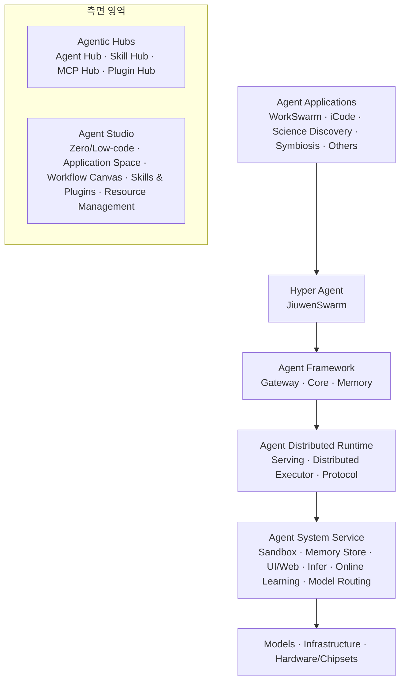
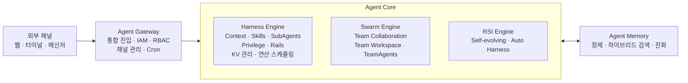
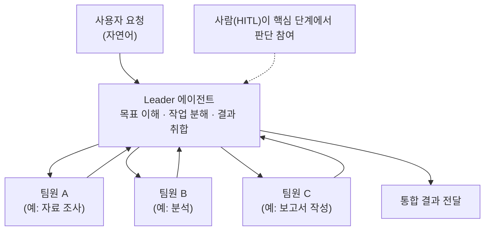
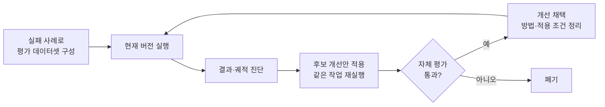
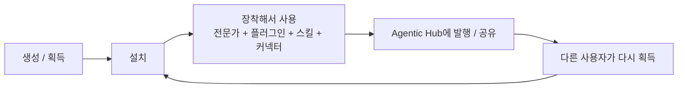
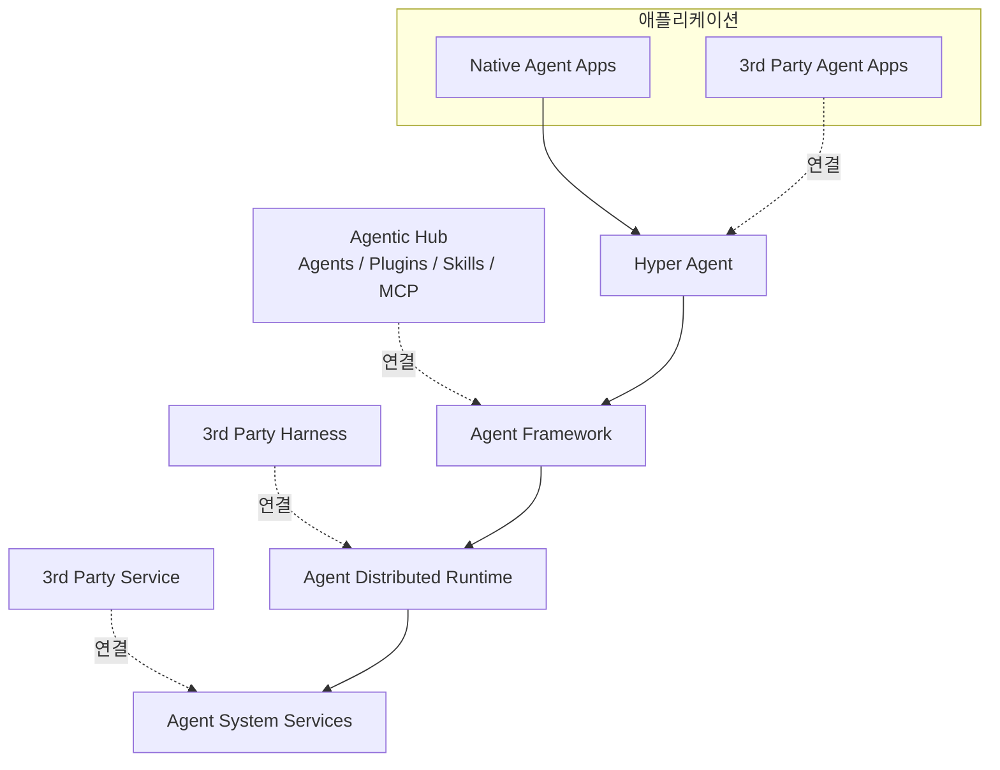
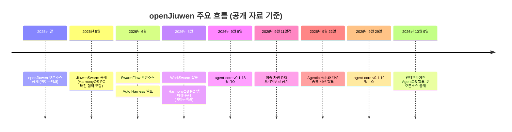

- 대상: 첨부하신 두 장의 구조도 (「Agent Applications → Hyper Agent → Agent Framework → Agent Distributed Runtime → Agent System Service」 계층도와, 서드파티 연결 방식을 보여 주는 「플러그인형 AgentOS」 구조도)
- 조사 기준일: 2026년 10월 15일
- 조사 방법: 공식 GitHub 저장소(openJiuwen-ai 조직, jiuwenswarm, agent-core, agentos-enterprise 등), 2026년 10월 9일자 量子位 보도, 2026년 9월 22일자 机器之心 보도, RSI 프레임워크 관련 보도, 논문(arXiv) 등 검색으로 확인한 자료만 사용했습니다. 공개 자료로 확인되지 않은 부분은 본문 마지막 장에 따로 모아 "확인되지 않음"으로 표시했습니다.

## 관련글

[**화웨이 openJiuwen 엔터프라이즈 AgentOS와 DeepSeek DSec**](https://k82022603.github.io/posts/%ED%99%94%EC%9B%A8%EC%9D%B4-openjiuwen-%EC%97%94%ED%84%B0%ED%94%84%EB%9D%BC%EC%9D%B4%EC%A6%88-agentos%EC%99%80-deepseek-dsec/)

---

## 1. 먼저 결론부터: 이 구조도는 무엇인가

첨부하신 구조도는 **openJiuwen 커뮤니티가 2026년 10월에 발표하고 오픈소스로 공개한 "엔터프라이즈 AgentOS(Jiuwen AgentOS)"의 전체 설계도**입니다. 구조도 하단의 출처 표기(量子位)와, 量子位가 2026년 10월 9일에 게재한 기사의 도표 제목 두 개 — "Jiuwen AgentOS 전체 아키텍처"와 "플러그인형 AgentOS 아키텍처와 Agentic Hub 북향 생태" — 가 첨부 구조도와 일치합니다.

쉽게 비유하면 이렇습니다. 스마트폰에는 앱이 있고, 앱 아래에 운영체제가 있고, 그 아래에 칩이 있습니다. AI 에이전트(스스로 계획을 세우고 도구를 써서 일을 처리하는 AI 프로그램)도 기업에서 수십, 수백 개를 동시에 돌리려면 똑같은 구조가 필요합니다. 에이전트를 실행하는 방, 그 방을 안전하게 가르는 벽(샌드박스), 에이전트끼리 대화하는 통로(프로토콜), 에이전트의 기억 창고, 스스로 실력을 키우는 장치 같은 것들입니다. **Jiuwen AgentOS는 이런 부품을 한 묶음의 "에이전트용 운영체제"로 정리한 것**이라고 이해하시면 됩니다.

이 프로젝트를 만든 주체에 대해 量子位 기사는 화웨이 2012 연구소, 화웨이 클라우드, 컴퓨팅·단말·"算力先遣队(컴퓨팅 선발대)" 등의 팀이 대학·기업의 개발자들과 함께 구축한 오픈소스 AI 에이전트 플랫폼 openJiuwen이라고 소개합니다. 라이선스는 저장소 기준 Apache License 2.0입니다.

---

## 2. 발표 배경: 왜 "AgentOS"인가

量子位 기사는 에이전트가 기업 현장에 들어갈 때 부딪히는 어려움을 크게 세 가지로 정리합니다. 첫째, 업무 흐름이 길어지면 여러 에이전트가 효율적으로 협업하기 어렵다는 점. 둘째, 업무 경험이 쌓이지 않아 실행할 때마다 처음부터 더듬는다는 점. 셋째, 연산 자원을 더 투입해도 실행 효율이 그만큼 오르지 않는다는 점입니다. 여기에 데이터 권한, 보안 격리, 오류 복구 같은 운영 문제가 더해져, 개발 도구 하나로는 해결되지 않고 **개발·실행·관리 전체를 관통하는 시스템 차원의 능력**이 필요하다는 것이 기사의 논지입니다.

그래서 기사는 AgentOS의 특징을 네 가지로 묶어 설명합니다.

- **멀티 에이전트 네이티브**: 작업 분해, 역할 분담, 병렬 실행을 "벌떼(Swarm) 협업"과 워크플로 오케스트레이션으로 지원하며, 핵심 단계에서는 사람이 판단에 참여할 수 있게 합니다.
- **자기 진화 네이티브**: 실행 기록, 사용자 피드백, 기억 장치를 바탕으로 에이전트가 스킬과 협업 방식을 스스로 다듬고, 효과가 확인된 경험을 재사용 가능한 능력으로 쌓습니다.
- **연산 친화와 엔터프라이즈 실행 기반**: 소프트웨어·하드웨어 협력, 자원 스케줄링, 추론 최적화로 연산 효율을 높이고, 멀티테넌트 격리·보안 샌드박스·권한 관리·보안 가드레일로 데이터 접근과 도구 호출을 통제하며, 장애 복구 기능으로 장시간 작업의 안정성을 확보합니다.
- **플러그인형 구조와 열린 북향 생태**: 모델 호출, 도구 호출, 기억 관리 같은 능력을 플러그인으로 만들어 필요할 때 불러 쓰게 하고, 스킬·커넥터·플러그인·전문가·전문가팀이라는 다섯 종류의 자산을 Agentic Hub로 발행·획득·공유합니다.

같은 시기에 열린 화웨이 전연결 대회 2026(HC2026)에서는 이 AgentOS를 바탕으로 한 **"올인원 머신(一体机) 형태의 오픈소스 에이전트 가속 플랫폼 및 솔루션"** 도 발표되었다고 기사는 전합니다. 통합 에이전트 게이트웨이, 분산 실행 기반, 사무·코딩 겸용 워크벤치 WorkSwarm이 기본 내장되고, 올인원 머신을 한 번에 설정·관리하는 SystemAgent도 포함된다고 합니다. 기사는 대회 발표 정보를 인용해 **시간 단위(수 시간 내)의 기업 단위 end-to-end 사설 배포**가 가능하다고 적었는데, 이는 발표 측 설명이므로 제3자 검증 수치로 보시면 안 됩니다.

---

## 3. 전체 구조를 한눈에 보기

첫 번째 구조도는 크게 **가운데의 쌓아 올린 계층**과 **오른쪽의 두 개 측면 영역**으로 이루어져 있습니다. 아래 다이어그램은 그 관계만 단순하게 옮긴 것입니다.

위에서 아래로 읽으면 "사용자가 만나는 앱 → 협업형 대표 에이전트 → 에이전트를 만드는 핵심 프레임워크 → 에이전트를 서비스로 돌리는 분산 런타임 → 샌드박스·기억 저장소 같은 시스템 서비스 → 모델·인프라·칩"의 순서입니다. 오른쪽의 Agentic Hubs는 에이전트가 쓰는 자산(에이전트, 스킬, MCP, 플러그인)을 모아 두는 "장터"이고, Agent Studio는 코드를 거의 쓰지 않고 에이전트와 워크플로를 만드는 "작업실"입니다.

참고로 openJiuwen 조직의 공식 소개 문서는 전체 구조를 **DeepAgents, Agent Studio, Agent Framework, Agent Distributed Runtime, Agent System Service**의 다섯 부분으로 설명합니다. 첨부 구조도에서 DeepAgents가 놓일 자리에 "Hyper Agent"라는 이름이 쓰이고 JiuwenSwarm이 그 대표 구성요소로 표시되어 있어, 같은 자리를 가리키는 두 가지 표기로 보입니다. 다만 공식 문서가 "Hyper Agent"라는 용어를 별도로 정의한 곳은 찾지 못했습니다.

---

## 4. 계층별 상세 설명 (아래에서 위로)

이해하기 쉽도록 가장 밑바닥부터 올라가며 설명합니다.

### 4.1 가장 아래: Models · Infrastructure · Hardware/Chipsets

맨 아래 줄은 모델(대규모 언어 모델 등), 인프라(서버·클러스터), 하드웨어/칩셋입니다. AgentOS는 이 층을 직접 만들기보다 **그 위에서 모델과 연산 자원을 가져다 쓰는 구조**입니다. JiuwenSwarm 저장소는 Huawei Cloud MaaS, OpenAI, DeepSeek, DashScope, SiliconFlow, OpenRouter 등 OpenAI 호환 API와 로컬 모델 배포를 지원한다고 밝히고 있습니다.

연산 자원과의 연결을 보여 주는 단서도 있습니다. agent-core의 2026년 9월 9일자 v0.1.18 릴리스 노트에는 "Ascend 친화(Ascend Affinity)를 위한 KV 캐시 수명 주기 관리 통합" 항목이 있습니다. 구조도 Harness Engine에 적힌 "Proactive KV Management / Compute Scheduling"과 같은 방향의 작업이지만, 두 항목이 일대일로 대응한다고 공식 자료가 직접 명시한 것은 아니므로 "관련 항목"으로만 말씀드립니다.

### 4.2 Agent System Service: 에이전트가 사는 "집"의 기초 설비

구조도에는 **Sandbox, Memory Store, Agent UI / Web, Agent Infer, Online Learning, Model Routing**의 여섯 칸이 있습니다. openJiuwen 조직의 공식 소개는 이 층을 AgentOS의 기초 시스템 서비스로, 시스템 수준 보안 샌드박스, 전역 통합 기억 영속 저장, 네이티브 CLI 도구, 표준화된 에이전트 파일 시스템, 에이전트 간 메시지 버스를 제공한다고 설명합니다.

- **Sandbox(샌드박스)**: 에이전트가 코드를 실행하거나 파일을 만질 때 외부 시스템에 피해를 주지 않도록 가둬 두는 격리 공간입니다. agentos-enterprise 저장소는 AgentOS를 구성하는 네 부품 중 하나로 "Conch"라는 에이전트 샌드박스 엔진을 들고 있습니다.
- **Memory Store**: 에이전트의 기억을 영구 저장하는 곳입니다. 아래 4.4절의 Agent Memory(기억을 만들고 꺼내는 로직)와 짝을 이룹니다.
- **Agent Infer**: openJiuwen 조직에는 "에이전트 워크로드를 위한 vLLM 기반 추론 프레임워크"를 표방하는 agent-infer 저장소가 있습니다. 구조도의 같은 이름 칸과 연결되는 것으로 보이지만, 저장소 설명 수준 이상의 상세는 확인하지 못했습니다.
- **Online Learning**: agent-core v0.1.18 릴리스 노트에 "개선된 온라인 RL 워크플로"가 언급되어 있어 관련 작업이 진행 중임은 확인되나, 이 칸의 세부 기능을 설명한 문서는 찾지 못했습니다.
- **Agent UI / Web, Model Routing**: 구조도에 칸으로 표시되어 있으나, 공개 자료에서 별도의 상세 설명은 확인하지 못했습니다.

### 4.3 Agent Distributed Runtime: 에이전트를 "서비스"로 돌리는 분산 실행 기반

이 층은 세 칸으로 나뉩니다.

- **Agent Serving (Agent as a Service / Agent Deployment)**: 만든 에이전트를 배포해 서비스 형태로 계속 돌리는 기능입니다.
- **Agent Distributed Executor (Multitenancy / Auto-Scale / Deterministic Execution)**: 여러 고객·팀(테넌트)이 한 시스템을 나눠 쓰게 하는 다중 테넌시, 부하에 따라 늘고 줄어드는 자동 확장, 그리고 실행의 결정성(같은 조건에서 같은 방식으로 실행되게 하는 성질)을 뜻하는 항목입니다. 마지막 항목의 구체적 의미는 공식 문서에서 따로 풀어 쓴 것을 찾지 못했습니다.
- **Agent Protocol (Registry / Discovery / Communication)**: 에이전트를 등록하고, 찾고, 서로 통신하게 하는 규약 계층입니다.

공식 소개는 이 층을 두고, 저코드와 코드 중심의 두 가지 배포 방식을 지원하며 원클릭 배포와 전체 수명 주기 통합 관리를 제공하고, 멀티테넌트 자원 격리, 탄력적 확장, 통합 등록·검색, 클러스터 간 고속 통신을 기본 내장한다고 설명합니다. 저장소 쪽에서는 세 개가 이 층에 해당합니다.

- **agent-runtime**: 에이전트를 서비스로 실행하고, 세션과 수명 주기를 관리하는 Python 런타임입니다.
- **agent-runtime-java**: Spring Boot 기반의 Java 런타임으로, 저장소 안에서 Agent Server는 현재 주된 제공물이고 Runtime Manager는 "계획 중"으로 표시되어 있습니다.
- **agent-protocol**: MCP SDK, A2A SDK, A2X Registry를 제공하는 에이전트 상호운용 프로토콜 SDK입니다. (MCP는 에이전트가 외부 도구에 접속하는 표준 규약, A2A는 에이전트끼리 대화하는 규약으로 이해하시면 됩니다.)

참고로 agent-protocol 저장소에는 "레지스트리가 에이전트 인스턴스를 통합 관리하게 하자"는 기능 제안(이슈 #73)이 올라와 있습니다. 같은 service_id로 반복 생성 요청이 와도 한 번만 띄우고, 게이트웨이의 생존 신호(heartbeat)가 유예 시간을 넘겨 끊기면 그 노드의 에이전트를 비활성으로 판단해 제거한다는 시나리오입니다. 구조도의 "Registry / Discovery"가 실제로 풀어야 할 문제를 엿볼 수 있는 자료입니다. 다만 이는 제안 문서이므로 구현 완료로 읽으시면 안 됩니다.

### 4.4 Agent Framework: 에이전트의 "두뇌와 신경계"

가장 내용이 많은 층입니다. 구조도에서는 **Agent Gateway, Agent Core, Agent Memory** 세 덩어리로 나뉩니다. 공식 소개는 이 프레임워크가 복잡한 작업 계획, 반복 실행, 도구·스킬 호출, 컨텍스트 관리, 기억 하위 시스템, 멀티 에이전트 협업, 에이전트 자기 진화, 연산 친화 스케줄링을 포괄하여 단일 에이전트부터 멀티 에이전트까지의 엔지니어링을 뒷받침한다고 설명합니다.

**① Agent Gateway (통합 진입점)**
구조도에는 Unified Entry(통합 진입), IAM, RBAC(역할 기반 접근 제어), Channels Management(채널 관리), Cron(예약 실행)이 적혀 있습니다. 쉽게 말해 사용자가 웹·터미널·메신저 어디서 말을 걸든 한 문으로 받아서, 누가 무엇을 할 수 있는지 확인하고, 정해진 시각에 작업을 돌려 주는 현관입니다. openJiuwen 조직의 저장소 목록은 agent-gateway를 "채널 관리, 메시지 처리, 예약 작업, 하트비트 관리"를 제공하는 통합 접속 게이트웨이로 소개하는데, 제가 확인한 시점의 목록에서는 "곧 공개 예정(Opening Soon)"으로 표시되어 있었습니다. 반면 agentos-enterprise 저장소의 배포 모듈 목록에는 agent-gateway가 포함되어 있어, 배포 패키지 안에서는 이미 한 부품으로 쓰이는 것으로 보입니다. JiuwenSwarm 쪽이 지원하는 채널은 샤오이, 페이슈(Feishu), 딩톡, 위컴(WeCom), 개인 위챗, 그리고 텔레그램, 디스코드, 슬랙, 왓츠앱 등입니다.

**② Agent Core의 세 엔진**

- **Harness Engine**: "하네스(harness)"는 모델을 둘러싸고 일을 시키는 모든 장치(프롬프트, 스킬, 도구, 실행 제약 등)를 가리키는 말입니다. 구조도에는 Context, Skills, SubAgents, Privilege, Rails, Proactive KV Management, Compute Scheduling이 적혀 있습니다. 이 설계를 학술적으로 설명한 논문(arXiv, 「openJiuwen: Beyond Static Harnesses for Long-Horizon Coding Agents」)에 따르면 핵심 원칙은 두 가지입니다. 하나는 **구조적 조합성(Structural Composability)** 으로, 단일 에이전트든, 위임받은 하위 에이전트든, 멀티 에이전트 흐름(Swarm Flow)이든 같은 실행 의미 체계와 "Rail"이라는 기능 부착 방식을 재사용한다는 것입니다. 다른 하나는 **런타임 적응성(Runtime Adaptivity)** 으로, 모델은 고정한 채 모델 주변의 상태(컨텍스트 전략 등)를 실행 중에 조정한다는 것입니다. 논문은 이 하네스를 SWE-bench Verified와 Terminal-Bench 2.1에서 평가했다고 밝힙니다. 이 논문에서 Rail은 에이전트의 능력을 "끼웠다 뺐다" 할 수 있게 하는 부착 장치이며, 예를 들어 리더 에이전트에게는 위임용 Rail을 주고 하위 에이전트에게는 특정 도구만 허용하는 식의 구성이 가능하다고 설명됩니다.
- **Swarm Engine**: Team Collaboration, Team Workspace, TeamAgents가 적혀 있습니다. 여러 에이전트가 한 팀으로 일하고, 팀이 공유하는 작업 공간을 갖는다는 뜻입니다. 구체적 동작은 4.5절 JiuwenSwarm에서 이어집니다.
- **RSI Engine**: Self-evolving과 Auto Harness가 적혀 있습니다. RSI는 Recursive Self-Improvement(재귀적 자기 개선)의 약자입니다. 아래 5.2절에서 자세히 풀어 드립니다.

**③ Agent Memory (기억)**
구조도에는 Refinement(정제), Hybrid Retrieval(하이브리드 검색), Evolution(진화)이 적혀 있습니다. openJiuwen의 agent-memory 저장소는 기억의 추출, 압축, 하이브리드 검색, 지식 축적, 자율 진화를 지원하는 에이전트 장기 기억 시스템이라고 소개합니다. 이 저장소의 2026년 4분기 로드맵 이슈를 보면 v0.2.1(2026-10-22 예정)에 CLI·MCP 호출, 문서 기억, 트리형 기억 관리, 시계열 기억, WorkSwarm과의 연동이 있고, v0.2.2(2026-11-05 예정)에 "Dreaming" 기억 트리거, 경험 기억 축적, 기억 보안이, v0.2.3(2026-11-19 예정)에 기억 망각과 기억 투명·거버넌스가 계획되어 있습니다. 다만 이 로드맵은 확인 시점에 상태가 모두 "시작 전(Not Start)"이었고 일정은 계획일 뿐이므로, 확정된 기능이 아니라 **예정 사항**으로 받아들이셔야 합니다.

### 4.5 Hyper Agent: 협업형 대표 에이전트 JiuwenSwarm

구조도의 Hyper Agent 층에는 JiuwenSwarm 하나가 있고, 그 아래에 Swarm Skill, Swarm Flow, Swarm Memory, UI, TUI(터미널 UI) 등이 적혀 있습니다. JiuwenSwarm 저장소의 소개 문구를 풀어 쓰면, **"여러 에이전트가 실제로 협업하게 만드는 에이전트 시스템"** 입니다. 자연어로 요청하면 다중 에이전트 협업, 스킬 자기 진화, 도구 호출을 주도해 의도에서 결과까지 한 번에 이어 준다고 합니다. 한 대의 컴퓨터에서도, 클러스터에서도 돌아가고, 브라우저·터미널·메신저로 접속할 수 있습니다.

저장소가 내세우는 특징을 쉽게 풀면 다음과 같습니다.

- **멀티 에이전트 협업**: "리더(Leader)" 에이전트가 복잡한 일을 쪼개고 팀을 꾸리면, 팀원 에이전트들이 전문 영역을 나눠 맡고 서로 조율합니다.
- **분산 에이전트 군집(Distributed Agent Swarm)**: 리더와 팀원을 서로 다른 프로세스나 서로 다른 기계에 배치해 한 대의 연산 한계를 넘어섭니다.
- **Swarmflow**: 파이썬 스크립트로 "정해진 순서의 여러 단계"를 짜 두는 결정적 워크플로입니다. 리더가 단계별 에이전트에게 일을 넘기고, 사람이 개입하는 HITL(human-in-the-loop), 팀 단위 토큰 예산, 터미널에서 실행 트리를 보는 /swarmflows 모니터링을 지원합니다.
- **스킬 자기 진화**: 오류 신호나 사용자 불만을 감지하면 스킬 정의를 스스로 개선합니다.
- **Skill Hub 공유**: 한 번 만든 스킬을 Swarm Skills Hub에서 검색·설치·변형·발행해 재사용합니다.
- **Auto Harness**: 평가를 기준으로 하네스 전체를 end-to-end로 최적화하되, 모델 가중치 학습은 하지 않는다고 설명합니다.
- **도구 권한과 보안**: 도구는 실행 전에 승인을 받고, 파일 접근은 허용 목록(화이트리스트)을 거치며, 민감한 작업은 차단됩니다.

사용 방식은 두 개의 작업 공간(사무·일반 업무용 Work, 프로젝트 디렉터리의 코드를 읽고 고치는 Code)과 두 개의 실행 모드(단일 에이전트가 처리하는 Agent 모드, 리더가 여러 전문 에이전트를 지휘하는 Cluster 모드)로 나뉩니다. 설치는 Windows·macOS·HarmonyOS PC용 데스크톱 패키지 또는 `pip install jiuwenswarm`으로 할 수 있고, 저장소는 Python 3.11 이상을 요구합니다.

이 그림의 팀원 이름과 역할은 이해를 돕기 위한 예시입니다. 量子位 기사가 "조사, 분석, 작성 같은 서로 다른 단계를 조직한다"고 쓴 것과 같은 방향의 예입니다.

최근 변화도 있습니다. agent-core의 2026년 9월 29일자 v0.1.19 릴리스 노트에는 JiuwenSwarm에 **Proactive Context Service(PCS)**(여러 출처의 컨텍스트를 구성해 실행 중에 주입)가 추가되었고, **Swarm Evolution**(자율적 능력 진화 프레임워크 확장), **진화 가능한 에이전트 팀의 프롬프트·정체성·도구 설명**, **JiuwenSwarm용 웹 기반 관측 기능**이 포함되었다고 나옵니다.

### 4.6 Agent Applications: 사용자가 실제로 만나는 앱들

맨 위 줄에는 **WorkSwarm, iCode, Science Discovery, Symbiosis, Others**가 있습니다.

- **WorkSwarm**: 量子位 기사가 AgentOS에 내장된 "사무·코딩 통합 워크벤치"라고 부르는 앱입니다. 2026년 9월 22일자 机器之心 보도는 WorkSwarm이 "벌떼 에이전트(蜂群智能体)"이며 Agentic Hub와 연동된다고 소개합니다. 바이두백과에는 2026년 8월에 WorkSwarm이 발표되어 HarmonyOS PC 앱 마켓에 올랐다고 정리되어 있습니다(백과 항목이므로 2차 자료입니다).
- **Science Discovery**: openJiuwen-ai 조직에 같은 이름의 저장소가 있습니다. 문헌 읽기, 가설 수립, 코드 작성, 실험 시행착오, 파라미터 튜닝처럼 번거로운 연구 탐색 과정을 한곳에서 처리하는 "과학 연구 올인원 작업대"를 표방합니다.
- **Symbiosis**: JiuwenSymbiosis는 구체화 지능(embodied intelligence, 로봇 같은 물리적 몸을 가진 AI)을 위한 에이전트 프레임워크로, 몸체 구성과 무관한 능력 재사용과 안전 제어를 지원한다고 소개됩니다.
- **iCode**: 구조도에는 있으나, 제가 검색한 범위에서 이 앱을 따로 설명하는 공개 자료는 찾지 못했습니다.

한 가지 짚어 둘 점이 있습니다. agentos-enterprise 저장소는 jiuwenswarm을 "Work/Coding 에이전트"로, 量子位 기사는 WorkSwarm을 AgentOS에 내장된 사무·코딩 워크벤치로 부릅니다. 두 이름의 정확한 관계(같은 제품의 다른 이름인지, 한쪽이 다른 쪽을 포함하는지)는 제가 확인한 공개 자료에 명시적으로 정리되어 있지 않아 단정하지 않겠습니다.

### 4.7 오른쪽 측면 영역 ① Agentic Hubs: 에이전트 자산의 "앱스토어"

구조도에는 Agent Hub, Skill Hub, MCP Hub, Plugin Hub의 네 칸이 있습니다. 2026년 9월 22일자 机器之心 보도는 openJiuwen이 에이전트 주변 능력을 **다섯 종류의 자산**으로 나누어 Agentic Hub(agentichub.openjiuwen.com)에 올린다고 설명합니다. 이 분류가 이해에 매우 유용해서 5.3절에서 따로 풀어 드립니다. 구조도의 네 허브 이름과 다섯 자산 분류가 일대일로 대응한다고 공식 자료가 명시한 것은 없으므로 단정하지 않습니다. 다만 두 자료 모두 "에이전트·스킬·MCP·플러그인류의 자산을 허브를 통해 공유한다"는 같은 방향을 가리킵니다. 보도는 커넥터가 사용자의 자체 MCP 서비스까지 접속할 수 있다고도 설명합니다.

### 4.8 오른쪽 측면 영역 ② Agent Studio: 코드 없이 만드는 "작업실"

구조도에는 Zero-code & Low-code, Application Space, Workflow Canvas, Skills & Plugins, Resource Management가 있습니다. 공식 소개는 Agent Studio를 저코드·무코드 시각 개발을 제공하는 원스톱 에이전트 개발 플랫폼으로, 에이전트 개발, 워크플로 오케스트레이션, 프롬프트 최적화, 온라인 디버깅, 자원 관리를 지원한다고 설명합니다. 저장소(agent-studio, Java)는 모델, 지식 베이스, 플러그인 등의 통합 관리를 내세웁니다. 구조도의 Workflow Canvas는 이 중 워크플로 오케스트레이션에 해당하는 기능입니다.

---

## 5. 핵심 개념을 쉽게 풀기

### 5.1 "하네스(Harness)"란 무엇인가

AI 모델 자체는 말하는 두뇌입니다. 그 두뇌가 일을 잘하게 만드는 주변 장치, 즉 어떤 지시문(프롬프트)을 주고, 어떤 방법 모음(스킬)을 쥐여 주고, 어떤 도구를 쓰게 하고, 어떤 제약(Rail)을 걸지가 하네스입니다. openJiuwen의 RSI 보도는 하네스를 에이전트의 "작업 장비"로 부르며 Prompt(작업 이해), Skill(도메인 방법), Tool(조작), Rail(실행 제약)의 네 요소로 설명합니다. 요즘 업계에서 "프롬프트 엔지니어링 → 컨텍스트 엔지니어링 → 하네스 엔지니어링"으로 중심이 옮겨 가고 있다는 흐름도 openJiuwen 관련 소개에서 언급됩니다.

### 5.2 "RSI(재귀적 자기 개선)"는 어떻게 작동하나

일반적인 사무 에이전트는 "납품하면 끝"입니다. 실패하면 사람이 로그를 보고, 프롬프트를 고치고, 도구를 더하고, 다시 시험해야 합니다. 2026년 9월 11~12일에 보도된 openJiuwen의 **이중 차원 RSI 프레임워크**는 이 일을 에이전트가 직접 하게 만드는 시도입니다. 보도에 따르면 WorkSwarm에 완전히 구현되었고, **"꽂았다 뺄 수 있는 하네스(Harness)"와 "산출물(Artifacts)"의 두 차원**을 최적화합니다. 앞서 2026년 6월에는 "Auto Harness"가 먼저 발표되었다고 합니다.

하네스 최적화의 흐름은 다음과 같습니다. 현재 버전을 실행하고, 작업 결과와 실행 궤적을 진단하고, 후보 개선안을 불러와 같은 작업 묶음을 다시 돌리고, **자체 평가를 통과한 개선만 채택**합니다. 이때 개선 방법과 적용 조건도 함께 정리됩니다. 시작점은 실제로 실패했던 사례를 모은 평가 데이터셋입니다. 机器之心 보도를 요약한 글은 이 과정에서 SWE-bench 통과율이 61%에서 87%로 올랐다고 소개하지만, 제가 확인한 것은 그 요약본이고 원문 수치를 직접 대조하지는 못했으므로 참고 수치로만 봐 주십시오.

여기서 한 가지 구분이 중요합니다. 이 방식은 **모델 가중치를 다시 학습하지 않고** 모델 바깥의 장치(하네스)와 산출물을 개선한다는 점이 핵심입니다(JiuwenSwarm 저장소도 Auto Harness를 모델 가중치 학습 없이 하네스를 개선하는 것으로 설명합니다).

스킬 쪽에도 비슷한 장치가 있습니다. 机器之心 보도에 따르면 로컬 스킬 자동 진화는 실행 과정, 실패 신호, 사용자 피드백으로 경험 기록을 만들되 **원본 스킬을 덮어쓰지 않고** 로컬 경험 파일과 스킬 색인에 쌓아 두었다가 다음 사용 때 읽어 쓰는 방식입니다.

### 5.3 다섯 종류의 에이전트 자산

보도는 다섯 자산의 역할을 한 줄씩 이렇게 요약합니다. **스킬은 방법을 쌓고, 커넥터는 외부 시스템에 접속하고, 플러그인은 능력을 묶고, 전문가는 역할을 정의하고, 전문가팀은 협업을 조직합니다.** 이어서 쉬운 말로 풀어 보겠습니다.

- **스킬(Skill)**: SKILL.md 파일을 입구로 하는 "설치 가능한 업무 설명서"입니다. 참고 자료, 스크립트, 템플릿, 멀티모달 자원을 함께 담을 수 있고, 어떤 상황에서 어떤 방법을 쓰고 어떤 도구를 호출할지 에이전트에게 알려 줍니다. WorkSwarm은 팀 스킬(여러 역할의 분담·절차), 멀티모달 스킬(웹페이지·영상에서 뽑아 만든 스킬), 일반 스킬(한 에이전트의 절차·SOP) 세 가지를 인식한다고 합니다.
- **커넥터(Connector)**: 코드 저장소, 사내 문서, 데이터베이스, 내부 서비스, 로컬 개발 도구 같은 외부 시스템을 에이전트에 연결하는 접속 자원으로, 연동 방식·인증 정보·연결 상태를 한곳에서 관리합니다. Hub에서 받거나, 직접 사내 시스템·로컬 CLI·사용자 정의 MCP 서비스를 등록할 수 있습니다.
- **플러그인(Plugin)**: 프롬프트, 도구, Rail, 스킬, MCP 능력을 한 묶음으로 포장한 것입니다. 사무 문서 처리, HarmonyOS 앱 빌드, 코드 품질 점검, 지식 베이스 검색처럼 여러 전문가가 함께 쓸 능력을 플러그인으로 만들어 필요할 때 장착합니다.
- **전문가(Expert)**: "누가 할 것인가"를 정하는 자산으로, 역할 정체성, 책임 범위, 작업 방식, 호출 가능한 능력을 담은 **설치 가능한 에이전트 템플릿**입니다. 보도는 전문가가 이미 실행 중인 에이전트가 아니라, 세션이 이 전문가를 선택해야 비로소 역할과 규칙과 능력이 로드되는 역할 템플릿이라고 강조합니다. 또 WorkBuddy, 千问办公(Qianwen Office) 같은 다른 플랫폼에서 쌓인 전문가 자산을 openJiuwen 전문가 자원으로 변환해 WorkSwarm에서 재사용할 수 있다고 설명합니다.
- **전문가팀(Expert Team)**: 여러 전문가를 하나의 팀으로 묶은 협업 설정입니다. 리더가 목표를 이해하고 작업을 쪼개 결과를 취합하고, 팀원 전문가들이 개발·테스트·문서·검토 등을 맡습니다. 보도는 전문가팀이 "더 큰 전문가"가 아니라 **초기 협업 구성을 저장한 것**이며 고정된 워크플로 단계도가 아니라고 설명합니다.

이 자산들은 한 번 쓰고 버리는 설정이 아니라 **돌고 도는 수명 주기**를 가집니다.

보도는 이 순환이 곧 "한 번의 작업 경험이 다음 협업의 출발점이 되게 한다"는 취지라고 정리합니다. 사례로는 단일 전문가("HarmonyOS 앱 개발 전문가")가 자연어 요청 하나로 앱 개발, 실기기 배포, 백엔드 배포, 2차 디버깅까지 처리하는 시연과, 로컬에 쌓인 여러 전문가를 묶어 "지낭천단(智囊天团)"이라는 팀으로 만들어 리더가 분배·취합하게 하는 시연이 소개되었습니다.

---

## 6. 두 번째 구조도: 서드파티는 어디에 끼어드는가

두 번째 구조도는 "플러그인형 AgentOS"의 확장 지점을 보여 줍니다. 파란색 계열이 openJiuwen 자체 계층이고, 회색이 외부 요소입니다.

화살표가 가리키는 위치를 말로 풀면 이렇습니다.

- **자체 앱(Native Agent Apps)과 서드파티 앱(3rd Party Agent Apps)** 은 모두 Hyper Agent 층 위에서 접속합니다. 다른 회사가 만든 에이전트 앱도 JiuwenSwarm 같은 대표 에이전트 위에 올라탈 수 있다는 뜻입니다.
- **Agentic Hub(에이전트·플러그인·스킬·MCP)** 의 자산은 Agent Framework 층에 연결됩니다. 앞 장의 자산들이 프레임워크의 하네스·스킬·도구 호출 구조 속에 장착된다는 그림과 맞습니다.
- **서드파티 하네스(3rd Party Harness)** 는 Agent Distributed Runtime 층에 연결됩니다. 즉 외부에서 만든 하네스(에이전트 실행 틀)도 분산 런타임 위에서 서비스로 돌릴 수 있게 하는 접점으로 그려져 있습니다. 이 층에 어떤 하네스가 구체적으로 올라가는지는 공개 자료에서 확인하지 못했습니다.
- **서드파티 서비스(3rd Party Service)** 는 가장 아래 Agent System Services에 연결됩니다. 외부 서비스가 샌드박스·저장소·추론 같은 시스템 서비스 수준에서 결합되는 접점입니다.

量子位 기사의 설명도 같은 방향입니다. AgentOS는 모델 호출, 도구 호출, 기억 관리 같은 능력을 플러그인화해 필요할 때 불러 쓰고 직접 확장할 수 있게 했고, 파트너는 개방된 플러그인과 인터페이스로 기업의 기존 업무 시스템, 로컬 지식 베이스, 업종별 모델을 AgentOS에 연결할 수 있다고 합니다. 사내 자료 검색·분석·보고서 생성처럼 협업하는 에이전트를 구성하는 예시도 듭니다.

---

## 7. 실제로 설치·배포하는 방법은? (agentos-enterprise 저장소 기준)

공식 저장소 openJiuwen-ai/agentos-enterprise는 "에이전트 인프라의 통합·납품 저장소"로 소개됩니다. Git 서브모듈로 **agent-runtime(분산 에이전트 런타임), jiuwenswarm(게이트웨이와 클라이언트, Work/Coding 에이전트), Conch(에이전트 샌드박스), agent-protocol(에이전트 접속 게이트웨이)** 의 네 부품을 모아 두고, 통합 빌드와 원커맨드 클러스터 배포를 제공합니다.

배포는 moosefs, jiuwenbox, agent-runtime, agent-gateway, jiuwenswarm의 다섯 모듈을 훅 방식으로 조율하며, 단일 머신과 다중 머신 클러스터(etcd 노드, 마스터 노드, 접속용 가상 IP를 설정 파일에 선언) 모두 지원한다고 합니다. 수명 주기 명령은 install → init → up → down → deinit → uninstall이고 status로 상태를 읽기 전용으로 점검합니다. 요구 사항은 openEuler 22.03/24.03(x86_64 또는 aarch64) 또는 Ubuntu 22.04/24.04, Python 3.11, Bash 4.3 이상 등입니다. 기동 후 접속 주소 포트 19000에서 JiuwenSwarm 웹 화면에 들어가고, 클라이언트에서는 TUI 패키지를 설치해 쓴다고 안내합니다.

이 저장소는 제가 확인한 시점에 스타 수가 매우 적고(공개된 지 얼마 되지 않은 통합 저장소) 커밋은 228개였습니다. 숫자 자체보다는 "10월 발표 시점에 맞춰 공개된 신규 통합 저장소"라는 점을 알아 두시면 됩니다.

---

## 8. 최근 흐름을 한 장의 연표로

각 시점의 출처는 맨 아래 목록에 있습니다. 2026년 5월의 JiuwenSwarm 공개는 It's FOSS 기사의 서술(2026년 5월 커뮤니티가 JiuwenSwarm을 공개했고 HarmonyOS PC 버전은 화웨이 단말 사업부 등과 협력)에 근거하고, 2025년 말·6월·8월 항목은 바이두백과의 정리에 근거합니다. 백과는 2차 자료이므로 세부 시점은 공식 릴리스 노트로 한 번 더 확인하시길 권합니다.

참고로 量子位 기사의 관련 기사 목록에는 2026년 10월 14일자로 "openJiuwen, 개인 지식 공간 최초 공개" 제목의 기사가 있습니다. 제가 본문까지 읽지는 않았고 제목만 확인했습니다.

---

## 9. 확인된 것과 확인되지 않은 것

이 글의 서술이 추측으로 흐르지 않도록 한계를 분명히 적어 둡니다.

**공개 자료로 확인된 것**
- 구조도가 2026년 10월 9일 量子位 보도의 "Jiuwen AgentOS 전체 아키텍처" 및 "플러그인형 AgentOS 아키텍처"와 같은 계열의 도표라는 점(출처 표기와 도표 제목 일치).
- openJiuwen 공식 소개의 다섯 부분 구조(DeepAgents, Agent Studio, Agent Framework, Agent Distributed Runtime, Agent System Service)와 각 층의 기능 설명.
- 저장소별 역할(jiuwenswarm, agent-core, agent-memory, agent-runtime, agent-protocol, agent-studio 등)과 agentos-enterprise의 구성·배포 방식.
- JiuwenSwarm의 기능, RSI·Auto Harness, 다섯 종류 자산과 Agentic Hub에 대한 보도 내용.

**확인하지 못했거나 단정할 수 없는 것**
- 구조도 용어 "Hyper Agent"의 공식 정의, 그리고 JiuwenSwarm과 WorkSwarm의 정확한 관계.
- Application 줄의 **iCode**에 대한 공개 설명.
- System Service의 **Agent UI/Web, Model Routing**, Distributed Executor의 **Deterministic Execution**의 구체적 동작.
- 두 번째 구조도의 **서드파티 하네스·서드파티 서비스**가 구체적으로 어떤 제품인지.
- agent-gateway의 공개 상태(조직 소개 문서의 "곧 공개 예정" 표기와 AgentOS 저장소의 배포 모듈 포함이 엇갈려 보임).
- "시간 단위 사설 배포", RSI 개선 수치(SWE-bench 61%→87%) 같은 성능·효율 수치는 발표 측 설명이나 보도 요약본에 의존한 것으로, 독립적인 검증은 확인하지 못했습니다.
- agent-memory의 2026년 4분기 계획은 로드맵 단계이며 구현 완료가 아닙니다.

---

## 10. 한 문단 정리

Jiuwen AgentOS는 에이전트를 "한 번 써 보는 데모"에서 "기업이 안심하고 오래 돌리는 시스템"으로 옮기기 위해, 에이전트가 필요로 하는 부품을 계층으로 쌓은 오픈소스 에이전트 운영체제입니다. 맨 아래에 모델·인프라·칩이 있고, 그 위에 샌드박스·기억 저장소 같은 시스템 서비스, 다중 테넌트 분산 실행과 통신 규약이 있으며, 그 위에 하네스·스웜·자기 진화 엔진과 기억을 갖춘 프레임워크가 얹히고, 대표 에이전트 JiuwenSwarm과 WorkSwarm 같은 앱이 맨 위에서 사용자를 만납니다. 옆에서는 Agentic Hub가 스킬·커넥터·플러그인·전문가·전문가팀을 돌려 쓰게 하고, Agent Studio가 코드 없이 에이전트와 워크플로를 만들게 합니다. 서드파티는 앱, 자산, 하네스, 서비스라는 네 갈래 접점으로 각자 알맞은 층에 꽂힙니다. 핵심 차별점으로 내세우는 것은 멀티 에이전트 협업, 하네스와 스킬의 자기 진화(RSI), 연산 친화 실행 기반의 세 가지입니다.

---

## 출처

- 量子位, 「openJiuwen发布并开源企业级AgentOS，加速智能体规模落地企业」 (2026-10-09): https://www.qbitai.com/2026/10/502106.html
- 机器之心Pro(网易号 재게재), 「Agent版Hugging Face来了，openJiuwen发布首个开源智能体资产平台」 (2026-09-22): https://www.163.com/dy/article/L7EKMSAD0511AQHO.html
- openJiuwen-ai 조직 소개 (System Architecture, Repository Overview): https://github.com/openJiuwen-ai
- agentos-enterprise 저장소: https://github.com/openJiuwen-ai/agentos-enterprise
- jiuwenswarm 저장소: https://github.com/openJiuwen-ai/jiuwenswarm
- agent-core 저장소 및 릴리스: https://github.com/openJiuwen-ai/agent-core / https://github.com/openJiuwen-ai/agent-core/releases/tag/v0.1.18 / https://github.com/openJiuwen-ai/agent-core/releases/tag/v0.1.19
- agent-memory 2026Q4 로드맵 이슈: https://github.com/openJiuwen-ai/agent-memory/issues/434
- agent-protocol 이슈 #73 (레지스트리 인스턴스 관리 제안): https://github.com/openJiuwen-ai/agent-protocol/issues/73
- agent-runtime-java 저장소: https://github.com/openJiuwen-ai/agent-runtime-java
- 논문, 「openJiuwen: Beyond Static Harnesses for Long-Horizon Coding Agents」: https://arxiv.org/html/2608.27969v1
- 이중 차원 RSI 프레임워크 보도 (财讯网 2026-09-12): https://m.tech.china.com/articles/20260912/202609121959261.html
- 위 RSI 보도의 영문 요약본 (Machine Heart 요약, 2026-09-11): https://www.besthub.dev/articles/openjiuwen-launches-dual-dimensional-rsi-framework-for-self-improving-ai-agents-56d6d68050eb
- It's FOSS, 「openJiuwen's Agent Swarm: When AI Agents Finally Work as a Team」: https://itsfoss.com/news/openjiuwens-agent-swarm/
- 바이두백과 openJiuwen 항목 (2차 자료, 검색 결과 요약 기준): https://baike.baidu.com/item/openJiuwen/67526462

---

작성일자: 2026년 10월 15일
