- **작성 기준일**: 2026년 10월 15일
- **작성 원칙**: 공식 문서·공식 블로그·공식 저장소 릴리스 노트·공식 지원 일정 페이지에서 확인한 내용만 "사실"로 적었습니다. 제가 직접 판단해서 제안하는 설계 의견은 반드시 **"설계 제안"** 이라고 표시해서 사실과 구분했습니다. 확인하지 못한 항목은 문서 마지막의 "확인 한계" 절에 따로 모았습니다.

---

## 목차

1. [한 문장으로 보는 Project Reactor](#1-한-문장으로-보는-project-reactor)
2. [왜 Reactor가 필요한가: 블로킹의 낭비와 비동기의 어려움](#2-왜-reactor가-필요한가-블로킹의-낭비와-비동기의-어려움)
3. [핵심 개념 해설](#3-핵심-개념-해설)
4. [홈페이지가 말하는 Reactor의 강점](#4-홈페이지가-말하는-reactor의-강점)
5. [Reactor 프로젝트 전체 지도(모듈별 현재 버전)](#5-reactor-프로젝트-전체-지도모듈별-현재-버전)
6. [릴리스 트레인과 BOM 읽는 법](#6-릴리스-트레인과-bom-읽는-법)
7. [지원 일정(Support Timeline)과 오늘 시점의 의미](#7-지원-일정support-timeline과-오늘-시점의-의미)
8. [최근에 달라진 점](#8-최근에-달라진-점)
9. [이상적인 아키텍처](#9-이상적인-아키텍처)
10. [도입 여부 의사결정 가이드](#10-도입-여부-의사결정-가이드)
11. [자주 하는 실수와 점검 목록](#11-자주-하는-실수와-점검-목록)
12. [버전·지원 일정 기반 운영 전략](#12-버전지원-일정-기반-운영-전략)
13. [확인 한계](#13-확인-한계)
14. [출처](#14-출처)
15. [별첨 A. 교재 7장 『반응형 마이크로서비스 개발』로 읽는 Project Reactor 실전](#별첨-a-교재-스프링-부트-3와-스프링-클라우드를-활용한-마이크로서비스-구축-7장으로-읽는-project-reactor-실전)
16. [별첨 B. Project Reactor와 유사한 프레임워크 비교](#별첨-b-project-reactor와-유사한-프레임워크-비교)
17. [별첨 C. Spring Cloud + Kubernetes 기반 Reactor 개발·운영 프레임워크 (Windows 실습)](#별첨-c-spring-cloud--kubernetes-기반-project-reactor-애플리케이션-개발운영-프레임워크-windows-노트북-실습)

---

## 1. 한 문장으로 보는 Project Reactor

Project Reactor 공식 홈페이지는 Reactor를 **"Reactive Streams 명세에 기반해, JVM 위에서 논블로킹(non-blocking) 애플리케이션을 만들기 위한 4세대 리액티브 라이브러리"** 라고 소개합니다. 쉽게 풀면, 자바(그리고 코틀린) 애플리케이션이 데이터베이스나 외부 API를 기다리는 동안 스레드를 붙잡아 두지 않고, "데이터가 도착하면 그때 반응하는" 방식으로 코드를 짜게 해 주는 라이브러리입니다.

여기서 "4세대"라는 표현은 홈페이지 소개 문구에 그대로 등장하는 표현이며, Reactor 코어 라이브러리가 Reactive Streams 공동 연구(RxJava 2도 함께 구현한 연구)를 기반으로 만들어진 첫 번째 리액티브 라이브러리라는 설명이 홈페이지에 함께 적혀 있습니다.

---

## 2. 왜 Reactor가 필요한가: 블로킹의 낭비와 비동기의 어려움

### 2.1 블로킹 코드가 낭비하는 것

Reactor 공식 레퍼런스는 성능을 높이는 방법을 크게 두 가지로 나눕니다. 하나는 **더 많은 스레드와 하드웨어 자원을 써서 병렬화**하는 것이고, 다른 하나는 **이미 가진 자원을 더 효율적으로 쓰는 것**입니다.

자바 개발자는 대개 블로킹 코드로 프로그램을 짭니다. 병목이 생기면 스레드를 늘려 같은 블로킹 코드를 더 많이 돌리는데, 레퍼런스는 이 방식이 경합과 동시성 문제를 빠르게 불러올 수 있다고 지적합니다. 더 근본적인 문제는 **블로킹이 자원을 낭비한다**는 점입니다. 데이터베이스 요청이나 네트워크 호출처럼 지연(latency)이 있는 작업을 만나면, 그 순간부터 스레드(경우에 따라 매우 많은 스레드)가 아무 일도 하지 않은 채 데이터가 오기만을 기다립니다. 따라서 병렬화는 하드웨어의 전체 성능을 끌어내기 위해 필요하지만, 만능 해법은 아니며 자원 낭비에 취약하다는 것이 레퍼런스의 설명입니다.

### 2.2 기존 비동기 방식(콜백, Future)의 한계

그렇다면 비동기·논블로킹으로 바꾸면 되는데, 자바가 전통적으로 제공하던 두 모델에는 한계가 있습니다.

- **콜백(Callback)**: 결과가 준비되면 호출되는 함수를 넘기는 방식입니다. 간단하지만 서로 조합하기 어렵고, 콜백 안에 콜백이 중첩되면 읽기 어려운 "콜백 지옥(Callback Hell)"이 됩니다.
- **Future**: 즉시 `Future<T>`를 돌려주고 나중에 값을 꺼내는 방식입니다. 콜백보다는 낫지만, `get()`을 호출하는 순간 또다시 블로킹 상황이 되기 쉽고, 지연(lazy) 계산을 지원하지 않으며, 여러 값과 고급 오류 처리를 다루기 어렵습니다. 자바 8의 `CompletableFuture`가 개선했지만 여러 Future를 엮는 일은 여전히 번거롭다고 레퍼런스는 설명합니다.

### 2.3 Reactor가 주는 해법: 같은 일을 훨씬 짧게

공식 레퍼런스는 "즐겨찾기 상위 5개를 보여 주고, 즐겨찾기가 없으면 추천 목록을 보여 주는" 예제를 콜백으로 짠 긴 코드와 Reactor로 짠 짧은 코드로 비교합니다. Reactor 버전은 다음과 같습니다.

```java
userService.getFavorites(userId)          // 즐겨찾기 ID의 흐름으로 시작
           .flatMap(favoriteService::getDetails) // 비동기로 상세 정보로 변환
           .switchIfEmpty(suggestionService.getSuggestions()) // 비었으면 추천으로 대체
           .take(5)                       // 최대 5개만
           .publishOn(UiUtils.uiThreadScheduler()) // UI 스레드에서 처리
           .subscribe(uiList::show, UiUtils::errorPopup); // 구독해서 실제 실행
```

그리고 "즐겨찾기 ID를 800ms 안에 못 받으면 캐시에서 가져오려면?"이라는 요구사항은 콜백 코드에서는 복잡하지만, Reactor에서는 체인에 연산자 두 줄만 끼우면 됩니다.

```java
userService.getFavorites(userId)
           .timeout(Duration.ofMillis(800))                       // 800ms 넘으면 오류 신호
           .onErrorResume(cacheService.cachedFavoritesFor(userId)) // 오류 시 캐시로 대체
           .flatMap(favoriteService::getDetails)
           .switchIfEmpty(suggestionService.getSuggestions())
           .take(5)
           .publishOn(UiUtils.uiThreadScheduler())
           .subscribe(uiList::show, UiUtils::errorPopup);
```

핵심은 **"코드가 업무 흐름의 모양을 그대로 닮는다"** 는 점입니다. 중첩이 줄고, 타임아웃·폴백·재시도 같은 운영상의 요구사항을 연산자 하나로 선언할 수 있습니다.

---

## 3. 핵심 개념 해설

### 3.1 Publisher와 Subscriber (Reactive Streams)

Reactive Streams는 비동기 컴포넌트들이 **백프레셔(backpressure)와 함께** 상호작용하는 방식을 정의한 작은 명세이며, 자바 9부터 `java.util.concurrent.Flow` 클래스로 인터페이스가 JDK에 들어왔습니다. 레퍼런스는 이를 친숙한 `Iterable`–`Iterator` 쌍과 비교합니다. 가장 큰 차이는 **Iterator는 소비자가 `next()`로 끌어오는(pull) 방식이고, 리액티브 스트림은 생산자가 값을 밀어 주는(push) 방식**이라는 점입니다.

`Publisher`는 `Subscriber`에게 다음 세 종류의 신호를 보냅니다.

```text
onNext × 0..N  →  [ onError | onComplete ]
```

값이 0개일 수도, 1개일 수도, N개(무한 포함)일 수도 있으며, 오류와 완료는 시퀀스를 끝냅니다.

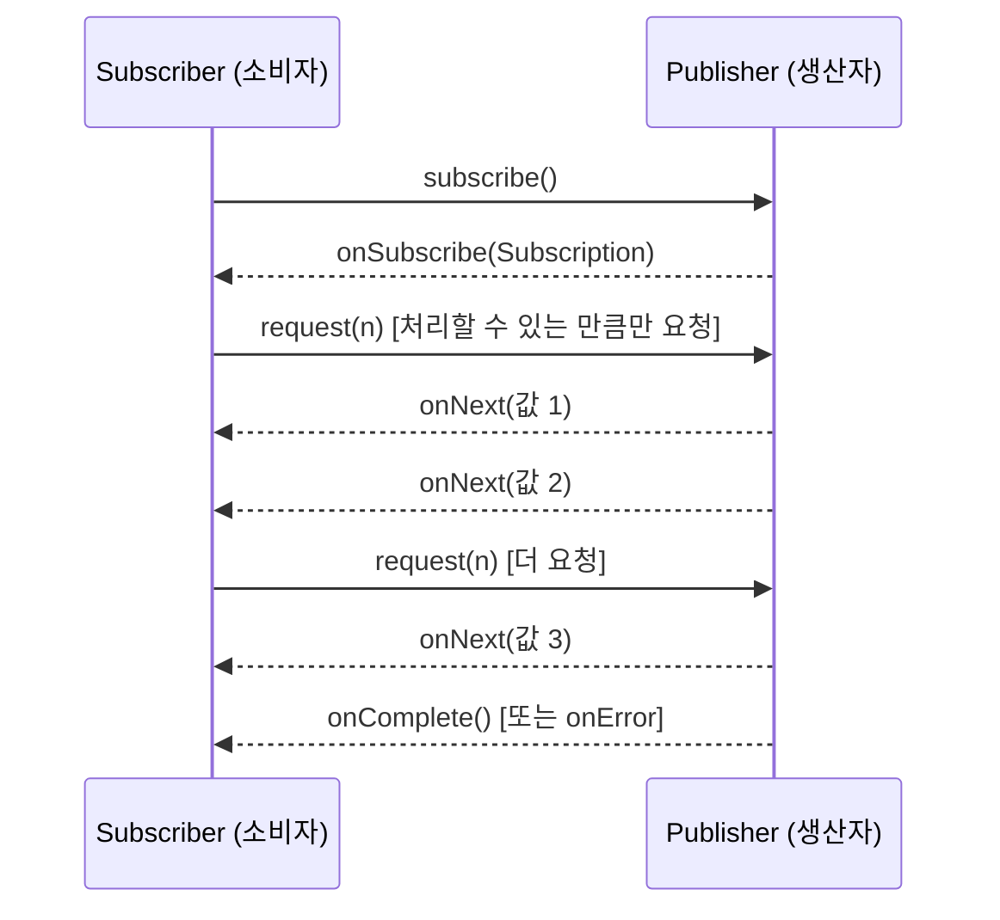

위 시퀀스에서 중요한 것은 `request(n)`입니다. 소비자가 "나는 최대 n개까지 처리할 수 있다"고 상류(upstream)에 알려 주는 이 신호가 바로 백프레셔의 실체입니다.

### 3.2 Mono와 Flux: 타입으로 표현하는 0..1과 0..N

Reactor는 두 가지 핵심 타입을 제공합니다.

| 타입 | 의미 | 대표 사용처 |
|---|---|---|
| `Mono<T>` | 0개 또는 1개의 결과 | 단건 조회, 저장 결과, HTTP 응답 한 건 |
| `Flux<T>` | 0개~N개의 결과 | 목록 조회, 이벤트 스트림, 스트리밍 응답 |

홈페이지는 이를 "Typed [0|1|N] sequences"라고 부르며, 두 API 모두 Reactive Extensions를 폭넓게 구현했다고 설명합니다. "값이 없을 수도 있다/하나다/여러 개다"를 **타입 자체가 알려 주기** 때문에 API 설계가 명확해집니다.

### 3.3 조립 라인(Assembly Line) 비유와 연산자

레퍼런스는 리액티브 애플리케이션을 **조립 라인**에 비유합니다. Reactor는 컨베이어 벨트이자 작업대이며, 원재료는 원천 `Publisher`에서 흘러나와 여러 작업대(연산자)를 거쳐 완제품이 되어 `Subscriber`에게 도착합니다. 어느 작업대가 느려져 막히면, 그 작업대가 상류에 "천천히 보내라"고 신호할 수 있습니다.

여기서 **연산자(operator)** 가 작업대입니다. 각 연산자는 이전 단계의 `Publisher`를 감싸는 **새 인스턴스**를 만듭니다. 이 사실을 모르면 "연산자를 붙였는데 적용이 안 된다"는 흔한 실수(결과를 변수에 받지 않고 버리는 경우)를 하게 된다고 레퍼런스 FAQ가 따로 안내합니다.

### 3.4 "구독하기 전에는 아무 일도 일어나지 않는다"

Reactor에서 `Publisher` 체인을 작성해도 데이터는 흐르지 않습니다. 체인은 **비동기 처리에 대한 추상적인 설계도**일 뿐이며, `Subscriber`가 **구독(subscribe)** 하는 순간 비로소 흐름이 시작됩니다. 내부적으로는 구독자가 보낸 단 하나의 `request` 신호가 상류의 원천까지 거슬러 올라가며 전파됩니다.

이 성질 덕분에 체인을 **재사용 가능한 부품**처럼 다룰 수 있지만, 동시에 "구독을 누가 하는가"를 항상 의식해야 합니다. (웹 프레임워크를 쓰면 대개 프레임워크가 구독합니다. 9장에서 다시 다룹니다.)

### 3.5 백프레셔: 빠른 생산자로부터 소비자를 보호하는 장치

동기·명령형 코드에서는 블로킹 호출 자체가 자연스러운 백프레셔입니다. 호출자가 결과를 기다려야 하니 생산 속도가 저절로 조절됩니다. 논블로킹 코드에서는 이 자연스러운 제동이 사라지므로, **이벤트의 속도를 의도적으로 제어**해야 빠른 생산자가 목적지를 압도하지 않습니다.

레퍼런스가 설명하는 실제 메커니즘은 다음과 같습니다.

- 구독자는 **무제한(unbounded) 모드**로 상류가 가능한 최대 속도로 밀어 넣게 할 수도 있고, `request(n)`으로 "최대 n개까지"만 요청할 수도 있습니다.
- 중간 연산자가 요청을 바꿀 수도 있습니다. 예컨대 10개씩 묶는 `buffer`는 구독자가 1개 묶음을 요청하면 상류에는 10개를 요청합니다.
- 일부 연산자는 **프리페치(prefetch)** 전략으로 `request(1)` 왕복을 줄입니다.
- 결과적으로 push 모델이 **push–pull 하이브리드**가 됩니다. 준비된 값은 끌어오고, 아직 없으면 생산되는 즉시 밀어 줍니다.

Spring Framework 문서는 여기에 중요한 단서를 하나 답니다. **"생산자가 속도를 늦출 수 없다면 어떻게 되나?"** 라는 질문에 대해, Reactive Streams는 *메커니즘과 경계*만 제공할 뿐이며, 생산자가 늦출 수 없다면 **버퍼링할지, 버릴지, 실패시킬지를 스스로 결정해야 한다**고 답합니다. 즉 백프레셔는 "공짜로 문제가 사라지는 마법"이 아니라 **정책을 결정하게 만드는 구조**입니다. (참고로 `Flux.create`로 직접 시퀀스를 만들 때 오버플로 기본 정책은 BUFFER라고 Reactor 저장소 README에 적혀 있습니다.)

### 3.6 Cold와 Hot

| 구분 | 설명 | 예 |
|---|---|---|
| **Cold** | 구독자마다 처음부터 새로 시작합니다. | HTTP 호출을 감싼 `Mono`는 구독할 때마다 새 HTTP 요청을 보냅니다. |
| **Hot** | 새 구독자는 구독한 *이후*의 신호만 받습니다. 일부는 과거 값을 캐시·재생하기도 합니다. | 센서 이벤트, 시계 틱 같은 스트림 |

Hot 스트림은 구독자가 없어도 값을 방출할 수 있는데, 이것이 "구독 전에는 아무 일도 없다"는 규칙의 예외입니다.

### 3.7 스레드와 스케줄러(Scheduler)

Reactor는 **동시성에 중립적(concurrency-agnostic)** 입니다. 특정 동시성 모델을 강요하지 않고 개발자에게 선택권을 줍니다. 중요한 사실 몇 가지가 있습니다.

- `Flux`나 `Mono`를 얻는다고 해서 별도 스레드에서 실행되는 것은 **아닙니다.** 대부분의 연산자는 직전 연산자가 실행되던 스레드에서 계속 실행되고, 맨 위 원천은 `subscribe()`를 호출한 스레드에서 실행됩니다.
- 실행 환경은 `Scheduler`가 결정합니다. `Schedulers`가 제공하는 대표 선택지는 다음과 같습니다.

| 스케줄러 | 용도 |
|---|---|
| `Schedulers.immediate()` | 현재 스레드에서 즉시 실행(사실상 no-op) |
| `Schedulers.single()` | 재사용되는 단일 스레드 |
| `Schedulers.parallel()` | CPU 코어 수만큼의 고정 워커. **CPU 바운드 작업용** |
| `Schedulers.boundedElastic()` | 상한이 있는 탄력적 풀. **블로킹 작업에 전용 스레드를 주는 용도** |
| `Schedulers.elastic()` | 상한 없는 풀. 백프레셔 문제를 숨기고 스레드가 너무 많아질 수 있어 **더 이상 권장되지 않음** |

- `boundedElastic()`은 3.6.0부터 두 가지 구현이 가능합니다. 하나는 플랫폼 스레드를 재사용하는 `ExecutorService` 기반이며(기본 상한은 CPU 코어 수 × 10, 상한 도달 후에는 최대 10만 개 작업을 큐에 대기), 다른 하나는 **Java 21 이상에서 `reactor.schedulers.defaultBoundedElasticOnVirtualThreads` 시스템 속성을 `true`로 설정하면 작업마다 새 `VirtualThread`를 사용하는 구현**입니다.
- 중요한 안전장치: 기본 `single`/`parallel` 스케줄러 안에서 `block()`, `blockFirst()`, `blockLast()` 같은 블로킹 API를 호출하면 `IllegalStateException`이 발생합니다.
- 스레드를 바꾸는 두 연산자의 차이: **`publishOn`은 위치가 중요**합니다(그 *이후* 연산자들의 실행 스레드를 바꿈). **`subscribeOn`은 위치가 덜 중요**합니다(구독 과정 전체, 즉 체인 전체가 시작되는 스레드를 바꿈). 가까운 `subscribeOn` 하나만 효과가 있고, 여러 번 쓰면 의미 없는 스레드 전환만 늘어납니다.

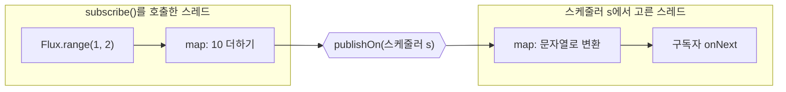

### 3.8 Context와 Context Propagation

리액티브 체인은 스레드를 넘나들기 때문에, 전통적인 `ThreadLocal`에 의존하던 로깅 상관관계 ID(MDC)나 트레이싱 정보를 그대로 쓸 수 없습니다. Reactor는 구독 단위로 전달되는 `Context`를 제공하고, 3.5.0부터 `io.micrometer:context-propagation` SPI를 내장 지원합니다. 공식 문서가 설명하는 두 모드는 다음과 같습니다.

| 모드 | 동작 | 특징 |
|---|---|---|
| **기본(제한) 모드** | `handle`, `tap` 같은 일부 연산자만 `ThreadLocal`을 복원 | 영향 범위가 작고 단순 |
| **자동(automatic) 모드** | `Hooks.enableAutomaticContextPropagation()`으로 켬. 모든 연산자가 스레드 경계를 넘어 `ThreadLocal` 복원 | 애플리케이션 시작 시점에 켜야 하며(새 구독에만 적용), 정리가 잘못되면 같은 스레드를 재사용하는 무관한 코드로 상태가 새어 나갈 수 있음 |

문서는 어느 쪽이 더 낫다고 단정하지 않고 **"실제 부하에서 측정하라"** 고 권고합니다. `ThreadLocal` 접근 자체가 리액티브 파이프라인에 상당한 영향을 줄 수 있어, 최고의 확장성이 목표라면 `ThreadLocal`에 의존하지 않고 인자를 명시적으로 전달하는 방식을 고려할 수 있다고도 적혀 있습니다. Micrometer나 SLF4J처럼 `ThreadLocal`을 쓰는 관측성(observability) 도구의 편의를 얻는 대신 이 비용을 치르는 것은 *이해하고 선택해야 할 타협*이라는 설명입니다.

---

## 4. 홈페이지가 말하는 Reactor의 강점

공식 홈페이지는 Reactor의 특징을 다음과 같이 정리합니다.

1. **Reactive Core** — 완전한 논블로킹이며 효율적인 수요(demand) 관리(백프레셔)를 제공합니다. 자바의 함수형 API인 `CompletableFuture`, `Stream`, `Duration`과 직접 연동합니다.
2. **Typed [0|1|N] Sequences** — 조합 가능한 두 API인 `Flux [N]`과 `Mono [0|1]`을 제공하고 Reactive Extensions를 폭넓게 구현합니다.
3. **Non-blocking IO** — 마이크로서비스 아키텍처에 잘 맞으며, HTTP(WebSocket 포함)·TCP·UDP용 **백프레셔 대응 네트워크 엔진**을 제공합니다.
4. **Efficient Message Passing** — 연산자와 스케줄러가 초당 **수천만(10's of millions) 건 규모의 메시지 처리량**을 유지할 수 있고 메모리 사용량이 작다고 안내합니다. *(이는 홈페이지의 성능 주장이며, 여러분의 애플리케이션 전체 처리량을 보장하는 수치가 아니라 코어 연산자·스케줄러 수준의 설명이라는 점에 유의하세요. Spring 공식 문서도 "리액티브·논블로킹이 애플리케이션을 더 빠르게 만드는 것은 일반적으로 아니다"라고 명시합니다. 이 내용은 9.8절에서 다시 다룹니다.)*
5. **A Micro Reactive Toolkit for All** — "Reactive Streams를 직접 구현하지 마세요"라는 입장에서, Reactor 모듈은 임베드 가능하고 상호운용 가능하다고 설명합니다. 사용 수준도 자유로워서 Spring Boot·WebFlux 같은 **프레임워크**, CloudFoundry Java Client 같은 **드라이버·클라이언트**, RSocket·R2DBC 같은 **계약·프로토콜** 수준에서 모두 쓸 수 있다고 합니다.
6. **Guardians of the Latency** — 지연과 느린 마이크로서비스를 극복하려면 스케일 아웃이 중요하고, 클라우드 네이티브 앱과 서버리스 함수는 비동기 아키텍처에서 효과적으로 스케일 아웃할 가능성이 더 높다고 설명합니다. 이를 돕기 위해 견고한 **Netty** 프레임워크를 기반으로 로컬 TCP/HTTP/UDP 클라이언트·서버를 포함한 논블로킹·백프레셔 대응 네트워크 런타임을 제공합니다.

홈페이지 하단에는 두 묶음의 링크가 있습니다. **Reactive World**에는 *Reactive Streams, RS-Commons, ReactiveX*가, **Production World**에는 *Tanzu Spring – Enterprise Support, Spring, VMware Tanzu*가 안내되어 있습니다. 즉 표준·생태계 쪽 뿌리(Reactive Streams, ReactiveX)와 상용 지원·Spring 연계(운영 환경) 쪽 축을 함께 보여 주는 구성입니다.

---

## 5. Reactor 프로젝트 전체 지도(모듈별 현재 버전)

Reactor는 하나의 라이브러리가 아니라 **여러 모듈의 묶음**입니다. 공식 문서 페이지(`projectreactor.io/docs`)에 표시된 현재 상태는 다음과 같습니다. 안정(stable) 릴리스 트레인은 **2025.0.7**, 사전 릴리스(pre-release) 트레인은 **2026.0.0-M2**입니다.

| 모듈 | 설명 | 안정 트레인 2025.0.7 | 사전 릴리스 2026.0.0-M2 |
|---|---|---|---|
| **Reactor Core** | 자바 8 기반 Reactive Streams 기초 라이브러리 | 3.8.7 | 3.8.7 |
| **Reactor Test** | 테스트 유틸리티 | 3.8.7 | 3.8.7 |
| **Reactor Netty** | Netty 기반 HTTP·TCP·UDP 클라이언트/서버 | 1.3.7 | 1.4.0-M2 |
| **Reactor Extra** | Flux용 추가 연산자 | 3.6.1 | 3.7.0-M1 |
| **Reactor Adapter** | 다른 리액티브 라이브러리와의 상호 변환 | 3.6.1 | 3.7.0-M1 |
| **Reactor Kotlin Extensions** | 코틀린용 확장(Dysprosium+ 의 모든 자바 아티팩트 대상) | 1.3.2 | 1.3.2 |
| **Reactor Pool** | 리액티브 애플리케이션용 범용 객체 풀 | 1.2.7 | 1.3.0-M1 |
| **Reactor Kafka** | Apache Kafka 리액티브 브리지 | 1.3.25 | (포함되지 않음) |
| **BlockHound** | 논블로킹 스레드의 블로킹 호출을 감지하는 자바 에이전트 | 별도 릴리스 *(문서 페이지에는 스냅샷 링크 위주로 표기)* | — |

> 참고: Reactor Core 3.8.6 릴리스 노트에는 "BlockHound를 1.0.17.RELEASE로 올림"이라는 항목이 있어, BlockHound의 최근 정식 버전이 1.0.17임을 간접적으로 확인할 수 있습니다.

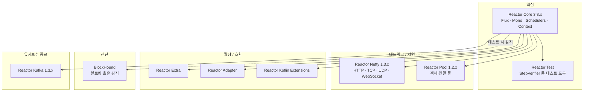

---

## 6. 릴리스 트레인과 BOM 읽는 법

Reactor 3는 **BOM(Bill of Materials)** 방식을 씁니다(reactor-core 3.0.4, 코드명 Aluminium 릴리스 트레인부터). 모듈마다 버전이 달라서 "어떤 조합이 서로 검증되었는가"를 알려 주는 것이 BOM이고, 각 배포 주기에는 코드명이 붙습니다.

- 지금 쓰는 트레인 이름은 **연도.번호.패치** 형태입니다. 예를 들어 `2025.0.7`은 "2025 트레인의 0번 라인, 7번째 패치"이고, 이 트레인에 `reactor-core 3.8.7`, `reactor-netty 1.3.7`이 묶여 있습니다.
- 문서 페이지에는 이전 트레인들의 최종 BOM도 함께 표시되며, 현재 **EOL(지원 종료) 표시가 붙은 이전 트레인**은 Dysprosium-SR25, Californium-SR23, Bismuth-SR17, Aluminium-SR3, 2024.0.18, 2023.0.19, 2022.0.22, 2020.0.47입니다.
- 실무 규칙: **개별 모듈 버전을 따로따로 올리지 말고 BOM 하나로 정렬**하는 것이 의도된 사용법입니다.

Gradle 예시(Reactor 공식 시작 문서의 방식):

```groovy
dependencies {
    implementation platform('io.projectreactor:reactor-bom:2025.0.7')
    implementation 'io.projectreactor:reactor-core'   // 버전 생략: BOM이 정함
    testImplementation 'io.projectreactor:reactor-test'
}
```

---

## 7. 지원 일정(Support Timeline)과 오늘 시점의 의미

공식 지원 일정 페이지의 데이터를 그대로 정리했습니다. **OSS 지원**은 Reactor 커뮤니티의 지원 기간이고, **엔터프라이즈 지원**은 Tanzu Spring을 통한 전담 전문가 지원으로 OSS 기간과 연장된 기간을 함께 포함합니다.

### 7.1 주요 모듈의 지원 종료일

| 모듈 / 버전 | 최초 릴리스 | OSS 지원 종료 | 엔터프라이즈 지원 종료 | 2026-10-15 현재 |
|---|---|---|---|---|
| reactor-core **3.8** | 2025-11-07 | 2027-06-30 | 2028-06-30 | OSS 지원 중 |
| reactor-core 3.7 | 2024-11-12 | 2026-06-30 | 2032-06-30 | **OSS 종료**, 엔터프라이즈만 |
| reactor-core 3.6 | 2023-11-14 | 2025-06-30 | 2026-06-30 | 모두 종료 |
| reactor-core 3.5 | 2022-11-08 | 2024-06-30 | 2025-06-30 | 모두 종료 |
| reactor-core 3.4 | 2020-10-26 | 2023-06-30 | 2029-06-30 | OSS 종료, 엔터프라이즈만 |
| reactor-netty **1.3** | 2025-11-07 | 2027-06-30 | 2028-06-30 | OSS 지원 중 |
| reactor-netty 1.2 | 2024-11-12 | 2026-06-30 | 2032-06-30 | **OSS 종료**, 엔터프라이즈만 |
| reactor-netty 1.1 | 2022-11-08 | 2025-06-30 | 2026-06-30 | 모두 종료 |
| reactor-netty 1.0 | 2020-10-26 | 2023-06-30 | 2029-06-30 | OSS 종료, 엔터프라이즈만 |
| reactor-kafka **1.3** | 2020-10-26 | 2026-06-30 | 2032-06-30 | **OSS 종료**, 엔터프라이즈만 |
| reactor-pool **1.2** | 2025-11-07 | 2027-06-30 | 2028-06-30 | OSS 지원 중 |
| reactor-pool 1.1 | 2024-11-12 | 2026-06-30 | 2032-06-30 | OSS 종료 |
| reactor-addons **3.6** | 2025-11-07 | 2027-06-30 | 2028-06-30 | OSS 지원 중 |
| reactor-addons 3.5 | 2022-11-08 | 2026-06-30 | 2032-06-30 | OSS 종료 |
| reactor-kotlin-extensions **1.3** | 2025-11-07 | 2027-06-30 | 2028-06-30 | OSS 지원 중 |
| reactor-kotlin-extensions 1.2 | 2022-11-08 | 2026-06-30 | 2032-06-30 | OSS 종료 |
| reactor-rabbitmq 1.5 | 2020-10-26 | 2023-06-30 | 2029-06-30 | OSS 종료, 엔터프라이즈만 |
| reactor-bom **2025** | 2025-11-07 | 2027-06-30 | 2028-06-30 | OSS 지원 중 |
| reactor-bom 2024 | 2024-11-12 | 2026-06-30 | 2032-06-30 | **OSS 종료** |

> 표의 "2026-10-15 현재" 열은 지원 일정 페이지의 날짜를 오늘 날짜와 비교한 단순 계산입니다. 표에 없는 세부 정책은 공식 "OSS support policy" 문서를 확인하세요.

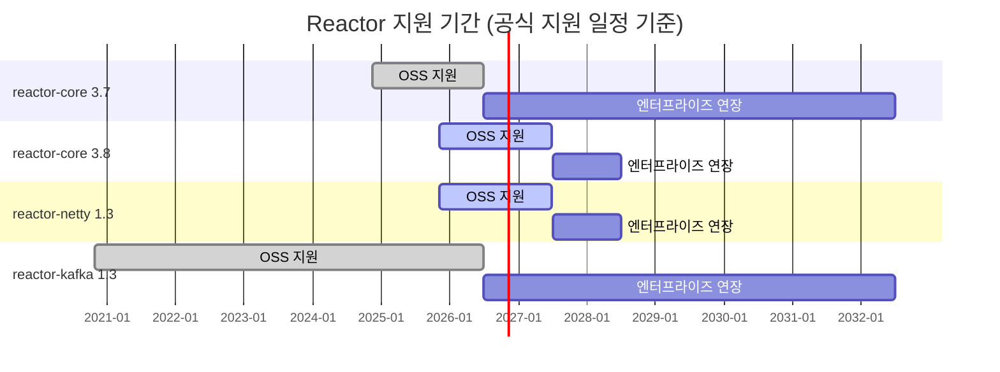

### 7.2 이 표에서 읽을 수 있는 실무 의미

- **오늘(2026-10-15) 기준으로 가장 최신 OSS 지원 라인은 reactor-core 3.8 / reactor-netty 1.3 / BOM 2025.0.x** 입니다. 2027-06-30까지 OSS 지원이 예정되어 있습니다.
- **3.7 / Netty 1.2 / BOM 2024**를 쓰고 있다면 OSS 지원은 이미 2026-06-30에 끝났습니다. 계속 안전 패치를 받으려면 3.8 라인으로 올리거나, Tanzu Spring 엔터프라이즈 지원(2032-06-30까지)을 이용해야 합니다.
- 일정 페이지의 날짜 형식은 **"11월에 새 마이너 라인 출시, OSS 지원은 이후 6월 30일 기준으로 종료"** 라는 패턴으로 반복됩니다(표의 최초 릴리스 날짜와 종료일을 보면 확인됩니다). 다만 이는 표의 날짜에서 보이는 규칙일 뿐이며, 공식 정책 문서가 이 패턴을 보장한다고 확인한 것은 아닙니다.

---

## 8. 최근에 달라진 점

### 8.1 Reactor Core 3.8 (2025.0 릴리스 트레인, 2025-11 출시)

3.8.0 릴리스 노트가 강조한 변경은 두 가지입니다.

1. **JSpecify 기반 null-safety**: 기존 JSR 305 기반 어노테이션(`reactor.util.annotation` 패키지의 `@Nullable` 등)을 대체하는 **JSpecify 어노테이션**을 도입해, 빌드 시점 검사로 `NullPointerException`을 예방합니다. 기존 `reactor.util.annotation`의 어노테이션은 **deprecated** 되었습니다. Reactor 코드베이스는 NullAway로 선언의 일관성을 빌드 과정에서 검증하며, 코틀린에서는 JSpecify 어노테이션이 자동으로 코틀린 null-safety로 해석됩니다. 문서는 Reactor에 의존하는 라이브러리들도 같은 방식을 쓰길 권장합니다.
2. **`reactor-core-micrometer` 버전을 코어와 일치**: 코어와 항상 함께 릴리스되는 이 모듈의 버전을 3.8.0부터 코어 버전에 맞췄습니다(이전에는 3.7.x에 대응하는 1.2.x 라인이었음).

이후 3.8.x 패치(3.8.1~3.8.7)는 주로 ByteBuddy, Micrometer(1.16.x), Micrometer Tracing(1.6.x), BlockHound 같은 의존성 갱신과 문서 개선이었습니다. 현재 최신은 **3.8.7**입니다.

### 8.2 Reactor Netty 1.3 (2025.0 릴리스 트레인)

1.3.0 릴리스 노트의 핵심은 다음과 같습니다.

- 기반이 **Netty 4.2**로 올라갔습니다.
- **HTTP/3 지원이 "졸업(graduated)"** — 1.2에서 *실험적(experimental)* 이던 것이 **프로덕션 사용 가능** 상태가 되었습니다.
- **QUIC 지원**과 **io_uring 지원**도 프로덕션 사용 가능으로 졸업했습니다.
- Linux 기본 전송은 **Epoll(기본 포함)** 이고, io_uring은 `io.netty:netty-transport-native-io_uring` 의존성을 **명시적으로 추가**해야 사용할 수 있습니다.

참고로 Spring 공식 블로그는 1.2 시절 글에서 "기본적으로 Reactor Netty는 HTTP/1.1을 지원하도록 설정되어 있어 HTTP/3를 쓰려면 설정을 바꿔야 한다"고 설명했습니다. 이 글에서는 Spring Boot 애플리케이션과 Spring Cloud Gateway를 HTTP/3 지원으로 설정하는 방법도 다룹니다. 최신 1.3.7 릴리스 노트에는 Reactor Core 3.8.7·Netty 4.2.17.Final 의존, WebSocket 클라이언트 메트릭 추가, HTTP/2 연결 풀의 요청당 CPU 사용 감소, 파이프라인된 HTTP 요청에 대한 백프레셔 추가, 압축 해제 버퍼 최대 크기 설정 API 추가 같은 항목이 포함되어 있습니다.

### 8.3 Reactor Kafka의 종료

2025년 5월 20일 Spring 블로그는 **Reactor Kafka 프로젝트를 중단한다**고 발표했습니다. 발표문이 밝힌 영향은 다음과 같습니다.

- Reactor Kafka는 **앞으로의 모든 Reactor BOM 릴리스에서 제외**됩니다. (실제로 현재 문서 페이지의 사전 릴리스 트레인 2026.0.0-M2에는 Reactor Kafka가 없습니다.)
- **1.3이 마지막 마이너 릴리스**이며, OSS·상용 지원 기간이 끝날 때까지 필수적인 수정만 제공합니다.
- **Spring Cloud Stream의 Reactor Kafka 바인더**는 deprecated 되고 향후 제거 대상이 됩니다.
- **Spring for Apache Kafka의 Reactive template**도 deprecated 되고 향후 제거 대상이 됩니다.
- 발표문은 Reactor Core, Reactor Netty 등 나머지 Reactor 생태계는 계속 개발할 것이라고 밝혔습니다.

저장소 쪽 상태도 일치합니다. `reactor/reactor-kafka`의 README에는 "2025년 5월에 중단됨" 공지가 있고, `spring-attic/reactor-kafka` 저장소 상단에는 **2026년 9월 30일 소유자에 의해 아카이브되어 읽기 전용**이라는 안내가 표시되어 있으며 README에는 "더 이상 유지보수되지 않음" 문구가 추가되었습니다. 최신 릴리스는 v1.3.25입니다.

### 8.4 사전 릴리스 트레인 2026.0.0-M2

문서 페이지에는 **2026.0.0-M2**가 사전 릴리스로 표시되어 있습니다(Core 3.8.7, Netty 1.4.0-M2, Extra·Adapter 3.7.0-M1, Pool 1.3.0-M1). 정식 출시 날짜는 제가 확인한 자료에는 없으므로 이 문서에서는 언급하지 않습니다.

### 8.5 Spring 쪽 동향(참고)

Reactor는 Spring WebFlux가 **선택한 리액티브 라이브러리**이고(Spring 공식 문서: "Reactor is the reactive library of choice for Spring WebFlux"), Spring Framework의 현재 안정 버전은 문서 기준 **7.0.9**(이전 안정 라인 6.2.19)입니다. Spring Boot 4.0 마이그레이션 가이드에는 모듈과 스타터가 세분화되어 `spring-boot-starter-reactor`, `spring-boot-starter-reactor-netty`, `spring-boot-starter-webflux` 같은 이름이 등장합니다. WebFlux 스타터를 쓰면 기본 서버는 **Netty(Reactor Netty)** 이고, Tomcat이나 Jetty로 바꿀 수도 있습니다.

---

## 9. 이상적인 아키텍처

이 장은 "Reactor로 만들 수 있는 이상적인 아키텍처"를 다룹니다. 먼저 정직하게 짚을 점이 있습니다. **"이상적"인 아키텍처는 워크로드에 따라 달라지며, 공식 문서가 단 하나의 정답 구조를 제시하지는 않습니다.** 그래서 이 장은 (1) 공식 문서에서 확인된 사실을 근거로 삼고, (2) 그 근거 위에서 제가 추론한 **설계 제안**을 구분해서 제시하며, (3) 어떤 전제에서 이상적인지를 먼저 밝히는 순서로 구성했습니다.

### 9.1 전제: 어떤 시스템에 "이상적"인가

Spring 공식 문서가 밝히는 리액티브·논블로킹의 기대 효과는 **"작고 고정된 수의 스레드와 더 적은 메모리로 확장"** 하는 능력이며, 그 효과가 드러나려면 **지연(latency)이 있는 환경, 특히 느리고 예측 불가능한 네트워크 I/O가 섞인 환경**이어야 합니다. 따라서 아래 아키텍처는 다음과 같은 시스템을 전제로 합니다.

- 외부 API·메시지 브로커·원격 서비스 호출이 많은 **I/O 중심** 서비스
- 동시 연결이 많거나 **스트리밍(SSE, WebSocket)** 이 필요한 서비스
- 부하가 커져도 **스레드·메모리 사용이 예측 가능**해야 하는 서비스

반대로 JPA·JDBC 같은 블로킹 영속성 API가 중심이라면 Spring 공식 문서는 "**일반적인 아키텍처에서는 Spring MVC가 최선의 선택**"이라고 안내합니다(10장에서 자세히 다룹니다).

### 9.2 설계 원칙 열 가지

아래 열 가지는 *공식 문서가 확인해 주는 사실*에 각각 근거를 두었고, 원칙 자체의 묶음과 순서는 설계 제안입니다.

**원칙 1. 끝에서 끝까지 논블로킹을 지킨다.**
Spring 문서는 WebFlux 컨텍스트에서 서블릿 필터를 매핑하거나 서블릿 API를 직접 다루는 것을 강하게 만류하며, **블로킹 I/O와 논블로킹 I/O를 같은 컨텍스트에 섞으면 런타임 문제가 생긴다**고 경고합니다. 한 군데라도 이벤트 루프 스레드를 막으면 그 스레드가 처리하던 모든 연결이 함께 지연됩니다.

**원칙 2. 파이프라인을 "조립"하는 코드와 "구독"하는 지점을 분리한다.**
서비스 계층은 `Mono`/`Flux`를 **반환만** 하고, 구독은 프레임워크(WebFlux)나 애플리케이션 경계(예: 메시지 소비 루프)에서 합니다. 서비스 안에서 `subscribe()`나 `block()`을 호출하면 오류 전파·취소·백프레셔가 끊깁니다. *(근거: "구독 전에는 아무 일도 일어나지 않는다" + `Mono`/`Flux`는 설계도라는 레퍼런스의 설명에서 도출한 설계 제안)*

**원칙 3. 모든 경계에 상한을 둔다(동시성·버퍼·풀).**
백프레셔는 정책 결정을 강제하는 구조이므로(3.5절), 무제한은 곧 "정책을 정하지 않았다"는 뜻입니다. `flatMap`의 동시성 인자, 버퍼 크기, 연결 풀 크기를 명시적으로 정합니다. Reactor Netty의 `HttpClient`는 기본적으로 **원격 호스트별 고정(fixed) 연결 풀(기본 최대 활성 채널 500)** 을 사용합니다(Reactor Netty 문서). 기본값에 의존하더라도 *그 값을 알고* 사용하는 것이 중요합니다.

**원칙 4. 블로킹을 피할 수 없다면 격리한다.**
레거시 JDBC 등을 어쩔 수 없이 써야 한다면 `subscribeOn(Schedulers.boundedElastic())`처럼 **블로킹 전용 스케줄러**에서 실행하게 해서 이벤트 루프를 보호합니다. Spring 문서도 `publishOn`이 쉬운 탈출구이지만 *"블로킹 API는 이 동시성 모델에 잘 맞지 않는다"* 고 덧붙입니다. 즉 격리는 임시 방편이지 이상형이 아닙니다.

**원칙 5. 시간 제한과 대체 경로를 선언적으로 둔다.**
2.3절의 `timeout` + `onErrorResume` 처럼, 모든 원격 호출에 시간 제한(그리고 필요하면 재시도·폴백)을 연산자로 선언합니다. 이것이 Reactor가 가장 잘 하는 일 중 하나입니다.

**원칙 6. 외부 시스템은 포트/어댑터 뒤에 둔다.**
Reactor Kafka 중단 사례(8.3절)가 이 원칙의 실증입니다. 메시징·데이터 접근 라이브러리는 생태계 사정으로 바뀔 수 있으므로, 도메인·애플리케이션 서비스는 `Flux<Event>`, `Mono<Result>` 같은 **Reactor 타입의 포트 인터페이스**만 알고, 실제 Kafka·DB·HTTP 구현은 어댑터로 교체 가능하게 둡니다. *(설계 제안)*

**원칙 7. 관측성(Observability)을 처음부터 설계한다.**
스레드가 계속 바뀌므로 `ThreadLocal` 기반 로그 상관관계가 깨집니다. Context Propagation(3.8절)을 쓰되, 기본 모드/자동 모드의 성능 영향을 **부하 상황에서 측정해 선택**합니다. Reactor Core 3.8은 Micrometer 1.16.x, Micrometer Tracing 1.6.x에 의존하고, `reactor-core-micrometer` 모듈이 코어와 같은 버전으로 릴리스됩니다.

**원칙 8. 테스트와 CI에 "블로킹 감시자"를 둔다.**
BlockHound는 논블로킹 스레드에서 발생한 블로킹 호출(I/O, `Thread.sleep` 등)을 **정확한 호출 위치와 함께** 오류로 알려 주는 자바 에이전트입니다. 데모 저장소도 *"테스트 실행 중에 켜서, 프로덕션에 들어가기 전에 문제를 발견하는 데 특히 유용"* 하다고 설명합니다. `BlockHound.install()`로 설치하며, JDK 13 이상에서는 README에 임시 우회 옵션 `-XX:+AllowRedefinitionToAddDeleteMethods`가 안내되어 있으니, 사용하는 BlockHound 버전의 최신 문서에서 이 옵션이 지금도 필요한지 확인하세요.

**원칙 9. 시간이 필요한 테스트는 가상 시간(virtual time)으로.**
`Scheduler`는 단순한 스레드 풀 추상화가 아니라 시계 역할도 하기 때문에, 테스트용 **가상 시간 구현**이 가능하다고 레퍼런스가 설명합니다. 타임아웃·지연 로직을 실제 시간 소모 없이 테스트할 수 있습니다. 시퀀스 검증에는 `reactor-test`(Reactor Test)의 `StepVerifier`를 씁니다.

**원칙 10. 버전은 BOM 하나로, 지원 일정에 맞춰 올린다.**
6~7장에서 보았듯이 지원 종료일이 명확히 공개되어 있으므로, 업그레이드를 일정으로 관리합니다(12장).

### 9.3 참조 아키텍처(설계 제안)

아래 구조는 위 원칙을 한 장에 담은 **제안 구조**입니다. 각 구성요소가 공식 문서에서 확인된 기술이라는 점이 중요하며, 구성 방식 자체는 제안입니다.

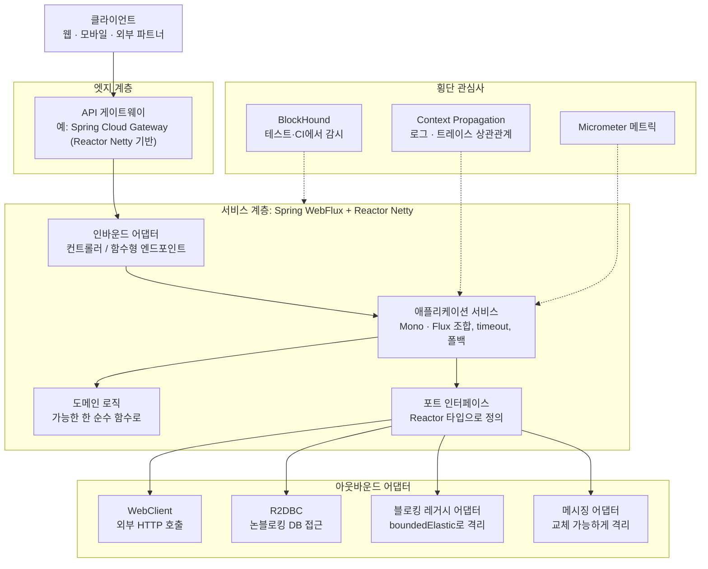

계층별 설명입니다.

**① 엣지 계층 — 게이트웨이.** Reactor Netty는 HTTP/1.1·HTTP/2에 더해 1.3에서 HTTP/3(QUIC)가 프로덕션 사용 가능으로 졸업했으므로, 엣지에서 프로토콜 선택지가 넓습니다. Spring 공식 블로그는 Spring Cloud Gateway를 Reactor Netty 설정으로 HTTP/3 지원 구성하는 방법을 소개했습니다(1.2 시절 글이므로 1.3 기준 설정은 최신 문서에서 확인).

**② 서비스 계층 — WebFlux + Reactor Netty.** Spring Boot의 WebFlux 스타터는 기본으로 **Netty**를 쓰며, Spring 문서는 그 이유를 *"비동기·논블로킹 영역에서 더 널리 쓰이고, 클라이언트와 서버가 자원을 공유할 수 있기 때문"* 이라고 설명합니다. 실제로 Reactor Netty를 클라이언트와 서버에 모두 쓰면 **이벤트 루프 자원을 기본적으로 공유**합니다. 즉 요청을 받는 스레드 몇 개가 외부 호출(WebClient)까지 함께 처리하는 구조라, 스레드 수가 작고 고정적으로 유지됩니다. 프로그래밍 모델은 두 가지 중 고르면 됩니다.

| 모델 | 특징 |
|---|---|
| **어노테이션 컨트롤러** | Spring MVC와 같은 어노테이션 기반. 리액티브 `@RequestBody` 인자도 지원 |
| **함수형 엔드포인트** | 람다 기반의 가벼운 모델. 요청 처리를 처음부터 끝까지 애플리케이션이 직접 통제. 작은 서비스에 적합 |

**③ 애플리케이션 서비스 계층.** 업무 흐름을 `Mono`/`Flux` 연산자로 조합하는 곳입니다. 아래는 이 계층의 **예시 코드(설계 제안 형태)** 입니다. 공식 문서의 연산자 의미(`flatMap`, `timeout`, `onErrorResume`, `switchIfEmpty`)에 맞게 작성했습니다.

```java
class RecommendationService {

    private final FavoritePort favorites;       // 포트: Reactor 타입으로 정의
    private final SuggestionPort suggestions;
    private final CachePort cache;

    RecommendationService(FavoritePort favorites, SuggestionPort suggestions, CachePort cache) {
        this.favorites = favorites;
        this.suggestions = suggestions;
        this.cache = cache;
    }

    // 파이프라인을 "조립해서 반환"만 한다. subscribe()는 프레임워크가 한다.
    Flux<Favorite> topFavorites(String userId) {
        return favorites.idsOf(userId)
                .timeout(Duration.ofMillis(800))                  // 원칙 5: 시간 제한
                .onErrorResume(e -> cache.cachedIdsOf(userId))    // 원칙 5: 대체 경로
                .flatMap(favorites::details, 16)                  // 원칙 3: 동시성 상한 16
                .switchIfEmpty(suggestions.defaults())
                .take(5);
    }
}
```

```java
class FavoriteController {

    private final RecommendationService service;

    FavoriteController(RecommendationService service) { this.service = service; }

    @GetMapping("/users/{id}/favorites")
    Flux<Favorite> favorites(@PathVariable String id) {
        return service.topFavorites(id);   // 구독은 WebFlux가 한다
    }
}
```

**④ 아웃바운드 어댑터.**
- **WebClient**: 이벤트 루프 방식으로 동작하며(Reactor Netty 커넥터 사용 시 `reactor-http-nio-` 스레드), 서버와 이벤트 루프를 공유합니다.
- **R2DBC**: Spring Framework 참조 문서에 "Data Access with R2DBC" 장이 있고, Reactor 홈페이지도 R2DBC를 Reactor 활용 사례로 소개합니다. 논블로킹 DB 접근이 필요할 때의 선택지입니다.
- **블로킹 레거시 어댑터**: 불가피할 때만, 아래처럼 격리합니다.

```java
Mono<Customer> findCustomer(String id) {
    return Mono.fromCallable(() -> legacyJdbcRepository.findById(id)) // 블로킹 호출
               .subscribeOn(Schedulers.boundedElastic());              // 전용 스레드에서 실행
}
```

  `boundedElastic`은 블로킹 처리에 전용 스레드를 줘서 다른 자원을 묶어 두지 않게 하는 용도이며, `single`/`parallel` 안에서 `block()`을 쓰면 예외가 난다는 안전장치도 앞서 확인했습니다(3.7절). Java 21 이상이라면 `reactor.schedulers.defaultBoundedElasticOnVirtualThreads=true`로 `boundedElastic`을 **가상 스레드 기반 구현**으로 바꿀 수 있습니다.

- **메시징 어댑터**: Kafka 같은 브로커 접근은 **교체 가능한 어댑터**로 감쌉니다. Reactor Kafka가 중단되었고 Spring for Apache Kafka의 Reactive template도 deprecated 되었으므로, **신규 설계에서 Reactor Kafka를 아키텍처의 기둥으로 삼는 것은 위험**합니다. 발표문은 대체 라이브러리를 지정하지 않았으므로, 어떤 대안을 쓸지는 각자의 요구사항에 맞게 평가해야 합니다. 이때 도메인은 `Flux<Event>` 같은 포트만 보게 하면 교체 비용이 어댑터 한 곳으로 한정됩니다. *(설계 제안)*

**⑤ 횡단 관심사.** Context Propagation(상관관계 ID), Micrometer(메트릭·트레이싱), BlockHound(테스트에서 블로킹 감시)를 처음부터 함께 구성합니다.

### 9.4 한 요청의 생애: 스레드 관점의 흐름

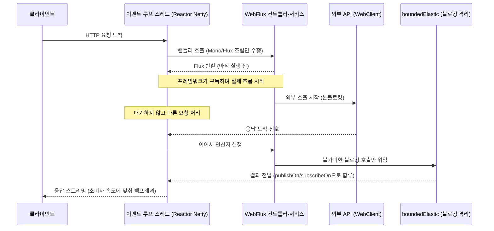

핵심 포인트는 **이벤트 루프 스레드가 어떤 지점에서도 기다리지 않는다**는 것입니다. 기다림이 필요한 지점은 "신호가 오면 이어서 실행"하는 구조로 바뀌고, 어쩔 수 없는 블로킹은 별도 풀에 격리됩니다.

### 9.5 백프레셔 설계: 정책을 명시한다

백프레셔의 세 가지 결정(버퍼, 버림, 실패)을 **경계마다** 정합니다. 아래 표는 *설계 제안*이며, 각 상황에서 선택은 업무 요구사항에 따라 달라집니다.

| 경계 | 질문 | 선택 예 |
|---|---|---|
| 외부 입력 → 서비스 | 느린 소비자에게 얼마나 쌓을 것인가 | 요청을 구독자가 `request(n)`으로 끌어가게 하고, 상한이 있는 버퍼를 둠 |
| 서비스 → 외부 API | 동시에 몇 건까지 호출할 것인가 | `flatMap(fn, 동시성)`으로 상한, 연결 풀 한도 인지 |
| 센서·이벤트 등 늦출 수 없는 원천 | 넘치면 어떻게 할 것인가 | 업무 중요도에 따라 *버림 / 최신값 유지 / 실패 신호* 중 선택 |

### 9.6 풀(Pool)과 자원 관리

외부 연결·세션 같은 **비싼 자원**은 Reactor Pool(리액티브 애플리케이션용 범용 객체 풀)이나 Reactor Netty가 내부적으로 쓰는 연결 풀로 관리합니다. 연결 풀의 한도는 곧 **외부 시스템에 대한 동시성의 상한**이므로, 앞의 원칙 3과 직결됩니다.

### 9.7 하이브리드 구성: "전부 리액티브"가 이상형은 아니다

Spring 공식 문서의 안내를 종합하면 다음과 같은 **혼합 구성**이 정당한 선택지입니다.

- 마이크로서비스 아키텍처에서는 **Spring MVC 컨트롤러 기반 서비스와 WebFlux 기반 서비스를 섞어 쓸 수 있습니다.** 같은 어노테이션 모델을 공유하기 때문에 지식 재사용이 쉽습니다.
- Spring MVC 애플리케이션이 원격 서비스를 많이 호출한다면, **리액티브 `WebClient`만 도입**해도 효과를 볼 수 있습니다. 컨트롤러가 리액티브 타입을 직접 반환할 수도 있고, 호출당 지연이 크거나 호출 간 의존성이 클수록 이득이 커진다고 문서는 설명합니다.
- 대규모 팀이라면 **비블로킹·함수형·선언형으로의 전환은 가파른 학습 곡선**임을 감안해야 하며, 문서는 "작게 시작하고 이점을 측정하라"고 조언하고, "상당수 애플리케이션에서는 전환이 필요 없을 것으로 기대한다"고까지 씁니다.

이를 근거로 한 **설계 제안**: *게이트웨이·팬아웃이 많은 집계 서비스·스트리밍 서비스는 WebFlux + Reactor로, 블로킹 영속성이 중심인 도메인 서비스는 Spring MVC로* 구성하고, 서비스 사이는 논블로킹 HTTP 클라이언트로 연결하는 구조가 현실적입니다.

### 9.8 성능에 대한 정직한 기대치

Spring 공식 문서는 분명히 말합니다. **리액티브·논블로킹은 일반적으로 애플리케이션을 더 빠르게 만들지 않습니다.** 원격 호출을 병렬로 실행하는 등 일부 경우에는 빨라질 수 있지만, 논블로킹 방식으로 일하려면 더 많은 작업이 필요해 처리 시간이 약간 늘 수도 있습니다. 핵심 이점은 **작고 고정된 스레드 수와 적은 메모리로 확장**하는 능력이며, 그래서 부하 상황에서 *예측 가능하게* 확장합니다. 이 이점은 **지연이 있는 환경(느리고 예측 불가능한 네트워크 I/O 혼합)** 에서 뚜렷해집니다. 따라서 도입 전 **자신의 워크로드로 측정**하는 것이 필수입니다. 이 문서는 구체적인 성능 수치를 제시하지 않습니다(근거가 되는 공식 수치를 확인하지 못했기 때문입니다).

### 9.9 가상 스레드(Virtual Threads)와의 관계

Java 21 이후 가상 스레드가 대안으로 거론됩니다. 제가 공식 문서에서 **확인한 사실**은 다음과 같습니다.

- Reactor `boundedElastic`은 Java 21+에서 가상 스레드 기반 구현을 선택할 수 있습니다(3.7절).
- Spring Framework 참조 문서의 "Spring MVC or WebFlux?" 안내는 블로킹 API가 있으면 MVC를, 비블로킹 스택을 찾는다면 WebFlux를 권하며, 스레드 모델 차이를 설명합니다.

반면 "가상 스레드가 있으니 Reactor는 불필요하다/여전히 필요하다"는 식의 **일반적 결론**이나 벤치마크 수치는 제가 신뢰할 만한 공식 근거를 확보하지 못해 이 문서에서 주장하지 않습니다. 선택 기준은 10장의 의사결정 흐름과 *직접 측정*을 권합니다.

### 9.10 운영 체크리스트(설계 제안)

- [ ] `reactor-bom`으로 버전을 단일화했는가
- [ ] 이벤트 루프 스레드에서 `block()`·JDBC·파일 I/O·`Thread.sleep`이 없음을 BlockHound로 CI에서 검증하는가
- [ ] 모든 원격 호출에 `timeout`과 오류 시 대체 경로가 있는가
- [ ] `flatMap` 등 동시성 연산자에 상한이 있는가
- [ ] 연결 풀·버퍼 크기를 의식적으로 정했는가
- [ ] 로그·트레이스에 상관관계 ID가 스레드를 넘어 유지되는가(Context Propagation 모드를 측정해서 선택)
- [ ] 메시징·DB 라이브러리가 어댑터 뒤에 격리되어 있는가
- [ ] 지원 종료일을 캘린더에 반영했는가

---

## 10. 도입 여부 의사결정 가이드

Spring Framework 공식 문서의 "Spring MVC or WebFlux?" 안내를 흐름도로 정리했습니다(문서의 문장을 바탕으로 한 구조화이며, 분기 구성은 설명을 위한 재배열입니다).

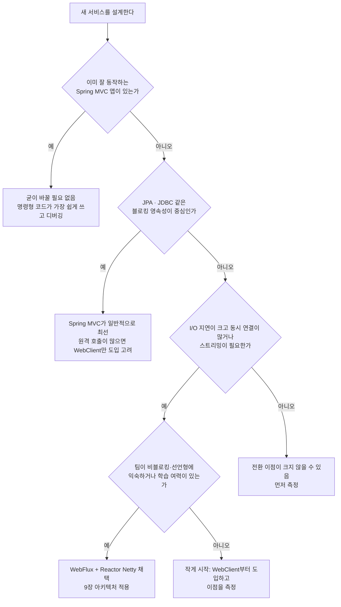

---

## 11. 자주 하는 실수와 점검 목록

| 실수 | 왜 문제인가 | 올바른 방향 |
|---|---|---|
| 연산자를 붙이고 결과를 버림 | 연산자는 새 인스턴스를 만들기 때문에 원본에는 적용되지 않음 | 반환값을 이어 받아 체인으로 연결 |
| `subscribe()`를 서비스 안에서 호출 | 오류 전파·취소·백프레셔가 끊김 | 반환만 하고 구독은 경계(프레임워크)에서 |
| 이벤트 루프/`parallel` 스레드에서 `block()` | 기본 스케줄러에서는 `IllegalStateException`, 그렇지 않은 환경에서는 처리량 붕괴 | 체인을 끝까지 논블로킹으로 유지 |
| 블로킹 호출을 그대로 둠 | 한 스레드가 막히면 해당 스레드의 모든 연결이 지연 | `subscribeOn(Schedulers.boundedElastic())`로 격리 후 점진적 제거 |
| `subscribeOn`을 여러 번 사용 | 가까운 하나만 효과가 있고 나머지는 불필요한 스레드 전환 | 원천 바로 뒤에 한 번만 |
| `Schedulers.elastic()` 사용 | 백프레셔 문제를 숨기고 스레드가 과도해질 수 있음(문서에서 비권장) | `boundedElastic()` 사용 |
| `flatMap` 동시성 무제한 | 외부 시스템 과부하, 메모리 증가 | 동시성 인자로 상한 지정 |
| 서블릿 필터를 WebFlux에 매핑 | 블로킹·논블로킹 혼용으로 런타임 문제 | WebFlux용 필터/`WebFilter` 사용 |
| 자동 Context Propagation을 측정 없이 켬 | 성능 영향, 상태 누수 가능 | 부하 상황에서 기본/자동 모드를 비교 측정 |
| 신규 설계에서 Reactor Kafka 채택 | 프로젝트 중단, 저장소 아카이브 | 메시징 어댑터 격리, 대안 평가 |

---

## 12. 버전·지원 일정 기반 운영 전략

아래는 7장의 공식 날짜를 근거로 한 **운영 제안**입니다.

1. **현재 3.7 / Netty 1.2 / BOM 2024 이하를 쓰는 경우**: OSS 지원이 이미 종료되었으므로(3.7·1.2는 2026-06-30), BOM **2025.0.x(reactor-core 3.8.x, Netty 1.3.x)** 로의 상향을 계획합니다. 3.8의 눈에 띄는 변경은 JSpecify null-safety와 `reactor-core-micrometer` 버전 정렬이며, 기존 `reactor.util.annotation` 어노테이션은 deprecated 상태이니 컴파일 경고·검사 결과를 확인하세요. 구체적인 호환성 이슈는 각 릴리스 노트에서 점검해야 합니다.
2. **현재 2025.0.x를 쓰는 경우**: OSS 지원이 **2027-06-30**까지입니다. 사전 릴리스 트레인 **2026.0.0-M2**의 정식 출시 소식을 지속 확인하고, 정식 출시되면 상향 일정을 잡습니다. 마일스톤 버전(`-M2`)은 운영 환경 도입 대상이 아닙니다.
3. **Reactor Kafka 사용 중인 경우**: 1.3은 OSS 지원이 2026-06-30에 끝났고 엔터프라이즈 지원은 2032-06-30까지입니다. 이는 *당장 쓸 수 없다*는 뜻이 아니라 *신규 기능 없이 필수 수정만* 제공된다는 뜻이므로, 대체 연동 방식을 평가해 **어댑터 뒤로 격리**한 다음 점진적으로 이행하는 계획이 필요합니다.
4. **상용 지원이 필요한 경우**: 홈페이지 "Production World"가 안내하는 Tanzu Spring 엔터프라이즈 지원이 선택지입니다. 지원 범위와 조건은 해당 안내 페이지에서 확인하세요.

---

## 13. 확인 한계

정직성을 위해, 이번 조사에서 **확인하지 못했거나 의도적으로 주장하지 않은 항목**을 밝힙니다.

- Reactor 공식 홈페이지는 직접 열었을 때 내용을 읽지 못해, 홈페이지 소개 문구는 **사용자가 제공한 본문 내용**을 기준으로 정리했습니다.
- **2026.0.0 정식(GA) 출시 시점**은 확인하지 못했습니다. 문서 페이지상 사전 릴리스 2026.0.0-M2가 최신으로 표시되어 있다는 사실만 적었습니다.
- Spring Boot 4.x가 **어떤 Reactor BOM 버전을 기본으로 관리하는지**는 확인하지 못해 단정하지 않았습니다. Spring Boot의 의존성 관리 문서에서 확인하세요.
- R2DBC, RSocket의 **최신 유지보수 상태와 버전**은 이번에 조사하지 않았습니다. 홈페이지가 Reactor 활용 사례로 소개한다는 사실과 Spring Framework 문서에 관련 장이 존재한다는 사실만 적었습니다.
- **Reactor Kafka의 대체 구현** 권장안은 공식 발표문에 명시되어 있지 않아 특정 라이브러리를 추천하지 않았습니다.
- **가상 스레드 vs Reactor의 성능 비교**는 신뢰할 만한 공식 수치를 확보하지 못해 결론을 내리지 않았습니다.
- `reactor-rabbitmq`는 지원 일정 페이지에 1.5 라인이 표시되어 있으나(OSS 2023-06-30 종료, 엔터프라이즈 2029-06-30까지), 안정 트레인의 문서 모듈 목록에는 나타나지 않습니다. 그 이상의 상태는 확인하지 못했습니다.
- Reactor Core·Spring 레퍼런스 일부는 3.7.x 문서(3.7.0-M4 표기)와 Spring Framework 7.1.0-M2 문서 페이지에서 가져왔습니다. 개념 설명 중심이라 3.8 / Spring 7.0.x에서도 동일하게 적용된다고 보이지만, **세부 동작은 사용하는 버전의 문서에서 재확인**하세요.
- 9장의 "설계 제안"은 제 추론이며 공식 권고가 아닙니다.

---

## 14. 출처

**Project Reactor 공식 / 공식 저장소**
- Project Reactor 홈페이지: https://projectreactor.io/
- 문서 목록: https://projectreactor.io/docs
- 지원 일정: https://projectreactor.io/support
- Reactor Core 레퍼런스(Introduction to Reactive Programming): https://docs.spring.io/projectreactor/reactor-core/docs/3.7.x/reference/html/reactiveProgramming.html
- Reactor Core 레퍼런스(Threading and Schedulers): https://docs.spring.io/projectreactor/reactor-core/docs/3.7.x/reference/html/coreFeatures/schedulers.html
- Reactor Core 레퍼런스(Context-Propagation Support): https://docs.spring.io/projectreactor/reactor-core/docs/3.7.x/reference/html/advanced-contextPropagation.html
- Reactor Core 레퍼런스(Null Safety): https://projectreactor.io/docs/core/release/reference/advancedFeatures/null-safety.html
- Reactor Core 3.8.0 릴리스 노트(JSpecify, Micrometer 버전 정렬): https://github.com/reactor/reactor-core/releases
- Reactor Core 3.8.5 / 3.8.6 릴리스 노트(미러): https://sourceforge.net/projects/reactor-core.mirror/files/v3.8.5/ , https://sourceforge.net/projects/reactor-core.mirror/files/v3.8.6/
- Reactor Netty 1.3.0 릴리스 노트: https://github.com/reactor/reactor-netty/releases
- Reactor Netty 1.3.7 릴리스 노트: https://github.com/reactor/reactor-netty/releases/tag/v1.3.7
- Reactor Netty 1.2.0 릴리스 노트: https://github.com/reactor/reactor-netty/releases?page=1
- Reactor Netty 레퍼런스(HTTP Client): https://projectreactor.io/docs/netty/milestone/reference/docs/http-client.html
- BlockHound 문서: https://docsearch.algolia.com/mcp/docs/repo/reactor/blockhound
- BlockHound 저장소 README 계열: https://github.com/pderop/BlockHound
- Reactor Addons 3.6.1 릴리스: https://github.com/reactor/reactor-addons/releases/tag/v3.6.1
- Reactor Core README: https://www.github.com/reactor/reactor-core

**Reactor Kafka 중단**
- Spring 블로그, "Reactor Kafka Project Will Be Discontinued"(2025-05-20): https://spring.io/blog/2025/05/20/reactor-kafka-discontinued
- reactor/reactor-kafka README(중단 공지): https://gh.nn.ci/reactor/reactor-kafka
- spring-attic/reactor-kafka 저장소: https://github.com/spring-attic/reactor-kafka

**Spring 공식**
- Spring Framework 참조 문서, WebFlux Overview: https://docs.spring.io/spring/reference/7.1/web/webflux/new-framework.html
- Spring Blog, HTTP/3 support in Reactor 2024.0 Release Train: https://spring.io/blog/2024/11/26/http3-in-reactor-2024
- Spring Boot 4.0 Migration Guide: https://github.com/spring-projects/spring-boot/wiki/Spring-Boot-4.0-Migration-Guide


---
---

# 별첨 A. 교재 『스프링 부트 3와 스프링 클라우드를 활용한 마이크로서비스 구축』 7장으로 읽는 Project Reactor 실전

> **이 별첨의 목적**: 본문 1~14장이 "Reactor란 무엇이고, 이상적인 구조는 무엇인가"를 다뤘다면, 이 별첨은 같은 내용이 **실제 마이크로서비스 예제 한 편에서 어떻게 구현되는가**를 교재 7장 「반응형 마이크로서비스 개발」(교재 182~233쪽 범위의 내용)로 확인합니다.
> **표기 규칙**: 문장 앞의 꼬리표로 출처를 구분했습니다.
> - **【교재】** 교재가 설명하는 내용을 제가 요약·재서술한 것입니다(문장을 그대로 옮기지 않았고, 코드는 개념 설명용으로 새로 작성했습니다).
> - **【공식】** Reactor·Spring 공식 문서/블로그에서 확인한 사실입니다.
> - **【2026 점검】** 교재 집필 이후 달라진 점을 2026-10-15 기준으로 확인한 내용입니다.
> - **【제안】** 제 추론에 의한 설계 의견이며 공식 권고가 아닙니다.

---

## A.1 7장이 만드는 것: 한눈에 보는 구조

### A.1.1 시스템 구성

**【교재】** 7장의 예제 환경은 네 개의 마이크로서비스로 이뤄집니다. 외부에 공개되는 **Product Composite(복합) 서비스**가 하나 있고, 그 뒤에 데이터를 소유한 **핵심 서비스 세 개**(Product, Recommendation, Review)가 있습니다. 저장소는 서비스마다 다릅니다. Product와 Recommendation은 **MongoDB**, Review는 **MySQL(JPA)** 을 씁니다.

핵심 설계 결정은 "**읽기는 논블로킹 동기 API, 생성·삭제는 이벤트 기반 비동기**"로 갈라 둔 것입니다.

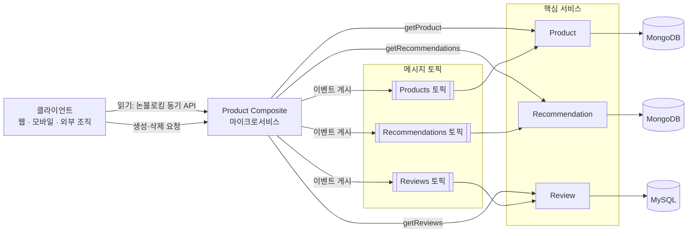

### A.1.2 이 장이 다루는 다섯 가지 주제

**【교재】** 7장의 학습 목표는 (1) 논블로킹 동기 API와 이벤트 기반 비동기 서비스 중 **무엇을 고를지** 판단하기, (2) 논블로킹 동기 RESTful API 개발, (3) 이벤트 기반 비동기 서비스 개발, (4) 반응형 환경의 수동 테스트, (5) 자동화된 테스트입니다. 교재는 6장 「영속성 추가」의 소스와 7장의 소스를 코드 비교 도구로 비교해 보라고 권합니다. "서비스를 반응형으로 바꾸려면 정확히 무엇이 바뀌는가"를 변경 사항으로 직접 보라는 뜻입니다.

본 문서의 구성과 대응시키면 다음과 같습니다.

| 교재 7장 주제 | 본문 대응 장 |
|---|---|
| 동기 API vs 이벤트 선택 기준 | 9.7(하이브리드 구성), 10(의사결정 가이드) |
| 프로젝트 리액터 소개, `Flux`/`Mono` 첫걸음 | 3(핵심 개념) |
| 논블로킹 영속성(Spring Data MongoDB) | 9.3(아웃바운드 어댑터) |
| 블로킹 코드 처리(JPA + `Scheduler`) | 9.2 원칙 4, 3.7(스케줄러) |
| 이벤트 기반 서비스(토픽·파티션·재시도·DLQ) | 9.3(메시징 어댑터), 8.3(Reactor Kafka 중단) |
| 자동화된 테스트 | 9.2 원칙 8~9 |

---

## A.2 선택 기준: 동기 API냐, 이벤트냐

### A.2.1 교재의 논리

**【교재】** 교재는 먼저 "논블로킹 동기 API와 이벤트 기반 비동기 서비스 중 무엇을 골라야 하는지는 항상 분명하지 않다"고 인정합니다. 그리고 기본 원칙을 이렇게 세웁니다.

1. 마이크로서비스는 **런타임 의존성을 최소화해 가능한 한 자율적**이어야 견고하고 확장하기 쉽습니다. 이것이 **느슨한 결합(loose coupling)** 입니다.
2. 그래서 **원칙적으로는 이벤트(비동기 메시지)가 동기 API보다 선호**됩니다. 비동기 방식에서는 서비스가 다른 여러 서비스에 직접·동기적으로 의존하는 대신, 런타임에 **메시징 시스템 하나에만** 의존하면 되기 때문입니다.
3. 하지만 **동기 API가 유리한 경우**도 있습니다.
   - 최종 사용자가 **응답을 기다리는 읽기 작업**
   - 모바일 앱이나 SPA처럼 **클라이언트 플랫폼이 동기 API를 쓰기에 더 적합**한 경우
   - 클라이언트가 **다른 조직의 서비스**에 연결하는 경우(조직 간에 공통 메시징 시스템을 합의하기 어려울 수 있음)

### A.2.2 이 책의 환경에 적용한 결론

**【교재】** 위 기준을 예제에 적용한 결과는 다음과 같습니다.

| 기능 | 선택 | 이유(교재의 설명) |
|---|---|---|
| 복합 서비스가 외부에 노출하는 생성·읽기·삭제 API | 논블로킹 동기 | 웹·모바일 클라이언트뿐 아니라 **다른 조직의 클라이언트**도 있다고 가정하므로 동기 API가 자연스러움 |
| 핵심 서비스의 읽기 서비스 | 논블로킹 동기 | 응답을 기다리는 **최종 사용자**가 있음 |
| 핵심 서비스의 생성·삭제 서비스 | 이벤트 기반 비동기 | 각 서비스 전용 토픽의 생성·삭제 이벤트를 수신 |
| 복합 서비스의 생성·삭제 API | 이벤트 게시 후 **202 Accepted** 반환 | 게시에 성공하면 "수락되었지만 아직 완전히 처리되지는 않았음"을 알림. 실제 처리는 202 응답과 무관하게 비동기로 완료 |

교재는 **202(Accepted)** 와 **200(OK)** 의 차이를 따로 강조합니다. 200은 요청이 처리 완료되었다는 뜻이고, 202는 요청을 *받아들였을 뿐* 처리는 별도로 진행된다는 뜻입니다. 쓰기 경로가 비동기가 되는 순간 **클라이언트와 서버 사이의 약속(계약)이 바뀐다**는 점이 이 구분의 핵심입니다.

### A.2.3 본문과의 연결

**【공식】** 본문 9.7·10장에서 인용했듯 Spring 공식 문서는 "MVC냐 WebFlux냐"를 이분법으로 보지 말라고 하고, 마이크로서비스 아키텍처에서는 **서비스마다 다른 방식을 섞어 쓸 수 있다**고 안내합니다. 교재의 구성도 같은 사고방식입니다. 같은 시스템 안에서 **읽기 경로**와 **쓰기 경로**의 성격이 다르므로 통신 방식을 다르게 고른 것입니다.

**【제안】** 교재의 판단 기준을 한 줄로 일반화하면 이렇습니다. *"사람이 응답을 기다리는가, 조직 경계를 넘는가 → 동기. 서비스끼리의 상태 변경 전파인가 → 이벤트."* 이 기준은 Reactor를 쓰든 안 쓰든 유효한 아키텍처 판단이고, Reactor는 **동기 경로를 논블로킹으로 만들어 자원 효율을 높이는 도구**로 얹힙니다.

---

## A.3 읽기 경로: 논블로킹 동기 API

### A.3.1 복합 서비스는 "병렬로" 부른다

**【교재】** 읽기 API의 논블로킹 버전에서 복합 서비스는 세 핵심 서비스에 **병렬로 반응형(논블로킹) 호출**을 수행하고, 모든 응답이 도착하면 이를 조합해 복합 응답을 만들어 호출자에게 돌려줍니다.

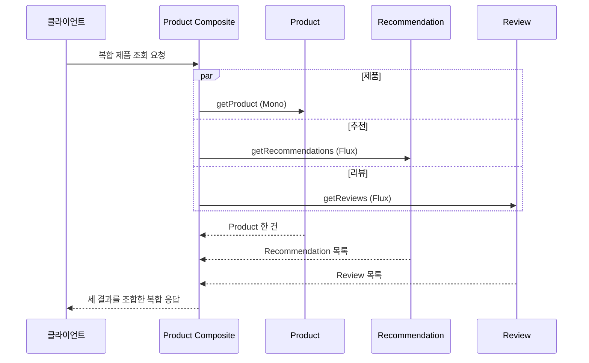

**【공식】** 이 구조는 Spring 공식 문서가 "리액티브 `WebClient`의 이점이 가장 뚜렷하다"고 한 상황과 정확히 일치합니다. 문서는 "호출당 지연이 크거나 호출 간 **상호 의존성이 클수록** 이점이 극적"이고, 원격 호출을 **병렬로 실행**하는 경우에는 리액티브가 실제로 더 빠를 수 있다고 설명합니다(본문 9.8절). 순차 호출 세 번의 지연 합계가 병렬 호출 중 **가장 느린 하나**의 지연으로 줄어들기 때문입니다.

### A.3.2 개발 중의 코드 감각(개념 설명용 코드)

아래는 위 구조를 개념적으로 표현한 **새로 작성한 예시**입니다(교재 코드가 아닙니다). 세 호출을 `Mono.zip`으로 묶고 시간 제한을 두었습니다.

```java
Mono<ProductAggregate> getAggregate(int productId) {
    Mono<Product> product            = productClient.getProduct(productId);
    Mono<List<Recommendation>> recs  = recommendationClient.getRecommendations(productId).collectList();
    Mono<List<Review>> reviews       = reviewClient.getReviews(productId).collectList();

    return Mono.zip(product, recs, reviews)                     // 세 호출을 동시에 구독
               .map(t -> ProductAggregate.of(t.getT1(), t.getT2(), t.getT3()))
               .timeout(Duration.ofSeconds(2));                 // 본문 원칙 5: 시간 제한
}
```

`zip`은 세 `Mono`가 모두 값을 내야 결과를 내고, 하나라도 오류면 전체가 오류가 됩니다. **【제안】** 추천·리뷰처럼 *없어도 되는* 정보는 각각 `onErrorReturn(List.of())` 같은 **부분 실패 허용 정책**을 붙이는 것이 사용자 경험상 더 낫습니다. 어떤 호출이 필수인지의 판단은 업무 요구사항이 정합니다.

---

## A.4 첫걸음: `Flux` 한 줄 테스트를 해부한다

### A.4.1 프로젝트 리액터 소개 절의 요점

**【교재】** 교재는 "스프링 5의 반응형 지원은 프로젝트 리액터를 기반으로 하며, 리액터는 리액티브 스트림 사양(표준)에 기반한다. 스프링 웹플럭스·웹클라이언트·스프링 데이터가 반응형·논블로킹 기능을 제공하려고 리액터에 의존한다"고 소개합니다. 핵심 타입은 **`Flux`(0…n 요소의 스트림)** 와 **`Mono`(비어 있거나 최대 한 개의 요소)** 입니다.

**【공식】** 사실 확인: Spring 공식 문서는 WebFlux가 Spring Framework **5.0**에서 추가되었다고 설명하고, "Reactor is the reactive library of choice for Spring WebFlux"라고 명시합니다(8.5절).

### A.4.2 교재의 첫 예제를 말로 풀어 보기

교재의 첫 테스트는 이런 처리 흐름을 선언합니다.

1. 정수 **1, 2, 3, 4**로 `Flux`를 시작한다(`Flux.just`).
2. **짝수만** 통과시킨다(`filter`) → 2, 4.
3. 값을 **2배**로 바꾼다(`map`) → 4, 8.
4. 통과하는 값을 **로그로 남긴다**(`log`).
5. 스트림이 끝나면 모든 항목을 **`List`로 모은다**(`collectList`).
6. 마지막에 **`block()`** 으로 결과를 기다리고 4와 8이 들어 있는지 단언한다.

**【교재】** 여기서 교재가 던지는 중요한 메시지가 두 가지입니다.

첫째, 지금까지는 **"어떻게 처리할지"를 선언**했을 뿐이고, 실제 처리는 **구독자가 있어야** 시작됩니다. 마지막의 `block()`이 "완료될 때까지 기다리는 구독자"를 등록합니다. 본문 3.4절 "구독하기 전에는 아무 일도 일어나지 않는다"의 실물 사례입니다.

둘째, 교재는 박스 설명으로 이렇게 강조합니다. **일반적으로 스트림 처리를 직접 시작하지 않는다.** 처리를 시작하는 것은 **인프라 구성 요소의 책임**이고, 예컨대 Spring WebFlux는 들어오는 HTTP 요청에 대한 응답으로 구독을 수행합니다. 유일한 예외는 **블로킹 코드가 반응형 스트림의 응답을 필요로 할 때**이며, 그때는 `Mono`/`Flux`의 `block()`을 호출해 **블로킹 방식으로** 결과를 얻습니다.

이 지침은 본문 9.2 **원칙 2**("조립하는 코드와 구독하는 지점을 분리한다")와 같은 말입니다.

### A.4.3 로그로 읽는 신호의 생애

**【교재】** `log()` 연산자의 출력에서 교재는 다음 흐름을 확인하도록 안내합니다.

| 순서 | 로그의 신호 | 의미 |
|---|---|---|
| 1 | `onSubscribe(...)` | 구독이 연결됨 |
| 2 | `request(unbounded)` | 구독자가 **제한 없이** 요청 |
| 3 | `onNext(4)`, `onNext(8)` | 값이 `log` 지점을 통과 |
| 4 | `onComplete()` | 처리가 끝났다고 구독자에게 알림 |

본문 3.1절의 시퀀스(`subscribe → onSubscribe → request(n) → onNext… → onComplete`)가 로그에 그대로 찍힌 것입니다. 여기서 `request(unbounded)`는 **백프레셔 관점에서 "무제한 모드"** 입니다. 이 예제처럼 작은 메모리 내 컬렉션을 모으는 경우는 문제가 없지만, **원천이 무한하거나 매우 클 때**는 `collectList` 같은 연산자의 무제한 요청이 메모리 문제로 이어질 수 있습니다(3.5절의 "정책을 정한다"와 직결).

**【제안】** 교육 목적이라면 같은 예제를 약간 바꿔 `StepVerifier`로도 써 보게 하면 좋습니다. 아래는 새로 작성한 변형 예시입니다.

```java
void evenNumbersTimesTen() {
    Flux<Integer> flux = Flux.just(1, 2, 3, 4, 5, 6)
            .filter(n -> n % 2 == 0)
            .map(n -> n * 10)
            .log();

    StepVerifier.create(flux)
            .expectNext(20, 40, 60)
            .verifyComplete();          // onComplete 신호까지 검증
}
```

---

## A.5 영속성 계층: 리포지토리를 반응형으로 바꾸기

### A.5.1 변경은 두 가지뿐

**【교재】** Product와 Recommendation의 MongoDB 리포지토리를 반응형으로 만드는 일은 "매우 간단"합니다.

1. 리포지토리의 기반 클래스를 **`ReactiveCrudRepository`** 로 바꾼다.
2. 사용자 정의 `find` 메서드가 **`Mono` 또는 `Flux`** 를 반환하도록 바꾼다. 교재에서는 제품 단건 조회가 `Mono`, 추천 목록 조회가 `Flux`를 반환합니다(0..1이냐 0..N이냐가 **반환 타입으로 드러남**, 본문 3.2절).

개념 설명용 새 코드는 다음과 같습니다.

```java
public interface ItemRepository extends ReactiveCrudRepository<ItemEntity, String> {
    Mono<ItemEntity> findByItemId(int itemId);          // 0..1건
}

public interface CommentRepository extends ReactiveCrudRepository<CommentEntity, String> {
    Flux<CommentEntity> findByItemId(int itemId);       // 0..N건
}
```

### A.5.2 Review 서비스는 일부러 그대로 둔다

**【교재】** Review 서비스의 영속성 코드에는 이 변경이 적용되지 **않습니다**. JPA 리포지토리는 **블로킹 상태로 유지**되고, 그 처리는 뒤의 「블로킹 코드 처리」 절에서 다룹니다. 즉 교재는 **혼합 환경**(일부는 논블로킹, 일부는 블로킹 격리)을 의도적으로 보여 줍니다. 이는 본문 9.7절의 "전부 리액티브가 이상형은 아니다"를 실습으로 보여 주는 구성입니다.

### A.5.3 테스트도 같이 바뀐다

**【교재】** 영속성 메서드가 이제 `Mono`/`Flux`를 반환하므로 테스트는 **응답이 사용 가능해질 때까지 기다려야** 합니다. 방법은 두 가지입니다.

- **`block()`**: 명령형 스타일을 유지하면서 `repository.findById(...)`가 반환한 `Mono`를 대상으로 `block()`을 호출해 값을 꺼냅니다. (기존의 `Optional.get()` 자리에 `block()`이 들어갑니다.)
- **`StepVerifier`**: 리액터의 헬퍼 클래스로, 비동기 이벤트의 **검증 가능한 시퀀스를 선언**합니다. 교재는 `expectNextMatches(...)`로 값을 검증하고 마지막에 **`verifyComplete()`** 를 호출함으로써 시퀀스를 **초기화(실행)** 한다고 설명합니다.

교재는 두 방식을 모두 실제 테스트 클래스에서 보여 줍니다(`block()` 방식과 `StepVerifier` 방식의 테스트 클래스 위치를 안내).

**【공식】** 일관성 확인: Reactor의 `reactor-test` 모듈은 "테스트 유틸리티"로 소개되고(5장), 가상 시간 테스트도 지원합니다(9.2 원칙 9). 또한 `block()`은 **`single`/`parallel` 스케줄러의 스레드 안에서 호출하면 `IllegalStateException`** 이 발생합니다(3.7절). JUnit의 테스트 스레드는 이 제한과 무관하므로 테스트에서의 `block()`은 허용되는 관행이고, 교재의 박스 설명(블로킹 코드가 응답을 필요로 하는 예외 상황)과도 맞습니다.

**【제안】** 두 방식의 선택 기준:

| 상황 | 권장 |
|---|---|
| 단건 조회 결과를 가볍게 단언 | `block()`도 충분 |
| **오류 신호**, 완료 여부, 여러 값의 **순서**, 시간 지연(가상 시간)을 검증 | `StepVerifier` |
| 무한 스트림 일부만 검증 | `StepVerifier`(+`take`/취소 검증) |

---

## A.6 핵심 서비스의 논블로킹 API: 서비스 구현 해부

### A.6.1 API 변경: 반응형 타입만 반환한다

**【교재】** 핵심 서비스의 API를 반응형으로 만들려면 메서드가 **`Mono` 또는 `Flux`만 반환**하도록 바꿉니다. 예컨대 제품 조회는 이제 `Product` 대신 `Mono<Product>`를 반환합니다. 교재는 변경 대상 인터페이스(`ProductService`, `RecommendationService`, `ReviewService`)를 api 프로젝트에서 보라고 안내합니다. 이 변경이 반응형 전환의 **계약 수준의 변화**입니다.

### A.6.2 서비스 구현: 한 줄씩 읽기

**【교재】** 제품 조회 구현을 교재는 이렇게 풀어 설명합니다(제가 번호를 단순화했습니다).

1. 메서드는 `Mono`를 **반환만** 합니다. 처리 내용을 *선언*할 뿐이고, Spring WebFlux가 요청을 받으면 그 `Mono`를 **구독해서** 처리를 시작합니다.
2. 영속성 리포지토리의 `findByProductId`로 제품을 찾습니다.
3. 제품이 없으면 `switchIfEmpty`가 **`NotFoundException` 오류 신호**를 내보냅니다.
4. `log`가 로그를 남깁니다.
5. `map`으로 엔티티를 **API 모델 객체**로 변환합니다.
6. 마지막 `map`에서 요청을 처리한 서비스의 **DNS 이름과 IP 주소**를 모델의 `serviceAddress` 필드에 설정합니다.

입력 검증은 메서드 맨 앞에서 합니다. 제품 ID가 1 미만이면 **`InvalidInputException`** 을 던집니다.

개념 설명용 새 코드:

```java
public Mono<Item> getItem(int itemId) {
    if (itemId < 1) {
        return Mono.error(new InvalidInputException("Invalid itemId: " + itemId));   // 제안: 오류를 신호로 통일
    }
    return repository.findByItemId(itemId)
            .switchIfEmpty(Mono.error(new NotFoundException("No item for itemId: " + itemId)))
            .log("item-service", Level.FINE)
            .map(mapper::entityToApi)
            .map(this::withServiceAddress);
}
```

**【제안】** 입력 검증에서 예외를 *던지는* 방식과 `Mono.error`로 *반환하는* 방식은 의미가 다릅니다. `Mono.error`는 **구독 시점에 오류 신호**로 전달되므로, 파이프라인 안의 다른 오류(`NotFoundException` 등)와 **같은 경로**로 흐릅니다. 하나의 오류 처리 경로로 통일하려는 목적이라면 `Mono.error`가 일관됩니다. 다만 교재 방식도 프레임워크의 예외 처리를 통해 동작할 수 있으니, 팀 규약으로 정하세요.

### A.6.3 로그로 읽는 "스레드의 이동"

**【교재】** 교재는 성공/실패 두 경우의 로그를 보여 줍니다. 성공 시에는 `onSubscribe → request(unbounded) → onNext(제품) → onComplete`가 찍히고, 제품이 없을 때는 `onSubscribe → request(unbounded) → onError(NotFoundException: No product found for productId: 2)`가 찍힙니다. 실패 로그에는 `ERROR` 레벨과 스택 트레이스가 함께 나옵니다.

흥미로운 관찰 지점은 **스레드 이름**입니다. 교재의 로그에서 `onSubscribe`와 `request`는 `reactor-http-nio-N` 계열의 **HTTP 스레드**에서 찍히지만, `onNext`·`onComplete`·`onError`는 **다른 이름의 이벤트 루프 스레드**에서 찍힙니다(`…EventLoopGroup…` 형태).

**【공식】** 이는 Reactor가 **동시성에 중립적**이라는 설명과 맞습니다. 대부분의 연산자는 *직전 연산자가 실행되던 스레드*에서 이어서 실행되므로, 신호를 **발생시키는 쪽(여기서는 DB 드라이버의 I/O 스레드)** 에서 후속 연산자가 이어서 실행됩니다. 개발자가 `publishOn`/`subscribeOn`으로 바꾸지 않는 한 Reactor는 스레드를 새로 만들지 않습니다(3.7절).

**【제안】** 로그 스레드 이름 읽기는 **반응형 디버깅의 첫 도구**입니다. 의도하지 않은 곳에서 `jdbc-pool` 같은 스레드 이름이 나오거나, 반대로 HTTP 스레드에서 DB 호출 로그가 나오면(블로킹 격리 실패) 문제 신호입니다.

---

## A.7 블로킹 코드 처리: JPA를 반응형 서비스 안에 안전하게 넣기

이 절은 7장에서 **가장 실무적으로 가치가 큰 부분**입니다.

### A.7.1 문제 정의

**【교재】** JPA로 관계형 DB에 접근하는 Review 서비스는 **논블로킹 프로그래밍 모델을 지원하지 않습니다.** 대신 **제한된 스레드로 구성된 전용 스레드 풀**의 스레드에서 블로킹 코드를 실행할 수 있는 **`Scheduler`** 를 쓰라고 합니다. 이렇게 하면 마이크로서비스에서 쓸 수 있는 스레드가 **고갈되는 것을 방지**하고, 동시에 진행되는 다른 논블로킹 처리에 **영향을 미치지 않습니다**.

### A.7.2 세 단계 구성

**【교재】** 교재는 구성을 세 단계로 설명합니다.

| 단계 | 내용 |
|---|---|
| ① 스케줄러 빈 정의 | 메인 클래스에서 `jdbcScheduler`라는 이름의 `Scheduler` 빈을 만들고, 스레드 풀 크기(`app.threadPoolSize`)와 작업 큐 크기(`app.taskQueueSize`)를 **프로퍼티로 설정 가능**하게 한다. 풀은 이름이 `jdbc-pool`인 **상한이 있는 탄력적(bounded elastic) 스케줄러**(`Schedulers.newBoundedElastic`)로 만든다. |
| ② 주입 | 서비스 구현 클래스에 `@Qualifier("jdbcScheduler")`로 스케줄러를 주입한다. |
| ③ 사용 | `getReviews()`를 `Mono.fromCallable(() -> 블로킹 메서드)` → `flatMapMany(Flux::fromIterable)` → `log` → **`subscribeOn(jdbcScheduler)`** 로 구성한다. |

블로킹 코드(리포지토리 호출, 엔티티→API 모델 변환, 서비스 주소 설정)는 별도의 private 메서드(`internalGetReviews`)에 모아 두고, `Mono.fromCallable`로 **`Mono` 안에 감쌉니다**.

개념 설명용 새 코드:

```java
Scheduler jdbcScheduler(@Value("${app.threadPoolSize:10}") int threads,
                        @Value("${app.taskQueueSize:100}") int queue) {
    return Schedulers.newBoundedElastic(threads, queue, "jdbc-pool");   // 스레드 상한, 큐 상한, 이름
}

public Flux<Review> getReviews(int itemId) {
    return Mono.fromCallable(() -> blockingFindReviews(itemId))     // 블로킹 호출을 Callable로 감쌈
               .flatMapMany(Flux::fromIterable)                      // List -> Flux
               .log("review-service", Level.FINE)
               .subscribeOn(jdbcScheduler);                          // 구독(=실행)을 전용 풀로
}
```

### A.7.3 로그가 입증하는 것

**【교재】** 교재는 테스트 실행 시 Review 서비스 로그에서 두 줄을 비교하게 합니다.

- 첫 로그: `getReviews()`의 `LOG.info`는 **`reactor-http-nio-4`라는 HTTP 스레드**에서 실행됩니다(WebFlux가 쓰는 스레드).
- 둘째 로그: 하이버네이트가 생성한 **SQL 문**이 **`jdbc-pool-1`이라는 스레드**에서 실행됩니다.

즉 **체인을 조립하는 일은 HTTP 스레드가, 블로킹 SQL 실행은 전용 풀이** 맡았다는 증거입니다.

### A.7.4 Reactor 관점의 해설

**【공식】** 이 패턴의 근거를 Reactor 문서로 확인합니다.

- `subscribeOn`은 **구독 과정 전체**(체인 전체가 시작되는 스레드)를 지정한 스케줄러의 스레드로 옮깁니다(3.7절). 그래서 `Mono.fromCallable`의 블로킹 람다가 그 풀에서 실행됩니다.
- `Schedulers.boundedElastic()`은 "블로킹 처리에 전용 스레드를 줘서 다른 자원을 묶어 두지 않게 하는 용도"로 문서에 설명됩니다. 교재는 **공용** `boundedElastic()` 대신 **이름과 상한을 직접 지정한 전용 풀**(`newBoundedElastic`)을 만듭니다.
- 공용 `boundedElastic`의 기본 상한은 CPU 코어 수 × 10, 상한 도달 후에는 최대 10만 개 작업이 큐에 대기합니다(3.7절).

**【제안】** 교재식 **전용 풀**의 설계적 가치는 다음과 같습니다.

1. **스레드 상한 = 하위 시스템에 허용할 동시성 상한.** 풀 크기는 곧 "DB에 동시에 보낼 수 있는 요청 수"의 상한이 되므로, 연결 풀(커넥션 풀)의 크기와 **의도적으로 맞추는** 것이 좋습니다. 스레드가 연결 수보다 훨씬 많으면 스레드가 커넥션을 기다리며 대기하고, 훨씬 적으면 연결 자원이 남습니다.
2. **큐 상한 = 백프레셔 정책의 구현.** 큐가 무한이면 "버퍼링"이라는 정책을 *암묵적으로* 택한 셈입니다. 상한을 두면 한도 초과 시의 동작이 *설계 결정*이 됩니다. 한도를 넘은 작업이 어떻게 처리되는지는 사용하는 Reactor 버전의 API 문서에서 확인하세요.
3. **격리(bulkhead) 효과.** 블로킹 DB가 느려져도 풀이 차는 것으로 문제가 **국소화**되어, 이벤트 루프와 다른 서비스 호출이 영향을 받지 않습니다.
4. **이름이 있는 스레드**(`jdbc-pool-N`)는 로그·스레드 덤프·메트릭에서 병목을 찾는 단서가 됩니다.

**【제안】** 이 패턴은 **임시방편**이라는 점도 기억해야 합니다. Spring 공식 문서가 "`publishOn`은 쉬운 탈출구이지만 블로킹 API는 이 동시성 모델에 잘 맞지 않는다"고 한 대로, 장기적으로는 **블로킹 구간을 점점 줄이는 방향**(논블로킹 드라이버로 교체하거나 서비스를 분리)을 로드맵에 넣는 것이 좋습니다.

### A.7.5 감시: BlockHound를 교재 예제에 붙인다면

**【제안】** `jdbc-pool` 스레드는 "논블로킹 전용"으로 표시된 스레드가 아니므로 거기서의 JDBC 호출은 정상입니다. 반면 **실수로 HTTP 스레드에서 JPA 호출이 실행**되면 문제인데, 이를 **테스트 중 자동으로 잡는 도구**가 BlockHound입니다(본문 9.2 원칙 8). 교재의 구조는 "블로킹은 `jdbc-pool`에서만 허용"이라는 규칙이 명확하므로, CI에서 BlockHound를 켜면 격리 누수를 기계적으로 검출할 수 있습니다.

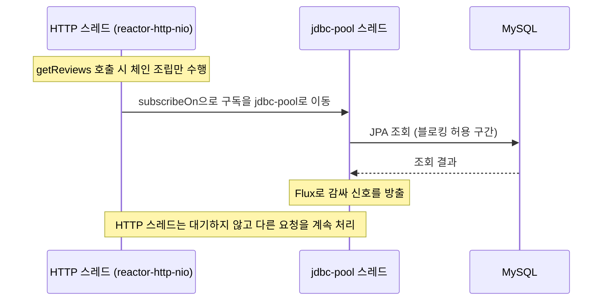

---

## A.8 이벤트 기반 비동기 서비스: 쓰기 경로

### A.8.1 구조

**【교재】** 생성·삭제 서비스의 이벤트 기반 비동기 버전에서는, 복합 서비스가 **각 핵심 서비스의 토픽에 생성·삭제 이벤트를 게시**한 뒤 **핵심 서비스에서 처리가 끝나기를 기다리지 않고** 호출자에게 OK 응답(앞서 본 202)을 돌려줍니다. 교재가 이 절에서 다루는 순서는 다음과 같습니다.

1. 메시징이 가진 문제 처리
2. 토픽 및 이벤트 정의
3. 그레이들 빌드 파일 변경
4. 핵심 서비스에서 이벤트 소비
5. 복합 서비스에서 이벤트 게시

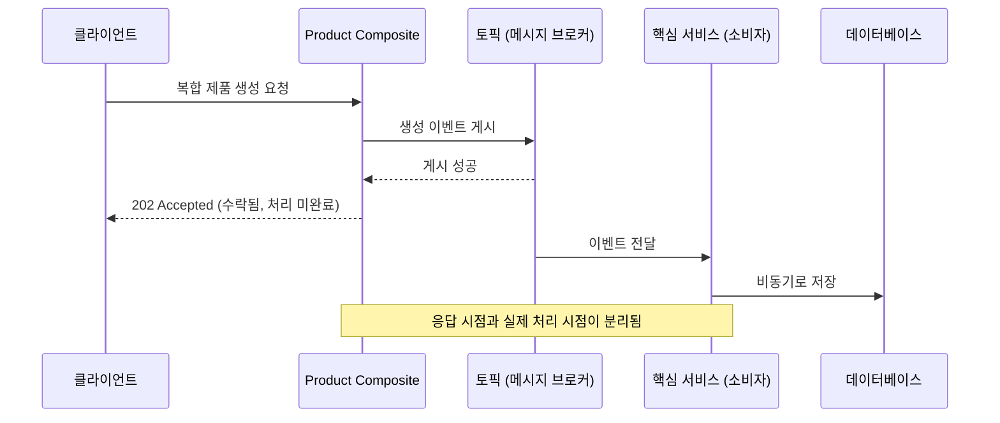

### A.8.2 메시징의 "문제 처리": 소비자 그룹, 재시도, DLQ, 파티션

**【교재】** 교재의 「정리」 절은 이 장에서 활용하는 **Spring Cloud Stream** 기능을 이렇게 요약합니다. 코드를 바꾸지 않고도 **RabbitMQ와 카프카 모두에서** 동작하는 이벤트 기반 비동기 서비스를 만들 수 있고, **몇 가지 구성 변경**만으로 **소비자 그룹, 재시도, 데드 레터 큐, 파티션** 같은 비동기 메시징의 과제를 다룹니다. 또 RabbitMQ에서 카프카로 바꿀 때도 소스는 그대로이고 **도커 컴포즈 파일 몇 군데만** 바꾸면 된다고 설명합니다.

네 가지 개념을 짧게 정리하면 다음과 같습니다(일반적인 메시징 개념이며, 구체 정의는 교재의 해당 절 참조).

| 개념 | 해결하는 문제 |
|---|---|
| **소비자 그룹** | 같은 서비스의 인스턴스 여러 개가 있을 때 **한 메시지를 한 인스턴스만** 처리하게 함 |
| **재시도** | 일시적 오류에서 처리를 다시 시도 |
| **데드 레터 큐(DLQ)** | 재시도 후에도 실패한 메시지를 **격리 보관**해 정상 흐름을 막지 않음 |
| **파티션** | **순서 보장과 병렬 처리의 균형**을 맞춤 |

### A.8.3 순서 보장과 파티션: 7장에서 가장 중요한 개념

**【교재】** 논리는 다음 순서로 전개됩니다.

1. 비즈니스 로직상 메시지를 **보낸 순서대로** 소비·처리해야 한다면, 성능을 높이려고 **소비자 인스턴스를 여러 개** 쓸 수 없습니다(예: 소비자 그룹). 여러 개를 쓰면 경우에 따라 수신 메시지 처리에 **허용 불가능한 지연**이 생길 수 있습니다.
2. 하지만 대부분의 경우 **엄격한 순서는 동일한 비즈니스 엔티티에 영향을 미치는 메시지**에 대해서만 필요합니다. 제품 ID 1의 메시지는 제품 ID 2의 메시지와 **독립적으로** 처리되어도 됩니다.
3. 해결책은 메시지에 **키**를 지정하고, 토픽에 **하위 토픽(파티션)** 을 도입하는 것입니다. 메시징 시스템은 키를 기반으로 메시지를 특정 파티션에 배치합니다. **같은 키는 항상 같은 파티션**으로 갑니다.
4. 메시징 시스템은 **같은 파티션 안에서만** 전달 순서를 보장하면 됩니다. 그래서 소비자 그룹 내에서 **파티션당 하나의 소비자 인스턴스**를 구성하고, 파티션 수를 늘리면 인스턴스 수를 늘려 **순서를 놓치지 않고 처리량을 키울** 수 있습니다.

교재의 예시: 키가 **123**인 메시지(A, C)는 항상 **Products-1** 파티션 → **Product #1** 인스턴스로, 키가 **456**인 메시지(B)는 **Products-2** 파티션 → **Product #2** 인스턴스로 갑니다.

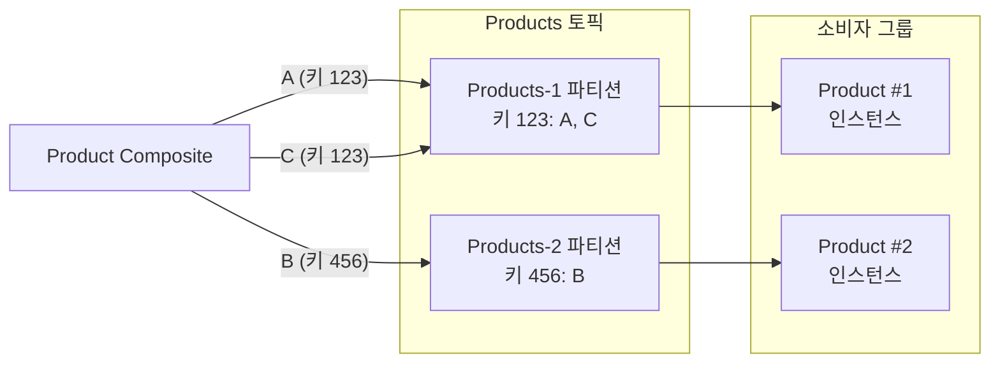

### A.8.4 RabbitMQ 큐 목록으로 구성을 검산하기

**【교재】** 교재는 RabbitMQ 관리 도구의 큐 목록으로 구성을 확인하게 합니다. 이 목록의 숫자는 **간단한 산수로 검산**할 수 있어 교육 자료로 좋습니다.

| 구성 | 토픽당 큐 | 총 큐 수 | 큐 이름 패턴(교재 표기) |
|---|---|---|---|
| **파티션 없음** | 3개(감사 그룹 큐 1 + 소비자 그룹 큐 1 + DLQ 1) | 3 × 3 = **9개** | `products.auditGroup`, `products.productsGroup`, `products.productsGroup.dlq` 등 |
| **파티션 2개** | 5개(감사 큐 2 + 소비자 그룹 큐 2 + DLQ 1) | 3 × 5 = **15개** | `products.auditGroup-0/-1`, `products.productsGroup-0/-1`, `products.productsGroup.dlq` 등 |

교재가 짚는 관찰 포인트는 이렇습니다.

- 토픽마다 **auditGroup용 큐**, 해당 핵심 마이크로서비스가 쓰는 **소비자 그룹용 큐**, **데드 레터 큐**가 존재합니다.
- 파티션을 켜면 Spring Cloud Stream이 **파티션당 하나의 큐**를 설정합니다.
- 제품 ID 1의 이벤트는 한 파티션에, 제품 ID 2의 이벤트는 다른 파티션에 배치된 것을 감사 큐의 메시지로 확인할 수 있습니다.
- DLQ는 정상 처리에서는 **비어 있고**, 소비자 그룹 큐도 소비가 끝나면 0건입니다. 감사 큐에만 남아 있다는 것은 "감사용으로 복제된 사본이 쌓여 있다"는 뜻이고, 이를 `Get Message(s)` 기능으로 직접 열어 볼 수 있습니다.

### A.8.5 Reactor 관점에서 본 쓰기 경로

**【공식·제안】** 7장의 쓰기 경로는 **Reactor 파이프라인 바깥의 메시징 인프라(Spring Cloud Stream)** 가 중심입니다. 그럼에도 Reactor와 만나는 지점이 있어 함께 짚어 둡니다.

1. **순서 보장은 Reactor 연산자 선택에도 영향을 줍니다.** `flatMap`은 내부 작업을 동시에 실행해 **결과 순서가 섞일 수 있고**, 순서를 유지하려면 `concatMap`(또는 순서를 보존해 합치는 `flatMapSequential`)을 씁니다. 같은 키의 메시지를 한 인스턴스 안에서 `flatMap(..., 동시성)`으로 병렬 처리하면 **파티션이 지켜 준 순서가 애플리케이션 안에서 깨질 수 있습니다.** *(제안: 같은 키 안에서는 순차, 다른 키 사이에서만 병렬)*
2. **쓰기 경로의 백프레셔.** 브로커는 생산 속도를 흡수하는 완충 장치(큐)이므로, 소비자 쪽에서 **처리 가능한 만큼만 요청**하는 정책이 중요합니다. 본문 9.5절의 표(경계마다 버퍼·버림·실패 정책 명시)를 메시징 경계에도 적용하세요.
3. **중복 처리 대비.** 재시도와 DLQ가 있다는 것은 같은 메시지가 **두 번 이상** 처리될 수 있다는 뜻이므로, 소비자 쪽 저장 로직은 **멱등(idempotent)** 으로 설계하는 것이 안전합니다. *(제안)*

### A.8.6 【2026 점검】 Reactor Kafka 중단과 이 장의 관계

본문 8.3절에서 확인했듯 **Reactor Kafka는 중단**되었고, 발표문이 **폐기 예정**으로 명시한 것은 다음 두 가지입니다.

- **Spring Cloud Stream의 "Reactor Kafka Binder"**
- **Spring for Apache Kafka의 Reactive template**

교재의 7장에서 확인되는 범위는 "Spring Cloud Stream으로 RabbitMQ와 카프카를 전환한다"는 설명까지이며, **어떤 바인더를 쓰는지**(일반 Kafka 바인더인지, Reactor Kafka 바인더인지)는 제가 확인한 쪽수에서는 드러나지 않습니다. 따라서 이 예제를 실무에 옮기실 때는 **쓰는 바인더가 폐기 예정 목록의 "Reactor Kafka Binder"가 아닌지** 의존성에서 직접 확인하세요. 발표문이 폐기 대상으로 적은 것은 위 두 항목뿐이므로, 그 외 구성이 같은 이유로 중단된다고 단정할 근거는 없습니다.

---

## A.9 반응형 환경의 자동화된 테스트

### A.9.1 7장이 제시하는 자동화 방식

**【교재】** 교재는 수동으로 하던 환경 검증을 **`test-em-all.bash`** 스크립트로 자동화합니다. 핵심 변경은 두 가지입니다.

1. 마이크로서비스 환경이 **작동 중인지** 확인하기 위해 **상태 엔드포인트(`/actuator/health`)** 를 `waitForService` 형태로 호출해 **준비될 때까지 기다린다**.
2. 테스트 데이터 설정 후 호출되는 새 함수 **`waitForMessageProcessing()`** 이 비동기 생성 서비스에 의해 **테스트 데이터 생성이 끝날 때까지 기다린다**.

두 번째가 비동기 시스템 테스트의 본질입니다. 쓰기 경로가 202로 즉시 끝나므로, **"요청이 성공했다 ≠ 데이터가 이미 저장됐다"** 입니다. 그래서 테스트는 **결과가 나타날 때까지 기다리는 단계**를 명시적으로 가져야 합니다.

### A.9.2 세 가지 조합을 돌린다

**【교재】** 같은 스크립트로 **메시지 브로커 조합 세 가지**를 자동 검증합니다.

| 순서 | 구성 | 설명 |
|---|---|---|
| 1 | 기본 도커 컴포즈 | **파티션 없는 RabbitMQ** |
| 2 | `docker-compose-partitions.yml` | **토픽당 파티션 2개의 RabbitMQ** |
| 3 | `docker-compose-kafka.yml` | **토픽당 파티션 2개의 카프카** |

실행 방식은 `COMPOSE_FILE` 환경 변수를 설정/해제하고 `./test-em-all.bash start stop`을 실행하는 형태입니다(시작·테스트·종료를 한 번에).

**【제안】** 이 구성이 훌륭한 이유는 **"브로커·파티션 구성이 달라도 애플리케이션 계약(코드)은 같다"** 는 주장을 자동으로 증명하기 때문입니다. 본문 9.2 원칙 6(포트/어댑터로 격리)을 **테스트 매트릭스로 검증**하는 사례이기도 합니다.

### A.9.3 테스트 계층 전체 구조

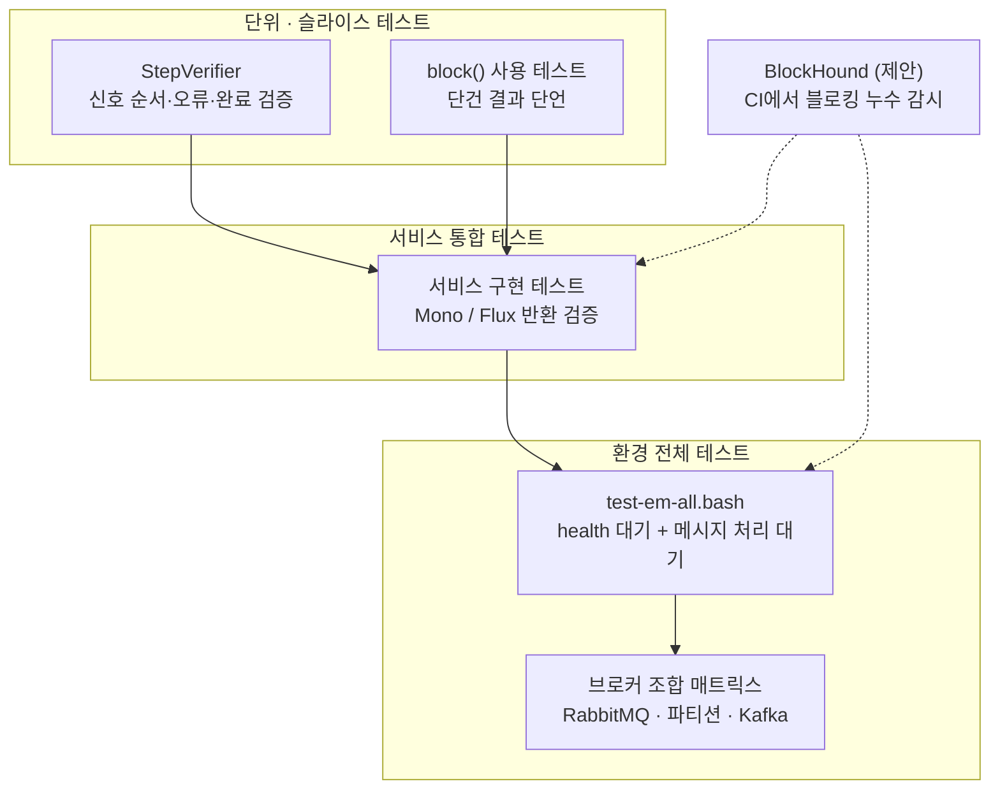

---

## A.10 【2026 점검】 교재의 가정과 오늘(2026-10-15)의 차이

교재 제목 그대로 **Spring Boot 3** 기준이므로, 오늘 시점에서 확인해야 할 변동 사항을 정리했습니다.

| 항목 | 교재의 전제 | 2026-10-15 기준 확인 사항 | 근거 수준 |
|---|---|---|---|
| **Spring Boot 3.x 지원** | Boot 3 | **3.5.x가 마지막 3.x 라인이며, 2026-06-25 발표된 3.5.16이 3.5.x의 마지막 OSS 릴리스.** 계속 OSS 지원을 받으려면 **4.0.x 또는 4.1.x로 업그레이드**하라고 공식 블로그가 안내 | **공식**(Spring 블로그) |
| Spring Boot 4.0의 OSS 지원 | — | **2026-12-31 종료로 보도**(복수의 2차 자료가 일치). 4.1이 나와 있으므로 신규 이전 대상은 4.1을 우선 검토 | 2차 자료(공식 지원 페이지에서 재확인 권장) |
| **Boot 4의 모듈 구조** | 스타터 중심 | Boot 4 마이그레이션 가이드의 목록에 `spring-boot-webflux`, `spring-boot-mongodb`, `spring-boot-r2dbc`, `spring-boot-jpa`, `spring-boot-amqp`, `spring-boot-kafka`, `spring-boot-reactor`, `spring-boot-reactor-netty` 등 **세분화된 모듈**이 나열됨 | **공식**(Spring Boot wiki) |
| **Reactor 라인** | 5.x 시대 개념 설명 | 안정 BOM **2025.0.7** = Core **3.8.7**, Netty **1.3.7**. OSS 지원은 **2027-06-30**까지 | **공식**(Reactor 문서·지원 페이지) |
| **null-safety** | 언급 없음 | Reactor Core 3.8부터 **JSpecify** 기반(기존 어노테이션은 deprecated) | **공식** |
| **Reactor Kafka** | 해당 없음(Spring Cloud Stream 사용) | **중단**, BOM에서 제외 예정, Cloud Stream의 Reactor Kafka Binder·Spring Kafka Reactive template 폐기 예정 | **공식**(Spring 블로그) |
| **WebFlux 기본 서버** | Netty | 변함없이 **Reactor Netty** 기본. Tomcat·Jetty로 교체 가능 | **공식** |
| **교재의 개념(Mono/Flux, subscribeOn, StepVerifier)** | 7장 전체 | **여전히 유효**. 스케줄러 설명(`boundedElastic`, `parallel`, `single`), `block()` 제한, 구독 모델 모두 공식 문서와 일치 | **공식** |

> **정리**: 7장의 **개념과 패턴은 현재도 유효**합니다. 달라진 것은 **주변 의존성의 지원 상태**입니다. 교재의 예제를 학습용으로 따라 하는 것은 문제없지만, **새 프로젝트의 기준선**을 Boot 3.x로 잡는 것은 2026-10-15 현재 권장되지 않습니다.

**【제안】** 학습 순서: ① 교재 7장으로 개념과 패턴을 익힌다 → ② 같은 구조를 Boot 4.x + Reactor 2025.0.x에서 다시 구성해 본다 → ③ Reactor Kafka 계열 의존성이 없는지 점검한다.

---

## A.11 교재 구조를 오늘 기준으로 다시 짠다면 (설계 제안)

교재의 구조를 본문 9장의 원칙에 비추어 개선점을 정리했습니다. 교재를 비판하려는 것이 아니라, **학습용 예제를 운영용으로 키울 때의 체크포인트**입니다.

| # | 교재 구조 | 운영 관점의 개선 제안 | 근거 |
|---|---|---|---|
| 1 | 복합 서비스가 3개 서비스를 병렬 호출 | 각 호출에 **`timeout`**, 선택적 정보(추천·리뷰)에는 **폴백**, 연결 풀 한도 인지 | 본문 원칙 3·5, 공식 `timeout`/`onErrorResume` 예시 |
| 2 | 검증 실패 시 예외를 던짐 | `Mono.error`로 **오류 경로 통일** 고려 | 구독 시점 오류 신호(3.4절) |
| 3 | `jdbcScheduler` 전용 풀(스레드·큐 상한) | 스레드 상한을 **DB 커넥션 풀과 정렬**, 풀 사용률을 **메트릭**으로 노출, 장기적으로 블로킹 구간 축소 | 본문 원칙 3·4·7 |
| 4 | 쓰기 경로 202 + 비동기 | 클라이언트에 **결과 확인 방법**(조회 API, 콜백, 이벤트) 제공, 소비자 **멱등성** 확보 | 비동기 계약 변화(A.2.2) |
| 5 | 파티션 키로 순서 보장 | 인스턴스 내부에서 **같은 키는 순차(`concatMap`)** 로 처리해 순서 유지 | 연산자 의미(A.8.5) |
| 6 | `test-em-all.bash` 자동화 | 파이프라인(CI)에 편입하고 **BlockHound**로 블로킹 누수 감시 | 본문 원칙 8 |
| 7 | 로그 기반 관찰 | **Context Propagation**으로 요청 ID를 스레드 간 유지, Micrometer 메트릭 | 본문 3.8절·원칙 7 |
| 8 | 브로커 접근(Spring Cloud Stream) | 폐기 예정 항목 **비해당 확인**, 도메인은 **포트 인터페이스**만 의존 | 본문 8.3절·원칙 6 |

---

## A.12 교재 「문제」 세 문항에 대한 모범 해설

교재 7장 끝에는 세 개의 문제가 있습니다. 본문과 별첨의 내용을 바탕으로 **학습용 답안**을 정리했습니다(교재 본문이 아닌 제 정리이며, 세 번째는 교재의 이벤트 정의 절이 범위 밖이라 **일반적인 정의**를 기준으로 했습니다).

### 문제 1. 반응형 마이크로서비스를 개발하는 방법을 아는 것이 중요한 이유는 무엇인가?

- **자원 효율**: 블로킹은 I/O 대기 중 스레드를 놀게 해 자원을 낭비합니다(2.1절). 논블로킹은 **작고 고정된 수의 스레드와 적은 메모리로 확장**할 수 있습니다(Spring 공식 문서).
- **지연이 큰 환경에서의 예측 가능한 확장**: 마이크로서비스는 원격 호출이 많아 지연이 쌓이기 쉽고, 병렬 논블로킹 호출은 그 지연을 줄여 줍니다(A.3.1).
- **탄력성과 응답성**: 교재는 반응형 시스템이 메시지 기반 비동기 통신으로 **탄력성(확장성+복원력)** 을 확보해 장애에 내성을 갖추고, 그 결과 **응답성**을 유지한다고 설명합니다.
- **단, 모든 경우에 필요한 것은 아니다**: Spring 문서는 "잘 동작하는 MVC 앱은 바꿀 필요 없다"고 명시합니다. 이점은 **측정**으로 확인해야 합니다(9.8절).

### 문제 2. 논블로킹 동기 API나 이벤트/메시지 주도 비동기 서비스를 선택하는 기준은 무엇인가?

| 기준 | 동기(논블로킹) API | 이벤트 기반 비동기 |
|---|---|---|
| 사용자가 응답을 기다리는가 | **예**(읽기 등) | 아니오 |
| 클라이언트 플랫폼 | 모바일·SPA 등 동기 API가 적합 | 서비스 간 내부 통신 |
| 조직 경계 | **다른 조직의 서비스**에 연결(공통 메시징 합의 어려움) | 같은 조직·같은 메시징 시스템 |
| 결합도 | 호출 대상에 직접 의존 | **메시징 시스템 하나**에만 의존(느슨한 결합) |
| 일반적 선호 | 위 조건에 해당할 때 | **원칙적으로 선호**(자율성·견고성) |

### 문제 3. 무엇이 이벤트를 일반적인 메시지와 다르게 만드는가?

- **일반 정의**: 일반적인 메시지는 "어떤 대상에게 데이터를 전달"하는 통신 단위이고, **이벤트는 "어떤 일이 일어났다"는 사실을 기술하는 메시지**입니다. 보통 **이벤트 유형, 발생 시각, 관련 데이터, 관련 엔티티의 키**를 담습니다. 이벤트는 **수신자에게 무엇을 하라고 지시하지 않으며**, 수신자는 각자 자신의 방식으로 반응합니다.
- **교재 7장에서의 의미**: 생성·삭제 이벤트가 **키(제품 ID)** 를 가지므로, 같은 엔티티의 이벤트를 **같은 파티션으로 보내 순서를 보장**할 수 있습니다(A.8.3).
- *(주의: 교재의 해당 정의 절은 이번에 확인한 쪽수에 없으므로, 교재 표현과 대조해 보시기 바랍니다.)*

---

## A.13 별첨 확인 한계

- 이 별첨은 교재 7장 중 **182~193쪽, 203쪽, 228쪽, 232~233쪽 및 이에 이어지는 정리·문제 부분**의 내용을 근거로 작성했습니다. **194~202쪽, 204~227쪽, 229~231쪽**(메시징 문제 처리의 세부, 토픽·이벤트 정의, 그레이들 변경, 이벤트 소비·게시 코드, 수동 테스트 절차 등)은 확인하지 못해 **세부 코드와 설정을 다루지 않았습니다.** 해당 부분의 서술은 목차(주제 목록)와 「정리」 절을 근거로 한 개요 수준입니다.
- 교재의 **본문 설명 중 기본값 표기**(`app.threadPoolSize`, `app.taskQueueSize`)는 코드 예시와 본문 문장을 함께 확인해야 정확합니다. 이 별첨은 **코드의 기본값(스레드 10, 큐 100)** 을 기준으로 썼으니, 실제 사용 시 교재 소스를 확인하세요.
- **Spring Boot 4.0의 OSS 종료일(2026-12-31)** 과 **4.1 관련 정보**는 복수의 2차 자료(HeroDevs, 개발자 블로그, 종료일 추적 사이트)의 내용이 일치하나, 저는 **공식 지원 페이지를 직접 열어 확인하지 못했습니다.** 반면 "3.5.16이 3.5.x의 마지막 OSS 릴리스이며 4.0.x/4.1.x로 업그레이드하라"는 내용은 Spring 공식 블로그(2026-06-25)에서 직접 확인했습니다.
- 교재 로그에서 나타난 **스레드 이름**의 정확한 출처(어느 라이브러리의 이벤트 루프인지)는 확인하지 못해 "다른 이름의 이벤트 루프 스레드"로만 적었습니다.
- A.3·A.5·A.6·A.7의 코드는 **개념 설명용으로 새로 작성한 예시**이며 컴파일·실행 검증을 하지 않았습니다. 실제 프로젝트의 의존성·버전에 맞춰 조정이 필요합니다.
- A.11·A.12의 개선 제안과 모범 답안은 제 추론·정리이며 교재의 공식 해설이 아닙니다.

---

## A.14 별첨 출처

**교재**
- 『스프링 부트 3와 스프링 클라우드를 활용한 마이크로서비스 구축』, 7장 「반응형 마이크로서비스 개발」(사용자가 제공한 해당 쪽수 범위)

**Spring 공식**
- Spring 블로그, "Spring Boot 3.5.16 available now"(2026-06-25, 3.5.x 마지막 OSS 릴리스 및 업그레이드 안내): https://spring.io/blog/2026/06/25/spring-boot-3-5-16-available-now/
- Spring Boot 4.0 Migration Guide(모듈 목록): https://github.com/spring-projects/spring-boot/wiki/Spring-Boot-4.0-Migration-Guide
- Spring Framework 참조 문서, WebFlux Overview: https://docs.spring.io/spring/reference/7.1/web/webflux/new-framework.html
- Spring 블로그, "Reactor Kafka Project Will Be Discontinued": https://spring.io/blog/2025/05/20/reactor-kafka-discontinued

**Reactor 공식**
- Reactor Core 레퍼런스(Threading and Schedulers, Introduction to Reactive Programming): 본문 14장 출처 참조

**2차 자료(공식 확인 권장)**
- Spring Boot 지원 일정 정리: https://www.herodevs.com/blog-posts/spring-boot-versions-eol-dates-and-latest-releases-april-2026 , https://www.danvega.dev/blog/spring-boot-end-of-life , https://endoflife.ai/article-spring-june-30-eol-wave


---
---

# 별첨 B. Project Reactor와 유사한 프레임워크 비교

> **이 별첨의 목적**: Reactor를 "여러 선택지 중 하나"로 위치시키기 위해, 비슷한 문제(비동기·논블로킹 I/O, 동시성 제어)를 푸는 JVM 계열 도구들을 표로 비교합니다.
> **조사 기준일**: 2026-10-15. 각 도구의 버전·상태는 이번에 확인한 자료의 범위만 적었고, 확인하지 못한 항목은 "확인하지 못함"으로 비워 두었습니다.
> **표기 규칙**: 별첨 A와 같습니다. **【공식】** 공식 문서·공식 블로그·공식 저장소로 확인한 사실, **【2차】** 공식은 아니지만 신뢰할 만한 기술 자료에서 확인한 사실, **【제안】** 제 판단(주관이 섞인 평가)입니다. 표 안의 평가성 문장은 모두 **【제안】** 으로 간주하세요.

---

## B.1 비교 대상과 선정 기준

### B.1.1 왜 이 일곱 가지인가

"Reactor와 유사한 프레임워크"는 두 부류로 나뉩니다. 하나는 **같은 문제를 같은 방식(Publisher/Subscriber, 연산자 체인)으로 푸는 라이브러리**이고, 다른 하나는 **같은 문제를 다른 방식(코루틴, 이벤트 루프 툴킷, 가상 스레드)으로 푸는 대안**입니다. 사용자가 실제로 선택지로 놓고 고민하는 후보를 두 부류에서 골랐습니다.

| 부류 | 도구 | 선정 이유 |
|---|---|---|
| 같은 방식 | **Project Reactor** | 기준점 |
| 같은 방식 | **RxJava 3** | Reactor와 같은 Reactive Extensions 계보. 홈페이지가 RxJava 2와 함께한 공동 연구를 언급 |
| 같은 방식 | **SmallRye Mutiny** | Quarkus의 기본 리액티브 모델 |
| 같은 방식 | **Akka Streams / Apache Pekko Streams** | 백프레셔 스트림을 액터 모델 위에서 제공 |
| 다른 방식 | **Kotlin 코루틴 / Flow** | Spring이 공식 지원하는 대안 프로그래밍 모델 |
| 다른 방식 | **Eclipse Vert.x 5** | 이벤트 루프 기반 리액티브 툴킷 |
| 다른 방식 | **JDK 가상 스레드(블로킹 스타일 유지)** | "리액티브가 꼭 필요한가"라는 질문의 직접적 대안 |

### B.1.2 이번에 조사하지 않은 후보

Micronaut와 Helidon은 처음에는 제외했으나 **B.11에서 보완**했습니다. Armeria, 그리고 Scala의 Cats Effect·ZIO·fs2 같은 **함수형 효과 시스템**은 이번 조사 범위에서 제외했습니다. 따라서 "이 일곱 가지가 전부"라는 의미가 아닙니다.

### B.1.3 공통 기반: Reactive Streams와 JDK `Flow`

**【공식】** Reactive Streams는 비동기 컴포넌트가 백프레셔와 함께 상호작용하는 방식을 정한 작은 사양이고, **Java 9부터 `java.util.concurrent.Flow`로 JDK에 포함**되었습니다(Reactor 레퍼런스, Spring 문서). 이 표준 덕분에 서로 다른 라이브러리가 `Publisher`/`Subscriber` 수준에서 연결될 수 있습니다. Spring WebFlux 문서도 "WebFlux는 Reactor를 핵심 의존성으로 요구하지만 Reactive Streams를 통해 다른 리액티브 라이브러리와 상호운용된다"고 설명합니다.

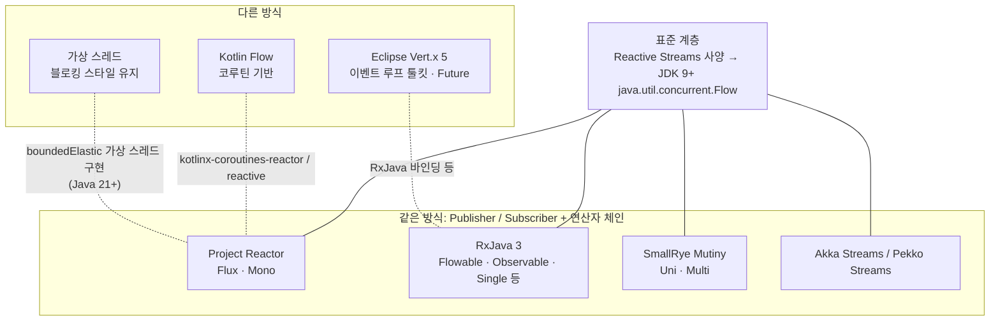

> 점선은 "상호 연동 수단이 확인된 관계"이고, 실선은 "표준을 구현하는 관계"입니다. 연동 수단의 근거는 B.8에 모았습니다.

---

## B.2 비교표 ① 개요: 정체성, 핵심 모델, 현재 상태

| 도구 | 한 줄 정체성 | 핵심 타입 · 모델 | 확인된 현재 상태 (2026-10-15 조사) | 주 소속 생태계 |
|---|---|---|---|---|
| **Project Reactor** | Reactive Streams 기반의 JVM 논블로킹 라이브러리(홈페이지: "4세대") | `Flux`(0..N), `Mono`(0..1) | Core **3.8.7**, 안정 BOM **2025.0.7**, OSS 지원 **2027-06-30**까지 【공식】 | **Spring**(WebFlux가 선택한 라이브러리) |
| **RxJava 3** | Reactive Extensions의 JVM 구현. 관측 가능한 시퀀스로 비동기·이벤트 기반 프로그램을 구성 | `Flowable`(0..N, **백프레셔 지원**), `Observable`(0..N, **백프레셔 없음**), `Single`(정확히 1개 또는 오류), `Maybe`, `Completable`(값 없이 완료/오류) | **3.x 라인**(확인한 자료에서 3.1.x 릴리스 확인). **2.x는 2021-02-28 이후 지원 종료** 【공식】 | 범용 JVM, **Android**(Java 8+ 또는 Android API 21+ 요구) |
| **SmallRye Mutiny** | 직관적·이벤트 중심의 리액티브 프로그래밍 라이브러리 | `Uni`(0..1), `Multi`(0..N) | **Mutiny 2**: JDK `Flow` 기반으로 전환, `Flow`용 Reactive Streams TCK 통과. Quarkus 3.34.x 확인(릴리스 표시 2026-04-22) 【공식】 | **Quarkus**("리액티브 애플리케이션을 쓰는 기본 모델") |
| **Eclipse Vert.x 5** | JVM에서 리액티브·논블로킹·비동기 애플리케이션을 만드는 툴킷 | 이벤트 루프, **`Future` 기반 API**(5에서 콜백 모델 제거), `VerticleBase` | **5.0.0 (2025-05-15 릴리스)**, Netty 4.2 기반 【공식】 | Eclipse Vert.x 스택(gRPC, 클라이언트 로드 밸런싱 등) |
| **Akka Streams / Apache Pekko Streams** | 액터 기반 툴킷의 스트림 모듈: 완전 양방향 백프레셔 스트림 | 액터 시스템 위의 스트림(Java·Scala) | **Pekko 1.0.0은 Akka 2.6.20 기반**(Apache 라이선스 유지). **Akka 2.7.x부터 Business Source License 1.1** 【2차】 | Java·Scala, 분산·클러스터 |
| **Kotlin 코루틴 / Flow** | 코루틴 위의 비동기 스트림 | `suspend` 함수, `Flow<T>` | Spring이 `kotlinx-coroutines-core`·`-reactor`가 클래스패스에 있으면 코루틴 지원을 활성화 【공식】 | Kotlin, **Spring**(WebFlux·Data) |
| **가상 스레드** (JDK 기능) | 블로킹 스타일 코드를 값싼 스레드로 실행 | 요청당 가상 스레드(기존 명령형 코드) | JDK 21에서 최종화. **Spring Boot 3.2+** 에서 Java 21 + `spring.threads.virtual.enabled=true`로 활성화 【공식·2차】 | **Spring MVC** 등 서블릿 스택 |

---

## B.3 비교표 ② 기술 특성: 백프레셔, 실행 모델, 표준 호환, 연계

| 도구 | 백프레셔 | 스레드·실행 모델 | 표준 호환 | 프레임워크 연계 |
|---|---|---|---|---|
| **Reactor** | Reactive Streams의 `request(n)`. **모든 연산자가 논블로킹 백프레셔 지원**(Spring 문서). 구독자는 무제한 또는 n개 요청 | **동시성 중립**. `Scheduler`(`parallel`, `single`, `boundedElastic` 등)와 `publishOn`/`subscribeOn`. `boundedElastic`은 Java 21+에서 가상 스레드 구현 선택 가능 | Reactive Streams, JDK `Flow` 인터페이스와 대응. **Reactor Adapter**가 다른 리액티브 라이브러리와 상호 변환 | Spring WebFlux·WebClient·Spring Data, **Reactor Netty**(HTTP/1.1·2·3, TCP, UDP) |
| **RxJava 3** | **`Flowable`만** 백프레셔 지원(Reactive Streams). `Observable`은 비백프레셔(짧은 시퀀스·GUI 상호작용용) | `subscribeOn(Schedulers.io())`, `observeOn(Schedulers.single())` 같은 스케줄러 | Reactive Streams(`Flowable` ↔ `Publisher`). 단일 의존성이 Reactive-Streams | Spring WebFlux 어노테이션 컨트롤러가 **RxJava로 투명하게 적응**(Spring 문서). Vert.x용 RxJava 바인딩 존재 |
| **Mutiny** | `Multi`는 **Reactive Streams 프로토콜을 따르는 `Publisher`**. 요청 없이 방출하는 소스는 `BackPressureFailure` 가능 | 이벤트 기반 파이프라인. Quarkus REST는 `Uni`/`Multi` 반환 시 **구독을 프레임워크가 처리** | **JDK `Flow` 기반**(Mutiny 2). 레거시 Reactive Streams와는 Mutiny Zero 어댑터 | Quarkus REST, 리액티브 데이터 소스·REST 클라이언트, Reactive Messaging |
| **Vert.x 5** | 스트림(`ReadStream`/`WriteStream`) 수준의 흐름 제어. `Flowable` 연동은 RxJava 바인딩으로 | **이벤트 루프** + 워커 스레드. Vert.x 5는 **가상 스레드** 지원 컴포넌트(구 Vert.x Sync 대체)를 제공 | 자체 `Future` 모델. Reactive Streams 연동은 바인딩 모듈 경유 | HTTP·gRPC(gRPC Web, 연쇄 데드라인), 서비스 디스커버리, 클라이언트 측 로드 밸런싱 |
| **Pekko / Akka Streams** | **완전 양방향 백프레셔 스트림**(Reactive Manifesto 준수) | **액터 시스템** 기반. 분산·클러스터 지원 | Reactive Streams(Pekko 1.0.0 의존 목록에 reactive-streams 1.0.4) | **Pekko Connectors**(Akka의 Alpakka에 해당) 등 스트리밍 커넥터 |
| **Kotlin Flow** | **`suspend` 함수로 구현**(Spring 문서) | 코루틴. 연산자 구현이 쉽고 비동기 연산 지원(`flatMap` 불필요) | `kotlinx-coroutines-reactive`/`-reactor`로 Reactive Streams·Reactor와 연결 | Spring WebFlux 컨트롤러, Spring Data 리포지토리(`Flow<T>`), 트랜잭션 지원 |
| **가상 스레드** | 동기 코드에서는 **블로킹 호출 자체가 자연스러운 백프레셔**(Spring 문서의 일반 설명). 단, 외부 자원 한도는 **별도 설계 필요**【제안】 | 요청마다 가상 스레드. Tomcat·Jetty가 요청 처리에 가상 스레드 사용. `applicationTaskExecutor`, `@Async`, Kafka·RabbitMQ 리스너 등도 가상 스레드 사용 | 리액티브 표준과 무관(명령형) | Spring MVC, 기존 블로킹 라이브러리(JPA·JDBC) 그대로 사용 가능 |

---

## B.4 비교표 ③ 강점 · 유의점 · 어울리는 상황 【제안】

> 이 표는 앞 표의 사실들을 바탕으로 한 **제 평가**입니다. 각 칸 끝에 근거 항목을 적었습니다.

| 도구 | 강점 | 유의점 | 어울리는 상황 |
|---|---|---|---|
| **Reactor** | 풍부한 연산자, Spring과의 긴밀한 통합, 스케줄러·Context·BlockHound·`reactor-test` 같은 **운영 도구 생태계**, Netty 기반 네트워크 엔진(HTTP/3 포함) | 비블로킹·함수형·선언형으로의 **학습 곡선이 가파름**(Spring 문서). 블로킹 호출은 격리 필요. Reactor Kafka는 **중단** | Spring 기반 서비스, I/O 지연이 큰 게이트웨이·팬아웃 서비스, 스트리밍 |
| **RxJava 3** | 성숙한 Rx 계보, **Android** 지원, 풍부한 타입(`Single`/`Maybe`/`Completable`)으로 의도를 세분화 | `Flowable`과 `Observable`을 **혼동하면 백프레셔가 없는 경로**가 생김(README의 구분). 2.x는 지원 종료이므로 3.x 이전 필요 | Android·클라이언트 측, 기존 Rx 자산이 있는 프로젝트 |
| **Mutiny** | `Uni`/`Multi`로 **0..1과 0..N을 이름부터 구분**, Quarkus 확장들이 일관되게 노출, 구독을 프레임워크가 처리 | **Quarkus 중심**. Mutiny 2는 소스·바이너리 호환이 깨지는 **메이저 전환**이었음(이전 0.x·1.x 대비). `Multi`는 `null` 방출 불가, `Uni`는 가능 | Quarkus 기반 서비스 |
| **Vert.x 5** | 이벤트 루프 툴킷, gRPC·로드 밸런싱 등 **인프라 기능이 내장**, 가상 스레드 옵션 | Vert.x 4→5는 **API 변경이 있는 메이저**(콜백 제거). 일부 컴포넌트는 Vert.x 6에서 제거 예정으로 안내됨 | 낮은 수준에서 이벤트 루프를 직접 다루고 싶은 팀, 폴리글랏 지향 서비스 |
| **Pekko / Akka Streams** | 액터·클러스터와 결합한 **분산 스트림 처리**, 완전한 양방향 백프레셔 | **라이선스 분기**: Akka 2.7.x부터 BSL 1.1(프로덕션은 라이선스 필요), Pekko는 패키지·설정 이름이 달라 이전 필요. Scala 비중 큼 | Scala·액터 모델이 이미 있는 분산 시스템 |
| **Kotlin Flow** | **명령형처럼 읽히는 비동기 코드**, Spring이 `Flow`/`suspend`를 공식 지원, 백프레셔를 중단 함수로 처리 | Kotlin 언어가 전제. 팀에 코루틴 이해 필요 | Kotlin 기반 Spring 서비스, Reactor를 쓰되 가독성을 높이고 싶을 때 |
| **가상 스레드** | **기존 블로킹 코드·라이브러리를 그대로** 쓰면서 동시성 확대, 가장 쉬운 디버깅(Spring 문서: 명령형이 쓰고·이해하고·디버깅하기 가장 쉬움) | 일부 라이브러리가 **가상 스레드를 고정(pinning)** 할 수 있음(InfoQ). 스트리밍·연속 이벤트 표현은 연산자 체인만큼 풍부하지 않음【제안】. 하위 시스템 동시성 한도는 직접 설계 | JPA·JDBC 중심 서비스, 기존 MVC 앱의 규모 확장 |

---

## B.5 같은 문제를 다섯 가지 방식으로 보기

**문제**: "사용자의 즐겨찾기를 조회하되 **800ms 안에 응답이 없으면 캐시에서 대신 가져온다**."

아래 코드는 **개념 비교용으로 새로 작성한 예시**이며, 컴파일·실행은 검증하지 않았습니다. 각 라이브러리의 연산자 이름 차이를 보여 주는 것이 목적입니다.

**Reactor** (`Mono`)

```java
Mono<List<String>> favorites(String userId) {
    return favoriteClient.fetch(userId)                      // Mono<List<String>>
            .timeout(Duration.ofMillis(800))
            .onErrorResume(e -> cache.cachedIds(userId));    // 캐시로 대체
}
```

**RxJava 3** (`Single`)

```java
Single<List<String>> favorites(String userId) {
    return favoriteClient.fetch(userId)                      // Single<List<String>>
            .timeout(800, TimeUnit.MILLISECONDS)
            .onErrorResumeNext(e -> cache.cachedIds(userId));
}
```

**Mutiny** (`Uni`)

```java
Uni<List<String>> favorites(String userId) {
    return favoriteClient.fetch(userId)                      // Uni<List<String>>
            .ifNoItem().after(Duration.ofMillis(800))
            .recoverWithUni(() -> cache.cachedIds(userId));
}
```

**Kotlin 코루틴** (`suspend`)

```kotlin
suspend fun favorites(userId: String): List<String> =
    withTimeoutOrNull(800) { favoriteClient.fetch(userId) }  // 시간 초과 시 null
        ?: cache.cachedIds(userId)
```

**가상 스레드** (블로킹 스타일)

```java
List<String> favorites(String userId) throws Exception {
    try (var exec = Executors.newVirtualThreadPerTaskExecutor()) {
        Future<List<String>> f = exec.submit(() -> favoriteClient.fetch(userId));  // 블로킹 호출
        try {
            return f.get(800, TimeUnit.MILLISECONDS);
        } catch (TimeoutException e) {
            f.cancel(true);
            return cache.cachedIds(userId);
        }
    }
}
```

**읽는 법**
- Reactor·RxJava·Mutiny는 **연산자 이름만 다르고 구조가 거의 같습니다**(타임아웃 → 폴백). 타입 이름도 `Mono`/`Single`/`Uni`로 "정확히 1개 결과"라는 의미가 대응합니다.
- Kotlin 코루틴은 **연산자 체인이 사라지고 일반 코드처럼** 읽힙니다. 타임아웃은 `withTimeoutOrNull`로 표현합니다.
- 가상 스레드 예제는 **스레드를 직접 다루는 명령형 코드**이며, 시간 제한과 취소를 `Future`로 처리합니다.
- Vert.x와 Pekko Streams 예제는 같은 구조로 단순 비교하기 어려워(Vert.x는 `Future` 조합·클라이언트 옵션, Pekko는 스트림 그래프 중심) 생략했습니다.

---

## B.6 Reactor 관점의 쌍별 비교

### B.6.1 Reactor vs RxJava 3

**【공식】** 두 라이브러리는 같은 Reactive Streams를 따르며, Reactor 홈페이지는 Reactor Core가 **RxJava 2도 구현한 공동 리액티브 연구를 기반으로 한 첫 라이브러리**라고 설명합니다.

- **타입 설계가 다릅니다.** RxJava는 백프레셔가 있는 `Flowable`, 없는 `Observable`, 그리고 `Single`/`Maybe`/`Completable`로 세분화하고, Reactor는 **`Flux`(0..N)와 `Mono`(0..1) 두 타입**으로 단순화합니다(Reactor 쪽은 모든 것이 Reactive Streams 백프레셔 대상).
- **생태계 중심이 다릅니다.** Reactor는 Spring이, RxJava는 범용·Android가 중심입니다. Spring은 WebFlux 컨트롤러에서 RxJava 반환 타입도 투명하게 적응하지만, **WebFlux 자체는 Reactor를 핵심 의존성으로 요구**합니다.
- **전환 비용**: Reactor Adapter가 두 라이브러리 사이를 변환합니다(B.8).

### B.6.2 Reactor vs Mutiny

- **타입 대응**: `Mono` ↔ `Uni`, `Flux` ↔ `Multi`. 이름에서 0..1/0..N 구분을 강조하는 철학은 같습니다.
- **API 스타일**: Reactor는 연산자를 메서드로 평평하게 나열하고, Mutiny는 `onItem().transform…`, `ifNoItem().after…`처럼 **이벤트 중심의 분기형(navigable) API**를 씁니다【제안: 가독성 취향 문제】.
- **표준 기반**: Mutiny 2는 **JDK `Flow`를 직접 기반**으로 삼았습니다. Reactor는 Reactive Streams를 구현합니다(둘 다 호환성 목적은 같음).
- **생태계 선택**: Spring 스택이면 Reactor, Quarkus 스택이면 Mutiny가 **프레임워크 쪽에서 선택한 기본값**입니다(Spring 문서: "Reactor is the reactive library of choice for Spring WebFlux", Quarkus 문서: Mutiny는 "primary model"). 같은 프레임워크에서 다른 라이브러리를 쓰는 것은 가능할 수 있으나 **통합 지원의 폭이 줄어듭니다**【제안】.

### B.6.3 Reactor vs Kotlin 코루틴/Flow

**【공식】** Spring 문서는 `Flow`를 "Flux에 대응하는 코루틴 세계의 개념"으로 소개하고, 주된 차이로 **백프레셔가 `suspend` 함수로 구현되고, 연산자 구현이 쉬우며, 비동기 연산을 `flatMap` 없이 지원**한다는 점을 듭니다. Spring Data 리포지토리도 `Flow<User>`를 반환하는 형태로 코루틴을 지원하고, 이는 리액티브 리포지토리 위에서 **논블로킹 특성을 노출**하는 방식이라고 설명합니다. 즉 **Reactor를 대체하는 것이 아니라, Reactor 위에 다른 문법을 얹는** 관계에 가깝습니다(Spring은 `kotlinx-coroutines-reactor`가 있어야 코루틴 지원을 켭니다).

**【제안】** Kotlin 팀이라면 "Reactor를 직접 쓸지, 코루틴으로 감쌀지"는 **가독성과 학습 비용의 선택**입니다. 이미 Reactor 연산자(`flatMap`, `zip`, `timeout`)에 익숙하다면 그대로, 명령형 가독성을 원하면 코루틴이 후보입니다. Reactor는 Kotlin용 확장(Reactor Kotlin Extensions 1.3.2)도 제공합니다.

### B.6.4 Reactor vs 가상 스레드

이 비교가 현재 **가장 현실적인 의사결정 질문**입니다. 공식 문서에서 확인된 사실만 정리합니다.

| 쟁점 | 확인된 내용 |
|---|---|
| Spring의 기본 안내 | **잘 동작하는 MVC 앱은 바꿀 필요가 없다.** 명령형이 쓰고 이해하고 디버깅하기 가장 쉽고, 블로킹 라이브러리 선택지가 가장 넓다. 블로킹 영속성(JPA·JDBC)이 있으면 **MVC가 일반적 아키텍처에서 최선** 【공식】 |
| 리액티브의 이점 | 일반적으로 앱을 **더 빠르게 만들지 않지만**, **작고 고정된 스레드와 적은 메모리로 확장**하는 능력을 준다. 이점은 **지연이 있는 환경**에서 뚜렷 【공식】 |
| 가상 스레드 지원 | Java 21 + `spring.threads.virtual.enabled=true`로 Tomcat·Jetty가 요청 처리에 가상 스레드를 사용(Spring Boot 3.2 릴리스 노트) 【공식】 |
| 주의 | Spring 생태계 라이브러리도 **가상 스레드를 고정(pin)할 수 있다**(InfoQ) 【2차】 |
| Reactor 쪽의 수용 | `Schedulers.boundedElastic()`을 **가상 스레드 기반 구현**으로 바꿀 수 있다(Java 21+, 시스템 속성). 블로킹 격리 스케줄러를 가상 스레드로 구현한다는 의미 【공식】 |

**【제안】** 정리하면 두 접근은 **배타적이지 않습니다.**
- *블로킹 영속성 중심의 도메인 서비스* → MVC + 가상 스레드(필요하면 `WebClient`만 도입).
- *스트리밍·팬아웃·게이트웨이 같은 이벤트 중심 서비스* → WebFlux + Reactor.
- *Reactor 안의 블로킹 격리 구간* → `boundedElastic`(필요 시 가상 스레드 구현).
- 이 구분은 본문 9.7절(하이브리드 구성)과 같은 취지입니다. 성능 우열을 단정하는 공식 수치는 확인하지 못했으므로, **여러분의 워크로드로 측정**하세요.

### B.6.5 Reactor vs Vert.x

- **추상화 높이**: Reactor는 **연산자 체인과 `Publisher` 추상화**가 중심이고, Vert.x는 **이벤트 루프·Verticle·`Future`** 가 중심인 **툴킷**입니다. 후자는 gRPC, 클라이언트 측 로드 밸런싱, 서비스 리졸버 같은 **인프라 기능을 함께 제공**합니다.
- **공통 기반**: 둘 다 Netty 위에 놓입니다(Reactor Netty 1.3은 Netty 4.2, Vert.x 5도 Netty 4.2 기반).
- **프로그래밍 모델**: Vert.x 5는 콜백을 없애고 `Future` 모델만 남겼고, 가상 스레드 방식의 모델도 제공합니다. Reactor는 `Flux`/`Mono` 연산자 체인이 일관된 모델입니다.
- **선택 기준**【제안】: Spring 에코시스템과 연산자 어휘가 필요하면 Reactor, 인프라 기능 번들과 이벤트 루프 제어가 필요하면 Vert.x.

### B.6.6 Reactor vs Akka/Pekko Streams

- **모델**: Pekko/Akka Streams는 **액터 시스템 위의 스트림**으로 **분산·클러스터링**과 결합합니다. Reactor는 단일 프로세스 내 리액티브 파이프라인과 네트워크 런타임에 초점을 둡니다.
- **라이선스 이슈**: Akka는 2.7.x부터 BSL 1.1(Baeldung)이며, Apache Pekko는 이를 피해 **Akka 2.6 계열에서 포크**한 프로젝트입니다. 패키지·설정 이름이 달라 이전 시 변경이 필요합니다. 현재 Akka 최신 라이선스 정책은 제가 확인하지 못했으므로 **제공자 페이지에서 직접 확인**하세요.
- **선택 기준**【제안】: Scala·액터 기반 분산 시스템이면 Pekko/Akka, Spring 기반 서비스면 Reactor.

---

## B.7 선택 의사결정 흐름 【제안】

아래 흐름도는 **이미 정해진 조건(프레임워크·언어·라이브러리)** 에서 출발합니다. 이 별첨에서 확인한 사실(프레임워크가 선택한 기본 라이브러리, 공식 안내)에 근거한 것이며, 성능 우열은 전제하지 않습니다.

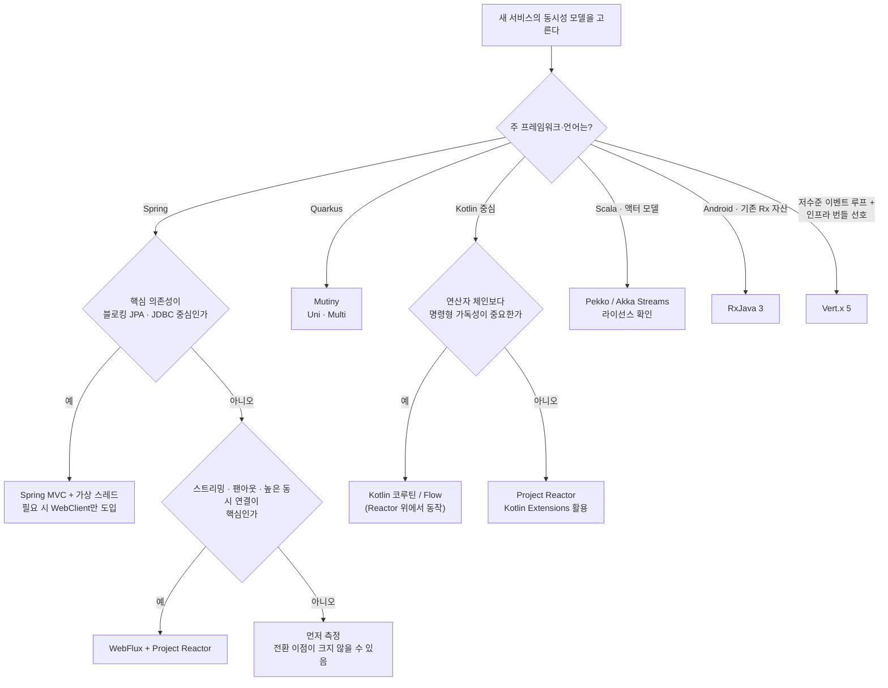

---

## B.8 상호운용과 이전 경로

이 절은 "한 번 고르면 영영 못 바꾼다"는 오해를 줄이기 위해, **확인된 변환 수단**만 모았습니다.

| 연결 | 수단 | 근거 |
|---|---|---|
| Reactor ↔ 다른 리액티브 라이브러리 | **Reactor Adapter**("Adapt to/from other reactive libraries") | Reactor 문서 페이지의 모듈 설명 【공식】 |
| Reactor ↔ Kotlin Flow·코루틴 | `kotlinx-coroutines-reactor`, `-reactive` | Spring 코루틴 문서 【공식】 |
| Reactor ↔ RxJava (WebFlux 경유) | WebFlux 어노테이션 컨트롤러는 RxJava 등 **다른 리액티브 타입도 투명하게 적응** | Spring WebFlux 문서 【공식】 |
| Mutiny ↔ 레거시 Reactive Streams | **Mutiny Zero** 어댑터(`mutiny-zero-flow-adapters`), 오버헤드 거의 없음 | Mutiny 2 마이그레이션 문서 【공식】 |
| Vert.x ↔ RxJava | Vert.x용 RxJava 바인딩(`ReadStream`→`Flowable` 등). 확인한 문서는 4.x 계열이므로 **5.x 지원 여부는 확인하지 못함** | Vert.x 문서 【공식, 4.x 기준】 |
| Akka → Pekko | 패키지명·설정 접두사 변경(`akka`→`pekko`), 마이그레이션 가이드 제공 | Pekko 릴리스 노트 【공식】 |
| 블로킹 → Reactor | `Mono.fromCallable(...).subscribeOn(Schedulers.boundedElastic())`(별첨 A.7) | Reactor 문서 【공식】 |

**【제안】** 이전 전략은 **경계에서 변환**하는 것이 가장 안전합니다. 도메인·애플리케이션 계층은 특정 라이브러리 타입이 아니라 **포트 인터페이스**(본문 9.2 원칙 6)에 의존하게 하고, 어댑터 계층에서 `Publisher`↔라이브러리 타입을 변환하면, 나중에 라이브러리를 바꿔도 영향이 한 곳으로 제한됩니다.

---

## B.9 별첨 B 확인 한계

- **버전 번호**: RxJava는 3.x 라인(3.1.x)임은 확인했으나 **정확한 최신 패치 버전은 확인하지 못했습니다.** Mutiny 2와 Vert.x 5.0.0, Pekko 1.0.0의 **현재 최신 패치도 확인하지 못했습니다**(표에는 확인한 값만 적었습니다).
- **Akka 현재 라이선스**: Akka 2.7.x부터 BSL 1.1이라는 점은 확인했으나, **2026-10-15 현재 Akka의 최신 라이선스 정책**은 이번에 확인하지 못했습니다.
- **Mutiny의 `ifNoItem().after(...)`·RxJava의 `onErrorResumeNext`** 등 B.5의 코드는 각 라이브러리의 연산자를 기억에 기반해 쓴 예시이며 **실행 검증을 하지 않았습니다.** 사용 중인 버전의 Javadoc으로 시그니처를 확인하세요.
- **성능 비교**는 하지 않았습니다. 라이브러리 간 처리량·지연 수치를 신뢰할 만한 공식 자료로 확보하지 못했습니다.
- **가상 스레드의 고정(pinning)** 은 InfoQ의 기술 기사 서술에 의존했습니다. 이후 JDK 버전에서 상황이 달라졌을 수 있으므로 **사용하는 JDK 버전의 문서**를 확인하세요.
- **B.4의 평가성 문장**(강점·유의점·어울리는 상황)은 제 판단입니다.
- Vert.x의 가상 스레드·RxJava 바인딩은 문서 일부가 4.x 계열이어서 **5.x 최신 지원 상태는 확인하지 못했습니다.**
- **조사하지 않은 후보**(Armeria, Scala 함수형 효과 시스템 등)가 있어 이 표가 전체 지형을 포괄하지 않습니다. Micronaut와 Helidon은 B.11에서 보완했습니다.

---

## B.10 별첨 B 출처

**Reactor / Spring (공식)**
- Spring Framework 참조 문서, WebFlux Overview(Reactor가 선택한 라이브러리, MVC vs WebFlux 안내, 성능·동시성 모델): https://docs.spring.io/spring/reference/7.1/web/webflux/new-framework.html
- Spring Framework 참조 문서, Kotlin Coroutines(Flow = Flux 대응, 백프레셔는 suspend, 필요한 의존성): https://docs.spring.io/spring/reference/languages/kotlin/coroutines.html
- Spring Data Commons, Coroutines(`Flow` 리포지토리): https://docs.spring.io/spring-data/commons/reference/kotlin/coroutines.html
- Spring Boot 3.2 Release Notes(가상 스레드 지원, `spring.threads.virtual.enabled`): https://github.com/spring-projects/spring-boot/wiki/Spring-Boot-3.2-Release-Notes
- Reactor Core 레퍼런스(Introduction, Threading and Schedulers): 본문 14장 출처 참조

**RxJava**
- ReactiveX/RxJava README·위키(Flowable·Observable 구분, Java 8+, Android API 21+, 3.x/2.x 지원 정책): https://github.com/ReactiveX/RxJava/releases?page=4 , https://github.com/ReactiveX/RxJava/wiki/What's-different-in-3.0

**Mutiny / Quarkus**
- Quarkus Mutiny Primer(Mutiny는 Quarkus의 기본 리액티브 모델): https://quarkus.io/guides/mutiny-primer
- Mutiny 2 마이그레이션 문서(JDK Flow 기반, Mutiny Zero 어댑터): https://github.com/smallrye/smallrye-mutiny/commit/4646708adc60474afb52e410ba4749eb6b4ab750
- Mutiny 백프레셔 글: https://es.quarkus.io/blog/mutiny-back-pressure/
- Quarkus 확장 목록(Quarkus 3.34.6, 2026-04-22): https://quarkus.io/extensions/new-extensions/2020/may

**Vert.x**
- Eclipse Vert.x 5 발표(2025-05-15): https://vertx.io/blog/eclipse-vert-x-5-released
- What's new in Vert.x 5: https://vertx.io/blog/whats-new-in-vert-x-5
- Vert.x 5.0.0 릴리스 정보: https://projects.eclipse.org/projects/rt.vertx/current-release
- Vert.x 5 마이그레이션 가이드: https://vertx.io/docs/guides/vertx-5-migration-guide/
- Vert.x RxJava3 바인딩(4.1.8 문서): https://vertx.io/docs/4.1.8/vertx-rx/java3/

**Akka / Pekko**
- Apache Pekko 1.0.0 릴리스 노트: https://pekko.apache.org/docs/pekko/1.0.0/release-notes/index.html
- Apache Pekko 제안서(Pekko는 BSL 이전 Akka의 포크): https://cwiki.apache.org/confluence/x/u4zGDQ
- Baeldung, Apache Pekko(Akka 2.7.x BSL 1.1): https://www.baeldung.com/scala/apache-pekko

**가상 스레드(2차)**
- InfoQ, Spring Boot 3.2 and Spring Framework 6.1 Add Java 21, Virtual Threads, and CRaC: https://www.infoq.com/articles/spring-boot-3-2-spring-6-1/
- InfoQ, Spring Boot 3.2 Delivers Support for Virtual Threads and Modern RestClient and JdbcClient: https://www.infoq.com/news/2023/12/spring-boot-virtual-threads/


---

## B.11 보완: 추가 후보 — Helidon 4와 Micronaut

> B.1.2에서 "조사하지 않았다"고 밝힌 후보 중 **Helidon**과 **Micronaut**을 보완했습니다. 두 도구는 Reactor와 같은 층위의 **라이브러리가 아니라 프레임워크**이므로, "Reactor를 대체하는가"보다 "**프레임워크가 어떤 동시성 모델을 기본으로 택했는가**"의 관점으로 비교합니다. 표기 규칙은 앞과 같습니다.

### B.11.1 Helidon 4: 리액티브 서버를 제거하고 가상 스레드로 간 사례

**【공식】** Helidon 4의 변경 사항을 공식 릴리스 노트·문서에서 확인한 내용은 다음과 같습니다.

- **Netty 기반의 리액티브 WebServer와 WebClient를 제거**하고, 블로킹 스타일 API를 가진 **가상 스레드 기반 구현(Project Níma)** 으로 완전히 전환했습니다.
- 리액티브 API를 갖던 **다른 모듈도 블로킹 스타일 API로 변환**했습니다. 다만 `io.helidon.common.reactive` API는 **범용 리액티브 유틸리티·연산자**로 남겨 두었습니다.
- Helidon SE 4.x 업그레이드 가이드는 "**리액티브 엔진이 제거**되었고, API와 구현이 '블로킹' 패러다임으로 다시 쓰였으며, Helidon 4는 **더 이상 Netty를 쓰지 않는다**"고 적습니다. Helidon SE는 비동기 스타일 API에서 **가상 스레드에 최적화된 명령형/블로킹 API**로 바뀌었습니다.
- 가상 스레드는 **Java 21**에서 제공되는 기능에 기대며, 문서는 "가상 스레드가 있으면 스레드는 더 이상 조심스럽게 풀링·관리해야 하는 희소 자원이 아니다"라고 설명합니다.
- 공식 변경 이력에는 "리액티브 서버의 높은 처리량과 스레드-요청당 방식의 단순함을 함께 얻는다"는 **공급자 측 주장**도 있습니다. 이는 **벤더의 설명**이며, 독립 검증된 수치가 아닙니다.
- Helidon MP(MicroProfile) 애플리케이션은 Helidon 4로 비교적 쉽게 이전할 수 있다고 안내합니다(가장 큰 변경은 MicroProfile Metrics 5.0).

**【2차】** InfoQ 기사도 같은 흐름을 "복잡한 리액티브 모델에서 '블로킹' 호출을 쓰는 더 단순한 명령형 모델로의 전환"으로 요약합니다.

**【제안】** 이 사례의 의미는 다음 정도로 제한해서 읽는 것이 정확합니다.

1. 가상 스레드가 나온 뒤 **일부 프레임워크는 리액티브 API를 버리는 선택을 실제로 했다**는 *한 가지 사실*입니다. 이것이 "리액티브는 끝났다"를 뜻하지는 않습니다. Spring은 같은 시기에 WebFlux를 유지하며 MVC와 WebFlux 양쪽을 안내하고(B.6.4), Reactor 3.8이 2025-11에 출시되어 지원 일정이 2027까지 공개되어 있습니다.
2. 반대로 **"가상 스레드면 충분하다"** 로 결론내릴 증거도 아닙니다. Helidon은 *웹 서버·클라이언트 자체를 새로 썼고* 라이브러리 생태계를 통제할 수 있는 입장이므로, 다양한 서드파티를 조합하는 일반 애플리케이션과 조건이 다릅니다【제안】.
3. 스트리밍·연속 이벤트 합성 같은 **연산자 어휘**가 필요한 경우 Helidon도 `common.reactive` 유틸리티를 남겨 두었다는 점이 시사적입니다.

### B.11.2 Micronaut: 리액티브 타입을 "받아주는" 프레임워크

**【공식·2차】** Micronaut는 Netty 이벤트 루프 위에서 동작하며, 확인된 내용은 다음과 같습니다.

- **리액티브 타입을 반환하는 컨트롤러 메서드는 이벤트 루프에서 실행**됩니다. 여기서 "리액티브 타입"은 `org.reactivestreams.Publisher`를 구현한 것, RxJava·Project Reactor의 타입, Java future까지 포함한다고 설명됩니다(Micronaut 2 시기의 공식 계열 설명 자료이므로 **현재 버전에서의 세부 규칙은 확인하지 못했습니다**).
- **블로킹 작업은 `@ExecuteOn(TaskExecutors.IO)`** 같은 어노테이션으로 별도 스레드 풀에서 실행하도록 하는 것이 원칙입니다(같은 자료).
- **Micronaut 4.4.0(2024-04)부터**, 이벤트 루프 스레드에서 **Project Reactor의 블로킹 연산을 하면 예외가 발생**합니다. 문서는 이 동작이 `@ExecuteOn`이 필요한 컨트롤러 메서드를 찾아내도록 돕는다고 설명합니다. *(본문 3.7절에서 본 "기본 스케줄러에서 `block()`을 하면 `IllegalStateException`"과 같은 철학의 안전장치입니다.)*
- **Micronaut 4.0.0**은 Java 기준선을 **17**로 올렸고, **가상 스레드 지원이 감지되면 `BLOCKING`이라는 이름의 실행기에 이를 자동 사용**합니다(InfoQ 일본어판 기사, Java 19+ 런타임 기준 서술).
- 모듈 목록에는 **Micronaut Reactor**(4.4.0 릴리스 노트상 Reactor 2023.0.4로 갱신), **Micronaut R2DBC**, **Micronaut Kafka** 등이 있습니다(릴리스 노트 기준, 당시 버전).

**【제안】** Micronaut는 "리액티브 라이브러리를 **고르는 대상**"이라기보다 "Reactor·RxJava 같은 라이브러리를 **받아주면서, 블로킹은 가상 스레드 또는 전용 풀로 보내는**" 프레임워크로 보는 것이 정확합니다. 즉 Reactor 사용 여부가 **선택 가능한 계층**이라는 점에서 Spring(WebFlux는 Reactor 고정)과 결이 다릅니다.

### B.11.3 비교표 ④ 추가 후보

| 도구 | 정체성 | 동시성 모델 | Reactor와의 관계 | 확인된 상태 | 유의점【제안】 |
|---|---|---|---|---|---|
| **Helidon 4** | 마이크로서비스 프레임워크(SE·MP) | **가상 스레드 + 블로킹 스타일 API**. Netty·리액티브 엔진 제거 | 직접 사용 아님. `common.reactive` 유틸리티만 유지 | Helidon 4가 4.0.0부터 이 구조(공식), Java 21 기반 | 리액티브 API로 짠 Helidon 3 코드는 **블로킹 API로 재작성** 필요(SE). MP는 이전이 비교적 쉬움 |
| **Micronaut** | JVM 마이크로서비스 프레임워크 | **Netty 이벤트 루프** + 블로킹은 `@ExecuteOn`/가상 스레드 실행기 | **Reactor·RxJava 타입을 지원**(Micronaut Reactor 모듈), 이벤트 루프에서의 Reactor 블로킹을 예외로 차단(4.4.0+) | Micronaut 4.x, Java 17 기준선(4.0.0) | 어떤 스레드에서 무엇이 실행되는지 **프레임워크 규칙**(리액티브 반환 → 이벤트 루프)을 이해해야 함 |

### B.11.4 프레임워크가 선택한 기본 동시성 모델: 한눈에 보기

아래는 **확인된 사실**만으로 그린 지형입니다. 한 프레임워크가 두 모델을 모두 지원할 수 있으므로 "택일"이 아니라 "**어디에 무게를 두었는가**"의 표현입니다.

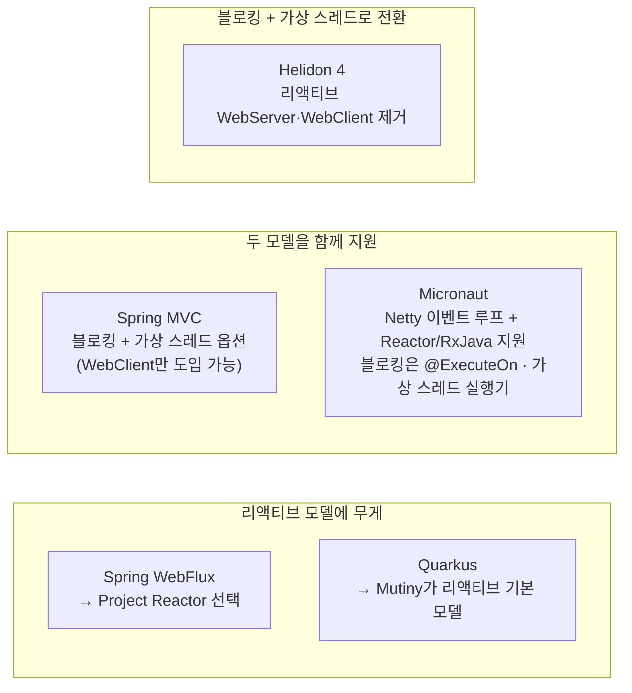

| 프레임워크 | 확인된 기본 선택 | 근거 |
|---|---|---|
| Spring WebFlux | **Reactor가 선택된 리액티브 라이브러리** | Spring 공식 문서 【공식】 |
| Spring MVC | 블로킹 스타일 유지, **가상 스레드 옵션**, 필요 시 리액티브 `WebClient` | Spring 문서·Boot 3.2 릴리스 노트 【공식】 |
| Quarkus | **Mutiny**가 리액티브 모델 | Quarkus Mutiny Primer 【공식】 |
| Micronaut | 이벤트 루프 + **리액티브 타입 지원**, 블로킹은 별도 실행기(가상 스레드 감지 시 사용) | Micronaut 릴리스 노트·기사 【공식·2차】 |
| Helidon 4 | **리액티브 제거, 가상 스레드 + 블로킹 API** | Helidon 4 릴리스 노트·문서 【공식】 |

**【제안】 읽는 법**: Reactor를 도입할지는 라이브러리 단독이 아니라 **프레임워크의 기본 모델과 얼마나 같은 방향인가**에 크게 좌우됩니다. Spring에서 WebFlux로 가면 Reactor가 가장 자연스럽고, Helidon 4에서 리액티브를 고집하는 것은 프레임워크의 방향과 반대입니다.

### B.11.4-1 남은 후보

**Armeria**, **Cats Effect·ZIO·fs2**(Scala 함수형 효과 시스템)는 이번에도 조사하지 못했습니다. 별도 조사가 필요합니다.

### B.11.5 B.11 확인 한계

- **버전**: Helidon 4와 Micronaut 4의 **현재 최신 패치 버전**은 확인하지 못했습니다. Helidon은 4.0.0 계열 릴리스 노트와 문서, Micronaut는 4.0.0·4.4.0 시점 자료를 근거로 했습니다.
- **Micronaut의 "리액티브 반환 → 이벤트 루프" 규칙**은 Micronaut 2 시기 자료이며, 4.x에서 세부가 달라졌을 수 있어 **현행 문서 확인**이 필요합니다.
- **Micronaut의 가상 스레드 자동 사용**은 InfoQ 일본어판 기사(4.0.0 시점)에 의존했고, 이후 JDK(특히 Java 21 이상)에서의 정확한 조건은 확인하지 못했습니다.
- **Helidon의 성능 주장**은 벤더 설명이며, 독립적인 비교 수치는 확인하지 못했습니다.
- 이 보완 절에서도 **처리량·지연의 우열은 판단하지 않았습니다.**

### B.11.6 B.11 출처

- Helidon 4.0.0-M1 릴리스 노트(리액티브 WebServer·WebClient 제거, 블로킹 API 전환): https://github.com/helidon-io/helidon/releases/tag/4.0.0-M1
- Helidon 4.0.0-M2 변경 이력: https://github.com/helidon-io/helidon/blob/4.0.0-M2/CHANGELOG.md
- Helidon 문서, What's New in This Release(Helidon 4): https://helidon.io/docs/v4/about/intro.html
- Helidon SE 4.x Upgrade Guide(리액티브 엔진 제거, Netty 미사용): https://helidon.io/docs/4.0.10/se/guides/upgrade_4x.html
- InfoQ, Helidon 4 Adopts Virtual Threads: https://www.infoq.com/articles/helidon-4-adopts-virtual-threads
- Micronaut 4.4.0 릴리스(이벤트 루프에서의 Reactor 블로킹 예외, Micronaut Reactor 갱신): https://micronaut.io/2024/04/17/micronaut-framework-4-4-0-released
- InfoQ 일본어판, Micronaut 4.0.0(Java 17 기준선, 가상 스레드 자동 사용): https://www.infoq.com/jp/news/2023/09/micronaut-brings-virtual-thread
- Object Computing, Micronaut 2: Don't Let Event Loops Own You(리액티브 반환 메서드는 이벤트 루프, `@ExecuteOn`): https://objectcomputing.com/resources/publications/sett/june-2020-micronaut-2-dont-let-event-loops-own-you


---
---

# 별첨 C. Spring Cloud + Kubernetes 기반 Project Reactor 애플리케이션 개발·운영 프레임워크 (Windows 노트북 실습)

> **이 별첨의 목적**: 본문의 원칙(9장)과 별첨 A·B의 판단을 **직접 손으로 확인할 수 있는 실습 체계**로 바꿉니다. Windows 노트북 한 대에서 Kubernetes 클러스터를 띄우고, Reactor 기반 서비스 4개를 배포해 **개발 → 배포 → 운영 → 관측 → 검증**의 전 과정을 체험합니다.
> **작성 기준일**: 2026-10-15.
> **표기 규칙**: 별첨 A·B와 같습니다. **【공식】** 공식 문서·공식 블로그로 확인한 사실, **【2차】** 공식은 아니지만 신뢰할 만한 기술 자료, **【제안】** 제 설계 판단, 그리고 이 별첨에서 새로 쓰는 **【미검증】** 은 "이 세션에서 컴파일·실행해 보지 못한 코드·설정"입니다. 아래 코드와 매니페스트는 모두 **【미검증】** 이며, 문법 검사 외에는 실행하지 못했습니다(C.13 참조). 따라서 **첫 실습은 "작은 단계로 나누어 하나씩 확인"하는 방식**으로 구성했습니다.

---

## C.1 프레임워크 개요

### C.1.1 이 "프레임워크"가 의미하는 것

여기서 프레임워크는 새로운 라이브러리가 아니라 **개발·운영의 약속(규칙, 구조, 점검표, 실습 절차)의 묶음**입니다. 이름을 **RKF(Reactor-on-Kubernetes Framework)** 라고 부르겠습니다. 다섯 개의 축으로 구성됩니다.

| 축 | 질문 | 이 별첨의 답 |
|---|---|---|
| **Build** | 무엇을 어떻게 만드는가 | Spring Boot 4 + WebFlux + Reactor, 서비스 4개 구조, 포트/어댑터, 단위 테스트(`StepVerifier`) |
| **Ship** | 어떻게 옮기는가 | Gradle `bootBuildImage` → 로컬 레지스트리 없이 `kind load` → `kubectl apply` |
| **Run** | 어떻게 안전하게 돌리는가 | 프로브, 우아한 종료, 롤링 업데이트, ConfigMap 기반 설정과 재적재, 자원 한도 |
| **Observe** | 무엇을 보는가 | Actuator·Micrometer·Prometheus 엔드포인트, Reactor 메트릭(`reactor-core-micrometer`), 로그의 스레드 이름 |
| **Verify** | 어떻게 확인하는가 | 단위·가상 시간 테스트, k6 부하, 장애 주입, 롤링 업데이트 무중단 측정 |

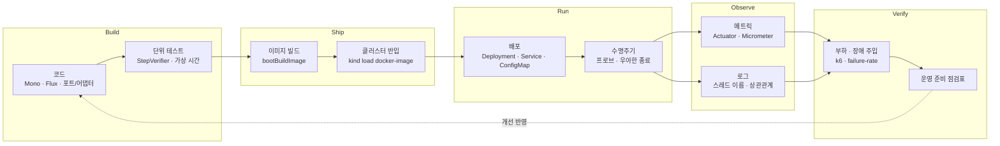

### C.1.2 열 가지 황금 규칙

본문 9.2의 원칙을 쿠버네티스 맥락으로 옮긴 **【제안】** 입니다.

1. **이벤트 루프 스레드는 절대 막지 않는다.** 블로킹은 `boundedElastic`으로 격리하고, 격리 구간은 로드맵에서 줄인다.
2. **구독은 경계에서만 한다.** 서비스는 `Mono`/`Flux`를 반환하고, 구독은 WebFlux가 한다.
3. **모든 원격 호출에 시간 제한을 둔다.** 파드 내부 타임아웃은 상위(게이트웨이)보다 **짧게** 둔다.
4. **모든 경계에 상한을 둔다.** 연결 풀·동시성·재시도 횟수·큐 크기를 숫자로 정한다.
5. **부분 실패를 허용할 곳을 미리 정한다.** 필수 정보와 선택 정보를 구분한다(필수는 오류, 선택은 폴백).
6. **프로브는 "내 상태"만 본다.** 외부 의존성(다른 서비스·DB)을 liveness에 묶지 않는다(Spring 블로그의 경고, C.7).
7. **종료는 협상이다.** 종료 유예 시간 > 애플리케이션 종료 대기 시간으로 둔다.
8. **설정은 이미지 밖에 둔다.** 변경 가능한 값은 ConfigMap으로, 재적재 가능한 값과 불가능한 값을 구분한다.
9. **관측 불가능한 것은 운영 불가능하다.** 메트릭 이름·태그를 코드에서 명시한다.
10. **측정하지 않은 개선은 개선이 아니다.** 모든 튜닝은 k6 같은 부하 도구로 전후를 비교한다.

---

## C.2 기술 선택: Spring Cloud의 무엇을 쓰고 무엇을 쓰지 않는가

### C.2.1 현재 버전 현황 (2026-10-15 기준 확인)

| 항목 | 확인된 내용 | 근거 |
|---|---|---|
| Spring Cloud 릴리스 트레인 | **2025.1.x "Oakwood"** 가 Spring Boot **4.0.x** 세대에 대응 | Spring Cloud 프로젝트 페이지 【공식】 |
| 최신 서비스 릴리스 | **2025.1.3** (2026-08-20). Gateway 5.0.3, Kubernetes 5.0.3, Config 5.0.5 등. Config Server 관련 CVE 2건 수정 포함 | Spring 블로그 【공식】 |
| Boot 호환 | **2025.1.2** 는 Spring Boot **4.0.7** 과 호환되고 **4.1.0 호환을 도입** | Spring 블로그(2026-06-11) 【공식】 |
| 이전 라인 | **2025.0.x(Northfields, Boot 3.5.x)** 는 **2026-06-30로 OSS 지원 종료**, 2025.0.3이 마지막 OSS 릴리스 | Spring 블로그 【공식】 |
| Spring Boot 최신 | Boot 4.0 문서 페이지의 안내 배너가 "최신 안정 버전은 **4.1.1**"이라고 표시 | Spring Boot 참조 문서 【공식】 |
| Gateway 5.x 모듈 구조 | **`spring-cloud-starter-gateway-server-webflux`** / `-webmvc` 로 분리. 설정 접두사는 `spring.cloud.gateway.server.webflux.*` | Spring Cloud Gateway 프로젝트 페이지·마이그레이션 표 【공식·2차】 |
| Reactor | 안정 BOM **2025.0.7**(Core **3.8.7**, Netty **1.3.7**), OSS 지원 2027-06-30까지 | 본문 5·7장 【공식】 |

> **이 별첨의 고정 조합【제안】**: **Spring Boot 4.1.0 + Spring Cloud 2025.1.2**. 공식 블로그가 이 쌍의 호환을 명시했기 때문입니다. 2025.1.3 또는 Boot 4.1.1로 올릴 때는 해당 릴리스 노트의 호환 표기를 먼저 확인하세요(이번 조사에서 2025.1.3의 Boot 호환 범위 문구는 확인하지 못했습니다).

### C.2.2 구성 요소 취사선택

쿠버네티스 위에서는 **플랫폼이 이미 하는 일**을 Spring Cloud가 반복하지 않도록 취사선택하는 것이 핵심입니다.

| 기능 | 쿠버네티스 자체 | Spring Cloud 구성요소 | 이 별첨의 결정 |
|---|---|---|---|
| 서비스 디스커버리 | `Service` + 클러스터 DNS | Spring Cloud Kubernetes Discovery(서비스 이름을 쿠버네티스 Service로 해석) 【공식】 | **기본은 쿠버네티스 DNS 사용**. 클라이언트 측 부하 분산 관찰 실습에서만 선택적으로 도입(C.12) |
| 설정 | `ConfigMap`, `Secret` | **Spring Cloud Kubernetes Config**: ConfigMap·Secret을 프로퍼티 소스로 사용하고, 변경 시 재적재 【공식】 | **사용**(`spring-cloud-starter-kubernetes-client-config`) |
| 별도 설정 서버 | — | Spring Cloud Config Server | **사용 안 함**. 2025.1.3 릴리스 노트에 Config Server 관련 CVE 수정이 포함되어 있어, 도입 시 **최신 패치 유지**가 필요 【공식】 |
| 게이트웨이 | `Ingress`/Gateway API | **Spring Cloud Gateway Server WebFlux** | **사용**(Reactor Netty 기반 라우팅) |
| 서킷 브레이커 | — | Spring Cloud CircuitBreaker(+Resilience4j) | **이번 실습에서는 Reactor 연산자만 사용**(`timeout`·`retryWhen`·`onErrorResume`). 확장 과제로 남김(C.12). Reactor용 스타터 이름은 2차 자료에서 `spring-cloud-starter-circuitbreaker-reactor-resilience4j`로 확인 【2차】 |
| 메시징 | — | Spring Cloud Stream 등 | **이번 실습 범위 밖**(별첨 A.8, 본문 8.3 참조) |

> **【제안】 왜 이렇게 줄였는가**: 노트북 자원(CPU·메모리)이 한정적이고, 실습 목적이 "Reactor 서비스를 쿠버네티스 위에서 운영하는 감각"이기 때문입니다. 구성 요소를 늘릴수록 "무엇이 문제의 원인인지"를 분리하기 어렵습니다.

---

## C.3 실습 아키텍처

### C.3.1 서비스 구성

| 서비스 | 역할 | 핵심 학습 포인트 |
|---|---|---|
| **gateway** | 단일 진입점. `/shop/**` 요청을 `shop-bff`로 전달 | Spring Cloud Gateway(WebFlux), 응답 타임아웃, 라우팅 |
| **shop-bff** | 제품 정보를 **catalog**와 **inventory**에서 병렬 조회해 조합 | `Mono.zip`, `timeout`, `retryWhen`, 폴백, 연결 풀, Reactor 메트릭, 블로킹 격리, 백프레셔 |
| **catalog** | 제품 정보 제공(스텁) | 지연·실패 주입(ConfigMap으로 실시간 조정) |
| **inventory** | 재고 정보 제공(스텁) | 선택 정보(실패해도 서비스 유지) |

catalog와 inventory는 **같은 코드(`stub` 모듈)를 환경 변수로만 구분해 두 번 배포**합니다(`SPRING_APPLICATION_NAME`). 코드 중복을 줄이고, "하나의 이미지를 설정으로 다르게 운영한다"는 원칙을 보여 줍니다.

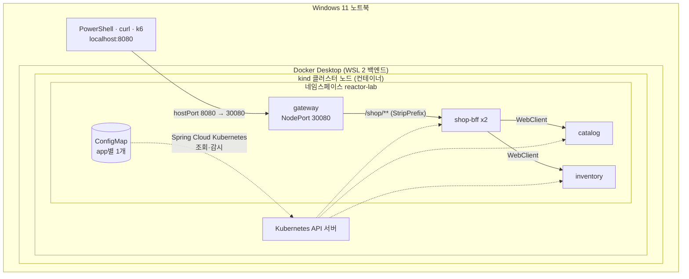

### C.3.2 요청 한 건의 흐름과 시간 예산

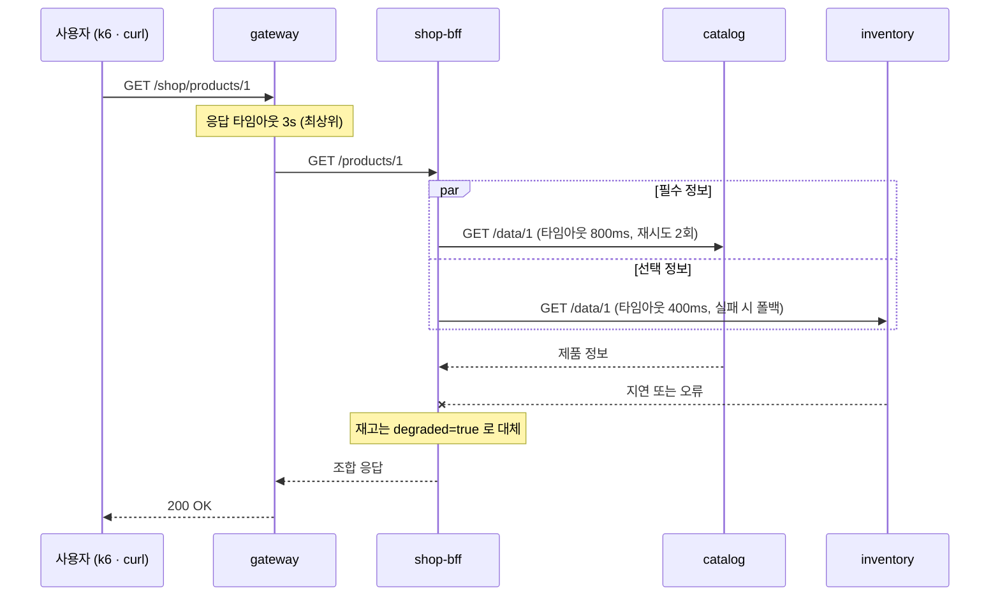

**【제안】 시간 예산 규칙**: 안쪽 호출의 합계가 바깥 타임아웃보다 **짧아야** 합니다. catalog는 `800ms × (재시도 포함 최대 3회) + 백오프`가 게이트웨이 3s 안에 들어와야 하므로 **재시도 횟수와 타임아웃을 함께 설계**해야 합니다. 위 숫자는 실습용 초기값이며, 부하 측정 후 조정하세요.

---

## C.4 Windows 환경 준비

### C.4.1 사양과 구성 요소

| 항목 | 내용 |
|---|---|
| OS | Windows 10 또는 11 (Docker가 "Microsoft 지원 기간 내의 Windows 버전"만 지원한다고 명시) 【공식】 |
| 메모리 | Docker Desktop 최소 요구는 **4GB RAM** 【공식】. 이 별첨은 파드 5~6개와 JVM 빌드를 돌리므로 **16GB 권장**【제안】 |
| 가상화 | BIOS에서 가상화 활성화, WSL 2 사용(Docker Desktop의 권장 백엔드) 【공식·2차】 |
| 컨테이너 엔진 | **Docker Desktop**(WSL 2 백엔드). 설치 시 약관(Docker Desktop terms)을 확인하세요. 기업 환경에서는 라이선스 조건이 있을 수 있습니다 【공식 페이지에 약관 안내 존재, 세부 조건은 직접 확인】 |
| 로컬 쿠버네티스 | **kind**(Kubernetes in Docker). 클러스터를 Docker 컨테이너로 실행하므로 Docker가 필요 【2차】. 대안으로 Docker Desktop 내장 Kubernetes(설정에서 활성화, 단일 노드) |
| 클라이언트 | `kubectl`(Docker Desktop은 별도 설치 없이 제공한다는 설명이 있으나, kind만 쓰는 경우는 따로 설치) |
| 개발 도구 | JDK(**21 LTS 권장**【제안】), Git, IDE(IntelliJ IDEA 또는 VS Code), PowerShell 7(선택, 병렬 처리용) |
| 부하 도구 | **k6**(선택) |

> **Java 버전**: Reactor Core 3.8은 Java 8 이상에서 동작하지만(본문 2·5장), **Spring Boot 4의 최소 Java 버전은 이번에 공식 문서로 확인하지 못했습니다.** JDK 21 LTS를 권장하는 것은 제 판단이며, 최소 버전은 Spring Boot 시스템 요구사항 문서를 확인하세요.

### C.4.2 설치 명령 (PowerShell, 관리자)

```powershell
# 패키지 ID는 winget search 로 한 번 확인하세요. (아래는 흔히 쓰이는 ID이며 이 세션에서 검증하지 못했습니다)
winget install -e --id Docker.DockerDesktop
winget install -e --id Kubernetes.kubectl
winget install -e --id Kubernetes.kind
winget install -e --id EclipseAdoptium.Temurin.21.JDK
winget install -e --id Git.Git
winget install -e --id Grafana.k6          # 선택
winget install -e --id Microsoft.PowerShell # 선택(PowerShell 7)

# WSL 2가 없다면
wsl --install
```

설치 후 **재부팅**하고, Docker Desktop을 한 번 실행해 초기 설정을 마칩니다. 확인:

```powershell
docker version
kubectl version --client
kind version
java -version
```

### C.4.3 WSL 2 자원 한도 설정 (중요)

WSL 2 백엔드는 기본적으로 호스트 메모리의 상당 부분을 쓸 수 있어 노트북이 느려질 수 있습니다. 사용자 폴더(`C:\Users\<이름>`)에 **`.wslconfig`** 파일을 만들어 한도를 둡니다【2차: 일반적으로 알려진 방법, 값은 제안】.

```ini
[wsl2]
memory=8GB
processors=4
swap=2GB
```

저장 후 `wsl --shutdown` 을 실행하고 Docker Desktop을 다시 시작하세요. **16GB 노트북이면 8GB, 32GB면 12~16GB**부터 시작해 `kubectl top`(또는 Docker Desktop 자원 보기)과 OOMKilled 여부로 조정합니다【제안】.

### C.4.4 kind 클러스터 생성

`k8s/kind-config.yaml`:

```yaml
kind: Cluster
apiVersion: kind.x-k8s.io/v1alpha4
nodes:
  - role: control-plane
    extraPortMappings:
      - containerPort: 30080   # 노드 안의 NodePort
        hostPort: 8080         # Windows localhost 포트 (충돌하면 18080 등으로 변경)
        protocol: TCP
```

```powershell
kind create cluster --name reactor-lab --config k8s/kind-config.yaml
kubectl cluster-info --context kind-reactor-lab
kubectl get nodes
```

> **포트 충돌**: `hostPort: 8080`을 이미 다른 프로그램이 쓰고 있으면 클러스터 생성이 실패하거나 접속이 엉뚱한 곳으로 갑니다. 그때는 `hostPort`를 바꾸고, 이후의 모든 `localhost:8080`을 같은 값으로 읽으세요.

---

## C.5 프로젝트 구조와 빌드 설정

### C.5.1 디렉터리

```text
reactor-k8s-lab/
├─ settings.gradle.kts
├─ build.gradle.kts                  # 공통 설정(플러그인, BOM, 이미지 이름)
├─ gateway/
│  ├─ build.gradle.kts
│  └─ src/main/{java,resources}/...
├─ shop-bff/
│  ├─ build.gradle.kts
│  └─ src/{main,test}/...
├─ stub/                             # catalog · inventory 공용
│  ├─ build.gradle.kts
│  └─ src/main/...
├─ k8s/
│  ├─ kind-config.yaml               # kind 클러스터 설정 (kubectl apply 대상이 아님)
│  └─ manifests/
│     ├─ 00-namespace.yaml
│     ├─ 10-rbac.yaml
│     ├─ 20-config.yaml
│     ├─ 30-stub.yaml
│     ├─ 40-shop-bff.yaml
│     └─ 50-gateway.yaml
├─ k6/load.js
└─ scripts/{up.ps1, build-images.ps1, down.ps1}
```

> **Gradle 래퍼**: 가장 쉬운 방법은 [start.spring.io](https://start.spring.io)에서 프로젝트를 하나 생성해 `gradlew`, `gradlew.bat`, `gradle/wrapper/`를 가져오는 것입니다. Spring Boot 4가 요구하는 최소 Gradle 버전은 제가 확인하지 못했으므로 **Initializr가 생성한 래퍼 버전을 그대로** 쓰세요.

### C.5.2 `settings.gradle.kts` · 루트 `build.gradle.kts` 【미검증】

```kotlin
// settings.gradle.kts
rootProject.name = "reactor-k8s-lab"
include("gateway", "shop-bff", "stub")
```

```kotlin
// build.gradle.kts (루트)
import org.springframework.boot.gradle.plugin.SpringBootPlugin
import org.springframework.boot.gradle.tasks.bundling.BootBuildImage

plugins {
    java
    id("org.springframework.boot") version "4.1.0" apply false
}

val springCloudVersion = "2025.1.2"

subprojects {
    apply(plugin = "java")
    apply(plugin = "org.springframework.boot")

    group = "lab.reactor"
    version = "0.0.1"

    repositories { mavenCentral() }

    extensions.configure<JavaPluginExtension> {
        toolchain { languageVersion.set(JavaLanguageVersion.of(21)) }
    }

    dependencies {
        add("implementation", platform(SpringBootPlugin.BOM_COORDINATES))
        add("implementation", platform("org.springframework.cloud:spring-cloud-dependencies:$springCloudVersion"))

        add("implementation", "org.springframework.boot:spring-boot-starter-actuator")
        add("implementation", "io.micrometer:micrometer-registry-prometheus")
        add("implementation", "org.springframework.cloud:spring-cloud-starter-kubernetes-client-config")

        add("testImplementation", "org.springframework.boot:spring-boot-starter-test")
        add("testImplementation", "io.projectreactor:reactor-test")
        add("testRuntimeOnly", "org.junit.platform:junit-platform-launcher")
    }

    tasks.withType<Test> { useJUnitPlatform() }

    tasks.withType<BootBuildImage>().configureEach {
        imageName.set("reactor-lab/${project.name}:dev")
    }
}
```

각 모듈의 `build.gradle.kts`:

```kotlin
// gateway/build.gradle.kts
dependencies {
    implementation("org.springframework.cloud:spring-cloud-starter-gateway-server-webflux")
}
```

```kotlin
// shop-bff/build.gradle.kts
dependencies {
    implementation("org.springframework.boot:spring-boot-starter-webflux")
    implementation("io.projectreactor:reactor-core-micrometer")   // Reactor 메트릭(tap)
    implementation("io.micrometer:context-propagation")           // Reactor 자동 컨텍스트 전파
}
```

```kotlin
// stub/build.gradle.kts
dependencies {
    implementation("org.springframework.boot:spring-boot-starter-webflux")
}
```

> **【공식】 반드시 지킬 것**: Spring Boot 문서는 `spring-boot-starter-web`과 `spring-boot-starter-webflux`를 **함께** 두면 Boot가 **Spring MVC를 자동 구성**한다고 명시합니다(WebClient를 쓰려고 webflux 스타터를 MVC 앱에 넣는 경우가 많기 때문). 따라서 이 실습의 모든 모듈에는 **`spring-boot-starter-web`을 넣지 마세요.** 의존성 트리에 섞여 들어오지 않았는지 `gradlew :shop-bff:dependencies`로 확인하는 습관이 필요합니다.

> **【제안】 Reactor 버전 확인**: Boot가 관리하는 Reactor 버전은 이번에 확인하지 못했습니다. 빌드 후 `gradlew :shop-bff:dependencies --configuration runtimeClasspath | findstr reactor`로 `reactor-core`와 `reactor-netty` 실제 버전을 확인해 본문 5장의 표(3.8.x, 1.3.x)와 비교해 보세요.

---

## C.6 서비스 소스 코드 【미검증】

> **권장 진행**: ① `stub` 하나를 먼저 만들어 로컬 실행 → ② `shop-bff` 추가 → ③ `gateway` 추가 → ④ 쿠버네티스 배포. 각 단계에서 `curl`로 확인한 뒤 다음으로 넘어가세요.

### C.6.1 stub (catalog · inventory 공용)

`stub/src/main/java/lab/stub/StubApplication.java`

```java
package lab.stub;

import org.springframework.boot.SpringApplication;
import org.springframework.boot.autoconfigure.SpringBootApplication;
import org.springframework.boot.context.properties.EnableConfigurationProperties;

public class StubApplication {
    public static void main(String[] args) {
        SpringApplication.run(StubApplication.class, args);
    }
}
```

`StubProperties.java` — **ConfigMap으로 바꿀 값**(재적재되려면 setter를 가진 JavaBean 형태로 둡니다【제안】).

```java
package lab.stub;

import org.springframework.boot.context.properties.ConfigurationProperties;

public class StubProperties {
    private long delayMs = 50;          // 응답 지연(ms)
    private double failureRate = 0.0;   // 0.0 ~ 1.0

    public long getDelayMs() { return delayMs; }
    public void setDelayMs(long delayMs) { this.delayMs = delayMs; }
    public double getFailureRate() { return failureRate; }
    public void setFailureRate(double failureRate) { this.failureRate = failureRate; }
}
```

`Data.java`

```java
package lab.stub;

public record Data(String service, int id, String pod, String value,
                   String handlerThread, boolean degraded) {}
```

`DataController.java`

```java
package lab.stub;

import java.time.Duration;
import java.util.concurrent.ThreadLocalRandom;

import org.springframework.beans.factory.annotation.Value;
import org.springframework.http.HttpStatus;
import org.springframework.web.bind.annotation.GetMapping;
import org.springframework.web.bind.annotation.PathVariable;
import org.springframework.web.bind.annotation.RestController;
import org.springframework.web.server.ResponseStatusException;
import reactor.core.publisher.Mono;

class DataController {

    private final StubProperties props;
    private final String service;
    private final String pod;

    DataController(StubProperties props,
                   @Value("${spring.application.name}") String service,
                   @Value("${HOSTNAME:local}") String pod) {   // 쿠버네티스에서 HOSTNAME = 파드 이름
        this.props = props;
        this.service = service;
        this.pod = pod;
    }

    @GetMapping("/data/{id}")
    Mono<Data> data(@PathVariable int id) {
        // 조립 시점의 스레드: 이벤트 루프(reactor-http-nio-N)임을 로그·응답으로 관찰한다.
        String handlerThread = Thread.currentThread().getName();

        if (props.getFailureRate() > 0
                && ThreadLocalRandom.current().nextDouble() < props.getFailureRate()) {
            return Mono.error(new ResponseStatusException(HttpStatus.SERVICE_UNAVAILABLE, "injected failure"));
        }
        return Mono.just(new Data(service, id, pod, service + "-value-" + id, handlerThread, false))
                   .delayElement(Duration.ofMillis(props.getDelayMs()));   // 논블로킹 지연
    }
}
```

`stub/src/main/resources/application.yaml`

```yaml
spring:
  application:
    name: stub                       # 배포 시 SPRING_APPLICATION_NAME 으로 catalog / inventory 로 덮어씀
  config:
    import: "optional:kubernetes:"   # 쿠버네티스 밖(로컬)에서도 기동되도록 optional
  cloud:
    kubernetes:
      secrets:
        enabled: false             # RBAC 최소 권한: Secrets 프로퍼티 소스 비활성
      reload:
        enabled: true                # 기본값은 false (공식 참조 문서)
        mode: event                  # event | polling
        strategy: refresh            # refresh | restart_context | shutdown

server:
  port: 8080
  shutdown: graceful                 # 우아한 종료

spring.lifecycle.timeout-per-shutdown-phase: 20s

management:
  endpoint:
    health:
      probes:
        enabled: true                # /actuator/health/liveness, /readiness
  endpoints:
    web:
      exposure:
        include: health,info,metrics,prometheus,threaddump

stub:
  delay-ms: 50
  failure-rate: 0.0
```

> **【공식】 확인된 사실**: Spring Cloud Kubernetes는 **애플리케이션 이름과 같은 이름의 ConfigMap**을 찾고, 그 안의 **`application.yaml` 키**의 내용을 YAML로 적용합니다. 재적재는 `spring.cloud.kubernetes.reload.enabled=true`로 켜야 하며 **기본값은 비활성**입니다. `strategy` 기본값은 `refresh`이고 `refresh`, `restart_context`, `shutdown` 중에서 선택합니다. 그리고 `spring.cloud.kubernetes.reload.*` 속성은 **ConfigMap·Secret 안에 넣지 말라**는 경고가 있습니다(런타임 변경 시 예기치 않은 결과). 이 별첨의 설정은 그 규칙을 따릅니다.
> **【미검증】** `spring.config.import: "optional:kubernetes:"` 형태는 제 기억에 의존한 표기입니다. 기동 시 ConfigMap이 읽히지 않으면 사용 중인 Spring Cloud Kubernetes 5.0.x 참조 문서의 "Config Data" 절에서 import 표기를 확인하세요.

### C.6.2 shop-bff (Reactor 핵심)

`shop-bff/src/main/java/lab/bff/BffApplication.java`

```java
package lab.bff;

import org.springframework.boot.SpringApplication;
import org.springframework.boot.autoconfigure.SpringBootApplication;
import org.springframework.boot.context.properties.EnableConfigurationProperties;
import reactor.core.publisher.Hooks;

public class BffApplication {
    public static void main(String[] args) {
        // 로그·트레이스 상관관계를 스레드 경계 너머로 전달 (context-propagation 라이브러리 필요).
        // 본문 3.8: 자동 모드는 성능 영향이 있을 수 있으므로 부하 측정 후 유지 여부를 결정한다.
        Hooks.enableAutomaticContextPropagation();
        SpringApplication.run(BffApplication.class, args);
    }
}
```

`BffProperties.java`

```java
package lab.bff;

import org.springframework.boot.context.properties.ConfigurationProperties;

public class BffProperties {
    private String catalogUrl = "http://catalog:8080";
    private String inventoryUrl = "http://inventory:8080";
    private long catalogTimeoutMs = 800;
    private long inventoryTimeoutMs = 400;
    private int retryMax = 2;

    public String getCatalogUrl() { return catalogUrl; }
    public void setCatalogUrl(String v) { this.catalogUrl = v; }
    public String getInventoryUrl() { return inventoryUrl; }
    public void setInventoryUrl(String v) { this.inventoryUrl = v; }
    public long getCatalogTimeoutMs() { return catalogTimeoutMs; }
    public void setCatalogTimeoutMs(long v) { this.catalogTimeoutMs = v; }
    public long getInventoryTimeoutMs() { return inventoryTimeoutMs; }
    public void setInventoryTimeoutMs(long v) { this.inventoryTimeoutMs = v; }
    public int getRetryMax() { return retryMax; }
    public void setRetryMax(int v) { this.retryMax = v; }
}
```

`Data.java`(stub과 같은 모양), `ProductView.java`

```java
package lab.bff;

public record Data(String service, int id, String pod, String value,
                   String handlerThread, boolean degraded) {
    static Data unavailable(String service, int id) {
        return new Data(service, id, "n/a", "unavailable", "n/a", true);
    }
}
```

```java
package lab.bff;

public record ProductView(Data catalog, Data inventory) {}
```

`ProductService.java` — **포트(함수)에만 의존**하게 만들어 HTTP 없이 `StepVerifier`로 테스트합니다(본문 원칙 6).

```java
package lab.bff;

import java.time.Duration;
import java.util.function.IntFunction;

import reactor.core.publisher.Mono;
import reactor.util.retry.Retry;

class ProductService {

    private final IntFunction<Mono<Data>> catalog;     // 포트: 카탈로그 조회
    private final IntFunction<Mono<Data>> inventory;   // 포트: 재고 조회
    private final BffProperties props;

    ProductService(IntFunction<Mono<Data>> catalog,
                   IntFunction<Mono<Data>> inventory,
                   BffProperties props) {
        this.catalog = catalog;
        this.inventory = inventory;
        this.props = props;
    }

    Mono<ProductView> product(int id) {
        // 필수 정보: 시간 제한 + 재시도(상한 있음). 끝내 실패하면 오류로 전파.
        Mono<Data> c = Mono.defer(() -> catalog.apply(id))
                .timeout(Duration.ofMillis(props.getCatalogTimeoutMs()))
                .retryWhen(Retry.backoff(props.getRetryMax(), Duration.ofMillis(100)));

        // 선택 정보: 시간 제한 + 폴백. 실패해도 서비스는 유지(degraded=true).
        Mono<Data> i = Mono.defer(() -> inventory.apply(id))
                .timeout(Duration.ofMillis(props.getInventoryTimeoutMs()))
                .onErrorResume(e -> Mono.just(Data.unavailable("inventory", id)));

        return Mono.zip(c, i, ProductView::new);   // 두 호출을 동시에 구독
    }
}
```

> **설명**: `Mono.defer`는 *구독 시점에* 포트를 호출하므로, 재시도 시마다 새 호출이 만들어집니다. `Retry.backoff(최대횟수, 최소백오프)`는 Reactor가 제공하는 재시도 명세입니다. 재시도 대상 오류를 제한하려면 `.filter(...)`를 덧붙이세요(예: 5xx와 타임아웃만). **재시도는 멱등한 GET에만** 적용하세요【제안】.

`ClientConfig.java` — 연결 풀과 타임아웃을 **명시**합니다(본문 원칙 3·4).

```java
package lab.bff;

import java.time.Duration;
import java.util.function.IntFunction;

import org.springframework.context.annotation.Bean;
import org.springframework.context.annotation.Configuration;
import org.springframework.http.client.reactive.ReactorClientHttpConnector;
import org.springframework.web.reactive.function.client.WebClient;
import reactor.core.publisher.Mono;
import reactor.netty.http.client.HttpClient;
import reactor.netty.resources.ConnectionProvider;

class ClientConfig {

    @Bean
    ConnectionProvider bffPool() {
        return ConnectionProvider.builder("bff-pool")
                .maxConnections(100)                          // 원격 호스트별 연결 상한
                .pendingAcquireTimeout(Duration.ofSeconds(1)) // 연결을 기다리는 최대 시간
                .maxIdleTime(Duration.ofSeconds(30))
                .metrics(true)                                // 풀 메트릭 노출(Micrometer)
                .build();
    }

    @Bean
    WebClient.Builder bffWebClientBuilder(ConnectionProvider bffPool) {
        HttpClient http = HttpClient.create(bffPool).responseTimeout(Duration.ofSeconds(2));
        return WebClient.builder().clientConnector(new ReactorClientHttpConnector(http));
    }

    @Bean
    ProductService productService(WebClient.Builder builder, BffProperties props) {
        WebClient catalog = builder.clone().baseUrl(props.getCatalogUrl()).build();
        WebClient inventory = builder.clone().baseUrl(props.getInventoryUrl()).build();

        IntFunction<Mono<Data>> catalogPort =
                id -> catalog.get().uri("/data/{id}", id).retrieve().bodyToMono(Data.class);
        IntFunction<Mono<Data>> inventoryPort =
                id -> inventory.get().uri("/data/{id}", id).retrieve().bodyToMono(Data.class);

        return new ProductService(catalogPort, inventoryPort, props);
    }
}
```

> **【미검증·주의】** 여기서는 `WebClient.Builder` 빈을 **직접 정의**했습니다. Spring Boot가 자동 구성하는 빌더(관측 계측·코덱 설정을 포함)를 대체하게 되어 **자동 계측이 빠질 수 있습니다.** 운영용으로는 Boot가 만든 빌더에 `ReactorClientHttpConnector`만 **커스터마이저로 덧입히는** 방식이 낫습니다. Boot 4에서 `WebClient.Builder` 자동 구성이 어떤 모듈에 있는지 이번에 확인하지 못했으므로, 이 실습에서는 단순함을 택했습니다. **이 점은 C.9의 관측 점검 항목으로 남겨 두었습니다.**

`ShopController.java` — 조합, 블로킹 격리 사례, 백프레셔 사례를 한곳에 둡니다.

```java
package lab.bff;

import java.time.Duration;
import java.util.Map;
import java.util.concurrent.atomic.AtomicLong;

import io.micrometer.core.instrument.MeterRegistry;
import org.springframework.http.MediaType;
import org.springframework.web.bind.annotation.GetMapping;
import org.springframework.web.bind.annotation.PathVariable;
import org.springframework.web.bind.annotation.RequestParam;
import org.springframework.web.bind.annotation.RestController;
import reactor.core.observability.micrometer.Micrometer;
import reactor.core.publisher.Flux;
import reactor.core.publisher.Mono;
import reactor.core.scheduler.Schedulers;

class ShopController {

    private final ProductService service;
    private final MeterRegistry registry;

    ShopController(ProductService service, MeterRegistry registry) {
        this.service = service;
        this.registry = registry;
    }

    // 1) 정상 경로: 병렬 조합 + Reactor 메트릭
    @GetMapping("/products/{id}")
    Mono<ProductView> product(@PathVariable int id) {
        return service.product(id)
                .name("bff.product")                       // 메트릭 이름
                .tag("source", "catalog+inventory")        // 사용자 정의 태그
                .tap(Micrometer.metrics(registry));        // reactor-core-micrometer
    }

    // 2) 블로킹 격리 사례: 불가피한 블로킹은 boundedElastic 으로
    @GetMapping("/legacy/{id}")
    Mono<Map<String, Object>> legacy(@PathVariable int id) {
        return Mono.fromCallable(() -> {
                    Thread.sleep(300);                      // 레거시 블로킹 호출 흉내
                    return Map.<String, Object>of("id", id, "thread", Thread.currentThread().getName());
                })
                .subscribeOn(Schedulers.boundedElastic());  // 이벤트 루프가 아닌 전용 스레드
    }

    // 3) 안티패턴 (교육용, 운영 금지): 이벤트 루프를 직접 막는다
    @GetMapping("/legacy-bad/{id}")
    Mono<Map<String, Object>> legacyBad(@PathVariable int id) throws InterruptedException {
        Thread.sleep(300);                                  // ← 이벤트 루프 스레드를 막음!
        return Mono.just(Map.of("id", id, "thread", Thread.currentThread().getName()));
    }

    // 4) 백프레셔 사례: 느린 소비자에게 보내는 빠른 생산자
    @GetMapping(value = "/stream", produces = MediaType.TEXT_EVENT_STREAM_VALUE)
    Flux<String> stream(@RequestParam(defaultValue = "drop") String policy) {
        AtomicLong dropped = new AtomicLong();
        Flux<Long> fast = Flux.interval(Duration.ofMillis(5));   // 요청과 무관하게 방출(백프레셔 불가 소스)
        Flux<Long> controlled = "buffer".equals(policy)
                ? fast.onBackpressureBuffer(100)                                   // 상한 있는 버퍼
                : fast.onBackpressureDrop(v -> {                                   // 넘치면 버림
                    dropped.incrementAndGet();
                    registry.counter("bff.stream.dropped").increment();
                });
        return controlled.map(v -> "tick-" + v);
    }
}
```

> **【공식·제안】 코드 설명**
> - `name(...)`·`tag(...)`·`tap(Micrometer.metrics(registry))`는 Reactor 공식 문서의 **현재 권장 방식**입니다. 코어 3.5.0까지는 `Flux.metrics()` 연산자였고, 이제는 **`reactor-core-micrometer` 모듈의 `Micrometer.metrics(...)`를 `tap`과 함께** 씁니다. 옛 방식(`Flux.metrics()`, `Schedulers.enableMetrics()`)은 deprecated입니다.
> - `Flux.interval`은 요청과 무관하게 방출하는 소스입니다. 소비자가 느리면 오류(`OverflowException`)가 나므로 `onBackpressureBuffer(상한)`/`onBackpressureDrop(...)`으로 **정책을 명시**합니다(본문 3.5절 "생산자가 늦출 수 없다면 버퍼링·버림·실패 중 정해야 한다"). 실제로 드롭·버퍼가 어떻게 관찰되는지는 **환경에 따라 다르므로 C.9의 실험 4에서 직접 확인**하세요【미검증】.
> - `/legacy-bad`는 일부러 안티패턴을 넣은 것입니다. 실험 5에서 `/legacy`와 **같은 부하에서의 지연 차이**를 확인합니다.

`shop-bff/src/main/resources/application.yaml`

```yaml
spring:
  application:
    name: shop-bff
  config:
    import: "optional:kubernetes:"
  cloud:
    kubernetes:
      secrets:
        enabled: false             # RBAC 최소 권한: Secrets 프로퍼티 소스 비활성
      reload:
        enabled: true
        mode: event
        strategy: refresh

server:
  port: 8080
  shutdown: graceful

spring.lifecycle.timeout-per-shutdown-phase: 20s

management:
  endpoint:
    health:
      probes:
        enabled: true
  endpoints:
    web:
      exposure:
        include: health,info,metrics,prometheus,threaddump

bff:
  catalog-url: ${BFF_CATALOG_URL:http://catalog:8080}
  inventory-url: ${BFF_INVENTORY_URL:http://inventory:8080}
  catalog-timeout-ms: 800
  inventory-timeout-ms: 400
  retry-max: 2
```

**단위 테스트** `ProductServiceTest.java` — HTTP 없이 `StepVerifier`와 가상 시간으로 검증합니다.

```java
package lab.bff;

import static org.assertj.core.api.Assertions.assertThat;

import java.time.Duration;

import org.junit.jupiter.api.Test;
import reactor.core.publisher.Mono;
import reactor.test.StepVerifier;

class ProductServiceTest {

    private BffProperties props() {
        BffProperties p = new BffProperties();
        p.setCatalogTimeoutMs(800);
        p.setInventoryTimeoutMs(400);
        p.setRetryMax(2);
        return p;
    }

    private Data ok(String service, int id) {
        return new Data(service, id, "pod-x", service + "-value", "test", false);
    }

    @Test
    void 재고_실패는_폴백으로_흡수된다() {
        ProductService s = new ProductService(
                id -> Mono.just(ok("catalog", id)),
                id -> Mono.error(new IllegalStateException("boom")),
                props());

        StepVerifier.create(s.product(1))
                .assertNext(v -> {
                    assertThat(v.catalog().degraded()).isFalse();
                    assertThat(v.inventory().degraded()).isTrue();   // 선택 정보는 degraded
                })
                .verifyComplete();
    }

    @Test
    void 카탈로그가_계속_실패하면_오류가_전파된다() {
        ProductService s = new ProductService(
                id -> Mono.error(new IllegalStateException("down")),
                id -> Mono.just(ok("inventory", id)),
                props());

        StepVerifier.withVirtualTime(() -> s.product(1))             // 재시도 백오프를 가상 시간으로
                .thenAwait(Duration.ofSeconds(5))
                .expectError()                                       // 재시도 소진 후 오류
                .verify();
    }

    @Test
    void 재고가_느리면_타임아웃_후_폴백된다() {
        ProductService s = new ProductService(
                id -> Mono.just(ok("catalog", id)),
                id -> Mono.never(),                                  // 응답이 오지 않음
                props());

        StepVerifier.withVirtualTime(() -> s.product(1))
                .thenAwait(Duration.ofMillis(500))                   // 400ms 타임아웃 경과
                .assertNext(v -> assertThat(v.inventory().degraded()).isTrue())
                .verifyComplete();
    }
}
```

> **【공식】 근거**: `StepVerifier.withVirtualTime`은 `Scheduler`가 시계 역할을 하므로 가능한 **가상 시간 테스트**입니다(본문 9.2 원칙 9). 가상 시간을 쓰려면 **`timeout`·`retryWhen` 같은 시간 연산자를 공급자(supplier) 안에서 생성**해야 합니다. 위 코드는 `ProductService.product(...)`가 호출 시점에 연산자를 만들도록 작성했습니다.

### C.6.3 gateway

`gateway/src/main/java/lab/gateway/GatewayApplication.java`

```java
package lab.gateway;

import org.springframework.boot.SpringApplication;
import org.springframework.boot.autoconfigure.SpringBootApplication;

public class GatewayApplication {
    public static void main(String[] args) {
        SpringApplication.run(GatewayApplication.class, args);
    }
}
```

`gateway/src/main/resources/application.yaml`

```yaml
spring:
  application:
    name: gateway
  config:
    import: "optional:kubernetes:"
  cloud:
    kubernetes:
      secrets:
        enabled: false             # RBAC 최소 권한: Secrets 프로퍼티 소스 비활성
      reload:
        enabled: false               # 게이트웨이는 이번 실습에서 재적재하지 않음
    gateway:
      server:
        webflux:                     # Gateway 5.x 에서 바뀐 설정 접두사
          httpclient:
            response-timeout: 3s     # 상위 타임아웃: 안쪽 호출 합계보다 길게
          routes:
            - id: shop-bff
              uri: ${SHOP_BFF_URL:http://shop-bff:8080}
              predicates:
                - Path=/shop/**
              filters:
                - StripPrefix=1      # /shop/products/1 -> /products/1

server:
  port: 8080
  shutdown: graceful

spring.lifecycle.timeout-per-shutdown-phase: 20s

management:
  endpoint:
    health:
      probes:
        enabled: true
  endpoints:
    web:
      exposure:
        include: health,info,metrics,prometheus,threaddump
```

> **【공식】 근거**: Gateway 5.x에서는 스타터가 `spring-cloud-starter-gateway-server-webflux`로 바뀌었고, 설정 접두사는 `spring.cloud.gateway.*`에서 **`spring.cloud.gateway.server.webflux.*`** 로 이동했습니다(마이그레이션 표). **【미검증】** `httpclient.response-timeout`의 정확한 속성 위치는 이 접두사 이동 규칙에 따른 추정입니다. 기동 시 인식되지 않으면 Gateway 5.0.x 참조 문서의 "HttpClient Timeouts" 절에서 확인하세요.

### C.6.4 이미지 빌드: `bootBuildImage` 와 대안

**【공식·2차】** Spring Boot Gradle 플러그인의 `bootBuildImage`는 Cloud Native Buildpacks로 **Dockerfile 없이** OCI 이미지를 만들며 **Docker 데몬이 필요**합니다(Docker Desktop 실행 상태). 첫 빌드는 빌더·실행 이미지를 내려받느라 시간이 걸립니다.

```powershell
.\gradlew.bat :stub:bootBuildImage :shop-bff:bootBuildImage :gateway:bootBuildImage
docker images | findstr reactor-lab
```

**대안(Dockerfile)** — 빌드팩이 문제를 일으킬 때의 우회로입니다【제안·미검증】.

```dockerfile
# stub/Dockerfile (shop-bff, gateway도 동일하게 경로만 변경)
FROM eclipse-temurin:21-jre
WORKDIR /app
COPY build/libs/*-0.0.1.jar app.jar
EXPOSE 8080
ENTRYPOINT ["java","-XX:MaxRAMPercentage=70","-jar","/app/app.jar"]
```

```powershell
.\gradlew.bat :stub:bootJar
docker build -t reactor-lab/stub:dev stub
```

> **【제안】 JVM 메모리**: Reactor Netty·Netty는 **힙 밖(다이렉트 버퍼)** 메모리도 씁니다. 컨테이너 메모리 한도 전체를 힙으로 주면 OOMKilled 위험이 커지므로 `MaxRAMPercentage`를 70% 안팎으로 시작해 측정으로 조정하세요. 빌드팩 이미지의 기본 메모리 계산 방식은 이번에 공식 문서로 확인하지 못했습니다.


---

## C.7 쿠버네티스 매니페스트와 수명주기 【미검증】

### C.7.1 매니페스트 설계 원칙

- **네임스페이스 하나**(`reactor-lab`)에 모두 둡니다. 서비스 이름이 곧 DNS 이름(`catalog`, `inventory`, `shop-bff`)이 됩니다.
- **ConfigMap 이름 = 애플리케이션 이름**(`spring.application.name`). Spring Cloud Kubernetes가 이 규칙으로 찾습니다(C.6.1의 【공식】 확인 사항). 그래서 `kustomize`의 해시 접미사 생성기를 쓰지 않고 **일반 ConfigMap**으로 둡니다.
- 하나의 ServiceAccount(`reactor-app`)에 **ConfigMap 조회·감시 권한만** 부여합니다(최소 권한). 이를 위해 모든 모듈의 `application.yaml`에서 **Secrets 프로퍼티 소스를 끕니다**(C.7.6의 수정 사항).
- **프로브 3종**을 둡니다. `startupProbe`(느린 기동 보호), `readinessProbe`(트래픽 수신 가능 여부), `livenessProbe`(재시작 필요 여부).
- **자원**: 메모리는 요청·한도를 두고, **CPU 한도는 두지 않습니다**(요청만). CPU 한도를 두면 스로틀링이 발생해 이벤트 루프 지연이 흔들릴 수 있고, JVM이 보는 프로세서 수도 달라집니다【제안】. 이벤트 루프 스레드 수는 필요 시 시스템 속성으로 직접 제어합니다(C.10).

### C.7.2 `k8s/manifests/00-namespace.yaml`, `10-rbac.yaml`

```yaml
apiVersion: v1
kind: Namespace
metadata:
  name: reactor-lab
```

```yaml
apiVersion: v1
kind: ServiceAccount
metadata:
  name: reactor-app
  namespace: reactor-lab
---
apiVersion: rbac.authorization.k8s.io/v1
kind: Role
metadata:
  name: config-reader
  namespace: reactor-lab
rules:
  - apiGroups: [""]
    resources: ["configmaps"]
    verbs: ["get", "list", "watch"]
---
apiVersion: rbac.authorization.k8s.io/v1
kind: RoleBinding
metadata:
  name: config-reader-binding
  namespace: reactor-lab
subjects:
  - kind: ServiceAccount
    name: reactor-app
    namespace: reactor-lab
roleRef:
  kind: Role
  name: config-reader
  apiGroup: rbac.authorization.k8s.io
```

> **【2차】** ConfigMap 재적재 예제들은 `configmaps`에 대해 `get`, `list`, `watch` 권한을 부여합니다. 디스커버리 기능을 켜면 `services`·`endpoints`·`pods` 등 **추가 권한**이 필요하므로 참조 가이드의 RBAC 안내를 확인하세요(C.12).

### C.7.3 `20-config.yaml` (앱별 ConfigMap)

```yaml
apiVersion: v1
kind: ConfigMap
metadata:
  name: catalog
  namespace: reactor-lab
data:
  application.yaml: |
    stub:
      delay-ms: 50
      failure-rate: 0.0
---
apiVersion: v1
kind: ConfigMap
metadata:
  name: inventory
  namespace: reactor-lab
data:
  application.yaml: |
    stub:
      delay-ms: 50
      failure-rate: 0.0
---
apiVersion: v1
kind: ConfigMap
metadata:
  name: shop-bff
  namespace: reactor-lab
data:
  application.yaml: |
    bff:
      catalog-timeout-ms: 800
      inventory-timeout-ms: 400
      retry-max: 2
---
apiVersion: v1
kind: ConfigMap
metadata:
  name: gateway
  namespace: reactor-lab
data:
  application.yaml: |
    # 이번 실습에서는 비워 둠 (필요 시 spring.cloud.gateway.server.webflux.* 값을 둔다)
    lab:
      note: gateway-config
```

### C.7.4 `30-stub.yaml` (catalog · inventory)

```yaml
apiVersion: apps/v1
kind: Deployment
metadata:
  name: catalog
  namespace: reactor-lab
  labels: { app: catalog }
spec:
  replicas: 1
  selector:
    matchLabels: { app: catalog }
  strategy:
    type: RollingUpdate
    rollingUpdate: { maxSurge: 1, maxUnavailable: 0 }
  template:
    metadata:
      labels: { app: catalog }
    spec:
      serviceAccountName: reactor-app
      terminationGracePeriodSeconds: 30     # > spring.lifecycle.timeout-per-shutdown-phase(20s)
      containers:
        - name: app
          image: reactor-lab/stub:dev
          imagePullPolicy: IfNotPresent     # kind load 로 반입한 이미지를 사용
          ports:
            - { name: http, containerPort: 8080 }
          env:
            - { name: SPRING_APPLICATION_NAME, value: catalog }
          resources:
            requests: { cpu: 100m, memory: 256Mi }
            limits: { memory: 768Mi }
          startupProbe:
            httpGet: { path: /actuator/health/liveness, port: http }
            periodSeconds: 5
            failureThreshold: 36            # 최대 180초 기동 허용
          readinessProbe:
            httpGet: { path: /actuator/health/readiness, port: http }
            periodSeconds: 5
            failureThreshold: 3
          livenessProbe:
            httpGet: { path: /actuator/health/liveness, port: http }
            periodSeconds: 10
            failureThreshold: 3
---
apiVersion: v1
kind: Service
metadata:
  name: catalog
  namespace: reactor-lab
spec:
  selector: { app: catalog }
  ports:
    - { name: http, port: 8080, targetPort: http }
---
apiVersion: apps/v1
kind: Deployment
metadata:
  name: inventory
  namespace: reactor-lab
  labels: { app: inventory }
spec:
  replicas: 1
  selector:
    matchLabels: { app: inventory }
  strategy:
    type: RollingUpdate
    rollingUpdate: { maxSurge: 1, maxUnavailable: 0 }
  template:
    metadata:
      labels: { app: inventory }
    spec:
      serviceAccountName: reactor-app
      terminationGracePeriodSeconds: 30
      containers:
        - name: app
          image: reactor-lab/stub:dev
          imagePullPolicy: IfNotPresent
          ports:
            - { name: http, containerPort: 8080 }
          env:
            - { name: SPRING_APPLICATION_NAME, value: inventory }
          resources:
            requests: { cpu: 100m, memory: 256Mi }
            limits: { memory: 768Mi }
          startupProbe:
            httpGet: { path: /actuator/health/liveness, port: http }
            periodSeconds: 5
            failureThreshold: 36
          readinessProbe:
            httpGet: { path: /actuator/health/readiness, port: http }
            periodSeconds: 5
            failureThreshold: 3
          livenessProbe:
            httpGet: { path: /actuator/health/liveness, port: http }
            periodSeconds: 10
            failureThreshold: 3
---
apiVersion: v1
kind: Service
metadata:
  name: inventory
  namespace: reactor-lab
spec:
  selector: { app: inventory }
  ports:
    - { name: http, port: 8080, targetPort: http }
```

### C.7.5 `40-shop-bff.yaml` · `50-gateway.yaml`

```yaml
apiVersion: apps/v1
kind: Deployment
metadata:
  name: shop-bff
  namespace: reactor-lab
  labels: { app: shop-bff }
spec:
  replicas: 2
  selector:
    matchLabels: { app: shop-bff }
  strategy:
    type: RollingUpdate
    rollingUpdate: { maxSurge: 1, maxUnavailable: 0 }
  template:
    metadata:
      labels: { app: shop-bff }
    spec:
      serviceAccountName: reactor-app
      terminationGracePeriodSeconds: 30
      containers:
        - name: app
          image: reactor-lab/shop-bff:dev
          imagePullPolicy: IfNotPresent
          ports:
            - { name: http, containerPort: 8080 }
          env:
            # 실험용: 이벤트 루프 워커 수를 줄여 블로킹의 영향을 선명하게 관찰한다 (C.9 실험 5).
            # 빌드팩 이미지는 JAVA_TOOL_OPTIONS 를 자체 값과 합칠 수 있으므로 기동 로그로 확인한다.
            - { name: JAVA_TOOL_OPTIONS, value: "-Dreactor.netty.ioWorkerCount=2" }
          resources:
            requests: { cpu: 100m, memory: 256Mi }
            limits: { memory: 768Mi }
          startupProbe:
            httpGet: { path: /actuator/health/liveness, port: http }
            periodSeconds: 5
            failureThreshold: 36
          readinessProbe:
            httpGet: { path: /actuator/health/readiness, port: http }
            periodSeconds: 5
            failureThreshold: 3
          livenessProbe:
            httpGet: { path: /actuator/health/liveness, port: http }
            periodSeconds: 10
            failureThreshold: 3
---
apiVersion: v1
kind: Service
metadata:
  name: shop-bff
  namespace: reactor-lab
spec:
  selector: { app: shop-bff }
  ports:
    - { name: http, port: 8080, targetPort: http }
```

```yaml
apiVersion: apps/v1
kind: Deployment
metadata:
  name: gateway
  namespace: reactor-lab
  labels: { app: gateway }
spec:
  replicas: 1
  selector:
    matchLabels: { app: gateway }
  strategy:
    type: RollingUpdate
    rollingUpdate: { maxSurge: 1, maxUnavailable: 0 }
  template:
    metadata:
      labels: { app: gateway }
    spec:
      serviceAccountName: reactor-app
      terminationGracePeriodSeconds: 30
      containers:
        - name: app
          image: reactor-lab/gateway:dev
          imagePullPolicy: IfNotPresent
          ports:
            - { name: http, containerPort: 8080 }
          resources:
            requests: { cpu: 100m, memory: 256Mi }
            limits: { memory: 768Mi }
          startupProbe:
            httpGet: { path: /actuator/health/liveness, port: http }
            periodSeconds: 5
            failureThreshold: 36
          readinessProbe:
            httpGet: { path: /actuator/health/readiness, port: http }
            periodSeconds: 5
            failureThreshold: 3
          livenessProbe:
            httpGet: { path: /actuator/health/liveness, port: http }
            periodSeconds: 10
            failureThreshold: 3
---
apiVersion: v1
kind: Service
metadata:
  name: gateway
  namespace: reactor-lab
spec:
  type: NodePort
  selector: { app: gateway }
  ports:
    - { name: http, port: 8080, targetPort: http, nodePort: 30080 }   # kind-config 의 containerPort 와 일치
```

### C.7.6 앞 절 코드에 반영할 두 가지 수정

C.6의 `application.yaml`들에 다음을 반영합니다(이 문서의 코드 블록에는 이미 반영되어 있습니다).

1. `spring.cloud.kubernetes.secrets.enabled: false` — Secrets 프로퍼티 소스는 참조 문서의 속성 표에서 기본 `true`로 확인되므로, RBAC에서 `secrets` 권한을 주지 않는 이 실습에서는 **명시적으로 끕니다**【공식 표 + 제안】.
2. 액추에이터 노출에 `threaddump` 를 포함 — 실험 5·9에서 스레드 상태를 보기 위해서입니다. **운영에서는 관리 포트를 분리하고 접근을 통제**하세요(스레드 덤프는 민감 정보를 담을 수 있음)【제안】.

### C.7.7 수명주기: 프로브와 우아한 종료

**【공식】** Spring Boot는 액추에이터 헬스 그룹으로 **`/actuator/health/liveness`**, **`/actuator/health/readiness`** 를 제공합니다. HTTP 프로브는 **쿠버네티스에서 실행될 때 자동으로 구성**되고, 로컬에서는 `management.health.probes.enabled=true`로 수동 활성화해 시험할 수 있습니다(Spring 블로그). 이 별첨은 환경과 무관하게 **명시적으로 켰습니다**(`management.endpoint.health.probes.enabled`).

**【공식】 경고**: Spring 팀은 **외부 상태를 liveness·readiness에 묶는 것을 신중히 고려**하라고 하며, 그래서 Boot가 기본으로 아무것도 추가하지 않습니다. **【제안】** liveness에는 외부 서비스·DB를 넣지 말고(외부 장애가 모든 파드의 연쇄 재시작을 일으킴), readiness에는 "트래픽을 받을 준비"에 꼭 필요한 것만 넣으세요. 이 실습의 `shop-bff`가 catalog 상태를 readiness에 넣지 않은 것도 같은 이유입니다(catalog 장애는 **폴백과 타임아웃**으로 다루는 영역입니다).

**【공식·2차】** 우아한 종료: `server.shutdown=graceful`과 `spring.lifecycle.timeout-per-shutdown-phase`로 설정하며, 요청이 없으면 즉시 종료하고 진행 중 요청이 있으면 타임아웃까지 기다립니다(Spring Boot 이슈 토론). 같은 토론에서 Spring 팀은 **"종료 지연은 플랫폼에 달려 있다(예: 준비성 확인 주기)"**, 그리고 **쿠버네티스는 파드가 `Terminating`이 되면 프로브에 의존하지 않지만, 서비스 엔드포인트에서 파드가 빠지는 데 시간이 필요하므로 지연이 필요**하다고 설명했습니다. 반면 종료 중 프로브 엔드포인트가 응답하는지에 대해서는 **이슈 제기자와 문서 사이에 이견이 있었으므로**(#24617), 실제 동작은 **실험 7에서 직접 측정**합니다.

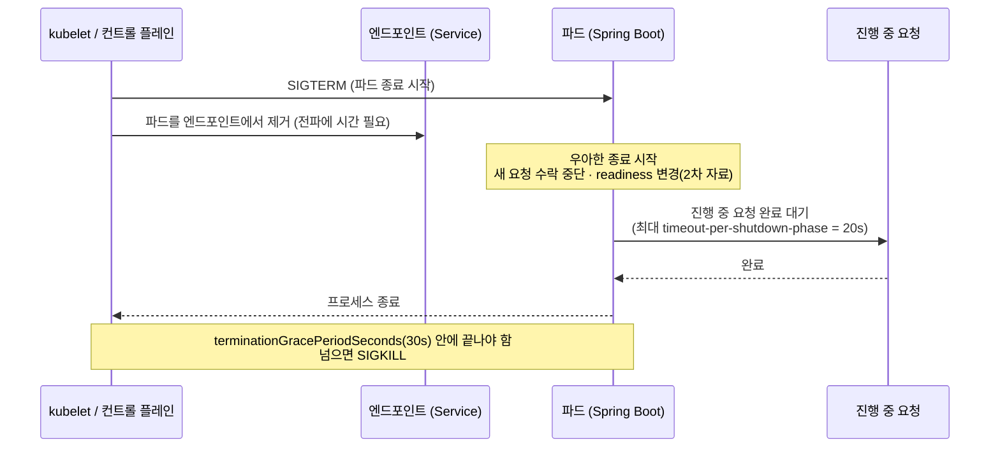

**【제안】 종료 시간 규칙**: `terminationGracePeriodSeconds`(30) **>** `timeout-per-shutdown-phase`(20) **>** 가장 긴 정상 요청 시간(타임아웃 합계 ≈ 3s). 이 순서가 깨지면 요청이 중간에 끊깁니다.

### C.7.8 설정 재적재 흐름

```mermaid
sequenceDiagram
    participant Op as 운영자 (kubectl apply)
    participant API as Kubernetes API 서버
    participant SCK as Spring Cloud Kubernetes (파드 내)
    participant Ctx as Spring 컨텍스트
    participant Req as 이후 요청

    Op->>API: ConfigMap 수정 (delay-ms 50 → 600)
    API-->>SCK: 변경 이벤트 (reload.mode=event)
    SCK->>Ctx: 재적재 트리거 (strategy=refresh)
    Ctx->>Ctx: @ConfigurationProperties 재바인딩
    Req->>Ctx: 다음 요청은 새 값으로 처리
    Note over Op,Req: 재시작 없음. 단, 구동 시점에 한 번 읽는 값(예: WebClient 기본 URL)은 반영되지 않음
```

> **【공식】** 재적재 수준은 `refresh`(Spring Cloud Context의 refresh 기능 활용), `restart_context`, `shutdown` 중에서 고릅니다. **【제안】** 이 실습의 `BffProperties`처럼 **요청 처리 시점에 값을 읽는 설정**(타임아웃·재시도 횟수)만 재적재 대상으로 삼고, **구동 시점에 확정되는 값**(연결 풀 크기, 기본 URL)은 재배포로 바꾸는 규칙을 두면 혼란이 줄어듭니다.

---

## C.8 빌드·배포 스크립트와 단계별 기동

### C.8.1 스크립트 【미검증】

`scripts/build-images.ps1`

```powershell
$ErrorActionPreference = "Stop"
Set-Location (Join-Path $PSScriptRoot "..")

.\gradlew.bat :gateway:bootBuildImage :shop-bff:bootBuildImage :stub:bootBuildImage
if ($LASTEXITCODE -ne 0) { throw "이미지 빌드 실패" }

foreach ($name in "gateway", "shop-bff", "stub") {
    kind load docker-image "reactor-lab/${name}:dev" --name reactor-lab
    if ($LASTEXITCODE -ne 0) { throw "kind 반입 실패: $name" }
}
```

`scripts/up.ps1`

```powershell
param([switch]$SkipBuild)
$ErrorActionPreference = "Stop"
Set-Location (Join-Path $PSScriptRoot "..")

$exists = kind get clusters | Select-String -SimpleMatch "reactor-lab"
if (-not $exists) {
    kind create cluster --name reactor-lab --config k8s/kind-config.yaml
}
kubectl config use-context kind-reactor-lab | Out-Null

if (-not $SkipBuild) { .\scripts\build-images.ps1 }

kubectl apply -f k8s/manifests/
foreach ($d in "catalog", "inventory", "shop-bff", "gateway") {
    kubectl -n reactor-lab rollout status "deployment/$d" --timeout=300s
}
Write-Host "준비 완료: http://localhost:8080/shop/products/1"
```

`scripts/down.ps1`

```powershell
kind delete cluster --name reactor-lab
```

PowerShell 스크립트 실행이 막히면 현재 세션에서만 허용합니다.

```powershell
Set-ExecutionPolicy -Scope Process -ExecutionPolicy Bypass
```

`k6/load.js`

```javascript
import http from 'k6/http';
import { check, sleep } from 'k6';

const target = __ENV.TARGET || '/shop/products/1';

export const options = {
  vus: 20,
  duration: __ENV.DURATION || '60s',
  thresholds: {
    http_req_failed: ['rate<0.01'],
    http_req_duration: ['p(95)<1000'],
  },
};

export default function () {
  const res = http.get(`http://localhost:8080${target}`);
  check(res, { 'status 200': (r) => r.status === 200 });
  sleep(0.05);
}
```

### C.8.2 기동 순서

```powershell
# 1) 처음 한 번: 클러스터 + 이미지 + 배포
.\scripts\up.ps1

# 2) 확인
kubectl -n reactor-lab get pods -o wide
Invoke-RestMethod http://localhost:8080/shop/products/1 | ConvertTo-Json -Depth 5

# 3) 코드만 바꿨을 때(이미지 다시 빌드 + 재시작)
.\scripts\build-images.ps1
kubectl -n reactor-lab rollout restart deployment/shop-bff

# 4) 정리
.\scripts\down.ps1
```

> **【제안】 첫 배포가 실패할 때의 점검 순서**: `kubectl -n reactor-lab get pods` → 상태가 `ImagePullBackOff`면 이미지 반입 누락(`kind load`), `CrashLoopBackOff`면 `kubectl -n reactor-lab logs deploy/<이름> --previous`, `Running`이지만 `READY 0/1`이면 `kubectl -n reactor-lab describe pod <이름>`의 프로브 이벤트를 봅니다.

---

## C.9 실습 실험

> 각 실험은 **가설 → 절차 → 관찰 항목 → 해석** 순서입니다. **결과 수치는 제가 실행해 얻은 것이 아니므로 적지 않았습니다.** 여러분의 측정값을 표에 채워 가며 진행하세요. "예상"이라고 쓴 부분은 가설입니다.

### 실험 1. 쿠버네티스 없이 로컬 기동 (Reactor 서비스의 기본 동작)

**목표**: 코드가 정상 동작하는지 먼저 확인한다. **쿠버네티스 문제와 코드 문제를 분리**하는 첫 단계입니다.

터미널 3개를 열어 각각 실행합니다.

```powershell
# 터미널 1: catalog
$env:SPRING_APPLICATION_NAME="catalog"; $env:SERVER_PORT="8082"
$env:SPRING_CLOUD_KUBERNETES_CONFIG_ENABLED="false"; $env:SPRING_CLOUD_KUBERNETES_RELOAD_ENABLED="false"
.\gradlew.bat :stub:bootRun
```

```powershell
# 터미널 2: inventory
$env:SPRING_APPLICATION_NAME="inventory"; $env:SERVER_PORT="8083"
$env:SPRING_CLOUD_KUBERNETES_CONFIG_ENABLED="false"; $env:SPRING_CLOUD_KUBERNETES_RELOAD_ENABLED="false"
.\gradlew.bat :stub:bootRun
```

```powershell
# 터미널 3: shop-bff
$env:SERVER_PORT="8081"
$env:BFF_CATALOG_URL="http://localhost:8082"; $env:BFF_INVENTORY_URL="http://localhost:8083"
$env:SPRING_CLOUD_KUBERNETES_CONFIG_ENABLED="false"; $env:SPRING_CLOUD_KUBERNETES_RELOAD_ENABLED="false"
.\gradlew.bat :shop-bff:bootRun
```

```powershell
Invoke-RestMethod http://localhost:8081/products/1 | ConvertTo-Json -Depth 5
```

**관찰**: 응답의 `catalog.handlerThread` 값이 `reactor-http-nio-N` 형태인지(이벤트 루프에서 조립됨), `degraded`가 `false`인지 확인합니다. 단위 테스트도 실행합니다: `.\gradlew.bat :shop-bff:test`.

> **기동 오류가 쿠버네티스 클라이언트 때문이라면**: 환경 변수 `SPRING_MAIN_CLOUD_PLATFORM=none`을 추가해 보세요【미검증: Boot의 `spring.main.cloud-platform` 속성을 활용하는 우회법】.

### 실험 2. 클러스터 배포와 파드 확인

**절차**: `.\scripts\up.ps1` → C.8.2의 확인 명령.

**관찰 항목**:
- `kubectl -n reactor-lab get pods`에서 5개 파드(`catalog`, `inventory`, `shop-bff` 2개, `gateway`)가 `1/1 Running`
- 응답의 `catalog.pod`·`inventory.pod`가 **쿠버네티스 파드 이름**(HOSTNAME)으로 채워짐
- `kubectl -n reactor-lab logs deploy/shop-bff`에서 `reactor-http-nio-N` 스레드 이름이 몇 개 보이는지(→ 실험 5의 출발점)

### 실험 3. ConfigMap 변경으로 재시작 없이 지연 조정 (설정 재적재)

**가설**: catalog의 `delay-ms`를 바꾸면 **재시작 없이** 응답 시간이 변하고, 일정 값을 넘으면 **shop-bff의 타임아웃**이 작동한다.

```powershell
# 기준선
Measure-Command { Invoke-RestMethod http://localhost:8080/shop/products/1 | Out-Null }

# k8s/manifests/20-config.yaml 의 catalog ConfigMap 을 편집:  delay-ms: 600  후 적용
kubectl apply -f k8s/manifests/20-config.yaml

kubectl -n reactor-lab logs deploy/catalog --tail=30
Measure-Command { Invoke-RestMethod http://localhost:8080/shop/products/1 | Out-Null }
```

그다음 `delay-ms`를 **1500**으로 올려 다시 적용하고 응답을 봅니다.

| delay-ms | 예상(가설) | 실제 측정 | 메모 |
|---|---|---|---|
| 50 | 빠르게 성공 | | |
| 600 | 성공, 지연 증가(800ms 타임아웃 이내) | | |
| 1500 | catalog 타임아웃 → 재시도 소진 → 오류 응답 | | |

**해석 포인트**: 1500ms에서 오류가 나는 이유는 `800ms 타임아웃 × (1+재시도 2회) + 백오프`가 **누적**되기 때문입니다. 이 합계가 게이트웨이의 3s 타임아웃에 근접하거나 넘는지도 확인하세요(C.3.2의 시간 예산).
재적재가 안 되면 ① `kubectl -n reactor-lab logs deploy/catalog`에 권한(Forbidden) 오류가 있는지, ② ConfigMap 이름이 `spring.application.name`과 같은지, ③ `spring.config.import` 표기(C.6.1의 【미검증】)를 점검합니다.

### 실험 4. 백프레셔: 빠른 생산자와 느린 소비자

**가설**: `drop` 정책에서는 소비자가 느릴수록 드롭 카운터가 늘고, `buffer(100)` 정책에서는 상한 초과 시 오류로 끝난다.

```powershell
kubectl -n reactor-lab port-forward deploy/shop-bff 18081:8080     # 터미널 A (유지)
```

```powershell
# 터미널 B: 매우 느리게 읽는 소비자 (curl.exe 사용, PowerShell의 curl 별칭과 구분)
curl.exe -N --limit-rate 200 "http://localhost:18081/stream?policy=drop" --max-time 20
Invoke-RestMethod "http://localhost:18081/actuator/metrics/bff.stream.dropped"
curl.exe -N --limit-rate 200 "http://localhost:18081/stream?policy=buffer" --max-time 20
```

| 정책 | 관찰 항목 | 실제 측정 |
|---|---|---|
| `drop` | `bff.stream.dropped` 증가량, 소비자가 받은 틱의 연속성 | |
| `buffer` | 연결이 오류로 끊기는 시점, 서버 로그의 오버플로 메시지 | |

**해석**: 두 정책은 "느린 소비자에게 무엇을 포기할 것인가"의 서로 다른 답입니다. 최신값만 중요하면 드롭, 모든 값이 중요하면 버퍼+상한+상위 속도 제어가 필요합니다(본문 3.5절, 9.5절). **환경(네트워크 버퍼 크기)에 따라 관찰되는 시점이 달라질 수 있습니다**【미검증】.

### 실험 5. 블로킹 격리 vs 이벤트 루프 막기 (가장 중요한 실험)

**가설**: `/legacy-bad`에 부하를 주면 **이벤트 루프가 막혀** 관계없는 `/products`의 지연도 함께 커진다. `/legacy`(격리)에서는 그 영향이 훨씬 작다.

**절차**: 터미널 A에서 방해 부하를, 터미널 B에서 **관찰용 부하**를 동시에 실행합니다.

```powershell
# 1) 기준선: products 만 (60초)
k6 run -e TARGET=/shop/products/1 -e DURATION=30s k6/load.js

# 2) 터미널 A: 이벤트 루프를 막는 안티패턴에 부하
k6 run -e TARGET=/shop/legacy-bad/1 -e DURATION=60s k6/load.js
# 3) 터미널 B (A 실행 중에): 같은 products 부하의 지연 측정
k6 run -e TARGET=/shop/products/1 -e DURATION=30s k6/load.js

# 4) 같은 방식으로 /shop/legacy/1 (boundedElastic 격리) 을 A 에 두고 B 의 지연 측정
```

**관찰 항목(p95 `http_req_duration`)**:

| 조건 | products p95 | 실제 측정 |
|---|---|---|
| 기준선(방해 없음) | | |
| 방해: `/legacy-bad` | 크게 증가할 것으로 예상 | |
| 방해: `/legacy` | 증가폭이 작을 것으로 예상 | |

추가 확인:

```powershell
Invoke-RestMethod http://localhost:18081/legacy/1      # thread 값이 boundedElastic-N 인지
Invoke-RestMethod http://localhost:18081/legacy-bad/1  # thread 값이 reactor-http-nio-N 인지
Invoke-RestMethod http://localhost:18081/actuator/threaddump | Select-String "reactor-http-nio" | Select-Object -First 5
```

**해석**: 이 실험은 본문 9.2 원칙 1·4의 실증입니다. `ioWorkerCount=2`로 일부러 이벤트 루프를 적게 만들었기 때문에 영향이 **과장되어** 나타납니다. 이벤트 루프 워커 수의 기본값은 **사용 가능한 프로세서 수로 대체**된다고 Reactor Netty API 문서(`ReactorNetty.IO_WORKER_COUNT`)에 설명되어 있으며, 이 값은 컨테이너·노트북 환경에서 **JVM이 보는 프로세서 수**에 따라 달라집니다. 파드 안 JVM이 몇 개의 프로세서를 보는지 직접 확인하고(`/actuator/metrics/system.cpu.count`), 필요하면 이 값을 명시하세요【제안】.

> **【제안】 이 실험의 후속**: 블로킹 호출이 이벤트 루프에서 실행되는 것을 **CI에서 자동 검출**하려면 BlockHound를 테스트에 켭니다(본문 9.2 원칙 8). JDK 13 이상에서는 추가 JVM 옵션이 필요할 수 있으므로 BlockHound의 최신 문서를 확인하세요.

### 실험 6. 장애 주입: 필수 정보와 선택 정보의 다른 운명

**절차**: `inventory` ConfigMap의 `failure-rate`를 **1.0**으로 바꿔 적용 → 응답 확인 → 이어서 `catalog`의 `failure-rate`를 **1.0**으로.

```powershell
Invoke-RestMethod http://localhost:8080/shop/products/1 | ConvertTo-Json -Depth 5
```

| 조건 | 예상(가설) | 실제 측정 |
|---|---|---|
| inventory만 100% 실패 | **200 OK**, `inventory.degraded=true` | |
| catalog 100% 실패 | 재시도 소진 후 **오류 응답**(5xx) | |
| 둘 다 정상 복구 | 정상 | |

**관찰 항목**: 오류 시 응답 시간(타임아웃·재시도 누적), shop-bff 로그의 재시도 흔적. **해석**: 선택 정보의 실패는 서비스 전체의 실패로 번지지 않아야 하고(원칙 5), 필수 정보의 실패는 **빠르게, 그러나 명확하게** 실패해야 합니다.

### 실험 7. 롤링 업데이트 중 무중단 측정

**가설**: `maxUnavailable: 0`, 프로브, 우아한 종료 설정으로 롤링 업데이트 중 실패율이 낮게 유지된다. **단, 연결 재사용 때문에 소수의 실패가 나올 수도 있다.**

```powershell
# 터미널 A: 부하 (60초)
k6 run -e DURATION=60s k6/load.js

# 터미널 B: 부하 시작 10초 후
kubectl -n reactor-lab rollout restart deployment/shop-bff
kubectl -n reactor-lab rollout status deployment/shop-bff
```

| 측정 항목 | 실제 측정 |
|---|---|
| `http_req_failed` 비율 | |
| p95 응답 시간 | |
| 오류가 난 시점(롤링 구간과 겹치는가) | |

**실패가 관찰되면 점검할 개선 후보**【제안·가설】: ① 종료 시작과 엔드포인트 제거 사이의 시간차를 흡수하는 **종료 전 대기**(preStop 지연), ② 게이트웨이에서 **멱등 GET 재시도**, ③ 연결 풀의 `maxIdleTime`을 업스트림의 유휴 종료보다 짧게, ④ `terminationGracePeriodSeconds`와 `timeout-per-shutdown-phase`의 재검토. **하나씩만 바꾸고 같은 시나리오로 다시 측정**하세요(원칙 10).

### 실험 8. 부하 분산 관찰: 쿠버네티스 Service는 요청을 고르게 나눌까?

**가설**: 클라이언트(shop-bff)가 **연결을 재사용**하면, 쿠버네티스 Service(연결 단위 분산)는 요청 단위가 아니라 **연결 단위**로 파드를 선택하므로 분포가 치우칠 수 있다.

```powershell
kubectl -n reactor-lab scale deployment/catalog --replicas=3
kubectl -n reactor-lab rollout status deployment/catalog

1..90 | ForEach-Object {
    (Invoke-RestMethod http://localhost:8080/shop/products/1).catalog.pod
} | Group-Object | Sort-Object Count -Descending | Format-Table Count, Name
```

| 조건 | 분포(파드별 응답 수) |
|---|---|
| 순차 요청 90건 | |
| (PowerShell 7) 병렬 요청: `1..90 \| ForEach-Object -Parallel { ... } -ThrottleLimit 20` | |

**해석**: 분포가 치우친다면 원인은 **연결 재사용**과 **Service의 연결 단위 선택**의 조합일 수 있습니다【제안·가설: 이번 세션에서 실측하지 못함】. 해결 후보는 클라이언트 측 부하 분산(Spring Cloud LoadBalancer + Kubernetes 디스커버리)이나 연결 수명 제한이며, C.12의 확장 과제로 이어집니다. **분포가 고르게 나왔다면 그것도 유효한 결과입니다.** 환경과 연결 재사용 방식에 따라 다릅니다.

### 실험 9. 관측 점검 (프로메테우스 엔드포인트와 Reactor 메트릭)

```powershell
kubectl -n reactor-lab port-forward deploy/shop-bff 18081:8080
Invoke-RestMethod http://localhost:18081/actuator/prometheus | Select-String -Pattern "reactor|bff|jvm_threads" | Select-Object -First 40
```

**점검 목록**:
- [ ] `name("bff.product")`로 지정한 시퀀스의 **구독 횟수·지속 시간·오류 상태** 메트릭이 보이는가(공식 문서 기준 Reactor 메트릭은 `reactor.*`계 이름을 쓰며, Prometheus에서는 이름이 변환됩니다)
- [ ] 연결 풀 메트릭(`metrics(true)`)이 보이는가
- [ ] WebClient 요청 메트릭(`http.client.requests` 계열)이 보이는가 → **보이지 않으면** C.6.2의 경고(직접 정의한 `WebClient.Builder` 때문에 자동 계측이 빠짐)가 현실화된 것입니다. Boot가 만든 빌더에 커스터마이저로 덧입히는 방식으로 바꿔 다시 확인하세요
- [ ] `/actuator/threaddump`에서 `reactor-http-nio-*`와 `boundedElastic-*` 스레드가 구분되는가

> **【공식】** 메트릭 이름·태그의 정확한 목록은 Reactor 공식 문서의 "Meters and tags for Reactor-Core-Micrometer module"에 있습니다(`Micrometer.metrics()`의 공통 태그와 `Micrometer.timedScheduler()`, `Micrometer.observation()` 대안 포함). 이름 표기는 이 문서의 표를 기준으로 확인하세요.

---

## C.10 운영 런북 (제안)

### C.10.1 배포 전 점검표 (Operational Readiness Review)

| 영역 | 점검 항목 | 확인 방법 |
|---|---|---|
| 코드 | 이벤트 루프에서 `block()`·`Thread.sleep`·JDBC·파일 I/O가 없다 | 코드 리뷰, BlockHound 테스트, 실험 5 |
| 코드 | 모든 원격 호출에 `timeout`이 있고, 시간 예산이 합산 규칙을 지킨다 | 단위 테스트(가상 시간), C.3.2 |
| 코드 | 재시도는 멱등 호출에만, 횟수 상한이 있다 | 코드 리뷰 |
| 코드 | 필수/선택 정보가 구분되어 있고 선택 정보는 폴백이 있다 | 실험 6 |
| 설정 | 연결 풀·동시성·큐에 명시적 상한이 있다 | `ConnectionProvider`, `flatMap` 동시성 인자 |
| 설정 | 재적재 대상 설정과 재배포 대상 설정이 구분되어 있다 | C.7.8 규칙 |
| 수명주기 | `startup/readiness/liveness` 프로브가 있고 외부 의존성을 liveness에 묶지 않았다 | 매니페스트 리뷰 |
| 수명주기 | `grace period > shutdown timeout > 최장 요청 시간` | 매니페스트·설정 비교 |
| 자원 | 메모리 요청·한도가 있고 OOMKilled 이력이 없다 | `kubectl describe pod` |
| 관측 | Reactor 메트릭·풀 메트릭·HTTP 메트릭이 수집된다 | 실험 9 |
| 보안 | 액추에이터(특히 `threaddump`)가 관리 포트·접근 통제 뒤에 있다 | 운영 환경 설정 |
| 권한 | 서비스 계정은 필요한 최소 권한만 가진다 | RBAC 리뷰 |
| 검증 | 부하·장애 주입·롤링 업데이트를 측정했다 | 실험 5~7 |

### C.10.2 증상 → 원인 가설 → 확인 → 조치

| 증상 | 의심 | 확인 | 조치 |
|---|---|---|---|
| **지연(p95)이 오르는데 CPU는 낮다** | 이벤트 루프 블로킹 | `threaddump`에서 `reactor-http-nio-*`가 블로킹 호출에 머무는지 | 블로킹 격리(`boundedElastic`), BlockHound 도입 |
| **타임아웃 증가, 하위 서비스는 정상** | 연결 풀 고갈·대기 | 풀 메트릭(대기·획득 시간), `pendingAcquireTimeout` 오류 | 풀 크기·동시성 상한 재설계, 호출 수 감소 |
| **하위 서비스가 느려져 전체가 느려짐** | 시간 예산·재시도 폭증 | 재시도 횟수·타임아웃 합계 | 재시도 상한·타임아웃 단축, 서킷 브레이커(C.12) |
| **`OOMKilled`로 재시작** | 힙 + 다이렉트 버퍼 > 한도 | `kubectl describe pod`의 종료 사유 | `MaxRAMPercentage` 낮춤 또는 메모리 한도 상향, 버퍼 사용 점검 |
| **기동 중 `CrashLoopBackOff`** | 설정·권한 오류, 기동 지연 | `kubectl logs --previous`, `startupProbe` 임계 | RBAC·ConfigMap 이름 점검, `failureThreshold` 조정 |
| **롤링 업데이트 중 5xx** | 엔드포인트 제거 지연·연결 재사용 | 실험 7 | 종료 전 대기, 게이트웨이 재시도, 유휴 연결 수명 조정 |
| **ConfigMap을 바꿨는데 반영 안 됨** | 권한·이름·재적재 설정 | 파드 로그의 Forbidden, `reload.enabled` | RBAC·이름·`mode` 점검, 재배포 대상 값인지 확인 |
| **한 파드만 과부하** | 연결 단위 분산의 치우침 | 실험 8 분포 | 클라이언트 측 LB, 연결 수명 제한 |

```mermaid
flowchart TD
    s["지연 증가 · 오류 증가"] --> q1{"CPU 사용률이 높은가"}
    q1 -->|"아니오"| q2{"이벤트 루프 스레드가<br/>블로킹 호출에 머물러 있는가<br/>(threaddump)"}
    q2 -->|"예"| a1["블로킹 격리 · BlockHound"]
    q2 -->|"아니오"| q3{"풀 대기·획득 시간이 증가했는가"}
    q3 -->|"예"| a2["풀 · 동시성 상한 재설계"]
    q3 -->|"아니오"| q4{"하위 서비스 지연이 증가했는가"}
    q4 -->|"예"| a3["타임아웃 · 재시도 · 폴백 점검"]
    q4 -->|"아니오"| a4["네트워크 · DNS · 노드 자원 점검"]
    q1 -->|"예"| q5{"GC 시간 또는 메모리 한도 근접인가"}
    q5 -->|"예"| a5["메모리 설정 · 객체 할당 점검"]
    q5 -->|"아니오"| a6["연산량(직렬화 등) 프로파일링 · 스케일 아웃"]
```

### C.10.3 변경 관리와 롤백

- **설정 변경**(ConfigMap): `kubectl apply` → 재적재 → **로그·메트릭으로 확인**. 재배포 대상 값이면 `kubectl rollout restart`.
- **이미지 변경**: `bootBuildImage` → `kind load`(로컬) 또는 레지스트리 푸시(실환경) → `kubectl rollout restart`.
- **롤백**: `kubectl -n reactor-lab rollout undo deployment/<이름>` — 직전 리비전으로 되돌립니다(쿠버네티스 표준 기능).
- 모든 변경은 **같은 부하 시나리오(실험 5~7)로 전후를 비교**합니다.

### C.10.4 버전·지원 일정 관리

| 항목 | 현재 상태 (2026-10-15) | 운영 규칙(제안) |
|---|---|---|
| Spring Cloud | 2025.1.x(Boot 4.x). 2025.0.x는 **2026-06-30 OSS 종료** | 분기마다 최신 서비스 릴리스 확인, **Boot↔Cloud 호환표를 먼저 확인** |
| Spring Cloud Config Server(도입 시) | 2025.1.3에서 CVE 2건 수정 | 보안 패치 즉시 적용 |
| Reactor | BOM 2025.0.x(Core 3.8.x), OSS **2027-06-30**까지 | 2026.0 트레인 GA 소식 추적, **마일스톤(`-M`)은 운영 금지** |
| Reactor Kafka | 중단(본문 8.3) | 신규 설계에 채택 금지, 어댑터로 격리 |
| Spring Boot | 4.1.x 안정. 4.0.x의 OSS 종료는 2026-12-31로 보도(2차, 공식 확인 필요) | 지원 종료 90일 전에 상향 계획 확정 |

---

## C.11 Windows 환경 문제 해결

| 증상 | 원인 후보 | 해결 |
|---|---|---|
| `kind create cluster`가 포트 오류로 실패 | `hostPort 8080`을 다른 프로그램이 사용 | `kind-config.yaml`의 `hostPort`를 `18080` 등으로 변경, 이후 URL도 동일 변경 |
| 노트북이 느려지고 `Vmmem`이 메모리를 과다 사용 | WSL 2 기본 한도 | `.wslconfig`로 `memory`·`processors` 제한 후 `wsl --shutdown` (C.4.3) |
| `bootBuildImage` 실패(Docker 연결 오류) | Docker Desktop 미실행 | Docker Desktop을 실행하고 `docker version` 확인 |
| 빌드는 되는데 파드가 `ImagePullBackOff` | `kind load` 누락 또는 클러스터 이름 불일치 | `kind load docker-image <이미지> --name reactor-lab`, `imagePullPolicy: IfNotPresent` 확인 |
| 스크립트 실행이 막힘 | PowerShell 실행 정책 | `Set-ExecutionPolicy -Scope Process -ExecutionPolicy Bypass` |
| `curl`이 이상하게 동작 | PowerShell의 `curl` 별칭이 `Invoke-WebRequest` | `curl.exe`를 명시 |
| 파드가 `OOMKilled` | 메모리 한도 부족 | 한도 상향(768Mi → 1Gi), `MaxRAMPercentage` 조정, WSL 한도 확인 |
| 첫 `bootBuildImage`가 매우 느림 | 빌더·베이스 이미지 다운로드 | 첫 1회만 오래 걸림. 네트워크·디스크 여유 확인 |
| 로컬 기동 시 쿠버네티스 클라이언트 오류 | 클러스터 밖 실행 | 실험 1의 환경 변수, `SPRING_MAIN_CLOUD_PLATFORM=none` 시도 |
| 회사 PC에서 Docker Desktop 설치·사용이 제한됨 | 정책·라이선스 | 조직 정책 확인. 대안(다른 컨테이너 엔진)은 이번에 조사하지 않음 |

---

## C.12 확장 과제 (이 프레임워크의 다음 단계)

| # | 과제 | 얻는 것 | 참고할 사실 |
|---|---|---|---|
| 1 | **Spring Cloud Kubernetes 디스커버리 + LoadBalancer** | 클라이언트 측 부하 분산 | 서비스 이름을 쿠버네티스 Service로 해석하는 디스커버리 클라이언트가 제공되며, `all-namespaces`·`namespaces`·`include-not-ready-addresses` 같은 속성이 있음 【공식】. **추가 RBAC 필요**, 실험 8의 분포 개선 여부를 측정 |
| 2 | **서킷 브레이커**(Spring Cloud CircuitBreaker + Resilience4j) | 장애 전파 차단 | Gateway의 WebFlux 쪽 서킷 브레이커 스타터 이름은 2차 자료 기준 `spring-cloud-starter-circuitbreaker-reactor-resilience4j` 【2차】 |
| 3 | **분산 트레이싱**(OpenTelemetry) | 요청 경로 가시화 | Reactor의 `Micrometer.observation()` 대안과 컨텍스트 전파(본문 3.8) 활용. Boot 4의 OTel 구성은 별도 확인 필요 |
| 4 | **Prometheus + Grafana** 배포 | 대시보드·알림 | 메트릭 엔드포인트는 이미 노출됨. 실환경의 차트·구성은 별도 확인 |
| 5 | **HPA(자동 확장)** | 부하 기반 스케일 | 메트릭 서버 필요. **kind에서의 추가 설정은 이번에 확인하지 못함** |
| 6 | **BlockHound를 CI에 편입** | 블로킹 누수 자동 검출 | 본문 9.2 원칙 8 |
| 7 | **메시징 어댑터**(Spring Cloud Stream) | 이벤트 기반 쓰기 경로 | 별첨 A.8, 본문 8.3 — Reactor Kafka Binder 폐기 예정 확인 |
| 8 | **보안**(NetworkPolicy, mTLS, Secret 관리) | 최소 권한 통신 | 이번 실습에서 다루지 않음 |
| 9 | **가상 스레드 비교 실습** | 별첨 B.6.4의 판단 검증 | 동일 시나리오를 MVC + 가상 스레드로 구현해 실험 5~7을 반복 측정 |

---

## C.13 별첨 C 확인 한계

- **코드·매니페스트의 실행 검증을 하지 못했습니다.** 이 세션에는 Docker·Kubernetes·JDK 빌드 환경과 Maven 저장소 접근이 없어, 자바 코드와 Gradle 설정은 **컴파일하지 못했고**, 매니페스트와 YAML은 **문법만 점검**했습니다. 위의 모든 코드·설정을 **【미검증】** 으로 표시한 이유입니다. 첫 실습에서 컴파일·기동 오류가 나면 **오류 메시지와 함께 알려 주세요.** 수정본을 만들어 드리겠습니다.
- **API·속성의 불확실한 표기**: `spring.config.import: "optional:kubernetes:"`, `spring.cloud.gateway.server.webflux.httpclient.response-timeout`, `SPRING_MAIN_CLOUD_PLATFORM=none`, Boot 4에서의 `WebClient.Builder` 자동 구성 위치는 **공식 문서로 직접 확인하지 못했습니다.**
- **버전 조합**: Boot 4.1.0 + Spring Cloud 2025.1.2는 공식 블로그가 호환을 명시한 쌍이지만, 2025.1.3과 Boot 4.1.1(문서 배너상 최신)의 호환은 확인하지 못했습니다. Spring Boot 4의 최소 Java·Gradle 버전도 확인하지 못했습니다.
- **Reactor 버전**: Boot가 관리하는 Reactor BOM 버전은 확인하지 못했습니다. C.5.2의 명령으로 실제 버전을 확인하세요.
- **빌드팩 이미지의 메모리 계산·`JAVA_TOOL_OPTIONS` 병합 동작**은 확인하지 못했습니다.
- **winget 패키지 ID**와 Docker Desktop·kind의 세부 사양은 `winget search`와 각 공식 페이지에서 확인이 필요합니다. Docker Desktop 약관(조직 규모에 따른 라이선스 조건)은 직접 확인하세요.
- **실험 결과 수치는 하나도 제시하지 않았습니다.** 모든 "예상"은 가설이며, 특히 실험 4(백프레셔 관찰), 실험 7(롤링 중 실패 여부), 실험 8(부하 분산 편향)은 환경에 따라 결과가 달라질 수 있습니다.
- **종료 중 프로브 응답 동작**은 Spring Boot 이슈 토론에서 의견이 갈려 있어 확정하지 않았습니다.
- C.10의 **운영 규칙·임계값**과 C.12의 확장 과제는 제 판단입니다.

---

## C.14 별첨 C 출처

**Spring Cloud / Spring Boot (공식)**
- Spring Cloud 프로젝트 페이지(릴리스 트레인 ↔ Boot 세대 표: 2025.1.x Oakwood = Boot 4.0.x): https://spring.io/spring-cloud
- Spring 블로그, Spring Cloud 2025.1.3 (2026-08-20): https://spring.io/blog/2026/08/20/spring-cloud-2025-1-3-has-been-released/
- Spring 블로그, Spring Cloud 2025.1.2 (2026-06-11, Boot 4.0.7 호환 + 4.1.0 호환 도입): https://spring.io/blog/2026/06/11/spring-cloud-2025-1-2-aka-oakwood-has-been-released/
- Spring 블로그, Spring Cloud 2025.1.1 (2026-01-29): https://spring.io/blog/2026/01/29/spring-cloud-2025-1-1-aka-oakwood-has-been-released/
- Spring Cloud 2025.0.x(Northfields) OSS 종료 안내(2026-06-30): https://spring.io/authors/ryanjbaxter
- Spring Cloud Gateway 프로젝트 페이지(WebFlux/WebMVC 서버 스타터): https://spring.io/projects/spring-cloud-gateway
- Spring Cloud Gateway 모듈·접두사 이동 표(마이그레이션): https://docs.openrewrite.org/recipes/java/spring/cloud2025/springcloudgatewaydeprecatedmodulesandstarters
- Spring Cloud Kubernetes 참조 문서(디스커버리·설정·재적재): https://docs.spring.io/spring-cloud-kubernetes/docs/2.0.5-SNAPSHOT/reference/html/
- Spring Cloud Kubernetes Configuration Watcher(5.1 문서): https://docs.spring.io/spring-cloud-kubernetes/reference/5.1/spring-cloud-kubernetes-configuration-watcher.html
- Spring Boot 참조 문서, WebFlux(`starter-web`과 `starter-webflux` 동시 사용 시 MVC 자동 구성): https://docs.spring.io/spring-boot/4.0/reference/web/reactive.html
- Spring 블로그, Liveness and Readiness Probes with Spring Boot: https://spring.io/blog/2020/03/25/liveness-and-readiness-probes-with-spring-boot/
- Spring Boot 이슈 #24617(우아한 종료와 프로브 토론): https://github.com/spring-projects/spring-boot/issues/24617

**Reactor (공식)**
- Reactor Core 참조 문서, Exposing Reactor metrics(`reactor-core-micrometer`, `Micrometer.metrics`, `tap`): https://projectreactor.io/docs/core/release/reference/metrics.html
- 메트릭 상세(Meters and tags): https://projectreactor.io/docs/core/release/reference/metrics-details.html
- Reactor Core 3.5 Javadoc deprecated 목록(`Flux.metrics()`·`Schedulers.enableMetrics()` 대체 안내): https://docs.enterprise.spring.io/reactor-core/docs/3.5.23/javadoc-api/deprecated-list.html
- Reactor Netty API, `ReactorNetty`(`IO_WORKER_COUNT` 등 시스템 속성 상수): https://docs.spring.io/projectreactor/reactor-netty/docs/current/api/reactor/netty/ReactorNetty.html
- 그 밖의 Reactor 문서: 본문 14장 출처 참조

**Windows·Kubernetes 로컬 환경**
- Docker 공식 문서, Install Docker Desktop on Windows(최소 4GB RAM, WSL 2, 약관 안내): https://docs.docker.com/desktop/install/windows-install/
- vCluster 블로그, Kubernetes on Windows(Docker Desktop 내장 Kubernetes, kind 개요): https://www.vcluster.com/blog/kubernetes-on-windows-6-life-saving-tools-and-tips

**2차 자료**
- Spring Cloud Gateway 5 가이드(서킷 브레이커 스타터 이름·접두사 변경 표): https://stevenpg.com/posts/ultimate-guide-spring-cloud-gateway/
- ConfigMap 재적재·RBAC 예제: https://developer.cloud.tencent.cn/article/1679044
- 헬스 프로브 구성 예시: https://oneuptime.com/blog/post/2026-01-25-health-probes-kubernetes-spring-boot/view
