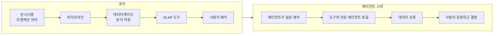
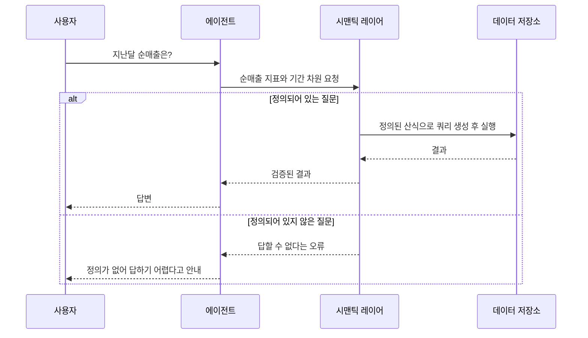
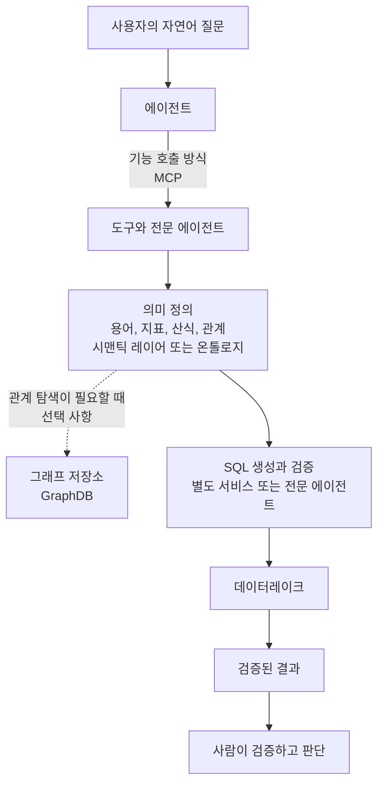
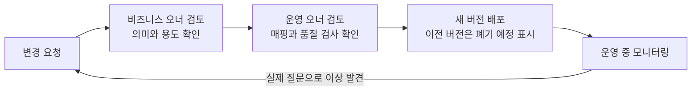
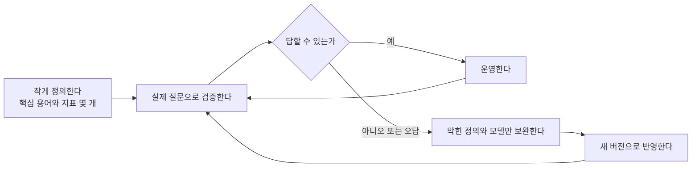

> 에이전트 시대의 데이터 표준화: 시맨틱 레이어, GraphDB, MCP, 그리고 "누가 의미를 책임지는가"

- 작성 기준일: 2026년 10월 15일
- 해설 대상: 사용자가 제공한 단상(페이스북 게시글) 본문
- 근거 자료: 2026년 4월~9월 사이의 공식 블로그, 표준 문서, 기업 기술 블로그 (말미에 출처 정리)


```
단상

SQL은 맞았는데, 답이 틀렸다

그동안 본시스템은 트랜잭션을 처리하고, 데이터레이크는 분석을 담당했습니다.

데이터는 파이프라인을 통해 이동했고, 사람은 OLAP 도구로 데이터를 분석했습니다.

그런데 AI가 등장하면서 변화가 시작됐습니다.

이제 에이전트가 데이터를 조회하고, 도구와 전문 에이전트를 호출합니다. 사람은 결과를 검증하고 의사결정에 집중합니다.

그런데 이상한 문제가 발생합니다.

SQL은 정상적으로 실행됐는데, 답이 틀립니다.

매출이 주문 기준인지, 결제 기준인지, 반품은 제외하는지 에이전트가 모르기 때문입니다.

사람이 경험으로 이해하던 업무의 의미를 이제는 AI에게 설명해야 합니다.

도메인과 엔티티, 속성과 관계, 지표 산식까지 표준화해야 하는 이유입니다.

여기서 재미있는 기술 논쟁이 시작됩니다.

“GraphDB로 관계를 표현해야 한다.”

“Semantic Layer면 충분하지 않을까?”

“MCP 도구에서 처리하면 되잖아?”

모두 일리가 있습니다.

GraphDB에서는 Cypher라는 질의 언어로 노드와 관계를 탐색할 수 있습니다.

예를 들어 자연어 질문에서 ‘순매출’이라는 업무 용어를 찾아 지표의 정의와 실제 데이터셋의 관계를 확인합니다.

이를 바탕으로 검증된 SQL을 생성하여 데이터레이크를 조회할 수 있습니다.

하지만 Cypher가 SQL로 자동 변환되는 것은 아닙니다. SQL 생성과 검증은 별도의 서비스나 전문 에이전트가 수행할 수 있습니다.

GraphDB도 필수는 아닙니다. 중요한 것은 기술이 아니라 업무의 의미를 일관되게 전달하는 것입니다.

MCP 역시 에이전트가 기능을 호출하기 위한 표준 인터페이스이지, 모든 업무 로직을 담는 정답은 아닙니다.

우리 팀의 기술 표준화 업무도 이 지점에 있습니다.

데이터레이크는 표준화된 의미 정보와 데이터 매핑을 제공하고, 본시스템은 업무 규칙과 실행을 책임지는 방향을 고민하고 있습니다.

그런데 더 어려운 문제가 남았습니다.

“업무의 의미는 누가 정의하고, 변경되면 누가 책임질 것인가?”

처음부터 완벽한 표준을 설계할 수는 없습니다.

작게 구축하고, 실제 질문으로 검증하고, 운영하면서 버전을 발전시켜야 합니다.

서로의 의견이 충돌하고, 때로는 어렵게 만든 설계를 스스로 부러뜨려야 할지도 모릅니다.

정답이 없다는 것이 가장 어려운 부분입니다.

그래도 같은 방향을 바라보며 부딪히고, 고치고, 함께 역경을 헤쳐 나가야 합니다.

표준은 처음부터 완벽한 정답지가 아니라, 함께 발전시키는 약속이라고 생각합니다.

여러분은 어떻게 생각하시나요?

에이전트 시대의 데이터 표준화는 데이터레이크에서 시작해야 할까요? 본시스템에서 시작해야 할까요? 아니면 둘이 함께 책임져야 할까요?

https://www.facebook.com/share/p/1HcYJQupiu/

```

---

## 0. 먼저 요약

이 글은 한 문장으로 줄이면 이렇습니다. **AI 에이전트가 데이터를 직접 조회하는 시대가 되자, SQL 문법의 정확성보다 "업무 용어가 무엇을 뜻하는지"를 기계가 이해할 수 있게 만드는 일이 더 중요해졌다**는 이야기입니다.

글쓴이는 이 문제를 풀 후보 기술로 세 가지를 꼽습니다. 관계를 표현하는 GraphDB, 지표와 용어를 정의하는 Semantic Layer(시맨틱 레이어), 에이전트가 기능을 호출하는 표준 통로인 MCP입니다. 그리고 세 기술 모두 일리는 있지만, **어느 것도 그 자체로 정답은 아니며 핵심은 "업무의 의미를 일관되게 전달하는 것"** 이라고 정리합니다. 마지막에는 기술보다 어려운 질문, 즉 "의미는 누가 정의하고 바뀌면 누가 책임지는가"를 던지고, 표준은 완성된 정답지가 아니라 **함께 발전시키는 약속**이라고 맺습니다.

이 문서는 글의 각 주장을 한 줄씩 풀어 설명하고, 2026년 10월 현재 확인되는 최신 자료로 뒷받침하거나 보정합니다. 확인되지 않는 내용은 추측하지 않고 "자료에서 확인되지 않음"이라고 명시했습니다.

### 자료에 관한 안내

원문 게시글 주소는 접근이 제한되어 직접 열 수 없었습니다. 따라서 원문 해설은 사용자가 붙여 넣어 주신 본문만을 근거로 했고, 기술적 사실 확인은 별도로 검색한 공개 자료로 했습니다.

---

## 1. 글의 배경: 데이터를 다루는 주체가 바뀌고 있다

### 1.1 지금까지의 구조

글은 먼저 기존 구조를 짧게 짚습니다. 본시스템(업무를 실제로 처리하는 핵심 운영 시스템)은 거래, 즉 트랜잭션을 처리합니다. 데이터레이크는 분석을 맡습니다. 두 곳 사이에서 데이터는 파이프라인을 따라 이동하고, 사람은 OLAP 도구(다차원 집계 분석 도구)로 데이터를 들여다봅니다.

이 구조에서 가장 중요한 점은 **의미를 해석하는 주체가 사람**이었다는 것입니다. 분석가는 "매출"이라는 단어를 보면 우리 회사에서 그 말이 보통 무엇을 뜻하는지 경험으로 알고 있었습니다.

### 1.2 AI 이후의 구조

글쓴이가 말하는 변화는 두 가지입니다. 첫째, 에이전트가 데이터를 직접 조회하고 도구와 전문 에이전트를 호출합니다. 둘째, 사람은 결과를 검증하고 의사결정에 집중합니다. 즉 **조회와 계산은 기계가, 검증과 판단은 사람이** 맡는 방향입니다.



여기서 문제가 생깁니다. 사람이 하던 "의미 해석"을 에이전트가 이어받아야 하는데, 에이전트에게는 사람이 가진 업무 경험이 없습니다.

---

## 2. 핵심 문제: SQL은 정상인데 답이 틀리는 이유

### 2.1 글이 말하는 원인

글은 구체적인 예를 듭니다. 매출이 주문 기준인지 결제 기준인지, 반품은 제외하는지를 에이전트가 모르기 때문에 SQL은 오류 없이 실행되지만 숫자가 틀린다는 것입니다.

이를 풀어서 설명하면 이렇습니다. "지난달 순매출은 얼마인가"라는 질문에서 에이전트는 주문 테이블을 합산할 수도 있고, 결제 테이블을 합산할 수도 있습니다. 반품 테이블을 빼야 하는지도 질문 안에 적혀 있지 않습니다. 어느 쪽을 골라도 SQL 문법은 완벽하고 실행도 성공합니다. 그러나 조직이 합의한 "순매출"의 정의와 다르면 결과는 틀린 답입니다. **오류 메시지가 없기 때문에 틀렸다는 사실 자체를 알아채기 어렵다**는 점이 이 문제의 무서운 부분입니다.

그래서 글은 도메인, 엔티티(업무에서 다루는 대상, 예를 들어 고객과 주문), 속성, 관계, 지표 산식까지 표준화해야 한다고 말합니다.

### 2.2 이 주장은 실제 측정 결과로 확인됩니다

이 주장은 감이 아니라 측정으로도 뒷받침됩니다. dbt Labs는 2026년 4월 7일 자 블로그에서 LLM이 직접 SQL을 쓰는 방식과 시맨틱 레이어를 거치는 방식을 비교한 벤치마크를 갱신해 공개했습니다.

실험 조건은 이렇습니다. 보험 회사를 모사한 ACME Insurance 데이터셋을 쓰고, 업무 질문 11개를 각각 20번씩 반복해 여러 모델에서 측정했습니다. 결과의 핵심은 다음과 같습니다.

- 시맨틱 레이어 없이 원본 테이블만 보고 SQL을 쓰는 방식의 전체 정확도는 2023년 GPT-4 기준 32.7%에서 2026년 Claude Sonnet 4.6과 GPT-5.3 Codex 기준 64.5%로 거의 두 배가 되었습니다. 모델이 크게 좋아진 것은 사실입니다.
- 그래도 시맨틱 레이어가 다룰 수 있는 범위의 질문에서는 두 모델 모두 정답률 100%였습니다. 시맨틱 레이어가 쿼리를 결정적으로(같은 입력에 항상 같은 방식으로) 생성하기 때문에, 모델이 지표와 차원만 제대로 고르면 조인이나 집계 오류가 날 수 없는 구조입니다.
- 가장 중요한 차이는 **실패하는 방식**입니다. dbt Labs의 표현을 풀어 쓰면, 직접 SQL을 쓰는 방식의 실패는 "그럴듯하지만 틀린 숫자"로 나타나고, 시맨틱 레이어의 실패는 "답할 수 없다는 오류 메시지"로 나타납니다. 글쓴이가 말한 "SQL은 맞았는데 답이 틀렸다"가 정확히 앞쪽의 실패 방식입니다.

다만 이 수치를 읽을 때 지켜야 할 단서가 있습니다.

1. 시맨틱 레이어는 모델링해 둔 범위의 질문만 답할 수 있습니다. 같은 벤치마크에서 원본(고도로 정규화된) 테이블 위의 시맨틱 레이어는, 엔티티 간 이동이 너무 많은 질문을 풀지 못해 전체 정확도가 72.7%에 머물렀습니다.
2. 그 빈틈을 메우려고 LLM이 새 모델 3개를 만들어 테이블을 몇 개 조인하고 대응하는 시맨틱 모델을 추가하자 11개 질문 전부에 답할 수 있게 되었습니다. 이 "모델링된" 구성에서 직접 SQL 방식은 Claude Sonnet 4.6이 90.0%, GPT-5.3 Codex가 84.1%였고, 시맨틱 레이어 방식은 각각 98.2%와 100.0%였습니다.
3. 직접 SQL 방식은 이 실험에서 전체 스키마를 맥락으로 모두 넣어 주었는데, dbt Labs 스스로 이것이 더 큰 데이터셋에서는 현실적이지 않다고 밝혔습니다.
4. 이 실험은 시맨틱 레이어를 만드는 회사가 직접 수행했고, 데이터셋 하나와 질문 11개라는 작은 규모입니다. 따라서 "모든 조직에서 이 정도 차이가 난다"고 일반화할 수는 없습니다.

dbt Labs의 권고는 양자택일이 아니라 역할 분담이었습니다. 이사회 보고, 감사, KPI처럼 정확성이 중요한 곳은 시맨틱 레이어에 LLM을 연결하고, 일회성 탐색은 먼저 시맨틱 레이어로 답할 수 있는지 확인한 뒤 안 되면 직접 SQL로 내려가라는 것입니다. 또 하나의 결론은 **모델링을 잘하면 두 방식 모두 좋아진다**는 점입니다. 이 마지막 결론은 글쓴이의 "표준화가 먼저"라는 문제의식과 맞닿아 있습니다.



위 흐름이 dbt Labs가 설명한 시맨틱 레이어 방식의 핵심 동작입니다. 정의가 있으면 결정적으로 정확하게 답하고, 없으면 틀린 숫자를 만들지 않고 실패를 드러냅니다.

---

## 3. 세 가지 기술 논쟁을 하나씩 풀어 보기

글은 "GraphDB로 관계를 표현해야 한다", "Semantic Layer면 충분하지 않나", "MCP 도구에서 처리하면 되잖아"라는 세 의견이 모두 일리 있다고 말합니다. 각각이 무엇이고 지금 어디까지 왔는지 차례로 보겠습니다.

### 3.1 Semantic Layer(시맨틱 레이어)

**무엇인가.** 비즈니스 지표, 차원, 데이터셋 사이의 관계를 한곳에서 정의해, BI 도구와 AI 에이전트가 같은 정의를 쓰게 하는 계층입니다. dbt의 시맨틱 레이어는 dbt 프로젝트 안에서 지표를 정의하고, MetricFlow라는 엔진이 실제 쿼리를 만들어 냅니다.

**최신 동향: 업계 공통 규격 시도.** 2025년 9월 Snowflake가 Salesforce, dbt Labs, BlackRock, RelationalAI 등과 함께 Open Semantic Interchange(OSI)를 발표했습니다. 의미 정보를 벤더 중립적으로 정의하고 교환하자는 오픈소스 규격입니다. 2026년 1월 27일 Snowflake 블로그에 따르면 첫 번째 규격이 Apache 2 라이선스의 Git 저장소로 공개되었고, 전용 웹사이트가 열렸으며, Databricks, AtScale 등이 작업 그룹에 합류했습니다.

그리고 2026년 7월 8일 Snowflake 블로그에 따르면 이 프로젝트는 **Apache Ossie(Incubating)** 라는 새 이름으로 Apache 소프트웨어 재단의 인큐베이터에 받아들여졌습니다. 이름을 바꾼 이유는 같은 약어를 쓰는 다른 오픈소스 프로젝트와의 혼동을 피하기 위해서이고, 규격과 YAML 기반 형식은 그대로라고 합니다. 같은 글은 다음을 알려 줍니다.

- Ossie는 시맨틱 레이어와 온톨로지(업무 개념과 규칙의 체계) 양쪽을 다루는 개방형 규격이라고 소개됩니다.
- 참여 조직이 17개 출범 파트너에서 50개 넘는 조직으로 늘었고, Metric Language, Catalog, Ontology의 세 작업 그룹이 운영됩니다.
- Ossie와 dbt MetricFlow 변환기, Apache Polaris 카탈로그 메타데이터 변환기, Snowflake 시맨틱 모델 변환기가 참조 구현으로 만들어졌습니다.
- 향후 과제로 "어떤 엔진이든 지원할 수 있는 표준 시맨틱 쿼리 규격" 같은 방향이 언급되지만, 로드맵은 확정된 것이 아니며 모든 항목이 공개 토론과 투표를 거친다고 명시되어 있습니다.

버전 표기에 관한 주의가 하나 있습니다. 일부 2차 자료는 이 규격을 "v1.0"이라고 부르고 다른 자료는 "v0.1"이라고 부릅니다. 1차 자료인 Snowflake 글은 "첫 번째 버전"이라고만 서술하므로, 이 문서는 버전 번호를 단정하지 않습니다.

**글쓴이의 관점과 연결.** 글쓴이가 "도메인과 엔티티, 속성과 관계, 지표 산식까지 표준화"를 말한 것은, 시맨틱 레이어가 다루는 지표와 차원에 더해 온톨로지 영역까지 포괄하려는 시도로 읽을 수 있고, Ossie가 정확히 그 둘을 함께 다룬다고 소개된다는 점은 흥미로운 일치입니다. 다만 글쓴이가 Ossie를 염두에 두었는지는 원문에 언급이 없으므로 확인되지 않습니다.

### 3.2 GraphDB와 Cypher

**무엇인가.** GraphDB는 노드(대상)와 관계(연결)를 중심으로 데이터를 저장하는 데이터베이스입니다. Cypher는 이런 그래프에서 패턴을 찾는 질의 언어로, Neo4j가 2010년경부터 개발했고 2015년 openCypher로 공개되었으며 2019년 국제 표준 초안(GQL)으로 이어졌습니다.

**글의 설명을 풀어 보면.** 글쓴이는 자연어 질문에서 "순매출"이라는 업무 용어를 찾고, 그 용어에 연결된 지표 정의와 실제 데이터셋의 관계를 그래프에서 확인한 뒤, 그 결과를 바탕으로 검증된 SQL을 만들어 데이터레이크를 조회하는 흐름을 그립니다. 그리고 **Cypher가 SQL로 자동 변환되는 것은 아니며**, SQL 생성과 검증은 별도 서비스나 전문 에이전트가 맡을 수 있다고 못 박습니다.

이 설명은 표준 문서와도 맞습니다. 2024년 4월 ISO가 발행한 GQL(ISO/IEC 39075:2024)은 속성 그래프를 위한 독립된 질의 언어입니다. 별개로 SQL:2023의 일부로 발행된 SQL/PGQ는 관계형 테이블 위에 그래프 뷰를 정의하고 SQL 안에서 그래프 패턴을 질의하게 해 줍니다. 즉 "그래프 언어를 SQL로 옮긴다"가 아니라, **그래프를 쓰는 길(GQL)과 SQL 안에서 그래프 패턴을 쓰는 길(SQL/PGQ)이 따로 표준화되어 있다**는 것이 공식적인 그림입니다. 자료에서 Cypher의 자동 SQL 변환을 일반 기능으로 설명하는 내용은 확인되지 않았습니다.

**실제 구현 사례.** 글의 흐름과 거의 같은 구조의 공개 사례가 있습니다. Neo4j는 관계형 DB의 스키마, 테이블, 컬럼, 외래키 같은 메타데이터를 그래프에 저장하고, 에이전트가 질문과 관련된 부분 그래프만 의미 검색과 최단 경로 탐색으로 꺼내 SQL 작성에 쓰게 하는 "시맨틱 레이어" 예제를 공개했습니다. 이 예제에서도 그래프는 "맥락을 찾는 곳"이고 SQL은 에이전트가 따로 만듭니다.

AWS가 공개한 샘플은 또 다른 길을 보여 줍니다. 온톨로지를 Amazon Neptune에 저장하고, 자연어 질의를 온톨로지 매핑을 이용해 SPARQL에서 SQL로 재작성하는 "가상 지식 그래프" 방식입니다. 여기서는 Cypher가 아닌 RDF 기반 SPARQL이 쓰입니다. 이는 글쓴이의 "GraphDB도 필수는 아니다"라는 말과도 맞아떨어집니다. 같은 샘플이 그래프 없이 메타데이터를 벡터 저장소에 두는 RAG 방식도 대안으로 제시하기 때문입니다.

**지식 그래프와 그래프 DB는 같은 말이 아닙니다.** Atlan의 설명에 따르면 그래프 DB는 노드와 관계를 저장하고 빠르게 탐색하는 저장 엔진이고, 지식 그래프는 그 위에 온톨로지로 의미를 입힌 것입니다. 또 Kanerika의 설명은 시맨틱 레이어가 "얼마나, 몇 개"에 답한다면 온톨로지는 "어느 것, 왜, 무엇이 영향을 받는가"에 답한다고 구분하고, 대부분의 기업 AI 프로그램은 시맨틱 레이어를 먼저 만들고 온톨로지는 그다음에 만든다고 서술합니다. 이 둘은 모두 벤더 블로그의 견해라는 점을 감안해 읽어야 하지만, 글쓴이의 "GraphDB가 필수는 아니다"와 방향이 같습니다.

### 3.3 MCP(Model Context Protocol)

**무엇인가.** MCP는 AI 애플리케이션이 외부 도구, 데이터, 프롬프트 템플릿을 공통된 방식으로 찾아 쓰게 하는 개방형 표준입니다. 각 도구는 이름, 설명, JSON 스키마로 된 입력 정의를 가진 "함수"로 노출됩니다. 글쓴이의 표현대로 "에이전트가 기능을 호출하기 위한 표준 인터페이스"가 정확한 정의입니다.

**최신 동향(이 글을 읽을 때 꼭 알아 둘 변화).** MCP 명세는 날짜로 버전을 매깁니다. 공식 블로그를 인용한 보도에 따르면 2026-07-28 개정판이 2026년 7월 28일에 정식 확정되었고, 후보판(릴리스 후보)은 5월 21일에 먼저 공개되었습니다. 이 개정은 출시 이래 가장 큰 변경으로 평가됩니다. 확인되는 주요 내용은 다음과 같습니다.

- 핵심 프로토콜이 **상태 비저장(stateless)** 으로 바뀌었습니다. 세션 개념이 사라지고 모든 요청이 자기 프로토콜 버전과 클라이언트 기능 정보를 스스로 담습니다.
- roots, sampling, logging 세 가지 기존 클라이언트 기능이 폐기 예정(deprecated)이 되었습니다.
- 인증 관련 제안 6건이 포함되어 OAuth 2.0과 OpenID Connect의 실제 운영 방식에 맞게 보강되었습니다.
- 직전 개정판은 2025-11-25였습니다.

이 변화가 글의 논점과 갖는 의미는 분명합니다. MCP는 **"어떻게 호출하는가"를 표준화하는 통로**이고, 그 통로를 지나가는 지표의 뜻, 즉 "순매출이 무엇인가"는 MCP 명세가 정해 주지 않습니다. 글쓴이가 "MCP는 모든 업무 로직을 담는 정답이 아니다"라고 말한 것은 이 역할 구분을 정확히 짚은 것입니다. 다만 시맨틱 레이어를 MCP 서버로 노출하는 방식이 일반적으로 쓰이는지에 관한 내용은 이번 조사에서 확정적인 근거를 확인하지 못했으므로, 그 부분은 말하지 않습니다. dbt 쪽에는 dbt-mcp라는 커뮤니티 채널 이름이 언급될 뿐입니다.

### 3.4 세 기술의 관계 정리

세 기술은 경쟁 관계라기보다 **서로 다른 층에서 서로 다른 질문에 답하는 도구**로 보는 편이 정확합니다. 아래는 위 자료를 종합해 그린 개념도이며, 특정 조직의 설계안이 아니라 역할 구분을 설명하기 위한 것입니다.



이 그림에서 MCP는 화살표의 규칙, 시맨틱 레이어는 의미의 원천, GraphDB는 선택적인 탐색 도구, SQL 서비스는 실행 담당입니다. 글쓴이가 말한 "중요한 것은 기술이 아니라 업무의 의미를 일관되게 전달하는 것"은 이 그림에서 **가운데 '의미 정의' 상자가 비어 있으면 나머지 상자가 아무리 잘 만들어져 있어도 소용없다**는 말로 읽힙니다.

---

## 4. 글쓴이 팀의 고민: 데이터레이크와 본시스템의 역할 분담

글쓴이는 팀의 기술 표준화 업무가 이 지점에 있다고 말합니다. 데이터레이크는 표준화된 의미 정보와 데이터 매핑을 제공하고, 본시스템은 업무 규칙과 실행을 책임지는 방향을 고민한다는 것입니다.

용어를 먼저 정리하면, 여기서 본시스템은 업무를 실제로 수행하고 거래를 기록하는 핵심 운영 시스템을 가리킵니다. 글에서 "본시스템은 트랜잭션을 처리"한다고 쓴 대목이 근거입니다.

이 고민의 구조를 풀어 쓰면 이렇습니다.

- **데이터레이크 쪽 역할**: 어떤 용어가 어떤 지표 정의와 연결되고, 그 지표가 실제 어느 데이터셋의 어느 컬럼으로 계산되는지를 담은 "의미 정보와 데이터 매핑"을 제공합니다. 분석 질문이 에이전트를 통해 들어올 때 가장 직접적으로 필요한 정보입니다.
- **본시스템 쪽 역할**: 주문, 결제, 반품 같은 업무가 어떤 규칙으로 처리되고 상태가 어떻게 바뀌는지의 "업무 규칙과 실행"을 책임집니다. 순매출에서 반품을 어떻게 취급하는지의 근거가 되는 업무 사실은 결국 여기서 만들어집니다.

공개 자료가 이 분담의 정답을 정해 주지는 않습니다. 다만 확인되는 일반적인 경향이 두 가지 있습니다. 하나는 시맨틱 정의를 사람이 읽을 수 있는 YAML 파일로 조직의 Git 저장소에 두고 버전 관리하는 방식이 Ossie와 dbt 모두에서 기본 형태로 소개된다는 점입니다. 이는 의미 정의가 특정 시스템 내부 설정이 아니라 **독립된 관리 대상**일 수 있음을 보여 줍니다. 다른 하나는 dbt Labs의 결과가 보여 주듯 데이터 모델링 품질이 직접 SQL 방식과 시맨틱 레이어 방식 모두에 영향을 준다는 점입니다.

---

## 5. 가장 어려운 질문: 의미는 누가 정의하고, 바뀌면 누가 책임지는가

글은 기술 논쟁보다 더 어려운 질문이 남아 있다고 말합니다. 이 질문에 대해 공개된 사례 두 가지를 근거로 정리해 보겠습니다. 어디까지나 다른 조직의 운영 사례이며, 글쓴이 조직에 그대로 적용된다는 뜻은 아닙니다.

### 5.1 Lyft의 사례: 지표마다 두 명의 책임자

Lyft의 엔지니어링 블로그는 핵심 지표(Golden Metrics)마다 **비즈니스 오너와 운영 오너를 반드시 지정**한다고 설명합니다. 비즈니스 오너는 지표의 건전성을 책임지고 서술형과 SQL 형태의 정의를 제공합니다. 운영 오너는 데이터의 건전성을 책임지며, 예를 들어 비즈니스 정의가 바뀌면 새 데이터 품질 검사를 만드는 일을 맡습니다. 블로그는 한쪽 오너만 알고 있는 중요한 세부 사항이 있을 수 있어, 두 사람이 함께 보면 부적절한 변경을 막을 수 있다고 설명합니다. 또 정의를 YAML 설정으로 코드화하고 내부 데이터 카탈로그와 연결해 소유자와 품질 정보를 함께 보여 준다고 합니다.

### 5.2 dbt의 정리: 데이터 팀과 도메인 팀의 역할

dbt Labs의 "누가 시맨틱 레이어를 소유해야 하는가" 글은 두 관점을 나란히 제시합니다. 데이터 팀이 소유하면 데이터 변환과 지표 정의를 같은 팀이 다루는 일관된 모델이 된다는 것이고, 한편 배포, 자격 증명, 통합, 성능 같은 기술 인프라는 자연스럽게 데이터 팀 몫이라는 것입니다. 규모가 작거나 비즈니스 팀이 기술에 익숙한 조직에서는 비즈니스 팀이 직접 정의를 관리할 수 있고, 비즈니스 팀이 정의를 제안하면 데이터 팀이 검토하고 구현하는 승인 흐름도 가능하다고 적고 있습니다. 즉 **하나의 정답이 아니라 조직 상황에 따라 달라진다**는 것이 이 자료의 입장입니다.

### 5.3 변경 관리에서 공통으로 강조되는 점

여러 자료가 공통으로 지적하는 점은 정의 변경이 파급 효과가 크다는 것입니다. 한 거버넌스 해설은 순매출 정의 하나가 바뀌면 대시보드, 예측, 보상 보고서, 자동화된 의사결정까지 바뀔 수 있어 버전 관리가 필수라고 설명합니다. 또 다른 글은 "고객"의 정의를 바꾸면 지표 하나가 아니라 같은 엔티티를 공유하는 여러 지표가 함께 영향을 받는다고 설명하며, 옛 정의를 일정 기간 조회할 수 있게 두면서 폐기 예정으로 표시하는 전환 기간의 필요성을 이야기합니다.

이 두 가지는 글쓴이의 "변경되면 누가 책임질 것인가"에 대한 공개 사례 기반 답의 윤곽을 보여 줍니다. 의미에는 **정의에 책임지는 사람(비즈니스)** 과 **계산과 데이터 품질에 책임지는 사람(운영/기술)** 이 구분되어 지정되고, 변경은 **승인과 버전 관리를 거쳐 영향 범위를 알린 뒤** 배포되는 구조입니다.



위 흐름은 Lyft와 변경 관리 해설에서 공통으로 확인되는 요소를 묶은 개념도입니다.

---

## 6. "작게 구축하고, 실제 질문으로 검증하고, 운영하며 발전"

글쓴이는 처음부터 완벽한 표준은 불가능하므로 작게 만들고 실제 질문으로 검증한 뒤 운영하면서 버전을 키워야 한다고 말합니다. 앞서 본 dbt Labs의 벤치마크가 이 접근의 실제 모양을 잘 보여 줍니다.

그 실험에서 처음에는 시맨틱 레이어가 11개 질문 중 일부를 풀지 못했습니다. 엔티티 사이를 너무 많이 건너야 하는 질문이었습니다. 이때 전면 재설계를 하지 않고, 질문이 막히는 지점을 확인한 뒤 새 모델 3개를 추가해 조인과 대응하는 시맨틱 모델을 만들었습니다. 변경을 Git에 올리자 시맨틱 레이어가 자동으로 갱신되었고, 같은 벤치마크를 다시 돌려 모든 질문에 답할 수 있음을 확인했습니다. **질문으로 시험하고, 막힌 곳만 고치고, 다시 시험하는 순환**입니다.



글에서 "어렵게 만든 설계를 스스로 부러뜨려야 할지도 모른다"는 말은, 검증에서 오답이 나왔을 때 기존 정의를 고집하지 않고 버전을 올려 바꾸는 태도를 가리킨다고 읽힙니다. 위 순환에서 "보완한다" 단계가 바로 그 지점입니다.

---

## 7. 마지막 질문에 대한 정리

글은 이렇게 묻고 끝납니다. 에이전트 시대의 데이터 표준화는 데이터레이크에서 시작해야 하는가, 본시스템에서 시작해야 하는가, 아니면 함께 책임져야 하는가.

먼저 분명히 해 둘 점은, 이 질문에 **"A가 정답"이라고 단정하는 공개 자료는 확인되지 않았다**는 것입니다. 대신 자료가 공통으로 말해 주는 것을 정리하면 다음과 같습니다.

1. **의미의 정의는 특정 시스템 한 곳의 부산물이 아니라 독립적으로 관리되는 자산으로 다뤄지는 경향이 있습니다.** Ossie와 dbt 모두 사람이 읽을 수 있는 정의 파일을 버전 관리하는 형태를 기본으로 합니다.
2. **책임은 한 팀에 몰기보다 의미 책임과 기술 책임으로 나눠 지정하는 사례가 있습니다.** Lyft는 지표마다 비즈니스 오너와 운영 오너를 둡니다.
3. **시작점은 완성된 설계보다 실제 질문입니다.** dbt Labs 실험에서 보듯 질문으로 시험해서 막힌 곳부터 보완하는 방식이 실행 가능한 경로로 제시됩니다.
4. **모델링 품질은 어떤 방식을 쓰든 결과를 좌우합니다.** 직접 SQL을 쓰든 시맨틱 레이어를 쓰든 정리된 모델 위에서 정확도가 올랐습니다.

이 네 가지로부터 "함께 책임져야 한다"는 방향이 자료와 잘 맞는다고 말할 수는 있지만, 데이터레이크와 본시스템 사이에서 구체적으로 어떻게 책임을 나눠야 하는지는 조직의 업무 구조, 규제, 시스템 현황에 달려 있어 공개 자료만으로 결론 낼 수 없습니다. 이 부분은 글쓴이가 마지막에 열어 둔 질문 그대로 남겨 두는 것이 정직한 정리입니다.

---

## 8. 용어 사전

- **본시스템**: 업무를 실제로 처리하고 거래를 기록하는 핵심 운영 시스템. 글에서는 트랜잭션 처리를 맡는 곳으로 쓰입니다.
- **트랜잭션**: 주문, 결제처럼 하나의 업무 단위로 처리되는 거래 처리.
- **데이터레이크**: 여러 원천의 데이터를 모아 분석에 쓰도록 저장하는 저장소.
- **OLAP**: 다차원 집계와 분석에 쓰는 처리 방식 또는 도구.
- **엔티티**: 업무에서 다루는 대상(고객, 주문, 상품 등).
- **지표 산식**: 지표를 계산하는 규칙(예: 순매출 = 어떤 금액에서 어떤 금액을 뺀 값).
- **시맨틱 레이어**: 지표, 차원, 관계를 한곳에서 정의해 여러 도구가 같은 정의를 쓰게 하는 계층.
- **온톨로지**: 업무 개념과 개념 사이의 관계, 규칙을 체계적으로 기술한 것.
- **GraphDB**: 노드와 관계 중심으로 저장하는 데이터베이스.
- **Cypher**: 그래프 데이터베이스에서 쓰는 질의 언어. Neo4j에서 출발했습니다.
- **GQL**: 2024년 4월 ISO가 발행한 속성 그래프 표준 질의 언어(ISO/IEC 39075:2024).
- **SQL/PGQ**: SQL:2023에 포함된, 관계형 테이블 위에 그래프 뷰를 정의하고 SQL로 그래프 패턴을 질의하는 규격.
- **MCP**: 에이전트가 외부 도구와 데이터를 공통 방식으로 호출하게 하는 개방형 표준. 현재 최신 개정판은 2026-07-28입니다.
- **Apache Ossie(Incubating)**: 구 Open Semantic Interchange. 시맨틱 레이어와 온톨로지를 위한 개방형 규격.
- **MetricFlow**: dbt 시맨틱 레이어에서 지표 쿼리를 결정적으로 생성하는 엔진.

---

## 9. 이 문서의 한계

- 원문 게시글 주소는 접근 제한으로 직접 열람하지 못했고, 사용자가 제공한 본문을 기준으로 했습니다.
- dbt Labs 벤치마크는 벤더가 수행한 소규모 실험(데이터셋 1개, 질문 11개)이므로 일반화에는 한계가 있습니다.
- Atlan, Kanerika, Gravitee 등은 관련 제품이나 서비스를 가진 벤더의 글이어서 견해로 읽어야 합니다.
- Ossie(구 OSI)의 버전 번호는 자료마다 표기가 달라 단정하지 않았습니다.
- MCP와 시맨틱 레이어의 결합 방식, 조직별 책임 배분 방식은 공개 자료에서 확정적 결론을 확인하지 못해 서술하지 않았습니다.
- 모든 정보는 2026년 10월 15일 기준 검색 결과입니다.

---

## 10. 출처

**시맨틱 레이어와 벤치마크**
- dbt Labs, "Semantic Layer vs. Text-to-SQL: 2026 Benchmark Update" (2026-04-07) — https://docs.getdbt.com/blog/semantic-layer-vs-text-to-sql-2026
- dbt Labs, "Who should own the semantic layer?" — https://www.getdbt.com/blog/semantic-layer-ownership

**Open Semantic Interchange와 Apache Ossie**
- Snowflake, "Apache Ossie (Incubating): The New Name for Open Semantic Interchange" (2026-07-08) — https://www.snowflake.com/en/blog/apache-ossie-open-semantic-interchange-incubator/
- Snowflake, "Open Semantic Interchange (OSI) Updates: Specification Now Live, New Working Group Members and More" (2026-01-27) — https://www.snowflake.com/en/blog/open-semantic-interchanges-specs-finalized/
- Constellation Research, "Snowflake, Salesforce, BlackRock lead effort to standardize semantic data" (2025-09) — https://www.constellationr.com/insights/news/snowflake-salesforce-blackrock-lead-effort-standardize-semantic-data

**그래프 질의 언어와 그래프 기반 시맨틱 사례**
- Wikipedia, "Graph Query Language" — https://en.wikipedia.org/wiki/Graph_Query_Language
- Libkin 외, "GQL and SQL/PGQ: Theoretical Models and Expressive Power" (VLDB 2025) — https://arxiv.org/pdf/2409.01102
- PuppyGraph, "What is GQL" — https://www.puppygraph.com/blog/what-is-gql
- Neo4j, "How a Neo4j semantic layer makes your Text-to-SQL agent smarter and cheaper" — https://neo4j.com/?p=417117
- AWS Samples, "sample-semantic-layer-structured" — https://github.com/aws-samples/sample-semantic-layer-structured
- Atlan, "Knowledge Graph vs Graph Database" — https://atlan.com/know/ai-agent/knowledge-graph/knowledge-graph-vs-graph-database/
- Kanerika, "Ontology vs Semantic Layer" — https://kanerika.com/blogs/ontology-vs-semantic-layer/

**MCP**
- PPC Land, "MCP forces ad tech to rebuild agent servers as sessions disappear" (2026-07-28) — https://ppc.land/mcp-forces-ad-tech-to-rebuild-agent-servers-as-sessions-disappear/
- Scalar, "What is MCP (Model Context Protocol)?" (2026년 9월 갱신) — https://scalar.com/learn/mcp/what-is-mcp
- GitHub, modelcontextprotocol/specification 릴리스 2026-07-28 — https://github.com/modelcontextprotocol/specification/releases/tag/2026-07-28

**거버넌스와 소유권**
- Lyft Engineering, "Metric Semantic Layer: How Lyft Governs and Scales Key Data Definitions" — https://eng.lyft.com/metric-semantic-layer-how-lyft-governs-and-scales-key-data-definitions-56bee3643c29
- Gravitee, "Semantic Layer Governance for AI-Driven Business Intelligence" — https://www.gravitee.io/corpus/gen-2190/business-intelligence-2-0/semantic-layer-governance-for-ai-driven-business-intelligence.html
- Modern Data 101, "The Semantic Layer Blackhole" — https://moderndata101.substack.com/p/the-semantic-layer-blackhole
