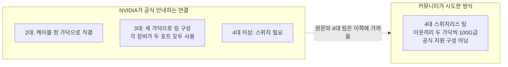
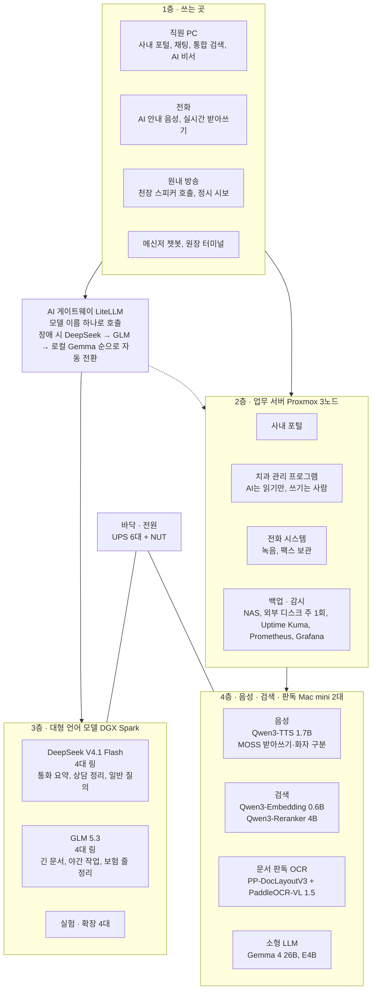
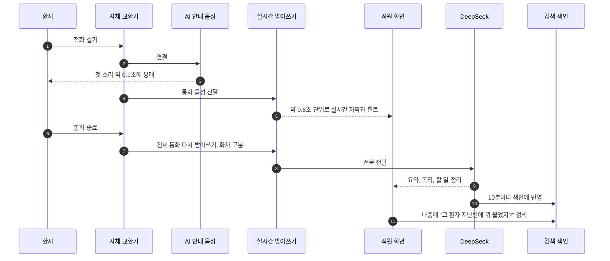
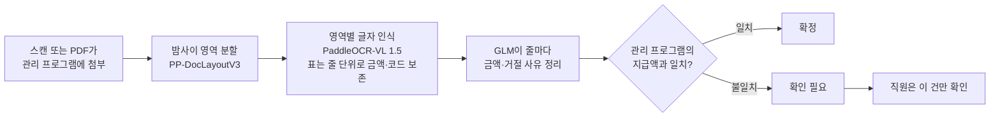
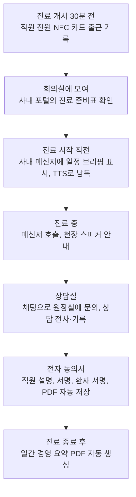
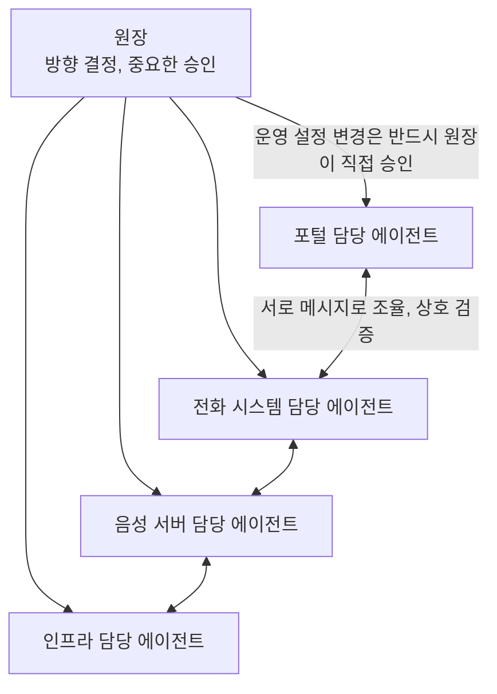

- 대상 글: [「동네 치과의 AX전환기」](https://arca.live/b/aihomelab/185810092) (아카라이브 · AI 로컬 홈랩 채널, 작성자 닉네임 gatsbydds)
- 함께 다룬 글: 이 글을 "AX를 하려는 모든 사람이 숙독해야 할 사례"라고 추천한 고영혁 님의 페이스북 게시물
- 이 문서는 원문과 관련 기술 자료를 2026년 10월 15일 기준으로 확인해 정리했습니다. 원문에 나온 수치는 작성자 본인의 주장이며 제3자가 검증한 것이 아니라는 점을 문서 곳곳에서 구분해 두었습니다.

> 
> AX 하겠다는 분들, 회장님에서부터 실무 직원까지 모든 분들에게 이 치과의사 분의 AX 경험담을 반드시 숙독하시길 추천드립니다. 이 정도면 제가 직간접적으로 알고 있는 모든 사례들 중 최고 수준입니다. 
> 
> 어떤 관점에서든 하고 있는 일의 어디까지 AI 로 전환했느냐를 놓고 보면 저랑 비교해도 꿀리지 않는 케이스네요. 뭐 저는 반복 자동화가 치과 의사 프로세스보다는 훨씬 적기 때문이기도 하지만, 정말 대단합니다.
> 
> https://arca.live/b/aihomelab/185810092?p=1
> 
> #ai #agent #usecase #ax #gonnector #고넥터
> 
> https://www.facebook.com/share/p/1FCh72noCV/
> 

---

## 0. 먼저 한 줄 요약

생물학을 전공한 동네 치과 원장님이 "인건비는 오르고 몸은 갈리는" 현실이 답답해서 AI를 써 보기 시작했고, 그 끝에 병원 뒷방에 자체 AI 서버실을 만들어 전화 응대, 보험 서류 판독, 사내 검색, 원내 방송, 사내 메신저, 경영 리포트, 전자 동의서까지 병원 업무의 상당 부분을 **병원 안에서** 자동화했다는 기록입니다. 핵심 원칙은 "환자 정보는 병원 밖으로 나가지 않는다"와 "AI는 읽고 제안할 뿐, 판단과 기록은 사람이 한다"입니다.

이 글이 화제가 된 이유는 두 가지로 보입니다. 하나는 비전공자가 AI 코딩 에이전트를 팀원처럼 부려서 이 정도 범위를 실제 운영에 넣었다는 점이고, 다른 하나는 "AI를 어디에 쓸지 모르겠다"는 사람들에게 구체적인 업무 단위의 예시를 아주 많이 보여 줬다는 점입니다.

---

## 1. 이 글은 무엇이고, 어디까지 퍼졌나

### 1.1 원문 게시글의 기본 정보

원문은 로컬 AI를 직접 돌리는 사람들이 하드웨어·구축·튜닝 경험을 나누는 커뮤니티인 아카라이브 「AI 로컬 홈랩 채널」에 올라왔습니다. 확인한 시점에 사이트가 보여 준 숫자는 다음과 같습니다. (사이트는 브라우저 시간대를 지원하지 않아 GMT 기준으로 표시한다고 안내하고 있었으므로, 아래 시각은 사이트 표시값 그대로입니다.)

| 항목 | 확인된 값 |
|---|---|
| 작성 시각 | 2026-10-13 09:15 (사이트 표시값) |
| 최종 수정 | 2026-10-14 10:26 (사이트 표시값) |
| 조회수 | 181,768 |
| 추천 / 비추천 | 358 / 3 |
| 댓글 | 130개 |

같은 채널의 다른 글 제목 가운데 "조회수 14만8천 뭐꼬", "저거 구축업체 바이럴 아님?" 같은 것이 있었던 것으로 보아, 이 글이 평소 이 커뮤니티의 규모를 크게 넘어서 퍼졌다는 것을 알 수 있습니다. 작성자도 본문 뒤쪽에서 "글이 생각보다 많이 퍼져서 깜짝 놀랐다"고 적었습니다.

### 1.2 외부 추천글

고영혁 님은 페이스북에서 이 글의 링크를 걸고, AX를 하겠다는 분들은 회장님부터 실무 직원까지 이 치과의사의 AX 경험담을 반드시 숙독하라고 권했습니다. 본인이 직간접적으로 아는 모든 사례 중 최고 수준이라고 평가하면서, "하고 있는 일의 어디까지 AI로 전환했느냐"를 기준으로 보면 자신과 비교해도 뒤지지 않는 사례라고 했습니다. 다만 자신은 반복 자동화할 일이 치과 업무보다 훨씬 적기 때문이기도 하다는 단서를 달았습니다. 게시물에는 #ai #agent #usecase #ax #gonnector #고넥터 해시태그가 붙어 있습니다.

제가 해당 페이스북 주소를 직접 열어 보려 했으나 사이트가 자동 접근을 막고 있어, 이 부분은 공유해 주신 게시물 본문에 적힌 내용을 근거로 했습니다. 공유해 주신 시점의 표시는 게시 16시간 경과, 좋아요 78, 댓글 8, 공유 30이었습니다.

---

## 2. 글쓴이는 누구이고, 왜 시작했나

### 2.1 소개

글쓴이는 스스로를 "작은 점빵 동네 치과 아저씨"라고 소개합니다. 컴퓨터공학 전공자가 아니라 생물학 학사입니다. 어릴 때 컴퓨터를 좋아해 네트워크 보안 전문가를 꿈꿨고 리눅스를 설치해 보며 놀았는데, 아버지가 CRT 모니터를 부수고 버린 일을 계기로 한동안 컴퓨터와 멀어졌다고 합니다.

### 2.2 시작의 계기 두 가지

첫 번째는 푸념이었습니다. 친구에게 "AI가 그림 그리고 코딩하고 소설 쓰는 시대에 나는 아직도 남의 입안에서 하루 종일 땜질을 한다"고 털어놓자 친구가 "그럼 네가 AI를 써 봐라"라고 답했고, 그날 밤 ChatGPT에 "치과에서 AI로 뭘 할 수 있어?"라고 물은 것이 출발점이라고 합니다.

두 번째는 개원 때의 공사비였습니다. 인테리어 견적서의 네트워크 공사비를 보고 직접 랜선을 깔기로 했고, 천장 타일을 들고 선을 던지고 커넥터를 찍고 스위치를 달다 보니 "이거 내가 할 수 있네"가 되었다고 합니다. 그 김에 직원 출입문에 NFC 태그를 붙여 출퇴근 기록과 시급 계산, 급여 처리까지 연결했습니다. 이 과정이 병원 뒷방의 서버랙으로 이어졌다는 것이 글의 앞부분 줄거리입니다.

### 2.3 동기를 정리하면

겉으로 드러난 동기는 "오르는 인건비와 몸이 갈리는 구조에서 벗어나고 싶다"는 것입니다. 작성자는 번외 글에서 자신의 취미 성향(주식 분석, 경영 분석, 디지털 치과 만들기 등)이 이런 작업과 맞았다고 설명하며, 이 모든 것이 "그냥 재미로" 시작된 취미에 가깝다고 강조합니다.

---

## 3. 가장 중요한 설계 원칙: 환자 정보는 병원 밖으로 나가지 않는다

원문 전체를 관통하는 결정은 AI를 클라우드가 아니라 **병원 안 서버에서 직접 돌린다**는 것입니다. 치과에는 진료 말고도 전화 받기, 예약 변경, 보험사 지급 내역을 한 줄씩 대조하기, 팩스 정리, 예전 처리 방식 찾기 같은 일이 많은데, 이런 일을 클라우드 AI에 맡기면 통화 녹음과 보험 서류가 외부 서버로 나가게 됩니다. 작성자는 이를 받아들일 수 없다고 판단했고, 그래서 장비를 사서 직접 돌리는 쪽을 택했습니다.

이 선택을 용어로는 **온프레미스(on-premise)** 운영이라고 합니다. 쉽게 말해 "회사(병원)가 자기 건물 안에 서버를 두고 직접 운영하는 방식"입니다. 원문에 실린 구성도 표 맨 위에는 "환자 데이터 외부 전송 0"이라는 항목이 있습니다. 같은 표는 "모든 모델은 병원 안 장비에서 돌고 환자 정보는 병원 네트워크 밖으로 나가지 않는다"고 적고 있습니다.

다만 이 문서에서 확인하지 못한 부분도 분명히 적어 둡니다. 원문은 AI 모델 호출은 병원 안에서 이뤄진다고 했지만, 그 밖의 경로(예: 앱을 통한 외부 접속, 마케팅용 홈페이지, 외부 데이터 연동 등)가 어떻게 분리되어 있는지는 설명하지 않았습니다. 이는 아래 9장의 논란과도 관련됩니다.

---

## 4. 뒷방에는 무엇이 있나 — 하드웨어 구성

### 4.1 원문이 밝힌 구성

| 구분 | 수량 | 역할 (원문 설명) |
|---|---|---|
| NVIDIA DGX Spark급 장비 (GB10) | 12대 | 4대씩 묶어 큰 AI 하나를 구동. DeepSeek용 4대, GLM용 4대, 나머지 4대는 실험·확장용 |
| Mac mini M5 Pro (64GB) | 2대 | 음성(말하기·받아쓰기), 검색, 서류 판독 담당. 한 대가 죽어도 멈추지 않도록 같은 구성으로 두 대 |
| 별도 Mac mini (M4) | 원문에 "에이전트가 도는 M4 mini"로 언급 | 크론잡, 보험 청구 사이트 작업 등에 쓰는 에이전트용 |
| 가상화 서버 (Proxmox) | 3대(노드) | 사내 포털, 치과 관리 프로그램, 전화 시스템, 백업·감시 |
| UPS (무정전 전원장치) | 6대 | 정전 시 장비들이 신호를 주고받으며 순서대로 안전하게 종료, 복전 시 자동 재기동 |
| PC | 30대 이상 | 진료실, 데스크, 상담실, 원장실, 서버 등 합산 |

### 4.2 DGX Spark가 어떤 장비인가 (확인된 사양)

DGX Spark는 NVIDIA가 내놓은 책 한 권 크기의 AI 전용 컴퓨터입니다. 확인한 공개 사양은 다음과 같습니다.

- 칩: NVIDIA GB10 (Grace Blackwell), 20코어 Arm CPU와 Blackwell GPU가 하나의 칩에 결합
- 메모리: 128GB LPDDR5x 통합 메모리 (CPU와 GPU가 같이 씀), 대역폭 273GB/s
- AI 성능: FP4 기준 약 1 PFLOP
- 네트워크: 10GbE 포트, 그리고 ConnectX-7 기반 200Gb/s QSFP 포트 2개
- 크기·무게·전력: 150×150×50.5mm, 약 1.2kg, 소비전력 약 170W

즉 "책 한 권 크기, 일반 콘센트로 동작"이라는 원문 설명은 사실에 부합합니다. 원문이 이 장비를 고른 핵심 이유로 든 것은 **메모리 용량**입니다. 큰 AI 모델은 모델 크기만큼 메모리가 있어야 올라가는데, 원문은 RTX PRO 6000이 한 장에 96GB, H200이 한 장에 141GB라서 한두 장으로는 큰 모델이 안 올라가고, 그걸 여러 장 사려면 가격과 전기 공사, 열과 소음 문제가 커진다고 비교합니다. DGX Spark는 한 대에 128GB, 네 대를 묶으면 512GB가 됩니다.

원문의 비유가 이해하기 쉽습니다. H200은 스포츠카, DGX Spark는 1톤 트럭입니다. 스포츠카는 빠르지만 이삿짐(큰 모델)이 안 실리고, 트럭은 느려도 일단 다 실린다는 이야기입니다. 작성자는 치과에서는 속도보다 정확도가 중요하다고 보고, "1초 빨리 틀리는 것보다 3초 늦어도 맞는 것"을 택했다고 설명합니다.

### 4.3 "4대를 케이블로 고리처럼 묶는다"는 대목 — 확인 결과

이 부분은 댓글에서 논란이 된 지점이라 따로 살펴봤습니다. 한 댓글은 "4대씩 케이블로 고리처럼 묶어서 큰 AI 하나를 같이 돌린다는 것부터 거짓"이라고 주장했습니다.

확인된 사실은 이렇습니다.

1. DGX Spark에는 QSFP 포트가 2개뿐입니다.
2. NVIDIA의 공식 문서와 가이드가 직접 케이블 연결(스위치 없음)로 안내하는 것은 **2대, 그리고 3대 링 구성**입니다. 4대 이상은 스위치를 쓰는 구성이 공식 안내입니다. NVIDIA Sync의 클러스터 도우미 문서도 2~3대는 직결 또는 스위치, 4대는 스위치라고 정리하고 있습니다.
3. 다만 NVIDIA 개발자 포럼에는 "스위치 없이 4노드 클러스터"를 시도한 토론이 있고, 이웃 노드끼리 두 가닥씩 이어 100G급 링크로 고리를 만드는 방식이 논의되었습니다. 포럼 연관 글 목록에는 스위치 없는 2·4·6대 구성으로 GLM, DeepSeek, Qwen을 서비스한다는 제목의 글도 있었습니다.
4. 반면 한 업체 기술 블로그는 4대를 점대점 링크로 연결했을 때 서로 맞은편에 있는 두 대는 경로가 없어 실패했고, 4대 이상은 스위치가 필요하다고 정리했습니다.

따라서 "4대를 고리로 묶었다"는 것은 **NVIDIA가 공식 지원하는 구성은 아니지만, 커뮤니티에서 시도된 적이 있는 방식**입니다. 댓글의 "거짓"이라는 단정은 근거가 부족하지만, 반대로 작성자가 실제로 어떤 배선과 소프트웨어 설정을 썼는지는 원문에 자세히 나오지 않아 이 문서로는 확인할 수 없습니다. (원문 구성도 표에는 DeepSeek 4대 구성이 "스위치 없이 QSFP 케이블 링"으로, 실험용 구성의 2대는 "QSFP 200G 직결 두 줄, RDMA 약 196Gb/s"로 적혀 있습니다.)

### 4.4 Mac mini M5 Pro는 어떤 장비인가

Apple은 2026년 8월 25일 M6와 M5 Pro 칩을 단 새 Mac mini를 발표했고, 판매는 9월 22일 시작됐습니다. M5 Pro 모델은 최대 18코어 CPU, 20코어 GPU, 최대 64GB 통합 메모리, 307GB/s 메모리 대역폭이라고 합니다. 한국 판매가는 M5 Pro 모델이 299만 원부터로 보도됐습니다. 원문이 "어제 새 맥미니 2대가 도착했다"고 쓴 시점과 출시 시기가 맞습니다.

흥미로운 점은 메모리 대역폭입니다. DGX Spark의 273GB/s보다 Mac mini M5 Pro의 307GB/s가 더 큽니다. 원문이 음성·검색·판독 같은 비교적 작은 모델을 Mac mini 쪽에 배치한 것은 이런 특성과 크게 어긋나지 않는 선택입니다. (다만 작성자가 이런 이유로 골랐는지는 원문에 적혀 있지 않습니다.)

---

## 5. 소프트웨어는 어떻게 층을 나눴나

원문에 실린 "사내 AI 인프라 구성도"는 시스템을 4개 층과 바닥 전원층으로 설명합니다. 아래 그림은 그 내용을 쉽게 다시 그린 것입니다.

### 5.1 각 층을 쉽게 풀면

**1층 · 쓰는 곳**은 직원이 실제로 만지는 화면과 장치입니다. 사내 포털(채팅, 통합 검색, AI 비서, 보험 청구 화면), 전화, 천장 스피커, 메신저 챗봇과 원장용 터미널이 여기에 해당합니다.

**AI 게이트웨이**는 "모델 호출의 창구"입니다. 구성도에는 LiteLLM이라고 적혀 있습니다. LiteLLM은 100개가 넘는 AI 제공처를 OpenAI 호환 형식 하나로 호출하게 해 주는 오픈소스 프록시이고, 순서를 정한 **폴백(fallback)** 목록을 설정하면 앞 모델이 실패했을 때 다음 모델로 자동 전환해 줍니다. 구성도 설명대로라면 DeepSeek가 막히면 GLM으로, 그것도 안 되면 로컬 Gemma로 넘어가는 안전장치입니다. 진료 중에 AI가 멈추면 안 된다는 작성자의 요구와 맞아떨어지는 구조입니다.

**2층 · 업무 서버**는 병원이 평소 쓰는 시스템들입니다. 구성도에는 AI가 치과 관리 프로그램에 대해 "읽기만 하고 쓰기는 사람이 한다"는 설명이 있고, 이 원칙은 뒤에서 다시 나옵니다. 백업은 매일 가상머신 백업을 NAS로 보내고 주 1회 외부 디스크로 보내며, 감시에는 Uptime Kuma, Prometheus, Grafana를 쓴다고 합니다.

**3층 · 대형 언어 모델**이 DGX Spark입니다. 통화 요약과 상담 정리는 DeepSeek, 긴 문서와 야간 일괄 작업, 보험 줄 단위 정리는 GLM이 맡는 식으로 역할이 나뉩니다.

**4층 · 음성·검색·판독**은 Mac mini 두 대가 같은 구성으로 맡습니다. 한쪽(A)이 주 서버이고 다른 쪽(B)이 예비입니다. 작성자는 환자 전화가 동시에 4통 들어와도 끊김 없이 받아써야 해서 병렬로 구성했다고 설명합니다.

**바닥 · 전원**은 UPS 6대와 NUT(UPS 상태를 네트워크로 전달하는 도구)입니다. 구성도에는 장비마다 UPS가 하나씩 있고, 한 대가 정전 신호를 받아 짝꿍에게 전달하며, DGX는 정전 5분, Mac은 배터리 20% 또는 10분이 되면 순서대로 안전하게 종료하고, 전기가 돌아오면 자동 부팅·자동 로그인·서비스 자동 기동된다고 적혀 있습니다.

### 5.2 쓰인 모델들을 하나씩 확인했습니다

원문 구성도에 적힌 모델과 도구가 실제로 존재하고 어떤 성격인지 공개 자료로 확인했습니다.

| 모델·도구 | 확인된 내용 |
|---|---|
| **DeepSeek V4 Flash** | 전체 2,840억 개, 실제 활성 130억 개 파라미터의 희소 전문가(MoE) 모델, 컨텍스트 약 100만 토큰. 2026년 4월 24일 프리뷰 공개, 7월 31일 정식(GA) 버전 공개. 정식판은 구조는 그대로이고 후처리 학습으로 에이전트 능력을 높였다고 보도됨. 한 자료는 MIT 라이선스로 상업적 이용이 가능하다고 설명. 구성도에는 "V4.1 Flash"로 적혀 있는데, 별도 모델 안내 목록에는 시각 이해 기능이 추가된 새 Flash 모델이 올라와 있으나 정확한 출시일은 확인하지 못했습니다. |
| **GLM 5.3** | 중국 Zhipu AI(국제 명칭 Z.ai)가 2026년 8월 14일 공개한 코딩·에이전트 중심 모델. 7,530억 개 규모 MoE 기반을 그대로 두고 후처리 학습을 키운 업데이트, 컨텍스트 100만 토큰. 가격은 입력 100만 토큰당 1.40달러, 출력 4.40달러. 항상 추론(thinking)이 켜진 모델. **오픈 웨이트 공개 여부는 자료마다 달랐습니다.** 어떤 자료는 이미 공개됐다고, 다른 자료는 안전 보강 후 공개 예정이라고, 또 다른 자료는 비공개 가중치로 분류했습니다. 이 문서에서는 결론을 내리지 못했습니다. |
| **Qwen3-TTS 1.7B** | 알리바바 Qwen팀이 2026년 1월 22일 공개한 음성 합성 모델(0.6B와 1.7B). 한국어를 포함한 10개 언어 지원, Apache 2.0 라이선스, 스트리밍 합성 지연 최저 97ms로 소개됨. |
| **MOSS-Transcribe-Diarize 0.9B** | 받아쓰기, 화자 구분, 시간 표시를 한 번에 처리하는 모델. Whisper 중형 인코더와 Qwen3-0.6B 디코더 구조이고, 최대 90분 길이 오디오를 처리하는 것으로 논문에 소개됨. 2026년 7월 9일 0.9B 버전 공개로 안내됨. |
| **PaddleOCR-VL 1.5 + PP-DocLayoutV3** | 바이두의 문서 판독 모델. 0.9B 규모 시각-언어 모델이고 2026년 1월 29일 공개, Apache 2.0. 비스듬하거나 구겨지거나 조명이 고르지 않은 실제 문서에서 영역을 잡는 레이아웃 엔진(PP-DocLayoutV3)과 결합해 쓰며, 논문은 OmniDocBench v1.5에서 94.5% 정확도를 보고. |
| **Gemma 4 (26B, E4B)** | 구글 DeepMind가 2026년 4월 2일 공개한 오픈 모델군(E2B, E4B, 26B MoE, 31B 밀집). Apache 2.0. 26B는 총 260억 중 약 38억만 활성화되는 MoE이고, E2B·E4B는 오디오 입력도 지원. |
| **LiteLLM** | 오픈소스 LLM 프록시. OpenAI 호환 하나의 접점, 폴백·부하 분산·비용 추적 기능. |
| **Qwen3-Embedding 0.6B, Qwen3-Reranker 4B** | 원문 구성도에 적힌 검색용 모델. 이 문서에서는 별도 검증을 하지 않았습니다. |

산술로 확인할 수 있는 점도 하나 있습니다. 원문의 4대 구성은 합계 512GB 메모리입니다. DeepSeek V4 Flash는 2,840억 개 파라미터이므로 8비트로 저장하면 약 284GB라 512GB 안에 들어갑니다. 반면 GLM 5.3은 7,530억 개이므로 8비트로는 약 753GB가 되어 512GB를 넘기 때문에 더 낮은 정밀도로 줄인 양자화 버전이어야 올릴 수 있습니다. 작성자가 어떤 정밀도를 썼는지는 원문에 없으므로, 이것은 "그렇게 하지 않으면 계산이 안 맞는다"는 단순 계산일 뿐 실제 설정을 확인한 것은 아닙니다.

---

## 6. 실제로 무엇을 자동화했나 — 업무별 상세

### 6.1 전화 받는 AI

작성자는 전화 쪽을 교환기부터 직접 만들었습니다. 병원 안에 자체 교환기(PBX)를 세워 내선, 돌려주기, 녹음, 안내 멘트를 마음대로 바꿀 수 있게 했고, 모바일 앱도 직접 개발해서 앱 하나로 집에서도 병원 대표번호 전화를 받고 걸고 통화 요약까지 볼 수 있게 했습니다. 글에서는 이 때문에 "퇴근이 없어진 것 아니냐, 내가 나를 착취하는 시스템을 만들었다"며 웃습니다.

원문이 설명한 통화 처리 흐름은 다음과 같습니다.

쉽게 말해 전화가 오면 AI 음성이 먼저 받고, 통화하는 동안 직원 화면에 글자가 실시간으로 뜨며, 끊고 나면 전체를 다시 정확하게 받아써서 누가 무슨 말을 했는지 구분하고, 요약과 할 일을 뽑아 줍니다. 그 결과는 10분마다 검색 색인에 들어가 다음 날 바로 찾을 수 있습니다. 실시간 자막의 지연(약 0.8초)과 첫 소리 시간(약 0.1초)은 원문 구성도에 적힌 숫자입니다.

주의할 점은 "첫 소리까지 0.1초"입니다. Qwen3-TTS 자체가 스트리밍 합성 지연 97ms를 내세우고 있어 숫자의 규모는 어긋나지 않지만, 작성자가 이 값을 어떤 조건에서 어떻게 쟀는지는 원문에 없습니다. 실제로 댓글에서도 "첫 응답 0.1초는 미리 만들어 둔 인사 음성이냐"는 질문이 있었는데, 확인한 범위에서는 작성자의 답을 찾지 못했습니다.

### 6.2 보험 서류 처리 — 작성자가 "효과가 제일 큼"이라고 꼽은 것

직원들이 가장 싫어하던 일이 보험사에서 온 지급 내역을 한 줄 한 줄 병원 기록과 대조하는 일이었습니다. 작성자가 밝힌 결과는 다음과 같습니다.

- 쌓여 있던 서류 904개, 3,389쪽을 AI가 69분 만에 읽었고, 읽기에 실패한 쪽은 0쪽이었음
- 판독 모델 4개를 실제 서류로 비교했는데, 흐릿한 스캔본에서 무료 OCR은 금액을 62% 맞혔고 선택한 모델은 100% 맞힘
- 줄마다 금액과 거절 사유를 정리해서 병원 기록과 맞으면 "확정", 다르면 "확인 필요"로 분류
- 6,928줄 중 5,319줄(약 77%)이 자동 확정, 직원은 나머지 약 23%(1,609줄)만 확인

이 숫자들을 산수로 다시 맞춰 보면 서로 일관됩니다. 3,389쪽을 69분에 읽었다면 분당 약 49쪽이고, 5,319를 6,928로 나누면 약 76.8%라서 "77%"와 맞습니다.

이 사례에서 눈여겨볼 설계 원칙은 "AI가 직접 기록을 고치지 않는다"는 점입니다. AI는 줄마다 근거를 정리하고 일치 여부를 표시할 뿐이고, 최종 판단과 기록은 사람이 합니다. 이 방식 덕분에 AI가 틀리더라도 사람이 보는 23% 안에서 걸러질 수 있습니다. 다만 "자동 확정된 77% 안에 틀린 것이 얼마나 숨어 있는지"는 원문에서 별도로 측정한 수치가 나오지 않습니다.

참고로 원문에 이 일의 이름이 "EOB"(보험사 지급 설명서) 확인 화면으로 나옵니다. 아래 10장에서 다시 다룹니다.

### 6.3 사내 검색

통화 기록, 문자, 보험 서류, 팩스, 매뉴얼, 치과 교과서까지 한 번에 검색되고, "임플란트 보험 거절되면 어떻게 해?"처럼 말로 물으면 됩니다. 원문 구성도 설명에 따르면 흐름은 이렇습니다. 키워드 검색(FTS5)과 의미 검색(벡터)으로 후보 50건을 뽑고, 리랭커가 두 대에서 나누어 다시 정렬하며, 매뉴얼과 실제 사례를 나눠 보여 주고, AI 비서가 답을 요약합니다.

직원 질문 28개로 시험했더니 26개를 제대로 찾았다고 합니다. 26/28은 약 93%입니다. 작성자 스스로도 "아직 부족한 점은 많다"고 적었고, 표본이 28개로 작다는 점도 감안해야 합니다.

이 검색의 응답 방식에서 눈에 띄는 대목이 있습니다. 원문에 실린 화면 예시에서 "유치는 언제 빠져?" 같은 일반 치과 상식을 물으면, AI가 "이건 환자 진료·행정 정보가 아니라 치과 상식이니 도구로 확인된 사실만 말씀드릴 수 있고, 문서함에서 교육 자료를 찾아볼까요?"라고 되묻습니다. 그리고 문서함의 교육 자료를 근거로 답합니다. 화면 안내문에는 "읽기만 하고 무엇을 물었는지 기록된다"는 문구도 있습니다. 즉 근거가 있는 것만 답하고, 질문 이력을 남기는 구조입니다.

### 6.4 원내 방송

천장 스피커로 환자를 호출하고 정시 시보를 내보냅니다. 외국 이름도 한국어 발음으로 자연스럽게 읽어 주고, 평소에는 잔잔한 BGM이 나옵니다. 캐스팅이 가능한 스피커로 구현했다고 합니다. 원문 구성도에는 방송에 쓰는 이름 변환용으로 Gemma 4 E4B를 쓴다고 적혀 있습니다. 작성자는 한때 설정 하나가 빠져 이름 변환이 6초씩 걸린 적이 있었다고 밝혔고, 이는 운영에 들어가기 전에 다른 에이전트가 잡아냈다고 합니다.

### 6.5 AI를 채점하는 원장 — 사람 판정 화면

이 대목이 이 글에서 가장 AX다운 부분이라고 생각합니다. AI가 통화를 요약하고 "예약 변경, 급함 보통, 할 일 있음"처럼 분류해 주는데, 그것이 맞는지는 결국 사람이 채점해야 한다는 문제의식에서 출발한 화면입니다.

- 통화 요약을 읽고 목적, 상대, 급함, 할 일, 예약 희망·확정, 가격 문의, 불만, 응급·통증을 숫자키로 고름. 키보드만으로 한 건에 몇 초
- DeepSeek와 GLM의 판정이 서로 다른 통화에는 "모델 엇갈림" 표시가 붙고, 원장은 이런 건부터 봄
- **블라인드 비교** 탭: 어느 AI가 쓴 것인지 가린 채 두 답을 보고 "1이 나음 / 2가 나음 / 비슷 / 둘 다 틀림" 중에서 고름. 브랜드 선입견 없이 실력만 보기 위함
- 이렇게 쌓인 판정이 **정답지**가 되어, "어느 모델이 우리 치과 전화를 더 잘 알아듣는가"를 숫자로 비교하고, 나중에는 병원 맞춤 모델을 더 학습시키는 재료로도 쓰겠다는 계획

쉽게 말하면 "우리 병원에 맞는 시험 문제와 정답지를 우리가 직접 만든다"는 뜻입니다. 모델 홍보 자료의 평균 성능이 아니라 **내 업무에서의 성능**을 재겠다는 접근이라, 실무에 AI를 도입하려는 조직이 참고할 만한 방식입니다. 원문 화면에는 누적 판정 수가 "3/1047건"으로 표시되어 있어, 1,047건 중 3건을 처리한 초기 단계로 보입니다.

### 6.6 매일·매주·매달 올라오는 경영 리포트

- 일간: 매일 오후 그날의 경영 요약 PDF가 자동으로 올라옴
- 주간: 매주 월요일 새벽에 지난주 숫자를 그래프로 정리한 리포트가 올라옴
- 월간: 매달 1일 진단 리포트. DeepSeek가 본편을 쓰고 다른 모델들의 비교판을 함께 붙임. 원문 목록 화면에는 "딥시크·GPT·GLM 합본"이라는 제목의 주간 합본이 보임

핵심 원칙은 다음과 같습니다.

> **숫자는 AI가 계산하지 않고 분석 프로그램이 계산한 값만 쓴다. AI는 그 숫자를 해석하고 글로 풀어 준다. 추정한 것은 [추정]이라고 따로 표시하게 한다.**

AI가 숫자를 지어내는 문제(환각)를 구조적으로 막기 위한 장치입니다. 계산은 코드가, 해석과 문장은 AI가 맡는 분업입니다. 또 같은 숫자를 서로 다른 AI 세 개에 주고 각자 진단서를 쓰게 한 뒤, 셋이 같은 말을 하면 진짜 문제로 보고 의견이 갈리면 사람이 들여다봅니다. 의사가 어려운 케이스에서 다른 의사의 소견을 한 번 더 듣는 것과 같은 원리라고 설명합니다.

### 6.7 출근부터 진료 시작까지의 하루

원문 화면에 나온 일정 브리핑 예시는 "오늘은 전체 예약이 열여덟 건이며 그중 신환은 두 분, 임플란트 여섯 건, 스케일링 일곱 건, 아직 예약 확인이 안 된 환자분이 한 분, 가장 바쁜 시간대는 오전 아홉 시 전후"라는 식입니다. 진료 준비표에는 날짜별 환자 수, 위생·진료 구분, 보험 남은 금액, 진액 수납 건, 다음 예약이 없는 환자, 남은 치료계획, 가족 리콜 등이 모아져 있고, "숫자는 코드가 계산하고 AI는 이 사실만 보고 쓴 초안"이라는 안내가 붙어 있습니다. 앞의 경영 리포트와 같은 원칙입니다.

### 6.8 카톡을 버리고 사내 메신저를 직접 만든 이유

직원 소통이 카카오톡 단체방이었는데, 퇴근 후에도 단체방이 울리고 환자 이야기가 외부 메신저 서버로 나가는 것이 둘 다 찜찜해서 사내 메신저를 만들었다고 합니다. 포털 안에 채팅을 붙였고 서버가 뒷방에 있어서 대화가 병원 밖으로 나가지 않습니다. 쓸모가 가장 큰 기능은 진료실 호출입니다.

- 진료실마다 PC가 있고 버튼 하나로 해당 진료실에 호출이 감
- 메시지를 AI 목소리(TTS)로 읽어 줘서, 장갑을 끼고 환자 입안을 보는 중에도 모니터를 볼 필요가 없음
- "3번 체어 다음 환자 오셨어요" 같은 안내를 복도를 뛰어다니며 하지 않아도 됨
- 정각마다 시보가 울림

일정 브리핑을 TTS로 읽어 주는 기능을 만들려다 보니 사내 메신저까지 만들게 되었다는 것이 작성자의 설명입니다.

### 6.9 상담실과 전자 동의서

상담실에서는 상담실장이 환자와 진료비 이야기를 하다가 막히면 예전에는 자리를 떠나 원장실로 가서 묻고 돌아와야 했습니다. 환자 입장에서는 "뒤에서 작전을 짜는 느낌"이라 별로였다고 합니다. 지금은 상담실장이 자리에서 일어나지 않고 채팅으로 원장실에 묻고, 원장은 진료 사이사이에 보고 바로 답합니다. 상담 내용은 Whisper 계열 음성 인식으로 전사되어 시스템에 기록되고, 동의서에 서명하면 전자 차트에 기록됩니다.

전자 동의서의 흐름은 이렇습니다.

1. 직원이 설명
2. 직원 서명
3. "환자에게 전달" 버튼
4. 환자가 읽고 서명
5. 환자 서명이 끝나는 순간 PDF가 만들어져 환자 차트에 자동 저장

종이를 받아 스캔하고 파일 이름을 바꿔 차트에 올리던 일이 사라졌고, 한국어와 영어가 함께 표시되어 외국인 환자도 그대로 씁니다. 동의서 위에 빨강·파랑·초록 펜으로 직접 그리면서 설명할 수 있고(예: 상악동 거상술을 그림으로 설명), 그린 그림이 동의서와 **함께 저장**되어 "그런 설명은 못 들었다"는 분쟁에 대비가 된다고 합니다.

작성자는 여기서 한 가지 한계도 분명히 밝힙니다. **AX의 병목은 DX 그리고 사람**이라는 것입니다. 치과는 노령 환자가 많아 태블릿 서명이 아직 익숙지 않아 종이 차트를 받아야 하는 경우가 있다고 합니다. 기술이 아무리 앞서도 사용자 쪽의 준비가 따라와야 한다는 현실적인 지적입니다.

### 6.10 병원 전용 터미널(CLI)과 돈 관리

통장, 카드, 결제 단말기 내역을 AI와 연결해 입출금을 자동으로 모으고, 치과 장부와 하나하나 맞춰 보며, 안 맞는 항목을 따로 표시하고, 재무제표·손익계산서·손익분기점까지 대략 뽑아 줍니다. 터미널에서 "지난달 카드 매출과 장부 매출이 30만 원 차이 나는데 왜 그래?"처럼 말로 물으면, AI가 필요한 데이터를 가져오고(도구 호출), 처음 받는 유형의 질문이면 처리 방법을 스스로 만들고(스킬), 다음에 같은 질문이 오면 그 방법을 꺼내 쓴다고 설명합니다. 경비 증빙은 카드를 쓰고 영수증 사진을 메신저로 보내면 OCR로 읽어 붙이는 방식이라고 합니다.

원문의 데모용 터미널 화면(데모치과)에는 대시보드, 매출, 예약 같은 메뉴가 보이고, 보험사별 수입 비중, 시술별 생산 순위, 미수 나이(기간별 미수금), 치료 수락률·위생 생산 비중 같은 항목이 막대그래프 형태로 나옵니다. 작성자는 블룸버그 터미널 스타일을 참고했다고 합니다.

### 6.11 마케팅비를 0원으로 줄였다는 대목

블로그 대행, 검색 광고, "상위 노출 보장" 업체에 쓰던 돈을 모두 끊고, 대신 두 가지를 한다고 합니다.

- **SEO(검색엔진 최적화)**: 홈페이지를 AI와 함께 손봐 진료 안내, 자주 묻는 질문, 보험 안내를 환자가 실제로 검색하는 말로 정리
- **GEO(생성형 AI 최적화)**: 사람들이 검색창 대신 ChatGPT 같은 AI에게 "근처에 ○○ 잘하는 치과 어디야?"라고 묻는 흐름에 맞춰, AI가 병원 정보를 읽고 추천하기 좋게 구조화

작성자는 요즘 ChatGPT나 Gemini가 추천해서 왔다는 환자가 부쩍 늘었다고 말합니다. 이것은 작성자의 체감이며 통계로 제시된 것은 아닙니다. 그는 마케팅비를 아낀 의미를 돈에만 두지 않습니다. 광고비를 많이 쓰면 그만큼 환자 한 명에게서 더 벌어야 하는 구조가 되고, 그러다 보면 안 해도 될 치료를 권하게 될 수 있는데, 자신은 "필요 없는 치료는 안 하셔도 돼요"라고 말할 수 있는 치과를 하고 싶었다는 것입니다.

---

## 7. 비전공자가 이걸 어떻게 만들었나 — 개발 방식

작성자는 코드를 거의 직접 짜지 않았다고 말합니다. AI 코딩 에이전트(Claude와 Codex)를 팀원처럼 부린다는 설명입니다. 처음에는 웹 ChatGPT에서 코드를 복사해 붙이는 것이 시작이었다고 합니다.

에이전트를 역할별로 여러 개 띄워 놓는데, 포털 담당, 전화 시스템 담당, 음성 서버 담당, 인프라 담당이 있고, 서로 메시지를 주고받으며 일합니다. 예를 들어 "나 이 서버 재시작할 건데 너 쪽 괜찮아?" "ㄱㄷ 나 지금 녹음 시험 중"처럼 말입니다.

이 방식에서 작성자가 꼽은 안전장치가 두 가지 있습니다.

- **운영 중인 설정을 바꿀 때는 반드시 원장이 직접 승인**하게 해 두었고, 에이전트끼리 "원장님이 된다고 했대" 하고 전해 들은 승인은 인정하지 않습니다. 작성자는 이것이 "은근 중요하다"고 말합니다.
- **AI끼리 서로 크로스체크**하게 합니다. 실제로 방송 이름 변환이 6초씩 걸리던 설정 누락을 다른 에이전트가 운영 전에 잡았고, 잘못 적은 시험 숫자를 다른 에이전트가 "그 숫자 이상한데?" 하고 정정했다고 합니다.

하루 일과의 예로, 새 Mac mini 2대가 도착한 날 음성·검색·판독 서버를 설치하고, 기존 GPU 서버 2대가 하던 일을 모두 옮기고 퇴역시키고, 남은 UPS를 연결하고, 남은 GPU 서버 2대는 케이블로 묶어 다음 실험을 준비하고, 그 사이 밤새 보험 서류 6,928줄을 자동 대조했다고 합니다. 자신이 한 일은 "응", "해", "꺼", 케이블 꽂기, 플러그 뽑기였고 낮에는 진료도 했다고 덧붙입니다.

---

## 8. 돈은 아꼈나 — 공개된 수치만 정리

작성자가 직접 밝힌 절감 항목은 다음과 같습니다.

| 항목 | 작성자 설명 |
|---|---|
| 회계 서비스 | 매달 숫자 정리, 경영 리포트, 이상 지출 탐지를 AI가 대신하게 되어 기존 회계 서비스를 해지. 단, 세금 신고처럼 도장을 찍어야 하는 일은 여전히 사람 전문가에게 맡김 |
| SaaS 구독 | 전화 녹음·요약, 문서 OCR, 예약 안내·문자, 각종 "AI ○○" 서비스를 자체 서버로 대체하고 구독 해지 |
| 전화 시스템 | 통신사 상품 대신 자체 교환기를 쓰면서 계약을 끊어 **450만 원 절감**이라고 언급 |
| 마케팅 | 월 수백~수천만 원이 들던 광고·대행을 중단, 현재 마케팅비 0원 |

**장비 구입 총액과 회수 기간은 원문에 공개되어 있지 않습니다.** 따라서 이 투자가 경제적으로 이득인지는 이 글만으로는 판단할 수 없습니다. 작성자 스스로도 "투자라기보다 취미에 미쳐서 과투자한 것에 가깝다"고 인정하고, 새는 돈을 막았다는 정도로 충분히 남는 장사라고 말할 뿐입니다. 장비 가격 상승으로 이익 본 기분이라는 이야기와 삼성전자·SK하이닉스 투자로 이익을 봤다는 이야기도 나오지만, 이 역시 본인 진술이며 금액은 나오지 않습니다.

---

## 9. 번외 글: "과투자다", "사기꾼이다"라는 반응과 작성자의 해명

글이 퍼지면서 댓글에는 "동네 치과에 저걸? 과투자 아님?", "결국 뭘 팔려는 거지?", "사기꾼 냄새가 난다" 같은 반응이 있었다고 작성자가 소개합니다. 그에 대한 해명의 요지는 다음과 같습니다.

1. **진심으로 취미였다.** 리누스 토르발스 자서전의 제목(작성자 기억으로 "그냥 재미로")처럼 재미로 시작했다. 옷, 차, 해외여행, 유흥에 돈을 쓰는 대신 이런 것이 좋았다.
2. **시작은 거창한 계획이 아니라 짜증이었다.** 사업 계획서도 없었고, 크라운을 깎다 짬이 날 때마다 AI를 붙잡았다.
3. **망한 것도 많았다.** 음성 챗봇은 처음에 요일 발음도 못 했고, 전화 시스템은 API로 대충 만들었다가 "구내 전화는 교환기가 필수"라는 말을 듣고 처음부터 다시 했으며, 교환기(PBX) 구축 중에도 터져서 위치를 옮겼다. 처음 산 GB10 Spark에서 돌린 gpt-oss-120b급 모델은 수준이 처참했지만 최근 로컬 모델이 좋아졌다.
4. **팔 것이 없다.** 돈은 여전히 환자 입안에서 번다. 배포한다면 치과의사들을 상대로 대부분을 오픈소스로 공개할 생각이다. 어차피 2년 안에 아이디어만 있으면 누구나 "딸깍" 해서 만들게 될 것이라고 본다.
5. **왜 DGX Spark인가.** 첫 번째 이유는 젠슨 황이 치킨집에서 이 장비를 선물하는 장면을 보고 갖고 싶어졌기 때문이라는 고백이다(순수한 물욕). 그다음이 메모리 용량, 가격, 전기, 열·소음, 그리고 NVIDIA 공식 포럼에서 고수들이 올려 주는 설정 레시피 같은 커뮤니티 덕분이다. Mac Studio M3 Ultra 512GB도 고려했지만 MLX 쪽이 아닌 것 같아 접었고, M5 Ultra 256GB를 주문했다가 취소하고 DGX를 더 주문했다는 대목도 있다.

### 9.1 댓글에서 실제로 나온 반응들 (확인한 범위)

| 유형 | 내용 |
|---|---|
| 호의적 | "이걸 솔루션으로 말아서 다른 치과에 팔아라", "5년 뒤 개원할 텐데 생각을 바꾸게 만들어 준 글", "의료인 대상 강의를 부탁드린다. 몇백만 원이어도 들을 가치가 있다", "개발자인 제가 봐도 넘사벽" |
| 현실적 지적 | 같은 직종이라는 한 댓글은 "덴트웹 같은 기존 치과 프로그램으로 대부분 해결되지 않느냐, 저걸로 돈을 벌 수는 없고 취미 수준이며, 환자가 느는 것도 아니다. 다만 사무직 타격은 맞을 것"이라는 취지의 의견. 다른 댓글은 한국 치과도 이미 전산화 프로그램으로 상담 기록, 요금 안내, 엑스레이 표시, 수납 여부까지 다 처리한다고 지적하면서 개인이 만든 것은 대단하다고 평가 |
| 기술적 질문 | 대표번호를 통신사 SIP 트렁크로 FreePBX에 붙였는지, 통화 음성을 AudioSocket이나 ARI External Media로 실시간 추출하는지, 화자 구분은 채널 분리 녹음인지 모델인지, 첫 응답 0.1초가 미리 만든 음성인지를 묻는 구체적 질문(확인한 범위에서 작성자 답변은 찾지 못함) |
| 우려·회의 | "환자 정보를 다루는 분이 이런 글을 올리는 것은 용감하다, 사이버보안을 먼저 공부해야 한다", "4대를 고리로 묶어 큰 AI 하나를 돌린다는 것부터 거짓", "구축 업체 바이럴 아니냐"는 의심 |

이 문서는 위 의견들의 옳고 그름을 판정하지 않습니다. 다만 4대 링 구성에 대해서는 4.3장에서 확인한 사실을 정리해 두었습니다.

---

## 10. 원문을 읽을 때 알아 두면 좋은 관찰 한 가지

원문의 데모용 터미널 화면에는 시술 코드가 "D3330", "D2740", "D6010"처럼 알파벳 D 뒤에 숫자 네 자리로 표시되고, 보험사 비중 항목에는 HDS, HMSA, UHC 같은 약칭이 보입니다. 이런 코드 형식은 미국 치과 시술 코드 체계(CDT)와 닮았고, "EOB"라는 용어도 미국 보험 실무에서 흔히 쓰는 표현입니다. 앞서 소개한 댓글 중 "미국이신가요? 덴트웹은 없나요?"라고 묻는 것도 같은 맥락일 수 있습니다.

그러나 작성자가 병원 소재 국가를 글에서 직접 밝힌 것은 아니고, 데모 모드는 이름·번호·금액을 가린 화면이라고 적혀 있어 실제 운영 환경과 같은지도 확인할 수 없습니다. 이 문서는 이를 **관찰로만 적어 두며**, 병원이 어느 나라에 있는지는 확정하지 않습니다. 중요한 것은 이 글을 한국 치과 현실에 그대로 대입하기 전에, 보험 청구 체계와 사용하는 관리 프로그램이 다를 수 있다는 점을 염두에 두라는 것입니다.

---

## 11. 이 사례에서 배울 만한 원칙 정리

원문이 직접 밝힌 원칙들을 AX 관점에서 다시 묶어 보면 아래와 같습니다. (이 정리는 원문에 적힌 내용을 재구성한 것입니다.)

1. **민감한 정보는 처음부터 경계를 긋는다.** 환자 정보를 병원 안에서만 처리한다는 원칙을 먼저 세우고, 그에 맞춰 장비를 골랐습니다.
2. **AI는 읽고 제안하고, 사람이 판단하고 기록한다.** 치과 관리 프로그램에 AI가 직접 쓰지 않습니다. 보험 대조에서도 77%는 자동 확정하되 나머지 23%는 사람에게 넘깁니다.
3. **숫자는 코드가, 해석은 AI가.** 계산은 분석 프로그램이 하고, AI는 그 값을 풀어 쓰며, 추정은 [추정]으로 표시합니다.
4. **여러 AI의 교차 검증.** 같은 질문을 서로 다른 모델에 던지고, 의견이 갈리는 곳을 사람이 봅니다.
5. **내 업무에 맞는 정답지를 직접 만든다.** 사람 판정 화면으로 라벨을 쌓아 모델 성능을 병원 기준으로 비교합니다.
6. **장애 대비를 기본값으로.** 폴백 순서, 같은 구성의 Mac mini 이중화, UPS와 자동 종료·재기동.
7. **승인 권한을 사람에게 남긴다.** 운영 설정 변경은 반드시 원장 승인이고, 전해 들은 승인은 인정하지 않습니다.
8. **병목은 기술이 아니라 사람과 DX.** 고령 환자가 태블릿에 익숙하지 않아 종이 차트가 남는 것처럼, AX 이전에 디지털 전환이 선행되어야 합니다.
9. **도메인 지식이 먼저다.** 작성자는 "뭘 시킬지는 내가 알아야 한다, 치과 일을 가장 잘 아는 건 결국 원장"이라고 말합니다.

작성자의 총평도 인상적입니다. AI가 사람을 대체한다기보다 사람이 싫어하던 일을 가져간다고 보고, 숫자를 다루는 사무 업무는 앞으로 AI가 많이 맡겠지만 입안에서 0.1mm 단위로 깎고 손 감각으로 신경관을 찾는 일은 당분간 어렵다는 낙관(?)으로 마무리합니다.

---

## 12. 한계와 주의할 점

- **수치는 모두 작성자의 자체 보고입니다.** 69분 처리, 62% 대 100%, 77% 자동 확정, 28문항 중 26개, 0.1초, 450만 원 절감 등은 제3자가 검증한 값이 아닙니다.
- **장비 총비용과 회수 기간이 없습니다.** 경제성 판단은 불가능합니다.
- **4대 링 구성은 NVIDIA 공식 안내 범위 밖입니다.** 커뮤니티 시도는 있지만, 작성자의 실제 배선과 성능은 확인되지 않았습니다.
- **GLM 5.3의 가중치 공개 상태에 대한 자료가 엇갈립니다.** 이 문서에서는 결론을 내리지 못했습니다.
- **보안·법규는 이 글이 다루지 않은 영역입니다.** 통화 녹음, 상담 전사, 전자 서명 보관, 앱을 통한 외부 접속 등은 개인정보·의료 관련 법규와 보안 점검이 따로 필요한 영역이고, 댓글에서도 사이버보안 우려가 제기되었습니다. 이 문서는 법적 판단을 하지 않습니다.
- **원문은 작성자가 AI로 썼다고 밝혔습니다.** "두서없거나 문맥이 안 맞는 부분이 있을 수 있다"는 단서가 본문에 있습니다.
- **고영혁 님 게시물은 직접 열람하지 못했습니다.** 공유받은 본문을 기준으로 했습니다.

### 12.1 확인한 것과 확인하지 못한 것

| 구분 | 내용 |
|---|---|
| 확인함 | 원문의 존재와 게시 정보(조회·추천·댓글 수), 작성자 주장 내용 전체, DGX Spark 사양, 클러스터 공식 안내 범위, DeepSeek V4 Flash 사양과 출시 시점, GLM 5.3 출시와 규모, Qwen3-TTS, PaddleOCR-VL 1.5, MOSS-Transcribe-Diarize, Gemma 4, LiteLLM의 폴백 기능, Mac mini M5 Pro 사양·출시 |
| 확인하지 못함 | 병원 실제 운영 수치, 정확도·속도 측정 조건, 장비 총비용, 4대 링 실제 배선, 외부 접속 경로의 보안 구성, GLM 5.3 가중치 공개 여부(자료 상충), Qwen3-Embedding·Reranker 세부, 병원 소재 국가 |

---

## 13. 용어 풀이

| 용어 | 쉬운 설명 |
|---|---|
| **AX (AI Transformation)** | 업무의 중심을 AI로 바꾸는 것. 단순히 AI를 쓰는 것을 넘어 일하는 방식 자체를 바꾸는 흐름 |
| **DX (Digital Transformation)** | 종이·수작업을 디지털로 옮기는 것. AX의 바탕이 되는 단계 |
| **온프레미스** | 외부 클라우드 대신 자기 건물 안 서버에서 직접 운영하는 방식 |
| **LLM** | 글을 이해하고 쓰는 대형 언어 모델 |
| **MoE (희소 전문가)** | 전체 파라미터 중 일부만 골라 쓰는 구조라 크기에 비해 계산이 가벼움 |
| **양자화** | 모델 숫자를 더 적은 비트로 줄여 메모리를 아끼는 기법 |
| **PBX** | 구내 전화 교환기. 내선 연결, 돌려주기, 녹음 등을 담당 |
| **STT / TTS** | 음성을 글자로(받아쓰기) / 글자를 음성으로(읽어 주기) |
| **화자 구분(diarization)** | 한 녹음에서 누가 말했는지 나누는 일 |
| **OCR** | 스캔본이나 사진 속 글자를 읽어내는 기술 |
| **EOB** | 보험사가 보내는 지급 내역 설명서 |
| **임베딩 / 리랭커** | 문장의 의미를 숫자로 바꿔 비슷한 것을 찾는 모델 / 찾은 후보를 다시 정밀하게 줄 세우는 모델 |
| **폴백(fallback)** | 주 모델이 실패했을 때 예비 모델로 자동 전환하는 장치 |
| **UPS / NUT** | 무정전 전원장치 / UPS 상태를 네트워크로 알려 주는 도구 |
| **QSFP / RDMA** | 고속 서버 간 케이블 규격 / 중간 처리를 거치지 않고 메모리끼리 직접 주고받는 고속 통신 방식 |
| **SEO / GEO** | 검색엔진 최적화 / AI 답변에 잘 인용·추천되도록 정보를 구조화하는 것 |
| **환각(hallucination)** | AI가 그럴듯하지만 사실이 아닌 내용을 지어내는 현상 |
| **크로스체크** | 서로 다른 모델이나 에이전트가 같은 결과를 검증하는 것 |

---

## 14. 출처

**대상 글과 반응**
- [동네 치과의 AX전환기 - AI 로컬 홈랩 채널 (아카라이브)](https://arca.live/b/aihomelab/185810092?p=1)
- 고영혁 님 페이스북 추천 게시물 (https://www.facebook.com/share/p/1FCh72noCV/, 자동 접근이 차단되어 공유받은 본문 기준)

**하드웨어**
- [NVIDIA DGX Spark 사양 (CNX Software)](https://www.cnx-software.com/?p=147584)
- [DGX Spark 성능 소개 (NADDOD)](https://www.naddod.com/ko/blog/the-performance-of-nvidia-dgx-spark)
- [4-node DGX Spark cluster without a switch (NVIDIA 개발자 포럼)](https://forums.developer.nvidia.com/t/4-node-dgx-spark-cluster-without-a-switch/368726)
- [Cluster Assistant 문서 (NVIDIA Sync)](https://docs.nvidia.com/sync/0.117.3/cluster-assistant.html)
- [4 DGX Sparks: switch or switchless ring (Petronella Tech)](https://petronellatech.com/blog/4-dgx-sparks-switch-or-switchless-ring/)
- [Mac mini M6·M5 Pro 발표 (Design Compass)](https://designcompass.org/en/apple-mac-mini-m6-m5-pro-claymation/)
- [Mac mini M6·M5 Pro 발표 (T2 Online)](https://t2online.in/tech/tech-news/apple-mac-mini-launches-with-m6--m5-pro-chips/2007528)

**모델과 도구**
- [DeepSeek V4 Flash 정식판 공개 (Caixin Global)](https://caixinglobal.com/2026-08-01/deepseek-releases-official-v4-flash-model-as-chinas-ai-race-intensifies-102470292.html)
- [DeepSeek V4 Flash 모델 정보 (OpenRouter 계열 정리)](https://ai-router.triadasite.ru/deepseek/deepseek-v4-flash-0731)
- [DeepSeek 모델 공개 이력 (No Code MBA)](https://www.nocode.mba/ai-release-tracker/providers/deepseek)
- [GLM-5.3 출시 정리 (APIYI)](https://docs.apiyi.com/en/news/glm-5-3-launch.md)
- [GLM-5.3 (Epoch AI)](https://epoch.ai/models/glm-5-3)
- [GLM-5.3 (LLM Reference)](https://www.llmreference.com/model/glm-5.3/z-ai)
- [Qwen3-TTS (GitHub)](https://github.com/QwenLM/Qwen3-TTS)
- [PaddleOCR-VL-1.5 논문 (arXiv)](https://arxiv.org/html/2601.21957v2)
- [PP-DocLayoutV3 (Hugging Face)](https://huggingface.co/PaddlePaddle/PP-DocLayoutV3)
- [MOSS Transcribe Diarize 논문 (arXiv)](https://arxiv.org/pdf/2601.01554v2)
- [MOSS-Transcribe-Diarize (Interfaze 모델 페이지)](https://interfaze.ai/models/openmoss-teammoss-transcribe-diarize)
- [Gemma 4 (Wikipedia)](https://en.wikipedia.org/wiki/Gemma_(language_model))
- [Gemma 4 공개 보도 (iThome)](https://www.ithome.com.tw/news/174868)
- [LiteLLM 폴백 문서](https://docs.litellm.ai/docs/proxy/reliability)

---

작성일자: 2026년 10월 15일 (목)
