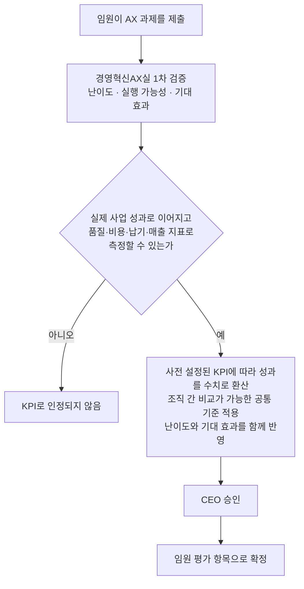
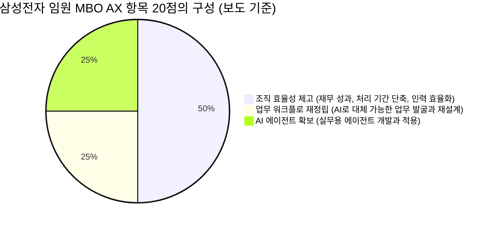
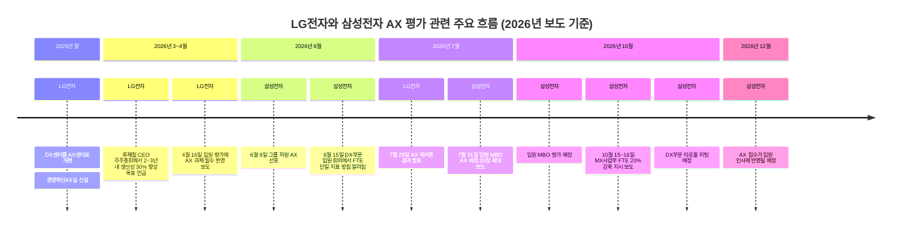

## 게시글 내용 해설 및 최신 보도 기반 사실 확인

- 작성 기준일: 2026년 10월 16일
- 성격: 소셜 게시글(스레드)에 올라온 주장과 그 댓글 논쟁을 공개 보도와 대조해 풀어 쓴 해설 문서
- 읽는 법: 보도로 확인된 내용과 보도만으로는 확인되지 않은 내용을 구분해서 적었습니다. 해석이 들어간 부분은 "해석"이라고 따로 밝혔습니다.

> 
> LG전자가 임원 평가 기준을 전면 개편했다. AI 전환(AX) 과제 수행 여부를 필수로 반영한다. 국내 대기업 중 처음이다.
> 
> 재밌는 건 삼성과의 대비다. 삼성의 AX 평가는 'AI로 몇 명분의 일을 줄였냐'는 FTE 지표가 핵심이었다. 인건비 중심의 평가다.
> 
> 반면 LG가 내세운 건 "단순 자동화가 아니라 업무 재설계"다. 품질·비용·납기·매출 전 영역에서 AI 기반 구조 개선 성과를 내야 한다. 효율 중심의 평가다.
> 
> 공정성 장치도 눈에 띈다. 임원이 제출한 AX 과제는 '경영혁신AX실'이 난이도·실행가능성·기대효과를 1차 검증한다. 객관 지표로 환산되는 과제만 CEO 승인을 거쳐 KPI가 된다.
> 
> 원칙은 명확하다. "도입했다는 사실이 아니라, 측정 가능한 성과와 연결된 과제만 인정한다."
> 
> 같은 AX 평가라도 묻는 게 다르다. 삼성은 '얼마나 줄였냐', LG는 '무엇을 바꿨냐'를 묻는다.
> 
> https://www.threads.com/share/BBKPnrcgPQ/
> 

---

## 1. 먼저 결론부터

게시글의 핵심 주장은 네 가지입니다. 첫째, LG전자가 임원 평가 기준을 전면 개편해 AI 전환(AX) 과제 수행을 필수로 넣었고 국내 대기업 중에서는 처음이라는 것. 둘째, 삼성은 AX 평가에서 FTE(전일제 환산 인력) 지표가 핵심이라는 것. 셋째, LG는 단순 자동화가 아니라 업무 재설계를 요구하며 품질·비용·납기·매출 전 영역의 구조 개선 성과를 요구한다는 것. 넷째, 임원이 제출한 과제는 '경영혁신AX실'이 1차 검증하고 객관 지표로 환산되는 것만 CEO 승인을 거쳐 KPI가 된다는 것입니다.

공개 보도와 대조해 보면 LG 쪽 내용은 매우 정확합니다. 400여 개 임원 조직, 필수 반영, 업무 재설계, 품질·비용·납기·매출, 경영혁신AX실의 1차 검증, CEO 승인이라는 골격이 모두 보도와 일치합니다. 반면 "삼성은 FTE, LG는 업무 재설계"라는 대비는 글을 읽기 쉽게 만든 요약이어서, 삼성 쪽 사실관계와 비교하면 다소 단순화되어 있습니다. 삼성도 임원 평가 항목 안에 업무 워크플로 재정립과 AI 에이전트 확보를 넣었고, FTE는 그 성과를 표현하는 단위라는 것이 삼성 쪽 설명이기 때문입니다. 이 부분은 5장에서 자세히 다룹니다.

또 하나 짚을 점이 있습니다. LG전자 임원 평가 개편을 처음 보도한 기사는 올해 4월 16일자 매일경제 단독 기사입니다. 따라서 이 소식은 최근에 새로 발표된 것이 아니라 6개월 전부터 알려진 내용이며, 이후 LG의 AX 행보(7월 해커톤 등)와 삼성의 후속 보도(7월 MBO 개편, 10월 FTE 감축 지시 보도)가 쌓이면서 최근 다시 주목받은 것으로 보입니다.

---

## 2. 용어를 먼저 정리합니다

이 주제는 용어만 정리해도 이해가 절반 이상 쉬워집니다.

**AX(AI Transformation, 인공지능 전환)** 는 AI 도구를 하나 도입하는 일이 아니라, 회사가 일하는 방식 전체를 AI 중심으로 바꾸는 활동을 말합니다. 보도에서는 DX(디지털 전환)에 이어 AI 시대의 전환을 가리키는 말로 쓰입니다.

**KPI(핵심성과지표)** 는 부서나 개인의 성과를 숫자로 점검하는 지표입니다. 임원의 KPI는 보통 매출, 영업이익 같은 재무 성과가 중심이었습니다.

**MBO(목표관리)** 는 연초에 목표를 정하고 연말에 달성도를 점수로 매기는 평가 방식입니다. 삼성전자 임원 MBO에는 항목별 배점이 있고, 이 점수가 성과급과 승진·인사에 연결된다고 보도되었습니다.

**FTE(Full-Time Equivalent, 전일제 환산 인력)** 는 특정 업무에 들어가는 총 근로시간을 풀타임 직원 몇 명 분량인지로 바꿔 말하는 지표입니다. 예를 들어 어떤 업무에 7 FTE가 필요하다고 하면 풀타임 7명이 필요하다는 뜻입니다. 한 일간지 기자 칼럼은 이 지표가 원래 인력 투입 계획과 예산 편성에 주로 쓰이는 것이라고 설명했습니다. 머니투데이는 FTE가 실제 직원 감원과는 구분되는 개념이라고 짚었습니다. FTE를 20% 줄인다는 말은 그만큼 사람을 내보낸다는 말과 같지 않고, 업무 투입량을 그만큼 줄인다는 뜻의 숫자 표현이라는 의미입니다.

**업무 재설계(워크플로 재정립)** 는 기존 업무 순서를 그대로 두고 AI를 붙이는 것이 아니라, 업무를 잘게 나눈 뒤 사람이 할 일과 AI 에이전트가 할 일을 다시 배치해 업무 흐름 자체를 바꾸는 것입니다.

---

## 3. LG전자는 무엇을 바꿨나

### 3-1. 개편의 골자

매일경제의 4월 16일자 단독 보도에 따르면 LG전자는 올해부터 400여 개 임원 조직을 대상으로 한 임원 평가에 AX 과제 수행 여부를 필수로 반영합니다. 기존에는 재무 성과가 임원 평가의 절대적 기준이었는데, 이제는 AI로 업무 프로세스를 얼마나 재설계하고 성과를 냈는지가 핵심 평가 항목으로 새로 들어왔다는 것이 보도의 요지입니다. 같은 기사는 이를 국내 대기업 중 처음 있는 사례라고 표현했습니다. 이 "최초"는 해당 매체의 보도 표현이라는 점을 기억해 두면 좋습니다.

임원에게 주어지는 핵심 과제는 단순 자동화가 아니라 업무 재설계입니다. 각 조직은 단순 반복 업무를 줄이는 수준을 넘어서 품질(Q), 비용(C), 납기(D), 매출(R) 전 영역에서 AI 기반의 구조 개선 성과를 만들어야 합니다.

### 3-2. 조직별로 어떤 과제가 나왔나

보도에 나온 사례는 이렇습니다. 가전제품 개발 조직은 '가상제품 개발(VPD)'에 AI를 접목하는 과제를 정했습니다. 가상제품 개발은 실제 시제품을 만들기 전에 디지털 환경에서 먼저 설계하고 시험해 보는 방식입니다. 기사는 신형 냉장고를 예로 들어, 선반 구조, 단열재 두께, 냉기 흐름 같은 요소의 조합을 AI가 수천 가지로 돌려 최적 설계를 찾고 시제품 제작과 테스트를 줄여 개발 기간을 30% 이상 줄이는 것이 목표라고 설명했습니다. 영업 조직은 AI 에이전트로 가격, 재고, 제품 전략을 실시간 도출하는 시스템을 구축해 향후 5년간 수천억 원 규모의 매출 증대를 노립니다. 물류·오퍼레이션 영역에서는 AI로 전 과정을 가시화해 비용 절감과 생산성 향상을 함께 추진합니다.

이 사례들의 공통점은 "AI를 몇 번 썼다"가 아니라 "개발 기간을 몇 퍼센트 줄이겠다", "매출을 얼마나 늘리겠다"처럼 결과 숫자로 말한다는 점입니다.

### 3-3. 공정성 장치: 검증 흐름

임원 평가에 AX를 넣을 때 가장 큰 쟁점은 공정성입니다. 조직마다 하는 일이 달라서 AI 성과를 같은 잣대로 비교하기 어렵기 때문입니다. 보도에 따르면 LG전자는 다음과 같은 검증 구조를 만들었습니다.

핵심은 두 가지입니다. 하나는 평가 주체입니다. 임원 스스로가 아니라 경영혁신AX실이라는 전담 조직이 난이도와 실행 가능성, 기대 효과를 먼저 따집니다. 다른 하나는 관문입니다. 측정 가능한 지표로 환산되는 과제만 통과해서 CEO 승인을 받아야 KPI가 됩니다. 게시글이 인용한 원칙, 즉 AI를 도입했다는 선언이 아니라 측정 가능한 성과와 연결된 과제만 인정한다는 말이 바로 이 구조를 요약한 것입니다.

난이도와 기대 효과를 함께 반영한다는 점도 중요합니다. 쉬운 과제를 골라 점수를 쉽게 따는 방식을 막고, 어려운 과제에 도전한 조직이 손해를 보지 않게 하려는 장치로 읽힙니다. 다만 이것은 보도된 설계 취지이고, 실제 운영에서 얼마나 잘 작동하는지는 공개된 자료로 확인되지 않습니다.

### 3-4. 이런 개편이 나온 배경

보도에 따르면 이번 변화는 류재철 신임 CEO 체제 출범 이후 첫 전사 조직 혁신입니다. 류 CEO는 3월 주주총회에서 AX를 활용해 2~3년 안에 업무 생산성을 30% 높이겠다고 밝혔고, AX를 일부 부서의 일이 아니라 모든 임직원이 참여하는 활동으로 정착시키겠다고 말했습니다. 조직 측면에서는 지난해 말 개편에서 최고전략책임자(CSO) 산하의 디지털전환센터(DX센터)를 AX센터로 바꾸고, 개발·영업·마케팅 등 기능별 업무 프로세스 재설계를 총괄하는 경영혁신AX실을 새로 만들었습니다.

LG전자 관계자는 AI로 단기 성과를 내는 것보다 일하는 방식 자체를 바꾸고 지속 가능한 프로세스를 구축하는 데 초점이 있다고 설명했고, 불확실한 외부 환경에서 AX로 생산성을 크게 높이지 못하면 생존이 어려울 수 있다는 공감대가 사내에 있다고 말했습니다. 기사는 이 변화를 AI 활용이 자율에서 의무로 넘어간 것으로 평가했고, 한 대기업 관계자의 말을 빌려 삼성과 SK 등 다른 기업도 도입을 검토할 가능성이 크다고 전했습니다. 이 마지막 부분은 어디까지나 업계 관계자의 전망입니다.

### 3-5. 그 후의 LG: 현장 아이디어가 올라오는 쪽

임원 평가가 위에서 내려오는 압력이라면, 7월에는 아래에서 올라오는 움직임도 보도되었습니다. LG전자는 올해 상반기 전 임직원 대상 'AX 해커톤'을 열었고, 2,100여 명이 참여해 700건이 넘는 아이디어가 나왔습니다. 두 달간의 심사와 검증을 거쳐 우수 과제 5개가 선정되었고, 보도에 따르면 올해가 3년째 행사입니다.

대표 과제인 '24시간 완전 자율업무 수행 시스템'은 업무 접수와 분류, 요구사항 분석, 코드 구현, 테스트, 문서 작성과 보고까지 소프트웨어 개발의 주요 과정을 AI 에이전트가 처리하는 방식입니다. LG전자의 자체 검증 결과 업무의 80% 가까이를 자동화할 수 있고 1인당 연간 근무시간 1,200시간 이상을 줄일 수 있을 것으로 예상된다고 했습니다. 여기서 "예상"이라는 표현에 주의해야 합니다. 이는 확정된 실적이 아니라 자체 검증에 근거한 기대치입니다. 제품 포장 설계 과제는 기존 120시간 걸리던 작업을 1.5시간으로 줄인다고 보도되었고, 사내 행정업무 시간을 80% 이상 줄이는 통합 업무 플랫폼과 AI 기반 광고 콘텐츠 생성·제안 시스템도 선정되었습니다. LG전자는 개념검증(PoC)을 거쳐 사내 업무용 AI 플랫폼 '엘지니'의 서브 에이전트로 등록해 전사로 확산할 계획이라고 밝혔습니다.

임원 평가(위로부터의 요구)와 해커톤(아래로부터의 제안)이 함께 있다는 점이 LG 방식의 특징으로 읽힙니다. 이것은 제 해석이며, 보도에서 두 제도를 하나의 설계로 묶어 설명한 것은 아닙니다.

---

## 4. 삼성전자는 무엇을 하고 있나

삼성 쪽은 서로 다른 두 가지 제도가 보도되면서 혼선이 생기기 쉽습니다. 하나는 DX부문의 FTE 지표이고, 다른 하나는 임원 MBO의 AX 배점입니다. 둘을 나누어 보면 이해가 쉽습니다.

### 4-1. DX부문의 FTE 지표 (6월 보도)

뉴스스페이스 보도에 따르면 삼성은 6월 9일 그룹 차원에서 AX를 선포하고 전 계열사에 외부 AI 도입을 공식화했습니다. DX부문은 6월부터 전 직원에게 외부 생성형 AI를 공식 개방했습니다. 이어 6월 15일 DX부문 임원 회의에서 AI 전환 성과의 정량 관리를 FTE 단일 지표로 일원화한다는 방침이 알려졌습니다. 주 40시간 기준으로 특정 업무에 필요한 인력 수를 계산해, AI를 쓰는 직원 한 명이 기존 몇 명 분량의 일을 처리하는지를 성과로 삼겠다는 설명이었습니다. 이 보도가 게시글 댓글에서 언급된 "AX 성과는 FTE로 표현" 공지와 같은 흐름의 내용입니다. 다만 저는 댓글에서 언급된 한겨레 단독 보도의 원문을 직접 열어 확인하지는 못했고, 같은 내용을 다룬 다른 매체 보도를 통해 확인했습니다.

삼성 측의 설명도 함께 전해졌습니다. 모든 조직이 같은 언어로 성과 변화를 확인하려면 단일 지표가 필요하다는 것이고, FTE 평가는 인사고과가 아니라 AI 전환 성과를 측정하기 위한 보조 지표라는 입장이었습니다. 비즈중앙 보도에서도 삼성전자는 FTE 방식과 구조조정은 무관하다고 반박했고, 업무의 질적 개선을 반영하는 보완 지표도 함께 운용한다고 밝혔다고 전해졌습니다. 한편 후속 보도에서는 FTE와 함께 투입 토큰 대비 성과를 보는 '토큰 가성비'가 참고 지표로 도입되었다는 내용도 나왔고, 이를 두고 비용 절감 효과를 전면에 내세운 것 아니냐는 비판이 있었습니다.

### 4-2. 임원 MBO의 AX 배점 (7월 보도)

임원 평가 쪽 보도는 7월 31일 전후에 집중되었습니다. 삼성전자는 10월 예정된 임원 MBO 평가에서 'AX 역량 제고' 배점을 기존 2~5점에서 전 임원 공통 20점으로 높였다고 알려졌습니다. 최소 4배에서 최대 10배 확대된 것이고, 그 대신 매출과 손익 등 경영성과 배점은 10점 줄었으며 다른 항목도 소폭 조정되었습니다. 이 점수는 12월 임원 인사에 반영되고 직무나 조직과 무관하게 모든 임원에게 동일하게 적용됩니다.

20점의 구성은 이투데이와 이데일리 보도에 나옵니다.

이 구성에서 눈에 띄는 점은 AI 도입 자체보다 성과에 가장 높은 점수를 줬다는 것입니다. 보도에 따르면 단순한 교육 이수나 서비스 접속 기록보다 AI가 실제 업무 방식과 조직 생산성을 얼마나 바꿨는지를 보겠다는 취지입니다. 삼성은 임원 교육에서도 AI 활용법보다 업무 재설계에 상당한 시간을 배정했고, 임원들이 자기 업무를 세부 단위로 쪼갠 뒤 사람과 AI 에이전트의 역할을 나누어 업무 순서와 담당을 다시 배치하는 방법을 배웠다고 전해졌습니다. 사장단과 관계사 임원 2,300여 명에게는 프롬프트 작성과 AI 에이전트 개발을 포함한 실습 교육이 진행되었다는 보도도 있습니다. 배경에는 이재용 회장이 신년사에서 일하는 방식과 조직 DNA를 송두리째 바꿔야 한다고 한 주문이 있습니다.

### 4-3. 최근(10월) 삼성 보도

10월 15~16일 머니투데이는 삼성전자 DX부문이 메모리 가격 급등에 따른 원가 부담이 이어지자 제품 전략을 바꾸고 인력 효율화에 나섰다고 보도했습니다. 이 기사에 따르면 MX(모바일경험)사업부에 AX를 통해 FTE를 20% 줄이라는 지시가 내려온 것으로 알려졌고, 가전 쪽도 개선안을 공모하고 있습니다. 같은 기사는 FTE가 실제 감원과 구분된다고 짚었고, DX부문이 AI로 자동화할 수 있는 업무를 찾기 위해 직원들에게 담당 업무를 세부 작업 순서까지 적게 하는 조사를 했다고도 전했습니다. 다만 "알려졌다"는 표현에서 보듯 회사의 공식 발표가 아니라 취재에 기반한 보도입니다.

배경 맥락도 알아 두면 좋습니다. 아주뉴스 등의 보도에 따르면 DX부문은 올해 2분기 매출 48조 원, 영업손실 8,000억 원으로 2021년 통합 출범 이후 처음으로 분기 적자를 냈고, MX사업부도 7,000억 원 적자였습니다. 반도체를 맡은 DS부문과의 성과급 격차에 대한 DX 직원들의 불만도 커졌으며, 노태문 DX부문장이 주재하는 타운홀 미팅이 10월에 예정되어 있다고 전해졌습니다. 즉 삼성의 FTE 논쟁은 AX 자체의 문제이기도 하지만, 실적 악화와 보상 갈등이라는 맥락 속에서 더 민감하게 받아들여지고 있다고 볼 수 있습니다. 이 마지막 문장은 제 해석입니다.

---

## 5. 게시글의 "삼성 vs LG" 대비는 얼마나 정확한가

게시글은 삼성의 AX 평가를 'AI로 몇 명분의 일을 줄였느냐'를 묻는 FTE 중심, 곧 인건비 중심 평가로 묘사하고, LG를 '무엇을 바꿨느냐'를 묻는 평가로 대비했습니다. 보도와 대조하면 맞는 부분과 보정이 필요한 부분이 나뉩니다.

**맞는 부분.** 삼성 DX부문이 AX 성과를 FTE로 표현하도록 안내했다는 보도가 여러 매체에서 확인됩니다. 임원 MBO에서도 가장 높은 배점(10점)이 재무 효과와 인력 효율성 같은 조직 효율성 항목에 주어졌습니다. LG가 임원에게 요구하는 것이 업무 재설계이고, 그 성과를 품질·비용·납기·매출이라는 여러 축의 지표로 환산한다는 점도 보도와 일치합니다.

**보정이 필요한 부분.** 첫째, 삼성도 업무 재설계를 요구합니다. 임원 MBO의 AX 20점 중 10점은 워크플로 재정립과 AI 에이전트 확보가 차지하고, 삼성의 임원 교육도 업무 재설계에 무게를 두었다고 보도되었습니다. 둘째, 삼성 측은 FTE가 성과를 표현하는 단위이고 인사고과가 아니라 측정용 보조 지표이며, 질적 개선을 반영하는 보완 지표도 있다고 설명했습니다. 이 설명을 그대로 믿을지는 독자의 판단이지만, 최소한 "삼성은 FTE만 본다"고 단정하는 것은 회사 측 설명과 임원 MBO 구성에 비춰 정확하지 않습니다. 셋째, LG의 숫자가 인건비와 무관한 것도 아닙니다. LG 역시 비용(C) 항목을 포함해 구조 개선을 숫자로 환산합니다. 차이는 "숫자를 쓰느냐 안 쓰느냐"가 아니라 "무엇을 숫자의 기본 단위로 삼느냐"에 가깝습니다. 이 마지막 문장은 제 해석입니다.

그래서 이 대비를 이렇게 다듬으면 더 정확합니다. 삼성은 성과를 FTE라는 하나의 공통 단위로 모으는 방향이 두드러지고, LG는 조직별 과제를 품질·비용·납기·매출 지표로 각각 환산해 공통 기준으로 비교하는 방향이 두드러진다는 정도입니다. 두 회사 모두 "도입 여부가 아니라 성과"를 보겠다는 큰 방향은 같습니다.

| 구분 | LG전자 | 삼성전자 |
|---|---|---|
| 평가 대상 | 임원 조직 400여 곳의 임원 평가 | 임원 MBO(전 임원 공통), DX부문 성과 관리 |
| AX의 위치 | 임원 평가에 AX 과제 수행을 필수 반영 | MBO 내 AX 역량 제고 항목을 2~5점에서 20점으로 확대 |
| 성과를 재는 방식 | 품질·비용·납기·매출 지표로 환산, 조직 간 공통 기준 | FTE로 표현(DX부문 안내), 보완 지표 병행(삼성 측 설명) |
| 검증 주체 | 경영혁신AX실 1차 검증 후 CEO 승인 | 공개 보도에서는 상세 검증 구조가 확인되지 않음 |
| 보도 시점 | 4월 16일 최초 보도 | 6월(FTE), 7월(MBO 20점), 10월(MX FTE 20% 지시 보도) |

표의 마지막 두 줄은 특히 한계가 있습니다. 삼성의 검증 구조가 "없다"는 뜻이 아니라, 제가 찾은 공개 보도에서 확인되지 않았다는 뜻입니다.

---

## 6. 댓글 논쟁이 보여 주는 쟁점

게시글에는 현업 종사자와 관심 있는 이용자들의 댓글이 많이 달렸습니다. 내용은 몇 가지 쟁점으로 묶입니다.

**쟁점 1. 삼성 임원 평가는 FTE가 아니라는 지적과 작성자의 답변.** 삼성 내부 사정을 안다는 한 이용자는 삼성 임원 평가는 FTE가 아니라며 다시 확인해 보라고 했습니다. 글쓴이는 한겨레 단독 보도(삼성전자 DX부문이 AX 성과를 FTE로 표현한다는 공지)와 이투데이 보도(임원 MBO의 AX 20점 배점)를 근거로 썼다고 답했고, FTE보다 중요하게 보는 지표가 있으면 알려 달라고 되물었습니다. 이어 MBO 20점은 워크플로 재정립 5점, AI 에이전트 확보 5점, 조직 효율성 제고 10점으로 구성된다고 보도되었으며, FTE는 그 성과를 표현하는 단위라는 것이 삼성의 설명이라고 정리했습니다. 이 정리는 이 문서의 4장과 일치합니다. 결국 이 논쟁은 FTE가 평가 지표 그 자체인지, 평가 지표의 측정 단위인지에 대한 해석 차이로 읽힙니다.

**쟁점 2. 평가 지표에는 원래 여러 가중 요소가 들어간다.** 한 댓글은 일반적으로 평가 지표에는 매출 기여를 비롯해 여러 가중 값이 들어가며 그중 하나가 인원 감축이나 효율 개선일 수 있다고 말했습니다. 글쓴이도 삼성 MBO 20점이 여러 구성으로 나뉜다는 점에서 같은 맥락이라고 답했습니다.

**쟁점 3. 이게 공식 정보인가?** 한 이용자가 공식 정보냐고 물었습니다. 이 질문은 중요합니다. LG 건과 삼성 건은 모두 회사가 보도자료로 공식 발표한 것이 아니라, 언론이 재계 관계자나 내부 공지를 취재해 보도한 내용입니다. 매일경제 LG 기사는 "재계에 따르면"으로 시작하고, 삼성 MBO 보도는 "업계에 따르면"이라는 표현을 씁니다. 따라서 "공식 정보"라기보다는 "다수 매체가 일관되게 보도한 취재 내용"이라고 부르는 것이 정확합니다. 반대로 LG의 해커톤처럼 회사가 직접 밝힌 내용은 공식 발표입니다.

**쟁점 4. 문화에 대한 우려.** 한 댓글은 LG가 무엇을 바꿀 때 회사의 이익이 아니라 최고위층 경영진이 좋아하는 방향으로 간다는 취지의 우려를 냈습니다. 글쓴이는 이번 개편의 취지는 보여 주기 위한 과제가 아니라 측정 가능한 성과를 보겠다는 것인데, 현장에서 어떻게 작동할지가 관건이라고 답했습니다. 이 우려는 공정성 문제의 다른 표현입니다. LG가 1차 검증 조직과 공통 KPI 기준을 둔 것은 바로 이 위험에 대한 제도적 답이지만, 실제 작동 여부는 앞으로 지켜볼 일입니다.

**쟁점 5. MBO는 계속 바뀐다.** 한 이용자는 삼성도 MBO를 계속 바꾸고 있으며 예전처럼 1년 전 목표만 따지는 시대가 아니라고 말했습니다. 이는 환경 변화가 빠를 때 연초 목표 하나로 연말을 평가하는 방식이 한계가 있다는 일반론에 해당하며, 이 문서에서 별도로 검증한 사실은 아닙니다.

**쟁점 6. 현장 실무자의 경험.** 한 이용자는 현장에서 자동화를 구축해 보면 툴을 붙이는 것보다 어떤 업무를 어떻게 다시 짤지 현업과 합의하는 데 시간이 훨씬 많이 든다고 말했습니다. 글쓴이도 현장에서는 툴보다 업무를 어떻게 다시 짜느냐에 대한 합의가 진짜 일이라고 동의했습니다. 이 경험담은 LG와 삼성이 모두 업무 재설계를 평가 대상으로 삼는 이유를 잘 설명해 줍니다. 기술을 도입하는 비용보다 업무를 다시 합의하는 비용이 더 크다는 것이기 때문입니다.

**쟁점 7. 시점의 문제와 일반 정서.** 어떤 댓글은 결국 결과는 같은데 그 시점을 어디에 두느냐의 차이라고 했고, 다른 댓글은 이제 AI도 배워야 하는 시대라며 직장인의 부담을 토로했습니다. 이런 반응은 AX 평가가 임원 문제에 그치지 않고 구성원 전체의 부담으로 번질 수 있다는 정서를 보여 줍니다.

---

## 7. 타임라인으로 보는 흐름

---

## 8. 확인되지 않았거나 조심해야 할 부분

이 문서가 사실만 다루려면 아래 한계를 분명히 해야 합니다.

첫째, LG전자 임원 평가에서 AX 항목이 전체 평가에서 차지하는 배점이나 비중은 제가 찾은 보도에 나와 있지 않습니다. 삼성의 20점처럼 구체적인 숫자는 LG 쪽에서 확인하지 못했습니다.

둘째, LG의 평가가 실제로 어떻게 운영되었고 어떤 결과가 나왔는지는 공개된 자료로 알 수 없습니다. 지금 확인되는 것은 설계된 제도와 보도된 취지까지입니다.

셋째, 삼성 FTE 관련 내용 중 상당수는 "알려졌다", "전해졌다"는 표현의 취재 보도입니다. 회사가 직접 문서로 공개한 것이 아니므로, 세부 내용은 보도마다 조금씩 달라질 수 있습니다.

넷째, LG 해커톤의 1,200시간 절감이나 80% 자동화는 자체 검증에 따른 예상 수치입니다. 확정 실적으로 읽으면 안 됩니다.

다섯째, "국내 대기업 최초"는 매일경제의 표현입니다. 모든 기업의 평가 제도를 전수 조사해 검증된 사실은 아니며, 이후 삼성도 유사한 방향으로 움직인 것이 보도되었습니다. 이 사실은 "최초"의 의미를 시기적 선도로 읽어야 한다는 점을 시사합니다.

여섯째, 게시글의 "삼성은 인건비 중심, LG는 효율 중심"이라는 표현은 글쓴이의 요약이며 두 회사가 공식적으로 그렇게 규정한 것이 아닙니다.

---

## 9. 이 이슈에서 얻을 수 있는 실무적 시사점

아래는 보도된 사실을 바탕으로 한 제 해석입니다.

**하나, AI 성과는 "썼다"가 아니라 "무엇이 얼마나 달라졌다"로 말해야 합니다.** 두 회사 모두 사용 횟수나 교육 이수보다 업무 방식의 변화와 그 결과를 보겠다고 합니다. 보도에서 반복되는 표현은 도입이 아니라 성과였습니다.

**둘, 측정 가능성이 과제 선정의 조건이 됩니다.** LG의 구조에서 측정 가능한 지표로 환산되지 않는 과제는 KPI가 되지 못합니다. 과제를 시작하기 전에 어떤 지표로 성과를 증명할지부터 정해 두는 습관이 필요하다는 뜻입니다.

**셋, 어려운 것은 도구가 아니라 업무 합의입니다.** 현업 댓글과 삼성의 임원 교육 설계(도구 사용법보다 업무 분해와 재배치에 시간을 배정)가 같은 지점을 가리킵니다. 자동화를 시도하는 조직이라면 업무를 잘게 나누고 사람과 AI의 역할을 다시 나누는 합의 과정에 가장 많은 시간을 써야 합니다.

**넷, 단일 지표의 편리함과 위험을 함께 봐야 합니다.** 한 기자 칼럼은 FTE가 한 사람이 AI로 몇 명 분의 일을 했는지는 잘 보여 주지만, AI로 고객 만족을 높이는 것 같은 질적 성과는 담기 어렵다고 지적했습니다. 그래서 다수의 글로벌 기업은 단일 지표가 아니라 AI로 무엇을 바꿨는지를 본다는 것이 그 칼럼의 주장입니다. 삼성이 보완 지표를 병행한다고 밝힌 것도 같은 문제의식으로 이해할 수 있습니다. 반대로 지표가 다양해지면 조직 간 비교가 어려워지므로 LG처럼 공통 환산 기준과 전담 검증 조직이 필요해집니다. 편리함과 정교함 사이의 균형이 이 주제의 본질적인 설계 문제입니다.

**다섯, 평가가 곧 행동을 바꿉니다.** 삼성의 사례처럼 매출·손익 배점을 줄이고 AX 배점을 늘리면 조직의 행동이 바뀐다는 것이 보도의 전제입니다. 다만 이것은 보도된 기대이고, 실제로 어떤 행동 변화가 나타나는지는 올해 평가 결과가 나온 뒤에야 알 수 있습니다.

---

## 10. 참고한 출처

LG전자 관련
- 매일경제 단독 "AI로 업무혁신 해냈나 임원 평가기준 바꾼다" (2026.4.16, 다음 뉴스 게재): https://v.daum.net/v/20260416173300218
- 아이뉴스24 "LG전자, 임원 평가에 'AI 전환' 혁신 성과 반영하기로": https://www.inews24.com/view/1961289
- 파이낸셜뉴스 "LG전자, 구성원 AX 아이디어 도입해 업무 생산성 높인다" (2026.7.29): https://www.fnnews.com/news/202607290911342038
- 글로벌이코노믹 "반복적 업무는 AI가 한다 LG전자 '모두의 AX'로 업무혁신": https://www.g-enews.com/article/Industry/2026/07/2026072910134493993084322ec9_1
- 오피니언뉴스 "LG전자, '모두의 AX'로 업무 체질 전환": http://www.opinionnews.co.kr/news/articleView.html?idxno=142208
- 인사이트 "120시간 걸리던 일이 1.5시간으로 LG전자 'AI 업무 혁신' 속도": https://www.insight.co.kr/news/565301

삼성전자 관련
- 뉴스스페이스 "AI 한 대가 사람 몇 명 몫? 정규직 환산으로 '가성비' 재는 삼성전자의 승부수": https://www.newsspace.kr/news/article.html?no=14397
- 비즈중앙 "삼성 DX 노조, 뉴욕 광고 이어 이재용 자택 집회 예고": https://www.bizjoongang.co.kr/news/articleView.html?idxno=54470
- 인싸잇 "삼성전자, 임원평가서 AI 점수 높였다": https://www.mediawatch.kr/news/article.html?no=260530
- 한국경제 "'10월이 벌써 두렵다' 이재용 특명에 삼성 임원들 '비상'": https://www.hankyung.com/article/202607318046g
- 이데일리(네이트 뉴스 게재) "삼전 AX 핵심은 '업무 재설계'": https://news.nate.com/view/20260804n29416
- 이투데이 "같은 회사인데 몸값은 달라졌다 AI가 만든 '직장인 新계급'": https://www.etoday.co.kr/news/view/2627307
- 머니투데이 "엑시노스 품은 울트라 '없던 일로'…메모리값 폭등에 PC·스마트폰 '충격'" (2026.10.16): https://www.mt.co.kr/industry/2026/10/16/2026101522493126583
- 아주뉴스 "'성과급 독식'에 뿔난 삼성 DX…노태문 사장, 전 직원 달래기 나서": https://www.ajunews.com/view/20260927142448953
- 한겨레(네이트 뉴스 게재) 기자 칼럼 "삼성의 AI 성과 측정이 놓친 것": https://m.news.nate.com/view/20260625n32623

참고 사항: 게시글 댓글에서 언급된 한겨레 단독 원문 기사는 직접 열람하지 못했고, 같은 내용을 다룬 위 매체들의 보도로 대조했습니다.
