- [「28시간 동안 AI한테 코딩시키기 (LG AI 프롬프톤 챌린지)」](https://www.youtube.com/watch?v=bChUKH9PdTE) (2026-10-01 게시, 러닝타임 약 23분 52초)
- [별첨 A. 로봇 팔 서비스 심층 분석: AI(엑사원)를 로봇에 어떻게 접목했을까](#별첨-a-로봇-팔-서비스-심층-분석-ai엑사원를-로봇에-어떻게-접목했을까)
- [별첨 B. AI-DLC 심층 분석: 방법론의 구조, 오픈소스 구현, 다른 방법론과의 비교, 그리고 LG·LG CNS에는 자체 AI 방법론이 없을까](#별첨-b-ai-dlc-심층-분석-방법론의-구조-오픈소스-구현-다른-방법론과의-비교-그리고-lglg-cns에는-자체-ai-방법론이-없을까)

---

## 0. 이 문서를 읽는 방법

이 문서는 영상에 담긴 자막(타임스탬프 포함)과 영상 속에 비친 작업 화면, 그리고 LG 공식 보도자료와 언론 보도를 대조해서 작성했습니다. 내용마다 근거가 어디에서 왔는지 구분하기 위해 아래 세 가지 표기를 사용합니다.

- **[영상]** 영상의 자막, 발언, 연출에서 확인되는 내용입니다.
- **[공식·보도]** LG 보도자료나 언론 기사로 확인되는 내용입니다.
- **[정리]** 위 두 가지를 바탕으로 읽기 쉽게 풀어 쓴 해석입니다. 영상이나 기사에 없는 사실을 새로 만들어 넣지 않았습니다.

영상만으로는 알 수 없거나, 영상과 공식 자료가 서로 다르게 말하는 부분은 8장 "사실 확인 메모"에 따로 모아 두었습니다. 추측으로 메우지 않고 모르는 것은 모른다고 적었습니다.

---

## 1. 한눈에 보기

이 영상은 LG그룹 계열사 개발자 100여 명이 모여 **직접 코드를 치지 않고 AI에게 코딩을 맡긴 채** 서비스를 만드는 대회, 「LG 프롬프톤 챌린지 2026」을 따라간 다큐멘터리형 콘텐츠입니다. 해커톤이 "누가 더 빨리, 더 많이 코딩하느냐"의 싸움이라면, 프롬프톤은 "AI에게 무엇을 어떻게 시키고, 나온 결과를 어떻게 검수해서 완성도를 끌어올리느냐"의 싸움입니다. 영상은 예선 28시간의 밤샘 현장, 심사와 결과 발표, 이후 약 한 달간의 고도화, 그리고 본선 무대와 대상 발표까지를 차례로 보여 줍니다.

영상의 결론부터 말씀드리면 이렇습니다. 대상은 입사 동기 세 명으로 구성된 신입사원 팀 **LG트리오즈**가 받았고, 서비스는 주소만 입력하면 집 도면에 맞춰 3D로 가전을 배치해 보는 서비스였습니다. 그리고 영상 전체를 관통하는 질문은 "AI가 코드를 대신 쓰는 시대에 개발자는 무엇을 하는 사람인가"였으며, 참가자들은 대체로 "기획자·디자이너·개발자의 역할을 함께 소화하는 빌더"를 그 답으로 이야기했습니다.

| 항목 | 내용 | 근거 |
|---|---|---|
| 대회 이름 | LG 프롬프톤 챌린지 2026 | 영상·공식 |
| 핵심 도구 | LG AI연구원의 엑사원(EXAONE), AWS의 AI 개발 도구 키로(Kiro) | 공식 |
| 예선 규모 | 28개 팀, 총 84명 (8월 진행) | 공식 |
| 본선 진출 | 10개 팀 | 영상·공식 |
| 본선 개최일 | 2026년 9월 15일 (LG AI 데브콘 첫날) | 공식 |
| 대상 | LG트리오즈 (3D 가전 배치 서비스) | 영상 |
| 이후 계획 | 우수 수상작의 실제 서비스화 검토, LG전자 사내 인큐베이션 프로그램 연계 언급 | 공식·영상 |

---

## 2. 이 대회가 열린 자리: LG SPARK 2026과 LG AI 데브콘

### 2.1 LG SPARK 2026

LG는 2026년 9월 7일부터 17일까지 서울 마곡 LG사이언스파크에서 「LG SPARK 2026」을 열었습니다. LG 공식 보도자료에 따르면 이 행사는 AI 혁신·기술·문화 축제이며, 올해부터 계열사의 AI 전환(AX) 사례를 확산하는 방향으로 개편되었습니다. 2주 동안 다섯 개의 프로그램이 이어집니다.

| 프로그램 | 일정 | 성격 |
|---|---|---|
| LG 테크페어 | 9월 7~8일 | 계열사 R&D 신기술 전시 |
| LG AX페어 | 9월 10~11일 | 현업 AX 성과 발표 |
| LG AI 토크콘서트 | 9월 14~15일 | LG AI연구원의 AI 비전과 엑사원 산업별 사례 |
| LG AI 데브콘 | 9월 15~16일 | 개발자 콘퍼런스, 프롬프톤 본선 포함 |
| 컬처위크 | 9월 15~17일 | 임직원 가족·지역주민·대학생 대상 프로그램 |

### 2.2 LG AI 데브콘 2026

프롬프톤 본선은 이 가운데 **LG AI 데브콘**의 첫날에 열렸습니다. 데브콘은 2022년부터 해마다 열어 온 LG 소프트웨어 개발자 콘퍼런스(LG SDC)를 AI 중심의 개발 환경 변화에 맞춰 이름과 범위를 바꾼 행사입니다. LG전자, LG CNS, LG유플러스 등 계열사 개발자 약 1,500명이 온·오프라인으로 참여했고, 엔비디아·마이크로소프트·구글클라우드·AWS·LG AI연구원의 AI 기술을 체험하는 전시 공간도 마련되었습니다.

데브콘의 다른 프로그램도 영상의 맥락을 이해하는 데 도움이 됩니다. LG전자는 스마트 TV 플랫폼 webOS 개발에 AI를 적용한 경험을, LG CNS는 AI를 활용한 노후 시스템 개선 사례를, LG유플러스는 대화형 AI 에이전트를 활용한 콘텐츠 제작 사례를 발표했습니다. 영상 속 참가자들이 "AI 쓰는 해커톤 대회에 많이 참가하려고 한다"고 말하는 배경에는, 회사 차원에서 AI 기반 개발 역량을 키우려는 흐름이 있습니다.

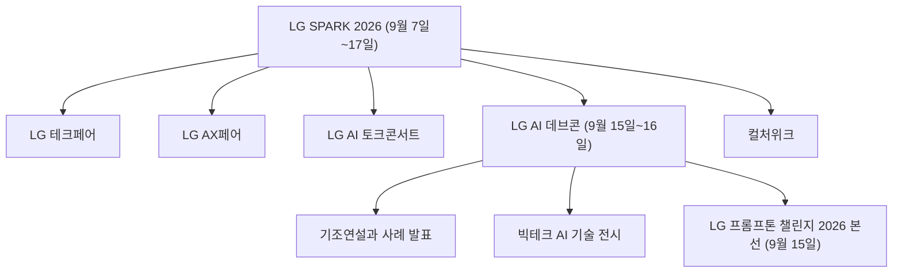

---

## 3. 프롬프톤은 해커톤과 무엇이 다른가

영상은 이 대회의 정체성을 한 문장으로 못 박습니다. **"이번에 열리는 AI 프롬프톤은 해커톤과 다르게 직접 코딩을 하지 않는다. 코딩은 AI가 해주는 대신 주어진 28시간 동안 서비스의 완성도를 최대한 높이는 것이 관건."** (영상 2분 55초~3분 8초 구간의 요지)

여기서 두 가지를 짚어 둘 필요가 있습니다.

첫째, 이름의 뜻입니다. 해커톤(Hackathon)은 해킹과 마라톤의 합성어로 개발자가 직접 코드를 짜며 겨루는 행사를 가리킵니다. 프롬프톤(Prompthon)은 거기에서 "코딩" 자리에 "프롬프트(AI에게 내리는 지시)"를 넣은 말로 이해하면 됩니다. LG 보도자료도 "엑사원과 프롬프트로 실제 현업에 즉시 투입 가능한 서비스를 만드는 개발대회"라고 소개합니다.

둘째, 평가의 초점입니다. 영상에서 AWS 사업 리더들은 심사 포인트를 이렇게 설명합니다. 단순 실험이 아니라 향후 사업이나 새로운 서비스로 연결될 가능성이 있는지, 그것을 감안해 설계와 개발을 했는지를 본다는 것입니다. 즉 "코드를 얼마나 잘 짰나"가 아니라 "쓸 만한 서비스를 만들어 냈나"가 기준입니다.

| 구분 | 전통적인 해커톤 | 이번 프롬프톤 |
|---|---|---|
| 코드 작성 주체 | 사람이 직접 | AI 에이전트 (사람은 지시와 검수) |
| 사람의 핵심 역할 | 구현 | 기획, 지시, 검수, 완성도 관리 |
| 필수 조건 | 제한 없음 | 엑사원 활용 필수 |
| 평가 관점 | 아이디어와 구현 | 실제 서비스에 준하는 완성도와 사업 연결 가능성 |
| 현장 분위기 (영상 증언) | 키보드 소리가 가득 | 키보드 소리가 줄고 대화 소리가 늘어남 |

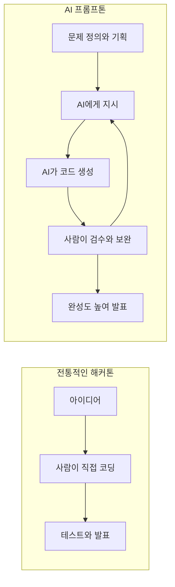

---

## 4. 이 대회를 떠받친 기술: 엑사원과 키로

### 4.1 엑사원(EXAONE)과 K-엑사원

영상은 "LG의 AI 모델인 K-엑사원 활용은 필수"라고 설명합니다. 공식 보도자료에는 "엑사원"으로 표기되어 있습니다. 엑사원은 LG AI연구원이 개발한 AI 모델이며, 대회 시점까지의 흐름은 다음과 같이 확인됩니다.

- **2025년 12월 30일**: 과학기술정보통신부 주관 '독자 AI 파운데이션 모델 1차 발표회'에서 K-엑사원(매개변수 2,360억 개, 236B)이 공개되었습니다. LG AI연구원 발표에 따르면 13개 벤치마크 평균 72.03점으로 알리바바 큐원3 235B(69.37점), 오픈AI GPT-OSS 120B(69.79점)보다 높았습니다.
- **2026년 1월**: 임우형 LG AI연구원 공동 연구원장은 MWC 2026 기자간담회에서 K-엑사원이 1월 기준 아티피셜 어낼리시스 인텔리전스 지수에서 공개 가중치(오픈 웨이트) 모델 중 7위였다고 밝혔습니다.
- **2026년 4월**: 비전언어모델(VLM) '엑사원 4.5'가 발표되었습니다.
- **2026년 7월 31일**: 2차수 모델 'K-엑사원 2.0'(7,500억 개, 750B)이 허깅페이스에 공개되었습니다. 9개 영역 24개 벤치마크 결과도 함께 공개되었습니다.
- **2026년 8월 18일**: 정부의 독자 AI 파운데이션 모델 프로젝트 2차 단계평가에서 LG AI연구원, SK텔레콤, 업스테이지가 통과했고 모티프테크놀로지스는 탈락했다고 보도되었습니다. LG AI연구원은 3차수에 진출했습니다.

중요한 단서가 하나 있습니다. **영상과 공식 자료 어디에도 참가팀이 K-엑사원의 어느 버전(1차수 236B인지 2.0인지)을 사용했는지는 적혀 있지 않습니다.** 따라서 이 문서도 버전을 특정하지 않습니다.

영상에서 참가자들이 엑사원을 쓰는 방식은 크게 세 갈래로 보입니다.

1. **한국어 강점 활용**: 한글에 특화된 점을 살려 AI 리뷰나 협찬 글을 걸러내고 정제하는 서비스.
2. **서비스 기능의 두뇌 역할**: 사용자의 집 공간과 수치를 파악해 대형 가전이 들어갈지 판단하는 에이전트, 기획안을 넣으면 사전 검토와 상황 시뮬레이션을 해 주는 서비스 등.
3. **보안·커뮤니케이션 처리**: 에이전트가 보아서는 안 되는 기밀 정보를 구분하고 필요한 정보만 수집하도록 돕는 프레임워크.

### 4.2 키로(Kiro)와 AWS

영상은 "이번 대회의 개발 환경과 AI 도구는 AWS를 통해 지원받았다"고 알려 주고, LG 보도자료는 그 도구가 **AWS의 AI 개발 도구 키로(Kiro)** 라고 밝힙니다. 본선 진출 10개 팀은 약 3주 동안 LG AI연구원과 AWS의 기술 지원을 받으며 서비스를 고도화했습니다.

키로는 AWS가 2025년에 공개한 AI 기반 IDE(통합 개발 환경)로, 외부 보도에 따르면 다음과 같은 특징이 있습니다.

- 사람이 자연어로 요청하면 요구사항과 설계 문서(스펙)를 먼저 만들고 그 스펙을 기준으로 구현하는 **스펙 주도(spec-driven) 개발**을 내세웁니다. AWS는 이를 "바이브 코딩에서 실제 쓸 수 있는 코드로" 넘어가는 접근이라고 설명했습니다.
- 파일 변경 같은 이벤트에 반응해 문서 갱신, 테스트 생성, 보안 점검을 자동으로 수행하는 **에이전트 훅(hooks)**, 프로젝트 전반에서 AI의 행동을 규정하는 **스티어링 규칙**, 외부 도구 연결을 위한 **MCP 지원**이 포함됩니다.
- 오픈소스인 Code OSS(VS Code의 오픈소스 부분)를 기반으로 만든 별도 IDE입니다.

영상 속 개발자들의 작업 창에서도 이런 흔적이 보입니다. 한 참가자의 터미널 패널에는 키로의 명령줄 도구로 보이는 표기가 있고, 다른 참가자의 작업 폴더에는 `aidlc-docs`라는 폴더와 Inception(구상)·Construction(구축)·Operations(운영) 단계별 체크리스트 문서가 보입니다. 체크리스트에는 Workspace Detection, Requirements Analysis, User Stories, Application Design, Units Generation, NFR Requirements, Build and Test 같은 항목이 있습니다.

이 용어들은 AWS가 공개한 **AI-DLC(AI-Driven Development Life Cycle, AI 주도 개발 수명주기)** 방법론의 단계와 일치합니다. AWS 개발자 블로그에 따르면 AI-DLC는 Inception, Construction, Operations의 세 단계로 구성되고, AI가 일상적인 작업을 맡되 중요한 결정은 사람이 승인하도록 설계되어 있습니다. 다만 **영상 자체가 "이 팀이 AI-DLC를 썼다"고 말해 주지는 않으며, 모든 팀이 같은 방법론을 썼는지도 확인되지 않습니다.** 영상 속 문서 구조가 AI-DLC의 단계 용어와 일치한다는 정도까지만 말할 수 있습니다. AI-DLC의 단계 구조, 오픈소스 구현, 다른 방법론과의 비교는 **별첨 B**를 참고해 주세요.

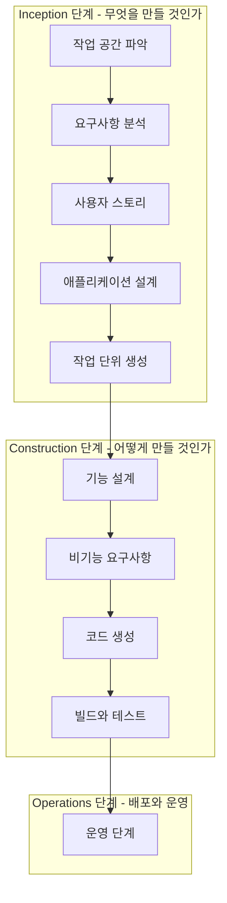

---

## 5. 영상 흐름 상세 해설

### 5.1 전체 타임라인

```mermaid
flowchart LR
    T1["0:00 도입과 입장"] --> T2["1:34 28시간 시작"]
    T2 --> T3["2:55 해커톤과 다른 점"]
    T3 --> T4["5:15 엑사원 활용"]
    T4 --> T5["7:12 2년 연속 참가팀"]
    T5 --> T6["9:14 AI 시대 개발자"]
    T6 --> T7["11:00 물 쏟은 사건"]
    T7 --> T8["14:42 둘째 날 아침"]
    T8 --> T9["16:39 예선 심사"]
    T9 --> T10["18:28 예선 결과"]
    T10 --> T11["19:54 4주 고도화 후 본선"]
    T11 --> T12["21:40 대상 발표"]
    T12 --> T13["22:03 참가자 후기"]
```

### 5.2 도입부 (0:00~1:34): "코드를 한 줄도 쓰지 않았습니다"

영상은 한 참가자의 선언으로 시작합니다. "제가 코드를 단 한 줄도 작성하지 않았습니다." PD가 "그냥 딸깍으로 바로 되는 거냐"고 묻자 그는 "딸깍이라는 말을 싫어한다"고 답합니다. 이 짧은 대화에 영상의 문제의식이 압축되어 있습니다. AI가 코드를 써 주는 것은 사실이지만, 그것을 단순히 버튼 한 번으로 끝나는 일로 부르는 데에는 거부감이 있다는 뜻입니다. 뒤에서 이 감각의 이유가 구체적으로 드러납니다. 검수해야 할 양이 많고, 도구가 한 번에 완벽한 결과를 내놓지는 않는다는 증언입니다.

이어서 8월의 어느 아침 LG 각 사 개발자들이 모입니다. 한 참가자는 급하게 회사에서 나와 노트북과 태블릿을 챙겨 왔다고 말합니다. 업무를 병행하면서 참가한다는 뜻입니다. 이 대회는 LG그룹 각 사 개발자가 AI를 활용해 **실제 서비스에 준하는 결과물**을 만드는 것이 목표이고, 엑사원 활용이 필수 조건이라고 소개됩니다. 한 팀은 과자를 챙겨 왔고, 한 팀은 오픈소스로 공개된 기본 로봇을 3D 프린터로 출력해 와서 로봇 팔 서비스를 준비합니다.

### 5.3 28시간의 시작 (1:34~2:55): 신입사원 팀과 가전 팀들

대회가 시작되자 영상은 몇몇 팀을 훑습니다. 올해 초 입사한 신입사원 팀은 팀장이 "주제가 현업에 도움이 되겠죠?"라고 했지만 자신들은 잘 모르겠다며 웃습니다. 이들은 집에 가구를 배치하고 제품을 추천해 주는 AI 서비스를 기획하고 있다고 소개하며, 이 팀의 이름이 **LG트리오즈**입니다. "최종 목표가 무엇이냐"는 질문에 이들은 "1등?"이라고 답합니다. 영상의 결말을 알고 보면 의미심장한 장면입니다.

바로 이어 "가전에 진심인 또 다른 한 팀"이 등장합니다. 사용자가 집에 대형 가전을 설치하려 할 때 공간과 수치 같은 집의 여러 조건을 파악해 가전이 들어갈 수 있는지 판단하는 에이전트를 만들겠다는 팀입니다. 이 팀의 자막 표기는 **낄끼빠빠** 팀이며, 소개 문구는 "우리 집에 새 가전을 설치할 수 있는지 미리 확인하는 AI"입니다.

### 5.4 서로 다른 아이디어들 (2:55~5:15)

영상 속 팀들의 아이디어는 6장에서 표로 정리하겠습니다. 이 구간에서 눈에 띄는 것은 **현업 문제에서 출발한 아이디어가 많다**는 점입니다. 특히 LG전자 VS본부(차량 시스템) 소속 팀은 개발자들이 쓰는 도구가 너무 비싸 테스트가 어렵다는 현업의 불편에서 출발해, 몇천만 원 하는 기존 도구를 50만 원대 장비로 대체하는 지원 도구를 만들겠다고 합니다. 영상 자막은 이 팀의 "킥은 비용 절감"이라고 요약합니다.

분위기를 풀어 주는 장면도 있습니다. 팀 이름이 "프롬프트 앤 프레이"인 팀은 "프롬프트를 잘 넣고 기도하는 것"이 전략이라며 실제로 두 손을 모읍니다. 진척도를 묻는 질문에는 팀마다 "70%", "20%", "10%"처럼 답이 제각각입니다. 영상은 이를 "개발 진행 속도는 팀마다 천차만별"이라고 정리합니다. 한 팀은 빠른 이유를 "단합력"이라고 농담하다가 "AI를 많이 써서"라고 바로잡습니다.

### 5.5 엑사원은 어떻게 쓰이나 (5:15~7:12)

참가자와 LG AI연구원 담당자의 증언을 통해 엑사원 활용 방식이 드러납니다. 한 팀은 엑사원이 한글에 특화된 점을 살려 AI가 쓴 리뷰나 협찬 글을 걸러내는 서비스를 구상합니다. LG AI연구원 담당자는 눈여겨보는 팀으로 **플래그원서클**을 꼽습니다. 고객의 다양성을 보완하기 위해 100개의 페르소나를 데모로 보여 주었는데 엑사원을 매우 잘 썼다는 평가입니다. 그 서비스는 기획안을 넣었을 때 사전 검토를 해 주고, 미리 상황을 시뮬레이션해 예상되는 상황까지 검토해 주는 것이 핵심이라고 확인됩니다.

같은 구간에서 작년에 이어 두 번째로 AI 프롬프톤을 준비한 책임급 담당자는 작년과 올해의 차이를 말합니다. 작년에는 AI 연구원들이 앉을 틈도 없이 질문하고 답했지만, 올해는 AI 기능이 훨씬 정교해져서 참가자들이 AI와 더 많이 대화하는 것 같다고 합니다. 등급 판정에도, 검증에도 AI를 쓰는 것 같다는 이야기도 나옵니다.

### 5.6 2년 연속 참가팀이 느끼는 변화 (7:12~9:14)

작년에도 참가한 팀의 증언은 영상의 핵심 대목입니다.

- 작년에는 "우리가 AI를 제어하는 느낌"이 강했는데, 올해는 "AI를 좀 따라가야 하는" 느낌이라고 합니다.
- 아이디어만 있으면 어떻게든 만들 수 있는 환경이 되었고, 작년과 올해의 차이는 "하늘과 땅"이라고 말합니다.
- 작년에는 AI 도구 성능이 떨어져 여기저기서 키보드 소리가 났지만, 올해는 명령만 주면 도구가 개발하므로 키보드 소리가 줄고 사람들이 이야기하는 소리가 많이 들린다고 합니다.

저녁 시간이 되어 사람들이 식사하러 가도 노트북은 멈추지 않습니다. "AI가 지금 일하고 있는 건가요?"라는 질문에 "열심히 하고 있습니다. 시킨 대로 잘"이라는 답이 돌아오고, 이어 영상 첫머리의 그 말이 다시 나옵니다. 코드를 한 줄도 쓰지 않았다는 것입니다. 이 참가자는 곧바로 단점도 말합니다. 명령만 내리면 다 해 주니 편하지만 **검수해야 하는 양이 많아서 불편하다**는 것입니다. 다른 참가자는 팀원으로서 "AI가 잘 돌 수 있게 응원하는" 일을 한다고 농담하고, 모두가 AI에게 일을 시켜 놓고 모니터를 지켜본다고 묘사합니다. 손은 여유롭고 눈이 바쁘다는 표현이 인상적입니다.

### 5.7 AI 시대, 개발자로 살아간다는 것 (9:14~10:56)

영상은 여기서 질문을 던집니다. 개발자들은 AI 시대를 어떻게 보는가. 응답은 한쪽으로 쏠리지 않고 엇갈립니다.

- **낙관**: 하루 만에 이만큼의 일을 한다는 건 불가능했는데, AI와 함께하니 생각하는 것을 더 많이 펼쳐 볼 수 있어서 좋다는 의견.
- **대체 불가론**: 개발자가 대체되지는 않을 것 같다는 의견. 이유로 실제로 해 보니 도구가 한 번에 딱 맞는 결과를 내놓지는 않았다는 경험을 듭니다.
- **불안**: 신입 개발자들의 표정이 오히려 심상치 않다고 영상은 전합니다. 일부는 "한 명이 열 명의 일을 하니 나머지 아홉은 없어져도 되는 것 아니냐"고 생각하기도 하고, 자신이 하는 일이 어느 방향으로 흘러갈지 몰라 무섭다고 말합니다. 그럼에도 AI가 생산성을 높인다는 데는 모두가 동의할 것이므로 진지하게 고민해야 할 때라고 덧붙입니다.

영상은 이것을 "쉽게 답할 수 없는 고민"이라고 정리하고, 곧바로 "눈앞의 일은 하나씩 해결해야 한다"며 장면을 전환합니다. 의도적으로 결론을 열어 둔 편집입니다.

### 5.8 자정의 사고: 물이 쏟아지다 (10:58 ~ 11:59, 15:42 ~ 15:55)

자정을 넘긴 대회장에서 참가자들이 AI에게 일을 맡겨 놓고 퇴근하려던 순간, 한 팀의 노트북에 물이 쏟아집니다. 휴지를 찾는 소동 끝에 막차가 얼마 남지 않은 팀원들이 먼저 떠나지만, 결국 데이터가 날아갑니다. 참가자의 설명은 "물을 쏟아서 저장이 안 됐다"는 것입니다. 영상은 이 대목을 침묵으로 처리합니다.

이튿날 아침 이 팀은 밝은 표정으로 돌아옵니다. 최종 통합(integration)에 성공했고 "이제 거의 완성됐다"고 말합니다. 다만 이 팀이 어떻게 작업을 복구했는지는 영상에 나오지 않습니다. 이 사건을 두고 필자가 덧붙일 수 있는 것은 영상이 보여 준 사실뿐입니다. AI에게 일을 시켜 두었어도, 결과물이 저장되고 보존되는 일은 여전히 사람이 신경 써야 하는 영역이라는 점은 영상 속 사건이 보여 주는 그대로입니다.

### 5.9 밤샘의 풍경 (12:04~14:42)

신입 팀 장면 이후, 한 팀이 진행률 82%를 이야기하며 시연을 보여 줍니다. 자막상 이 팀의 표기는 **띵** 팀이며 소개 문구는 "기업 내부에서도 보안 기준에 맞춰 다양한 AI 도구 사용이 가능한 도구"입니다. 발언과 시연에서 확인되는 서비스는 다음과 같습니다.

- 에이전트가 보아서는 안 되는 보안 사항이나 기밀문서가 있을 수 있으므로, 엑사원을 이용해 보안 문제를 최소화하면서 필요한 정보만 수집하도록 하고, 커뮤니케이션 효과를 극대화하는 **프레임워크**를 제시하고 있다는 설명.
- 시연 화면에는 "전체에게 묻기"라는 기능이 보입니다. 질문을 보내면 모든 사람의 에이전트가 먼저 스스로 판단하고, 예를 들어 "9명의 에이전트가 질문을 받았고 4명이 답할 수 있다고 판단했다"는 식으로 답할 수 있는 사람을 찾아 줍니다. 각 사람의 담당 주제(인증, SSO, 토큰 정책 등)에 비추어 누가 적합한지 에이전트가 판단하는 구조로 보입니다. 안내 문구에는 이 단계에서는 문서를 읽지 않고 경계를 넘는 것도 없다는 취지의 설명이 있습니다.

이 팀이 아직 목표를 달성하지는 못했고 "내일 아침에 마저 하겠다"며 퇴근합니다. 내일 늦게 오는 사람이 커피를 사고 발표를 맡는 내기를 걸었는데, 다음 날 아침 정작 가장 늦게 도착한 사람이 "9시 기준인 줄 알았다"와 "10시 기준이었다"로 서로 기준이 달랐다고 해명하는 장면은 영상의 소소한 웃음 포인트입니다.

밤이 깊을수록 로봇 팀의 이야기가 이어집니다. 이 팀은 AI를 활용해 로봇 학습에 필요한 **실제 데이터 양을 줄여 주는 서비스**를 개발하고 있고, 양말을 집는 동작을 예로 듭니다. 원래는 사람이 최소 200번을 반복해야 하는데 이 서비스로는 10번 정도면 된다는 설명입니다. 영상 속 한 단어 소감은 "기대감"이었습니다. 이 서비스는 영상에 나온 정보가 적어, 확인된 사실과 기술 배경, 가능한 접목 방식(가설)을 **별첨 A**에 따로 정리했습니다.

### 5.10 예선 둘째 날과 심사 (14:42~18:28)

둘째 날 아침 참가자들은 밤샘의 흔적을 안은 채 마무리 작업에 들어갑니다. 한 참가자는 전날 새벽 4시경 퇴근했고, 로봇 팔을 다루는 팀과 또 다른 한 팀이 더 늦게까지 남아 있었다고 증언합니다. 로봇 팀은 마침내 로봇이 물건을 집는 데 성공하고 환호합니다.

예선 심사는 오후 2시에 시작됩니다. 심사에는 AWS 사업 리더들이 참석했고, 각 팀은 28시간 동안 만든 서비스를 **10분 안에** 발표해야 합니다. 이 심사는 본선에 진출할 10개 팀을 뽑는 자리였고, 영상에 따르면 본선에 진출만 해도 커피머신을 받습니다.

발표 대목에서는 비슷한 가전 관련 서비스를 기획한 두 팀이 비교되어 소개됩니다. 한 팀은 설치 상황에 중점을 두어 AI 에이전트가 설치 전에 지금 사는 가전이 그 장소에 맞는지를 판단해 주는 솔루션을 제시했고, 다른 팀은 AI가 아파트 도면을 인식해 최적의 가전 배치를 3D 모델로 보여 주는 솔루션을 내세웠습니다. 영업 담당자가 제품의 하드웨어·소프트웨어 사양을 모두 알기 어려워 제안하기 어렵고 그래서 협상에서 불리했다는 현업 사례를 해결하려는 팀도 소개됩니다.

발표를 마친 참가자들의 표정은 제각각입니다. 노트북에 물을 쏟은 팀은 "집에 가서 울 뻔했다"고 했지만 발표 분위기는 긍정적이었다고 말합니다.

### 5.11 예선 결과 (18:28~19:54)

결과 발표에서는 영상이 팀들의 반응을 나란히 보여 줍니다. 탈락한 팀의 "인생이란 원래 그런 것"이라는 담담한 소감, "재미만으로도 만족스럽다"는 소감이 이어지고, 본선에 오른 팀들은 4주 동안의 고도화 준비를 이야기합니다. 영상에서 확인되는 본선 진출 10팀의 명단은 다음과 같습니다.

| 순서 | 팀 이름 (영상 표기) |
|---|---|
| 01 | 엑선임이된 엑사원 |
| 02 | 김태균이창훈홍성욱 |
| 03 | BOA |
| 04 | 플래그원서클 |
| 05 | LG 트리오즈 |
| 06 | 엑사론 (표기 확신 어려움) |
| 07 | 땅 (표기 확신 어려움) |
| 08 | EXAODUS |
| 09 | 프롬98 |
| 10 | RestAPI |

6번과 7번 팀 이름은 영상 해상도상 정확한 글자를 확신하기 어려워 괄호로 표시했습니다. 또한 위에서 소개한 "낄끼빠빠", "띵", "프롬프트 앤 프레이" 같은 이름이 이 명단의 어느 항목과 같은 팀인지는 영상만으로 대응시킬 수 없습니다.

### 5.12 본선 (19:54~21:40)

본선은 4주 뒤입니다(영상 자막 기준, 보도자료와의 표현 차이는 8장 참조). 참가자들은 그 사이 현업을 병행했습니다. 한 참가자는 4일 출장을 다녀왔고 새벽에 코딩해서 아쉬움이 컸다고 말하고, 다른 참가자는 퇴근한 뒤 밤새 AI를 돌려 놓고 개발을 진행했다고 말합니다. 그렇게 바쁜 와중에도 매달릴 수 있었던 이유를 묻자 돌아온 답은 "재밌으니까"였습니다.

본선 무대의 발표 내용은 고도화의 정도를 보여 줍니다. 영상에서 확인되는 내용은 다음과 같습니다.

- 가전 설치 문제가 **설치 재방문, 반품, 구매 후 불편으로 이어진다**는 문제 인식.
- 주소만 입력해도 설치 시뮬레이션까지 해 볼 수 있다는 점, 사진 한두 장만으로도 집을 구현해 내는 품질이 매우 높다는 점, 소재 표현도 잘한다는 점.
- 알림을 주는 데서 그치지 않고 **사용자가 지금 해야 할 행동까지 안내**한다는 점.
- 제품 팀과 사업부, 해외 시장으로의 확장까지 고려한다는 구체적인 사업 계획.

영상 속 한 평가 관계자는 참가자 결과물의 품질이 크게 발전했다고 평가하고, 추후 자신들과 연계해 더 깊게 개발해 볼 수 있는 부분도 발견했다고 말합니다. 이 발언자의 소속은 영상에 표기되어 있지 않습니다.

### 5.13 대상 발표와 후기 (21:40~23:34)

대상은 **LG트리오즈**가 수상했습니다. 영상 자막은 "3D 가전 배치 서비스를 개발한" 팀이라고 밝히고, 발표 장면의 소개 문구에는 "주소만 입력하면 도면에 맞춰 3D 가전을 배치할 수 있는 서비스"라고 적혀 있습니다. 영상 속 소개 자막에는 이 팀이 LG CNS 소속으로 표기되어 있으며, 수상 직후 사회자는 "신입사원 세 명이서 대이변을 일으켰다"고 말합니다. 이 팀은 영상 앞부분(2분 안팎)에서 "올해 초에 입사한 신입사원"이고 입사 동기라고 스스로 소개했던 팀과 같은 팀입니다.

후기 대목에서 참가자들은 다음과 같이 말합니다.

- 직업이 개발자이기 때문에 AI 시대에 불안한 마음이 없지는 않지만, 그럴수록 **AI를 더 잘 다루는 역량**이 중요하다고 생각해서 이런 대회에 많이 참가하려 한다.
- 단순히 개발만 하는 개발자가 아니라 기획자와 디자이너의 역할까지 소화하는 **빌더**가 개발자의 미래 모습일 것 같다.
- AI로 할 수 있는 가능성이 무궁무진하며, 경쟁사를 이길 기회가 될 수 있겠다는 생각이 들었다.
- 요즘은 업무에서 코드를 직접 칠 일이 거의 없는데, 직접 무언가를 만들고 밤을 새우니 옛 생각이 나고 재미있었다.

마지막으로 한 관계자(영상에 소속 표기 없음)는 이것이 대회로 끝나지 않고 사업 쪽으로 계속 연결될 것이며, LG전자 사내 인큐베이션 프로그램이 있어 파트너사와 함께 계속 지원할 계획이라고 말합니다. 보도자료에도 "우수 수상작들의 실제 서비스화까지 검토할 계획"이라는 문장이 있어 이 언급과 방향이 일치합니다. 영상은 "개발자의 역할도, AI와 일하는 방법도 달라지고 있지만 무언가를 만들어 보고 싶은 마음은 여전한 것 같다"는 말로 끝납니다.

---

## 6. 영상에 나온 팀과 아이디어 정리

아래 표는 영상 자막과 발언에서 확인되는 내용만 담았습니다. 팀 이름과 서비스의 대응은 자막이 직접 연결해 준 경우만 적었고, 그렇지 않은 경우는 "자막상 팀명 미표기"로 두었습니다.

| 팀 (영상 표기) | 서비스 아이디어 | 문제의식 |
|---|---|---|
| LG트리오즈 | 주소만 입력하면 도면에 맞춰 3D로 가전을 배치하고 설치 시뮬레이션까지 해 보는 서비스 | 설치 재방문, 반품, 구매 후 불편 |
| 낄끼빠빠 | 우리 집에 새 가전을 설치할 수 있는지 미리 확인하는 AI 에이전트 | 구매 전에는 설치 가능 여부를 안내받지 못해 설치가 거부되는 사례 |
| 띵 | 보안 기준을 지키면서 다양한 AI 도구를 쓰고, 모든 사람의 에이전트에게 질문을 보내 답할 수 있는 사람을 찾아 주는 도구 | 기밀 정보를 에이전트가 보아서는 안 되는 문제, 소통 효율 |
| 김태균·이창훈·홍성욱 팀 (자막 표기) | 영업 담당자가 HW·SW 사양을 쉽게 고객에게 추천하고 표현하며, 고객 요구사항을 신규 개발로 연결하는 플랫폼 | 영업이 제품 사양을 다 알기 어려워 제안과 협상에서 불리함 |
| 플래그원서클 | 100개 페르소나를 활용해 기획안을 사전 검토하고 상황을 시뮬레이션하는 서비스 | 고객 다양성을 반영한 사전 검증 |
| LG전자 VS본부 소속 팀 (자막상 팀명 미표기) | 고가의 개발 도구를 50만 원대 장비로 대체하도록 지원하는 도구 | 몇천만 원대 도구 때문에 테스트가 어려움 |
| 로봇 팀 (자막상 팀명 미표기) | 로봇 학습에 필요한 실제 데이터 양을 AI로 줄이는 서비스 (200회 이상 → 약 10회) | 로봇 학습의 데이터 수집 부담 (상세는 별첨 A) |
| 리뷰 정제 서비스 팀 (자막상 팀명 미표기) | 엑사원의 한국어 강점을 살려 AI 리뷰와 협찬 글을 걸러내는 서비스 | 신뢰하기 어려운 리뷰 |
| 프롬프트 앤 프레이 | (아이디어 설명 없음, 전략이 "프롬프트를 잘 넣고 기도하기"라고 소개) | - |

한 가지 흥미로운 점은 **가전 설치 문제를 다룬 팀이 여럿이었다**는 것입니다. 영상은 "LG 개발자들은 가전에 진심"이라고 표현하고, LG 보도자료도 본선 진출 팀들의 아이디어 예로 "가전 설치 시뮬레이션 서비스"와 "B2B 고객 대상 맞춤 제안서 작성 서비스"를 꼽습니다. 이 두 유형은 영상 속 가전 설치 팀들, 그리고 영업 지원 플랫폼 팀과 각각 맞닿아 있지만, 보도자료가 어느 팀을 가리키는지는 명시하지 않았습니다.

---

## 7. 영상이 던지는 메시지 (정리)

아래는 영상의 발언과 장면을 근거로 한 정리이며, 영상에 없는 새로운 사실은 포함하지 않았습니다.

**첫째, 병목이 "작성"에서 "검수"로 옮겨 갔다.** 참가자는 명령만 내리면 다 해 주니 편하지만 검수할 양이 많아 불편하다고 말했고, 다른 참가자는 도구가 한 번에 딱 맞는 결과를 내지는 않는다고 했습니다. 코드를 쓰는 시간은 줄었지만 결과를 확인하고 바로잡는 일은 사람의 몫으로 남았다는 증언입니다.

**둘째, 사람의 역할이 "제어"에서 "방향 설정과 동행"으로 바뀌는 느낌이 있다.** 2년 연속 참가팀은 예전에는 AI를 제어하는 느낌이었는데 지금은 AI를 따라가야 하는 느낌이라고 했습니다. 현장의 소리가 키보드 소리에서 대화 소리로 바뀌었다는 증언도 같은 맥락입니다. 사람들이 코딩 대신 서로 이야기하며 기획과 판단에 시간을 쓰고 있다는 뜻으로 읽힙니다.

**셋째, 아이디어의 출발점이 현업이다.** 비용이 높은 도구, 영업 현장의 정보 비대칭, 가전 설치의 반복되는 실패 사례처럼 참가자들이 매일 부딪히는 문제에서 서비스가 나왔습니다. AI로 구현 장벽이 낮아지면 "무엇을 만들 것인가"를 아는 사람, 즉 현업 문제를 아는 사람의 가치가 커진다는 이야기를 영상은 사건들로 보여 줍니다. 대상 팀이 신입사원 팀이었다는 점도 같은 방향의 증거로 읽을 수 있지만, 이것이 일반적인 법칙이라고 단정할 근거는 영상에 없습니다.

**넷째, 불안과 기대가 공존한다.** 한쪽에는 "하루 만에 이만큼을 해낼 수 있어 좋다"는 반응이, 다른 쪽에는 "한 명이 열 명의 일을 하면 나머지는 어떻게 되나"라는 불안이 있었습니다. 영상은 어느 쪽도 결론으로 밀어붙이지 않고, 후기에서는 AI를 다루는 역량을 키우는 쪽으로 방향을 잡은 참가자들의 목소리를 더 길게 담았습니다.

**다섯째, 작업을 AI에게 맡겨도 사람이 챙길 일이 남아 있다.** 물이 쏟아져 저장되지 않은 데이터가 사라진 사건은 가볍게 소비되는 에피소드이지만, 맡겨 둔 결과물의 보존과 통합 같은 일은 결국 사람이 책임진다는 사실을 보여 줍니다.

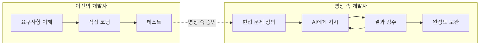

---

## 8. 사실 확인 메모

문서 내용 중 출처가 서로 엇갈리거나 확인이 어려웠던 부분입니다.

1. **예선과 본선 사이의 기간**: 영상 자막은 "본선까지는 앞으로 4주", "4주 뒤"라고 말하지만, LG 보도자료는 본선 진출 팀이 "지난 3주간" 기술 지원을 받아 서비스를 고도화했다고 적고 있습니다. 두 표현이 다르며, 영상만으로 어느 쪽이 정확한지 판단할 수 없습니다. 본선 개최일이 9월 15일이고 예선이 8월에 열렸다는 점만 공통으로 확인됩니다.
2. **대상 수상 사실의 출처**: LG트리오즈의 대상 수상은 영상 자막과 사회자의 발언에서 확인한 내용입니다. 이번 조사에서 검색된 보도자료와 기사는 본선 개최 사실과 본선 팀의 아이디어 유형까지만 다루고 있어, 수상 결과를 별도로 보도한 기사는 찾지 못했습니다. 검색에서 확인하지 못했다는 뜻이며 수상 사실이 틀렸다는 뜻은 아닙니다.
3. **LG트리오즈의 소속**: 영상 속 소개 자막에는 LG CNS 소속으로 표기되어 있습니다. 공식 자료에서 이 팀의 소속을 별도로 확인하지는 못했습니다.
4. **사용한 엑사원 버전**: 영상과 보도자료 모두 어떤 버전을 썼는지 밝히지 않았습니다.
5. **팀 이름 대응**: 본선 진출 10개 팀 명단 중 6번과 7번의 표기는 불확실하고, 영상에서 소개된 일부 팀 이름(낄끼빠빠, 띵, 프롬프트 앤 프레이)이 명단의 어느 항목에 해당하는지는 영상만으로 연결할 수 없습니다.
6. **12분대 장면의 팀 소속**: 영상은 신입 개발자 팀이 화기애애하다는 내레이션 뒤에 82% 진행률과 보안 프레임워크 시연을 이어 붙입니다. 그러나 해당 시연에 붙은 팀 자막은 "띵"이며, 앞서 소개된 LG트리오즈의 아이디어(가구·가전 배치)와는 내용이 다릅니다. 이 문서는 시연의 소속을 자막대로 "띵 팀"으로만 적었고, 신입 팀과의 동일 여부를 단정하지 않았습니다.
7. **참가 인원 표기**: 영상 자막은 "100여 명의 LG 개발자"라고 하고, 보도자료는 예선 참가를 28개 팀 84명으로 적습니다. 숫자 표현이 다르며, 영상의 "100여 명"은 대략적인 수치로 보입니다.
8. **방법론에 대한 해석**: 영상 속 한 참가자의 작업 폴더가 AWS AI-DLC의 단계 용어와 일치하는 것은 확인되지만, 이를 해당 대회의 공식 방법론이었다고 단정할 근거는 없습니다.

---

## 9. 용어 설명

| 용어 | 설명 |
|---|---|
| 프롬프톤(Prompthon) | 프롬프트와 마라톤의 합성어 성격의 이름으로, AI에게 지시해 결과물을 만드는 대회. 이 대회는 직접 코딩을 하지 않는 방식 |
| 해커톤(Hackathon) | 정해진 시간 안에 집중적으로 개발하는 대회 |
| 엑사원(EXAONE) | LG AI연구원이 개발한 AI 모델. K-엑사원은 정부의 독자 AI 파운데이션 모델 프로젝트에 출품된 모델 |
| 파운데이션 모델 | 다양한 작업에 활용할 수 있도록 대규모 데이터로 학습한 기반 AI 모델 |
| 오픈 웨이트 | 모델의 학습된 가중치를 공개해 누구나 내려받아 쓸 수 있게 한 방식 |
| 키로(Kiro) | AWS가 공개한 AI 기반 개발 도구(IDE). 스펙 주도 개발, 훅, 스티어링 규칙, MCP 지원이 특징 |
| 스펙 주도 개발 | 구현 전에 요구사항과 설계를 문서로 먼저 만들고 그것을 기준으로 AI가 코드를 작성하게 하는 방식 |
| AI-DLC | AWS가 제안한 AI 주도 개발 수명주기. Inception, Construction, Operations의 세 단계 |
| 에이전트 | 목표를 받아 스스로 계획하고 도구를 사용해 여러 단계의 작업을 수행하는 AI |
| 페르소나 | 서비스 사용자를 대표하도록 가상으로 설정한 인물상 |
| 바이브 코딩 | 코드를 직접 짜기보다 AI에게 느낌과 의도를 말로 전달하며 코드를 만들어 가는 개발 방식 |
| 인큐베이션 프로그램 | 사내 아이디어를 실제 사업이나 서비스로 키우도록 지원하는 제도 |

---

## 10. 참고 자료

**영상**
- 「28시간 동안 AI한테 코딩시키기 (LG AI 프롬프톤 챌린지)」, 2026-10-01 게시 — https://www.youtube.com/watch?v=bChUKH9PdTE

**LG 공식 보도자료**
- LG, 「글로벌 빅테크·AI 미래인재와 'AI 축제' 연다」 (2026-09-04) — https://www.lg.co.kr/media/release/30537
- LG전자, 「AI 활용 소프트웨어 개발 혁신 가속화」 (2026-09-16) — https://www.lg.co.kr/media/release/30574
- LG AI연구원, 「K-엑사원 2.0 공개」 (2026-07-31) — https://lg.co.kr/media/release/30411

**언론 보도**
- SBS Biz, 「LG, 개발 현장도 AI 전환…1,500명 모여 노하우 공유」 (2026-09-16) — https://biz.sbs.co.kr/amp/article/20000334997
- 인사이트, 「실패와 성공경험 나눈다... LG전자, AI 데브콘 2026 개최」 (2026-09-16) — https://www.insight.co.kr/news/573732
- 넥스트데일리, 「LG전자, 'LG AI 데브콘 2026' 개최」 — https://www.nextdaily.co.kr/news/articleView.html?idxno=253102
- 파이낸셜뉴스, 「LG, 엔비디아·구글과 AI 머리 맞댄다…'LG 스파크 2026' 개최」 (2026-09-04) — https://www.fnnews.com/news/202609040926335531
- 한국경제, 「LG AI연구원 'K-엑사원'…"챗GPT보다 성능 뛰어나"」 (2025-12-30) — https://www.hankyung.com/article/2025123034261
- 헤럴드경제, 「오픈AI·알리바바 추월한 LG AI연구원…'K-엑사원'으로 세계 5위 넘본다」 — https://www.heraldk.com/article/2025122923000062376
- 중앙데일리, 「LG heightens AI ambitions with K-Exaone model and Korea's largest data center」 (MWC 2026) — https://www.koreajoongangdaily.com/business/lg-heightens-ai-ambitions-with-k-exaone-model-and-koreas-largest-data-center/12517440
- 뉴시스, 「LG AI연구원, 7500억 파라미터 'K-엑사원 2.0' 공개」 (2026-07-31) — https://www.fnnews.com/news/202607311000306959
- SBS Biz, 「독파모 3차 진출한 LG "프런티어급 AI 도약 목표"」 (2026-08-18) — https://biz.sbs.co.kr/amp/article/20000329202
- 노컷뉴스, 독자 AI 파운데이션 모델 2차 평가 결과 보도 — https://nocutnews.co.kr/news/6564113

**기술 배경 자료**
- AWS DevOps Blog, 「AI-Driven Development Life Cycle: Reimagining Software Engineering」 — https://aws.amazon.com/blogs/devops/ai-driven-development-life-cycle
- AWS DevOps Blog, 「Building with AI-DLC using Amazon Q Developer」 — https://aws.amazon.com/blogs/devops/building-with-ai-dlc-using-amazon-q-developer
- TechRadar, 「AWS launches Kiro, an agentic AI IDE, to end the chaos of vibe coding」 — https://www.techradar.com/pro/aws-launches-kiro-an-agentic-ai-ide-to-end-the-chaos-of-vibe-coding
- DevClass, 「Hands on with Kiro, the AWS preview of an agentic AI IDE driven by specifications」 — https://devclass.com/?p=7690

※ 로봇 팔 서비스에 대한 심층 분석과 그 참고 자료는 아래 **별첨 A**에, AI-DLC 방법론의 상세 설명과 다른 방법론과의 비교, LG·LG CNS의 자체 AI 개발 방법론 여부는 **별첨 B**에 따로 정리했습니다.

---

# 별첨 A. 로봇 팔 서비스 심층 분석: AI(엑사원)를 로봇에 어떻게 접목했을까

## A.1 이 별첨을 읽는 방법

본문 5.9에서 소개한 로봇 팀의 서비스는 영상에 **세 개의 짧은 장면**으로만 등장합니다. 어떤 모델을 어디에 어떻게 연결했는지에 대한 설명은 영상에 없습니다. 그래서 이 별첨은 질문하신 "어떤 방식으로 AI, 특히 엑사원을 로봇에 접목했을까"를 **사실로 단정하지 않고**, 다음 세 층으로 나누어 씁니다.

1. **[영상]** 영상에서 확인되는 사실. A.2, A.3에서 다룹니다.
2. **[근거 있는 배경]** 공개된 연구와 보도로 확인되는 기술 배경. A.4~A.6에서 다룹니다. 이 팀이 그 기술을 썼다는 뜻이 아니라, "이런 문제를 이런 방식들로 풀어 왔다"는 지형도입니다.
3. **[가설]** 위 두 층을 바탕으로 "엑사원이 들어갈 수 있었던 자리"를 후보로 제시한 것. A.7 이후에 있으며, **모두 영상에서 확인되지 않은 가설**이라고 명시합니다.

영상에서 얻을 수 있는 정보가 적은 만큼, 이 별첨의 가치는 "정답을 맞히는 것"이 아니라 "무엇이 확인된 것이고 무엇이 아닌지 구분하면서, 가능한 접목 방식의 범위를 이해하는 것"에 있습니다.

---

## A.2 영상에서 확인되는 사실

| 시점 | 영상에서 확인되는 내용 |
|---|---|
| 1:04~1:23 | 한 팀이 과자와 함께 로봇을 가져옵니다. 참가자는 이 로봇이 "오픈소스로 공개된 기본 로봇 중의 하나"이고 "3D프린팅으로 프린트한 로봇"이라고 소개합니다. 가져온 이유는 "로봇을 작동하려고"입니다. 영상 자막은 "간식부터 로봇 팔까지" 준비해 왔다고 표현합니다. |
| 13:29~14:20 | 밤샘 중 "아직도 로봇과 씨름 중인 팀"이 등장합니다. 자막은 이 팀이 **"AI를 활용해 로봇 학습에 필요한 실제 데이터량을 줄여주는 서비스"** 를 개발 중이라고 설명합니다. PD가 "(양말을) 집는 연습을 원래 같으면 몇 번을 사람이 해야 되는 건데"라고 묻자 참가자는 **"원래는 최소 200번을 해야 되는데 한 10번 정도만 하면 돼요"** 라고 답합니다. 소감을 한 단어로 묻자 "기대감"이라고 합니다. |
| 15:25~15:40 | 둘째 날 아침, 다른 참가자가 "저쪽에 로봇 팔 하는 팀"이 전날 밤 늦게까지 남아 있었다고 증언합니다. 이어 환호성과 함께 "잡았다", "성공", "잡았잖아"라는 말이 들립니다. |

장면에서 보이는 것도 정리하면 다음과 같습니다. 세 명의 참가자가 바닥에 앉아 노트북 두 대를 펴 놓고 있고, 한 명은 푸른색의 작은 로봇 팔을 손에 쥐고 있습니다. 바닥에는 같은 계열 색의 팔이 바퀴 달린 받침 위에 세워져 있고, 주변에 전원 케이블과 어댑터가 어지럽게 놓여 있습니다.

여기서 얻을 수 있는 확정적인 정보는 다음과 같습니다.

- 서비스의 목적은 **로봇 학습에 필요한 "실제 데이터량"을 줄이는 것**입니다.
- 예시 과제는 **양말 집기**입니다.
- 사람이 반복해야 하는 횟수가 **최소 약 200회에서 약 10회로 줄어든다**는 것이 참가자의 설명입니다. 단순 계산으로 약 20분의 1, 즉 95% 감소입니다. 다만 "한 10번 정도"는 참가자의 어림 표현이므로 정확한 측정값으로 읽으면 안 됩니다.
- 로봇은 **오픈소스로 공개된 3D 프린팅 로봇**이며 팔을 갖추고 있습니다.
- 둘째 날 아침, 무언가를 **집는 데 성공**한 듯한 순간(환호와 "잡았다"는 말)이 영상에 담겨 있습니다. 다만 그 환호의 주체가 이 팀인지는 자막이 명시하지 않습니다.

위 세 장면(입장 때의 로봇 소개, 밤샘 중의 서비스 설명, 둘째 날 아침의 증언)이 **모두 같은 팀의 이야기인지**도 영상이 팀명을 표기하지 않아 단정할 수 없습니다. 이 별첨은 문맥상 같은 로봇 팀을 가리키는 것으로 보고 읽되, 이 점을 전제로 둡니다.

---

## A.3 영상이 말하지 않는 것

아래 항목은 영상과 공식 보도자료 어디에도 나오지 않습니다. 이 별첨의 가설 영역이 바로 이 빈칸을 다룹니다.

| 알 수 없는 것 | 비고 |
|---|---|
| 이 팀이 서비스에서 **엑사원을 어디에 썼는지** | 영상은 대회 전체에 대해 "엑사원 활용은 필수"라고만 말합니다. |
| 사용한 엑사원의 종류(텍스트 모델인지, 시각 입력까지 받는 모델인지) | 버전 정보 없음 |
| 로봇 제품의 정확한 이름 | "오픈소스로 공개된 기본 로봇"이라고만 표현 |
| 로봇을 움직이는 정책(학습된 모델)의 종류 | 언급 없음 |
| "시연 횟수를 줄이는" 기법의 이름과 원리 | 언급 없음 |
| 성공 기준, 성공률, 측정 방법 | 언급 없음 |
| 최종 발표 내용과 본선 진출 여부 | 이 팀의 팀명이 자막에 표기되지 않아 본선 명단과 연결할 수 없음 |

---

## A.4 이 서비스가 풀려는 문제: 로봇은 왜 "시연 횟수"가 병목일까

로봇 팔에게 "양말을 집어라"라는 일을 가르치는 대표적인 방법이 **모방학습(imitation learning)** 입니다. 사람이 로봇을 직접 조작하며 그 과정을 반복해서 보여 주면(이것을 시연, demonstration이라고 합니다), 로봇은 카메라 영상과 관절 상태, 그리고 그때 사람이 내린 동작을 짝지어 학습합니다. 영상 속 PD의 질문, "몇 번을 사람이 해야 되는 건데"는 정확히 이 시연 반복을 가리키는 것으로 읽힙니다.

문제는 이 시연이 **사람의 시간과 수고**를 먹는다는 점입니다. 같은 동작을 200번 보여 주려면, 양말의 위치를 바꿔 가며 반복해서 조작해야 합니다. 시연 수가 부족하면 로봇은 양말이 조금만 다른 위치에 있어도 실패합니다. 그래서 "시연 횟수를 줄이면서도 성능은 유지한다"는 것이 로봇 학습 분야의 오래된 과제이며, 영상의 서비스는 바로 그 지점을 겨냥합니다.

공개된 연구들은 이 문제를 크게 세 가지 방향으로 접근해 왔습니다. 이 세 방향은 A.6에서 구체적인 수치와 함께 정리합니다.

---

## A.5 오픈소스 3D 프린팅 로봇 팔 생태계

영상은 로봇 제품명을 말하지 않지만, "오픈소스로 공개된 3D 프린팅 로봇 팔"이라는 설명에 부합하는 대표적인 생태계가 있습니다. **영상 속 로봇이 이 제품이라는 증거는 없으며**, 어떤 환경에서 이런 일이 흔히 이루어지는지 이해하기 위한 배경으로만 소개합니다.

TechCrunch 보도(2025-04-28)에 따르면 Hugging Face는 프로그래밍 가능한 로봇 팔 **SO-101**을 선보였습니다.

- 물체를 집어 옮기는 기본 작업을 수행하는 팔로, 전작 SO-100의 후속작입니다.
- 기본 가격은 100달러이며, 완제품과 관세 등을 반영하면 공급처에 따라 약 100달러에서 500달러 사이입니다.
- 3D 프린팅으로 제작할 수 있습니다.
- SO-100 대비 조립이 빨라지고, 마찰을 줄이면서 자체 무게를 버틸 수 있는 개선된 모터를 탑재했습니다.
- Hugging Face의 로보틱스 부문인 LeRobot이 The Robot Studio, WowRobo, Seeed Studio, PartaBot과 협업해 출시했습니다.

같은 생태계에서 나온 **SmolVLA** 블로그는 실제 로봇 평가 대상으로 SO-100과 SO-101을 들고, LeKiwi 같은 저가형 하드웨어도 언급합니다. 공개된 모델이 이런 저가형 오픈소스 팔을 평가 대상으로 삼는다는 점에서, 이 계열의 팔은 학습된 정책을 실제로 돌려 보는 실험 환경으로 쓰이고 있음을 알 수 있습니다.

영상 속 로봇이 이 계열인지는 확인할 수 없습니다. 다만 "오픈소스로 공개된 기본 로봇을 3D 프린팅으로 출력해 왔다"는 참가자의 설명은 이 계열의 특징과 모순되지 않습니다. 또한 장면에는 사람이 작은 팔을 손에 쥐고 있고 바닥에 같은 계열의 팔이 놓여 있는데, 이것이 사람이 쥔 팔로 다른 팔을 조종하는 원격 조작(시연 수집)이었을 가능성은 있지만, **그 장면이 실제로 그 용도였는지는 영상만으로 알 수 없습니다.**

---

## A.6 시연 횟수를 줄이는 세 가지 대표 접근

### 접근 1. 미리 크게 배운 정책을 가져다 쓴다 (사전학습)

Hugging Face가 공개한 **SmolVLA**는 소비자용 하드웨어에서도 돌아가도록 만든 오픈소스 비전-언어-행동(VLA) 모델입니다.

- 규모는 4억 5천만 개 파라미터(450M)이고, 행동을 만들어 내는 부분(액션 전문가)이 약 1억 개입니다.
- 입력은 여러 카메라의 영상, 로봇의 현재 상태, 자연어 지시문이며, 출력은 연속적인 행동 묶음입니다.
- 학습에는 Hugging Face Hub에서 LeRobot 태그가 붙은 커뮤니티 공유 데이터만 사용했습니다. 선별 후 487개 데이터셋, 약 1,000만 프레임, 학습 에피소드 3만 개 미만이며 주로 SO100 팔의 데이터입니다.
- 커뮤니티 데이터로 사전학습하자 SO100의 실제 과제 성공률이 51.7%에서 78.3%로 26.6%p 올랐다고 보고합니다.

핵심은 "남들이 모은 시연 데이터로 미리 배운 모델을 쓰면, 내 과제에 필요한 시연이 줄어든다"는 발상입니다. 다만 위 수치는 **사전학습의 효과**이며, "시연이 몇 회로 줄었다"는 값이 아니라는 점을 구분해야 합니다.

### 접근 2. 소수의 시연을 불려서 쓴다 (시연 증폭)

**MimicGen**(2023, arXiv)은 사람의 시연을 객체 중심의 구간으로 나눈 뒤, 새로운 장면의 객체 위치에 맞게 변환해 로봇이 다시 실행하게 하고, **성공한 실행만** 학습 데이터로 저장합니다.

- 원문 초록 기준으로 약 200개의 사람 시연에서 18개 과제에 걸쳐 5만 개가 넘는 시연을 생성했습니다.
- 과제당 원본 시연은 보통 10개였고, 과제 변형마다 성공 데이터 1,000개씩을 생성했습니다.
- 사람 시연 10개로 만든 생성 데이터 200개는, 사람 시연 200개로 학습한 결과와 대체로 비슷했다고 보고합니다.
- 성능 향상 사례로 Square 과제 11.3%에서 90.7%, Threading 19.3%에서 98.0%가 제시됩니다.

원리는 단순합니다. 집는 동작을 "물체를 향해 다가가기", "집기", "옮기기" 같은 구간으로 쪼개 두고, 물체가 다른 곳에 있으면 그 위치에 맞게 같은 동작을 옮겨 심는 것입니다. 다만 원문은 분명한 **전제와 한계**도 밝힙니다.

- 동작 공간이 손끝(엔드 이펙터)의 델타 포즈 명령과 그리퍼 명령이어야 합니다.
- 과제가 객체 중심 하위 과제들의 **알려진 순서**로 구성되어 있어야 합니다.
- 데이터 수집 중 각 하위 과제 시작 시점의 객체 위치를 관찰할 수 있어야 하고, 하위 과제의 끝을 자동으로 감지할 지표가 있어야 합니다.
- 생성 실패가 생길 수 있어, 로봇 팔과 과제에 따라 생성 성공률이 크게 달랐습니다(한 사례에서 38%에서 74%).
- 생성량을 늘릴수록 성능은 오르지만 이득이 점차 줄어듭니다.

**HybridGen**(2025, arXiv)은 여기에 **비전-언어 모델(VLM)** 을 끼워 넣은 사례입니다. VLM이 소량의 사람 시연을 분석해 작업을 두 종류의 구간으로 나눕니다. 정밀한 제어가 필요해 사람 시연에 의존할 구간과, 경로 계획으로 다양한 궤적을 합성할 수 있는 구간입니다. 7개 과제에서 기존 최고 방법 대비 평균 약 5% 향상을 보고하고, 가장 어려운 과제 변형에서 평균 성공률 59.7%로 MimicGen의 49.5%보다 높다고 합니다.

### 접근 3. LLM이 과제와 데이터를 만들어 준다 (생성형 데이터 확장)

**GenSim2**(PMLR 270권 수록)는 멀티모달·추론 기능을 갖춘 코딩 LLM으로 **시뮬레이션 과제**를 만듭니다. 초록 기준으로 최대 100개의 관절형 과제와 200개의 객체에 대한 데이터를 생성할 수 있다고 보고하며, 생성한 데모로 학습한 언어 조건부 정책을 시뮬레이션에서 실제 로봇으로 제로샷 전이했다고 합니다. 실제 데이터를 제한적으로만 쓴 학습 대비 정책 성능이 20% 향상되었다고 하지만, 초록에는 그 20%의 기준 지표와 사용한 LLM 모델명이 나와 있지 않습니다.

### 세 접근의 비교

| 접근 | 대표 사례 | 핵심 아이디어 | 언어 모델의 역할 | 확인된 수치 (원문 기준) |
|---|---|---|---|---|
| 사전학습 정책 | SmolVLA | 공개 시연 데이터로 미리 학습 | 자연어 지시를 입력으로 받는 정책 일부 | 사전학습으로 51.7%에서 78.3% |
| 시연 증폭 | MimicGen | 소수 시연을 새 객체 위치에 변환해 불림 | 없음 | 시연 약 200개에서 5만 개 이상 생성 |
| 시연 증폭 + VLM | HybridGen | VLM이 구간을 구분하고 제약을 추출 | 시연 분석과 구간 분류 | 어려운 변형 59.7% 대 49.5% |
| 생성형 과제·데이터 | GenSim2 | 코딩 LLM이 시뮬레이션 과제를 생성 | 과제 생성 | 실제 데이터만 쓴 경우 대비 정책 성능 20% 향상 |

---

## A.7 엑사원은 어디에 들어갈 수 있었을까 (가설)

> **주의: 이 절의 모든 내용은 영상에서 확인되지 않은 가설입니다.** 후보는 "엑사원이 어떤 모델인지"와 "비슷한 연구에서 언어 모델이 어떤 자리에 쓰였는지"를 겹쳐서 도출했습니다.

### A.7.1 먼저 엑사원이 어떤 모델인지

가설을 세우기 전에 확인된 사실부터 정리합니다.

- LG AI연구원의 **엑사원 4.5**는 2026년 4월 9일 공개된 약 330억 개 파라미터의 **비전-언어 모델(VLM)** 입니다. 보도에 따르면 텍스트와 시각 정보를 함께 이해하고 추론하며, 계약서·기술 도면·재무제표·스캔 문서 같은 복합 문서를 읽는 데 강점이 있다고 합니다. 허깅페이스에 공개되었고, 기사에는 연구·학술·교육 목적으로 사용할 수 있다고 명시되어 있습니다.
- **K-엑사원**(1차수 2,360억 개, 2.0은 7,500억 개)은 정부의 독자 AI 파운데이션 모델 프로젝트용 대형 모델이며, 영상이 말하는 "K-엑사원"과 보도자료의 "엑사원" 중 이 대회에서 실제로 호출된 모델이 무엇인지는 확인되지 않습니다.
- LG는 MWC 2026에서 엑사원 4.5를 한국형 휴머노이드 로봇 '케이팩스(KAPEX)'의 **"두뇌" 역할**로 발전시키겠다고 밝혔습니다. 다만 해당 보도들은 **엑사원이 로봇의 동작을 직접 생성하는 방식**(행동 모델, 제어 방식)에 대해서는 아무것도 설명하지 않습니다. 장기 목표로는 물리 세계를 이해하고 판단하는 "피지컬 인텔리전스"를 제시했습니다.

여기서 이끌어 낼 수 있는 판단은 이렇습니다. **공개된 엑사원 계열은 언어 모델 또는 비전-언어 모델이며, 관절 각도 같은 저수준 제어 값을 직접 내놓는 행동(VLA) 모델이라고 소개된 적은 없습니다.** 따라서 이 팀이 엑사원으로 로봇의 모터를 직접 움직였다고 보는 것은 근거가 부족합니다. 엑사원이 들어갔다면 "이해와 판단, 계획, 대화" 쪽 층일 가능성이 높다는 것이 이 별첨의 출발 가정입니다. 이것은 확인된 사실이 아니라 위 공개 정보에 기반한 판단입니다.

### A.7.2 후보 자리 다섯 가지

| 후보 | 엑사원의 역할 (가설) | 비슷한 근거 | 영상 내 증거 | 엑사원 적합성에 대한 판단 |
|---|---|---|---|---|
| H1 | 자연어 요청을 하위 단계로 분해 ("양말을 집어서 바구니에 넣어라" → 접근, 파지, 이동, 놓기) | MimicGen 계열이 하위 과제 순서를 전제로 하고, SmolVLA 등이 자연어 지시를 입력으로 받음 | 없음 | 언어 모델의 기본 능력과 부합. 구현 난이도 낮음 |
| H2 | 시연 기록을 보고 구간을 나누거나, 실행 결과의 성공·실패를 판정 | HybridGen에서 VLM이 시연을 분석해 구간을 구분. MimicGen은 하위 과제 종료 감지와 성공 필터링을 전제로 함 | 없음 | 시각 입력이 필요하므로 엑사원 4.5 같은 VLM이어야 가능. 텍스트 전용 모델로는 어려움 |
| H3 | 학습용 변형 장면·과제 조건을 만들어 시연을 불리는 데 활용 | GenSim2에서 코딩 LLM이 시뮬레이션 과제를 생성 | 없음 | 28시간 안에 시뮬레이션 환경을 갖추기는 부담이 큼. 가능성은 낮은 편으로 판단 |
| H4 | 서비스 계층: 사용자와의 한국어 대화, 데이터 수집 안내, 결과 설명 | 영상의 다른 팀들이 엑사원의 한국어 강점을 서비스 쪽에 활용 | 간접적(다른 팀의 사례) | 대회 조건(엑사원 필수)을 가장 무리 없이 충족하는 자리 |
| H5 | 개발 보조: 로봇 제어·데이터 처리 코드 작성 | 영상 전반에서 참가자가 AI에게 코드 작성을 맡김. 대회 환경은 키로 기반 | 간접적 | 어떤 모델이 코드를 썼는지는 확인되지 않음 |

이 다섯 후보 가운데 **영상에서 직접 뒷받침되는 것은 하나도 없습니다.** 순위를 굳이 매기자면 구현 부담과 대회 조건을 고려했을 때 H4, H1이 가장 무리가 적고 H2가 기술적으로 흥미로운 후보지만, 이것은 가능성에 대한 판단일 뿐 실제로 그랬다는 주장이 아닙니다.

한 가지 가능성도 열어 두어야 합니다. 시연 횟수를 줄이는 핵심 기법이 **엑사원과 무관한 로봇 학습 알고리즘**(A.6의 접근 1이나 2 계열)이고, 엑사원은 대회 조건을 충족하는 서비스 계층에만 쓰였을 수도 있습니다. 영상은 이 가능성을 배제하지 않습니다.

### A.7.3 가설 아키텍처 한눈에 보기

아래 도표는 위 후보들이 한 서비스 안에서 어떻게 이어질 수 있는지를 보여 주는 **가설도**입니다. 영상에서 확인된 구조가 아닙니다.

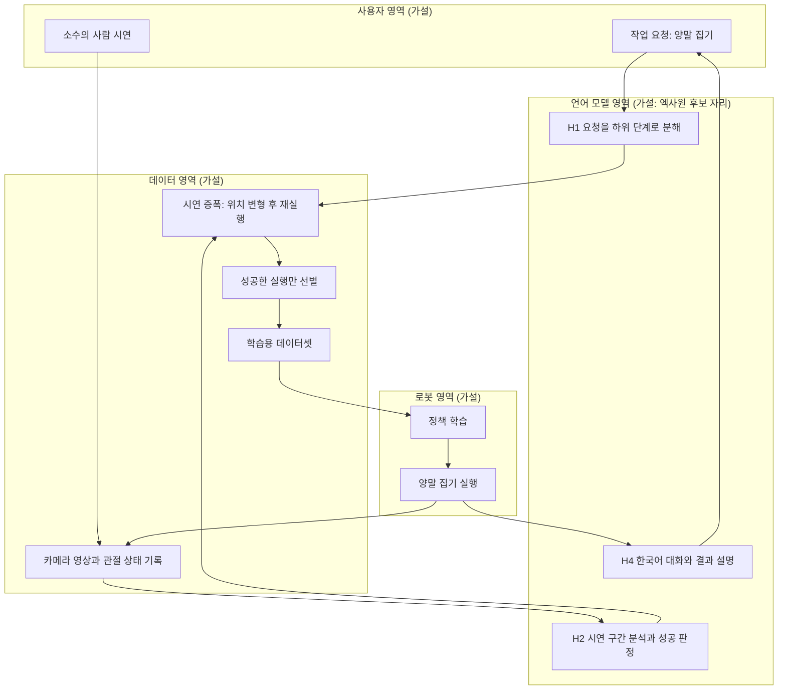

---

## A.8 28시간이라는 조건에서 생각해 볼 현실적 제약

아래는 앞서 인용한 연구가 **스스로 밝힌 전제와 한계**를 이 대회 조건에 비춰 본 설계상의 고려사항입니다. 이 팀이 실제로 이런 어려움을 겪었다는 뜻이 아니라, 같은 문제를 풀려는 팀이라면 마주쳤을 법한 지점입니다.

- **제어 공간의 맞춤**: MimicGen 원문의 전제는 손끝 델타 포즈와 그리퍼 명령입니다. 다른 방식으로 제어되는 로봇 팔에 같은 기법을 옮기려면 변환 작업이 필요할 수 있습니다.
- **하위 과제 정의와 종료 감지**: 증폭 기법은 하위 과제의 순서와 종료 시점을 알아야 합니다. 이를 사람이 일일이 지정하면 시간이 들고, 언어 모델이 대신해 주면(H1, H2) 부담이 줄어듭니다. HybridGen은 VLM을 바로 이 지점, 즉 시연을 분석해 구간을 나누는 일에 쓴 사례입니다.
- **생성 실패와 필터링**: 생성한 시연이 실제로 성공하는지 확인해야 합니다. MimicGen에서도 생성 성공률은 팔과 과제에 따라 크게 달랐고(한 사례에서 38%에서 74%), 그래서 성공한 실행만 남기는 단계가 있습니다.
- **수확 체감**: 생성 데이터를 늘릴수록 성능은 오르지만 이득이 점차 줄어듭니다. 짧은 시간에 적당한 지점에서 멈추는 판단이 필요합니다.
- **실물 로봇의 시간**: 시뮬레이션과 달리 실물 로봇은 한 번 실행하는 데 실제 시간이 듭니다. 로봇 팀이 전날 밤 늦게까지 남아 있었고 둘째 날 아침에 "잡았다"는 환호가 나온 영상의 순서는 이 현실과 결이 맞습니다. 다만 이것은 장면에 대한 해석일 뿐이며, 그 환호의 주체가 이 팀인지, 그것이 데이터 효율 기법의 성공을 뜻하는지는 알 수 없습니다.

---

## A.9 "200번에서 10번"을 어떻게 읽을까

참가자의 말은 사람이 직접 반복해야 하는 횟수가 최소 200번에서 약 10번으로 준다는 것입니다. 이 숫자를 읽을 때는 다음을 구분해야 합니다.

1. **산수**: 200에서 10으로 줄었다면 20분의 1, 95% 감소입니다. 다만 "최소 200번", "한 10번 정도"는 어림 표현이라 오차가 있습니다.
2. **숫자의 우연한 닮음**: MimicGen 논문도 "원본 시연 10개로 만든 생성 데이터 200개가 사람 시연 200개와 비슷했다"고 보고합니다. 숫자가 비슷해 보이지만, **그렇다고 이 팀이 같은 기법을 썼다는 증거는 되지 않습니다.** 우연의 일치일 수도 있고 아닐 수도 있으며, 영상은 이 팀의 기법을 밝히지 않았습니다.
3. **정의되지 않은 것들**: "200번"의 기준이 처음부터 직접 학습할 때의 시연 수인지, 비교 대상이 어떤 정책인지, "된다"의 기준이 성공률 몇 퍼센트인지는 영상에 없습니다.
4. **과제의 난이도**: 양말 집기는 한 물체를 집는 비교적 단순한 과제입니다. 이 숫자가 여러 단계로 이루어진 복잡한 과제에도 그대로 통한다고 일반화할 수는 없습니다. 앞서 본 MimicGen에서도 과제에 따라 향상 폭은 크게 달랐습니다.

정리하면, 이 숫자는 **이 팀이 체감한 효율 개선에 대한 증언**으로는 충분히 의미 있지만, 검증된 성능 지표로 인용하기에는 정보가 부족합니다.

---

## A.10 사업화 관점에서 짚어 둘 점

대회의 평가 기준은 "향후 사업이나 새로운 서비스로 연결될 가능성"이었고, LG는 우수 수상작의 실제 서비스화를 검토하겠다고 밝혔습니다. 이 서비스의 목적이 영상 자막대로 **로봇 학습에 필요한 실제 데이터량을 줄이는 것**이라는 점은, 앞서 본 연구들이 모두 겨냥하는 문제와 같은 방향입니다. 다만 이 서비스가 실제로 사업성이 있는지는 영상만으로 판단할 수 없습니다.

다만 두 가지는 확인이 필요합니다. 첫째, 엑사원 4.5의 경우 보도 시점에 허깅페이스에서 연구·학술·교육 목적으로 쓸 수 있다고 안내되었습니다. 실제 서비스화 때의 이용 조건은 모델 카드와 라이선스 원문으로 확인해야 하며, 이 문서는 그 세부 조건을 확인하지 못했습니다. 둘째, 영상의 정보만으로는 이 서비스의 핵심 기술이 어디에 있고 엑사원이 그 안에서 어떤 비중을 차지하는지 판단할 수 없습니다.

---

## A.11 실제로 확인하려면

가설을 사실로 바꾸려면 다음 질문에 대한 답이 필요합니다. 팀의 본선 발표 자료, 코드 저장소, 또는 대회 주최 측을 통해 확인해 볼 수 있습니다.

1. 로봇 제품은 무엇이고, 시연은 어떤 방식으로 수집했는가?
2. 시연을 줄이는 기법은 무엇인가? (사전학습 정책, 시연 증폭, 생성형 데이터 중 무엇인가)
3. 엑사원은 어느 단계에 호출되는가? 입력은 텍스트인가, 카메라 영상까지 포함하는가?
4. 사용한 엑사원은 어떤 모델이며 어떻게 호출했는가?
5. "10번"의 기준과 성공률은 무엇이며, 어떻게 측정했는가?
6. 로봇을 움직이는 정책은 엑사원과 별개인가, 연결되어 있는가?

---

## A.12 별첨 참고 자료

**로봇 하드웨어·모델**
- TechCrunch, 「Hugging Face releases a 3D-printed robotic arm starting at $100」 (2025-04-28) — https://techcrunch.com/2025/04/28/hugging-face-releases-a-3d-printed-robotic-arm-starting-at-100
- Hugging Face, 「SmolVLA: Efficient Vision-Language-Action Model trained on Lerobot Community Data」 — https://huggingface.co/blog/smolvla
- SmolVLA 논문 — https://arxiv.org/html/2506.01844v1

**시연 데이터 효율화 연구**
- MimicGen: A Data Generation System for Scalable Robot Learning using Human Demonstrations — https://ar5iv.labs.arxiv.org/html/2310.17596
- HybridGen: VLM-Guided Hybrid Planning for Scalable Data Generation of Imitation Learning — https://arxiv.org/html/2503.13171v1
- GenSim2: Scaling Robot Data Generation with Multi-modal and Reasoning LLMs — https://proceedings.mlr.press/v270/hua25a.html

**엑사원과 피지컬 AI**
- 머니투데이, 「LG, 오픈AI GPT·앤트로픽 클로드 뛰어넘는 '엑사원 4.5' 공개」 (2026-04-09) — https://www.mt.co.kr/industry/2026/04/09/2026040909184245467
- 데일리안, 「텍스트 넘어 시각까지… LG '엑사원 4.5'로 피지컬 AI 시대 연다 [MWC 2026]」 — https://www.dailian.co.kr/news/view/1615811/
- 헤럴드경제, 「'AI 원팀' 선언 LG "글로벌 최고 수준 모델로 피지컬 AI 공략"」 (2026-03-01) — https://www.heraldk.com/article/2026030115000026523

---

# 별첨 B. AI-DLC 심층 분석: 방법론의 구조, 오픈소스 구현, 다른 방법론과의 비교, 그리고 LG·LG CNS에는 자체 AI 방법론이 없을까

본문 4.2절에서 영상 속 한 참가자의 작업 폴더에 `aidlc-docs`라는 이름과 Inception, Construction, Operations 체크리스트가 보인다고 짚었습니다. 이 별첨은 그 용어의 출처인 **AI-DLC**를 처음부터 끝까지 풀어 설명합니다. 먼저 AI-DLC가 무엇이고 왜 나왔는지(B.2~B.5), 팀이 실제로 어떻게 일하는지(B.6~B.7), 오픈소스로 공개된 구현이 어떤 구조인지(B.8~B.13), 영상과 어떻게 이어지는지(B.14), 효과와 위험(B.15~B.16), 다른 방법론과의 비교(B.17), 마지막으로 "LG나 LG CNS는 자체 AI 방법론이 없는 것인가"라는 질문(B.18)을 차례로 다룹니다.

## B.1 이 별첨을 읽는 법

본문과 같은 원칙을 씁니다. **[공식·보도]** 는 AWS·LG CNS 등의 공식 발표나 언론 보도, 공개 저장소 문서에서 확인한 내용, **[정리]** 는 그 내용을 풀어 쓴 설명이나 배경 지식, **[가설]** 은 근거가 부족해 추정으로 말할 수밖에 없는 부분입니다. 숫자에는 누가 어떤 맥락에서 말한 것인지를 함께 적었습니다.

### "AI-DLC"라는 이름은 세 가지를 가리킵니다

자료를 읽다 보면 같은 이름 아래 서로 다른 것이 섞여 나옵니다. 아래 세 가지를 구분해 두면 혼란이 크게 줄어듭니다.

1. **방법론으로서의 AI-DLC (2025년 7월)**: AWS의 Raja SP가 AWS 블로그와 백서로 소개한 개념입니다. 단계, 용어, 원칙을 정의합니다.
2. **AWS가 공개한 오픈소스 구현 (`awslabs/aidlc-workflows`)**: 그 방법론을 AI 코딩 도구 안에서 돌아가게 만든 규칙·에이전트·엔진 묶음입니다. 2025년에는 규칙 파일 중심(v1 계열)이었고, 지금은 `aidlc`라는 명령과 5개 단계 33개 스테이지를 갖춘 훨씬 큰 구조(v2 계열)입니다.
3. **제3자가 만든 파생·확장 문서**: 예를 들어 ai-dlc.dev라는 사이트에 올라온 "AI-DLC 2026" 방법론 논문은 AWS 공식 발행물이라는 표시가 없고, 12개 원칙과 세 가지 운영 모드(HITL, OHOTL, AHOTL) 같은 **원전에 없는 내용을 더한 확장판**입니다. 핵심 개념(Intent, Unit, Bolt, Mob Elaboration)은 Raja SP의 2025년 7월 정의에서 왔다고 스스로 밝히고 있습니다. 이 별첨은 이 문서의 내용을 AWS AI-DLC의 설명으로 쓰지 않습니다.

미리 못 박아 둘 점이 하나 더 있습니다. **영상은 어떤 팀도 AI-DLC를 썼다고 말하지 않습니다.** 영상에서 확인되는 것은 한 참가자의 작업 폴더에 AI-DLC의 용어와 맞는 이름이 보인다는 사실뿐입니다(B.14).

## B.2 AI-DLC는 무엇이고 왜 나왔나

### 한 문장 정의

**[공식·보도]** AI-DLC(AI-Driven Development Life Cycle, AI 주도 개발 수명주기)는 AI를 개발 과정의 중심 협업자로 두고 소프트웨어 개발 수명주기 전체를 새로 짜자는 AWS의 방법론입니다. AWS 블로그가 2025년 7월 31일에 처음 소개했습니다. 한국 언론은 이를 "AI가 실행하고 사람이 검증하는 휴먼 인 더 루프 방식"으로 옮겼습니다(전자신문, 2026-07-16 AWS 코리아 기자간담회 보도).

### 문제의식: 기존 방식의 두 가지 한계

**[공식·보도]** 원전 글이 제시하는 문제의식은 이렇습니다. 기업이 AI를 쓰는 방식은 크게 둘로 나뉩니다. 하나는 문서화, 코드 완성, 테스트 생성처럼 특정 작업을 돕는 **AI 보조 개발**이고, 다른 하나는 요구사항만 넣으면 사람의 개입 없이 애플리케이션을 통째로 만드는 **AI 자율 개발**입니다. 글은 두 방식 모두 속도와 소프트웨어 품질 면에서 만족스럽지 못했다고 평가합니다.

또 하나의 문제는 기존 방법론 자체입니다. 기존 개발 방법론은 사람이 주도하는 긴 프로세스를 전제로 만들어졌고, 제품 오너·개발자·아키텍트는 핵심 업무보다 기획, 회의, 각종 의식(ritual)에 시간을 많이 씁니다. 여기에 AI를 도우미로 덧붙이기만 하면 AI의 능력이 제한되고 기존 비효율도 그대로 남는다는 것이 글의 주장입니다. 그래서 "기존 방식에 AI를 끼워 넣지 말고, 처음부터 AI가 있었다면 수명주기가 어땠을지 다시 설계하자"는 결론으로 나아갑니다.

**[정리]** 쉬운 비유를 들면 이렇습니다. 말이 끄는 마차 길에 자동차를 올려놓고 말처럼 천천히 달리게 하는 것이 "기존 방식에 AI 덧붙이기"라면, 자동차에 맞는 도로와 신호 체계를 새로 만들자는 것이 AI-DLC의 입장입니다. IBM의 해설 기사(2026-08-04)도 이 변화를 마차에서 자동차로의 전환에 비유하며, 애자일에 AI를 더하는 것만으로는 "더 빠른 말"에 그친다고 설명합니다.

### 두 개의 축

**[공식·보도]** 원전은 AI-DLC를 두 축으로 설명합니다.

1. **사람의 감독 아래 AI가 실행**: AI가 상세한 작업 계획을 세우고, 모르는 점을 질문하고, 중요한 결정은 사람에게 넘깁니다. 비즈니스 맥락과 지식은 사람만 가지고 있으므로 올바른 선택은 사람이 해야 한다는 논리입니다.
2. **동적인 팀 협업**: AI가 반복 작업을 맡으면 팀은 한 자리(실물 또는 가상)에 모여 실시간으로 문제를 풀고 빠르게 결정합니다. 각자 따로 일하던 방식에서 함께 집중하는 방식으로 바뀝니다.

이 두 축을 묶는 **핵심 사고 모델**은 한 줄로 요약됩니다. **AI가 계획하고, 질문하고, 사람의 검증을 받은 뒤에야 구현한다. 사람은 중요한 결정을 내린다.** 이 패턴이 수명주기의 모든 활동에 반복 적용됩니다.

## B.3 10가지 원칙

**[공식·보도, 2차 출처]** AWS 백서의 원칙을 IBM이 정리한 기사 기준으로 10가지입니다. 백서 원문이 아니라 IBM의 요약이므로, 표현은 달라질 수 있습니다. 그리고 AWS가 오픈소스 적응형 워크플로 글에서 "원칙 10"을 직접 언급하고 있어 번호 체계가 존재한다는 점은 AWS 글로 확인됩니다.

| 번호 | 원칙(요약) | 쉬운 풀이 |
|---|---|---|
| 1 | 개조가 아니라 재구상 | 기존 방법론에 AI를 덧붙이지 말고, AI가 처음부터 있었다면 어땠을지 다시 설계한다 |
| 2 | 대화 방향의 전환 | 사람이 작업을 하나씩 지시하지 않고 의도를 설명하면, AI가 계획·질문·실행·검증을 하며 승인을 능동적으로 구한다 |
| 3 | 설계 기법의 핵심 통합 | 도메인 주도 설계(DDD), 행위 주도 개발(BDD), 테스트 주도 개발(TDD)을 워크플로에 녹여 품질을 표준화한다 |
| 4 | AI 역량에 맞춘 설계 | AI를 완전 자율로 두지 않고 사람이 판단·감독하는 구조를 권한다 |
| 5 | 복잡한 시스템 대응 | 여러 서비스·이해관계자·기술 부채가 얽힌 프로젝트 전체의 맥락을 보존한다 |
| 6 | 사람의 참여 유지 | 지속적인 피드백 문화를 유지하고, 사람의 판단이 필요한 지점을 남겨 두되 그 접점을 자동화하고 문서화한다 |
| 7 | 친숙함을 통한 전환 | 조직이 익숙한 개념과 워크플로에 통합해 점진적으로 도입한다 |
| 8 | 책임의 간소화 | AI가 여러 분야의 맥락을 유지하므로 전문가 팀 사이의 인수인계가 줄어든다 |
| 9 | 단계는 줄이고 흐름은 키운다 | 기획·설계·구현·테스트·배포를 순차 단계가 아니라 연속된 흐름으로 보고 동시적·비선형적으로 진행한다 |
| 10 | 고정된 워크플로를 두지 않는다 | 프로젝트마다 목표와 제약에 맞춰 워크플로를 새로 구성한다 |

**[정리]** 이 중 원칙 10이 오픈소스 구현의 "적응형(adaptive)" 설계로 직접 이어집니다. 모든 프로젝트를 같은 순서로 밀어붙이는 고정형 워크플로는 과잉 설계나 검증 부족을 낳고, 자동화가 지나치면 사람의 검증이 밀려난다는 것이 AWS가 적응형을 내세운 이유입니다.

## B.4 용어 사전

AI-DLC는 기존 애자일 용어를 일부 바꿨습니다. 처음 보면 낯설어 표로 정리했습니다.

| 용어 | 뜻 | 기존 애자일에서 가장 가까운 개념 |
|---|---|---|
| Intent(의도) | 달성하려는 목표를 담은 출발점. 구현 방법은 AI가 정한다 | 요구사항, 에픽의 상위 목표 |
| Unit of Work(작업 단위) | Intent에서 나온 독립적으로 만들고 검증할 수 있는 작업 묶음 | 에픽 |
| Bolt(볼트) | 몇 시간~며칠 단위의 짧고 집중된 작업 주기 | 스프린트 |
| Mob Elaboration(모브 정교화) | 팀 전원과 AI가 모여 AI의 질문에 답하며 Intent를 요구사항·스토리·Unit으로 구체화하는 Inception 단계의 의식 | 백로그 정제, 기획 회의 |
| Mob Construction(모브 구축) | 팀 전원이 AI가 낸 설계·코드 제안을 실시간으로 검토·결정하는 Construction 단계의 의식 | 페어·몹 프로그래밍과 설계 리뷰 |
| 규칙 파일 / 스티어링 파일 | 저장소에 두는 마크다운 문서로, 에이전트가 따를 규칙·제약·표준을 적어 둔다 (Amazon Q Developer의 Rules, Kiro의 Steering Files) | 팀 개발 규약 문서 |
| 승인 관문(gate) | 단계 끝에서 사람이 결과를 승인해야 다음으로 넘어가는 멈춤 지점 | 정의된 완료(DoD) 검토 |
| 감사 기록(audit) | 사람과 AI가 주고받은 입력·응답·승인을 시간순으로 남긴 기록 | 회의록 + 변경 이력 |

**[공식·보도]** Intent, Unit, Bolt 등의 상세 정의는 원전 블로그 본문에 없고 백서에 있다고 안내됩니다. 위 표의 Intent 설명은 IBM의 해설을 따랐습니다. 한 가지 눈여겨볼 대목은 Bolt입니다. 원전은 "몇 주가 아니라 몇 시간 혹은 며칠"이라고만 말하며 구체적인 길이를 정하지 않습니다.

## B.5 세 단계: 무엇을 하고 무엇이 남는가

**[공식·보도]** 원전의 세 단계를 활동과 산출물 중심으로 정리하면 다음과 같습니다. 원전은 산출물 목록을 세부적으로 제시하지 않고 개괄만 하므로, 표의 구체적인 항목은 원전에 적힌 범위까지만 담았습니다.

| 단계 | 한마디로 | AI가 하는 일 | 사람이 하는 일 | 남는 산출물 |
|---|---|---|---|---|
| Inception(착수) | 무엇을 만들지 정한다 | 비즈니스 의도를 요구사항, 스토리, 작업 단위로 바꾸고, 모호한 점을 질문한다 | 질문에 답하고, 제안을 검증하고, 범위를 확정한다 | 요구사항, 스토리, 작업 단위(Unit) |
| Construction(구축) | 만들고 검증한다 | 검증된 맥락을 바탕으로 논리 아키텍처, 도메인 모델, 코드, 테스트를 제안한다 | 기술적 결정과 아키텍처 선택을 실시간으로 내리고 제안을 승인한다 | 논리 아키텍처, 도메인 모델, 코드, 테스트 |
| Operations(운영) | 배포하고 돌본다 | 앞선 단계에서 쌓인 맥락으로 인프라를 코드(IaC)로 관리하고 배포를 처리한다 | 팀이 감독한다 | 원전은 구체 목록 없이 IaC와 배포 작업으로만 언급 |

핵심 설계 원리는 **"각 단계의 결과가 다음 단계의 맥락이 된다"** 는 점입니다. Inception에서 사람이 검증한 요구사항이 Construction의 AI 제안을 더 정확하게 만들고, 그것이 다시 Operations의 맥락이 됩니다. 이를 위해 AI는 계획·요구사항·설계 산출물을 프로젝트 저장소에 파일로 저장해, 대화 세션이 끊겨도 작업을 이어갑니다. AI의 대화 기억은 세션마다 사라지므로 파일이 곧 기억인 셈입니다.

아래 그림은 이 개념적 흐름을 단순화한 것입니다. 실제 구현의 세부 단계는 B.9에서 따로 보여 드립니다.

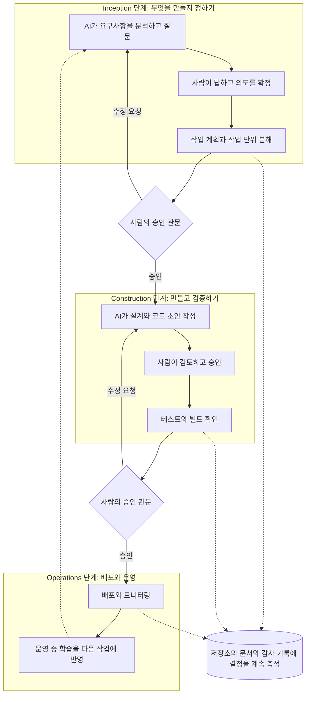

점선은 기록과 환류입니다. 이 방법론이 강조하는 것은 사람이 모든 줄의 코드를 직접 쓰는 일이 아니라, **중요한 지점마다 멈춰서 판단하고, 그 판단을 문서로 남기는 일**입니다.

### 역할 분담

**[공식·보도]** 원전과 이를 해설한 자료들을 종합하면 사람과 AI의 역할은 아래와 같이 나뉩니다.

| 구분 | AI | 사람 |
|---|---|---|
| 계획 | 상세한 작업 계획을 세운다 | 계획을 검증한다 |
| 질문 | 모르는 점을 묻고 맥락을 확보한다 | 질문에 답하고 지침을 준다 |
| 결정 | 중요한 결정은 보류하고 사람에게 넘긴다 | 중요한 결정과 비즈니스 요구의 해석을 맡는다 |
| 구현 | 사람의 검증 뒤에 구현하고 반복 작업을 처리한다 | 기술적·아키텍처 선택을 실시간으로 제시한다 |
| 품질 | 조직 표준(코딩, 설계 패턴, 보안)을 일관되게 적용하고 테스트를 생성한다 | 감독하고 최종 판단한다 |

**[정리]** 팀 역할에 관한 해설 글(TT PSC, 2026-06-10)은 제품 오너는 의도 명확화와 가치 검증, 아키텍트는 AI가 제안한 구조 검토, 개발자는 구현 감독과 품질 확보, 보안·운영 담당은 규칙 작성과 게이트키퍼, 관리자는 토큰 사용량이나 코드 줄 수가 아니라 성과 지표로 평가하는 역할을 맡는다고 풀이합니다. 이는 해설 필자의 권고이며 AWS가 정한 직무 정의는 아닙니다.

## B.6 모브 세션은 실제로 어떻게 진행되나

### 원전이 말하는 것과 말하지 않는 것

**[공식·보도]** 원전 블로그는 Mob Elaboration에서 "팀 전원이 AI의 질문과 제안을 적극적으로 검증한다", Mob Construction에서 "팀이 실시간으로 기술적 결정과 아키텍처 선택을 명확히 한다"고 말합니다. 그러나 **세부 절차, 시간, 참석자별 역할은 원전 본문에 적혀 있지 않습니다.** 이 점을 숨기면 안 되는 이유는, 인터넷에 도는 "몇 시간 만에 요구사항 확정" 같은 설명이 원전의 사실인지 필자의 해설인지 구분되지 않는 경우가 많기 때문입니다.

### 해설 자료와 도구 쪽에서 확인되는 진행 방식

**[정리]** 도구 구현과 해설 글에서 공통으로 확인되는 모브 세션의 진행은 대체로 다음과 같습니다.

1. **AI가 질문을 먼저 만든다.** 의도를 입력하면 AI가 곧바로 코드를 쓰지 않고 질문 목록을 파일로 만듭니다. 질문은 객관식 선택지와 "기타(Other)" 항목을 갖추도록 설계되어, 사람이 빠르게 고르거나 자기 말로 쓸 수 있습니다.
2. **사람이 답한다.** 팀원이 모여 같은 질문에 답합니다. 의견이 갈리면 그 자리에서 조정합니다. 이것이 "모브" 즉 여럿이 한 화면 앞에 모인다는 뜻의 의식입니다.
3. **AI가 답을 점검한다.** 답변끼리 모순이 없는지, 빠진 곳이 없는지를 AI가 확인하고 모호하면 추가로 묻습니다.
4. **산출물이 문서로 나온다.** 요구사항 문서, 사용자 스토리, 작업 단위 같은 결과가 파일로 생기고, 사람이 검토해 수정하거나 승인합니다.
5. **Construction에서는 계획을 먼저 승인한다.** AI가 체크박스가 달린 번호형 코드 생성 계획(비즈니스 로직, API, 데이터 계층, 테스트, 문서, 배포 파일 등)을 만들면 팀이 이를 고치거나 승인하고, 승인 뒤에야 코드가 생성됩니다.

**[정리]** 이 순서의 장점은 "AI가 틀린 방향으로 대량의 코드를 쓰기 전에, 사람이 방향을 먼저 바로잡는다"는 점입니다. 이는 영상 속 참가자들이 "코드를 직접 쓰지 않아도 오히려 설계에 더 많이 고민했다"고 말한 장면과 결이 맞습니다. 다만 결이 맞는다는 뜻일 뿐, 그 참가자들이 이 절차를 따랐다는 증거는 아닙니다.

## B.7 하나의 실제 예: AWS 워크스루 (강 건너기 퍼즐)

**[공식·보도]** AWS는 Amazon Q Developer를 써서 AI-DLC를 처음부터 끝까지 돌려 보이는 글을 공개했습니다. 만든 것은 "강 건너기 퍼즐" 웹 앱입니다. 진행 순서를 표로 옮깁니다.

| 순서 | 단계 | 시스템이 하는 일 | 사용자가 하는 일 |
|---|---|---|---|
| 0 | 시작 | 요청 앞에 AI-DLC 접두어를 붙이면 워크플로가 켜지고 방법론 개요를 안내 | "Using AI-DLC let's build a web application…"처럼 요청 |
| 1 | Inception: 작업공간 탐지 | 신규(greenfield)인지 기존(brownfield)인지 판별하고 `aidlc-docs` 폴더 생성 권한을 요청 | 승인 |
| 2 | Inception: 요구사항 분석 | 객관식 질문 파일 생성, 답변 모순 검사, 요구사항 문서 작성 | 파일에 답을 쓰고 "Done" 입력 |
| 3 | Inception: 요구사항 검토 | 요구사항을 검토하고 사용자 스토리 단계 필요 여부를 추천 | "Continue" |
| 4 | Inception: 워크플로 계획 | 실행할 단계와 건너뛸 단계를 실행 계획 문서로 제시 | "Continue" |
| 5 | Construction: 코드 생성 계획 | 체크박스가 있는 코드 생성 계획 문서 작성 | 검토 후 "Continue" |
| 6 | Construction: 코드 생성 | 계획에 따라 코드를 단계적으로 생성하고 체크박스로 진행 상황 추적 | "Continue" |
| 7 | Construction: 빌드와 테스트 | 빌드·테스트 지침과 요약 문서 작성 | "Continue" 후 종료 |
| 8 | Operations | 이 예시에서는 실행하지 않음 | - |

몇 가지 눈여겨볼 점이 있습니다. 첫째, 이 예시는 단순한 앱이어서 워크플로가 사용자 스토리, 애플리케이션 설계, 작업 단위 분해 같은 조건부 단계를 건너뛰도록 **스스로 추천**했습니다. 사용자는 이 추천을 받아들이거나, 단계를 추가해 달라고 요구할 수 있습니다. 둘째, 코드 생성 계획은 8단계로 구성되었습니다. 셋째, 규칙 파일 구성이 눈에 띄는데, 핵심 규칙 파일(`core-workflow.md`)은 항상 모델의 맥락에 올려 두고, 단계별 상세 규칙은 별도 폴더에 두었다가 **필요할 때만 불러옵니다.** 모델이 한 번에 읽을 수 있는 분량(맥락 창)과 토큰 사용량을 아끼기 위한 구조라고 글은 설명합니다. 넷째, 같은 글은 AI의 확률적 특성 때문에 질문과 산출물이 실행할 때마다 달라질 수 있다고 분명히 적고 있습니다. 글에는 소요 시간이나 비용 측정치가 나오지 않습니다.

생성되는 파일은 `aidlc-docs/` 폴더 아래에 모입니다. 해설 글(TT PSC)에 따르면 코드는 작업공간 루트에, 마크다운 문서는 `aidlc-docs/`에, 진행 상태는 `aidlc-state.md`에, 입력·AI 응답·승인·시각의 기록은 `audit.md`에 남습니다. 앞서 본 AWS 워크스루 글 안에서는 상태 파일의 이름이 본문(`aidlc-state.md`)과 그림 캡션(`aidlc-metadata.json`)에서 서로 다르게 적혀 있어, 버전에 따라 이름이 달랐거나 표기 불일치가 있는 것으로 보입니다.

## B.8 오픈소스로의 진화: v1에서 v2까지

**[공식·보도]** AWS는 2025년 11월 29일 "적응형 워크플로" 글을 통해 AI-DLC의 워크플로를 오픈소스로 공개했다고 밝혔습니다. 이 글이 말하는 적응형의 의미는 세 가지 문제의 해결입니다.

- 모든 프로젝트를 같은 순서로 밀어붙이는 **고정형 워크플로**
- 단계별 깊이를 조절하지 못해 생기는 **과잉 설계 또는 검증 부족**
- 자동화가 지나쳐 **사람의 검증과 감독이 밀려나는 것**

해결 방향은 "프로세스가 맥락에 맞춰 조정되고, 깊이가 유연하게 바뀌고, 협업이 기본"이라는 것입니다. 예로 든 장면도 있습니다. 단순한 결함 수정에는 요구사항 분석과 계획이 필요 없고, 순수한 인프라 이전에는 도메인 모델링을 포함한 애플리케이션 설계가 필요 없다는 식입니다. 그리고 모든 AI 생성 계획과 산출물에 근거를 남기고, 사람의 승인과 상호작용을 기록해 추적할 수 있게 한다는 원칙(감사 가능성)을 둡니다. 다만 이 글에서 판단 기준의 구체적 수치나 규칙 파일의 세부 구성은 제시되지 않습니다.

그 뒤 저장소는 빠르게 커졌습니다. 아래 표는 제가 읽은 자료의 시점별 표기를 모은 것입니다.

| 자료(시점) | 표기된 규모 |
|---|---|
| Amazon Q Developer 워크스루(2025년) | 규칙 파일 중심. 3개 단계(Inception, Construction, Operations)로 소개 |
| 저장소 첫 화면(제가 처음 확인한 시점) | 5개 phase, 33개 stage, 감사 이벤트 107개, 버전 표시 2.10.0 |
| v2 정식 출시를 다룬 외부 기술 기사(Classmethod, v2.5.5 기준) | 32개 stage, 에이전트 14개, 지원 도구 5개, 감사 이벤트 74개 |
| 사용자 가이드 소개 문서 | 5개 phase, 33개 stage, 감사 이벤트 유형 91개 |
| 저장소 첫 화면(이 별첨을 보강하며 다시 확인한 시점) | 버전 표시 2.11.0, 5개 phase 33개 stage, 에이전트 14개, 워크플로 프로필 11개, 감사 이벤트 119개 |

**[정리]** 같은 저장소인데 감사 이벤트 수가 74, 91, 107, 119로 다르게 보이는 것은 오류라기보다 **버전이 올라갈 때마다 숫자가 바뀌고, 문서마다 "이벤트 개수"와 "이벤트 유형 수"처럼 세는 기준도 다르기 때문**으로 보입니다(후자는 제 해석입니다). 그래서 이 별첨은 숫자를 외우기보다 구조를 이해하는 데 초점을 둡니다. 이 저장소는 거의 매일 갱신되는 것으로 소개되므로, 도입을 검토할 때는 최신 문서를 직접 확인해야 합니다.

**[정리]** 눈여겨볼 변화가 하나 더 있습니다. v1 계열 자료(Q Developer 워크스루, 해설 글)에서는 산출물이 `aidlc-docs/` 폴더에 모이고 감사 기록이 `audit.md` 한 파일이었습니다. 반면 제가 읽은 v2 사용자 가이드(2.11.0 시점)에서는 `aidlc-docs`라는 이름이 나오지 않고, 기록이 `aidlc/spaces/<space>/intents/<날짜-이름>/` 아래에 의도(intent) 단위로 쌓이며 감사 기록은 `audit/` 폴더의 조각 파일로 나뉩니다. 이 차이는 B.14에서 영상과 연결해 다시 짚습니다.

## B.9 v2의 구조: 5개 단계, 33개 스테이지

**[공식·보도]** v2의 사용자 가이드(저장소의 "Phases and Stages" 장)는 수명주기를 5개 phase로 나눕니다. 원전의 3단계에 앞뒤로 **Initialization(초기화)** 과 **Ideation(구상)** 이 더해진 모양입니다.

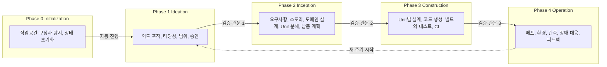

그림의 "검증 관문"은 사람의 승인과는 별개로 **자동으로 도는 점검**입니다. 단계가 넘어가는 경계마다 필수 산출물이 있는지, 요구사항과 스토리 사이의 추적 연결이 끊기지 않았는지, 이름만 있고 어디에도 쓰이지 않는 산출물이 없는지, 관련 산출물끼리 모순이 없는지를 확인합니다. 문제가 나오면 진행할지 되돌아가 고칠지를 사람에게 묻습니다.

### 단계별 스테이지 전체 목록

**[공식·보도]** 아래 표는 사용자 가이드의 단계별 표를 한국어로 옮기고 핵심 산출물을 요약한 것입니다. "필수"는 선택한 계획에 그 스테이지가 들어 있으면 항상 실행된다는 뜻이고, "조건부"는 계획·프로젝트 성격에 따라 건너뛸 수 있다는 뜻입니다.

**Phase 0. Initialization(3개, 자동 실행, 승인 없음)**

| 번호 | 스테이지 | 하는 일 | 구분 |
|---|---|---|---|
| 0.1 | Workspace Scaffold | 이번 작업의 기록 폴더를 만든다 | 필수 |
| 0.2 | Workspace Detection | 신규/기존 프로젝트와 기술 구성을 규칙 기반 스캐너로 탐지한다 | 필수 |
| 0.3 | State Initialization | 진행 상태 파일과 감사 기록을 초기화한다 | 필수 |

이 세 스테이지는 AI 모델을 부르지 않고 결정적인 도구 호출 한 번으로 1초 안에 끝납니다.

**Phase 1. Ideation(7개)**

| 번호 | 스테이지 | 핵심 산출물 | 구분 |
|---|---|---|---|
| 1.1 | Intent Capture & Framing | 의도 진술, 이해관계자 지도 | 필수 |
| 1.2 | Market Research | 경쟁 분석, 직접 구축 대 구매 판단 | 조건부 |
| 1.3 | Feasibility & Constraints | 타당성 평가, 제약 목록, 위험·가정·이슈·의존성(RAID) 기록 | 조건부 |
| 1.4 | Scope Definition | 범위 정의, 의도 백로그 | 필수 |
| 1.5 | Team Formation | 팀 평가, 모브 구성 계획 | 조건부 |
| 1.6 | Rough Mockups | 와이어프레임, 사용자 흐름 | 조건부 |
| 1.7 | Approval & Handoff | 사업 개요서, 결정 기록 | 필수 |

**Phase 2. Inception(9개)**

| 번호 | 스테이지 | 핵심 산출물 | 구분 |
|---|---|---|---|
| 2.1 | Reverse Engineering | 기존 코드를 분석한 9종의 역공학 산출물 | 기존 프로젝트일 때 |
| 2.2 | Practices Discovery | 팀 관행, 발견된 규칙, 근거 문서 | 조건부 |
| 2.3 | Requirements Analysis | `requirements.md` | 필수 |
| 2.4 | User Stories | `stories.md`, `personas.md` | 사용자 대면 기능일 때 |
| 2.5 | Refined Mockups | 정제된 목업, 상호작용 명세 | UI 프로젝트일 때 |
| 2.6 | Domain Design | `components.md`, 설계 결정 기록(ADR) | 실행 계획에 따라 |
| 2.7 | Units Generation | 작업 단위 정의, 의존 관계(DAG), 스토리 매핑 | 필수 |
| 2.8 | Contract Design | 계약(인터페이스) 요약 | 조건부 |
| 2.9 | Delivery Planning | `bolt-plan.md`, 팀 배정, 위험·순서 근거, 외부 의존 지도 | 필수 |

**Phase 3. Construction(7개, 앞의 5개는 Unit마다 반복)**

| 번호 | 스테이지 | 핵심 산출물 | 구분 |
|---|---|---|---|
| 3.1 | Functional Design | 엔티티, 규칙, 기능 명세 | Unit별 조건부 |
| 3.2 | NFR Requirements | 성능·보안·확장성·신뢰성·관측성 비기능 요구사항 | Unit별 조건부 |
| 3.3 | NFR Design | 비기능 설계 명세 | Unit별 조건부 |
| 3.4 | Infrastructure Design | 인프라 명세, IaC 설계 | Unit별 조건부 |
| 3.5 | Code Generation | 애플리케이션 코드와 코드 문서 | Unit별 필수 |
| 3.6 | Build and Test | 테스트 결과, 품질 보고서 | 필수, 모든 Unit 뒤 한 번 |
| 3.7 | CI Pipeline | CI 설정, 품질 관문 | 조건부, 모든 Unit 뒤 한 번 |

**Phase 4. Operation(7개, 모두 조건부)**

| 번호 | 스테이지 | 핵심 산출물 |
|---|---|---|
| 4.1 | Deployment Pipeline | 배포(CD) 설정, 배포 전략, 롤백 런북 |
| 4.2 | Environment Provisioning | 환경 목록, 검증 보고서 |
| 4.3 | Deployment Execution | 배포 기록, 스모크 테스트, 상태 점검 |
| 4.4 | Observability Setup | 대시보드, 경보, 서비스 수준 목표(SLO) 설정 |
| 4.5 | Incident Response | 장애 대응 런북, 사고 계획, 에스컬레이션 표 |
| 4.6 | Performance Validation | 부하 테스트 결과, 비기능 검증 표 |
| 4.7 | Feedback & Optimization | SLO 보고서, 비용 분석, 피드백 루프 문서 |

**[정리]** 이 표를 보면 앞서 제가 "운영 단계는 미성숙"이라고 쓴 부분을 정확히 고쳐야 합니다. 원전과 초기 자료에서 Operations는 AWS 스스로 발전 중이라고 표시했고, Q Developer 워크스루도 이 단계를 실행하지 않았습니다. 반면 v2에는 Operation에 7개 스테이지가 **정의되어 있습니다.** 다만 7개가 전부 조건부이고, 11개 프로필 중 상당수(예: Classic은 자리표시, MVP는 아예 제외)가 이 단계를 건너뜁니다. 정리하면 "구조는 갖췄지만 기본 경로에서는 선택 사항"에 가깝습니다. 실제 운영 현장에서 이 7개 스테이지가 얼마나 검증되었는지는 제가 찾은 자료로는 알 수 없습니다.

## B.10 v2의 Construction 규칙: 기능을 쪼개어 만들고 증명한다

Construction은 가장 규칙이 많은 단계입니다. 사용자 가이드가 설명하는 내용을 쉬운 말로 풀어 보겠습니다.

**Unit 단위로 반복합니다.** 새로 시작하는 단독 작업에서 Unit 분해가 있고 코드를 생산하는 경우의 기본값은 **Unit 우선(unit-major) 직렬 실행**입니다. 한 Unit이 자신의 설계 스테이지들과 코드 생성을 마친 뒤에야 다음 Unit이 시작되고, 실행 순서는 Unit 사이 의존 관계도(DAG)를 따릅니다. 대안은 **스테이지 우선(stage-major)** 방식으로, 모든 Unit이 한 스테이지를 통과한 뒤 다음 스테이지로 넘어갑니다. 이 경우 `swarm` 설정을 켜면 서로 의존하지 않는 Unit을 한 묶음으로 병렬 구축할 수 있습니다. 팀 모드에서는 팀원이 Unit을 하나씩 맡아 각자의 작업 사본에서 동시에 만들 수 있습니다.

**뼈대(walking skeleton)를 먼저 세울 수 있습니다.** 이 옵션을 켜면 첫 번째 Unit을 "실제로 끝에서 끝까지 도는 가장 작은 통합 조각"으로 만들고, 그 코드가 실제 점검을 통과해야 사람이 뼈대를 승인한 뒤 다음 Unit이 시작됩니다. 문서만 검토해서 뼈대로 인정하는 일은 없습니다.

**"증명 명령"이 따로 있습니다.** Unit 검증에 쓰는 명령(예: 테스트 실행)은 Delivery Planning이 프로젝트 스캔으로 제안하고, **사람이 승인해야** 기록됩니다. 검증 도구는 영수증(receipt)을 남기고, 승인에는 그 영수증이 필요합니다. 손으로 쓴 증명 파일로는 Unit을 검증된 것으로 만들 수 없습니다. 이는 "AI가 테스트를 통과했다고 말만 하는" 상황을 막으려는 장치로 읽힙니다(해석입니다).

**실패하면 멈춥니다.** 자율 모드에서도 실패는 반드시 사람에게 돌아옵니다. 한 Unit의 코드 생성이 실패하면 즉시 멈추고 재시도, 건너뛰기, 중단 중 하나를 고르게 합니다. 병렬 묶음에서 일부만 실패하면 전체 묶음이 끝나길 기다린 뒤 성공한 Unit의 산출물은 보존하고 실패한 Unit에 대해서만 같은 선택을 묻습니다.

**자동 계속 옵션이 있습니다.** "Continue automatically"를 고르면 일상적인 완료 확인은 생략되지만, 계획 승인, 요약 확인(켜져 있을 때), 검증 명령 선택, 뼈대 승인, 그리고 모든 실패는 여전히 사람의 몫으로 남습니다.

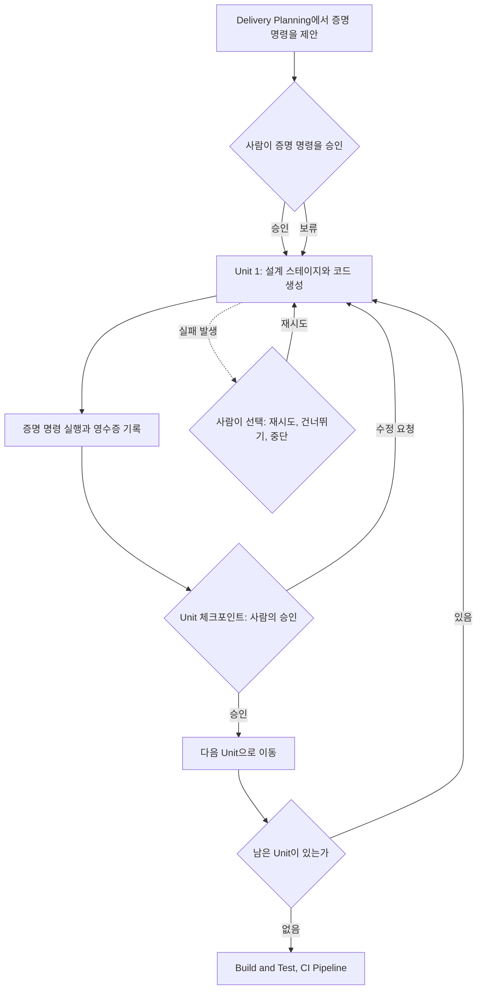

## B.11 14명의 에이전트, 11가지 프로필, 깊이 조절

### 에이전트 14개

**[공식·보도]** v2는 하나의 AI가 모든 일을 하지 않고 역할별 에이전트를 둡니다. 구성은 **도메인 전문가 11개, 검토 전용 2개, 적응형 구성기(composer) 1개**입니다.

- 도메인 전문가 11개: 제품(product), 설계(design), 납품(delivery), 아키텍트(architect), AWS 플랫폼, 컴플라이언스, 데브섹옵스(devsecops), 개발자(developer), 품질(quality), 파이프라인·배포(pipeline-deploy), 운영(operations). 각 스테이지에는 주도(lead) 에이전트가 있고, 필요하면 지원(supporting) 에이전트가 의견을 보탭니다.
- 검토 전용 2개: 제품 책임자 에이전트(요구사항·스토리·UX 산출물의 완결성, 사업 정합성, 시험 가능성 검토)와 아키텍처 검토 에이전트(설계 산출물의 타당성, 구현 가능성, 끊긴 상호 참조, 달성 불가능한 비기능 목표 검토).
- 구성기 1개: `/aidlc compose` 같은 요청이 있을 때 작업의 복잡도를 추정해 맞춤 스테이지 경로를 제안합니다.

실행 방식은 스테이지마다 다릅니다. 33개 중 29개는 대화 안에서 에이전트가 직접 작업하는 inline 방식이고, 2개(Practices Discovery, Code Generation)는 별도 하위 에이전트로, 1개(Reverse Engineering)는 개발자 스캔 뒤 아키텍트가 종합하는 파이프라인으로, 1개(User Stories)는 설계·개발·품질 에이전트가 동시에 기여하는 "모브" 방식으로 돌아갑니다. 즉 사람의 모브 세션을 에이전트 쪽에서도 흉내 낸 구조입니다. 에이전트가 서로를 호출하는 위임 도구는 각 도구의 정책으로 막혀 있다고 문서는 적고 있습니다.

### 워크플로 프로필 11개

**[공식·보도]** 프로필(내부 용어로는 scope)은 "이 작업에 33개 중 어떤 스테이지를 쓸지"를 정해 둔 묶음입니다. 사용자 가이드의 표는 다음과 같습니다.

| 프로필 | 용도 | 사용 스테이지 수 | 깊이 |
|---|---|---|---|
| Classic | v1 방식의 의식을 갖춘 Inception·Construction 흐름 (프로필을 지정하지 않을 때의 기본값) | 18/33 | Standard |
| Express | 요구사항에서 코드·테스트까지 가장 가벼운 경로 | 10/33 | Minimal |
| Feature | 전체 수명주기를 쓰는 프로덕션 기능 | 33/33 | Standard |
| Enterprise | 규제·고보증 작업, 완전한 추적성 | 33/33 | Comprehensive |
| MVP | Operation 단계를 뺀 첫 제품 증분 | 23/33 | Standard |
| Proof of concept | 실현 가능성 검증 | 8/33 | Minimal |
| Bugfix | 알려진 결함의 집중 수정과 회귀 테스트 | 9/33 | Minimal |
| Refactor | 동작 변경 없는 내부 구조 개선 | 10/33 | Minimal |
| Infrastructure | 환경, IaC, 배포 기반, 비용 작업 | 13/33 | Standard |
| Security patch | CVE 등 보안 취약점 대응 | 10/33 | Minimal |
| Workshop | 교육·그룹 실습 세션 | 26/33 | Standard (테스트 전략은 Minimal) |

가이드의 시작 예시 화면에는 같은 프로필이 다른 스테이지 수(예: Classic 14개, Feature 29개)로 표시되어 있습니다. 예시 화면은 다른 시점의 실행 결과이거나 현재 표와 다른 버전일 수 있어, 숫자는 "프로필마다 스테이지 수가 다르다"는 정도로만 받아들이시면 됩니다.

**프로필은 어떻게 고르나.** `/aidlc express`처럼 이름을 직접 지정하는 방법, 작업 설명에서 키워드를 읽어 AI가 프로필을 제안하고 확인받는 방법, 복잡하거나 모호한 작업에서 `compose`로 맞춤 경로를 제안받아 승인하는 방법이 있습니다. 요구사항이 이미 분명하면 Express, 규제·감사 대응이 필요하면 Enterprise, 문제 정의가 불명확하면 Feature나 Enterprise를 권한다고 문서는 안내합니다.

**깊이 조절.** 프로필이 고른 기본 깊이와 별개로 `--depth minimal|standard|comprehensive`로 깊이를, `--test-strategy`로 테스트 전략을, `--review adversarial|advisory|none`으로 검토 강도의 **상한**을 따로 정할 수 있습니다. 검토 강도는 스테이지 선언, 프로필 상한, 실행별 상한 중 가장 낮은 값이 적용되므로 실행 옵션으로 올릴 수는 없습니다. 이 옵션들은 프로필 자체를 바꾸지 않고 조정만 합니다.

## B.12 사람이 개입하는 방식: 질문, 승인, 수정 횟수 제한

**질문에 답하는 세 가지 방식.** 스테이지가 시작되면 AI는 질문 파일을 만들고 답변 방식을 한 번 묻습니다. **Guide me**는 질문을 몇 개씩 대화창에서 선택지로 보여 주는 방식, **Edit File**은 질문 파일을 직접 열어 답을 써 넣는 방식, **Chat**은 자유롭게 대화하면 AI가 대화에서 결정을 뽑아내는 방식입니다. 한 번 고른 방식은 이후 스테이지에서 재사용되며 언제든 바꿀 수 있습니다. 모든 질문에는 "직접 입력"과 "이 문제로 대화하기" 선택지가 항상 붙습니다.

**승인 관문.** 초기화 3개를 제외한 모든 스테이지는 승인 관문으로 끝납니다. 기본 선택지는 Approve(다음 스테이지 이름이 함께 표시됨)와 Request Changes(수정 의견 입력) 두 가지입니다. 승인하면 진행 상태 파일이 갱신되고 다음 스테이지로 넘어갑니다.

**3회 수정 후의 탈출구.** 같은 스테이지에서 수정 요청을 세 번 하면 세 번째 선택지 Accept as-is(현재 버전을 보관하고 넘어가기)가 나타납니다. 끝없는 수정 루프를 막기 위한 장치로, 2번째 수정 때 "한 번 더 수정하면 이 선택지가 열린다"는 안내가 먼저 뜹니다.

**사람이 진짜로 눌렀는지 확인하는 장치.** 승인을 요구하는 관문은 사람의 실제 메시지가 있어야 통과됩니다. 계획이나 설정, 보호 정책으로는 이 요건을 낮출 수 없고, 환경 변수 하나(`AIDLC_SKIP_HUMAN_PRESENCE_GUARD=1`)로만 끌 수 있으며 꺼져 있는 동안은 AI-DLC가 그 사실을 알립니다. 또한 사용자가 직접 승인하기로 한 Unit 체크포인트는 반드시 사용자 본인의 답으로만 결정되고, 다른 질문에 대한 답은 효력이 없습니다.

**단계 건너뛰기와 되돌리기.** 특정 스테이지로 점프할 수 있고(`--stage`, `--phase`), 건너뛴 스테이지는 `[S]`로 표시되며 나중에 자동으로 실행되지 않습니다. 앞 스테이지로 되돌아가면 그 스테이지와 뒤의 모든 스테이지가 다시 열립니다. 파일은 남고, 다시 연 스테이지는 이전 파일을 유지·수정·재작성 중 어떻게 할지 묻습니다.

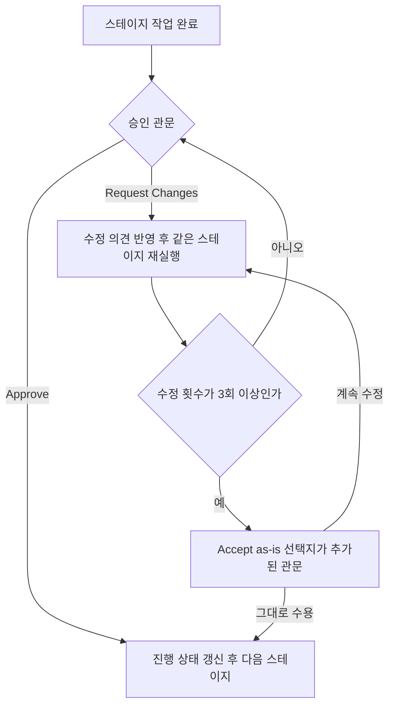

## B.13 설치하고 시작하는 법

**[공식·보도]** 저장소 첫 화면 기준(2.11.0 시점)의 시작 절차는 세 줄로 요약됩니다.

1. **설치**: macOS·Linux·WSL에서는 설치 스크립트(`install.sh`)를, Windows PowerShell에서는 `install.ps1`을 내려받아 실행합니다. 설치기는 `aidlc` 명령과 모든 하네스(AI 코딩 도구)용 실행 환경을 한 번에 설치하며 Bun이나 Node.js를 따로 설치할 필요가 없다고 합니다. 관리자 권한 PowerShell에서는 경고가 나옵니다. 실행 환경을 직접 관리하려는 경우를 위해 수동 복사 방식도 안내됩니다.
2. **프로젝트 설정**: 프로젝트 루트에서 `aidlc config --harness claude`처럼 쓰는 도구를 지정하고 `aidlc doctor`로 점검합니다. `claude` 자리에는 `kiro`, `kiro-ide`, `codex`, `cursor`, `opencode`, `copilot`을 쓸 수 있습니다.
3. **시작**: 도구를 열고 `/aidlc Build a REST API for inventory management`처럼 할 일을 적습니다. Codex CLI는 `$aidlc`, Kiro IDE는 채팅창의 에이전트 선택에서 aidlc를 먼저 고릅니다. 그러면 AI-DLC가 요청에 맞는 프로필을 제안하고, 빠진 결정을 묻고, 승인 관문마다 멈춥니다.

저장소 문서는 권장 모델로 당시 기준 Claude Opus 4.8을 적고 있고(모델 권장은 자주 바뀔 수 있습니다), 모델 제공 설정은 각 도구의 몫이며 방법론 자체는 모델 제공자와 무관하다고 설명합니다. 문서 맨 위의 경고도 눈여겨볼 만합니다. 생성형 AI는 실수할 수 있으니 생성 결과와 비용을 직접 검토하라고 적혀 있습니다.

## B.14 이 영상과는 어떻게 이어지나

영상과 AI-DLC의 접점은 세 가지입니다.

1. **[영상]** 한 참가자의 작업 폴더에 `aidlc-docs`가 보이고, Inception·Construction·Operations 단계로 보이는 체크리스트가 있습니다.
2. **[공식·보도]** 대회가 제공한 개발 도구는 AWS의 Kiro였고, AWS는 AI-DLC와 Kiro를 함께 알리고 있습니다(2026-07-16 AWS 코리아 기자간담회).
3. **[공식·보도]** AWS 서밋 서울 2026(5월)에서는 AI-DLC 챌린지가 열렸고, 현대해상·LG유플러스·SK AX가 우승팀으로 기자간담회에 참여했습니다.

여기서 B.8의 관찰이 쓸모를 갖습니다. **`aidlc-docs`라는 폴더 이름은 제가 읽은 자료에서 v1 계열(Amazon Q Developer 워크스루, 해설 글)에 나오고, 2.11.0 시점의 v2 사용자 가이드에는 나오지 않습니다.** 이것이 말해 주는 바는 제한적입니다. 참가자가 v1 계열 규칙 파일(예: Kiro의 스티어링 파일 형태로 배포된 것)을 썼거나, 주최 측·참가자가 만든 별도 템플릿이 같은 이름을 썼거나, 또는 제가 읽지 못한 v2의 다른 설정 경로가 있을 수 있습니다. 어느 쪽인지는 영상과 제가 확인한 보도만으로는 알 수 없습니다.

이 정황을 이어 붙이면 "LG 프롬프톤에서 AI-DLC를 썼을 것"이라는 그림이 그려지지만, **정황일 뿐 확인된 사실이 아닙니다.** 대회 주최 측이 방법론을 지정했다는 언급은 제가 확인한 공개 자료에 없고, 다른 방식(예: Kiro의 스펙 기능만 사용)으로도 비슷한 이름의 문서가 생길 수 있는지는 확인하지 못했습니다.

## B.15 장점과 그 근거의 강도

### 주장되는 장점

- **방향이 틀어진 채로 달리는 문제를 줄인다.** 코드를 만들기 전에 요구사항과 계획을 사람이 확정하므로, AI가 엉뚱한 방향으로 대량의 코드를 쏟아 내는 일을 막는다는 논리입니다.
- **결정이 문서로 남는다.** 나중에 왜 그렇게 만들었는지 추적할 수 있고, 팀원이나 다른 AI 세션이 맥락을 이어받기 쉽습니다.
- **역할이 분명해진다.** 사람은 "설계자이자 검증자", AI는 "초안 작성과 실행"이라는 분업이 명확합니다.
- **짧은 반복에 맞다.** 며칠 단위(Bolt)로 빠르게 돌 수 있습니다.
- **작업 크기에 맞춰 무게를 조절한다.** v2의 프로필 11종과 깊이 옵션이 "작은 버그에 큰 의식"을 피하려는 장치입니다.

### 숫자로 제시된 성과와 한계

- **[공식·보도]** AWS는 내부 프로젝트에서 중간값 기준 약 4.5배의 생산성 향상을 보고했다고 소개합니다. 다만 이는 **AWS가 스스로 측정해 발표한 수치**입니다.
- **[공식·보도]** 2026-07-16 기자간담회에서 AWS 측은 LG전자 MS사업본부가 개발 생산성을 2배로 높였고, CJ올리브영이 3일간의 워크숍에서 5개 프로젝트의 MVP를 완성했으며, 어떤 B2B 서버 플랫폼 사례에서는 스프린트가 2주에서 1주로, 총 투입 공수가 6.0 M/M에서 3.0 M/M으로 줄었다고 소개했습니다. AWS 서밋 서울 2026 기조연설 보도(바이라인네트워크, 2026-05-20)에도 LG전자와 올리브영 사례가 나옵니다. 어떤 제품·팀에서 어떤 기준으로 측정했는지는 제가 본 자료에 없습니다.
- **[공식·보도]** 같은 간담회에서 AWS는 업계 보고서를 인용해 "AI를 도입한 개발 조직의 94%가 기대한 성과를 내지 못한다", "상위 5% 조직도 기능 개발 속도는 85% 빨라졌지만 배포 속도는 26% 개선에 그쳤다"고 설명했습니다(CircleCI 보고서 인용으로 보도됨). 또 소프트웨어 개발에서 코딩이 차지하는 비중은 약 20%라는 AWS 담당자의 설명도 보도되었습니다. AI로 코딩이 빨라져도 검증·배포가 따라오지 못하면 전체 효과가 작다는 AWS의 문제의식을 보여 줍니다.
- **[공식·보도]** 개발 분석 업체 Jellyfish는 AI-DLC에 관한 자사 블로그에서 상위 도입 그룹의 PR 처리량이 약 1.7배라는 수치와 AI가 만든 PR이 더 크다는 관찰을 소개했습니다. 이 역시 업체 블로그의 주장입니다.
- **[공식·보도]** AWS는 Kiro가 AWS 공개 오픈소스 벤치마크 기준으로 같은 작업의 비용이 타사 도구의 6분의 1에서 10분의 1 수준이었다고도 주장했습니다. 이것은 AI-DLC가 아니라 도구(Kiro)에 대한 주장입니다.

**[정리]** 정리하면, AI-DLC의 효과를 **독립적인 제3자가 대규모로 검증한 연구는 제가 찾은 범위에서는 보이지 않습니다.** 나온 수치는 방법론을 제안한 쪽, 도입 사례를 홍보하는 쪽, 분석 서비스를 파는 쪽에서 나온 것이어서 "가능성을 보여 주는 사례" 정도로 읽는 것이 정확합니다. 한 외부 해설 글(orchestrator.dev, 2026-10-03)은 AWS가 발표한 "약 3개월 계획 작업을 4시간 모브 세션 5일로 줄였다"거나 "10~15배 생산성" 같은 수치가 AWS의 자체 주장이며 독립 검증되지 않았고, 그린필드 프로젝트에 AWS 엔지니어가 참여한 통제된 조건이라는 점을 독립 평론가들이 지적한다고 전합니다. 그 글 자체도 필자가 직접 돌려 본 실사용기가 아니라 개요라고 스스로 밝히는 형태여서, 이 지적 역시 간접 인용으로 받아들여야 합니다.

또 AWS 서밋 챌린지 우승팀들의 결과(현대해상은 요구사항 정의부터 개발까지 6시간, LG유플러스는 코딩 자체는 30~40분에 끝나고 대부분의 시간을 설계와 의사결정에 썼다는 발표)는 **대회·시연 환경의 결과**이므로 실제 운영 시스템의 개발 속도와 같다고 볼 수 없습니다.

## B.16 위험과 한계

- **[정리] 형식적 승인의 위험.** 사람이 승인해야 한다는 구조는, 승인하는 사람이 내용을 읽지 않고 누르기 시작하면 안전장치로 기능하지 않습니다. 외부 해설 글은 한 실무자가 문서를 한 시간 넘게 읽은 뒤부터 승인이 형식적인 클릭이 되었다고 보고했다고 전하며, 승인 세션을 한 시간 안팎으로 끊고 게이트 사이에 쉬라고 권합니다(간접 인용). v2가 "사람이 직접 보낸 메시지가 있어야 승인된다"는 장치를 둔 것도 이 위험을 의식한 설계로 읽을 수 있습니다(해석입니다).
- **[정리] 작성자와 승인자가 같아지는 문제.** 의도를 쓴 사람이 계획까지 승인하면 직무 분리가 무너진다는 지적이 같은 글에 나옵니다. 프롬프트를 쓰지 않은 승인자를 따로 두라는 권고입니다.
- **[정리] 검토 병목.** 생산 속도가 빨라지면 병목은 사람의 검토로 옮겨 갑니다. 앞서 본 "개발 속도는 빨라졌는데 배포 속도는 덜 빨라졌다"는 보고가 이 현상을 가리킨다고 해석할 수 있습니다(해석입니다).
- **[정리] 잘못된 명세의 전파.** 초기 단계의 요구사항이나 설계가 틀리면 이후 단계가 그 오류 위에 쌓입니다. 계획 문서가 길고 그럴듯해 보일수록 오류를 발견하기 어렵습니다.
- **[정리] 작은 작업의 과도한 멈춤.** 작은 버그 수정에도 여러 번 멈춘다는 불만이 있고, 그래서 경량 프로필(Express, Bugfix 등)을 쓰라는 권고가 나온다고 같은 외부 글이 전합니다.
- **[공식·보도] 보안.** AWS 간담회에서는 Veracode 분석을 인용해 취약점이 없는 코드 비율이 AI 생성 코드 55%, 사람이 쓴 코드 75%라고 소개했고, Black Duck 보고서를 인용해 코드베이스당 취약점이 전년 대비 107% 늘었다고 했습니다. AI 코드 일반의 위험이지 AI-DLC 고유의 결과는 아니지만, 방법론이 이 문제를 자동으로 해결해 주지 않는다는 뜻입니다.
- **[정리] 운영 단계 검증 부족.** 앞서 적었듯 Operation은 구조는 갖췄지만 기본 경로에서는 선택 사항이며, 현장 검증 정도는 확인하지 못했습니다.
- **[정리] 비용과 비결정성.** 질문·계획·문서화·검토 단계마다 모델 호출이 늘어 토큰 비용이 커질 수 있고(제가 본 자료에는 비용 측정치가 없습니다), 같은 입력에도 AI의 출력이 달라질 수 있어 재현성이 완전하지 않습니다. 원전 워크스루 글도 실행마다 결과가 달라질 수 있다고 인정합니다.
- **[정리] 전제 조건.** 자동화된 테스트가 없거나 문서를 읽고 판단할 시간을 내지 못하는 팀에서는 효과가 작을 가능성이 큽니다. 이는 구조에서 따라 나오는 추론이며 실험으로 확인된 것은 아닙니다.
- **[정리] 도입 방식.** 해설 글은 대규모 전환보다 통제된 파일럿을 권합니다. 리드타임, 결함률, 테스트 커버리지, 문서 완성도, 리뷰 부담으로 측정하고, 워크플로 규칙을 프로젝트와 함께 커밋해 재현성을 확보하며, PR·CI/CD·코드 리뷰·위협 모델링 같은 기존 거버넌스는 유지하라는 내용입니다. 이는 필자의 권고입니다.

## B.17 다른 방법론과의 비교

### 먼저 정리할 구분: 기법인가, 수명주기 전체인가

AI 코딩을 둘러싼 방법론들은 크게 두 층으로 나뉩니다. 하나는 **"코드를 쓰기 전에 명세(spec)부터 쓰자"** 는 **명세 주도 개발(Spec-Driven Development, SDD)** 계열의 도구·기법이고, 다른 하나는 요구사항에서 운영까지 **전체 수명주기와 팀의 일하는 방식**을 다루는 방법론입니다. AI-DLC는 후자에 속하며 명세 주도 방식을 그 안에 포함하는 구조입니다. 반대로 Spec Kit이나 OpenSpec은 대체로 "한 건의 변경을 어떻게 진행할지"에 초점을 둔 도구에 가깝습니다. 비교 글(Developer Toolkit)에서도 이들을 대체재라기보다 쓰임새가 다른 도구로 다룹니다.

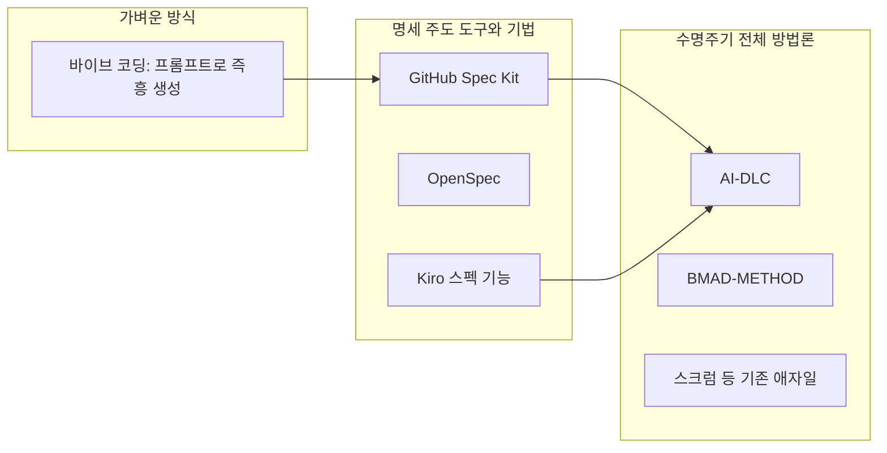

위 그림의 화살표는 "도입 수준이 올라가는 일반적인 방향"을 보여 주려는 개념도이며, 어떤 팀이 실제로 이 순서로 옮겨 갔다는 뜻이 아닙니다.

### 비교표

아래 표의 각 도구 설명은 공개 저장소와 도구 비교 글에서 확인한 내용을 요약한 것입니다. 도구들은 자주 바뀌므로 세부 기능은 최신 문서를 확인하세요.

| 구분 | 핵심 아이디어 | 범위 | 사람의 역할 | 산출물 | 비고 |
|---|---|---|---|---|---|
| AI-DLC (AWS) | AI가 제안하고 사람이 결정. 착수·구축·운영, 짧은 Bolt 반복, 승인 관문, 감사 기록 | 요구사항에서 운영까지 전체 | 승인 관문마다 검토·결정, 모브 세션 참여 | 요구사항, 스토리, Unit, 설계, 코드, 테스트, 감사 기록 | 오픈소스(MIT-0), 7개 도구에서 사용 가능. 프로필 11종으로 무게 조절 |
| GitHub Spec Kit | 헌장(constitution)을 정한 뒤 명세·명확화·계획·작업 분해·분석·구현 순으로 진행 | 한 건의 기능·변경 | 각 단계 산출물 검토 | 명세, 계획, 작업 목록 | 오픈소스(MIT). 처음부터 만드는 프로젝트에 어울린다는 평이 많음 |
| OpenSpec | 변경 제안(propose) → 적용(apply) → 보관(archive). 명세의 변경분(delta)을 관리 | 기존 코드가 있는 프로젝트의 변경 | 제안 승인, 적용 결과 확인 | 명세 변경분, 보관된 이력 | 기존 시스템(brownfield) 수정에 초점 |
| BMAD-METHOD | 분석가·설계자·개발자·검증자 같은 역할(관점)별 에이전트가 단계를 나눠 수행 | 기획에서 구현·검증까지 | 단계 전환 승인, 학습과 조정 | 기획·설계 문서, 구현 | 오픈소스(MIT). 역할 기반이라는 점이 특징 |
| Superpowers 등 작업 분류형 | 작업 유형을 분류하고 테스트 주도(TDD) 같은 규율을 강제 | 코딩 작업 단위 | 규율 준수 확인 | 테스트와 코드 | 방법론이라기보다 에이전트 행동 규칙 모음에 가까움 |
| Kiro 스펙 기능 | 요구사항·설계·작업을 문서로 먼저 만든 뒤 구현. 훅·스티어링·MCP 제공 | 한 건의 기능 | 문서 검토·승인 | 요구사항·설계·작업 문서 | AWS의 IDE 기능이며 AI-DLC와 같은 회사 제품 |
| 스크럼 등 기존 애자일 | 사람 팀이 2~4주 스프린트로 반복 | 제품 개발 전반 | 거의 모든 작업을 사람이 수행 | 백로그, 증분 | AI가 작업을 수행한다는 전제가 없음 |
| 바이브 코딩 | 프롬프트를 주고받으며 즉흥적으로 결과를 얻음 | 프로토타입, 작은 작업 | 결과를 보고 다음 프롬프트 | 코드 위주 | 기록·검증 체계가 거의 없음 |

### AI-DLC와 다른 방법론의 결정적 차이를 세 가지로 줄이면

1. **범위**: 다른 도구가 "한 건의 변경"을 잘 다루는 데 집중할 때, AI-DLC는 구상(Ideation)부터 운영 피드백까지 한 의도(intent)의 전 과정을 이어 붙입니다. 운영에서 얻은 피드백이 다시 구상 단계로 돌아가는 고리까지 구조에 들어 있습니다.
2. **통제 장치의 밀도**: 단계마다 승인 관문, 경계마다 자동 검증 관문, Unit마다 사람이 승인한 증명 명령과 영수증, 모든 입력과 승인의 감사 기록이 있습니다. 가벼운 도구일수록 이런 장치가 적고 속도가 빠릅니다. 이 밀도는 장점이자 비용입니다.
3. **협업 의식**: 모브 세션처럼 **팀이 한 자리에서 AI와 함께 결정하는 방식**이 방법론에 들어 있습니다. 대부분의 명세 도구는 개인이 AI와 일대일로 쓰는 것을 기본 장면으로 둡니다. 다만 v2의 에이전트 구성은 사람의 모브를 에이전트들이 흉내 내는 구조까지 포함하고 있어 경계가 흐려지는 부분도 있습니다.

### 같이 쓰기와 혼동하기 쉬운 것

- **한 변경에는 하나의 프레임워크만 쓰라**는 경고가 비교 글에서 자주 나옵니다. 두 방법론이 각기 다른 폴더·문서 규칙으로 에이전트를 지시하면 AI가 혼란을 일으키기 쉽기 때문입니다.
- **ISO/IEC 42001이나 NIST AI RMF는 비교 대상이 아닙니다.** 이들은 조직이 AI를 어떻게 관리·통제할지를 다루는 거버넌스 표준·프레임워크로, 소프트웨어를 어떤 순서로 개발할지를 정하는 방법론이 아닙니다.
- **AIDDLC라는 별도의 7단계 표준**과 **제3자의 "AI-DLC 2026" 확장 문서**가 따로 존재합니다. 이름이 거의 같아 자료를 찾을 때 섞이기 쉬우니 출처를 확인하세요(B.1 참고).

## B.18 질문에 대한 답: LG와 LG CNS는 자체 AI 방법론이 없는 것인가

먼저 결론부터 말씀드리면, **"없다"고 단정할 수는 없고, 공개 자료로 확인되는 것은 "AI 개발 플랫폼과 접근 방식은 있지만 AI-DLC처럼 단계·의식·용어·승인 규칙까지 공개한 독립 방법론 문서는 찾지 못했다"는 수준**입니다. 공개 자료에 없다는 것이 내부에 없다는 증거는 아니라는 점을 함께 기억해 주세요.

### LG CNS: 방법론이라기보다 플랫폼과 접근 방식으로 공개

**[공식·보도]** LG CNS는 자체 개발 플랫폼 브랜드 **DevOn** 아래에서 AI 개발 체계를 발전시켜 온 것으로 보도되었습니다.

1. **DevOn AIDD(2025-05-28 보도)**: AI-Driven Development를 표방하며 분석·설계·코딩·테스트·품질 진단에 AI를 적용하는 체계를 소개했습니다. 이후 "AI 프로그래머"로 확장 발표되었습니다. 제가 확인한 보도에는 별도의 방법론 문서나 정량적 성과가 없었습니다.
2. **Cline과의 협력(2025-12-18 보도)**: LG CNS와 AI 코딩 에이전트 Cline이 공동 사업 협약(JDA)을 맺고, 자사의 "DevOn AI Native Development"와 Cline을 결합한 **"Cline Spec Driven For Enterprise"** 를 만들기로 했다고 보도되었습니다. 이름에서 보듯 명세 주도 방식을 기업용으로 다듬는 방향입니다.
3. **DevOn AIND(2026-06-08 보도)**: "DevOn Agentic AI Native Development"를 발표하며 단계별 전문 에이전트, 온톨로지 기반 지식 기반(Knowledge Foundation), 명세 주도 개발 접근을 내세웠습니다. 보도에서 COBOL에서 Java로의 전환을 "몇 주에서 몇 분으로" 줄인다는 회사 주장이 있었으나, 어떤 LLM을 썼는지나 생산성 비율은 밝히지 않았습니다. (참고로 보도에 나온 4,704%는 LG CNS의 성과가 아니라 Cline의 GitHub 성장률을 가리키는 수치입니다.)

**[정리]** 흥미로운 대목은 구조의 닮은 점입니다. DevOn AIND가 내세우는 "단계별 전문 에이전트"와 "지식 기반"은 AI-DLC v2의 "스테이지별 주도 에이전트 14개"와 "누적되는 팀 지식·학습된 규칙"과 **개념적으로 비슷한 방향**입니다. 다만 이는 두 쪽의 홍보 문구를 나란히 놓은 비교일 뿐, LG CNS의 내부 구조를 제가 확인한 것이 아니므로 동일하거나 유사한 방법론이라고 말할 근거는 없습니다.

종합하면 LG CNS는 "AI로 개발 전 과정을 바꾸는 플랫폼(DevOn)과 명세 주도 접근"이라는 **자체 체계를 공개해 왔지만**, AI-DLC처럼 단계 정의, 승인 관문, 의식, 문서 규약을 외부가 그대로 따라 할 수 있게 공개한 방법론 문서는 찾지 못했습니다. 또한 2025년 말에는 외부 도구(Cline)와 손잡는 방식을 택했습니다. 이 선택의 이유를 회사가 밝힌 자료는 보지 못했고, "도구 생태계에 얹는 편이 낫다고 판단했을 수 있다"는 정도가 추정이며 사실로 말할 근거는 없습니다.

### LG전자·LG그룹: 이름 붙은 공개 방법론은 확인되지 않음

**[공식·보도]** LG 프롬프톤이 열린 LG AI 데브콘에서 LG CNS 발표는 "AI를 활용한 노후 시스템 개선 성과"가 소개되었다는 정도로만 확인되고, LG전자의 webOS 관련 발표에서도 특정 도구나 프레임워크 이름이 언급되지 않았습니다. 임원 대상 프로그램 보도자료에도 LG의 자체 AI 개발 방법론이 언급되지 않았습니다. 그룹 차원에서 이름이 붙은 공통 방법론을 공개한 사례는 제가 검색한 범위에서 찾지 못했습니다.

**[공식·보도]** 오히려 눈에 띄는 것은 외부 방법론을 쓴다는 신호입니다. AWS 코리아는 AWS 서밋 서울 2026 기조연설(2026-05-20)과 7월 기자간담회에서 **LG전자 MS사업본부가 AI-DLC 도입으로 생산성을 2배 높였다**고 소개했고, AI-DLC 챌린지 우승팀에는 LG유플러스(모빌리티AX개발팀)가 포함되었습니다. 이는 AWS 측 발언을 언론이 전한 것이어서, 해당 내용을 LG전자가 직접 확인한 자료는 보지 못했습니다. 또한 MS사업본부의 적용 범위와 2배의 측정 기준은 공개되지 않았습니다.

### 그래서 어떻게 이해하면 좋은가

- **[정리] "자체 방법론 부재"로 읽기는 이르다.** LG CNS는 자체 AI 개발 체계(DevOn 계열)를 공개해 왔고, 이는 방법론의 일부 역할을 할 수 있습니다.
- **[정리] 다만 "AWS의 AI-DLC 같은 이름 붙은 공개 방법론"은 확인되지 않는다.** 대기업은 방법론을 외부에 문서로 공개할 이유가 크지 않은 경우가 많아, 내부에서만 쓰는 지침이 있을 가능성은 열려 있습니다(이것은 가능성의 이야기이며 확인된 사실이 아닙니다).
- **[정리] 외부 방법론을 채택하는 것 자체는 이상한 일이 아니다.** 스크럼도 외부에서 만들어진 방법론을 대기업들이 널리 채택해 왔습니다. 기업은 보통 외부 방법론에 자사 플랫폼과 보안·품질 규정을 얹는 방식으로 운영합니다.
- **[영상] 이번 프롬프톤에서는** 주최 측이 방법론을 지정했다는 언급이 영상과 제가 확인한 보도에 없고, 도구로는 AWS Kiro와 LG의 엑사원이 제공되었다는 점만 확인됩니다.

## B.19 직접 확인하고 싶을 때의 질문 목록

공개 자료만으로는 닫히지 않는 부분입니다. 대회 관계자나 해당 회사에 물어볼 수 있다면 다음이 핵심 질문입니다.

1. 프롬프톤에서 참가자에게 방법론(AI-DLC 등)을 안내하거나 지정했는가, 아니면 도구(Kiro)만 제공했는가?
2. 영상 속 `aidlc-docs` 폴더는 어떤 경로(교육, 템플릿, 참가자의 자율 선택)로, 어떤 버전의 규칙으로 만들어졌는가?
3. LG전자 MS사업본부의 "생산성 2배"는 어떤 업무·기간·지표로 측정한 값인가?
4. LG CNS의 DevOn AIND에서 말하는 "명세 주도 개발 접근"은 단계와 승인 규칙이 문서화된 방법론인가, 아니면 도구 기능의 집합인가?
5. (도입을 검토하는 팀이라면) 우리 조직의 작은 저장소 하나에서 Bugfix 같은 가벼운 프로필로 끝까지 돌려 보고, 승인 관문 수와 집중 시간, 결함률을 직접 기록해 보았는가?

## B.20 별첨 B 참고 자료

**AI-DLC 원전과 저장소**
- AWS DevOps Blog, AI-DLC 소개 글(2025-07-31) — https://aws.amazon.com/blogs/devops/ai-driven-development-life-cycle/
- AWS DevOps Blog, 「Building with AI-DLC using Amazon Q Developer」 — https://aws.amazon.com/blogs/devops/building-with-ai-dlc-using-amazon-q-developer
- AWS DevOps Blog, 「Open-sourcing adaptive workflows for AI-Driven Development Life Cycle (AI-DLC)」(2025-11-29) — https://aws.amazon.com/blogs/devops/open-sourcing-adaptive-workflows-for-ai-driven-development-life-cycle-ai-dlc/
- GitHub, awslabs/aidlc-workflows (README, 사용자 가이드: 소개·시작하기·Phases and Stages·Agents·Interaction Modes·Workflow Profiles) — https://github.com/awslabs/aidlc-workflows
- Classmethod, AI-DLC workflows v2 GA 소개 — https://dev.classmethod.jp/en/articles/aidlc-workflows-v2-ga-kiro-cli/

**해설 자료(2차 출처)**
- IBM Think, 「AI-DLC: The AI-Driven Development Lifecycle」(2026-08-04) — https://www.ibm.com/think/topics/ai-dlc
- TT PSC, 「How AWS's AI-DLC defines an AI-Native methodology」(2026-06-10) — https://ttpsc.com/en/blog/how-aws-ai-dlc-defines-an-ai-native-methodology/
- orchestrator.dev, 「AI-DLC in Practice」(2026-10-03, 개요성 글) — https://orchestrator.dev/blog/2026-10-03-ai-dlc-in-practice/
- ai-dlc.dev, 「AI-DLC Paper」(AWS 공식 문서 표시 없음, 확장판) — https://ai-dlc.dev/paper

**한국 보도(AWS 코리아 행사)**
- 전자신문, 「AWS, 'AI-DLC & Kiro'로 AI 개발 생태계 주도권 강화… "개발자, 코더에서 설계·검증자로"」(2026-07-16) — https://www.etnews.com/20260716000274
- 바이라인네트워크, AWS 코리아 기자간담회 기사(2026-07-22) — https://byline.network/2026/07/22-594/
- 바이라인네트워크, AWS 서밋 서울 2026 함기호 대표 기조연설 기사(2026-05-20) — https://byline.network/2026/05/20-595/
- AWS 기술 블로그, CJ올리브영 AI-DLC 사례 — https://aws.amazon.com/ko/blogs/tech/cj-oliveyoung-aidlc-tech-blog/

**다른 방법론**
- Jellyfish, AI-Driven Development Lifecycle 해설 — https://jellyfish.co/library/ai-driven-development-lifecycle/
- Developer Toolkit, 명세 주도 프레임워크 비교 — https://developertoolkit.ai/en/ecosystem/frameworks/spec-driven-frameworks/
- GitHub, github/spec-kit — https://github.com/github/spec-kit
- GitHub, bmad-code-org/BMAD-METHOD — https://github.com/bmad-code-org/BMAD-METHOD

**LG CNS·LG 관련**
- LG 뉴스룸 보도자료 — https://www.lg.co.kr/media/release/29020 , https://www.lg.co.kr/media/release/30232 , https://www.lg.co.kr/media/release/27662
- 시대일보, LG CNS·Cline 협력 기사(2025-12-18) — https://www.sidae.com/article/2025121809074479704
- 아시아경제, LG CNS DevOn AIDD 관련 기사 — https://view.asiae.co.kr/article/2025080407332367024
- 디지털타임스 — https://www.dt.co.kr/article/12066366
- 머니투데이(LG AI 데브콘·프롬프톤 보도, 2026-09-16) — https://www.mt.co.kr/article/2026091608432966260
- 코리아타임스, LG CNS DevOn AIND 기사(2026-06-08)

---

작성일: 2026-10-17
