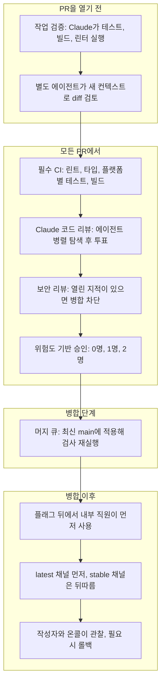
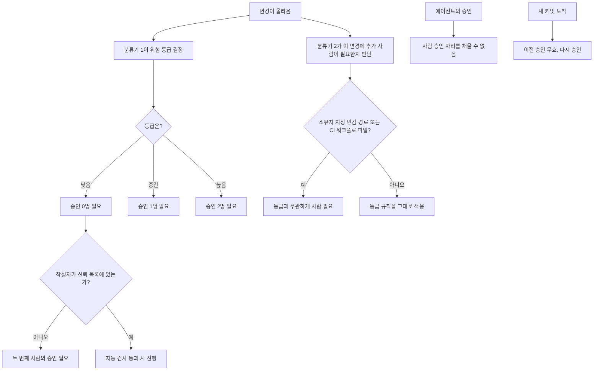
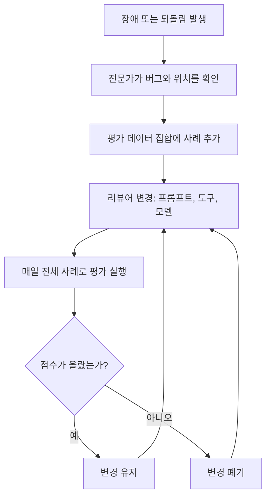
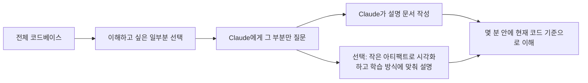
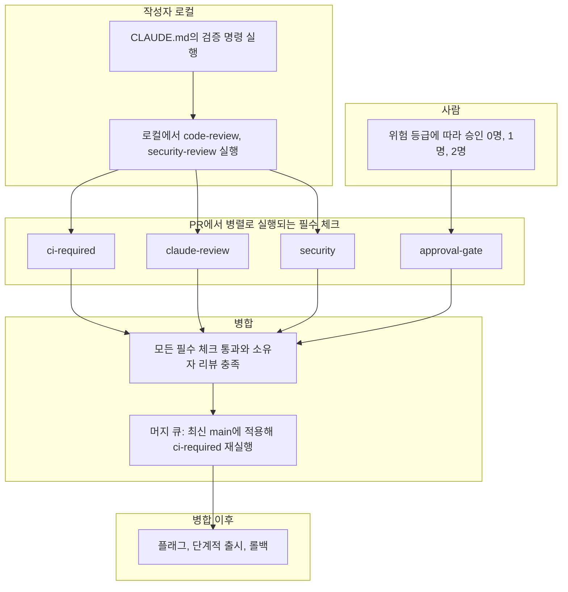

- 원문: "How the Claude Code team does code review" (claude.dev Blog, Engineering)
- 게시일: 2026-10-15 / 저자: Addy Osmani, Morgan Westlee Lunt, Qing Wang
- 원문 주소: https://claude.dev/blog/solving-code-review-at-anthropic/
- 이 문서는 원문의 내용을 한국어로 풀어 설명하고, 같은 시기에 공개된 공식 발표(Code Review 정식 출시)를 검색해 보강한 해설서입니다. 원문에 없는 내용을 추측으로 덧붙이지 않았으며, 원문 밖의 정보는 "보강 정보"라고 따로 표시했습니다.
- 부록 A에는 이 해설의 구조를 GitHub와 GitLab에서 구현한 파이프라인 예시가, 부록 B에는 위험 분류기를 AI와 알고리즘 중 무엇으로 만들지에 대한 검토와 선택 적용 가능한 구현이, 부록 C에는 별도 테스트팀 유무와 품질 측정 방식, ALM·SDLC·개발 방법론 구분이 들어 있습니다.

---

## 1. 한눈에 보는 핵심

이 글이 던지는 질문은 단순합니다. AI가 코드를 대부분 작성하는 시대에, 그 많은 코드를 어떻게 검토할 것인가 하는 문제입니다. Anthropic은 Claude Code 코드의 약 90%를 Claude가 쓴다고 밝혀 왔습니다. 코드가 이렇게 빨리, 많이 만들어지면 사람이 한 줄 한 줄 읽는 전통적인 리뷰 방식은 사실상 불가능해집니다.

글쓴이들의 답은 "리뷰를 없앴다"가 아닙니다. 오히려 리뷰의 대부분을 기계에게 넘기되, 사람의 시간과 주의력을 정말 사람이 필요한 곳에만 쓰도록 구조를 다시 짰다는 것입니다. 그 결과로 제시하는 대표 수치는 다음과 같습니다. 2026년 6월부터 9월 사이에 Claude Code 코드베이스에 병합된 풀 리퀘스트(PR)는 두 배 넘게 늘었는데, 그중 되돌려야 했던(revert) 비율은 40% 넘게 줄었다고 합니다. 다만 이 수치는 Anthropic이 자기 팀의 내부 측정값으로 직접 밝힌 것이라는 점은 기억해 둘 필요가 있습니다.

글 전체를 관통하는 사고방식은 이 한 문장으로 요약됩니다. "사람이 코드를 읽었는가?"라는 질문은 부정확한 대용 지표일 뿐이고, 진짜 질문은 "이 변경에서 무엇이 잘못될 수 있고, 그것을 잡기에 가장 적합한 검사는 자동화된 것인가 사람인가?"라는 것입니다.

---

## 2. 배경: 왜 리뷰 방식을 바꿔야 했나

### 2.1 변경량의 폭증

에이전트가 코드를 쓰기 시작하면 변경 건수가 급격히 늘어납니다. 원문은 Anthropic의 모노레포(여러 프로젝트가 한 저장소에 모여 있는 구조)에서 하루에 반영되는 변경이 올해 5월 약 2,500건에서 9월 3만 건 이상으로 늘었다고 소개합니다. Claude Code는 이 모노레포와 별도의 저장소에서 개발되지만, 비슷한 압력을 받고 있다고 설명합니다. 이 속도에서는 줄 단위 수동 리뷰가 "매우 어렵거나 불가능"하다는 것이 출발점입니다.

### 2.2 코드 리뷰가 원래 하던 두 가지 일

원문은 코드 리뷰가 본래 두 가지 역할을 한다고 정리합니다.

첫째는 출시 전에 문제를 찾아 고치는 일이고, 둘째는 팀 안에 코드베이스에 대한 공통 이해와 맥락을 퍼뜨리는 일입니다. 글의 앞부분은 첫째 역할에 집중하고, 둘째 역할은 뒤쪽 "맥락 공유" 절에서 다시 다룹니다.

### 2.3 리뷰의 시점이 바뀌었다

예전의 리뷰는 길 끝에 놓인 관문이었습니다. 코드를 쓰고, PR을 열고, 동료가 봐 주기를 기다리는 순서였습니다. 지금은 글을 쓰는 동안 맞춤법 검사기가 계속 돌아가듯, 리뷰가 작업 중에 계속 실행됩니다. 대부분의 변경은 사람에게 검토를 요청하기 전에 이미 Claude가 한 번 이상 검토하고 고친 상태입니다. 덕분에 사소한 실수는 기계가 걸러 내고, 팀의 주의력은 더 높은 수준의 질문에 남겨 둘 수 있다는 설명입니다.

---

## 3. 가장 희소한 자원: 사람의 시간과 주의력

글쓴이들은 사람의 시간을 이렇게 정의합니다. 리뷰하는 데 쓰는 시간뿐 아니라, 잘못된 코드가 일으킨 문제를 고치는 데 쓰는 시간까지 합쳐서 "사람의 시간"입니다. 리뷰 시간만 줄이고 사고 수습 시간이 늘어난다면 아무것도 아낀 것이 아니라 시간을 옮겨 놓았을 뿐이라는 논리입니다.

그래서 목표는 이렇게 세워졌습니다. Claude Code 저장소들(CLI, 데스크톱·웹 앱, 모바일 앱)에서 대부분의 PR이 "사람이 많아야 한 명"만 거치고 병합되게 하되, 되돌림이나 장애가 늘지 않아야 합니다. 이때 그 한 명은 작성자 본인일 수도 있습니다.

측정 방식도 구체적입니다. PR당 사람의 승인 횟수(중앙값과 95번째 백분위), 사람이 남긴 댓글 수, PR이 사람을 기다리는 시간을 추적합니다. 그리고 되돌림 비율과 장애 비율을 "가드레일"로 둡니다. 이 두 지표가 오르면 사람의 시간을 아낀 것이 아니라 다른 곳으로 옮긴 것으로 판단합니다.

---

## 4. 변경의 일생: 한 PR이 거치는 길

하나의 변경은 엔지니어의 노트북(또는 Slack 안의 Claude 세션)에서 출발해 사용자에게 닿기까지 여러 겹의 검사를 통과합니다. 원문 전체 흐름을 아래 도표로 정리했습니다.



원문은 이 구조를 한 문장으로 요약합니다. 길의 대부분은 자동화되어 있고, 사람의 주의력은 위험이 있는 곳에 투입됩니다. 또 이 여러 겹의 검사는 하나의 관문이 아니라 겹겹이 쌓인 층이라고 강조합니다. 각 층은 어떤 문제는 잡고 어떤 문제는 놓치며, 모든 층을 통과하는 문제는 드물고, 그래도 새는 것은 맨 아래의 롤백이 처리한다는 설계입니다.

---

## 5. 계층별 상세 설명

### 5.1 층 1 — 다른 사람이 보기 전에 작업을 먼저 검증한다

원문에 따르면 요즘 리뷰의 대부분은 PR이 만들어지기 전에 끝납니다. Claude에게 실행해 볼 수 있는 수단을 줍니다. 예를 들어 테스트, 빌드, 또는 디자인 기준과 대조할 수 있는 실제 화면 결과물입니다. 그리고 "다 했다"고 말하는 대신 실행 결과 출력을 보여 달라고 요구합니다. 그다음 별도의 서브에이전트가 새로운 컨텍스트로 diff를 검토합니다. 이 두 습관은 Claude Code 공식 모범 사례 문서에서 온 것이라고 밝힙니다.

PR을 열기 전에 팀원들은 내부 스킬 몇 가지도 돌립니다. 버그를 찾는 스킬, diff를 단순화하는 스킬, 동작을 처음부터 끝까지 확인하는 스킬이 있고, UI 변경은 디자인 가이드라인에 맞는지도 점검합니다.

Claude Code를 만든 Boris Cherny는 "Claude가 자기 작업을 검증할 방법을 주는 것"이 좋은 결과를 얻는 데 가장 중요한 일일 것이라고 말해 왔고, 결과물이 2~3배 좋아진다고 추정한다고 원문은 전합니다. 그는 검증이 영역마다 다르게 생겼다고 덧붙입니다. bash 명령 한 줄일 수도 있고, 테스트 스위트 실행일 수도 있고, 브라우저나 휴대폰 시뮬레이터에서 앱을 돌려 보는 것일 수도 있다는 것입니다.

**같은 지적이 반복되면 근본 원인에서 고친다.** 자동 리뷰어가 같은 문제를 계속 지적하면, 그 지적을 매번 처리하는 대신 스킬, 린트 규칙, 또는 안내 파일을 고쳐서 발생 자체를 막습니다. 안내 파일은 두 종류가 소개됩니다.

- **CLAUDE.md**는 프로젝트가 무엇인지 Claude에게 알려 줍니다. 기술 스택, 관례, 목표와 비목표가 들어갑니다. 모든 리뷰가 이 파일을 읽어 들이기 때문에, 큰 코드베이스에서는 짧게 유지하고 자세한 내용은 다른 문서로 안내하는 방식을 씁니다. 리뷰어는 이 파일에 적힌 관례를 어긴 코드, 그리고 이 파일의 한 줄을 낡게 만드는 변경도 지적합니다.
- **REVIEW.md**는 코드 소유자가 작성해서, 자기 영역에서 무엇이 중요한지 리뷰어에게 알려 줍니다. 리뷰어가 이 파일을 실제로 따르는지도 별도로 검사합니다. 좋은 REVIEW.md는 짧습니다. 해당 저장소에서 "실패"가 어떤 모습인지 말해 주고(문서라면 "거짓말을 한다", 설정이라면 "엉뚱한 곳으로 보낸다"), 사소한 지적(nit)의 개수에 상한을 두고, 건너뛸 경로를 나열하고, 이름만 보고 짐작하지 말고 파일과 줄 번호를 증거로 대라고 요구합니다. 요약은 지적 건수로 시작하고, 고칠 것이 없으면 없다고 분명히 쓰게 합니다.

### 5.2 층 2 — 모든 PR에 붙는 AI 리뷰

모든 PR은 사람이 보기 전에 Claude 리뷰를 받습니다. 리뷰어는 diff를 저장소 전체와 PR이 밝힌 의도에 비춰 읽으면서 세 가지를 묻습니다. 이 변경이 문제를 해결하는가, 시스템에 맞는가, 다른 것을 망가뜨리지는 않는가. 버그 수정 PR이라면 근본 원인을 찾으려 합니다.

공개 제품 버전인 Code Review for Claude Code는 Team과 Enterprise 플랜에서 정식 출시(GA)되었고, 로컬에서는 `/code-review` 명령으로 가벼운 버전을 돌릴 수 있습니다. 연구 프리뷰를 출시했을 때 내부 PR 중 실질적인 리뷰 댓글을 받는 비율이 16%에서 54%로 올랐다고 합니다. 1,000줄이 넘는 PR은 대부분 지적을 받고, 작은 PR은 대부분 깨끗하게 통과합니다. 관리자는 저장소마다 Quick, Standard, Deep 중 하나를 고르며, 버그 하나를 놓치는 비용이 추가 리뷰 시간보다 큰 곳에서는 Deep이 값어치가 있다고 설명합니다.

**지적은 사람이 보기 전에 다른 에이전트들이 검증한다.** 이 부분이 이 리뷰 시스템의 가장 독특한 점입니다. 여러 에이전트가 동시에 버그를 찾습니다. 그다음 별도의 에이전트 집단이 각 지적에 투표하고, 충분한 수가 "진짜 버그"라고 동의해야만 지적이 게시됩니다. 스타일, 진단 메시지, 정리 수준의 지적은 걸러집니다. 이 필터들은 자체 PR에서 A/B 테스트를 거친 뒤 채택되었다고 합니다. 살아남은 지적은 심각도 순으로 정렬된 인라인 댓글로 달리고, 각각 Important, Nit, Pre-existing 중 하나의 꼬리표가 붙습니다. Pre-existing은 이 PR이 만든 것이 아니라 원래 있던 버그라는 뜻이어서, 작성자의 잘못처럼 보이지 않게 하려는 장치입니다.

**모든 지적에는 답을 해야 한다.** 고치거나, 이유를 적고 스레드를 닫아야 합니다. 밤사이 에이전트가 수정을 대신 반영해 두는 경우도 많아서, 작성자가 돌아오면 PR이 이미 한 라운드를 더 거친 상태일 때가 흔하다고 합니다.

### 5.3 층 3 — 병합을 막을 수 있는 보안 리뷰

보안도 독립된 자동 리뷰를 받습니다. 버그 리뷰나 보안 리뷰에서 나온 지적이 하나라도 열려 있으면 PR은 병합될 수 없습니다. 고치거나 짧은 이유를 달아 스레드를 닫아야 하며, 오탐(false positive)은 이렇게 해소합니다. 나중 커밋이 문제를 고치면 지적은 자동으로 해소됩니다. 같은 구성은 오픈소스 보안 리뷰 GitHub Action이나 `/security-review` 명령으로 직접 만들 수 있다고 안내합니다.

### 5.4 층 4 — 병합을 막는 자동 검사

흔히 보는 항목들입니다. 린트, 타입 검사, 모든 플랫폼에서의 테스트, 빌드입니다. 전형적인 CLI PR은 사람이 보기 전에 수십 개의 검사를 돌립니다. PR 템플릿은 "어떻게 테스트했는지"와 "어떻게 되돌리는지"를 묻습니다. 이 칸은 Claude가 채울 수 있지만, 변경을 요청한 사람이 최종 확인을 합니다.

### 5.5 층 5 — 위험도에 따라 달라지는 사람의 승인

문서 오탈자 수정과 자동 업데이터 변경은 위험이 다르니 리뷰도 달라야 한다는 것이 이 층의 원칙입니다. 원문의 표는 다음과 같습니다.

| 위험도 | 예시 | 필요한 사람의 승인 |
| --- | --- | --- |
| 낮음 | 문서, 문구, 내부 전용 기능, 플래그 뒤의 추가적 변경 | 자동 리뷰와 보안 검사가 모두 통과하면 필요 없음 |
| 중간 | 일반 제품 변경, 그리고 캐싱·자동 업데이터·시스템 프롬프트 같은 민감 영역의 변경 | 1명 |
| 높음 | 가장 위험한 코드, 그리고 항상 2명이 필요한 소수의 경로 | 2명 |

이 표 아래에 네 가지 원칙이 붙어 있습니다.

1. **등급은 작성자가 아니라 변경 내용이 정한다.** 분류기(classifier)가 변경을 읽고 위험 등급을 고릅니다. 두 번째 분류기는 등급상 사람이 필요 없더라도 이 특정 변경에는 다른 사람이 필요한지를 따로 묻습니다. 소유자가 민감하다고 지정한 경로와 모든 CI 워크플로 파일은 언제나 사람이 봐야 합니다.
2. **가벼운 경로는 신뢰받는 작성자에게만 열린다.** 저장소의 신뢰 목록에 오른 작성자(대부분 해당 저장소를 소유한 팀)만 가벼운 경로를 쓸 수 있고, 그 밖의 사람은 두 번째 사람의 승인이 필요합니다. 또 에이전트의 승인은 결코 사람의 승인으로 세지 않습니다. 자동 리뷰가 낮은 위험의 변경을 통과시킬 수는 있어도, 사람이 필요한 자리를 대신 채울 수는 없습니다.
3. **변경을 지시한 사람이 책임진다.** 에이전트가 쓴 PR에서는, 에이전트를 지휘한 사람이 직접 코드를 친 것과 똑같이 필수 리뷰어 중 한 명으로 계산됩니다.
4. **승인은 특정 커밋 하나에 대한 것이다.** 시스템이 보증할 수 없는 새 커밋(에이전트의 푸시, 사람이 손으로 해결한 병합 등)이 들어오면 승인을 다시 받아야 합니다.

이 승인 로직을 순서도로 정리하면 다음과 같습니다.



### 5.6 층 6 — 머지 큐, 플래그, 점진적 출시

머지 큐는 변경을 최신 main에 적용한 상태에서 모든 검사를 다시 돌립니다. 따라서 각각은 통과하지만 합치면 깨지는 두 PR이 main을 망가뜨리는 일을 막습니다. 새 동작은 보통 먼저 Anthropic 직원에게만 켜지는 플래그 뒤에서 출시되며, 내부의 활발한 사용이 사용자보다 먼저 회귀(regression)를 드러내는 경우가 많다고 합니다. 공개 릴리스는 `latest` 채널에 먼저 나가고, `stable` 채널은 그 뒤를 따릅니다.

### 5.7 층 7 — 빠른 감지와 빠른 롤백

일부 실수는 결국 빠져나가므로 마지막 층은 빨리 발견하는 데 집중합니다. 플래그는 배포 없이 끌 수 있습니다. Claude Code는 매주 바뀌는 온콜 로테이션이 있고, 장애 회고는 "어느 층이 이것을 잡았어야 했는가"를 묻습니다.

여기서 원문은 한계를 솔직하게 인정합니다. 나쁜 병합을 알아차리는 일은 여전히 작성자와 온콜, 그리고 되돌림·장애 대시보드에 달려 있습니다. 이 수치가 나빠지면 자동으로 승인을 더 엄격하게 조이는 "서킷 브레이커"는 아직 없으며, 사람이 전혀 보지 않는 병합을 더 늘리기 전에 엔지니어들이 그것을 원한다고 적었습니다. 한 동료의 말도 인용합니다. 속도를 늦추면 오류율이 실제로 낮아지지만 그것은 대개 모든 일을 덜 하기 때문이고, 자신들은 문제를 더 빨리 알아채고 고치는 쪽을 택하겠다는 입장입니다.

---

## 6. 리뷰어 자체를 개선하는 방법

### 6.1 장애가 곧 평가 데이터(eval)가 된다

팀은 과거에 장애를 일으킨 PR과 그 후속 수정, 되돌림을 모았습니다. 그리고 해당 코드를 잘 아는 엔지니어들이 각 버그와 그 위치를 확인했습니다. 리뷰어는 이 데이터 집합을 상대로 매일 실행됩니다. 장애가 하나 생길 때마다 평가 사례가 하나 늘고, 리뷰어의 프롬프트·도구·모델을 바꿀 때마다 이 전체 사례로 점수를 매깁니다. 점수가 오르면 유지하고, 오르지 않으면 버립니다.



### 6.2 소음은 사람의 반응으로 측정한다

버그를 더 많이 잡는 것은 쉽습니다. 오탐을 많이 내도 괜찮다면 말입니다. 그래서 소음에 대한 점검이 필요합니다. 팀은 리뷰어가 남긴 모든 댓글을 PR 담당자의 반응으로 분류합니다. 고쳤다, 틀렸다고 말했다, 의도된 동작이라고 말했다, 중요하지 않다고 판단했다의 네 가지입니다. 또 깨끗하다고 알려진 PR에 리뷰어를 돌려서, 누군가를 해로운 수정으로 이끌 만한 지적을 얼마나 자주 내놓는지도 셉니다. 문서화된 우선순위는 "진짜 버그를 잡는 것이 먼저, 리뷰 라운드를 줄이는 것이 그다음"입니다.

작성자가 에이전트일 때 소음의 비용은 더 큽니다. 사람은 사소한 지적을 몇 초 만에 넘기지만, 에이전트는 그것을 고치고, 그러면 커밋이 하나 늘고 리뷰 라운드가 하나 더 생기기 때문입니다.

### 6.3 리뷰는 수렴해야 한다

에이전트 작성자와 에이전트 리뷰어는 서로를 끝없이 바쁘게 만들 수 있습니다. 원문은 한 CLI PR이 밤새 50라운드가 넘는 리뷰와 수정을 거친 뒤에야 작성자가 멈춘 사례를 듭니다. 팀이 git blame으로 리뷰어가 계속 지적하던 대상을 추적해 보니, 약 59%는 리뷰어의 첫 번째 패스 때부터 이미 있던 코드였습니다. 즉 리뷰어는 새 버그를 찾는 것이 아니라, 매 라운드마다 오래된 버그를 조금씩 더 찾아내고 있었습니다. 원문은 팀이 "라운드를 여러 번 돌리는 것"을 기본값처럼 굳혀 상황을 스스로 악화시켰다고 인정합니다. 위험한 변경에는 가치가 있지만 모든 PR에 그럴 필요는 없다는 것입니다.

그래서 재현율(recall)과 함께 "통과까지 걸린 라운드 수"를 추적하고, 재리뷰 방식을 다음 네 가지로 바꿨습니다.

- **라운드 상한**: 3라운드 뒤에는 리뷰어가 작성자에게 한 걸음 물러나 접근 방식을 다시 생각하라고 요청합니다.
- **diff만 재리뷰**: 처음 몇 번의 패스 이후에는 새로 바뀐 diff만 다시 봅니다.
- **버그의 종류를 지적**: 한 줄이 아니라 같은 종류의 모든 사례를 작성자가 고치게 합니다.
- **중복 금지**: 이미 게시한 지적은 반복하지 않습니다.

이에 더해 리뷰 에이전트는 밤마다 기존 코드를 훑어서, 오래된 버그가 다른 곳에서 터지기 전에 찾아내는 일도 한다고 합니다.

원문 웹페이지의 도표 데이터에는 수렴 개선 전후의 내부 PR 수치가 실려 있습니다(이 수치는 웹페이지의 도표에만 표기되어 있고 본문 문장에는 나오지 않습니다).

| 지표 | 개선 전 | 개선 후 |
| --- | --- | --- |
| 리뷰와 수정 한 라운드 후 통과하는 비율 | 65% | 78% |
| 5라운드 이상 필요한 비율 | 8.9% | 1.5% |
| 통과까지 평균 리뷰 횟수 | 2.08 | 1.32 |

---

## 7. 사람이 여전히 맡는 일

원문은 숙련된 시니어 엔지니어를 깊은 작업에서 끌어내 사소한 실수를 잡게 하는 비용이, 자동 리뷰의 비용보다 훨씬 크다고 말합니다. 그래서 Anthropic에서 사람의 일은 "모든 diff를 읽는 것"에서 "기계가 서툰 결정"으로 옮겨 갔습니다. 다섯 가지입니다.

1. **이것을 만들어야 하는가?** 방향, 취향, 범위의 문제입니다. 리뷰 병목이 해결되었다고 선언한 한 팀도, 팀 외부에서 오는 변경만은 사람이 계속 리뷰하게 두었습니다. 누군가는 "이걸 정말 해야 하나?"를 물어야 하기 때문입니다.
2. **위험한 코드**: 결제, 자동 업데이터, CI 워크플로 같은 영역입니다.
3. **다른 사람들이 따라 할 패턴을 정하는 아키텍처.**
4. **증거 읽기**: 테스트 출력, 실행된 명령과 그 결과, 실제 화면 결과물, 리뷰어의 지적을 읽는 일입니다. 확인 절차가 무엇을 놓칠 수 있는지 설명할 수 없다면, 가벼운 승인 대신 제대로 된 리뷰를 요청하라고 권합니다.
5. **결과에 대한 책임**: 누가 타이핑했든, 출시되는 모든 변경에는 책임지는 사람이 있어야 합니다.

---

## 8. 코드 리뷰의 두 번째 역할: 맥락 공유는 어떻게 하나

코드 리뷰는 팀원의 diff를 읽으며 무엇이 바뀌었고 조각들이 어떻게 맞물리는지 배우는 통로이기도 했습니다. 기계가 대부분을 읽는다면 사람은 코드를 어떻게 배우는가? 원문의 답은 의외로 단출합니다. 공식적인 절차는 없습니다. Claude Code 전체에 대한 완전한 머릿속 모델을 가진 사람은 팀에 없고, 그럴 필요도 없다고 봅니다. 대신 어떤 부분을 이해하고 싶으면 Claude에게 정확히 그 부분에 대한 설명 문서(explainer)를 써 달라고 합니다. 몇 분이면 되고, 지금 시점의 코드를 반영합니다. 일부는 한 걸음 더 나아가, 그 부분을 시각화하고 그 사람이 선호하는 방식으로 가르쳐 주는 작은 아티팩트를 Claude에게 만들게 합니다.

원문이 드는 예시 질문은 "Claude Code는 관리형 설정(managed settings)을 어떻게 가져오는가?"입니다.



원문의 대비는 이렇습니다. 한 줄짜리 문구 변경을 줄 단위로 읽어서는 거의 배울 것이 없지만, 곧 수정할 모듈에 대한 설명 문서는 많은 것을 가르쳐 줍니다. 사람의 주의력을 잘 쓰는 것이 목표라면 후자가 낫다는 주장입니다. 열린 Slack 채널에서 일하는 문화도 도움이 된다고 합니다. 다른 사람들이 무엇을 만드는지 만드는 동안 볼 수 있기 때문입니다.

---

## 9. "내가 병합하면 내가 책임진다"

작거나 중간 규모의 변경을 병합한 뒤 문제가 생기면, 대개 병합한 사람이 고치는 것이 팀의 규범입니다. 이것이 나쁘게 흘러가지 않도록 받치는 장치가 다섯 가지 있습니다.

- 변경이 작아서 리뷰, 디버깅, 되돌리기가 쉽습니다.
- 모든 것이 되돌릴 수 있습니다. 플래그, 리버트, 단계적 출시로 대부분의 실수를 몇 분 안에 취소합니다.
- 파급 범위(blast radius)가 기준을 정합니다. 비용이 큰 코드에는 더 많은 사람과 검사가 붙습니다.
- 텔레메트리와 내부 사용 덕분에 회귀가 빨리 드러납니다.
- 비난이 아닙니다. 고치는 일을 맡는 것은 맥락을 가장 잘 알기 때문이며, 장애 회고는 사람이 아니라 시스템을 봅니다.

소유권은 공유되기도 합니다. 팀의 상당수가 열린 채널에서 일하면서, 누구든 다른 사람이 만드는 것을 보고, 흐름을 이어받고, 빈틈에 Claude를 투입할 수 있으며, 코드를 소유하지 않은 사람에게서도 피드백이 옵니다. 원문은 이 개방성이 모든 줄에 관문을 두지 않고도 품질을 유지하는 큰 이유라고 말합니다.

---

## 10. 방향을 바꿀 때

에이전트 덕분에 일을 시작하는 비용이 싸졌으므로, 어떤 작업은 병합되지 않는 편이 낫습니다. 보통은 채널의 누군가가 왜 하는지 묻거나, 이전 결정을 짚거나, 더 단순한 길을 제안하고, 작성자가 PR을 닫거나 다시 설계합니다. 코드가 빨리 만들어졌으니 PR을 닫는 것이 손실처럼 느껴지지 않습니다. 요령은 다른 방향을 완성된 PR에 대한 차단성 댓글이 아니라, 스레드 초반에 제기하는 것입니다.

---

## 11. 우리 팀에 적용하려면

원문은 이 과정의 대부분 조각이 지금 이미 존재한다고 말하며 단계별 체크리스트를 제시합니다.

**PR을 열기 전**
- 에이전트가 실행할 수 있는 검사를 짧은 CLAUDE.md에 적고, 포매터와 린터를 돌리는 훅(hook)을 둡니다.
- `/code-review`와 `/security-review`를 로컬에서 돌리거나, 새 컨텍스트의 서브에이전트 리뷰를 돌립니다.
- REVIEW.md를 추가하고, 반복되는 리뷰 댓글을 그 안으로 옮깁니다.

**모든 PR에서**
- CI를 필수로 하고, PR 템플릿에 "테스트", "위험", "되돌리는 방법" 항목을 추가합니다.
- 저장소 하나에 AI 리뷰어(Code Review for Claude Code 또는 Claude Code GitHub Action)를 붙이고, 몇 주 동안 REVIEW.md를 다듬은 뒤 범위를 넓힙니다.
- 자동 보안 리뷰를 추가하고, 병합 전에 모든 리뷰 스레드가 해소되도록 요구합니다.
- 위험에 맞춰 리뷰 강도를 조절합니다. 일상적 변경은 가볍게, 버그 하나가 비싼 곳은 깊게 합니다.
- 리뷰 라운드에 상한을 두고, 처음 몇 번 이후에는 새 diff만 재리뷰합니다.

**승인**
- 위험 등급을 문서화하되 작성자가 아니라 변경 내용으로 정합니다. 엄격하게 시작해서 근거가 쌓이면 완화합니다.
- 가벼운 승인 경로는 신뢰하는 작성자에게만 줍니다.
- CODEOWNERS와 브랜치 보호로 인증, 결제, CI·릴리스 워크플로, 설치 프로그램은 항상 사람을 거치게 합니다.
- 봇의 승인이 필수 사람 승인을 대신하게 하지 말고, 새 커밋이 오면 승인을 무효화합니다.

**병합과 그 이후**
- 머지 큐, 기능 플래그, 내부 선사용, 단계적 출시, 한 단계 롤백을 갖춥니다.
- 장애와 되돌림을 평가 데이터로 만들고, 리뷰어의 프롬프트·도구·모델이 바뀔 때마다 다시 채점합니다.
- 사람의 시간을 측정하되, 되돌림과 장애 비율을 가드레일로 둡니다.

---

## 12. 앞으로의 방향

원문은 Code Review 발표문이 "PR을 승인하는 일은 여전히 사람의 판단"이라고 밝혔다고 상기시킵니다. 제품은 승인이 아니라 지적(finding)을 게시합니다. 반면 자체 저장소에서는 한 걸음 더 나아가, 소유자가 어떤 낮은 위험의 변경은 자동 검사만으로 병합되게 할지 정하게 하고 있고, 그 경계선은 계속 움직이고 있다고 합니다. 리뷰가 무언가를 놓치면 "모델이 눈앞에 갖지 못했던 것이 무엇인가"를 묻고, 그 해결책을 CLAUDE.md, 스킬, 새 검사로 옮깁니다. 목표는 변하지 않았습니다. 변경당 사람의 시간은 줄이고, 되돌림은 전보다 늘지 않게 하는 것입니다.

---

## 13. 보강 정보: 같은 시기의 공식 발표 (검색 결과)

원문이 링크한 제품 쪽 소식을 검색으로 확인한 내용입니다. 원문이 직접 서술하지 않은 부분이라 따로 모았습니다.

- **정식 출시(GA)**: Anthropic의 공식 블로그는 2026-10-15에 Code Review가 연구 프리뷰를 졸업해 Claude Team과 Enterprise 조직에서 쓸 수 있게 되었다고 발표했습니다. 이는 원문 게시일과 같은 날입니다.
- **Enterprise 크레딧**: 같은 발표에 따르면 자격이 되는 Claude Enterprise 조직은 2027-01-15까지 최소 10,000달러 상당의 Code Review 크레딧을 받을 수 있습니다.
- **GA의 개선 방향**: 발표문은 연구 프리뷰 사용자들이 리뷰가 더 조용하고, 변경 크기에 맞고, 더 빠르기를 원했다고 전하며, 저장소별로 Quick, Standard, Deep을 고를 수 있다고 설명합니다.
- **관리자 설정**: Claude Code 설정에서 Code Review를 켜고, GitHub 앱을 설치하고, 리뷰할 저장소를 고르는 방식입니다.
- **연구 프리뷰 시기(2026-03-09 전후)**: 연구 프리뷰 발표문에 따르면 Code Review는 PR이 열리면 에이전트 팀을 투입하는 방식이며, 깊이를 위해 만들어졌고 기존의 오픈소스 Claude Code GitHub Action보다 더 철저하고 비쌉니다. 당시 발표문은 1,000줄이 넘는 큰 PR의 84%에서 지적이 나오고 평균 7.5건이라고 밝혔고, 리뷰 비용은 토큰 사용량에 따라 청구되며 대체로 평균 15~25달러라고 안내했습니다.

주의할 점이 하나 있습니다. 위의 15~25달러는 연구 프리뷰 시점의 안내이며, 정식 출시 이후의 요금 체계는 이번 검색에서 확인하지 못했으므로 최신 가격은 공식 문서에서 직접 확인하시기 바랍니다.

---

## 14. 용어 정리

| 용어 | 쉬운 설명 |
| --- | --- |
| PR (풀 리퀘스트) | 내가 고친 코드를 본 저장소에 합쳐 달라고 요청하는 단위 |
| diff | 변경 전후의 차이만 보여 주는 비교 결과 |
| 머지 큐 | 병합 대기열. 병합 직전에 최신 상태에서 검사를 다시 돌려 충돌을 막음 |
| 플래그 (기능 플래그) | 배포 없이 기능을 켜고 끄는 스위치 |
| 리버트 (되돌림) | 문제가 된 변경을 취소하는 작업 |
| 온콜 | 장애 대응을 돌아가며 맡는 당직 |
| 분류기 (classifier) | 변경을 읽고 위험 등급 같은 범주를 판정하는 자동 장치 |
| 재현율 (recall) | 실제로 있는 버그 중 리뷰어가 찾아낸 비율 |
| 가드레일 | 지켜야 할 한계선. 여기서는 되돌림과 장애 비율 |
| 평가 데이터 (eval) | 리뷰어의 성능을 반복 측정하기 위한 정답이 확인된 사례 모음 |
| 파급 범위 (blast radius) | 문제가 났을 때 영향이 미치는 범위 |
| CLAUDE.md | 프로젝트 전반을 Claude에게 알려 주는 안내 파일 |
| REVIEW.md | 코드 소유자가 리뷰어에게 중요한 점을 알려 주는 안내 파일 |

---

## 15. 이 글을 읽을 때 짚어 둘 점

이 글의 수치(PR 두 배 증가, 되돌림 40% 이상 감소, 16%→54% 등)는 모두 Anthropic이 자기 팀과 내부 PR에서 측정해 공개한 값입니다. 제3자가 검증한 결과가 아니라는 점은 분명합니다. 또 원문이 스스로 인정한 미해결 과제도 있습니다. 되돌림과 장애 지표가 나빠질 때 자동으로 승인 기준을 조이는 서킷 브레이커가 아직 없고, 그것이 사람이 전혀 보지 않는 병합을 더 늘리기 전의 선결 조건으로 거론된다는 점입니다. 마지막으로, 이 방식이 가능한 전제 조건들(작은 변경, 플래그와 단계적 출시, 빠른 롤백, 신뢰 목록 기반의 승인 체계)을 갖추지 않은 팀이 리뷰만 자동화하면, 원문이 경계한 "시간을 줄인 게 아니라 옮긴" 상태가 될 수 있습니다. 원문이 단계적 도입(저장소 하나에서 시작, 몇 주 튜닝 후 확대, 엄격하게 시작해 근거로 완화)을 권하는 이유도 여기에 있습니다.

---

## 16. 참고 자료

- How the Claude Code team does code review (claude.dev Blog, 2026-10-15): https://claude.dev/blog/solving-code-review-at-anthropic/
- Code Review is now generally available (Claude 블로그, 2026-10-15): https://claude.com/blog/code-review-is-now-generally-available
- Bringing Code Review to Claude Code (Claude 블로그, 연구 프리뷰 발표): https://claude.com/blog/code-review
- Claude Code 모범 사례 문서(원문 링크): https://code.claude.com/docs/en/best-practices
- Code Review for Claude Code 문서(원문 링크): https://code.claude.com/docs/en/code-review
- Anthropic 모노레포 소스 관리 재설계(원문 링크): https://www.anthropic.com/engineering/redesigning-source-control

---

## 부록 A. 원문의 리뷰 구조를 파이프라인으로 구현하기 (GitHub 중심, GitLab 대응)

이 부록은 본문에서 설명한 일곱 개 층을 실제 저장소에 올릴 수 있는 설정 파일로 옮긴 것입니다. 먼저 분명히 해 둘 점이 있습니다. 원문은 Anthropic 내부 구현을 공개하지 않았고, 특히 위험 등급을 정하는 분류기가 어떻게 만들어졌는지는 밝히지 않았습니다. 그래서 아래의 파일들은 원문이 말한 원칙(변경 내용이 등급을 정한다, 에이전트의 승인은 사람의 승인으로 세지 않는다, 승인은 커밋 하나에 대한 것이다 등)을 공개된 도구로 재현하려는 단순화된 예시이지, Anthropic이 실제로 쓰는 코드가 아닙니다. 원문과 달라지는 지점은 A.8에 따로 모아 두었습니다.

### A.1 GitHub, GitLab, 아니면 다른 것? — 결론부터

결론은 "이미 코드가 있는 곳에 만든다"가 기본이고, 처음부터 고르는 상황이라면 GitHub가 가장 갖춰진 선택입니다. 이번에 확인한 공식 문서 기준의 근거는 다음과 같습니다.

첫째, 원문에 나오는 제품 버전의 Code Review(관리형 서비스)는 GitHub에 올라온 저장소를 대상으로 합니다. 공식 문서는 지원 코드 호스트를 GitHub로 한정하고, GitHub Enterprise Server와 데이터 거주 옵션이 있는 GitHub Enterprise Cloud까지 포함한다고 설명합니다. GitLab은 이 목록에 없습니다. 둘째, 직접 워크플로를 만드는 방식인 Claude Code GitHub Action은 공식 문서에서 v1 사용법과 예시를 안내하고 있습니다. 셋째, GitLab용 Claude Code CI/CD 연동은 공식 문서에 베타로 표시되어 있고, 이 연동은 GitLab이 유지보수한다고 적혀 있습니다. 넷째, 병합 대기열과 소유자 승인 같은 보조 장치는 두 플랫폼 모두에 있지만 이용 조건이 있습니다. GitHub의 머지 큐는 문서상 조직이 소유한 공개 저장소와 GitHub Enterprise Cloud의 비공개 저장소에서 쓸 수 있다고 하고, GitLab의 머지 트레인과 Code Owners는 Premium과 Ultimate 등급에서 제공된다고 합니다.

그래서 이 부록은 GitHub 구현을 완성형으로 제공하고, GitLab은 대응 예시와 차이점을 따로 적었습니다. 다른 플랫폼은 A.6에서 다룹니다. 참고로 이 때문에 플랫폼을 옮기는 것은 권하지 않습니다. 이 구조의 핵심은 플랫폼이 아니라 "필수 체크, 소유자 승인, 병합 대기열, 빠른 롤백"이라는 장치들이 갖춰져 있는가이기 때문입니다.

### A.2 일곱 개 층과 구현의 대응

| 원문의 층 | GitHub 구현 | GitLab 대응 | 이 부록에서의 구현 수준 |
| --- | --- | --- | --- |
| 1. 작업 검증 | `CLAUDE.md`에 검증 명령을 적고, 로컬에서 `/code-review`, `/security-review` 실행 | 같음 | 파일 제공 |
| 2. 모든 PR에 AI 리뷰 | `claude-review.yml` (또는 관리형 Code Review) | `claude-review` 잡 | 파일 제공 |
| 3. 병합을 막는 보안 리뷰 | `security-review.yml` | 공식 보안 리뷰 액션은 이번 조사에서 확인하지 못함 | GitHub만 제공 |
| 4. 병합을 막는 자동 검사 | `ci.yml` | `.gitlab-ci.yml`의 검증 잡 | 파일 제공 (명령은 예시) |
| 5. 위험도별 사람 승인 | `approval-gate.yml`, 스크립트, `CODEOWNERS`, 브랜치 보호 | Code Owners 승인 규칙 (Premium 이상) | GitHub는 제공, GitLab은 부분 |
| 6. 머지 큐, 플래그, 점진 출시 | 머지 큐 설정 | 머지 트레인 설정 | 큐만 설정 안내, 플래그와 출시는 배포 도구의 몫 |
| 7. 빠른 감지와 롤백 | 파이프라인 바깥의 운영 체계 | 같음 | 코드 없음, 점검 항목만 안내 |

전체 흐름을 체크 이름 기준으로 그리면 다음과 같습니다. 병렬로 도는 네 개의 필수 체크와 사람의 승인이 모두 모여야 머지 큐에 들어갈 수 있습니다.



### A.3 GitHub 구현: 파일별 설명

저장소에 복사할 파일의 구성은 다음과 같습니다. 뒤에 나오는 코드 블록이 곧 파일 내용이고, 같은 파일이 별도의 압축 파일로도 제공됩니다.

```text
github/
├── CLAUDE.md
├── REVIEW.md
└── .github/
    ├── CODEOWNERS
    ├── pull_request_template.md
    ├── risk-tiers.json
    ├── risk-policy.md            (선택: 부록 B의 LLM 분류기가 읽는 기준)
    ├── trusted-authors.txt
    ├── scripts/
    │   ├── approval-gate.sh
    │   └── classify-llm.sh       (선택: 부록 B)
    └── workflows/
        ├── ci.yml
        ├── claude-review.yml
        ├── security-review.yml
        └── approval-gate.yml
```

#### A.3.1 ci.yml — 층 4, 병합을 막는 자동 검사

원문이 "흔한 것"이라고 부른 린트, 타입 검사, 모든 플랫폼에서의 테스트, 빌드를 담은 워크플로입니다. 명령은 Node 프로젝트를 가정한 예시이므로 실제 스택에 맞게 바꿔야 합니다. 눈여겨볼 곳은 두 군데입니다. 하나는 `merge_group` 트리거로, GitHub 공식 문서에 따르면 머지 큐를 쓸 때 이 이벤트로 워크플로가 실행되도록 하지 않으면 필수 체크가 보고되지 않아 병합이 실패합니다. 다른 하나는 마지막의 `ci-required` 잡입니다. 매트릭스(운영체제 조합)가 바뀌어도 브랜치 보호에는 이 이름 하나만 등록하면 되도록 한 관례입니다.

**`github/.github/workflows/ci.yml`**

````yaml
name: ci

# 층 4. 병합을 막는 자동 검사
# merge_group 트리거가 반드시 있어야 머지 큐에서도 이 검사가 실행된다.
on:
  pull_request:
  merge_group:

concurrency:
  group: ci-${{ github.event.pull_request.number || github.ref }}
  cancel-in-progress: true

permissions:
  contents: read

jobs:
  lint-types:
    runs-on: ubuntu-latest
    timeout-minutes: 15
    steps:
      - uses: actions/checkout@v6
      # 아래 명령은 예시이다. 프로젝트의 실제 린트, 타입 검사 명령으로 교체한다.
      - uses: actions/setup-node@v4
        with:
          node-version: 22
          cache: npm
      - run: npm ci
      - run: npm run lint
      - run: npm run typecheck

  test:
    strategy:
      fail-fast: false
      matrix:
        os: [ubuntu-latest, windows-latest, macos-latest]
    runs-on: ${{ matrix.os }}
    timeout-minutes: 30
    steps:
      - uses: actions/checkout@v6
      - uses: actions/setup-node@v4
        with:
          node-version: 22
          cache: npm
      - run: npm ci
      - run: npm test

  build:
    runs-on: ubuntu-latest
    timeout-minutes: 20
    steps:
      - uses: actions/checkout@v6
      - uses: actions/setup-node@v4
        with:
          node-version: 22
          cache: npm
      - run: npm ci
      - run: npm run build

  # 브랜치 보호에는 이 잡 하나만 필수 체크로 등록한다.
  # 매트릭스가 바뀌어도 필수 체크 이름을 고치지 않아도 된다.
  ci-required:
    if: always()
    needs: [lint-types, test, build]
    runs-on: ubuntu-latest
    steps:
      - name: 하나라도 실패, 취소, 건너뜀이면 실패 처리
        env:
          RESULTS: ${{ join(needs.*.result, ' ') }}
        run: |
          echo "결과: $RESULTS"
          case " $RESULTS " in
            *" failure "*|*" cancelled "*|*" skipped "*) exit 1 ;;
          esac
````

#### A.3.2 claude-review.yml — 층 2, 모든 PR에 붙는 AI 리뷰

이 파일은 공식 문서의 코드 리뷰 워크플로 예시(플러그인을 설치하고 `--comment`로 PR에 게시)를 바탕으로, 원문의 운영 교훈 몇 가지를 더한 것입니다. 더한 내용은 세 가지입니다. 첫째, 같은 브랜치에서 이 워크플로가 3회를 넘게 실행되면 리뷰를 건너뛰고 한 번만 안내 댓글을 남깁니다. 원문의 "3라운드 뒤에는 접근 방식을 다시 생각하라고 요청한다"를 근사한 것인데, 실제로 세는 것은 리뷰 라운드가 아니라 워크플로 실행 횟수라는 한계가 있습니다. 둘째, `--max-turns`와 `timeout-minutes`로 한 번의 실행이 무한히 길어지지 않게 막았습니다. 공식 문서도 비용 관리 방법으로 이 두 가지를 권합니다. 셋째, `github_token` 입력을 일부러 넘기지 않았습니다. 공식 문서의 문제 해결 항목에 따르면 기본 `GITHUB_TOKEN`으로 만든 커밋은 다른 워크플로를 트리거하지 않기 때문에, 이 값을 넘기면 Claude가 푸시한 커밋에서 CI가 돌지 않을 수 있습니다.

공식 문서는 공개 저장소에서 포크로 온 PR에는 GitHub가 시크릿을 주지 않으므로 이 리뷰가 같은 저장소의 브랜치에서 온 PR에서만 돈다고 설명합니다. 그래서 파일에도 같은 조건을 넣었습니다. 초안 PR도 건너뜁니다. 인증은 `ANTHROPIC_API_KEY` 시크릿을 쓰며, Claude 구독 토큰을 쓰려면 문서대로 `claude_code_oauth_token` 입력으로 바꿉니다.

**`github/.github/workflows/claude-review.yml`**

````yaml
name: claude-review

# 층 2. 모든 PR에 붙는 AI 리뷰 (직접 만든 워크플로 방식)
# Team 또는 Enterprise 플랜이면 이 파일 대신 관리형 Code Review를 켤 수도 있다.
on:
  pull_request:
    types: [opened, synchronize, ready_for_review, reopened]
  merge_group:

concurrency:
  group: claude-review-${{ github.event.pull_request.number || github.run_id }}
  cancel-in-progress: true

jobs:
  claude-review:
    runs-on: ubuntu-latest
    timeout-minutes: 30
    permissions:
      contents: read
      pull-requests: write   # 라운드 상한 안내 댓글용
      issues: read
      actions: read          # 실행 횟수 조회용
      id-token: write        # 액션의 기본 GitHub App 인증에 필요
    steps:
      # 원문의 "라운드 상한" 근사 구현: 같은 브랜치에서 이 워크플로가 실행된 횟수가 상한을 넘으면 리뷰를 건너뛴다.
      - name: 리뷰 라운드 상한 확인
        id: cap
        if: github.event_name == 'pull_request'
        env:
          GH_TOKEN: ${{ secrets.GITHUB_TOKEN }}
          REPO: ${{ github.repository }}
          PR: ${{ github.event.pull_request.number }}
          BRANCH: ${{ github.head_ref }}
          MAX_ROUNDS: "3"
        run: |
          set -euo pipefail
          n=$(gh run list --repo "$REPO" --workflow claude-review.yml --branch "$BRANCH" --event pull_request --limit 100 --json databaseId --jq 'length')
          echo "이 브랜치의 리뷰 실행 횟수: $n (상한 $MAX_ROUNDS)"
          if [ "$n" -le "$MAX_ROUNDS" ]; then
            echo "proceed=true" >> "$GITHUB_OUTPUT"
          else
            echo "proceed=false" >> "$GITHUB_OUTPUT"
            if [ "$n" -eq $((MAX_ROUNDS + 1)) ]; then
              gh pr comment "$PR" --repo "$REPO" --body "자동 리뷰가 ${MAX_ROUNDS}회 실행되었습니다. 더 돌리기 전에 접근 방식을 다시 검토해 주세요. 추가 리뷰가 필요하면 담당자가 직접 요청하세요."
            fi
          fi

      - uses: actions/checkout@v6
        if: ${{ github.event_name == 'pull_request' && steps.cap.outputs.proceed == 'true' && github.event.pull_request.draft == false && github.event.pull_request.head.repo.full_name == github.repository }}
        with:
          fetch-depth: 1

      # github_token 입력은 일부러 넘기지 않는다.
      # 기본 GITHUB_TOKEN으로 만든 커밋은 다른 워크플로를 트리거하지 않기 때문이다.
      - uses: anthropics/claude-code-action@v1
        if: ${{ github.event_name == 'pull_request' && steps.cap.outputs.proceed == 'true' && github.event.pull_request.draft == false && github.event.pull_request.head.repo.full_name == github.repository }}
        with:
          anthropic_api_key: ${{ secrets.ANTHROPIC_API_KEY }}
          plugin_marketplaces: "https://github.com/anthropics/claude-code.git"
          plugins: "code-review@claude-code-plugins"
          prompt: "/code-review:code-review --comment ${{ github.repository }}/pull/${{ github.event.pull_request.number }}"
          claude_args: '--max-turns 20 --allowedTools "mcp__github_inline_comment__create_inline_comment"'

      # 머지 큐에서는 PR 단계에서 이미 리뷰했으므로 필수 체크만 통과시킨다.
      - name: 머지 큐 통과 처리
        if: github.event_name == 'merge_group'
        run: echo "PR 단계에서 리뷰가 끝난 변경입니다."
````

Team 또는 Enterprise 플랜이라면 이 파일 대신 관리형 Code Review를 켜는 방법도 있습니다. 관리자가 설정에서 켜고 GitHub 앱을 설치한 뒤 저장소와 검토 강도(Quick, Standard, Deep)를 고르면 됩니다. 이 경우 워크플로를 유지보수할 필요가 없습니다. 다만 공식 문서에 따르면 관리형 리뷰는 Anthropic 인프라에서 실행되고, 리뷰 결과의 체크 런은 실패로 끝나지 않으며 PR을 승인하거나 막지 않습니다. 또 Zero Data Retention이나 HIPAA 구성이 적용된 조직, 고객 관리형 암호화 키를 쓰는 조직에서는 아직 쓸 수 없다고 합니다. 그래서 리뷰 결과로 병합을 막는 효과는 이 부록의 나머지 장치(보안 리뷰 체크, 스레드 해결 필수, 승인 게이트)가 맡습니다.

#### A.3.3 security-review.yml — 층 3, 병합을 막을 수 있는 보안 리뷰

공식 보안 리뷰 액션을 쓰는 워크플로입니다. 이 액션의 공식 설명에는 눈에 띄는 경고가 있습니다. 프롬프트 인젝션 공격에 대비해 강화되어 있지 않아서 신뢰할 수 있는 PR에만 써야 하고, 저장소 설정에서 외부 기여자의 워크플로는 관리자가 확인한 뒤 실행하도록 "Require approval for all external contributors"를 켜라는 권고입니다. 그래서 포크 PR은 건너뛰도록 조건을 걸었습니다.

원문에서 보안 리뷰는 열린 지적이 있으면 병합이 막히는 구조입니다. 이 액션이 출력하는 `findings-count` 값을 이용해, 지적이 하나라도 있으면 체크를 실패시키도록 했습니다. 조언만 하게 하려면 해당 단계를 지우면 됩니다. 오탐을 해소하는 방식은 원문처럼 "스레드를 이유와 함께 닫는다"가 아니라, 이 단순 구현에서는 수정하거나 담당자가 규칙에 따라 우회하는 방식이 됩니다. 이 액션이 남기는 댓글이 해결 처리가 가능한 리뷰 스레드인지는 이번 조사에서 확인하지 못했기 때문에, 스레드 해결에 의존하는 설계는 하지 않았습니다. 시크릿 이름이 앞의 워크플로와 다른 점(`CLAUDE_API_KEY`)은 각 액션의 공식 문서를 따른 것입니다.

**`github/.github/workflows/security-review.yml`**

````yaml
name: security-review

# 층 3. 병합을 막을 수 있는 보안 리뷰
# 주의: 이 액션은 프롬프트 인젝션에 대비해 강화되어 있지 않아 신뢰할 수 있는 PR에만 써야 한다고 공식 설명에 적혀 있다.
# 그래서 포크에서 온 PR은 건너뛰고, 저장소 설정에서 외부 기여자 워크플로는 승인 후 실행하도록 한다.
on:
  pull_request:
  merge_group:

concurrency:
  group: security-review-${{ github.event.pull_request.number || github.run_id }}
  cancel-in-progress: true

permissions:
  pull-requests: write   # PR 댓글용
  contents: read

jobs:
  security:
    runs-on: ubuntu-latest
    timeout-minutes: 30
    steps:
      - uses: actions/checkout@v6
        if: ${{ github.event_name == 'pull_request' && github.event.pull_request.head.repo.full_name == github.repository }}
        with:
          ref: ${{ github.event.pull_request.head.sha || github.sha }}
          fetch-depth: 2

      # 운영에서는 @main 대신 검증한 커밋 SHA로 고정하는 것을 권한다.
      - name: 보안 리뷰 실행
        id: sec
        uses: anthropics/claude-code-security-review@main
        if: ${{ github.event_name == 'pull_request' && github.event.pull_request.head.repo.full_name == github.repository }}
        with:
          comment-pr: true
          claude-api-key: ${{ secrets.CLAUDE_API_KEY }}

      # 지적이 하나라도 있으면 이 체크를 실패시켜 병합을 막는다.
      # 조언만 하게 하려면 이 단계를 지운다.
      - name: 지적이 있으면 병합 차단
        if: ${{ steps.sec.outputs.findings-count != '' && steps.sec.outputs.findings-count != '0' }}
        env:
          COUNT: ${{ steps.sec.outputs.findings-count }}
        run: |
          echo "::error::보안 지적 ${COUNT}건이 있습니다. 수정하거나 보안 담당자와 협의하세요."
          exit 1

      - name: 머지 큐 통과 처리
        if: github.event_name == 'merge_group'
        run: echo "PR 단계에서 보안 리뷰가 끝난 변경입니다."
````

#### A.3.4 approval-gate — 층 5, 위험도에 따라 달라지는 사람의 승인

이 부록에서 가장 손이 많이 간 부분입니다. 원문의 원칙을 하나씩 코드로 옮겼습니다.

변경된 파일 경로를 `risk-tiers.json`의 규칙과 맞춰 PR의 위험 등급을 정합니다. 등급은 PR에 포함된 파일 중 가장 높은 것을 따르고(원문의 "변경이 등급을 정한다"), 어느 규칙에도 속하지 않는 파일은 중간으로 취급합니다(원문의 "엄격하게 시작하고 근거가 쌓이면 푼다"). 낮음은 0명, 중간은 1명, 높음은 2명의 사람 승인이 필요합니다. 워크플로 파일, 소유자 파일, 이 게이트의 설정과 스크립트처럼 "항상 사람이 봐야 하는" 경로가 섞여 있으면 등급과 무관하게 최소 1명을 요구합니다. 신뢰 목록(`trusted-authors.txt`)에 없는 작성자는 낮은 등급이어도 1명의 승인이 필요합니다.

승인을 셀 때는 네 가지를 지킵니다. 봇 계정의 승인은 세지 않고, 작성자 본인의 승인도 세지 않습니다. 사람마다 가장 최근의 리뷰 하나만 보며, 그것이 변경 요청이면 이전 승인은 무효입니다(댓글만 남긴 리뷰는 승인을 지우지 않습니다). 그리고 승인이 현재 PR의 마지막 커밋에 대한 것일 때만 인정합니다. 마지막 항목이 원문의 "승인은 특정 커밋 하나에 대한 것이다"를 구현한 부분입니다. 워크플로는 설정과 스크립트를 PR의 변경본이 아니라 base 커밋에서 내려받아 읽습니다. PR이 자기 자신을 통과시키도록 규칙 파일을 고치는 일을 막기 위해서이며, 관리형 Code Review가 `REVIEW.md`를 기본 브랜치에서 읽고 PR 자신의 변경에서는 읽지 않는다는 공식 설명과 같은 취지입니다. 이 워크플로에는 선택 기능으로 LLM 분류 잡도 들어 있습니다. 저장소 변수 `LLM_CLASSIFIER_MODE`를 만들지 않으면 꺼져 있어 아래의 규칙만 작동하며, 켜는 이유와 방법은 부록 B에서 다룹니다.

**`github/.github/workflows/approval-gate.yml`**

````yaml
name: approval-gate

# 층 5. 위험도에 따라 달라지는 사람의 승인
# 판정 로직은 .github/scripts/approval-gate.sh 에 있다.
# 설정 파일과 스크립트는 PR의 변경본이 아니라 base 커밋에서 읽는다.
# 그래야 PR이 자기 자신의 규칙을 약하게 바꿔서 통과하는 일을 막을 수 있다.
#
# (선택) LLM 분류기: 저장소 변수 LLM_CLASSIFIER_MODE 를 shadow 또는 enforce 로 두면 켜진다.
#  - 변수를 만들지 않거나 off 이면 규칙 기반 판정만 쓴다.
on:
  pull_request:
    types: [opened, synchronize, reopened, ready_for_review]
  pull_request_review:
    types: [submitted, dismissed]
  merge_group:

permissions:
  contents: read
  pull-requests: read

jobs:
  # 분류는 PR이 열리거나 갱신될 때 한 번만 하고, 결과는 커밋 상태로 남긴다.
  # 리뷰가 달릴 때마다 다시 분류하면 비용이 들고, 모델의 응답이 흔들려 같은 PR의 판정이 바뀔 수 있다.
  classify:
    if: ${{ github.event_name == 'pull_request' && (vars.LLM_CLASSIFIER_MODE == 'shadow' || vars.LLM_CLASSIFIER_MODE == 'enforce') && github.event.pull_request.head.repo.full_name == github.repository }}
    runs-on: ubuntu-latest
    timeout-minutes: 10
    permissions:
      contents: read
      pull-requests: read
      statuses: write
    steps:
      - uses: actions/checkout@v6
        with:
          ref: ${{ github.event.pull_request.base.sha }}
      - name: LLM 위험 분류
        env:
          GH_TOKEN: ${{ secrets.GITHUB_TOKEN }}
          REPO: ${{ github.repository }}
          PR: ${{ github.event.pull_request.number }}
          HEAD_SHA: ${{ github.event.pull_request.head.sha }}
          ANTHROPIC_API_KEY: ${{ secrets.ANTHROPIC_API_KEY }}
        run: bash .github/scripts/classify-llm.sh

  # 잡 이름이 곧 필수 체크 이름이므로 approval-gate 로 유지한다.
  # always() 를 쓰는 이유: 분류 잡이 실패해도 이 잡이 반드시 돌아야 한다.
  # 건너뛴 필수 체크는 통과로 취급되므로, 이 잡이 건너뛰어지면 승인 검사가 사라진다.
  approval-gate:
    needs: [classify]
    if: ${{ always() }}
    runs-on: ubuntu-latest
    timeout-minutes: 5
    permissions:
      contents: read
      pull-requests: read
      statuses: read
    steps:
      - name: 머지 큐 통과 처리
        if: github.event_name == 'merge_group'
        run: echo "승인은 PR 단계에서 이미 검증되었습니다."

      - uses: actions/checkout@v6
        if: github.event_name != 'merge_group'
        with:
          ref: ${{ github.event.pull_request.base.sha }}

      - name: 위험 등급과 승인 수 평가
        if: github.event_name != 'merge_group'
        env:
          GH_TOKEN: ${{ secrets.GITHUB_TOKEN }}
          REPO: ${{ github.repository }}
          PR: ${{ github.event.pull_request.number }}
          AUTHOR: ${{ github.event.pull_request.user.login }}
          HEAD_SHA: ${{ github.event.pull_request.head.sha }}
          LLM_CLASSIFIER_MODE: ${{ vars.LLM_CLASSIFIER_MODE }}
          CLASSIFY_RESULT: ${{ needs.classify.result }}
        run: bash .github/scripts/approval-gate.sh
````

**`github/.github/scripts/approval-gate.sh`**

````bash
#!/usr/bin/env bash
# 위험 등급에 따라 필요한 사람의 승인 수를 계산하고, 부족하면 실패시킨다.
# 필요한 환경 변수: GH_TOKEN, REPO, PR, AUTHOR, HEAD_SHA
# 선택: LLM_CLASSIFIER_MODE (off, shadow, enforce / 기본 off), CLASSIFY_RESULT (분류 잡의 결과)
# 필요한 도구: gh, jq
set -euo pipefail

CFG="${RISK_CONFIG:-.github/risk-tiers.json}"
TRUSTED="${TRUSTED_FILE:-.github/trusted-authors.txt}"

# 설정의 정규식 목록 중 하나라도 파일 경로와 맞으면 성공(0)을 반환한다.
matches() {
  jq -e --arg f "$2" --arg k "$1" \
    '.[$k][] | . as $p | select($f | test($p))' "$CFG" >/dev/null
}

files=$(gh api --paginate "repos/$REPO/pulls/$PR/files" --jq '.[].filename')

tier=1          # 1 낮음, 2 중간, 3 높음
always_human=0  # 등급과 무관하게 사람이 봐야 하는 경로가 있는가

while IFS= read -r f; do
  if [ -z "$f" ]; then continue; fi
  if matches high "$f"; then t=3
  elif matches medium "$f"; then t=2
  elif matches low "$f"; then t=1
  else t=2   # 어디에도 속하지 않으면 중간으로 본다. 엄격하게 시작하고 근거가 쌓이면 푼다.
  fi
  if [ "$t" -gt "$tier" ]; then tier=$t; fi
  if matches always_human "$f"; then always_human=1; fi
done <<< "$files"

case "$tier" in
  1) required=0 ;;
  2) required=1 ;;
  3) required=2 ;;
esac

# 신뢰 목록에 없는 작성자는 가벼운 경로를 쓸 수 없다.
if [ "$required" -eq 0 ]; then
  if [ ! -f "$TRUSTED" ] || ! grep -qxF "$AUTHOR" "$TRUSTED"; then
    required=1
  fi
fi
if [ "$always_human" -eq 1 ] && [ "$required" -lt 1 ]; then
  required=1
fi
rule_required=$required

# (선택) LLM 분류기의 제안. 규칙 기반 판정을 올리는 방향으로만 반영하며, 절대 낮추지 않는다.
#  - shadow: 결과를 요약에만 기록하고 판정에는 쓰지 않는다.
#  - enforce: 제안이 규칙보다 높으면 그 값을 따른다.
# 분류 결과가 없거나 분류 잡이 실패했으면 안전한 쪽(1명)으로 기운다.
MODE="${LLM_CLASSIFIER_MODE:-off}"
llm_required="-"
llm_note=""
if [ "$MODE" = "shadow" ] || [ "$MODE" = "enforce" ]; then
  llm_required=""
  if [ "${CLASSIFY_RESULT:-}" != "failure" ] && [ "${CLASSIFY_RESULT:-}" != "cancelled" ]; then
    llm_required=$(gh api "repos/$REPO/commits/$HEAD_SHA/statuses" \
      --jq '[.[] | select(.context == "risk-classifier")][0].description // ""' \
      | sed -n 's/.*required=\([0-3]\).*/\1/p' | head -n1)
  fi
  if [ -z "$llm_required" ]; then
    llm_required=1
    llm_note="분류 결과가 없거나 분류 잡이 실패해 안전한 쪽(1명)으로 가정했습니다."
  fi
  if [ "$MODE" = "enforce" ] && [ "$llm_required" -gt "$required" ]; then
    required=$llm_required
  fi
fi

# 사람의 승인만 센다.
#  - 봇(user.type이 User가 아닌 계정)의 승인은 제외
#  - 작성자 본인 제외
#  - 사람마다 가장 최근의 리뷰 하나만 보고, 그것이 현재 PR 헤드 커밋에 대한 승인일 때만 인정
approvals=$(gh api --paginate "repos/$REPO/pulls/$PR/reviews" | jq -s \
  --arg author "$AUTHOR" --arg sha "$HEAD_SHA" '
    add
    | map(select(.user.type == "User" and .user.login != $author
                 and .state != "COMMENTED" and .state != "PENDING"))
    | group_by(.user.login)
    | map(max_by(.submitted_at))
    | map(select(.state == "APPROVED" and .commit_id == $sha))
    | length')

echo "위험 등급: $tier (1 낮음, 2 중간, 3 높음) / 규칙 기준 필요 승인: $rule_required / LLM 제안($MODE): $llm_required / 최종 필요 승인: $required / 유효한 사람 승인: $approvals"

if [ -n "${GITHUB_STEP_SUMMARY:-}" ]; then
  {
    echo "### 승인 게이트"
    echo "- 위험 등급: $tier (1 낮음, 2 중간, 3 높음)"
    echo "- 규칙 기준 필요 승인: $rule_required"
    echo "- LLM 분류기($MODE)의 제안: $llm_required"
    if [ -n "$llm_note" ]; then echo "- 참고: $llm_note"; fi
    echo "- 최종 필요한 사람의 승인: $required"
    echo "- 현재 유효한 사람의 승인: $approvals"
  } >> "$GITHUB_STEP_SUMMARY"
fi

if [ "$approvals" -lt "$required" ]; then
  echo "::error::사람의 승인이 부족합니다. 필요 $required, 현재 $approvals"
  exit 1
fi
````

등급 규칙과 신뢰 목록은 별도 파일입니다. 아래 경로와 계정은 모두 예시이므로 저장소 구조에 맞게 바꿔야 합니다. 정규식에서 `CLAUDE.md`와 `REVIEW.md`를 중간 등급으로 따로 둔 이유는, 이 파일들이 리뷰어의 판단 기준을 바꾸는 파일이라 단순한 문서(낮음)로 취급하면 안 되기 때문입니다.

**`github/.github/risk-tiers.json`**

````json
{
  "high": [
    "^src/billing/",
    "^src/auth/",
    "^installer/"
  ],
  "medium": [
    "^src/cache/",
    "^src/updater/",
    "^prompts/",
    "^(CLAUDE|REVIEW)\\.md$"
  ],
  "low": [
    "^docs/",
    "\\.md$",
    "^\\.github/ISSUE_TEMPLATE/"
  ],
  "always_human": [
    "^\\.github/workflows/",
    "^\\.github/scripts/",
    "^\\.github/CODEOWNERS$",
    "^\\.github/risk-tiers\\.json$",
    "^\\.github/risk-policy\\.md$",
    "^\\.github/trusted-authors\\.txt$"
  ]
}
````

**`github/.github/trusted-authors.txt`**

````text
your-github-id
teammate-github-id
````

소유자 파일은 민감한 경로에만 소유자를 지정합니다. 주석에도 적었듯이, 맨 위에 `*` 전체 규칙을 두면 "코드 소유자 리뷰 필수" 설정이 모든 PR에 사람 승인을 강제하게 되어 낮은 위험의 변경이 사람 없이 병합되는 경로가 사라집니다.

**`github/.github/CODEOWNERS`**

````text
# 마지막에 일치하는 규칙이 우선한다.
# 주의: 맨 위에 "*" 전체 규칙을 두지 않는다.
# 브랜치 보호에서 "코드 소유자 리뷰 필수"를 켜면 "*" 규칙이 모든 PR에 사람 승인을 강제해서
# 낮은 위험의 변경이 사람 없이 병합되는 경로가 사라진다.
/src/billing/        @your-org/billing-owners
/src/auth/           @your-org/security-owners
/src/updater/        @your-org/release-owners
/installer/          @your-org/release-owners
/prompts/            @your-org/maintainers
/CLAUDE.md           @your-org/maintainers
/REVIEW.md           @your-org/maintainers
/.github/            @your-org/platform-owners
````

이 스크립트는 실제 GitHub 대신 가짜 `gh` 명령으로 13개 시나리오를 시험했습니다(LLM 분류기 연동 부분은 부록 B.6에 따로 적었고, 연동을 추가한 뒤 기존 시나리오도 다시 돌려 확인했습니다). 확인한 내용은 다음과 같습니다. 문서만 바꾼 신뢰 작성자는 승인 없이 통과하고, 같은 변경이라도 신뢰 목록 밖의 작성자는 막힙니다. 분류되지 않은 일반 소스는 중간으로 취급되어 1명이 필요하고, 결제 경로는 2명이 필요합니다. 봇 승인만 있을 때, 이전 커밋에 대한 승인, 승인 뒤에 변경 요청이 온 경우, 본인 승인은 모두 인정되지 않습니다. 승인 뒤에 댓글만 추가된 경우에는 승인이 유지됩니다. 워크플로 파일을 바꾸면 사람의 승인이 항상 필요하고, `CLAUDE.md`만 바꿔도 `.md`가 낮음으로 분류되지 않고 중간으로 취급됩니다. 다만 이것은 스크립트의 판정 논리를 시험한 것이고, 실제 GitHub에서 실행한 것은 아니라는 점은 A.8에 적어 두었습니다.

#### A.3.5 PR 템플릿, CLAUDE.md, REVIEW.md

원문은 PR 템플릿이 "어떻게 테스트했는지"와 "어떻게 되돌리는지"를 묻는다고 했고, 도입 가이드에서는 "Testing", "Risk", "How to revert" 세 항목을 권합니다. 템플릿은 이 세 항목을 그대로 담았습니다.

**`github/.github/pull_request_template.md`**



````markdown
## 무엇을 바꿨나요

