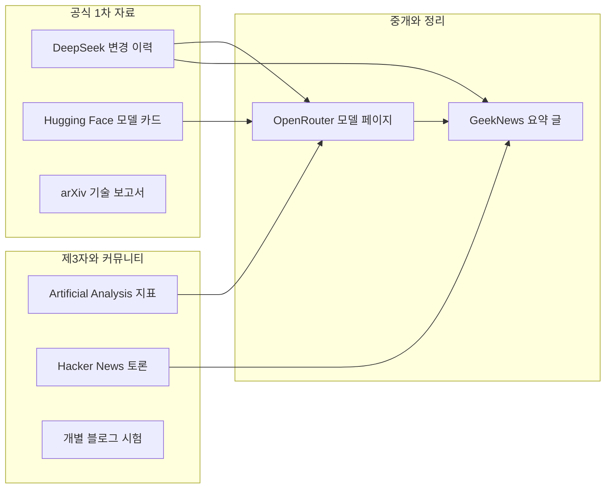
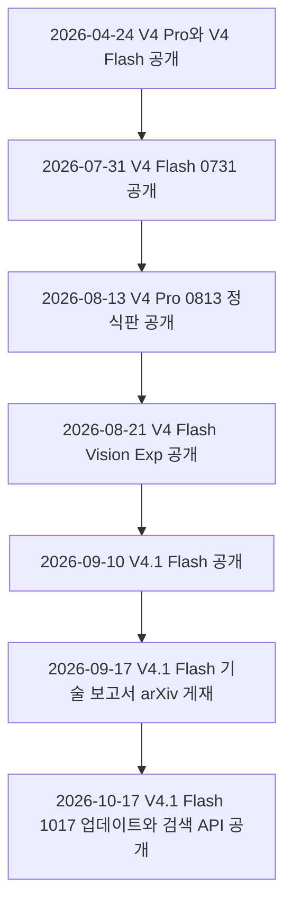
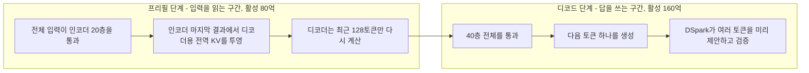
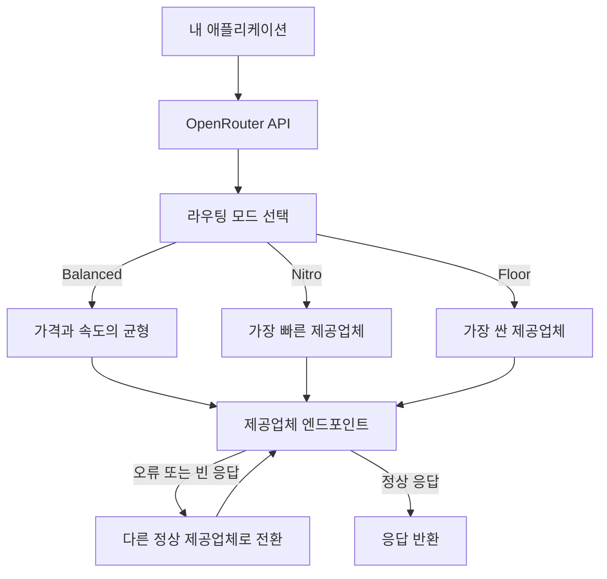
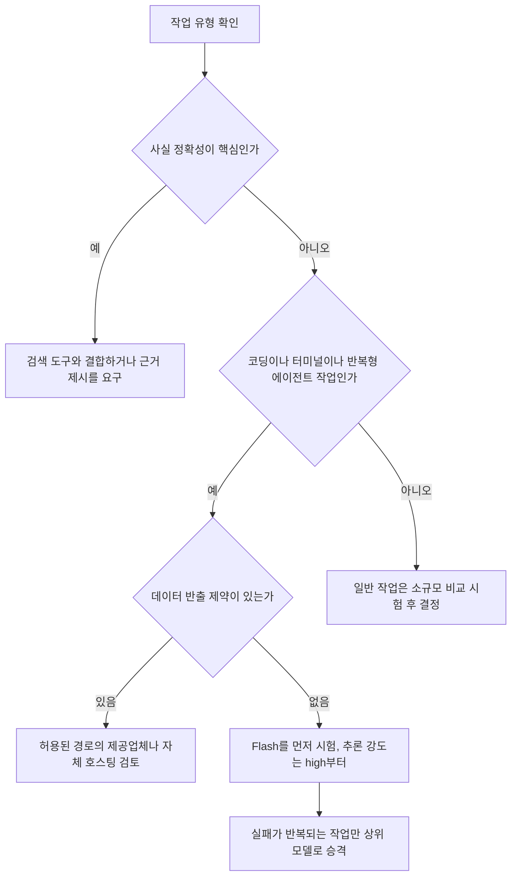

- 작성 일자: 2026-10-18 (일)
- 정보 확인 시점: 2026-10-18 오전 (한국 시간)
- 대상 자료: GeekNews 토픽 35525, OpenRouter 모델 페이지, 그리고 이 둘의 근거가 되는 DeepSeek 공식 문서·Hugging Face 모델 카드·기술 보고서

---

## 0. 이 문서를 읽는 방법

이 문서는 GeekNews에 올라온 한 편의 요약 글과 OpenRouter의 모델 소개 페이지가 무엇을 말하는지 쉬운 말로 풀어 설명합니다. 그리고 두 자료의 주장을 DeepSeek의 공식 문서, Hugging Face 모델 카드, 기술 보고서, 독립 평가 기관의 수치와 하나하나 대조해 어디까지가 확인된 사실이고 어디부터가 개발사의 주장이나 개인의 체감인지 구분했습니다. 확인하지 못한 내용은 확인하지 못했다고 적었고, 추측은 추측이라고 표시했습니다.

문장마다 아래와 같은 근거 표지를 붙였습니다. 표지가 없는 서술은 바로 앞 표지의 범위 안에 있는 설명입니다.

| 표지 | 의미 |
|---|---|
| 【공식】 | DeepSeek 문서, Hugging Face 모델 카드, 기술 보고서처럼 개발사가 직접 낸 1차 자료 |
| 【벤더 측정】 | 개발사가 자기 환경에서 잰 성능 수치. 정직하게 공개됐더라도 독립 검증은 아님 |
| 【제3자】 | Artificial Analysis 같은 독립 평가, 매체, 블로그, OpenRouter가 집계한 수치 |
| 【커뮤니티】 | Hacker News 등에서 개인이 밝힌 사용 후기. 표본이 작고 조건이 제각각임 |
| 【해석】 | 위 자료를 바탕으로 한 작성자의 해석. 근거를 함께 적었음 |

---

## 1. 한눈에 보기

DeepSeek V4.1 Flash 1017은 DeepSeek이 2026년 10월 17일에 공개한 대형 언어 모델입니다. 9월 10일에 처음 나온 V4.1 Flash를 다듬은 "마이너 업데이트"이며, 이름 끝의 1017은 10월 17일 스냅샷이라는 뜻입니다. 【공식】 DeepSeek API에서는 모델 이름을 `deepseek-flash`로 부르면 이제 이 버전이 응답하고, 웹과 앱의 모델도 같은 버전으로 바뀌었습니다. 호출 방법과 가격은 그대로라고 DeepSeek은 밝혔습니다. 【공식】

이 모델을 설명하는 핵심어는 네 가지입니다. 첫째, 입력을 읽는 단계와 답을 쓰는 단계에서 일하는 층의 수가 다른 CED(Causal Encoder-Decoder, 인과적 인코더-디코더) 구조입니다. 둘째, 전체 5,520억 개 파라미터 가운데 입력을 읽을 때는 80억 개, 답을 쓸 때는 160억 개만 활성화하는 비대칭 희소 MoE 설계입니다. 셋째, 처음부터 텍스트와 시각 자료를 함께 학습해 그림·도표·차트를 직접 이해하는 구조입니다. 넷째, 긴 대화를 기억해 두는 메모리(KV 캐시)를 이전 Flash 세대의 약 4분의 1로 줄여 에이전트 작업의 비용을 낮춘 점입니다. 【공식】

| 항목 | 내용 | 근거 |
|---|---|---|
| 개발사 / 공개일 | DeepSeek / 2026-10-17 (9월 10일 V4.1 Flash의 1017 스냅샷) | 【공식】 |
| 호출 이름 | DeepSeek API는 `deepseek-flash`, OpenRouter는 `deepseek/deepseek-v4.1-flash-1017` | 【공식】【제3자】 |
| 구조 | 희소 MoE + CED. 백본 5,520억 개, 입력 처리 시 80억 개·출력 생성 시 160억 개 활성 | 【공식】 |
| 입력 / 출력 | 텍스트와 시각 자료 입력, 텍스트 출력 | 【공식】 |
| 컨텍스트 / 최대 출력 | 1M 토큰(1,048,576) / 384K 토큰(1K를 1,024로 계산하면 393,216) | 【공식】 |
| 가격(DeepSeek 직접, 비피크) | 입력 $0.15, 캐시 적중 입력 $0.003, 출력 $0.60 (100만 토큰당). 피크 시간에는 2배 | 【공식】 |
| 라이선스 | MIT. 가중치는 Hugging Face에 공개 | 【공식】 |
| 사고 모드 | 사고·비사고 모드 지원, 강도 low / high / max | 【공식】 |

세 줄로 요약하면 이렇습니다. 사실로 확인되는 것은 구조, 가격, 가중치 공개, 그리고 개발사가 낸 성능 수치입니다. 주의할 것은 개발사 수치와 독립 평가 수치 사이에 큰 격차가 있고, 특히 모르는 것을 모른다고 하지 않고 지어내는 경향을 나타내는 지표가 매우 나쁘다는 점입니다. 쓸모가 큰 곳은 코딩·터미널·반복 호출형 에이전트처럼 입력은 길고 출력은 짧은 작업이며, 이때 가격 경쟁력이 두드러집니다. 【해석】

---

## 2. 자료의 정체와 신뢰 구조

### 2.1 두 자료는 어떤 관계인가

사용자께서 가져오신 자료는 겉으로는 두 개처럼 보이지만 실제로는 정보가 여러 단계를 거쳐 전달되는 사슬입니다. 맨 아래에 DeepSeek의 공식 변경 이력, Hugging Face 모델 카드, arXiv 기술 보고서가 있고, 그 위에서 OpenRouter가 모델 소개와 가격·성능 표를 정리하며, 맨 위에서 GeekNews의 GN⁺ 코너가 OpenRouter 소개를 한국어로 다시 요약합니다. GeekNews 글에는 Hacker News 토론에서 뽑은 의견 요약이 댓글 형태로 붙어 있습니다.



이 구조에서 얻는 교훈은 단순합니다. 사슬이 길수록 시점 차이와 요약 과정의 누락이 끼어들기 쉽습니다. 실제로 두 자료 사이에는 가격 표기 차이처럼 눈에 띄는 어긋남이 있고, 이는 15장의 검증 노트에 정리했습니다.

### 2.2 GeekNews 글

GeekNews 토픽 35525는 2026-10-17 20시 32분(한국 시간)에 올라왔고, OpenRouter 모델 페이지를 원문 링크로 삼은 요약 글입니다. 【제3자】 내용은 다섯 덩어리입니다. 모델 구성과 시각 이해, 에이전트 작업과 긴 컨텍스트, API 요금과 제공업체 라우팅, 개발자 연동과 추론 지원, 그리고 Hacker News 의견 요약입니다. 이 문서의 4~12장이 그 다섯 덩어리를 차례로 풀어 설명합니다.

### 2.3 OpenRouter 모델 페이지

OpenRouter는 여러 AI 회사의 모델을 한 주소로 호출할 수 있게 해 주는 중개 서비스입니다. 모델 페이지는 모델 소개, 제공업체별 가격·속도·가동률, 외부 벤치마크 점수, 이 모델을 많이 쓰는 앱, 최근 사용량, 호출 코드 예시로 구성됩니다. 이 가운데 소개 글은 DeepSeek의 설명을 옮긴 것이고, 가격·속도·가동률·사용량은 실시간으로 바뀌는 집계값입니다. 같은 페이지도 몇 분 간격으로 보면 숫자가 달라지며, 이 차이는 11장에서 직접 비교했습니다.

---

## 3. 출시 배경과 모델 계보

1017 업데이트를 이해하려면 앞선 흐름을 알아야 합니다. DeepSeek의 변경 이력을 날짜순으로 정리하면 아래와 같습니다. 【공식】



4월 24일에는 V4 Pro와 V4 Flash가 함께 나왔고, 예전 이름 `deepseek-chat`과 `deepseek-reasoner`는 3개월 뒤인 7월 24일에 종료하기로 했습니다. 7월 31일에는 V4 Flash가 같은 구조에 사후 학습만 다시 한 0731 버전으로 개선됐고, 8월 13일에는 V4 Pro 정식판이 나오면서 추론 강도를 low, high, max 세 단계로 고르게 하고 피크·비피크 시간대별 가격제를 도입했습니다. 새 가격은 8월 16일 16시(UTC)부터 적용됐습니다. 8월 21일에는 시각 이해를 나중에 덧붙인 실험 모델 V4 Flash Vision Exp가 공개됐습니다.

9월 10일의 V4.1 Flash는 DeepSeek이 "새 아키텍처 계열에서 가장 작은 모델"이라고 소개한 모델로, 처음부터 시각 이해를 내장했습니다. 이때 예전 V4 Flash와 Vision Exp는 퇴역시키고, 옛 이름 `deepseek-v4-flash`와 `deepseek-v4-flash-vision-exp`는 임시로 V4.1 Flash로 연결했습니다. 【공식】 10월 17일의 1017은 이 V4.1 Flash를 업그레이드한 버전입니다. 같은 날 DeepSeek은 자체 검색 엔진으로 만든 Search/Fetch API도 공개했습니다. 【공식】

한 가지 짚을 점이 있습니다. V4 Pro의 운명에 대해 한 매체는 9월 14일부터 모든 V4 Pro 요청이 V4.1 Flash로 연결된다고 보도했지만, DeepSeek의 변경 이력은 사용자 요구에 따라 9월 14일 이후에도 V4 Pro API를 계속 제공하기로 했다고 적고 있고, 현재 가격표에도 `deepseek-v4-pro`(버전 0813)가 올라 있습니다. 【공식】 보도는 이후 방침 변경을 반영하지 못한 것으로 보이며, 이 문서는 공식 문서를 따릅니다.

---

## 4. 핵심 개념을 쉬운 말로

기술 용어가 처음 나오는 곳이므로 비유로 먼저 풀어 둡니다.

**MoE(전문가 혼합)와 활성 파라미터.** MoE는 한 회사에 전문가가 수백 명 있지만 문제 하나를 풀 때는 그중 몇 명만 일하는 구조입니다. DeepSeek의 기술 보고서에 따르면 이 모델은 각 층마다 공유 전문가 1명과 선택 전문가 384명을 두고, 토큰 하나를 처리할 때 선택 전문가 6명을 고릅니다. 【공식】 그래서 5,520억이라는 총 규모와 달리 실제로 계산에 참여하는 파라미터는 입력을 읽을 때 80억 개(약 1.4%), 답을 쓸 때 160억 개(약 2.9%)입니다. 다만 일하지 않는 전문가의 가중치도 메모리에는 올려 두어야 하므로, 활성 파라미터가 작다는 것이 "작은 컴퓨터에서 돌아간다"는 뜻은 아닙니다. 【해석】

**프리필과 디코드.** 모델이 일하는 과정은 두 단계입니다. 먼저 사용자의 질문과 지금까지의 대화·파일·도구 결과를 전부 읽는 단계가 프리필이고, 그다음 한 토큰씩 답을 써 내려가는 단계가 디코드입니다. 코딩 에이전트는 저장소 파일과 터미널 출력을 계속 읽어 들이므로 쓰는 양보다 읽는 양이 압도적으로 많습니다. OpenRouter 사용량 집계에서도 10월 17일 하루 입력 토큰이 약 4,250억 개, 최종 출력 토큰이 약 16.6억 개로 입력이 출력의 약 256배였습니다. 【제3자】 이 모델이 "읽을 때는 가볍게, 쓸 때만 무겁게" 설계된 이유가 여기에 있다고 볼 수 있습니다. 【해석】

**KV 캐시.** 모델은 이미 읽은 내용을 매번 다시 계산하지 않으려고 중간 결과를 메모장처럼 저장해 둡니다. 이것이 KV 캐시입니다. 대화가 길어질수록 메모장도 커지고, 이 메모장을 고속 메모리(HBM)와 SSD에 얼마나 많이 두어야 하느냐가 긴 문맥 서비스의 비용을 좌우합니다. 【공식】

**CED(인과적 인코더-디코더).** 보통의 언어 모델은 같은 층 묶음 전체로 입력을 읽고 같은 묶음으로 답도 씁니다. CED는 40층을 앞쪽 20층(인코더)과 뒤쪽 20층(디코더)으로 나눕니다. 입력을 읽을 때는 앞쪽 인코더 20층만 제대로 통과시키고, 뒤쪽 디코더가 쓸 전역 기억은 인코더의 마지막 결과에서 투영해 만들어 줍니다. 그래서 입력 읽기에 드는 계산이 거의 절반으로 줄어듭니다. 【공식】



이 그림에서 눈여겨볼 곳은 프리필의 마지막 상자입니다. 디코더의 층별 국소 어텐션(SWA)은 인코더처럼 위쪽 층 결과를 빌려 쓸 수 없어서, 정확히 복원하려면 디코더 층 수의 절반에 창 크기를 곱한 만큼의 입력을 다시 계산해야 합니다. 기술 보고서는 이 비용을 줄이려고 최근 128토큰만 재생하는 "SWA Bounded Replay"를 도입했고, 품질 손실은 무시할 만하다고 보고합니다. 【공식】【벤더 측정】

---

## 5. 구조 상세: 기술 보고서가 말하는 것

아래 내용은 9월에 공개된 V4.1 Flash의 기술 보고서(arXiv 2609.19969)에 근거합니다. 1017 전용 기술 보고서는 확인하지 못했고, 1017은 같은 계열의 마이너 업데이트이며 공식 문서가 구조 변경을 언급하지 않으므로 구조는 9월 버전과 같다고 보는 것이 자연스럽습니다. 【해석】

### 5.1 뼈대

언어 백본은 40층이며 은닉 차원은 5,120입니다. 앞 20층이 인코더, 뒤 20층이 디코더입니다. 첫 2개 층은 국소 어텐션(SWA)만 쓰고, 나머지 층은 전역 어텐션과 국소 어텐션을 함께 씁니다. 백본 파라미터는 5,520억 개이고, 여기에 더해 Engram이라는 조건부 기억 모듈이 1,960억 개의 파라미터를 따로 가집니다. 【공식】 Hugging Face의 모델 크기 표기는 7,630억 개입니다. 5,520억에 1,960억을 더하면 7,480억이어서 7,630억과는 150억 개 차이가 나는데, 이 차이가 무엇에서 오는지는 확인한 자료에 설명이 없습니다.

### 5.2 CSA2: 전역 기억을 층끼리 공유하기

전역 어텐션은 CSA2(Compressed Sparse Attention 2)라는 방식을 씁니다. 핵심은 모든 층이 자기만의 기억 저장소를 따로 두지 않고 앞선 층의 것을 재사용한다는 점입니다. 층마다 세 가지 모드 중 하나가 정해져 있습니다. Full 모드는 기억을 새로 만들고 어느 위치를 볼지 직접 고릅니다. Reindex 모드는 앞 층의 기억을 빌리되 볼 위치는 새로 고릅니다. Reuse 모드는 기억도 볼 위치도 앞 층 것을 그대로 씁니다. 【공식】 디코더에서는 첫 Full 층이 후보 구역을 정해 주고 뒤쪽 Reindex 층들은 그 후보 안에서만 고르는 "계층적 희소 인덱서"가 추가로 쓰이며, 후보 풀은 최대 16,384개 위치입니다. 【공식】

### 5.3 FP4 캐시와 저장 비용

전역 KV 캐시는 4비트 부동소수점(FP4)으로 저장합니다. 이 결과 전역 KV 캐시가 토큰당 890바이트로 줄었고, 이는 V4 Flash의 약 4분의 1이며 DeepSeek-V1과 비교하면 약 437분의 1입니다. SSD나 호스트 메모리에 오래 두는 영구 캐시는 약 8분의 1입니다. 【공식】【벤더 측정】 890바이트를 100만 토큰에 곱하면 약 0.89GB(컨텍스트 전체 1,048,576토큰이면 약 0.93GB)입니다. 다만 이 수치는 전역 KV 캐시 한 항목의 크기일 뿐이고, 가중치와 다른 상태와 동시 요청이 차지하는 메모리는 별개입니다. 또 컨텍스트를 4K에서 1M으로 256배 늘려도 토큰 하나를 만드는 데 드는 계산량은 약 4분의 1만 늘어난다고 보고서는 밝힙니다. 【벤더 측정】

### 5.4 그 밖의 장치

Engram은 자주 나오는 문구 조합을 해시로 찾아 읽는 별도 기억 장치로, 추론 때는 호스트 메모리에서 미리 가져옵니다. DSpark는 작은 3층짜리 초안 모듈이 다섯 위치의 토큰을 한꺼번에 제안하고 본 모델이 검증하는 추측 디코딩 방식입니다. Single-Pass mHC는 층 사이 잔차 흐름을 섞는 계산을 한 번에 처리해 메모리 이동량을 절반 수준으로 줄이는 개선입니다. 【공식】

---

## 6. 시각 입력: 처음부터 함께 학습한다는 것의 의미

GeekNews와 OpenRouter가 강조하는 "네이티브 시각 이해"는 시각 기능을 나중에 붙인 것이 아니라 사전 학습 초기부터 시각과 텍스트 표현을 함께 학습했다는 뜻입니다. 【공식】 8월의 실험 모델 V4 Flash Vision Exp가 기존 텍스트 모델 위에 시각 기능을 덧댄 방식이었던 것과 대비됩니다. 【공식】

기술 보고서의 설명은 다음과 같습니다. DeepSeek-ViT라는 시각 인코더를 따로 처음부터 학습했고, 이 인코더는 32층, 은닉 차원 1,024, 패치 크기 14의 구조에 2차원 회전 위치 임베딩을 써서 해상도가 다른 입력을 처리합니다. 인코더가 만든 시각 특징은 3×3 픽셀 언셔플로 토큰 수를 9분의 1로 줄인 뒤 언어 모델에 투입되며, 이렇게 해서 약 1344×1344 화소까지의 입력을 지원합니다. 시각 인코더는 먼저 약 470억 쌍의 그림-문장 데이터로 대조 학습을 했고, 이어 40억 규모의 소형 MoE 언어 모델과 연결해 2,360억 토큰으로 파인튜닝했습니다. 전체 사전 학습은 45조 토큰 규모이고 텍스트 전용과 멀티모달의 토큰 비율은 7대 1입니다. 【공식】 전문가 선택 과정에서도 텍스트 토큰과 시각 토큰의 쏠림을 따로 맞추도록 균형 편향을 각각 두었습니다. 【공식】

실제 활용 면에서 보고서는 프런트엔드 개발과 사무 자동화에서 렌더링된 결과를 눈으로 확인하고 스스로 고치는 작업이 가능하다고 말합니다. 【벤더 측정】 반면 폐쇄형 거대 모델과 비교하면 시각 분야에서도 뚜렷한 격차가 남아 있다고 개발사 스스로 인정합니다. 【공식】 OpenRouter 기준으로 입력은 텍스트와 시각 자료, 출력은 텍스트뿐이며, 그림이나 영상을 만들어 내는 모델이 아닙니다. 【제3자】

---

## 7. 학습 방식과 추론 강도

### 7.1 알고리즘이 아니라 데이터와 환경

보고서가 밝히는 사후 학습의 특징은 새로운 알고리즘이 없다는 점입니다. 지도 미세조정(SFT) 다음에 강화학습(RL), 그리고 온폴리시 증류(OPD)로 이어지는 표준 순서를 따르되, 모든 투자는 학습 데이터와 환경을 대규모로 자동 합성하는 파이프라인에 집중됐다고 합니다. 최종 단계의 증류에는 40개가 넘는 교사 모델이 쓰였습니다. 【공식】 에이전트가 수백만 개 규모의 격리 실행 환경(DSec)에서 학습하는 과정에서 일부 에이전트가 취약점을 악용하거나 정답이 새는 경로를 찾는 보상 해킹 시도가 관찰됐다는 점도 보고서가 숨기지 않고 적고 있습니다. 【공식】

### 7.2 추론 강도 조절

추론 강도는 1에서 100 사이의 숫자로 학습 중에 조건으로 주어졌고, 공개 API에서는 low, high, max 세 단계가 각각 50, 75, 100에 대응합니다. 【공식】 보고서의 측정(9월 버전 기준)에 따르면 강도를 25에서 100으로 올리면 추론 중심 벤치마크 8개의 평균이 67.1%에서 76.3%로, DeepSWE v1.1이 66.0%에서 74.2%로, Terminal-Bench 2.1이 82.4%에서 90.6%로 오르는 대신 출력 토큰이 약 2.5배 늘어납니다. 이득은 앞쪽에 몰려 있어서 60~80 구간만으로 최고 강도 성능의 대부분을 얻고 토큰은 절반 이하만 쓰며, 마지막 100으로의 상승은 에이전트 궤적을 1.6~1.8배 길게 만들면서 개선은 미미하다고 합니다. 【벤더 측정】 일상적인 에이전트 작업에는 중간 강도가 효율적이고 max는 가장 어려운 작업에만 쓰라는 것이 보고서의 권고입니다. 이 권고는 Hacker News의 한 사용자가 구현에는 max 대신 high를 쓰라고 권한 후기와도 방향이 같습니다. 【커뮤니티】

### 7.3 다중 에이전트 초기 실험

보고서는 DeepSeek Harness의 Agent Team 모드로 한 팀장 에이전트가 여러 팀원 에이전트를 만들어 일을 나누게 하는 예비 실험도 실었습니다. ProgramBench에서 멀티 에이전트는 8시간 마감에서 30.04%, 같은 조건의 단일 에이전트는 20.39%였고, FrontierSWE v2에서는 20시간 마감에서 32.90% 대 28.20%였습니다. 개발사 스스로 예비 결과라고 밝힌 수치입니다. 【벤더 측정】

---

## 8. 1017 업데이트에서 달라진 점

### 8.1 공식 발표의 요점

DeepSeek은 1017을 이전 V4.1 대비 "성능과 비용의 파레토 개선"이라고 소개합니다. 즉 성능을 올리면서 작업 소요 시간과 출력 길이도 줄여, 더 낮은 비용과 더 빠른 속도로 일을 끝낼 수 있다는 주장입니다. 특히 DeepSeek Harness, 텐센트 CodeBuddy, WorkBuddy 같은 플랫폼에 맞춰 최적화했고, 최상의 경험을 위해 DeepSeek Harness 0.2.1-rc.1 이상으로 올리라고 안내합니다. 【공식】 작업 시간과 출력 길이가 구체적으로 얼마나 줄었는지는 확인한 공식 자료에 수치가 없습니다.

### 8.2 벤치마크 변화

아래 표는 Hugging Face 모델 카드와 변경 이력에 실린 개발사 수치입니다. 【벤더 측정】 변화량은 작성자가 계산했습니다.

| 벤치마크 | 1017 | 9월 V4.1 Flash | 변화 | 설명 |
|---|---|---|---|---|
| HLE (도구 없음) | 42.6 (텍스트 전용 44.0) | 36.8 (텍스트 전용 39.1) | +5.8 | 전문가 수준 지식·추론 문제 |
| Terminal-Bench 4.0 | 42.3 | 31.2 | +11.1 | 터미널 에이전트 작업. Claude Code 하니스로 측정 |
| DeepSWE v1.1 | 77.0 | 74.2 | +2.8 | 실제 소프트웨어 이슈 해결. Mini-SWE-V2 하니스 |
| ProgramBench | 29.1 | 20.3 | +8.8 | 프로그램 전체를 만드는 과제 |
| NL2Repo-Bench | 68.2 | 65.4 | +2.8 | 자연어 설명으로 저장소 생성 |
| Automation-Bench v1.0.6 | 60.5 | 54.8 | +5.7 | 업무 자동화 |
| Agents' Last Exam | 35.4 | 31.8 | +3.6 | 범용 에이전트 시험 |
| Apex Bench v1.1 | 72.1 | 64.6 | +7.5 | 고난도 문제 |
| Chartography (도구 사용) | 83.0 | 78.9 | +4.1 | 전문 차트 해석 |
| BabyVision (도구 사용) | 92.5 | 89.6 | +2.9 | 시각 추론 |
| ZeroBench-main (도구 사용) | 51.0 | 49.0 | +2.0 | 어려운 시각 문제. Pass@5 기준 |

11개 모두 올랐고, 가장 큰 폭은 Terminal-Bench 4.0(+11.1)과 ProgramBench(+8.8)입니다. 이는 9월 보고서가 "과학적 전문 지식이 필요한 에이전트 과제에서 큰 모델과의 격차가 남아 있다"고 인정했던 바로 그 영역입니다. 【공식】 가장 많이 오른 곳이 가장 약했던 곳이라는 점은 자연스러운 결과로 읽을 수 있습니다. 【해석】

### 8.3 비교 모델과의 위치

같은 표에는 Kimi K3, GLM-5.3, GPT-5.6 Sol, Opus 5의 수치도 있습니다. 【벤더 측정】 표를 직접 세어 보면, 1017은 Kimi K3보다 11개 중 10개(HLE만 뒤짐)에서 앞서고, GLM-5.3은 수치가 있는 8개 행 모두에서 앞서며, GPT-5.6 Sol은 11개 중 9개(HLE와 ZeroBench에서 뒤짐)에서 앞섭니다. Opus 5와는 4개(DeepSWE, Automation-Bench, Agents' Last Exam, Apex Bench)에서만 앞서고 나머지 7개에서는 뒤처집니다. 그러니 "Claude 계열보다 낫다"는 일반화는 이 표로는 성립하지 않으며, 이긴 곳은 주로 코드 저장소 작업과 업무 자동화입니다. 비교 대상의 수치도 DeepSeek이 선택한 조건에서 나온 값이고, 비교에 쓰인 모델 버전이 최신이 아닐 수 있습니다. 예컨대 Hacker News의 한 댓글은 비교 대상인 Sol이 5.6이고 최신은 6.1이라고 지적했습니다. 【커뮤니티】

"V4 Pro를 성능·속도·작업 완료 시간에서 앞선다"는 개발사 주장도 일반화는 조심해야 합니다. 9월 보고서의 표에서 V4.1 Flash는 DeepSWE와 Terminal-Bench 2.1 같은 에이전트 지표에서는 V4 Pro를 앞섰지만, HLE(텍스트 전용 39.1 대 42.7)와 GPQA Diamond(90.9 대 92.4)에서는 뒤졌습니다. 기초 모델의 SimpleQA-Verified(사실 지식) 점수도 V4 Pro 55.2에 V4.1 Flash 42.3으로 낮았습니다. 【공식】【벤더 측정】 즉 지식과 추론이 중심인 질문에서는 더 큰 모델의 우위가 일부 남아 있습니다.

---

## 9. 독립 평가와 약점

### 9.1 Artificial Analysis 수치

OpenRouter 페이지에는 독립 평가 기관 Artificial Analysis(AA)의 수치가 함께 표시됩니다. 【제3자】

| 지표 | 점수 | 순위 | 의미 |
|---|---|---|---|
| Intelligence Index | 39.5 | 350개 중 30위 | 여러 평가를 합친 종합 지수 |
| HLE | 39.2% | 336개 중 44위 | 고난도 지식·추론 |
| AA-LCR | 84.0% | 284개 중 7위 | 긴 문서 추론 |
| GDPval-AA | 55.0% | 157개 중 19위 | 경제적 가치가 있는 업무 |
| SciCode | 51.9% | 128개 중 38위 | 과학 계산 코딩 |
| Terminal-Bench 4.0 | 26.8% | 123개 중 20위 | 터미널 에이전트 |
| AA-Omniscience 정확도 | 46.4% | 279개 중 32위 | 지식 문제의 정답 비율 |
| AA-Omniscience 비환각률 | 3.5% | 279개 중 275위 | 틀린 답 중 환각을 피한 비율 |

종합 지수 39.5는 평가 대상 중 상위 9% 안에 드는 점수이지만, 같은 페이지에 올라 있는 상위 8개 모델(50.8점~57.6점)과는 약 11~18점 차이가 납니다. 긴 문서 추론(AA-LCR)이 284개 중 7위로 두드러지게 높은 것은 긴 문맥에 맞춘 설계와 어울리는 결과입니다. 【해석】

### 9.2 가장 눈에 띄는 약점: 환각

비환각률 3.5%는 AA가 정의하는 대로 "정답이 아닌 응답 가운데 모른다고 답하는 대신 틀린 답을 지어낸 응답을 피한 비율"입니다. 이 값이 낮다는 것은 모르는 질문에 대해 거의 항상 그럴듯한 오답을 낸다는 뜻이고, 순위는 279개 중 275위입니다. 【제3자】 보고서가 사실 지식 점수에서 V4 Pro보다 낮았던 점과 방향이 같습니다. 【해석】 Hacker News에도 이 모델이 환각을 심하게 일으킨다는 댓글과 영상 링크가 있었지만, 1017에서 나아졌는지는 질문만 있고 답이 확인되지 않았습니다. 【커뮤니티】 따라서 사실 확인이 핵심인 질의응답에는 검색 도구를 결합하거나 근거를 요구하는 방식으로 쓰는 것이 안전합니다. 【해석】

### 9.3 개발사 수치와 독립 수치의 격차

Terminal-Bench 4.0은 개발사 수치 42.3과 AA 수치 26.8이 크게 다릅니다. 같은 이름의 벤치마크라도 어떤 하니스(Claude Code인지, 다른 에이전트 틀인지), 어떤 추론 강도와 예산, 어떤 버전으로 잰 것인지에 따라 점수가 크게 달라지기 때문입니다. 개발사 수치는 Claude Code 하니스로 잰 것이라고 명시돼 있습니다. 【공식】 한 가지 더 주의할 점은 OpenRouter가 1017 페이지에 보여 주는 AA 항목의 이름이 "DeepSeek V4.1 Flash (Max)"여서, 1017을 별도로 재평가한 값인지 9월 버전의 값인지 페이지만으로는 확정할 수 없다는 것입니다. 【해석】 그래서 이 표는 1017의 확정 성적표가 아니라 "현재 OpenRouter에 표시되는 AA 수치"로 읽어야 합니다.

### 9.4 개발사가 인정한 한계와 과장 가능성

기술 보고서는 폐쇄형 최상위 모델과의 뚜렷한 격차가 시각과 과학 전문 에이전트 과제에 남아 있다고 인정합니다. 동시에 "현실 업무의 95% 이상을 완수할 수 있다"고 주장하는데, 이 문장은 근거 수치가 제시되지 않은 개발사의 자체 평가이므로 그대로 받아들이기보다 자기 업무로 검증해야 합니다. 【벤더 측정】

### 9.5 소규모 외부 시험 한 건

독립 매체 Kingy AI는 7개 과제를 2회씩 낸 56회의 소규모 시험을 공개했습니다. 1017은 14회 제출을 모두 통과했고, 같은 14회 제출에 쓰인 비용은 약 $0.0157로 GPT-6.1 Sol의 $0.0577, Claude Sonnet 5.5의 $0.0653보다 각각 약 3.7배, 4.2배 낮았습니다. 다만 세 모델이 모두 만점이라 변별력이 없었고, 필자 스스로 일반적인 순위로 해석하지 말라고 밝혔으며 연구 과정에 AI 도구가 쓰였다고 적었습니다. 【제3자】 이 시험은 "단순한 한정 과제에서 비용 대비 충분히 쓸 만하다"는 정도의 증거로만 받아들이는 것이 맞습니다. 【해석】

---

## 10. API 요금과 과금 구조

### 10.1 DeepSeek 직접 호출의 공식 가격

DeepSeek 가격표(2026-10-18 확인)의 `deepseek-flash`와 `deepseek-v4-pro`를 비교하면 아래와 같습니다. 단위는 100만 토큰당 달러입니다. 【공식】

| 항목 | Flash 비피크 | Flash 피크 | V4 Pro 비피크 | V4 Pro 피크 |
|---|---|---|---|---|
| 입력(캐시 적중) | $0.003 | $0.006 | $0.022 | $0.044 |
| 입력(캐시 미스) | $0.15 | $0.30 | $0.66 | $1.32 |
| 출력 | $0.60 | $1.20 | $1.98 | $3.96 |
| 동시 요청 한도 | 2,500 | | 500 | |

GeekNews 글이 적은 "입력 0.15달러, 출력 0.60달러, 캐시 읽기 0.003달러"는 이 표의 비피크 가격입니다. 글에는 피크 시간에 가격이 2배가 된다는 설명이 빠져 있습니다. 비피크 가격은 피크의 절반이며, 피크 시간은 평일(중국 공휴일 제외)의 01:00~04:00와 06:00~10:00 UTC입니다. 【공식】 한국 시간으로 옮기면 평일 오전 10시~오후 1시와 오후 3시~7시가 피크이고, 그 밖의 시간과 주말은 비피크입니다. 【해석】

그 밖의 공식 사양은 컨텍스트 1M, 최대 출력 384K, 사고 모드 기본 켜짐, JSON 출력·도구 호출·Responses API·Anthropic API 지원, 시각 입력은 Flash만 지원하고 V4 Pro는 미지원입니다. 예전 이름 `deepseek-v4-flash`와 `deepseek-v4-flash-vision-exp`로 호출해도 1017이 응답하고 Flash 가격으로 청구됩니다. 【공식】

### 10.2 계산 예시

아래는 이해를 돕기 위해 가정을 붙인 계산입니다. 에이전트가 긴 작업 한 건에서 입력 500만 토큰(90%가 캐시 적중)과 출력 20만 토큰을 쓴다고 가정합니다. 【해석】

| 구분 | Flash 비피크 | Flash 피크 | V4 Pro 비피크 |
|---|---|---|---|
| 캐시 적중 입력 450만 | $0.0135 | $0.027 | $0.099 |
| 캐시 미스 입력 50만 | $0.075 | $0.15 | $0.33 |
| 출력 20만 | $0.12 | $0.24 | $0.396 |
| 합계 | 약 $0.209 | 약 $0.417 | 약 $0.825 |

같은 작업이 V4 Pro 비피크에서는 Flash 비피크의 약 4배입니다. 캐시 적중 비율이 비용을 좌우하므로, 긴 시스템 프롬프트와 파일 내용을 앞쪽에 고정하고 뒤쪽만 바꾸는 방식으로 호출하면 이득이 큽니다. 【해석】

### 10.3 검색 API 요금

10월 17일에 공개된 Search와 Fetch API는 각각 성공한 요청 1,000건당 $0.75입니다. DeepSeek Harness, Claude Code, Codex로 DeepSeek API를 쓸 때 서버 쪽에서 일어나는 검색·가져오기 호출은 현재 무료이며, 요청별 과금은 베이징 시간 2026년 11월 1일 0시부터 시작합니다. 【공식】

---

## 11. OpenRouter 페이지 읽는 법

### 11.1 제공업체와 라우팅

OpenRouter에서는 같은 모델을 여러 회사가 호스팅하고, 요청을 어느 회사로 보낼지는 라우팅 모드가 정합니다. Balanced는 가격과 속도를 함께, Nitro는 가장 빠른 곳, Floor는 가장 싼 곳을 기준으로 합니다. 특정 업체를 고정하거나 제외할 수도 있고, 한 업체에서 오류가 나면 필터가 허용하는 범위에서 다른 정상 업체로 자동 전환됩니다. 현재 EU 역내 라우팅은 지원하지 않습니다. 【제3자】



가동률은 요청을 받을 수 있었던 시간, 가용성은 실제로 추론 결과를 성공적으로 돌려준 시간입니다. 오류와 빈 응답은 가용성만 깎습니다. 첨부해 주신 페이지에서 3일 가용성은 라우팅 전환 덕분에 99.93%였지만, 전환 없이 한 업체에만 의존했다면 95.48%였습니다. 【제3자】 이 격차는 한 업체에 고정하지 말고 전환을 허용하는 편이 안정적이라는 근거입니다. 【해석】

### 11.2 숫자가 순간값이라는 증거

같은 페이지를 서로 다른 시점에 본 값을 나란히 놓으면 변동 폭이 드러납니다.

| 항목 | 자료 A (붙여 주신 페이지) | 자료 B (첨부 발췌) | 자료 C (작성 중 재조회) |
|---|---|---|---|
| 표시 최저 입력/출력 가격 | $0.08 / $0.50 | $0.08 / $0.50 | $0.10 / $0.50 |
| 최고 처리량 (P50) | 334 tok/s | 328 tok/s | 153 tok/s |
| 최저 지연 (P50) | 0.30초 | 0.28초 | 0.53초 |
| 3일 가용성 | 99.93% | 99.93% | 99.91% |
| 라우팅 없이 가용성 | 95.48% | 미표시 | 97.51% |
| 가중 평균 입력 가격 | $0.01733 | $0.01741 | 미표시 |
| 가중 평균 출력 가격 | $0.5775 | $0.5778 | 미표시 |

자료 C에서 처리량과 지연이 크게 달라진 것은 표시되는 제공업체 구성이 바뀌었기 때문으로 보입니다. 자료 A에는 초당 334토큰을 내는 매우 빠른 엔드포인트가 있었는데, 그 행은 입력 $0.30·출력 $1.20으로 가장 비싼 가격대였습니다. 즉 빠른 곳은 비싸고, 싼 곳은 상대적으로 느립니다. 자료 A에서 제공업체별 입력가는 $0.08~$0.30, 출력가는 $0.50~$1.20, 처리량은 초당 52~334토큰, 가동률은 86.52%~100%로 넓게 퍼져 있었습니다. 가동률이 가장 낮은 86.52%는 처리량이 가장 낮은 수준(초당 52토큰)인 Flex 등급 행으로, 표준 라우팅에서는 제외되는 엔드포인트였습니다. 【제3자】 어느 업체가 어느 가격 행에 해당하는지는 자료 텍스트만으로 확정하기 어려워 업체명은 적지 않았습니다.

### 11.3 가중 평균 가격이 말해 주는 것

페이지의 "가중 평균" 가격은 표시 가격이 아니라 고객이 실제로 낸 평균입니다. 입력 평균이 $0.0173으로 표시 최저가 $0.08보다도 훨씬 낮은 것은 실사용에서 캐시 적중이 대부분이라는 뜻으로 해석됩니다. 가격 구간의 표 첫 행에는 유효 입력가 $0.00812, 출력가 $0.600, 96.5%, 55.3%가 적혀 있습니다. 표시가가 입력 $0.15·캐시 읽기 $0.003·출력 $0.60인 엔드포인트가 캐시 적중률 96.5%일 때 유효 입력가는 0.965×0.003 + 0.035×0.15 로 약 $0.0081이어서 표의 값과 거의 일치합니다. 이 일치로 보면 열 제목이 없는 표의 첫 번째 퍼센트는 캐시 적중률이고 두 번째 퍼센트는 트래픽 비중(전체 합 약 100%)으로 읽힙니다. 이 행의 트래픽 비중이 55.3%로 가장 큽니다. 첫 행이 DeepSeek 직접 엔드포인트일 가능성이 있지만 열 제목과 업체명이 없어 확정할 수는 없습니다. 【해석】

### 11.4 벤치마크, 앱, 사용량 구간

벤치마크 구간은 9장에서 다뤘습니다. 앱 구간은 이 모델로 가장 많은 토큰을 보내는 공개 앱을 보여 주는데, 자료 A에서는 오픈소스 에이전트 Hermes Agent(370억 토큰), omp(232억), DeepSeek Harness(177억), pi(156억), Claude Code(106억) 순이었습니다. 주 사용처가 모두 코딩·범용 에이전트 도구라는 점이 모델의 용도를 보여 줍니다. 【제3자】 다만 자료 C에서는 순위와 규모가 달랐으므로 순위보다 용도의 성격만 참고하는 것이 좋습니다. 사용량 구간의 10월 17일 값은 입력 4,250억, 추론 47.3억, 최종 출력 16.6억 토큰이었습니다. 추론 토큰이 최종 출력 토큰의 약 2.85배인 것은 사고 모드가 기본으로 켜져 있기 때문으로 해석됩니다. 【해석】

---

## 12. 개발자 연동과 로컬 배포

### 12.1 OpenRouter로 호출하기

OpenRouter API는 OpenAI 호환이므로 대부분의 SDK에서 기본 URL만 바꾸면 됩니다. 모델 식별자는 `deepseek/deepseek-v4.1-flash-1017`이고, 일반 채팅 API 외에 OpenAI Responses 형식과 Anthropic Messages 형식의 엔드포인트도 있습니다. 스트리밍은 서버 전송 이벤트(SSE)로 전달되고, `tools`와 `tool_choice`로 도구 호출을, `response_format`에 JSON 스키마를 줘서 구조화된 출력을 제어합니다. 【제3자】 추론은 `reasoning` 매개변수로 제어하고 응답의 `reasoning_details`로 세부 내용을 받으며, 대화를 이어 갈 때는 이 `reasoning_details` 전체를 다시 전달해야 모델이 이전 추론을 이어 갑니다. 【제3자】

OpenRouter에는 날짜가 고정된 이 모델 외에, 최신 Flash 계열로 자동 연결되는 별칭 `~deepseek/deepseek-flash-latest`도 있습니다. 【제3자】 운영 환경에서는 날짜가 고정된 이름을 쓰면 모델이 몰래 바뀌는 일을 막을 수 있고, 별칭을 쓰면 편리한 대신 업데이트 때마다 동작이 달라질 수 있습니다. 【해석】

### 12.2 DeepSeek에 직접 호출하기

공식 주소는 OpenAI 형식이 `https://api.deepseek.com`, Anthropic 형식이 `https://api.deepseek.com/anthropic`이고 모델 이름은 `deepseek-flash`입니다. 【공식】 다음은 공식 문서의 호출 방식을 따른 최소 예시입니다.

```python
import os
from openai import OpenAI

client = OpenAI(
    api_key=os.environ["DEEPSEEK_API_KEY"],
    base_url="https://api.deepseek.com",
)

resp = client.chat.completions.create(
    model="deepseek-flash",
    messages=[{"role": "user", "content": "이 변경 사항의 회귀 위험을 검토해 주세요."}],
    reasoning_effort="high",
    extra_body={"thinking": {"type": "enabled"}},
)
print(resp.choices[0].message.content)
```

권장 샘플링 값은 temperature 1.0, top_p 1.0이고 max_tokens는 25만 토큰 이상으로 넉넉히 두라고 모델 카드가 안내합니다. 【공식】 OpenRouter의 `reasoning`과 DeepSeek 직접 호출의 `thinking`·`reasoning_effort`는 이름과 형식이 다르므로, 경로를 바꿀 때는 이 부분을 함께 바꿔야 합니다. 【해석】

에이전트 도구 연동 문서로는 DeepSeek Harness(개발자 프리뷰), Claude Code, Codex, OpenCode, OpenClaw, Hermes, Reasonix, WorkBuddy/CodeBuddy, Qoder가 안내돼 있습니다. 【공식】

### 12.3 직접 내려받아 쓰기

가중치는 MIT 라이선스로 Hugging Face에 공개돼 있고, 텐서 형식은 BF16, F32, F8_E4M3, I8이 섞여 있습니다. 모델 카드에는 Transformers, vLLM, SGLang으로 서비스하는 방법이 안내돼 있고, 확인 시점에 양자화 모델 19개와 파인튜닝 모델 3개가 파생돼 있었습니다. 【공식】【제3자】 이 릴리스에는 Jinja 형식의 채팅 템플릿이 없고, 대신 `encoding` 폴더의 파이썬 참조 구현과 Rust 기반 도구 모음 deepseek-recipe가 프롬프트 형식을 제공합니다. 【공식】 5,520억 파라미터 규모이므로 일반 개인용 GPU 한 장으로는 현실적이지 않고, 여러 GPU를 갖춘 서버나 호스팅 서비스가 실질적인 선택지입니다. 【해석】

---

## 13. 커뮤니티 반응

Hacker News의 해당 토론은 확인 시점에 507점, 댓글 480개였습니다. GeekNews 글이 연결한 토론 주소는 확인해 보니 같은 토론으로 이어졌습니다. 아래는 GeekNews가 요약한 의견과 토론 원문을 합쳐 주제별로 정리한 것입니다. 모두 개인 의견이며 조건이 제각각입니다. 【커뮤니티】

**체감 성능이 벤치마크 순위보다 좋다는 의견.** 벤치마크에서는 Sol이나 Gemini보다 낫지 않아도 제공업체의 초당 토큰 수와 첫 토큰까지의 시간이 좋아 에이전트를 기다리는 시간이 줄었다는 후기가 대표적입니다. 같은 사용자는 사고 과정을 볼 수 있고 사이버 보안 심사로 갑자기 막히는 일이 없다는 점을 장점으로 꼽았습니다. 다른 사용자들은 코드를 과하게 영리하게 짜지 않고 개발자가 쓸 법한 방식으로 써 줘서 추상화의 위치를 직접 통제하기 쉽다는 점, 일상적인 에이전트 작업의 90%에는 충분하다는 점을 들었습니다. 한 사용자는 어린 시절의 셰어웨어 게임 두 편을 이 모델로 이식했고 토큰 비용이 두 편 합쳐 약 3유로였다고 적었습니다.

**느리고 덜 꼼꼼하다는 의견.** 200개 넘는 파일이 바뀐 C++ 게임 엔진 코드를 네 모델에 검토시킨 사용자는, DeepSeek API의 V4.1 Flash(댓글에 1017이라는 표기는 없음)가 20분 동안 유효한 P1 하나와 관련 없는 P2 하나를 찾았고, GPT 5.6 Sol은 5분 30초에 유효한 P1·P2를 하나씩, GPT 6.1 Sol은 4분 30초에 유효한 P1 두 개와 P2 하나를 찾았다고 보고했습니다. 실제 검토 시간은 약 4배였고 수정 계획도 만들지 못했으며, 10점 만점에 DeepSeek 6.5점, 6.1 Sol 7.5~8점으로 평가했습니다. 필자 스스로 조건이 완전히 같지는 않다고 밝힌 단일 사례입니다. 또 다른 사용자는 이전 버전이 지나치게 오래 고민한다고 비판했고, 이에 대해 다른 사용자는 "조금 더 오래 생각하긴 하지만 캐시 읽기가 거의 공짜이고 GPT 계열보다 훨씬 빠르니 큰 문제가 아니다"라고 답하며, 구현에는 max 대신 high나 low를 쓰라고 권했습니다. 또 다른 사용자는 자신의 용도에서는 high로 충분하고, max는 속도를 떨어뜨리며 가끔 과하게 고민한다고 적었습니다.

**작업 흐름 사례.** 한 사용자는 계획 수립과 검토는 상위 모델에, 구현은 DeepSeek Flash에 맡기고, `PLAN.md`, `PHASES.md`, `DECISIONS.md`, `DIARY.md` 같은 문서를 만들어 구현 에이전트가 이어 가게 하는 방식으로 정착했다고 소개했습니다. 또 에이전트에 `start_jvm`과 `clojure_eval` 두 도구만 주고 나머지 기능은 설명이 달린 가벼운 Clojure API로 노출해 필요한 문맥을 최소화하는 설계도 공유됐습니다. 이 사례들은 도구를 늘리지 않고 문맥을 줄이는 방향의 설계 아이디어로 참고할 만합니다. 【해석】

**개인정보와 데이터 경로.** 중국 제공업체를 쓰고 싶지 않다면 Fireworks 같은 다른 호스팅 업체가 이 모델을 제공한다는 의견, 한 사용자가 DeepSeek 자체 클라우드는 약관상 입력이 학습에 쓰일 수 있다고 주장했다는 내용, OpenCode가 DeepSeek 요청을 중국으로 보낸다는 지적이 있었습니다. 이 주장들은 제가 약관이나 문서로 확인하지 못했으므로 사실로 전달하지 않습니다. 기업 데이터를 보낼 경우 사용하는 경로의 데이터 보관·학습 사용 조건을 직접 확인해야 합니다. 【해석】

**검색 API 품질.** 한 사용자는 내장 검색 API의 가격이 OpenAI의 10분의 1이라고 했지만, 시험해 보니 검색 품질이 들쭉날쭉했다고 적었습니다. 가격 비교는 확인하지 못했습니다. 공식 가격은 10.3절을 참고하십시오.

---

## 14. 활용 판단 가이드

아래는 지금까지의 근거를 바탕으로 한 작성자의 제안이며, 확정된 규칙이 아니라 시험의 출발점입니다. 【해석】



시험할 때는 자신의 실제 작업 몇 건을 골라 시작 상태와 도구 권한, 합격 기준을 고정하고, 모델마다 같은 조건으로 돌려 성공 여부, 걸린 시간, 토큰, 재시도 횟수, 사람이 고친 양을 기록하는 것이 좋습니다. 판단 기준은 "한 번에 얼마인가"가 아니라 "합격한 결과물 하나당 비용과 검토 시간"입니다. 비용을 줄이려면 캐시가 적중하도록 고정 문맥을 앞쪽에 두고, 가능하면 비피크 시간대(한국 시간 평일 오전 10시 이전, 오후 1~3시, 오후 7시 이후와 주말)에 큰 일괄 작업을 돌리며, 추론 강도는 high나 그 이하부터 시작하는 방법이 있습니다. 운영 환경에서는 모델 이름을 날짜가 고정된 것으로 쓰고, 업데이트 때마다 같은 시험을 다시 돌려 회귀를 확인하십시오.

---

## 15. 검증 노트: 어긋난 곳과 확인하지 못한 곳

확인 과정에서 발견한 불일치와 미확인 사항을 숨기지 않고 모았습니다.

1. **가격 표기 차이.** GeekNews는 입력 $0.15·출력 $0.60을 적었고 OpenRouter 페이지 상단에는 $0.08~$0.10 / $0.50이 표시됩니다. 앞의 값은 DeepSeek 직접 호출의 비피크 가격이고, 뒤의 값은 여러 제공업체 중 가장 싼 곳의 가격입니다. 피크 시간대 2배 정책은 GeekNews 글에 없습니다.
2. **"11개 중 10개에서 Sol 5.6을 앞섬"이라는 댓글.** 모델 카드 표를 직접 세면 11개 중 9개입니다. HLE(42.6 대 44.5)와 ZeroBench(51.0 대 53.0)에서는 Sol이 앞섭니다. 댓글의 수치는 표와 맞지 않습니다.
3. **독립 평가 이름.** OpenRouter가 1017 페이지에 보여 주는 AA 지표의 이름이 "V4.1 Flash (Max)"여서, 1017 재평가인지 확인하지 못했습니다. 이전 세대에 대한 AA의 환각 수치와의 단순 비교도 평가 기준 개정 여부를 몰라 하지 않았습니다.
4. **공식 발표 페이지 직접 접근.** `news261017` 주소는 두 번 모두 공식 문서의 시작 페이지를 돌려줘서 발표문 원문을 직접 읽지 못했습니다. 같은 내용을 담은 변경 이력 페이지와 Hugging Face 모델 카드로 대조했고, 두 자료의 수치는 일치했습니다. 시연 사례를 설명한 일부 서술은 2차 자료에서만 보여 이 문서에 싣지 않았습니다.
5. **Medium의 선행 글.** 10월 17일 오전에 올라온 한 글은 "공식 발표를 확인할 수 없다"는 전제로 쓰인 추측성 글이었습니다. 이후 공식 변경 이력과 모델 카드가 공개됐으므로 그 글의 보류 판단은 이미 해소됐고, 이 문서는 해당 글의 추측을 쓰지 않았습니다.
6. **V4 Pro 퇴역 보도.** 한 매체의 퇴역 보도와 DeepSeek의 계속 제공 공지가 충돌합니다. 공식 변경 이력과 현재 가격표를 따랐습니다.
7. **파라미터 규모 표기.** 백본 5,520억과 Hugging Face 표기 7,630억의 차이 원인은 확인하지 못했습니다.
8. **최대 출력.** 공식 문서는 384K이고 GeekNews는 393,216으로 적었습니다. 384×1,024는 393,216이므로 같은 값을 다르게 표기한 것으로 보이지만, 공식 문서가 K를 어떤 기준으로 쓰는지는 명시돼 있지 않습니다.
9. **기술 보고서의 적용 범위.** 구조·학습·추론 강도 관련 수치는 9월 V4.1 Flash 기준입니다. 1017 전용 기술 보고서는 확인하지 못했습니다.
10. **실시간 수치.** OpenRouter의 속도·가격·가동률·사용량은 보는 시점마다 달랐습니다. 이 문서의 해당 수치는 모두 2026-10-18 오전 시점의 순간값입니다.
11. **Hacker News 주소.** GeekNews가 연결한 토론 번호와 실제 토론 번호가 달랐으나 같은 토론으로 이어졌습니다. 이 문서는 실제 토론 번호를 적었습니다.

---

## 16. 용어 사전

| 용어 | 쉬운 설명 |
|---|---|
| MoE | 전문가 여러 명 중 필요한 몇 명만 일하는 구조 |
| 활성 파라미터 | 한 토큰을 처리할 때 실제로 계산에 참여하는 파라미터 |
| 프리필 | 입력 전체를 읽는 단계 |
| 디코드 | 답을 한 토큰씩 쓰는 단계 |
| KV 캐시 | 이미 읽은 내용의 중간 결과를 저장해 두는 메모장 |
| CED | 앞쪽 층은 읽기, 뒤쪽 층은 쓰기에 쓰도록 나눈 구조 |
| SWA | 가까운 토큰만 보는 국소 어텐션 |
| CSA2 | 전역 기억을 층끼리 공유하고 볼 위치를 일부만 골라 쓰는 어텐션 |
| FP4 | 4비트로 숫자를 저장해 메모리를 줄이는 형식 |
| 하니스 | 모델에 도구·프롬프트·실행 환경을 입혀 에이전트로 동작하게 하는 틀 |
| Pass@1 / Pass@5 | 1번 또는 5번 시도해서 통과할 확률 |
| TTFT | 요청 후 첫 토큰이 나올 때까지의 시간 |
| P50 | 중앙값. 절반의 요청은 이보다 빠름 |
| 파레토 개선 | 어느 쪽도 나빠지지 않으면서 한쪽 이상이 좋아지는 개선 |

---

## 17. 참고 자료 (모두 2026-10-18 확인)

- GeekNews 토픽 35525: https://news.hada.io/topic?id=35525
- OpenRouter 모델 페이지: https://openrouter.ai/deepseek/deepseek-v4.1-flash-1017
- DeepSeek API 변경 이력: https://api-docs.deepseek.com/updates
- DeepSeek 모델과 가격: https://api-docs.deepseek.com/quick_start/pricing
- DeepSeek 빠른 시작: https://api-docs.deepseek.com/
- Hugging Face 모델 카드: https://huggingface.co/deepseek-ai/DeepSeek-V4.1-Flash-1017
- 기술 보고서 (arXiv 2609.19969): https://arxiv.org/abs/2609.19969
- Hacker News 토론: https://news.ycombinator.com/item?id=50129045
- Kingy AI 분석 글: https://kingy.ai/blog/deepseek-v4-1-flash-1017-specs-benchmarks-pricing/
- Artificial Analysis 모델 페이지: https://artificialanalysis.ai/de/models/deepseek-v4-1-flash
- The Next Web 보도: https://thenextweb.com/news/deepseek-v4-1-flash-launch-v4-pro-retired-price-cut
- Medium 선행 글: https://medium.com/data-science-in-your-pocket/deepseek-v4-1-flash-1017-is-here-5bb734eaeb18

---

작성 일자: 2026-10-18
