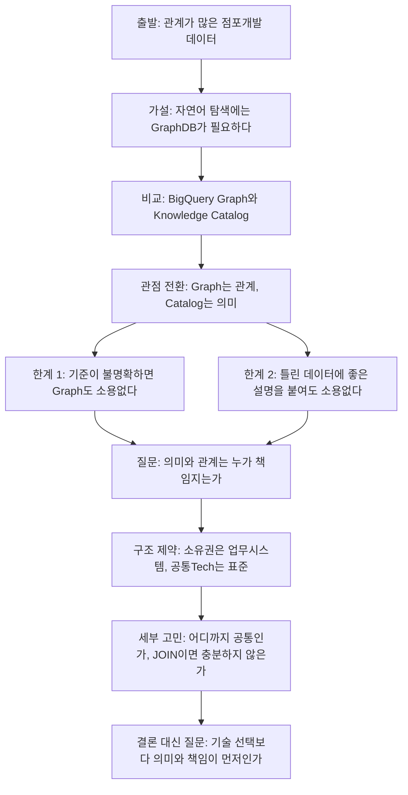
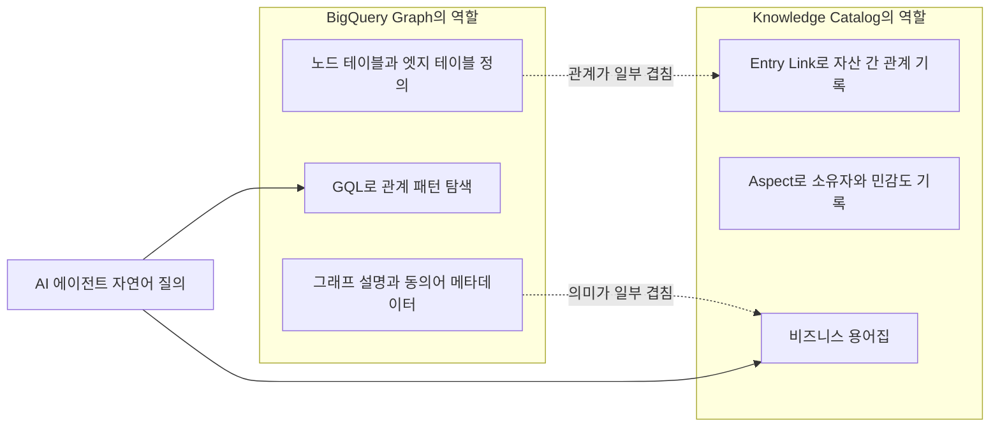
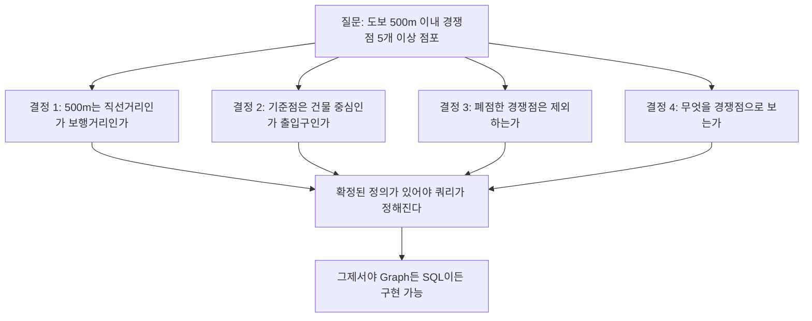
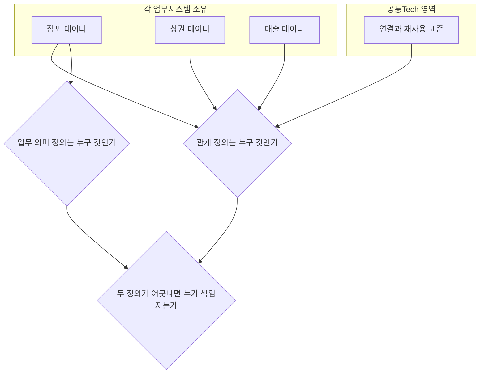
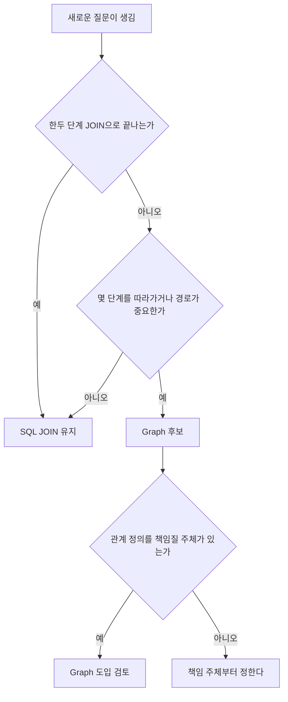
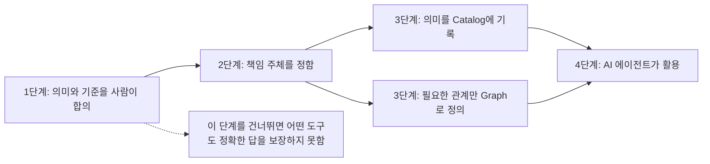

- 작성 기준일: 2026-10-18
- 분석 대상: 점포개발 업무 맥락에서 BigQuery Graph와 Google Knowledge Catalog를 비교하며 쓴 단상(짧은 에세이) 한 편
- 참고 사항: 게시글 본문은 제공해 주신 텍스트를 기준으로 분석했습니다. 제품 사실관계는 Google Cloud 공식 문서와 공식 블로그를 검색해 확인했고, 제가 덧붙인 해석은 "해석"이라고 따로 표시했습니다.


```
단상 

Graph를 만들면 AI가 데이터를 이해할까?

요즘 Graph와 Catalog를 살펴보면서 고민이 하나 늘었습니다.

점포개발 업무에는 점포, 건물, 경쟁점, 상권, 매출 등 서로 관계가 있는 데이터가 많습니다.

그동안 복잡한 관계를 자연어로 탐색하려면 GraphDB가 필요하지 않을까 생각했습니다.

그런데 BigQuery Graph와 Google Knowledge Catalog를 비교하다 보니 조금 다른 관점이 보입니다.

Graph는 데이터 사이의 관계를 탐색하고,
Catalog는 데이터와 관계가 가진 의미를 설명합니다.

예를 들어 이런 질문입니다.

“도보 500m 이내 경쟁점이 5개 이상인 점포를 찾아줘.”

개발자라면 어떤 쿼리를 작성할지부터 고민할 수 있습니다.

그런데 500m는 직선거리일까요?
실제 보행거리일까요?
건물 중심일까요, 출입구 기준일까요?
폐점한 경쟁점은 제외해야 할까요?

이런 기준이 불명확하다면 GraphDB를 아무리 잘 만들어도 정확한 답을 얻기 어렵습니다.

그렇다고 Catalog에 업무 용어와 설명을 등록하면 해결될까요?

그것도 의문입니다.

잘못된 데이터에 아무리 좋은 설명을 붙여도 결과가 정확해지는 것은 아닐 테니까요.

여기서 또 다른 고민이 생깁니다.

데이터의 의미와 관계는 누가 책임져야 할까요?

우리는 데이터와 도구, MCP의 소유권을 각 업무시스템에 두는 방향을 정했습니다.

공통Tech팀은 개별 업무를 대신 구현하기보다 서로 연결하고 재사용할 수 있는 표준을 고민해야 합니다.

그런데 막상 Graph와 Catalog를 이 구조에 적용하려니 생각할 것이 많습니다.

어디까지 공통으로 관리해야 할까요?
Graph의 관계 정의와 Catalog의 업무 의미가 달라지면 누가 책임져야 할까요?

SQL JOIN으로 충분한 관계까지 Graph로 만들어야 할지도 의문입니다.

기술적으로 가능하다는 것과 운영할 가치가 있다는 것은 다른 이야기니까요.

아직 답을 찾는 과정입니다.

예전에는 어떤 기술로 구현할지를 먼저 고민했다면, 요즘은 그 기술이 정말 필요한지부터 묻게 됩니다.

AI가 업무를 이해하도록 만드는 데 Graph가 먼저일까요, Catalog가 먼저일까요?

아니면 우리가 먼저 해야 할 일은 기술 선택이 아니라, 업무 데이터의 의미와 책임을 명확히 하는 것일까요?

개발자마다 생각이 다를 것 같습니다.

저 역시 계속 고민 중입니다.

https://www.facebook.com/share/p/187Xy2c9qh/
```

---

## 1. 한눈에 보기

이 글은 기술 소개 글이 아니라, 글쓴이가 실무에서 마주친 고민을 적은 단상입니다. 핵심은 이렇습니다.

점포, 건물, 경쟁점, 상권, 매출처럼 서로 얽힌 데이터를 AI에게 자연어로 물어보려면 GraphDB가 필요하다고 생각했습니다. 그런데 Google의 BigQuery Graph와 Knowledge Catalog를 나란히 놓고 보니 관점이 달라졌습니다. 글쓴이는 이 둘의 역할을 이렇게 정리합니다.

- Graph는 데이터 사이의 관계를 탐색합니다.
- Catalog는 데이터와 관계가 가진 의미를 설명합니다.

그러고 나서 글은 세 가지 질문으로 번집니다. 첫째, 기준이 모호하면 Graph를 아무리 잘 만들어도 정확한 답이 나오지 않습니다. 둘째, 그렇다고 Catalog에 용어 설명을 등록하면 해결되느냐 하면, 데이터 자체가 틀렸다면 설명이 좋아도 결과는 정확해지지 않습니다. 셋째, 그렇다면 데이터의 의미와 관계는 누가 책임져야 하느냐는 조직 구조의 문제가 남습니다.

글쓴이는 결론을 내지 않습니다. 오히려 "기술을 무엇으로 구현할까"가 아니라 "그 기술이 정말 필요한가"를 먼저 묻게 됐다고 말하며 끝납니다. 이 글의 가치는 답이 아니라 질문의 순서를 바꿨다는 데 있습니다.

---

## 2. 글의 논리 흐름

글은 다음과 같은 순서로 전개됩니다. 각 단계가 앞 단계의 한계에서 출발한다는 점이 중요합니다.



---

## 3. 글에 나오는 두 제품: 최신 정보

글이 두 제품을 전제로 쓰였기 때문에, 먼저 두 제품이 실제로 무엇인지 확인한 내용을 정리합니다. 아래 내용은 모두 공식 문서와 공식 블로그를 검색해 확인한 것입니다.

### 3.1 BigQuery Graph

**무엇인가.** BigQuery 안에서 그래프 분석을 할 수 있게 해 주는 기능입니다. 공식 문서는 ISO GQL 표준과 ISO SQL/PGQ 표준에 호환되는 그래프 질의 인터페이스를 제공한다고 설명합니다. 즉 SQL의 장점과 그래프 패턴 매칭의 표현력을 결합한다는 뜻입니다.

**어떻게 만드는가.** 별도의 그래프 데이터베이스를 세우는 것이 아니라, 이미 BigQuery에 있는 테이블 위에 "속성 그래프(Property Graph)"라는 정의 계층을 얹는 방식입니다. `CREATE PROPERTY GRAPH` 문으로 노드 테이블과 엣지 테이블을 지정하며, 공식 문서는 그래프를 만들 때 데이터가 이동하거나 복사되지 않는다고 밝힙니다. 그래프를 삭제해도 원본 테이블에는 영향이 없습니다.

**출시 경과.** 공개 프리뷰는 2026년 4월에 발표되었고, 2026년 9월 1일자 Google Cloud 블로그에서 정식 출시(GA)가 발표되었습니다. 참고로 일부 오래된 문서 페이지에는 아직 프리뷰 경고가 남아 있다는 외부 해설도 있습니다.

**GA에서 확인되는 주요 내용.**

- 성능: 공식 블로그는 공개 벤치마크 기준으로 프리뷰 대비 GQL이 2배, 무방향 순회가 100배 빨라졌다고 밝힙니다. 이는 Google의 자체 설명이라는 점은 감안해야 합니다.
- 표현력: `CALL` 문과 확장된 서브쿼리를 지원해, 복잡한 질문을 여러 조각으로 나누어 쓸 수 있습니다.
- 보안: BigQuery의 기존 행·열 수준 보안 아래에서 동작하고, 같은 쿼리에서 BigQuery ML과 AI 함수를 호출할 수 있습니다.
- 다른 클라우드 데이터: borderless Lakehouse를 통해 Databricks Unity Catalog, AWS Glue, Snowflake 경유의 Iceberg 테이블까지 하나의 그래프로 엮을 수 있다고 설명합니다.
- 자연어 질의: BigQuery의 conversational analytics로 그래프와 직접 대화할 수 있습니다. 이때 에이전트는 그래프에 정의한 설명(description)과 동의어(synonym) 같은 메타데이터를 활용해 결과를 안정시킨다고 합니다.
- 에이전트 스킬: GQL 작성, 그래프와 SQL 혼합, 스키마 설계 모범 사례를 담은 스킬이 제공됩니다. 데이터셋이나 ER 다이어그램에서 노드와 엣지를 제안하고 관계 일치율까지 검증해 주는 기능은 "곧 제공 예정"이라고 되어 있어 아직 GA 시점의 확정 기능이 아닙니다.
- 에이전트 기억: BigQuery Agent Analytics의 context graph로 에이전트의 행동 기록을 그래프로 남길 수 있습니다.

**한계에 대한 공식 맥락.** 외부 해설 중에는 BigQuery Graph가 "그래프 데이터베이스의 대체재가 아니라 BigQuery 안에서 관계 탐색을 하기 위한 기능"이라고 정리한 글이 있습니다. 이는 제품의 자기 소개가 아니라 제3자의 해석이므로 참고용으로만 보시기 바랍니다.

### 3.2 Google Knowledge Catalog

**무엇인가.** 이전에 Dataplex Universal Catalog로 불리던 서비스의 새 이름입니다. 2026년 4월 Google Cloud Next '26에서 이름이 바뀌었다고 외부 해설이 설명하며, 공식 문서도 "Dataplex Universal Catalog is now Knowledge Catalog"라고 안내합니다. 공식 문서는 이를 Gemini 기반 데이터 카탈로그로 소개하며, 정형·비정형 데이터에서 의미를 추출해 동적인 컨텍스트 그래프를 만들고 AI 에이전트가 사실에 근거해 답하도록 돕는다고 설명합니다.

**세 가지 축.** 공식 설명은 이 서비스가 여러 시스템의 메타데이터를 모으고(aggregation), 비즈니스 의미를 입히고(curation), 에이전트가 검색해 쓰게 하는(retrieval) 구조라고 설명합니다. 검색 단계에서는 시맨틱 검색과 MCP를 지원하는 도구가 제공됩니다.

**글쓴이의 고민과 직결되는 구성 요소들.**

- **비즈니스 용어집(Business Glossary):** 업무 용어의 단일 기준을 만듭니다. 공식 튜토리얼은 컬럼을 용어에 연결하면 일관된 정의를 얻고, AI 에이전트가 이 맥락을 그대로 물려받는다고 설명합니다. 컨텍스트 문서에는 "Promotional Discount"라는 용어를 "결제 시 적용되는 고객 할인이며 제조사 리베이트와 배송 지원은 제외"처럼 정의하는 예시가 나옵니다. 글쓴이가 던진 "폐점한 경쟁점은 제외해야 하나?" 같은 질문과 정확히 같은 종류의 정의입니다.
- **Aspect Type과 Aspect:** 정해진 스키마에 따라 메타데이터를 붙이는 장치입니다. 공식 튜토리얼에는 데이터 스튜어드, 민감도, 검토일 같은 거버넌스 필드를 가진 Aspect Type을 만들어 테이블에 붙이는 예가 있습니다. 즉 "이 데이터는 누가 책임지는가"를 카탈로그에 기록하는 공식 수단이 존재합니다.
- **Entry와 Entry Link:** Entry는 데이터 자산의 카탈로그상 표현이고, Entry Link는 두 자산 사이의 관계입니다. 지원되는 링크 유형은 synonym, related, definition, schema-join입니다. 또한 Entry Group은 접근 제어(IAM) 같은 관리 단위로 쓰입니다.
- **데이터 관계의 자동 발견:** Knowledge Catalog는 BigQuery 테이블·뷰 사이의 관계를 자동으로 찾아 Entry Link로 저장합니다. 다만 질의 이력의 표본을 분석하는 방식이라 일부 쿼리에서는 링크가 발견되지 않을 수 있다고 공식 문서가 명시합니다. 또한 관계 조회 권한은 원본 시스템(예: BigQuery)에 대한 기존 권한을 따릅니다.
- **자동 컨텍스트 큐레이션:** 설명, 용어집, 검증된 SQL 패턴을 자동 생성하는 기능은 출시 블로그 기준 프리뷰였습니다. 현재 상태는 제가 확인하지 못했으므로 도입 전에 공식 문서에서 확인하셔야 합니다. 반면 하이브리드 시맨틱 검색은 같은 블로그에서 GA로 표기되었습니다.

---

## 4. "Graph는 관계, Catalog는 의미"라는 구분을 읽는 법

글쓴이의 한 줄 요약은 제품 문서와도 대체로 맞아떨어집니다. 다만 경계가 완전히 깨끗하지는 않다는 점을 같이 알아 두시면 글의 고민이 더 잘 이해됩니다.



**서술형 설명.** BigQuery Graph는 "무엇이 무엇과 연결되어 있는가"를 실제 데이터에서 따라가는 도구입니다. 반대로 Knowledge Catalog는 "그 연결이나 값이 업무적으로 무엇을 뜻하는가"를 기록하는 도구입니다. 이 점에서 글쓴이의 구분은 타당합니다.

그런데 두 제품 모두 상대 영역에 걸쳐 있습니다. BigQuery Graph에도 설명과 동의어를 붙일 수 있고, Knowledge Catalog에도 schema-join 같은 관계 링크가 있습니다. 이 겹침이 글 후반부의 질문, 즉 "Graph의 관계 정의와 Catalog의 업무 의미가 달라지면 누가 책임져야 하는가"를 단순한 기우가 아니라 실제로 발생할 수 있는 운영 문제로 만듭니다.

공개된 GoogleCloudPlatform/knowledge-catalog 저장소의 풀리퀘스트 하나는 의미 모델을 BigQuery 그래프와 Knowledge Catalog 양쪽에 반영하는 도구를 다루는데, 관계 링크를 다시 정리(reconcile)하는 로직과 "Knowledge Catalog로의 푸시는 일부 정보가 손실된다"는 취지의 언급이 보입니다. 이것이 제품의 공식 권고는 아니지만, 두 곳에 같은 관계를 유지하려면 동기화 비용이 든다는 사실을 보여 주는 사례로 읽을 수 있습니다.

---

## 5. 예시 질문 해부: "도보 500m 이내 경쟁점이 5개 이상인 점포"

글에서 가장 구체적인 부분입니다. 이 질문은 사람이 보면 간단해 보이지만, AI가 정확히 답하려면 네 가지 결정이 선행되어야 합니다.



네 번째 항목은 글에 직접 나오지 않지만, 같은 종류의 질문입니다. 본문은 앞의 세 가지를 명시했고, 네 번째는 제가 같은 맥락에서 덧붙인 것입니다(해석).

**여기서 읽어야 할 핵심.** 글쓴이가 말하려는 것은 "GraphDB가 나쁘다"가 아니라, 이 네 가지가 정해지지 않으면 어떤 저장소를 쓰든 답이 불안정하다는 점입니다. Graph는 정의된 관계를 빠르게 따라가 줄 뿐, 무엇을 관계로 볼지는 정해 주지 않습니다.

**제품 측면에서 확인한 점.** 이번 조사에서 확인한 공식 문서 범위에서는, 두 제품 중 어느 쪽도 "도보"의 의미를 업무 맥락에 맞게 대신 정해 준다는 내용은 찾지 못했습니다. 이것은 "기능이 없다"는 단정이 아니라 "제가 확인한 문서에서는 그런 설명이 없었다"는 뜻입니다. 다만 BigQuery Graph의 엣지는 기존 테이블에서 정의된다는 구조상, "경쟁점이 반경 500m 안에 있다"는 관계를 그래프로 쓰려면 그 관계를 먼저 계산해 둔 테이블이 필요하다는 점은 구조에서 따라 나오는 해석입니다. 어떤 거리 기준으로 그 테이블을 만들지는 결국 사람이 정해야 합니다.

---

## 6. "잘못된 데이터에 좋은 설명을 붙여도 소용없다"

글쓴이는 Catalog에 용어와 설명을 등록하는 것으로 문제가 해결되지는 않는다고 말합니다. 이 지적은 의미(semantics)와 품질(quality)이 서로 다른 문제라는 데서 나옵니다.

- 의미의 문제: 이 컬럼이 무엇을 뜻하는가, 이 관계가 무엇을 나타내는가.
- 품질의 문제: 그 값이 실제로 맞는가, 최신인가, 빠진 것은 없는가.

Knowledge Catalog 공식 요금 페이지를 보면 프리미엄 처리 등급에 데이터 계보, 데이터 품질, 프로파일링 기능이 포함된다고 되어 있습니다. 즉 제품도 설명과 품질을 별개의 기능으로 다룹니다. 용어집으로 의미를 정리하는 일과 데이터 품질을 점검하는 일은 따로 해야 한다는 글쓴이의 직관은 제품 구성과도 맞습니다.

여기에는 한 가지 더 생각할 점이 있습니다. 공식 문서는 용어집이 AI 에이전트의 환각을 줄이는 데 도움이 된다고 설명하지만, 이는 "정의가 올바르게 등록되어 있을 때"를 전제로 합니다. 잘못된 정의가 등록되면 에이전트는 그 잘못된 정의를 그대로 믿고 답할 수 있습니다. 이 부분은 문서에 명시된 내용이 아니라 구조에서 따라 나오는 해석이며, 글쓴이의 우려와 같은 방향입니다.

---

## 7. 소유권과 책임: 글의 가장 어려운 질문

글 중간에서 분위기가 바뀝니다. 기술 이야기에서 조직 이야기로 넘어갑니다.

글쓴이의 조직은 데이터, 도구, MCP의 소유권을 각 업무시스템에 두기로 정했습니다. 그리고 공통Tech팀은 개별 업무를 대신 구현하지 않고, 서로 연결하고 재사용할 수 있는 표준을 고민하는 역할이라고 말합니다. 이 원칙을 Graph와 Catalog에 적용하려니 막히는 지점이 생깁니다.



**질문을 풀어서 읽으면 이렇습니다.**

첫째, 점포와 상권을 잇는 관계는 점포 시스템의 것인지 상권 시스템의 것인지, 아니면 둘 사이에 걸쳐 있어 공통 영역인지가 분명하지 않습니다. 관계는 본질적으로 두 개 이상의 시스템에 걸쳐 있기 때문에, 소유권을 시스템 단위로 나눈 원칙과 부딪힙니다. 글쓴이가 "어디까지 공통으로 관리해야 할까요?"라고 묻는 이유가 여기에 있습니다.

둘째, 관계 정의(Graph)와 의미 정의(Catalog)가 서로 다른 곳에 저장되면, 하나가 바뀌었을 때 다른 하나가 낡을 수 있습니다. 앞서 4장에서 본 것처럼 두 제품이 일부 영역에서 겹치기 때문에 이 위험은 현실적입니다.

**제품이 제공하는 단서.** Knowledge Catalog에는 소유자를 기록하는 Aspect, 접근 권한을 묶는 Entry Group, 원본 시스템 권한을 따르는 관계 가시성이 있습니다. 즉 "누가 책임지는가"를 기록하고 권한을 나눌 수단은 제품에 있습니다. 하지만 누가 책임져야 하는지를 정하는 일은 제품이 대신해 주지 못합니다. 이 부분은 글쓴이의 질문이 여전히 열려 있는 이유입니다.

---

## 8. "SQL JOIN으로 충분한 관계까지 Graph로 만들어야 하는가"

이 질문은 실무적으로 가장 쓸모가 큽니다. 글쓴이는 "기술적으로 가능하다는 것과 운영할 가치가 있다는 것은 다르다"고 말합니다.

공식 블로그는 그래프가 힘을 발휘하는 질문을 "두 계정이 어떻게 연결되어 있는가, 결제가 어떤 경로를 거쳤는가, 표시된 개체에서 몇 단계 안에 있는 개체는 무엇인가"처럼 연결과 경로에 관한 것으로 설명하고, 이런 질문은 SQL 조인으로 표현하기 어렵다고 말합니다. 활용 사례로 든 것도 사기 탐지, 공급망 의존성, 신원 해소, 지식 그래프, 네트워크 토폴로지처럼 여러 단계(multi-hop)를 따라가는 문제들입니다.

이 기준을 점포개발 질문에 대어 보면 다음과 같이 생각해 볼 수 있습니다(해석).



"도보 500m 이내 경쟁점이 5개 이상"이라는 질문은 점포에서 경쟁점으로 한 단계만 가면 되는 거리 기반 집계입니다. 이런 질문은 그래프 순회가 아니라 공간 계산과 집계의 문제에 가깝다고 볼 수 있습니다. 이 판단은 제가 질문의 모양을 보고 내린 해석이며, 실제 데이터 구조와 요구를 보고 확인해야 합니다. 이 해석이 맞다면 글쓴이가 JOIN으로 충분한 관계까지 Graph로 만들 필요가 있는지 의심하는 것은 합리적입니다.

---

## 9. 결국 "Graph가 먼저냐, Catalog가 먼저냐"

글은 마지막에 이렇게 묻습니다. AI가 업무를 이해하도록 만드는 데 Graph가 먼저인지, Catalog가 먼저인지. 혹은 기술 선택 자체가 아니라 업무 데이터의 의미와 책임을 명확히 하는 것이 먼저인지.

글쓴이는 답을 내지 않았으므로, 여기서는 지금까지 확인한 사실로 이 질문이 어떻게 정리되는지만 보여 드리겠습니다.



- 사실로 확인된 것: Graph와 Catalog는 서로 다른 일을 하며, 둘 다 사람이 정한 정의를 입력으로 받습니다. Catalog에는 소유자와 용어를 기록할 장치가 있고, Graph는 기존 테이블 위에서 관계를 정의합니다.
- 해석: 그렇다면 어느 도구가 먼저냐보다, 두 도구에 넣을 내용을 먼저 합의하는 일이 선행되어야 한다는 글쓴이의 마지막 의심은 근거가 있습니다. 다만 이것은 이 글의 문제의식에 대한 제 정리이지, 제품 문서의 주장은 아닙니다.

---

## 10. 이 글이 말하지 않는 것

오해를 피하기 위해 글의 범위도 정리합니다.

- 글은 두 제품 중 하나를 도입하라고 권하지 않습니다.
- 글은 GraphDB가 불필요하다고 단정하지 않습니다. "필요한지부터 묻게 된다"고만 말합니다.
- 글은 BigQuery Graph와 Knowledge Catalog의 상세 기능을 설명하지 않습니다. 두 제품의 역할을 한 줄로 대비시키는 데 그칩니다.
- 글에는 특정 조직의 구체적 구조나 사내 시스템 이름이 나오지 않으며, "각 업무시스템", "공통Tech팀"이라는 역할 수준에서만 언급됩니다.

---

## 11. 사실과 해석 구분표

| 구분 | 내용 | 근거 |
|---|---|---|
| 확인된 사실 | BigQuery Graph는 2026년 9월 1일 발표로 GA, 프리뷰는 2026년 4월 | Google Cloud 블로그, 외부 해설 |
| 확인된 사실 | 그래프는 기존 테이블 위에 정의되며 데이터가 이동·복사되지 않음 | BigQuery 공식 문서 |
| 확인된 사실 | Knowledge Catalog는 Dataplex Universal Catalog의 새 이름 | 공식 문서 |
| 확인된 사실 | 용어집, Aspect, Entry Link(synonym, related, definition, schema-join) 지원 | 공식 문서 |
| 확인된 사실 | 관계 자동 발견은 질의 이력 표본 기반이라 일부는 발견되지 않을 수 있음 | 공식 문서 |
| 확인 못 한 것 | "도보 거리" 같은 업무 기준을 제품이 대신 정해 주는지 | 조사한 문서에서 확인되지 않음 |
| 확인 못 한 것 | 자동 컨텍스트 큐레이션의 현재 GA 여부 | 출시 블로그 기준 프리뷰, 현재 상태 미확인 |
| 해석 | 거리 기반 집계는 그래프 순회보다 공간 계산에 가깝다 | 질문 모양에 대한 제 판단 |
| 해석 | 잘못된 정의가 등록되면 에이전트가 이를 믿고 답할 수 있다 | 구조에서 따라 나오는 추론 |

---

## 출처

- [Introduction to BigQuery Graph (Google Cloud 문서)](https://docs.cloud.google.com/bigquery/docs/graph-overview)
- [Create and query a graph (Google Cloud 문서)](https://docs.cloud.google.com/bigquery/docs/graph-create)
- [BigQuery Graph is now GA: the knowledge foundation for the agentic era (Google Cloud 블로그, 2026-09-01)](https://cloud.google.com/blog/products/data-analytics/bigquery-graph-connecting-data-and-ai-at-scale)
- [Introducing BigQuery Graph (Google Cloud 블로그)](https://cloud.google.com/blog/products/data-analytics/introducing-bigquery-graph)
- [Introducing the Google Cloud Knowledge Catalog (Google Cloud 블로그)](https://cloud.google.com/blog/products/data-analytics/introducing-the-google-cloud-knowledge-catalog)
- [Knowledge Catalog overview (Google Cloud 문서)](https://docs.cloud.google.com/knowledge-catalog/docs/introduction)
- [About metadata management in Knowledge Catalog (Google Cloud 문서)](https://docs.cloud.google.com/dataplex/docs/catalog-overview)
- [View data relationships in Knowledge Catalog (Google Cloud 문서)](https://docs.cloud.google.com/dataplex/docs/data-relationships)
- [Establish foundational data context (Google Cloud 문서)](https://docs.cloud.google.com/dataplex/docs/establish-foundational-data-context)
- [Build foundational data governance (Google Cloud 문서)](https://docs.cloud.google.com/dataplex/docs/build-foundational-data-governance)
- [Knowledge Catalog 제품 및 요금 페이지](https://cloud.google.com/products/knowledge-catalog)
- [What Is Google Knowledge Catalog and How Does It Work? (Atolio, 외부 해설)](https://www.atolio.com/blog/what-is-google-knowledge-catalog)
- [How to Use BigQuery Graph: 5 Key Points for GQL Analysis (외부 해설)](https://book.st-hakky.com/en/data-platform/bigquery-graph-gql-guide)
- [GoogleCloudPlatform/knowledge-catalog 풀리퀘스트 #277](https://github.com/GoogleCloudPlatform/knowledge-catalog/pull/277)

---

작성 일자: 2026-10-18
