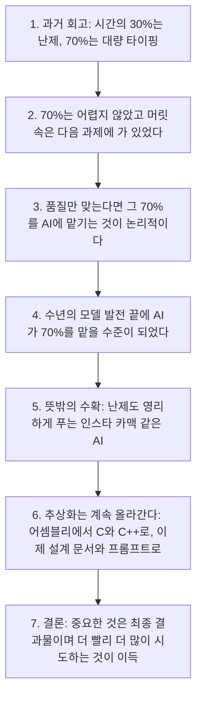
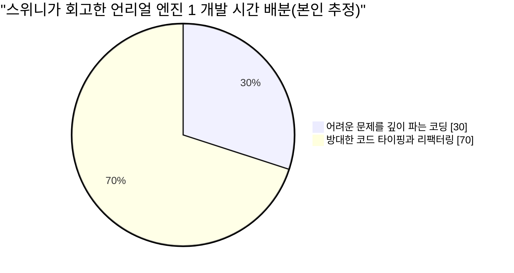
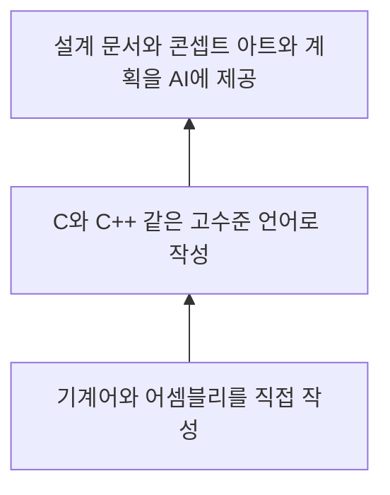
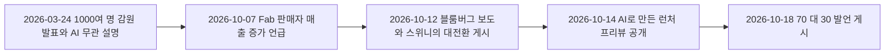
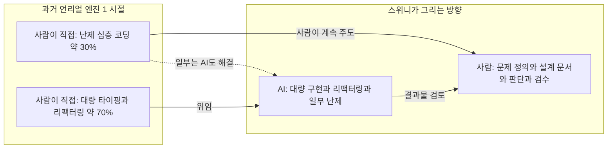

- 작성 일자: 2026-10-18
- 대상 글: Epic Games 창업자이자 CEO인 팀 스위니(Tim Sweeney)가 X(구 트위터)에 올린 AI 코딩 관련 장문 게시물 (https://x.com/TimSweeneyEpic/status/2111633221725122769)
- 문서 성격: 발언의 내용, 용어, 배경 사실, 최근 상황, 쟁점을 서술형으로 풀어 쓴 해설서

---

## 0. 이 문서를 읽기 전에: 확인한 것과 확인하지 못한 것

이 문서는 "막연한 추측 없이 확인된 사실만 쓴다"는 원칙으로 작성했습니다. 그래서 먼저 어디까지 직접 확인했는지부터 밝혀 둡니다.

게시물 원문 페이지는 X 측이 자동 접근을 막고 있어 제가 직접 열어 보지 못했습니다. 대신 검색 결과에 노출된 원문 첫 문단("언리얼 엔진 1을 쓰던 시절 내 시간은 이렇게 나뉘어 있었다. 약 30%는 어셈블리 텍스처 매퍼, C++ BSP 트리, 데이터 영속성, 객체지향 시스템 설계, 네트워킹 같은 깊은 코딩이었다……")이 사용자께서 보내 주신 번역문과 일치함을 확인했습니다. 나머지 본문은 사용자께서 제공하신 번역문을 기준으로 해설합니다. 또 이 게시물이 2026년 10월 18일에 올라온 것은 검색에 잡힌 X 페이지들의 게시 시각 표기로 확인했습니다.

이 문서에서 "해석"이라고 표시한 부분은 사실이 아니라 제 의견이며, 표시가 없는 서술은 출처를 둔 사실입니다. 출처는 맨 끝에 모아 두었습니다.

---

## 1. 한눈에 보기

스위니의 글은 길지만 주장은 하나로 요약됩니다. 자신이 1990년대에 언리얼 엔진 1을 만들 때를 돌아보니, 시간의 약 30%만 진짜로 어려운 문제에 쓰였고 약 70%는 어렵지는 않지만 양이 엄청난 코드를 타이핑하고 정리하는 데 쓰였다는 것입니다. 그 70%를 AI가 비슷한 품질로 해낼 수 있게 되었으니 맡기는 것이 당연하고, 그렇게 풀려난 시간으로 프로그래머가 더 가치 있는 일을 하게 된다는 이야기입니다.

여기에 두 가지가 덧붙습니다. 하나는 "AI가 어려운 30%의 문제까지 꽤 영리하게 풀어 내는 모습은 예상하지 못했다"는 놀라움이고, 다른 하나는 "프로그래밍의 추상화 수준은 늘 올라가 왔고, 어셈블리를 버렸을 때 아쉽지 않았듯 코드 타이핑도 같은 길을 갈 것"이라는 역사적 비유입니다. 결론은 "중요한 것은 최종 결과물이며, 더 많은 아이디어를 더 빨리 시험하게 돕는 것은 모두에게 이득"이라는 한 문장입니다.

이 글이 주목받는 이유는 내용 자체보다 시점입니다. 불과 엿새 전 블룸버그가 에픽이 디즈니 협업 게임 개발진에게 "AI 우선" 생산 방식을 지시했다고 보도했고, 나흘 전에는 에픽이 AI로 "바이브 코딩"했다는 새 런처 프리뷰를 공개했습니다. 즉 이 글은 회사 안팎에서 AI 전환 논쟁이 가장 뜨거울 때 CEO가 자신의 철학을 직접 풀어 쓴 글입니다. 이 맥락은 4장에서 자세히 다룹니다.

---

## 2. 글의 논리 구조

스위니의 논증은 개인적 회고에서 출발해 기술 전망을 거쳐 철학적 결론으로 이어지는 일곱 단계로 읽힙니다.

각 단계가 앞 단계를 전제로 한다는 점이 중요합니다. 3단계의 "품질만 맞는다면"이라는 조건이 4단계의 "그 수준에 도달했다"는 평가로 충족되었다고 선언해야 5단계 이후가 성립합니다. 따라서 이 글에서 가장 힘이 실린 주장은 사실상 4단계이며, 이 부분은 6장에서 비판적으로 따져 봅니다.

---

## 3. 문장별로 풀어 읽기

### 3.1 "30% 대 70%"의 의미

스위니가 든 30%의 예시는 어셈블리로 짠 텍스처 매퍼, C++로 구현한 BSP 트리, 데이터 영속성, 객체지향 시스템 설계, 네트워킹입니다. 모두 "어떻게 풀어야 하는지 자체를 알아내야 하는" 문제들입니다. 반대로 70%는 "게임 엔진이라는 완결된 제품이 되려면 필요한 방대한 기능 코드"를 쓰고 고치는 일로 묘사됩니다. 풀이법은 이미 알고 있는데 분량이 많은 일입니다.

이 수치는 측정값이 아니라 본인의 기억에 따른 대략적 배분입니다. 글 자체도 "대략(around)"이라고 표현했습니다.

### 3.2 "타이핑하는 동안 머리는 다른 곳에"

가장 흥미로운 문장은 70%를 치는 동안에도 마음은 대부분 더 어려운 주제와 다음 계획에 가 있었다는 대목입니다. 이는 두 가지를 말합니다. 첫째, 70% 작업은 사고력이 거의 필요 없는 일이었다는 자기 평가입니다. 둘째, 그래서 그 시간의 사고 자원은 사실상 30%의 문제나 앞으로의 설계에 쓰이고 있었다는 것입니다. 스위니는 이 상태를 "오늘날의 바이브 코딩과 크게 다르지 않게 느껴졌다"고 표현하며, 차이는 AI에게 프롬프트를 쓰고 결과를 검토하는 대신 IBM Model M 키보드로 직접 쳤다는 점뿐이라고 덧붙입니다.

해석: 여기서 스위니가 "같다"고 말하는 것은 작업의 품질이나 방식이 아니라 개발자의 인지 상태, 즉 손은 구현을 하고 머리는 다른 곳에 있는 상태입니다. 이 비유를 "바이브 코딩이 곧 숙련자의 직접 코딩과 동등하다"는 주장으로 읽으면 과한 해석입니다.

### 3.3 "AI에 맡기는 것은 지극히 논리적"

이어지는 논리는 단순합니다. 70%가 어렵지 않은 일이라면, 같은 품질을 낼 수 있는 한 누가 하든 상관없다는 것입니다. 스위니는 "그동안 AI는 그 품질에 못 미쳤다"고 인정하고, 몇 년간의 모델 발전 끝에 이제 맡을 수 있게 되었다고 말합니다. 이 문장은 AI가 모든 일을 잘한다는 주장이 아니라, "우리와 비슷한 품질 기준을 충족하는 범위에서"라는 조건부 주장입니다.

### 3.4 "인스타 카맥"이라는 표현

스위니는 "예상하지 못한 놀라움"으로 AI가 "일종의 즉석 카맥(insta-Carmack)"처럼 어려운 기술 문제를 영리하게, 때로는 깔끔하게 푼다는 점을 꼽습니다. 카맥은 『둠』과 『퀘이크』를 만든 id Software의 존 카맥을 가리키며, 스위니와 함께 세계에서 가장 이름난 게임 엔진 프로그래머로 꼽혀 온 인물입니다. 그러니 이 표현은 "30%의 난제에 해당하는 일까지 해내는 AI"를 가리키는 최상급 칭찬입니다. 스위니는 또 AI가 복잡한 3D 장면을 다룰 수 있다고 했는데, 도구를 직접 조작하는 방식과 원시 데이터 파일을 직접 이해하는 방식 두 가지를 모두 언급했습니다.

### 3.5 어셈블리 비유

스위니는 1998년에 어셈블리 언어 사용을 그만두었다고 말합니다. 이유는 비순차 실행(out-of-order) CPU가 등장해 훨씬 단순하게 쓴 C/C++ 코드가 더 빨리 실행되기 시작했기 때문이며, 이후 어셈블리가 그리웠던 적이 없다고 합니다. 이를 근거로 "설계 문서, 콘셉트 아트, 계획서를 프롬프트로 주는 것만으로 코드 타이핑과 정점 조정을 뛰어넘을 수 있다면, 개발자는 더 높은 수준의 일을 하게 될 것"이라고 전망합니다.

이 비유의 요점은 "기술이 더 높은 추상화 계층으로 올라가면, 사람은 아래 계층의 수고에서 풀려나고 그것을 잃었다고 느끼지 않는다"는 데 있습니다.

### 3.6 맺음말

마지막 단락은 "중요한 것은 게임이든 엔진이든 최종 결과물이며, 개발자가 새 아이디어를 더 많이 시도하고 더 나은 소프트웨어와 게임을 더 빨리 만들도록 돕는 것은 모두에게 이득"이라는 가치 선언입니다. 즉 "코드를 누가 쳤는가"가 아니라 "무엇이 만들어졌는가"로 평가 기준을 옮기자는 주장입니다.

---

## 4. 왜 지금 이 글이 올라왔나: 최근 상황 정리

이 글은 진공 상태에서 나온 것이 아니라 에픽의 최근 일련의 사건 한가운데서 나왔습니다. 확인된 순서는 다음과 같습니다.

### 4.1 3월: 감원과 "AI와는 무관하다"는 설명

2026년 3월 24일 스위니는 1,000명이 넘는 직원을 감원한다고 밝혔습니다. 그는 포트나이트 이용 감소로 회사가 벌어들이는 것보다 훨씬 많이 쓰고 있었다고 설명했고, 계약직·마케팅·미충원 포지션 축소로 5억 달러 넘게 절감하겠다고도 했습니다. 특히 감원은 AI와 무관하다고 명시했습니다. 같은 글에서 언리얼 엔진 5와 포트나이트용 언리얼 에디터에서 언리얼 엔진 6으로 넘어가는 계획도 언급되었습니다. 이 점은 이후 AI 전환이 "인력 감축 수단이 아니다"라는 스위니의 반복된 입장의 배경이 됩니다.

### 4.2 10월 7일과 10월 12일: 생태계 관찰과 전환 선언

스위니는 10월 7일 게시물에서, 9월에 언리얼 에디터용 콘텐츠 마켓인 Fab의 판매자 매출이 크게 늘었다고 말하며, AI 가속이 콘텐츠 수요를 늘렸고 많은 개발자가 AI 어시스턴트로 장면을 만들면서 Fab의 구성 요소를 사 간다고 해석했습니다. 이는 에픽 측 관찰이며 독립적으로 검증된 통계는 아닙니다.

10월 12일에는 블룸버그의 제이슨 슈라이어가 에픽이 디즈니와 협업하는 미발표 슈팅 게임(스타워즈와 마블 캐릭터가 등장하는 것으로 보도됨)을 기존 목표였던 2027년 3월 이후로 연기했고, 개발진에게 "AI 우선(AI first)" 생산 방식을 지시했다고 보도했습니다. 보도에 따르면 내부 메일에서 아트를 "완전한 AI 워크플로로 생성"하고 "손으로 쓰는 코드는 더 이상 없다"는 취지의 지시가 있었습니다. 에픽 커뮤니케이션 책임자 제이크 존스는 블룸버그에 "개발자가 주도하는 AI 가속 개발을 받아들이고 있다"는 취지로 입장을 밝혔고, 디즈니는 즉각 답하지 않았습니다.

몇 시간 뒤 스위니는 X에 "에픽에서 거대한 전환이 진행 중이며, 개발자들을 재배치해 최대한의 AI 가속에 맞춰 재정비하고 있다"고 썼습니다. 이어 목적은 "같은 일을 더 적은 인원으로 하는 것"이 아니라 모두가 더 많고 더 좋은 것을 만들 수 있게 하고 그 혜택을 언리얼을 쓰는 모든 팀에 확장하는 것이라고 밝혔습니다. 다만 매체들이 공통으로 지적하듯, 스위니는 회사 전반의 AI 방향을 말했을 뿐 디즈니 프로젝트에 관한 개별 보도 내용을 확인하거나 논평하지는 않았습니다.

연기 사유에 대해서도 정확히 구분할 필요가 있습니다. 보도에 따르면 이 프로젝트는 AI 지시 이전부터 예상보다 느리게 진행되고 있었고, 필요한 인력과 시간을 에픽이 과소평가한 것이 배경으로 전해졌습니다. 즉 "AI 때문에 늦어졌다"가 아니라 "이미 늦어지던 프로젝트에 AI 우선 방식이 지시되었다"가 보도 내용입니다. 블룸버그는 이것이 대형 게임사로서는 게임을 대부분 AI로 만들어 보려는 첫 시도라고 짚었습니다. 또 취재원들이 전한 바로는, 일부 직원은 AI가 만든 결과물의 오류를 처리하는 방식을 두고 "AI에게 자기 실수를 고치라고 시켜야 하느냐"는 식의 농담을 했습니다. 이 부분은 익명 취재원을 통한 보도이며 에픽이 확인한 것은 아닙니다.

### 4.3 10월 14일: "바이브 코딩" 런처

에픽은 10월 14일 새 에픽게임즈 런처의 프리뷰 버전을 공개하면서 공식 블로그에서 "프로그래밍은 어렵다. 그래서 대신 바이브 코딩으로 더 빠르고 날렵한 새 런처를 만들었다"는 취지로 소개했습니다. 에픽이 공개한 수치는 다음과 같습니다. 콜드 스타트에서 스토어 화면까지 평균 5.47초로, 비교 대상으로 제시한 스팀의 10.07초보다 빠르다는 것이고(약 1.8배, 46% 단축), 시스템 트레이에서 다시 열 때는 0.36초 대 0.42초라고 했습니다. 에픽 게임스 스토어 책임자 마틴 킬리는 IGN에 라이브러리 로딩이 이전보다 30배 빨라졌고 용량은 약 300MB라고 말했습니다. 리눅스 지원이 처음 포함되었고 포트나이트의 리눅스 이식은 이후 과제로 소개되었습니다.

AI 활용 범위에 대해 킬리는 AI를 개발 과정의 도구로 썼으며, 에이전트가 코드를 쓰고 검토하되 개발자가 관리·감독했다는 취지로 설명했다고 전해집니다. 소규모 팀이 코드베이스를 새로 쓰고 여러 플랫폼에 더 빨리 내놓을 수 있었다는 것입니다.

주의할 점이 있습니다. 위 속도 수치는 에픽이 자사 프리뷰 사이트에 제시한 비교이며 제3자의 독립 검증 결과가 아닙니다. 에픽도 개별 환경에 따라 결과가 달라질 수 있음을 인정했습니다. 새 런처는 기능이 가벼운 첫 버전이라는 점도 스스로 밝혔습니다. 따라서 이 런처는 "AI로 만든 소프트웨어가 상용 서비스에 쓰일 수 있다"는 사례이지만, "AI 코딩이 사람 코딩보다 낫다"는 증거로 쓰기에는 비교 조건이 한정적입니다.

### 4.4 10월 18일: 이 글

그리고 10월 18일 스위니가 이 글을 올렸습니다. 게시 직후부터 반응이 갈렸고, 확인된 비판 답글 중에는 "AI로 바이브 코딩한 런처가 밸브가 사람 손으로 만든 코드를 못 이기지 않았느냐"는 취지의 반박도 있었습니다. 다만 이 답글은 한 이용자의 의견일 뿐이며, 앞서 말했듯 속도 비교의 근거는 에픽 측 수치라는 점을 함께 기억해야 합니다.

---

## 5. 용어 해설

**언리얼 엔진 1(UE1)**: 스위니가 1995년부터 개발을 시작해 1998년 게임 『언리얼』 출시와 함께 선보인 에픽의 첫 게임 엔진입니다. 마이크로프로즈와 레전드 엔터테인먼트는 1996년에 이미 이 기술을 라이선스했습니다. 초기에는 그래픽 계산을 전적으로 CPU가 처리하는 소프트웨어 렌더링에 의존했고, C++와 UnrealScript, 어셈블리로 작성되었습니다. 스위니는 엔진 코드의 대부분을 직접 썼는데, 위키백과가 인용하는 인터뷰에서는 90%, 게임 디벨로퍼 매거진 인터뷰에서는 약 80%와 25만 줄로 말해 인터뷰마다 수치가 조금 다릅니다. 또 1998년 인터뷰에서 엔진에서 가장 어려웠던 부분은 렌더러였고 핵심 알고리즘을 여러 번 다시 썼다고 말했습니다. 이는 이번 글의 "30%는 어려운 문제"라는 회고와 일관됩니다.

**텍스처 매퍼(texture mapper)**: 3D 표면에 2D 그림을 입히는 렌더링 루틴입니다. 소프트웨어 렌더링 시절에는 이 루틴이 화면의 모든 픽셀마다 수없이 반복 실행되는 가장 뜨거운 구간이어서 어셈블리로 최적화하는 것이 흔했습니다. 스위니가 과거 강연 자료에서 언리얼 1을 "마지막 주요 소프트웨어 렌더러"로 소개한 것과도 맥이 닿습니다.

**BSP 트리**: 공간을 평면으로 재귀적으로 둘로 나누는 자료구조로, 3D 공간의 가시성 판정과 렌더링 순서 정리에 쓰였습니다. 아이디어 자체는 어렵지만 구현과 디버깅이 까다로운 부류의 문제입니다.

**데이터 영속성(data persistence)**: 프로그램 안의 객체와 데이터를 저장했다가 다시 복원하는 문제를 말합니다.

**비순차 실행(out-of-order) CPU**: 명령어를 프로그램에 적힌 순서가 아니라 준비된 것부터 먼저 실행하는 CPU입니다. 스위니의 과거 강연 자료는 1995년 펜티엄 프로를 비순차 실행의 시작점으로 소개합니다. 일반적으로는 하드웨어가 스스로 순서를 조정해 주니, 사람이 명령어 배치를 손으로 짜 맞추는 이점이 줄어들어 단순한 고수준 코드도 충분히 빨라졌다고 설명됩니다. 스위니가 어셈블리를 버린 이유가 바로 이것입니다.

**바이브 코딩(vibe coding)**: 코드를 직접 쓰기보다 AI에게 프롬프트로 원하는 바를 설명하고 결과를 검토하며 만들어 가는 개발 방식을 가리키는 통칭입니다. 에픽 런처 사례에서 보듯 사람에 따라 "자동완성 수준"부터 "대규모 코드 생성"까지 폭넓게 쓰이는 말이어서, 구체적으로 어디까지 AI가 했는지를 확인해야 의미가 정해집니다.

**IBM Model M 키보드**: 묵직한 타건감으로 유명한 IBM의 고전 키보드입니다. 스위니는 이를 "그저 손으로 쳤다"는 상징으로 가볍게 쓴 것으로 보입니다.

---

## 6. 비판적으로 읽기: 이 글이 입증한 것과 그렇지 않은 것

이 장은 사실 확인과 해석을 구분해서 읽어야 합니다. 각 항목에서 앞부분은 확인 가능한 사실, 뒷부분은 제 해석입니다.

### 6.1 30 대 70은 증거가 아니라 회고다

스위니 본인이 "대략" 그랬다고 쓴 개인 기억이며, 다른 프로젝트나 현대의 대규모 팀 개발에 그대로 일반화할 근거는 글 안에 없습니다. 해석하자면 이 비율은 "AI에 맡길 수 있는 일의 크기"를 가늠하는 하나의 직관적 틀로는 유용하지만, 자신의 프로젝트에서는 직접 측정해 봐야 하는 값입니다.

### 6.2 "비슷한 품질이라면"이라는 조건이 핵심이다

글의 논리는 품질 동등성에 의존하는데, 글에는 그 동등성을 입증하는 데이터가 없습니다. 근거로 인용 가능한 것은 에픽 자체 런처 사례(에픽이 제시한 수치)와 스위니의 주관적 평가 정도입니다. 반면 같은 시기 보도된 디즈니 프로젝트 관련 이야기에서는 직원들이 AI 결과물의 오류 처리 책임을 걱정했다는 취재원 증언이 있습니다. 해석하자면 70%를 AI가 쓰더라도 그 코드의 정확성과 일관성을 책임지는 일은 사라지지 않고 "검토" 쪽으로 옮겨 가며, 그 검토 비용이 얼마인지는 이 글에서 다뤄지지 않았습니다.

### 6.3 말하는 사람의 위치

스위니는 지금 AI 전환을 실행하는 회사의 CEO입니다. 이는 의견의 진정성을 의심하자는 것이 아니라, 독자가 맥락으로 알고 읽어야 하는 사실입니다. 그는 3월 감원 때와 10월 12일 모두 AI 전환의 목적이 인력 감축이 아니라고 일관되게 말해 왔습니다. 다만 이 의도가 실제로 어떤 결과로 이어질지는 아직 확인할 수 없습니다.

### 6.4 "예상하지 못한 수확"이라는 서술의 근거

스위니는 AI의 난제 해결 능력을 "놀라운 수확"으로 서술하지만 구체적 사례를 제시하지 않았습니다. 해석하자면 이 대목은 이번 글에서 가장 근거가 얇은 부분이며, 인스타 카맥이라는 표현도 문학적 수사로 읽는 것이 안전합니다.

### 6.5 존 카맥은 어떻게 보는가

스위니가 카맥의 이름을 빌렸으니 카맥 본인의 최근 입장을 확인해 둘 필요가 있습니다. 카맥은 2021년 12월 메타 자문 CTO직에서 물러나고 2022년 범용 인공지능(AGI) 연구 스타트업 킨 테크놀로지스(Keen Technologies)를 세웠으며, 리처드 서튼과 협력해 2030년까지 "생명의 징후"를 보이는 AGI 프로토타입을 목표로 한다고 밝힌 바 있습니다. 2025년 가을 D CEO 인터뷰에서는 AI가 세상을 의미 있게 바꾸겠지만 사람들이 믿는 만큼 크게 또는 빠르게는 아닐 것이라는 취지로 말했습니다.

또 2026년 9월경 공유된 글(집계 사이트 요약으로 확인)에서 카맥은 손으로 코드를 쓰거나 오피코드를 직접 조립하는 기술이 AI로 덜 중요해지고 있다고 짚으며, 전통에 매달리는 "세상 물정 모르는 쿵후 사범"이 되지 말라고 경고했다고 전해집니다. 이 글은 제가 원문이 아닌 요약 페이지로만 확인했으므로 세부 표현은 단정하지 않겠습니다. 정리하면 카맥은 스위니와 같은 방향을 보면서도 속도와 범위에는 더 신중한 편으로 보입니다. 이는 두 사람의 공개 발언을 비교한 결과이며, 카맥이 이번 스위니 글에 직접 반응했다는 확인은 하지 못했습니다.

---

## 7. 사용자께서 덧붙이신 관점과의 연결

사용자께서는 "좋은 프로그래머의 가치는 얼마나 많은 코드를 직접 작성하느냐가 아니라, 얼마나 좋은 문제를 발견하고 해결하느냐에 있고, AI는 그 오래된 사실을 선명하게 드러낸다"고 정리하셨습니다. 이 관점은 스위니의 글과 구조적으로 정확히 맞물립니다. 스위니의 30%가 바로 "좋은 문제를 풀어내는" 부분이고, 70%가 "코드를 많이 쓰는" 부분이기 때문입니다. 그리고 스위니 자신이 70%를 칠 때도 마음은 30%에 있었다고 했으니, 그에게도 가치의 원천은 늘 문제 쪽이었다는 이야기가 됩니다.

다만 해석 차원에서 한 가지 보완점이 있습니다. "좋은 문제를 발견한다"는 능력은 구현을 많이 해 본 경험에서 길러지는 면이 있습니다. 스위니도 어셈블리를 치열하게 써 본 뒤에야 그것을 놓아도 아쉽지 않다고 말할 수 있었습니다. 앞서 소개한 카맥 글의 토론 페이지에서도 한 댓글이, AI를 열렬히 지지하는 사람들은 대개 AI 없이 일해 본 경험이 있는 사람들이라고 지적했습니다. 즉 "코드를 안 쳐도 된다"는 결론은 "코드를 쳐 본 사람"에게 더 설득력이 있고, 처음부터 AI에 의존해 입문하는 세대가 문제를 보는 눈을 어떻게 기를지는 이 글이 답하지 않는 열린 질문입니다. 이것은 제 해석이며 검증된 사실이 아닙니다.

---

## 8. 정리: 사람이 쥐는 일과 맡기는 일에 대한 하나의 틀

아래 표는 스위니의 글과 보도 내용을 바탕으로 제가 정리한 하나의 사고 틀이며, 확정된 업계 표준이 아닙니다.

| 구분 | 맡기기 쉬운 쪽 | 사람이 쥐고 있어야 하는 쪽 |
|---|---|---|
| 성격 | 해법이 알려져 있고 분량이 많은 구현 | 무엇을 만들지, 어떤 구조로 할지 정하는 판단 |
| 판단 기준 | 테스트와 리뷰로 정오를 가리기 쉬운 것 | 품질 기준, 제품 방향, 위험 수용 여부 |
| 책임 | 생성 과정 | 최종 결과물에 대한 책임 |

스위니도 마지막에 "중요한 것은 최종 결과물"이라고 못 박았다는 점에서, 생성의 주체가 AI로 바뀌어도 결과에 대한 책임과 기준은 사람이 가진다는 전제가 그의 글에 깔려 있다고 읽을 수 있습니다. 이 전제가 실제 조직에서 어떻게 운영되는지는 앞으로 에픽의 사례가 보여 줄 것입니다.

---

## 9. 확인된 사실과 확인하지 못한 사항

**확인한 사실**
- 게시물 첫 문단의 문구와 게시 날짜(2026년 10월 18일)는 검색으로 확인했습니다.
- 언리얼 엔진 1의 개발 시기(1995년 개발 시작, 1998년 출시)와 스위니가 코드 대부분을 직접 썼다는 점, 렌더러가 가장 어려웠다는 발언을 확인했습니다.
- 2026년 3월 24일 감원 발표와 "AI와는 무관"이라는 설명을 확인했습니다.
- 10월 12일 블룸버그 보도와 스위니의 "거대한 전환" 게시, 에픽 측 입장 표명을 확인했습니다.
- 10월 14일 런처 프리뷰 공개와 에픽이 제시한 속도 수치, 킬리의 설명을 확인했습니다.

**확인하지 못했거나 제한이 있는 사항**
- X 원문 페이지를 직접 열람하지 못했습니다. 본문 전체는 사용자께서 제공하신 번역문 기준입니다.
- 디즈니 프로젝트의 세부 내용(지시 문구, 직원 반응, 연기 사유)은 블룸버그 보도와 이를 인용한 매체에 의존하며, 에픽이 개별 사항을 확인한 것은 아닙니다. 디즈니는 즉각 답하지 않았다고 보도되었습니다.
- 런처의 속도 비교는 에픽의 자체 수치이며 독립 검증은 확인하지 못했습니다.
- 카맥의 2026년 9월 글은 원문이 아닌 요약 페이지로만 확인했습니다.
- 카맥이나 다른 개발자들이 이번 스위니 글에 어떻게 공식 반응했는지 포괄적으로 조사하지는 못했습니다.

---

## 10. 출처

- 스위니 게시물 관련 X 페이지: https://x.com/TimSweeneyEpic , https://x.com/TimSweeneyEpic/status/2111646230376017936
- 스위니 "거대한 전환" 게시 인용 사례: https://x.com/Grummz/status/2109762144904548402
- Game Developer, 디즈니 프로젝트 AI 우선 보도: https://www.gamedeveloper.com/programming/no-more-hand-written-code-epic-s-disney-project-reportedly-shifts-to-ai-first-development
- Niche Gamer: https://nichegamer.com/epic-reportedly-delays-disney-shooter-as-developers-are-told-to-adopt-ai-first-production/
- GamingBolt: https://gamingbolt.com/epics-delays-disney-project-to-unknown-date-embraces-ai-first-development-rumor
- Comic Shop Locator: https://www.comicshoplocator.com/2026/10/13/epic-delays-star-wars-marvel-shooter-ai-first/
- The Next Web, 런처 보도: https://thenextweb.com/news/epic-games-launcher-vibe-coded-ai-pivot-fortnite-linux
- WN Hub, 런처 수치와 킬리 발언: https://wnhub.io/news/stores-and-publishing/item-52402
- Let's Data Science, 런처 프리뷰: https://letsdatascience.com/news/epic-games-releases-ai-assisted-launcher-preview-e1001309
- GameRiv, 런처와 스팀 비교: https://gameriv.com/epic-takes-a-dig-at-valve-says-its-vibe-coded-launcher-is-faster-than-steam/
- BNN Bloomberg, 3월 감원: https://www.bnnbloomberg.ca/business/2026/03/24/epic-games-to-cut-more-than-1000-jobs-as-fortnite-usage-falls
- GameFromScratch, 감원 공지문: https://gamefromscratch.com/epic-games-announce-massive-layoffs/
- Decrypt, 감원과 언리얼 엔진 6 언급: https://decrypt.co/?p=362229
- 위키백과, 언리얼 엔진 1: https://en.wikipedia.org/wiki/Unreal_Engine_1
- Game Developer, 스위니 인터뷰: https://www.gamedeveloper.com/business/the-old-guard-an-interview-with-tim-sweeney
- 스위니 강연 자료(소프트웨어 렌더링과 CPU 발전사): https://www.scribd.com/document/19017535/null
- D CEO, 카맥 인터뷰: https://www.dmagazine.com/business-economy/2025/11/conversation-with-john-carmack-keen-technologies/
- Dallas Innovates, 킨 테크놀로지스와 서튼 협력: https://dallasinnovates.com/john-carmacks-keen-technologies-partners-to-accelerate-development-of-artificial-general-intelligence/
- 카맥 관련 요약(2026-09-13 표기): https://zeli.app/story/49677577

---

작성 일자: 2026-10-18
