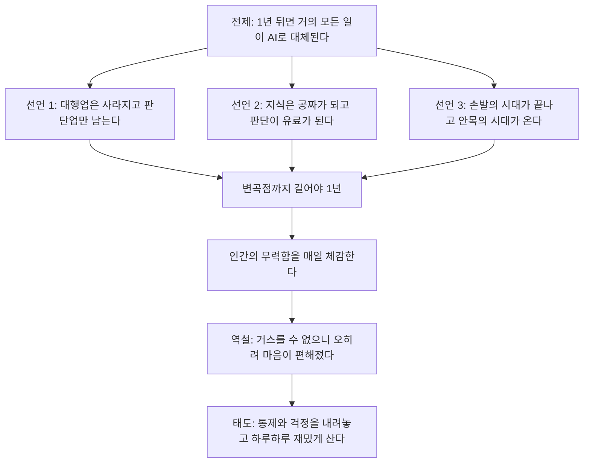
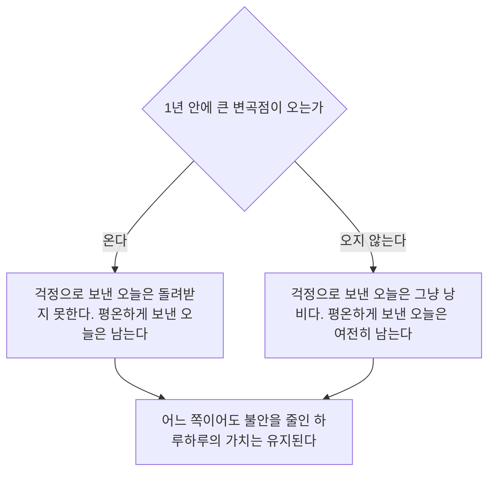

> 짧은 글 하나에 담긴 전제, 세 가지 선언, 그리고 "그래서 마음이 편해졌다"는 결론을 문장 단위로 풀고, 2026-10-19 기준 최신 자료로 대조한 문서

```
어차피 1년 뒤면 거의 모든 일이
AI에 의해 대체될 거라고 생각하고 산다.

- 대행업은 사라지고 판단업만 남는다.
- 지식은 공짜가 되고 판단은 유료가 된다.
- 손발의 시대가 끝나고 안목의 시대가 온다.

나는 그 변곡점까지 길어야 1년 정도 본다.

인간의 무력함을 매일 예민하게 체감한다.
그런데 역설적으로 마음은 오히려 편해졌다.

어차피 거스를 수 없는 변화라면
지금부터 모든 걸 통제하려 애쓸 필요도 없고
미래를 걱정하느라 오늘을 희생할 이유도 없다.

이왕 이렇게 된 거 하루하루 더 재밌게 살자.
90년대생인 내가 요즘 내가 살아가는 방식이다.

https://www.threads.com/share/BCNmQfzQQI/
```

---

## 0. 이 문서를 읽는 법

### 0.1 대상 글

분석 대상은 Threads에 올라온 짧은 글입니다. 본문은 사용자가 붙여 넣은 내용을 기준으로 합니다. 글의 요지는 다음과 같습니다.

- 글쓴이는 "1년 뒤면 거의 모든 일이 AI에 의해 대체될 것"이라고 생각하고 산다.
- 그 생각을 세 문장으로 압축한다. 대행업은 사라지고 판단업만 남는다, 지식은 공짜가 되고 판단은 유료가 된다, 손발의 시대가 끝나고 안목의 시대가 온다.
- 변곡점까지 "길어야 1년"으로 본다.
- 인간의 무력함을 매일 예민하게 체감하지만, 역설적으로 마음은 편해졌다.
- 거스를 수 없는 변화라면 모든 것을 통제하려 애쓸 필요도, 미래를 걱정하느라 오늘을 희생할 이유도 없으니 하루하루 더 재밌게 살겠다는 것이 90년대생인 자신의 삶의 방식이다.

해당 게시글 주소는 사이트 정책상 자동으로 열 수 없었습니다. 그래서 **작성자, 게시 시각, 댓글은 확인하지 못했고**, 이 문서는 사용자가 제공한 본문만 다룹니다. 작성자가 누구인지 추측하지 않았습니다.

### 0.2 표기 규칙

| 표기 | 의미 |
|---|---|
| **[원문]** | 글에서 말한 내용을 정리한 것 |
| **[확인]** | 이 문서를 쓰면서 외부 자료에서 직접 확인한 것 |
| **[2차]** | 원자료를 직접 보지 못하고 기사나 요약 페이지를 통해서만 확인한 것 |
| **[해석]** | 이 문서의 해석이며 사실로 단정하지 않은 것 |
| **[미확인]** | 확인하지 못한 것 |

외부 연구 수치는 대부분 요약 보도나 요약 페이지를 통해 확인한 것이라 **[2차]** 입니다. 정확한 수치가 필요하면 원 논문과 원 보고서를 확인하세요.

---

## 1. 한눈에 보기

### 1.1 한 문장 요약

AI가 일의 대부분을 곧 대신할 것이라는 **강한 예측**을 전제로, 남는 가치는 "무엇을 할지 판단하고 좋은 것을 알아보는 능력"이며, 그 변화는 개인이 막을 수 없으니 **통제욕과 미래 걱정을 내려놓고 오늘을 즐기자**는 **삶의 태도**로 이어지는 글입니다.

### 1.2 글의 논리 흐름



### 1.3 이 글에서 구분해서 봐야 할 세 층

| 층 | 글의 내용 | 성격 |
|---|---|---|
| 예측 | 1년 뒤면 거의 모든 일이 대체된다 | 검증 가능한 주장 (강한 형태) |
| 가치 이론 | 판단, 안목, 맥락이 희소해진다 | 개념적 주장 + 부분적 근거 |
| 삶의 태도 | 통제를 내려놓고 오늘을 즐긴다 | 개인의 선택. 참과 거짓이 아니라 "그에게 효과가 있는가"의 문제 |

이 구분이 중요한 이유는, 앞의 두 층을 따져 보는 일과 마지막 층을 존중하는 일이 서로 충돌하지 않기 때문입니다. 아래에서는 앞의 두 층은 최신 자료로 대조하고, 마지막 층은 해석으로 다룹니다.

---

## 2. 문장별 해설

### 2.1 "어차피 1년 뒤면 거의 모든 일이 AI에 의해 대체될 거라고 생각하고 산다"

**[원문]** 이 문장에서 눈여겨볼 점이 세 가지 있습니다.

1. **"생각하고 산다"는 표현.** 글쓴이는 이것을 단정적 사실이라기보다 자신이 **전제로 삼고 사는 가정**으로 말합니다. 즉 "그렇게 될 것이다"보다 "그렇게 생각하고 산다"에 무게가 있습니다.
2. **"거의 모든 일"이라는 범위.** 일부 직군이 아니라 거의 전체를 가리킵니다. 이 범위가 이 글의 예측을 매우 강한 형태로 만듭니다. (뒤의 4장에서 대조합니다.)
3. **"1년"이라는 시간.** 뒤에서 "길어야 1년"으로 한 번 더 좁혀집니다.

**[해석]** 다만 이 글은 일자리를 직접 말하기보다 "일"이라고 말합니다. 일자리(고용 계약)가 사라진다는 말과 일(과업)의 상당 부분을 AI가 수행한다는 말은 다릅니다. 과업의 대체와 직업의 소멸은 시차가 있을 수 있고, 연구들도 이 둘을 구분합니다. (4장 참고)

### 2.2 선언 ① "대행업은 사라지고 판단업만 남는다"

**[원문]** 여기서 "대행업"은 남을 대신해 실행해 주는 일을 가리키는 것으로 읽힙니다. 문서 작성 대행, 디자인 대행, 개발 대행, 광고 대행처럼 의뢰인이 결정한 것을 구현해 주는 일입니다. "판단업"은 무엇을 할지, 맞는지, 어디까지 믿을지를 결정하는 일입니다.

**[해석]** 이 구분의 핵심은 업종 이름이 아니라 **하는 일의 성격**입니다. 같은 직무 안에도 대행에 가까운 부분과 판단에 가까운 부분이 섞여 있습니다. 그래서 이 선언은 "직군 X는 사라진다"가 아니라 "직군 안에서 대행의 비중이 줄고 판단의 비중이 커진다"로 읽는 편이 현실적입니다. 글 자체가 그렇게 말하는 것은 아니며, 이 문서의 읽기입니다.

### 2.3 선언 ② "지식은 공짜가 되고 판단은 유료가 된다"

**[원문]** 지식(정보 접근, 정리, 설명)은 한계 비용이 거의 0에 가까워지고, 그 지식을 가지고 **무엇을 할지 정하는 일**에만 사람이 돈을 낸다는 뜻입니다.

**[확인, 유사한 주장]** 같은 방향의 글이 2026년 5월에 나온 적이 있습니다. Jamie Hammond의 「The Judgment Economy」(2026-05-13 게시, 같은 해 7월에 수정)는 문서 작성, 분석, 요약 같은 실행 업무가 싸고 흔해지면서 희소성이 **판단력**으로 옮겨 간다고 주장합니다. 판단력의 특성으로는 (1) 실패를 통해 보정되고 (2) 통념과 독립적이며 (3) 맥락 간에 이전 가능하다는 점을 듭니다. 또한 전문가는 자기 시간이 아니라 **상황에 대한 판단**을 팔아야 한다고 말합니다. **[2차]**

**주의할 점:** 이 글은 저자의 25년 경력과 개인 경험에 기댄 에세이이고, 정량 데이터나 외부 연구 인용이 없다고 확인됩니다. **[2차]** 즉 "판단이 유료가 된다"는 명제는 **널리 공감되는 가설이지만 이 글만으로 검증된 것은 아닙니다.** 이 문서의 위 문단이 이 선언을 뒷받침한다고 말할 수는 없습니다.

**[해석]** 이 선언에는 숨은 문제가 하나 있습니다. 판단은 어떻게 값이 매겨지는가입니다. 판단은 결과물이 아니라 맥락 속에서 작동하기 때문에, 판단의 질을 사는 쪽이 알아보기가 어렵습니다. "안목이 유료가 된다"가 실제 시장 가격으로 나타나려면 판단의 질을 평가하는 방법이 함께 필요합니다. 글은 이 부분은 다루지 않습니다.

### 2.4 선언 ③ "손발의 시대가 끝나고 안목의 시대가 온다"

**[원문]** 선언 ①②를 은유로 압축한 문장입니다. 손발은 직접 만들고 옮기는 일, 안목은 좋은 것과 나쁜 것을 가려내는 눈입니다.

**[해석]** 이 은유에서 "안목"은 **알아보는 능력**에 해당합니다. AI가 만들어 낸 결과물이 넘칠수록 그중 쓸 만한 것을 고르고 틀린 것을 알아채는 능력의 몫이 커진다는 논리입니다. 이 논리는 최근 자료에서도 부분적으로 관찰됩니다. Anthropic은 2026년 10월 17일 자사 보고에서, Claude가 읽고 정리해야 할 글을 쏟아내면서 **사람의 주의와 판단이 생산성의 병목이 되고 있다**고 설명했습니다. **[2차, TechCrunch 보도, 자사 보고라는 한계]**

### 2.5 "나는 그 변곡점까지 길어야 1년 정도 본다"

**[원문]** 앞의 전제를 가장 구체적으로 좁힌 문장입니다. "변곡점"이라는 말은 지금까지의 점진적 변화가 어느 순간 질적으로 바뀐다는 뜻으로 읽힙니다.

**[해석]** 이 문장은 이 글에서 **가장 쉽게 틀릴 수 있고 동시에 가장 중요한** 부분입니다. 시간이 짧을수록 사람의 행동(예: 장기 투자, 학습, 커리어)에 미치는 영향이 큽니다. 이에 대한 대조는 4장에서 합니다.

### 2.6 "인간의 무력함을 매일 예민하게 체감한다. 그런데 역설적으로 마음은 오히려 편해졌다"

**[원문]** 이 대목이 글의 감정적 중심입니다. 무력감과 평온이 함께 있다는 점이 "역설"입니다.

**[해석]** 이 역설은 심리적으로 자연스러운 구조로 읽을 수 있습니다. 통제할 수 없다는 사실을 받아들이면, 통제하려는 시도에 드는 에너지와 그것이 실패할 때의 불안이 줄어들 수 있기 때문입니다. 다만 이것은 이 글에 대한 읽기일 뿐, 글쓴이의 마음을 진단하는 것이 아니며 그럴 수도 없습니다. 글쓴이가 실제로 어떤 상태인지는 글만으로는 알 수 없습니다.

### 2.7 "모든 걸 통제하려 애쓸 필요도 없고, 미래를 걱정하느라 오늘을 희생할 이유도 없다. 하루하루 더 재밌게 살자"

**[원문]** 결론입니다. 두 가지를 내려놓자고 말합니다. 하나는 **통제**, 다른 하나는 **미래 걱정을 위한 오늘의 희생**입니다.

**[해석]** 이 문장은 "포기"가 아니라 **우선순위의 재배치**로 읽는 편이 글의 문면에 맞습니다. "하루하루 더 재밌게 살자"는 일을 놓겠다는 말이 아니라, 불안을 연료로 쓰는 방식에서 벗어나겠다는 말입니다. 이 점은 5장에서 더 자세히 다룹니다.

### 2.8 "90년대생인 내가 요즘 내가 살아가는 방식이다"

**[원문]** 글쓴이는 자신의 세대를 밝히고 이것이 자신의 "방식"이라고 말합니다.

**[해석]** 이 문장은 일반 법칙이 아니라 **개인의 방식을 말하는 문장**이라는 점을 분명히 합니다. 세대 전체의 태도를 대변한다고 읽을 근거는 글에 없습니다. 이 문서도 그렇게 읽지 않습니다.

---

## 3. 숨은 전제 정리

글이 성립하려면 아래 전제들이 필요합니다. 어느 하나가 약하면 결론의 설득력이 달라집니다.

| # | 전제 | 이 전제가 틀리면 |
|---|---|---|
| 1 | AI 역량이 1년 안에 거의 모든 과업을 수행할 수준에 도달한다 | "1년 후 대체"는 성립하지 않음 |
| 2 | 역량이 도달하면 곧바로 조직과 시장에서 대체가 일어난다 (도입 지연이 짧다) | 역량은 높아도 대체는 느릴 수 있음 |
| 3 | 대체되는 것은 "실행"이고 "판단"은 사람에게 남는다 | 판단까지 대체되면 "판단업만 남는다"가 성립하지 않음 |
| 4 | 판단의 질은 시장에서 식별되고 가격으로 보상된다 | 판단이 희소해도 유료가 되지 않을 수 있음 |
| 5 | 개인은 이 흐름에 영향을 줄 수 없다 | 개인의 대응(학습, 포지셔닝)이 무의미해짐 |

**[해석]** 이 글의 **삶의 태도**(통제를 내려놓고 오늘을 즐기기)는 전제 5에 가장 크게 의존합니다. 전제 1~4는 예측과 가치 이론에 해당하고, 이 부분은 데이터로 점검할 수 있습니다.

---

## 4. 최신 자료와 대조 (확인일 2026-10-19)

### 4.1 AI 역량의 추세: 빠르게 오르는 중

**METR의 과제 길이(time horizon) 연구** **[2차, 연구소 페이지 요약]**

- 2025년 3월 원 연구는 AI가 완수할 수 있는 소프트웨어 과제의 길이가 지난 6년간 지수적으로 늘었고, 배가 주기는 약 7개월이라고 보고했습니다.
- 2025년 7월의 확장 분석은 과학 추론, 수학, 로봇공학 등 9개 벤치마크에서 대체로 비슷한 속도의 개선을 확인했다고 합니다.
- 2026년 1월 29일에는 더 많은 과제와 새 평가 인프라로 추정치를 갱신한 TH1.1을 공개했고, 2026년 4월 10일에는 에이전트가 주 단위의 코딩 과제(예: 약 1만 6천 줄 코드베이스의 재구현)를 수행한 **예비** 결과를 공개했습니다. 다만 제가 확인한 페이지에는 2026년 연구의 구체적 수치가 없었습니다.
- 같은 연구소가 2025년 8월에 낸 관련 연구는 알고리즘 기반 채점 점수와 **실제 프로덕션 준비 상태 사이의 차이**를 다룹니다.

**[해석]** 역량 추세는 "AI가 오래 걸리는 과업을 점점 더 해낸다"는 방향을 지지합니다. 하지만 **벤치마크 점수와 실제 업무 투입 가능성 사이에는 간극이 있다**는 점도 같은 연구소가 다룹니다. 따라서 역량 추세만으로 "1년 뒤 거의 모든 일 대체"를 도출할 수는 없습니다.

### 4.2 실제 고용: 거시 지표에서는 아직 광범위한 대체가 보이지 않음

| 자료 | 내용 | 한계 |
|---|---|---|
| Stanford Digital Economy Lab, 「Canaries in the Coal Mine?」 개정판 (2026-08-12 공개, 2026-08-25 보도) **[2차]** | ADP 급여 데이터 기준 2026년 중반까지 AI와 연관된 **광범위한 고용 감소는 확인되지 않음.** 22~25세의 AI 노출도 높은 직업군 고용은 노출도 낮은 직업군 대비 약 19% 낮음(2025년 7월 데이터 기준 약 15%에서 2026년 6월 기준 약 19%로 확대). 격차는 퇴직 증가가 아니라 **신규 채용 감소**에서 비롯. 경력직에서는 비슷한 격차 없음 | 연구진 스스로 결과가 기술적이며 인과적이지 않다고 명시. 19%는 추세 대비 상대 격차이지 사라진 일자리 총량이 아님 |
| Yale Budget Lab (2025-10-01 발표, 2026-09 기사로 재보도) **[2차]** | AI 노출도, 자동화, 보완 측정치와 미국 경제 전체의 고용·실업 변화 사이에 연관성이 보이지 않음. ChatGPT 출시 후 33개월간 직업 구성 변화는 과거보다 다소 빨랐으나 크지 않았고, 변화 상당 부분은 기업 도입이 본격화되기 전부터 존재 | 집계 지표에 한정. 관찰 기간이 짧아 예측이 아닌 기준선으로 읽어야 함 |
| 세인트루이스 연준 연구 (2025-09 Fortune 보도 기준) **[2차]** | 2022~2025년 부문별로 AI 도입률과 실업률 증가 사이 상관계수 0.57. 컴퓨팅·수학 직종은 AI 사용률 약 80%에 3년간 실업률 1.2%p 상승 | 상관이지 인과가 아님. 팬데믹 후 기술업 과잉 채용 조정이 상관을 부풀렸을 수 있음 |
| SignalFire 「State of Talent 2026」 (TechCrunch 2026-06-24 보도) **[확인, 보도 기준]** | 대형 기술 기업 전체 채용은 2019년 대비 25% 감소했지만 엔지니어링 직군은 11% 감소에 그침. 12개 대형 기술 기업에서 신규 채용 중 엔지니어 비중은 2025년 55%로 2019년 46%보다 높음 | 대형 기술 기업과 초기 스타트업 중심 자료 |

**[해석]** 종합하면 **"과업 수준의 변화는 빠르지만, 거시 고용에서 광범위한 대체는 2026년 중반 기준 아직 뚜렷하지 않다"** 는 그림입니다. 이 점은 "1년 뒤 거의 모든 일 대체"라는 예측의 속도 가정(전제 2)과 정면으로 긴장합니다. 다만 위 연구들은 모두 과거와 현재를 측정한 것이고, **앞으로 1년을 예측하는 것은 아닙니다.** 연구진도 기준선으로 읽으라고 말합니다. 그러므로 "아직 안 보인다"와 "앞으로도 안 온다"는 다른 말입니다.

### 4.3 대체가 먼저 오는 곳: 신입과 입구

흥미롭게도 위 자료들은 **총량보다 "입구"가 먼저 좁아진다**는 방향에서 서로 겹칩니다.

- Stanford: 22~25세, AI에 노출된 직업군에서 상대적 고용 부족. 원인은 퇴직이 아니라 채용 감소. **[2차]**
- Stanford(Brynjolfsson 주도 이전 연구, 세인트루이스 연준 기사에서 재인용): AI 노출 직종 신입 고용 상대 13% 감소, 경력직은 증가. **[2차]**
- Anthropic 자사 보고(2026-10-17): 기술 부문 직원 중 주니어 비율이 2025년 초 이후 21%에서 14%로 감소. 주니어 기술 채용 비율은 27%에서 9%로 감소. **[2차, 자사 보고]**
- 한국: 소프트웨어 개발직 채용 공고 중 신입 비중이 2022년 53.5%에서 2024년 37.4%로 하락했다는 한국노동연구원 보고서 보도. **[2차]**

**[해석]** 이 패턴은 글의 "대행업이 먼저 사라진다"와 방향이 같습니다. 신입이 맡던 일이 대행성 업무(정리, 초안, 반복 구현)에 가까웠다면 그 부분이 먼저 줄어드는 것은 자연스럽습니다. 하지만 이것도 **원인이 AI 하나라는 것을 증명하지는 않으며**, 위 연구들도 인과를 주장하지 않습니다.

### 4.4 전망가들의 엇갈린 시각

- **Dario Amodei(Anthropic CEO).** 2025년에 AI가 5년 안에 신입 화이트칼라 직무의 절반을 없애고 실업률을 최대 20%까지 올릴 수 있다고 경고했다고 TechCrunch가 전합니다. **[2차]** 2026년 4월 21일 자 IOL 기사에 따르면 금융, 컨설팅, 기술 분야의 초급 직무 상당수가 **1~5년** 안에 사라질 수 있다고 경고했고, 재교육 투자와 부의 재분배 방안을 정부가 검토해야 한다고 주장했습니다. 이 기사도 다른 매체를 재인용한 것이라 발언 원문은 직접 확인하지 못했습니다. **[2차]**
- **Peter McCrory(Anthropic 경제 책임자).** 2026년 3월 TechCrunch에, Claude를 핵심 업무에 자동화 방식으로 쓰는 직군과 덜 노출된 직군 사이에 실업률의 큰 차이를 아직 보지 못했다고 말했습니다. **[2차]**
- **Jensen Huang(Nvidia CEO).** 2026년 4월 Stanford GSB 인터뷰에서, 엔지니어 전원이 에이전트형 AI를 쓰게 된 지금 "소프트웨어 엔지니어는 그 어느 때보다 바쁘다"고 말했다고 TechCrunch가 전합니다. **[2차]** TechCrunch는 이를 제본스 역설(효율이 높아지면 수요도 늘어난다)의 사례로 해석했습니다.

**[해석]** 같은 회사(Anthropic) 안에서도 **"1~5년 내 초급 직무 상당수 소멸"** 이라는 경고와 **"아직 뚜렷한 효과는 안 보인다"** 는 관측이 함께 나옵니다. 이는 전문가들조차 시간표에 대해 합의가 없다는 뜻이며, "길어야 1년"이라는 구체적 시간표는 **이 자료들이 지지하는 범위보다 훨씬 공격적**입니다. 다만 "틀렸다"고 판정할 근거도 이 문서에는 없습니다. 판정은 시간이 합니다.

### 4.5 노동자 인식: 불안은 커지고 있음

| 조사 | 결과 |
|---|---|
| APA 「Work in America 2026」 (미국 재직 성인 2,009명, 2026-05-21~06-01, 오차 ±3.1%p) **[2차]** | AI로 자신의 직무가 쓸모없어질 수 있다고 우려한다는 응답 48% (2023년 질문 시작 이후 최고). 기술 변화의 이익이 노동자보다 기업에 더 돌아간다는 응답 64%(2025년 52%). AI를 쓰지 않으면 동료에게 뒤처질까 걱정한다는 응답 37%(2025년 30%) |
| ADP Research 글로벌 조사 (36개 시장 근로 성인 39,000명 이상, 2025-07-21~08-04, 2026-03-25 발표) **[2차]** | 자기 일자리가 안전하다고 "강하게 동의"한 응답은 22% |

**[해석]** 글쓴이가 말한 "인간의 무력함을 매일 체감한다"는 감각은 **개인만의 것이 아니라 조사에서도 증가세로 나타나는 정서**입니다. 다만 두 조사 모두 응답자의 인식을 묻는 조사이며, 실제 직무 소멸 확률을 알려 주지는 않습니다.

### 4.6 검증 요약표

| 글의 주장 | 확인 결과 | 판정 |
|---|---|---|
| AI가 오래 걸리는 과업을 점점 더 해낸다 | METR 시리즈가 같은 방향. 단 벤치마크와 실제 투입 사이의 간극을 같은 연구소가 다룸 | **방향은 지지** |
| 1년 뒤 거의 모든 일이 대체된다 | 거시 고용에서 광범위한 대체는 2026년 중반까지 확인되지 않음. 전문가 시간표도 엇갈림 | **현재 자료로는 지지되지 않음, 미래 반증은 불가** |
| 대행성 업무가 먼저 줄어든다 | 신입 채용 감소, 신입 중심 격차가 여러 자료에서 관찰됨. 인과는 불확정 | **부분 지지(방향)** |
| 판단이 희소해지고 유료가 된다 | 사람의 판단이 병목이라는 Anthropic 자사 보고, 「Judgment Economy」 에세이. 가격으로 보상된다는 정량 근거는 확인 못 함 | **개념은 공감대, 가격 형성은 미검증** |
| 불안을 느끼는 사람이 많다 | APA, ADP 조사에서 확인 | **확인(인식 조사)** |
| 변곡점이 1년 안에 온다 | 검증 불가 | **미확인** |

---

## 5. "마음이 편해졌다"는 대목에 대하여

이 대목은 사실 판단의 문제가 아니라 태도의 문제이므로, 점검보다 **해석과 가능한 질문**을 제시합니다. 이 장은 모두 **[해석]** 이며 글쓴이를 진단하지 않습니다.

### 5.1 통제할 수 있는 것과 없는 것의 구분

글의 태도는 "통제할 수 없는 것(변화의 속도와 방향)"과 "통제할 수 있는 것(오늘 어떻게 사는가)"을 구분하고 후자에 집중하는 구조입니다. 이 구분 자체는 오래된 지혜의 형태이며, 이 글이 새로 만든 것은 아닙니다. 그 안에서 눈에 띄는 것은 "미래를 걱정하느라 오늘을 희생하지 않는다"는 선택이 **예측이 맞아도 틀려도 손해가 작은 태도**라는 점입니다.



### 5.2 이 태도가 잘 작동하려면 필요한 조건

**[해석]** 이 태도는 **포기와 구별될 때** 안정적입니다. 구별 기준을 질문으로 바꾸면 이렇습니다.

1. "통제를 내려놓는다"가 모든 대비를 중단한다는 뜻인가, 아니면 **대비의 강박을 내려놓는다**는 뜻인가?
2. "오늘을 즐긴다"에 **지금 할 수 있는 일(학습, 관계, 건강)을 계속하는 것**이 포함되는가?
3. 예측이 틀렸을 때(변화가 느리게 올 때) 이 삶의 방식을 **조정할 여지**가 있는가?

글에는 이에 대한 답이 없습니다. 다만 글의 문면에서는 "하루하루 더 재밌게 살자"고 했지 "아무것도 하지 말자"고 하지 않았으므로, 첫 번째와 두 번째 질문에서는 긍정적으로 읽을 여지가 큽니다.

### 5.3 불안과 심리적 자원의 관계에 대한 자료

APA 조사는 흥미로운 점을 보여 줍니다. 조사에서 측정한 **심리자본(PsyCap)** 이 높은 집단은 AI로 직무가 쓸모없어질 수 있다고 우려한 비율이 37%, 낮은 집단은 53%였고, 기술 변화로 새 기회가 생겼다고 답한 비율은 높은 집단이 64%였습니다. **[2차]** 보고서는 이 조사가 인과를 입증하지 못한다고 밝힙니다. 따라서 "마음의 상태가 안정된 사람이 덜 불안하다"는 상관은 보이지만, 마음을 편하게 먹으면 불안이 줄어든다는 처방으로 읽어서는 안 됩니다.

**[해석]** 이 자료가 말해 주는 것은 제한적입니다. **불안의 크기는 사람마다 다르고, 심리적 자원이 있을 때 AI를 위협보다 기회로 보는 경향이 상관되어 있다**는 정도입니다. 글쓴이의 평온이 이런 자원에서 오는지 다른 이유에서 오는지는 글만으로는 알 수 없습니다.

---

## 6. 예측이 틀릴 때와 맞을 때: 사고 실험

아래는 예측이 아니라 **생각을 정리하기 위한 틀**이며, 확률을 부여하지 않습니다. **[해석]**

| 시나리오 | 상황 | 이 글의 태도가 시사하는 점 |
|---|---|---|
| A. 1년 안에 급변 | 과업 대체가 빠르게 고용으로 번짐 | "판단과 안목" 중심의 재편이 빠르게 현실화. 이 글의 가치 이론이 맞는 셈 |
| B. 점진적 변화 | 과업은 빠르게 바뀌지만 고용은 느리게 조정됨. 신입 입구가 먼저 좁아짐 | 현재 관찰 자료와 가장 가까움. "1년"은 과장이었지만 방향(대행→판단)은 맞음 |
| C. 병목에서 정체 | 사람의 검증과 책임이 병목이 되어 일부 영역에서 대체가 기대만큼 안 이뤄짐 | Stripe의 사람 리뷰, Anthropic의 판단 병목 보고와 결이 같음. "판단업이 남는다"는 점은 맞지만 "거의 모든 일 대체"는 과장 |

이 틀에서 눈에 띄는 점은, **세 시나리오 모두에서 "대행성 업무의 비중 감소"와 "판단의 상대적 중요성 증가"라는 방향은 공통**이라는 것입니다. 다르게 나오는 것은 속도와 범위입니다. 그래서 이 글의 가치 이론(2장 선언 ①~③)은 속도에 덜 민감하고, 예측(전제 1~2)은 속도에 매우 민감합니다.

---

## 7. 함께 읽으면 좋은 시각: 확신과 "알 수 없음"

앞서 정리한 다른 글(Tony Cho의 후속 글, 2026-10-19)과 이 글을 나란히 놓으면 흥미로운 대비가 있습니다. 두 글의 작성자 사이에 관계가 있는지는 확인하지 못했으며, 아래는 두 텍스트를 비교한 것뿐입니다. **[해석]**

| 항목 | 이 글 | Tony Cho 후속 글 |
|---|---|---|
| 미래에 대한 태도 | 구체적 시간표를 전제로 삼음 ("길어야 1년") | 미래가 어디로 흐를지 모르며 안다고 확신하는 것 자체가 위험하다고 말함 |
| 불확실성에 대한 반응 | 통제를 내려놓고 오늘을 즐김 | "알 수 없음"을 견디며 유연하게 대처하고 생각하고 질문함 |
| 공통점 | 둘 다 개인이 흐름을 막을 수 없다고 봄. 둘 다 미래 예측에 현재를 희생하는 것을 경계함 | |

**[해석]** 두 글은 전제(확신 vs 불확실성)가 다르지만 **"미래의 예측에 오늘을 저당 잡히지 말자"는 결론은 겹칩니다.** 서로 다른 인식론에서 같은 실천이 나올 수 있다는 점이 눈에 띕니다.

---

## 8. 읽는 이별 시사점

이 장은 모두 **[해석]** 이며 처방이 아닙니다.

| 독자 | 가져갈 수 있는 것 |
|---|---|
| 이 글에 공감한 사람 | 평온한 태도 자체는 존중하되, 예측(1년)과 태도(오늘을 즐긴다)를 분리해서 생각해 볼 수 있다. 예측이 틀려도 태도는 유지될 수 있다 |
| 이 글이 불편한 사람 | 불편함의 이유가 시간표(1년)인지, 가치 이론(판단과 안목)인지, 태도(통제 포기)인지 구분해 보면 어느 부분에 동의하는지 분명해진다 |
| 불안이 큰 사람 | 불안한 사람이 많다는 조사 결과(APA 48%, ADP 22%)는 개인만의 문제가 아님을 보여 준다. 다만 이 문서는 의료나 심리 상담이 아니며, 불안이 일상에 영향을 줄 정도라면 가까운 사람이나 전문가와 이야기해 보는 것이 좋다 |
| 커리어를 고민하는 사람 | 자료가 일관되게 가리키는 것은 "총량"보다 "입구(신입 채용)"의 변화다. 자신의 일에서 대행 비중과 판단 비중을 나눠 보는 것이 출발점이 될 수 있다 |

---

## 9. 용어 정리

| 용어 | 뜻 |
|---|---|
| 대행업 | 남이 결정한 것을 대신 실행해 주는 일 (이 글의 맥락) |
| 판단업 | 무엇을 할지, 맞는지, 어디까지 믿을지를 결정하는 일 |
| 변곡점 | 변화의 양상이 질적으로 바뀌는 지점 |
| time horizon (과제 길이) | AI가 일정 성공률로 완수할 수 있는 과제가 사람 기준으로 얼마나 오래 걸리는 일인지를 나타내는 지표 (METR의 연구 맥락) |
| 제본스 역설 | 효율이 올라 자원 사용 비용이 내려가면 오히려 총수요가 늘어나는 현상 |
| 심리자본(PsyCap) | APA 조사에서 심리적 자원의 정도를 나타내는 척도 |
| 기술적(descriptive) 연구 | 현상을 기술하되 인과를 주장하지 않는 연구 |

---

## 10. 참고 자료

확인일은 모두 2026-10-19입니다. 아래 중 "요약 페이지"로 표시한 것은 원문을 직접 읽은 것이 아니라 요약을 통해 확인한 것입니다.

**대상 글**
- Threads 게시글 (자동 접근이 제한되어 사용자가 제공한 본문으로 분석): https://www.threads.com/share/BCNmQfzQQI/

**고용과 AI의 실증 연구**
- Stanford Digital Economy Lab 개정판 보도 (요약 페이지): https://letsdatascience.com/news/stanford-finds-no-broad-ai-job-displacement-2299c364
- Yale Budget Lab 연구 보도 (요약 페이지): https://letsdatascience.com/news/yale-analysis-finds-no-economy-wide-ai-job-disruption-e87edd9f
- 세인트루이스 연준 연구 보도 (요약 페이지): https://getcoai.com/news/fed-study-links-ai-adoption-to-rising-unemployment-in-tech-jobs
- TechCrunch, SignalFire 보고서 보도, 2026-06-24: https://techcrunch.com/2026/06/24/ai-was-supposed-to-kill-engineering-jobs-but-new-data-suggests-theyre-the-most-resilient/
- TechCrunch, Anthropic 자사 인력 보고 보도, 2026-10-17: https://techcrunch.com/2026/10/17/anthropic-says-its-workforce-has-become-less-junior-and-is-spending-more-time-in-meetings/
- Anthropic 보고서 (위 기사가 링크한 원문, 직접 열어보지 않음): https://www.anthropic.com/research/employment-at-anthropic
- 한국노동연구원 보고서 보도, 2026-01-06: https://www.twig24.com/news/2026/01/06/20260106500238

**AI 역량 추세**
- METR 연구 목록 (time horizon 연구, 2025-03 원 연구와 2026-01, 2026-04 후속): https://metr.org/research

**전망가 발언**
- Amodei 발언 보도, 2026-04-21 (재인용 기사): https://iol.co.za/ios/news/2026-04-21-dario-amodei-warns-of-impending-job-losses-as-ai-systems-threaten-white-collar-employment/

**판단과 안목에 관한 논의**
- Jamie Hammond, 「The Judgment Economy」, 2026-05-13: https://jamiehammond.substack.com/p/the-judgment-economy

**노동자 인식 조사**
- APA, 「Work in America 2026」: https://www.apa.org/pubs/reports/work-in-america/2026
- ADP Research 글로벌 조사 보도자료, 2026-03-25: https://mediacenter.adp.com/2026-03-25-ADP-Research-Only-22-of-Workers-Confident-Their-Job-is-Safe-from-Elimination,-Underscoring-the-Importance-of-Talent-Strategies-that-Prepare-Employees-for-the-Future,1

**비교한 글**
- 「개발자는 끝났다, 그 글 이후」, Flowkater.io, 2026-10-19: https://flowkater.io/posts/2026-10-19-after-developers-are-finished/

---

**작성 일자: 2026-10-19**
