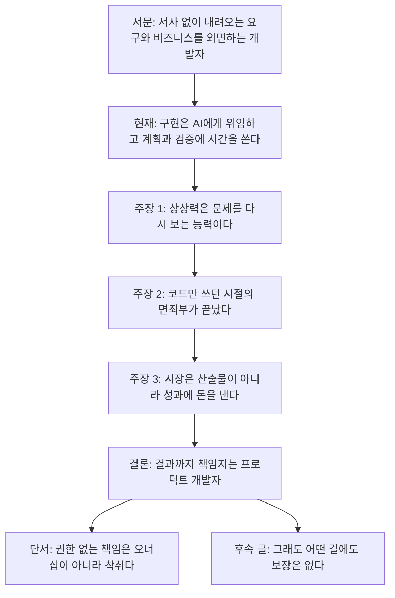
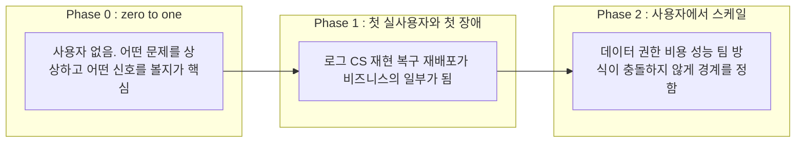
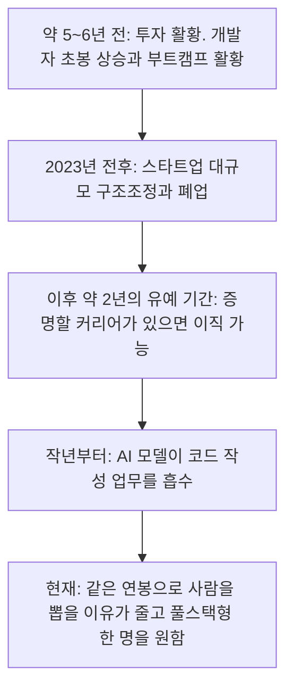
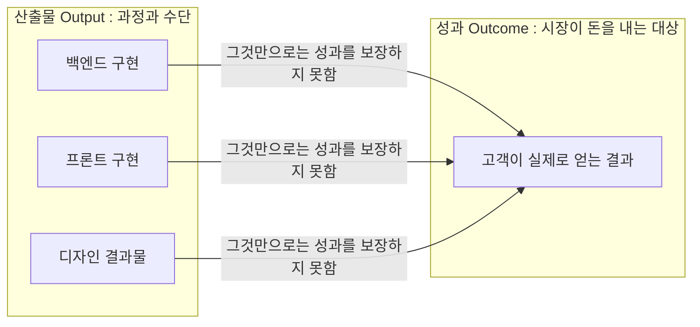
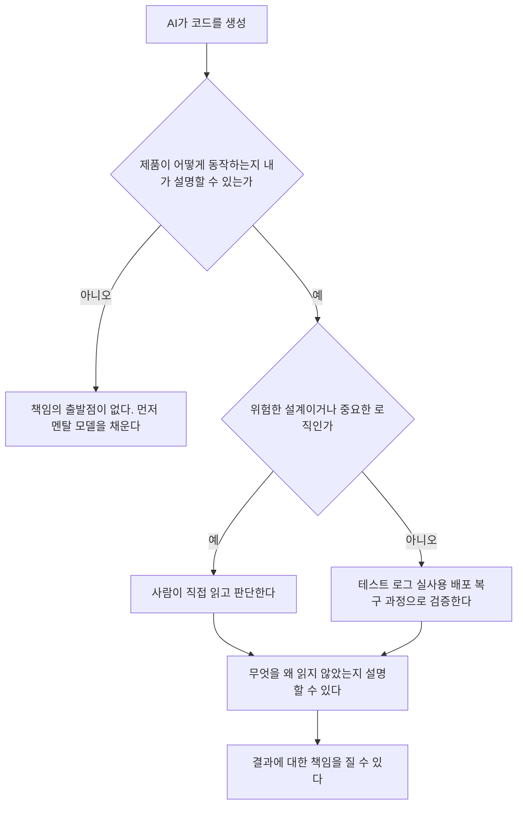
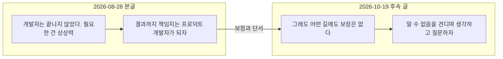

**Tony Cho(Flowkater.io)의 에세이 본글(2026-08-28), 후속 글과 Threads 대화(2026-10-19), 그리고 2026-10-19 기준 최신 자료로 검증한 정리**

> 
> 이 글 이후에 사실 개발자 에세이는 이제 거의 안 쓰고 있다. 아니 못 쓴다. 내가 할 말은 끝났고 난 글에서 말한 대로 살고 있다. 그리고 개고생 중이다.(..)
> 
> https://flowkater.io/posts/2026-08-27-are-developers-finished/
> 
> AI 시대에 개발자뿐만 아니라 모든 종래의 직무에 머물러 있던 사람들이 각자 어떻게 해야 할지는 이제 각자 선택의 몫이다. 내가 그들의 선택을 대신해 줄 수도 책임질 수도 없다. 다만 거대한 시대의 흐름을 거스를 수 없으며 어떤 방식으로든 각자 방법을 찾아야 한다. AI로 인한 직업적 위기는 분명히 실존하는 것이다.
> 
> 원래 그래야 한다, 원래 맞다는 본인의 생각에서 빨리 벗어날수록 오히려 길이 보일 거라고 생각한다. 모든 선택에는 대가가 따르지만 항상 얘기하고 싶은 건, 인생 길다. 불과 5년 전에 개발자가 유망하다고 유행처럼 모두 부트캠프를 갔고 이제는 망했다고 말한다. 다른 사람들의 확신, 미래의 예측. 나아가서 미래의 희망에 본인의 현재를 희생하는 어리석은 짓은 더 이상 말리고 싶다. 시간을 낭비하지 말자.
> 
> 능력 좋으면 살아남는다는 말도 이제 별로 하고 싶지 않다. 애초에 개발자라는 직업이 괜찮은 것도 고만고만해도 그럭저럭 먹고살 수 있었기 때문이다. 유니콘이 되어야 살아남는다면, 엘리트 스포츠 선수나 아이돌이랑 다를 바 없다. 대박을 낼 수는 있으나 직업으로는 최악이다.
> 
> 모두에게 가혹한 잣대를 들이대고 내가 지금 조금 우위에 있다고 거만해져서 훈수 두지 말고 연민을 가지고 이 직업 시장의 미래에 대해 진지하게 고민했으면 좋겠다.
> 
> 자본주의 사회에서 미시적으로 개인의 능력은 중요하지만 그만큼 거시적으로는 시장의 크기가 훨씬 중요하다. 파이를 키워서 이 직업군이 최소한의 생존 기반이라도 유지하려면 어쨌든 실력 있는 사람들이 기술에 머물지 말고 더 큰 사업적 성과를 만들어 내긴 해야 한다. 나도 아직 한참 그 수준에 못 미친다. 나의 사업적 성과보다 훈수가 편하긴 하다. 나도 저렇게 글만 썼으니.
> 
> 난 하루하루 재밌게 살고 있지만 이 시장 자체에 우울감이 있다. 아니 정확히는 고군분투하는 IT 종사자 모든 분들께 응원의 메시지를 드리고 싶다.
> 
> 미래가 어디로 흘러갈지는 나도 모른다. 애초에 안다고 확신하는 것 자체가 위험하다. 어쩌면 미래를 준비하는 가장 필요한 역량은 '알 수 없음' 상태를 잘 견지하고 항상 유연하게 대처하는 태도일 것이다. 그리고 내가 믿고 있는 게 언제든지 무너질 수 있다는 생각이다.
> 
> A냐 B냐가 아니다. A와 B일 수 있고 A와 B 둘 다 아닐 수도 있다. 항상 생각하는 것만이 살길이다. 맞다. 인생 더 피곤해졌다.
> 
> 내 글을 읽고 정답인양 받아들인 분들에게는 미안한 부분이 있다. 풀스택 프로덕트 엔지니어가 되어도 미래에 살아남는다는 보장은 어디에도 없다. 애초에 그런 믿음 자체를 부정하는게 이 글의 요지이다. 그래도 할 수 있는 일을 해야한다. 하지만 그건 스스로만이 알 수 있다.
> 
> 마지막으로 뜬금없지만 요즈음 내 메인은 책이니까 책 얘기를 안 할 수 없다. 책을 읽어보자. 내가 부족한 교양을 쌓든 삶에서 만나지 못했던 수많은 인간 군상을 만나서 나의 관용을 키우든 두둥실 떠다니는 내 생각을 명확한 언어로 표현하며 해방감을 느끼든. 
> 
> 결국 생각하고 질문하는 것이다. 정말 그런가? 이게 맞을까? 
> 
> 다른 활동으로도 채울 수 있는 것들이나 내 생각엔 책이 제일 경제적이고 효율적이다.
> 
> https://www.threads.com/share/_38oqPuGE/
> 

---

## 0. 이 문서를 읽는 법

이 문서는 세 가지를 한 번에 다룹니다. 첫째는 2026년 8월 28일에 올라온 에세이 「개발자는 끝났다.」(읽는 데 약 35분이 걸리는 장문)가 무엇을 말하는지 순서대로 풀어 쓴 해설입니다. 둘째는 2026년 10월 19일에 같은 저자가 Threads와 블로그에 올린 후속 글, 그리고 그 아래 달린 댓글 대화입니다. 셋째는 글 속 주장 가운데 외부 자료로 확인할 수 있는 것을 최신 자료로 대조한 결과입니다.

글에는 사실, 개인 경험, 가치 판단이 섞여 있기 때문에 이 문서에서는 문장의 성격을 아래처럼 구분해 적습니다.

| 표기 | 의미 |
|---|---|
| **[원문]** | 필자가 글에서 말한 내용을 그대로 정리한 것 |
| **[확인]** | 이 문서를 쓰면서 외부 자료로 직접 확인한 것 |
| **[2차]** | 원자료를 직접 보지 못하고 다른 글이나 기사의 인용으로만 확인한 것 |
| **[해석]** | 이 문서의 해석이며, 사실로 단정하지 않은 것 |
| **[미확인]** | 확인하지 못한 것. 사실로도 거짓으로도 판정하지 않음 |

한 가지 미리 밝힐 점이 있습니다. 원문 말미에서 필자는 이 글을 일부러 직접 썼고, 요약만 읽어서는 글의 감정을 느낄 수 없게 만드는 것이 목표라고 말합니다. 이 문서는 바로 그 "요약과 해설"에 해당하므로 원문의 호흡과 감정을 대신하지 못합니다. 내용을 이해하는 지도로 쓰시고, 마음이 움직였다면 원문도 읽어 보시길 권합니다.

또 하나, Threads 게시글 주소는 사이트 정책상 자동으로 열 수 없었습니다. 그래서 Threads 부분은 사용자가 붙여 넣은 본문과 댓글 내용을 기준으로 하고, 같은 본문이 블로그 후속 글로 올라와 있어 그쪽 페이지로 교차 확인했습니다.

---

## 1. 한눈에 보기

### 1.1 한 문장 요약

AI가 개발자라는 직업을 끝낸 것이 아니라, **"코드를 작성하고 있다"는 이유로 결과에 대한 책임을 미룰 수 있던 시대**를 끝냈다는 주장입니다. 그래서 개발자에게 요구되는 것은 상상력(문제를 다시 보는 능력), 문제 정의, 임파워먼트, 그리고 시스템이 어떻게 동작하는지에 대한 멘탈 모델이며, 이것을 바탕으로 결과까지 책임지는 "프로덕트 개발자"가 되어야 한다고 말합니다.

### 1.2 제목이 두 번 뒤집히는 이유

제목은 "개발자는 끝났다"인데 본문에는 "개발자는 끝나지 않았다"가 먼저 나옵니다. 모순처럼 보이지만 필자는 두 문장이 가리키는 대상을 다르게 씁니다.

| 문장 | 가리키는 사람 | 의미 |
|---|---|---|
| 개발자는 **끝나지 않았다** | 상상력의 크기와 해상도를 가지고 AI를 몰 수 있는 개발자 | AI 시대에 오히려 더 좋은 개발자가 될 수 있다 |
| 개발자는 **끝났다** | 코드만 쓰는 개발자, 이슈 티켓만 처리하던 개발자 | 코드 작성이라는 면죄부가 사라졌다 |

### 1.3 글 전체의 논증 지도

---

## 2. 글의 정체: 누가, 언제, 어떤 태도로 썼나

저자 Tony Cho는 소개란에서 스스로를 "Product Engineer, Fractional CTO, and Writer"라고 밝힙니다. 블로그의 글 메타 정보에 따르면 본글은 2026년 8월 28일(UTC 기준 01:38)에 게시되었고, 주소에는 8월 27일이라는 날짜가 들어 있습니다. **[확인]**

글의 구성은 크게 다음과 같습니다.

1. 들어가며: "개발하기도 바쁜데, 비즈니스를 언제 신경 써요?"
2. 여전히 바쁘다
3. 문제는 문제야, 바보야 (It's the problem, stupid)
4. 알에서 깨어나기 (기능 직무의 유예가 끝난 이유 / 코드 작성자가 누리던 면죄부 / 프로덕트 개발자 / 시장은 결과에 돈을 지불한다 / 가속화된 본질)
5. 아마 이런 질문이 남을 것이다 (두 가지 반문에 대한 답)
6. 이 글을 읽는 경영자와 리더에게
7. 나가며

글의 태도에서 눈에 띄는 점은 의도적인 거침입니다. 필자는 "나가며"에서 처음에는 온갖 사례를 조사해 완결된 논증 구조를 세웠지만, AI가 만든 듯 완벽한 구조를 보고 쓰고 싶지 않아졌다고 말합니다. 그래서 근거가 빈약하고 비약이 많더라도 자기 사고의 흐름을 그대로 담았고, AI는 맞춤법 교정과 기계적 다듬기에만 썼다고 밝힙니다. **[원문]** 이 말은 글을 읽는 방법에 영향을 줍니다. 이 글은 논문처럼 근거를 쌓는 글이 아니라, 경험에서 나온 주장을 밀어붙이는 에세이입니다. 필자 스스로도 자신의 판단이 "내가 만난 시장을 기준으로" 한 체감이라고 여러 번 한정합니다.

---

## 3. 들어가며: 서사 없는 요구와 "비즈니스를 언제 신경 써요?"

### 3.1 필자가 브리핑에서 말한 것

필자는 새 프로젝트를 시작할 때마다 30명이 넘는 팀원 앞에서 브리핑을 했고, 포맷은 항상 같았다고 합니다. 핵심은 **"누가 사용하고, 왜 그들이 사용하는지"** 였고, 사실은 여기에 "언제까지"가 하나 더 들어 있었다고 덧붙입니다. 앞부분(누가, 왜)은 집중해서 듣던 팀원들이 일정 이야기가 나오면 표정이 달라졌다는 회고도 있습니다.

그가 "어떻게(How)"를 말하지 않은 이유는 리더십에 대한 그의 생각 때문입니다. 30명이 넘는 조직에서 리더가 하나하나 How를 알려주는 것은 좋은 리더십도 좋은 팀도 아니며, 좋은 팀은 목표(Outcome)를 명확히 받으면 그것을 달성하는 데 집중하는 팀이라는 것입니다. **[원문]** 필자는 스스로를 "서사 덕후"라고 부르며, 모든 일에는 인과가 있고 하나의 서사가 팀에 정렬되어야 온전히 한 팀으로 일할 수 있다고 믿는다고 말합니다.

### 3.2 두 가지 좌절

**좌절 1. 서사가 빠진 채 내려오는 요구.** 사업부에서는 "어떤 기능을, 이렇게 구현해서, 언제까지 주세요"라는 형태로 목표가 내려왔다고 합니다. 그 안에는 왜 이 기능이 필요한지에 대한 이야기가 없었기 때문에, 필자는 요청한 곳이 운영인지 마케팅인지 실제 사용자 피드백인지 직접 부서를 쑤시고 다니며 "리버스 엔지니어링"했다고 말합니다. 서사의 마지막 조각을 맞추고 나면 하나뿐인 디자이너 엘리에게 전달용 발표 자료를 부탁했고, 엘리는 월요일 발표를 위해 밤을 새워 만들어 주었다는 일화가 이어집니다. (지금은 AI로 자료를 만들지만 중요한 순간에는 여전히 그녀에게 부탁할 것이라고 합니다.) 결국 그는 그 조직을 떠났다고 말합니다.

**좌절 2. "개발하기도 바쁜데, 개발자가 비즈니스를 언제 신경 써요?"** 이 말은 일부 주니어 개발자들이 필자의 조언에 돌려주던 답이었고, 필자는 처음에는 화가 났지만 어느 순간부터 설명을 그만두었다고 합니다. 이유는 그 답이 사실상 이렇게 들렸기 때문입니다. "(저는 실력이 없어서) 개발하기도 바쁜데, 비즈니스를 언제 신경 써요?" 그리고 이것은 채용을 맡은 리더인 자신의 책임이라고 결론짓습니다.

### 3.3 이 대목의 의미

**[해석]** 서문은 글 전체의 질문을 심어 두는 부분입니다. 필자가 말하는 "비즈니스"는 매출 구조만이 아니라 고객, 사용자 시나리오, 고객 가치, 가설까지 포함하는 넓은 뜻입니다. 그리고 "시간이 없다"는 말을 두고, 실력이 있으면 여유가 생겨 그런 데까지 신경 쓸 수 있다는 논리를 깔아 둡니다. 이 논리가 뒤에서 "코드 작성이 AI로 넘어갔으니 이제 시간이 있지 않느냐"로 이어집니다.

---

## 4. 「여전히 바쁘다」: 두 달 뒤의 작업 방식

### 4.1 상황

필자는 두 달여 전에 쓴 이전 글(「AI가 일자리보다 먼저 가져가는 것」)에 역대급으로 많은 댓글이 달렸고, 대부분이 좌절이나 "이제 개발자를 하지 않겠다"는 반응이었다고 말합니다. 그 위기감을 풀려고 《사고외주》, 《읽지 않는 사람들》, 《지능 파산》, 《생각을 넓혀주는 독서법》 같은 책을 읽었고, AI로 작업하는 시간보다 책을 읽고 생각하고 대화하는 시간을 크게 늘렸다고 합니다. **[원문]**

그런데 두 달이 지나도 이전에 느낀 위기감은 자신에게 현실이 되지 않았다고 합니다. 오히려 지금도 하루 종일 개발하며 일하고 있다는 것입니다.

### 4.2 지금의 일하는 방식 (필자가 설명한 것)

- 기획, 설계, 디자인 같은 **사전 계획에 쓰는 시간을 최대한 늘리고** 몰아서 집중해 정리합니다.
- AI는 24시간, 필자가 먼저 끝낸 계획을 중심으로 구현을 시작합니다.
- 구현 결과를 확인하는 **검증 과정은 최대한 자동화**했지만, 결국 필자가 직접 제품을 빌드하고 써 보고 오류를 일으켜 평가하는 데 대부분의 시간을 씁니다.
- 코드는 거의 읽지 않습니다. 다만 새 설계가 들어올 때는 서비스 동작의 멘탈 모델과 메커니즘을 에이전트와 대화하며 채웁니다.
- 인지 부채가 쌓이는 모듈이나 PR, 학습해야 할 주제를 "StudyOS(가제)"라는 개인 데스크톱 프로그램에 AI를 연결해 꾸준히 공부합니다.
- 핵심 문장: "모든 줄을 읽었다는 사실만으로 책임을 다했다고 믿는 시대는 끝났다. 읽지 않은 만큼, 무엇을 직접 확인하고 무엇을 다른 증거로 검증할지는 더 집요하게 결정해야 한다."

필자가 쓰는 도구와 모델(Codex 계정, gpt-5.6-sol, gpt-5.6-luna 등)은 필자가 밝힌 사용 환경이며, 이 문서에서 별도로 검증하지는 않았습니다. **[미확인]**

### 4.3 진입 비용이 거의 0이라는 점

필자는 에이전트와 일할 때 가장 큰 장점으로 일을 시작하는 진입 비용이 거의 제로가 된 것을 꼽습니다. 예전에는 책상을 치우고, 물을 채우고, 플레이리스트를 고르고, 환경을 여는 준비 과정이 필요했는데 그것이 사라졌다는 것입니다. 아침에는 결과를 보고 싶어 일찍 깨고, 구현을 더 위임하고 싶어 밤늦게까지 일하게 된다고 합니다. 10분이면 문서의 프로토타입을 HTML로 만져 볼 수 있고, 길어도 하루면 구현 결과를 볼 수 있다는 설명도 있습니다.

### 4.4 적토마 비유

이 대목에서 글에서 가장 자주 인용되는 비유가 나옵니다. AI는 **미친 듯이 달리는 적토마**입니다.

- AI는 구현 범위를 슬쩍 줄이고 편한 길을 택하며, 방향을 주지 않으면 새로운 길로 가지 않습니다.
- 말고삐를 틀어쥐고 방향을 꺾는 사람이 없으면 엉뚱한 곳으로 달려가 출발점으로 돌아와야 할 수도 있습니다.
- 방향만 제대로 잡으면 모자란 것은 말 먹이, 즉 **토큰**뿐입니다.

### 4.5 상상력 = 해상도

이 절의 결론은 "개발자는 끝나지 않았다. AI 시대에 요구되는 건 상상력"입니다. 필자는 AI로 할 수 있는 역량의 상한이 결국 사용자의 상상력에 달려 있다고 말하며, 그것을 **이매지네이션의 크기, 깊이, 해상도**라고 표현합니다. 상상력이 디테일할수록 AI에게 위임하기 쉽다는 뜻입니다. 그리고 곧바로 반문합니다. 그래도 무력감과 갑갑함, 취업난은 그대로인데, "개발자는 끝났나보다 더 중요한 질문은 '그래서 우리는 이제 어떻게 해야 하는가'"라고 말입니다. 그리고 서문의 문장으로 되돌아갑니다.

---

## 5. 「문제는 문제야, 바보야」: 코드를 대신 써 주는 세상에서 남는 일

### 5.1 "끝났다"의 진짜 대상

필자는 여기서 낙관을 한 번 뒤집습니다. **코드만 쓰는 개발자, 이슈 티켓만 치던 개발자는 끝났다**는 것입니다. 이슈 티켓이 들어올 때의 스트레스, 사용자의 지적을 받는 일의 어려움, 그래서 개발자들이 달고 사는 말 "시간이 없다. 그건 중요하지 않다. 우선순위가 아니다."를 하나씩 짚습니다. 이 말은 대부분 "(내 지금 일정에서는) 시간이 없다"는 뜻이며 대부분의 경우 맞는 말이라고 인정합니다. 정말 바빴기 때문입니다.

그런데 세상이 바뀌었다고 합니다. 필자는 지난해 11월 Opus 4.6 릴리즈 시점부터 이슈 티켓이 이전만큼의 정신적 에너지를 요구하지 않는다고 말합니다. 이슈 분석도, 해결도, 테스트도 AI가 하기 때문입니다. **[원문]** (모델 출시 시점은 이 문서에서 별도 검증하지 않았습니다. **[미확인]**) 그러다 보니 오히려 "딸깍 돌려놓고 뒤늦게 피드백을 받아 수정하는 자신에게 죄책감이 든다"는 고백이 나옵니다. 돈을 받은 만큼의 책임과 의무를 다하고 있는가 하는 물음입니다.

### 5.2 "줄어든 노동만큼 책임도 내려놓고 있지 않은가"

이 물음이 글의 핵심 논지, "책임을 유예할 수 있던 시대의 종료"로 이어집니다. 필자는 두 가지를 말합니다.

- 죄책감과 책임감을 느끼는 사람은 가능성이 있습니다. 반대로 죄책감 없이 일을 덜할 궁리만 하는 사람과는 마주치지 않기를 바란다고 거칠게 말합니다. (죄책감을 가지고 궁리하는 건 괜찮다는 괄호 문장도 있습니다.)
- AI가 매주 천 건이 넘는 코드 변경을 만들고 사람이 검토해 반영하는 조직이 이미 있다는 사실을 근거로 듭니다. 어떤 일을 AI에게 맡길지, 결과를 어디까지 믿을지, 무엇을 확인하고 반영할지는 여전히 개발자가 결정한다는 것입니다.

**[확인]** 이 사례는 Stripe의 "Minions"를 가리킵니다. Stripe 공식 개발자 블로그(2026-02-09, Alistair Gray)는 Minions를 완전히 무인으로 동작하는 코딩 에이전트라고 소개하며, 매주 머지되는 PR 가운데 천 건이 넘는 것이 **전부 Minions가 만든 것이고 사람의 리뷰를 거치지만 사람이 쓴 코드는 포함되지 않는다**고 밝힙니다. 이 블로그가 설명하는 구조도 필자의 논지와 맞닿아 있습니다. 작업은 Slack 메시지에서 시작해 CI를 통과한 PR로 끝나고, 격리된 개발 환경(devbox)에서 돌며, CI는 최대 두 번까지만 돌리고, 최종 머지 판단은 사람이 합니다. 코드베이스 규모는 수억 줄로 설명됩니다.

### 5.3 코더였다는 사실을 인정하다

필자는 논쟁적인 문장을 던집니다. 개발자가 코드만 쓰는 사람이 아닌 것은 맞지만, 노동 가치를 시간으로 환산하면 절대적인 시간은 코드 작성과 읽기에 있었으므로, **"멋진 소프트웨어 엔지니어이기 이전에 모든 개발자는 어쨌든 코더였다"** 는 것입니다. 동시에 개발만 잘해서 성공하는 비즈니스는 드물고, 개발을 잘 못해서 망하는 비즈니스는 많다고 말합니다. 갚지 못하는 기술 부채, 섣부른 기술 도입, 잘못된 팀 구성이 그 예입니다.

여기서 **"갚을 수 있는 부채"** 개념이 나옵니다. 잘하는 개발자는 주어진 요구사항 너머를 봅니다. 고객이 어떻게 쓸지, 풀려는 문제가 무엇인지, 회사와 제품 전략에 비추어 어떻게 확장될지, 어떤 트레이드오프로 어디까지 신경 쓸지를 봅니다. 그런 판단 아래 타협한 것은 갚을 수 있는 부채가 되고, 갚을 수 있는 부채는 자산이 되지만 갚지 못하는 부채는 그냥 망하는 것입니다.

### 5.4 AI는 앞에 놓인 길로만 간다 (바이브 코딩이 별로인 이유)

필자의 설명에 따르면 AI는 현재 프로젝트의 맥락과 구조를 그대로 답습하며 그 위에서 최적화합니다. 프로젝트가 커질수록 그 구조를 뒤집는 결정은 AI가 하지 못합니다. 그래서 "바이브 코딩 자체는 괜찮지만 그 결과물은 대부분 별로"라는 것이 필자의 관찰입니다. **[원문, 필자의 관찰]**

### 5.5 파인만 알고리즘: 문제를 적는 1단계

필자는 "모든 문제를 풀 수 있다는 파인만 알고리즘"을 소개합니다. 1단계 문제를 적는다, 2단계 매우 깊이 생각한다, 3단계 답을 적는다. 농담 같지만 엔지니어링의 정수가 들어 있고 **가장 중요한 단계는 1단계**라고 말합니다. 결과물이 이상하거나 성과가 안 날 때는 되돌아가 "근데 문제가 뭐였지?"를 물어야 한다는 것입니다. (이 알고리즘의 유래는 이 문서에서 별도로 검증하지 않았습니다. **[미확인]**)

그리고 다음 대비를 놓습니다.

- 개발자가 받은 요구사항에는 이미 **답이 적혀 있다**. 개발자가 하던 일은 그 답을 코드로 옮겨 적는 일이었다.
- 답을 코드로 옮겨 적는 일은 이제 AI가 한다.
- 그러나 "깊이 생각해 낸 답이 정말 맞는지"는 사람이 판단해야 하고, 그 이전에 "도대체 무슨 문제를 풀려고 했는가"를 물어야 한다.

필자는 gpt-5.6-sol을 high로 쓸 때 "이거 좀 오버했는데" 싶은 구현 계획이 나오면 쳐낸다고 하며, 문제를 잘 적기만 하면 비싼 토큰을 미리 아낄 수 있다고 말합니다. 그리고 이 "문제 인식"의 한 단계가 서문의 **"누가 사용하고, 왜 사용하는가"** 를 파악하는 일, 즉 일부 개발자가 외면하던 "비즈니스"라는 것으로 연결됩니다.

### 5.6 엘리베이터 이야기

느린 엘리베이터 두 대에 대한 불만을 풀기 위해 엔지니어들이 층 배분, 출근 시간 운행, 증설 같은 방안을 내놓습니다. 그때 노련한 엔지니어가 엘리베이터 옆에 큰 거울을 달았더니 불만이 줄었습니다. 문제의 핵심은 속도가 아니라 기다리는 시간의 지루함이었기 때문입니다.

필자는 이 이야기가 스마트폰 시대에는 공감이 약한 낡은 예시라고 인정합니다. 그래도 AI로 엘리베이터를 열 개씩 지을 수 있는 시대에 "정말 엘리베이터를 더 짓는 게 맞는 해법인가"를 묻게 한다는 점에서 여전히 교훈이 있다고 말합니다. 거울에 디스플레이를 달아 광고 지면으로 쓰자는 농담 섞인 확장도 덧붙입니다. (이 이야기는 널리 알려진 일화로 이 문서에서 출처를 검증하지는 않았습니다. **[미확인]**)

### 5.7 상상력의 재정의

여기서 앞의 "상상력"이 정의됩니다.

> 상상력은 아무거나 많이 만들어내는 능력이 아니다. 우리가 풀어야 할 문제를 다시 보고, 전달받은 요구사항 밖의 다른 답을 그려보는 능력이다.

예전에는 코드 작성에 시간을 쏟느라 문제를 제대로 쳐다볼 여유가 없었고, 상상력의 한계가 "받은 요구사항"이었다는 것입니다. 그 시절이 끝났으므로, 문제를 정의하지 못하는 개발자는 이제 경제적 가치를 만들기 어렵다는 것이 이 장의 결론이며, 장 제목은 1992년 미국 대선 구호를 비튼 "문제는 문제야, 바보야"입니다.

---

## 6. 「알에서 깨어나기」: 채용 시장과 회사의 단계

### 6.1 세 단계(Phase) 구분

필자는 자신의 경험(창업 및 스타트업 근무)을 기준으로 회사를 세 단계로 나눕니다. **[원문]**

| 단계 | 핵심 질문 | 개발자의 일 |
|---|---|---|
| Phase 0 | 어떤 문제를 상상하고 어떤 신호를 확인할 것인가 | AI로 프로토타입 열 개를 만들 수 있지만 아홉 개를 버릴 줄 아는 일 |
| Phase 1 | "만들었다"와 "실제로 작동한다"는 어떻게 다른가 | 로그, CS, 재현, 복구, 재배포. "그건 우선순위가 아니다"를 한 번 더 의심하는 일 |
| Phase 2 | 많은 사용자 속에서 무엇이 충돌하지 않게 할 것인가 | 더 많이 만들기보다 경계를 정하고 제한하는 일 |

필자는 지금 Phase 0 회사를 운영하면서 Phase 1~2 단계 회사에서 Fractional CTO로 자문하고 있다고 밝히고, 개발 조직에 불안이 있는 회사는 연락하라는 "중간 광고"를 직접 끼워 넣습니다. (Fractional CTO는 파트타임 형태로 CTO 역할을 맡는 자문 방식을 뜻합니다.)

### 6.2 "기능 직무의 유예가 끝난 이유": 필자의 시장 서사

필자의 주장을 시간순으로 정리하면 다음과 같습니다. 이 흐름은 모두 **필자의 회고와 해석**이며, 구체적 연도와 수치는 이 문서에서 검증하지 않았습니다. **[미확인]**

필자의 설명 논리는 이렇습니다.

1. 투자금이 쏟아지던 시기에는 외형은 Phase 2인데 실상은 Phase 0~1인 회사가 많았고, 그 회사들이 높은 연봉으로 개발자를 대거 채용했습니다.
2. 투자 시장이 얼면서 구조조정이 이어졌지만 한동안은 "유예" 기간이 있었습니다.
3. 그 뒤 AI가 코드 작성을 가져가면서, 무분별한 확장의 결말을 겪은 경영자들이 개발자 채용 자체에 회의적이 되었다는 것입니다.

### 6.3 지금 Phase 0 회사에 조언한다면

필자는 Phase 0 회사에는 기능별 개발자를 먼저 채용하지 말라고 조언하겠다고 합니다. Phase 1에 진입해 재현 가능한 증거를 확인한 시점부터 채용을 고민하며, 그 시기의 대표들은 **프론트, 백엔드, 디자인, PM 업무까지 End-to-End로 책임지는 한 명**을 원한다는 관찰입니다. 이전에는 이 시기에 프론트 한 명, 백엔드 한 명, CTO까지 갖췄을 것이라는 대비도 나옵니다.

이어서 "그런 사람이면 자기가 창업하면 되지 않느냐"는 반문에는, 잘 만드는 일과 돈을 버는 일은 다른 영역이라고 답합니다. 그리고 현실적으로는 그런 개발자를 구하기 어렵다고 말합니다. 주니어에게는 기대하기 힘들고 연차가 있는 개발자는 이미 "난 백엔드요, 난 프론트요"로 정체성이 굳었기 때문입니다. 그 결과 **채용 공고는 거짓말을 한다**는 문장이 나옵니다. '백엔드'를 뽑는다면서 AI와 풀스택까지 요구하고, '프론트'를 뽑는다면서 백엔드와 디자인까지 요구한다는 것입니다.

### 6.4 큰 회사와 기능 직무

필자는 일정 규모 이상의 회사에서는 여전히 전문가가 필요하고 기능 영역도 나뉘어 있을 것이며, 시스템이 AI 도입으로 하루아침에 바뀌지는 않는다고 말합니다. 다만 두 가지 슬픈 사실을 적습니다.

- 기능별 직무에서 신입에게 돌아가는 기회가 급격히 줄고 있다.
- 그런 회사들도 AI 네이티브 조직에 쫓기면 결국 파괴적 변화를 택할 것이다.

그래서 기능 직무를 최대한 오래 하고 싶다면 가장 현실적인 선택지는 대기업이라는 조언도 합니다. 명문 학위와 점수로 증명하거나 커리어를 잘 포장하라는 것입니다. 이 글은 그런 사람들을 위한 글이 아니라고 선을 긋습니다. 필자가 보기에 시간 문제일 뿐 앞서가는 조직은 이미 변하고 있고, 대부분의 독자는 그런 회사에서 일하고 있지 않기 때문입니다.

### 6.5 "돈으로 시간을 산다"는 채용 논리

필자가 Phase 1~2 단계의 회사를 운영한다면 **하나의 비즈니스 목적을 가진 프로덕트 파트 전체를 담당할 수 있는 개발자**를 뽑겠다고 합니다. 고용은 돈으로 그 사람의 시간을 사는 일이고, 이왕이면 내가 그 시간을 쓰는 것보다 훨씬 효율적이기를 바란다는 설명입니다. 그리고 비개발자 CEO가 말하는 "개발을 잘한다"는 기술적 코딩 실력이 아니라 **프로덕트 목표를 더 잘 달성한다**는 뜻이라고 말합니다. (CEO가 늘 비즈니스와 맞는 프로덕트 목표를 제시하는 것은 아니며, 엉뚱한 것을 만들고 있는 경우도 많다는 단서를 붙입니다.)

### 6.6 「코드 작성자가 누리던 면죄부」

글에서 가장 거친 대목입니다. 필자의 논리를 순서대로 정리하면 다음과 같습니다.

1. 개발자는 사회적으로 "덕후"라는 통념이 있고(사회성이 부족하거나 자존심이 세거나 항상 안 된다고 하거나), 그것은 일종의 축복이었다. 사회적이지 않아도 되는 축복이다.
2. "소프트 스킬"이라는 말은 우스운 단어다. 영업직이나 일반 회사원은 그 단어를 쓰지 않는다. 눈치가 없으면 고립되기 때문이다. 소프트 스킬은 배워야 하는 기술이 아니라 조직과 사회에서 기본으로 요구되는 덕목이다.
3. 개발자가 비사회화된 행동을 해도 크게 욕먹지 않았던 이유, 다른 직무의 면죄부를 얻은 이유는 **코드를 작성하는 직무**였기 때문이다.
4. AI는 코드 작성 직무와 함께 그 면죄부도 가져갔다.
5. 선택지는 두 가지다. (a) 창업해서 혼자 일하며 성과로 인정받거나, (b) 알에서 깨어나 모든 직무에 관심을 두고 "내 월급이 어디서 나오는지"를 다시 생각하는 것이다.

**[해석]** 이 대목은 직업 집단 전체에 대한 일반화를 담고 있어 반발이 클 수 있습니다. 다만 논지의 핵심은 사람 품평이 아니라 "코드 작성이라는 가치 창출 방식이 약해지면 그 직무가 누리던 예외도 함께 사라진다"는 구조 주장입니다. 이 구조 주장은 별도의 근거 없이 필자의 관찰로 제시됩니다.

---

## 7. 「프로덕트 개발자」: 프로덕트 엔지니어라는 직무 정의

### 7.1 용어의 출발

필자는 AI 개발이 보편화되기 직전에 "프로덕트 엔지니어"라는 직무 정의가 유행했고, 일부 주니어 프론트엔드 개발자들이 면접에서 이 말을 자주 했다고 회고합니다. 그 말이 소프트 스킬처럼 의아하게 들렸다고도 합니다. (진짜 의미를 이해하고 쓴 것인지, 부족함을 포장한 것인지는 알 수 없다는 단서가 있습니다.) 하지만 AI로 난개발이 쉬워진 지금은 오히려 꼭 필요한 직무 정의였다고 평가합니다.

### 7.2 인용된 두 가지 정의와 확인 결과

**(a) 드루 호스킨스(Drew Hoskins)의 《The Product-Minded Engineer》**

필자는 이 책의 "프로덕트 사고" 정의와 저자 인터뷰의 정의를 인용합니다. 두 번째 정의의 요지는 "어떻게 만들 것인가"만큼 "무엇을, 왜 만드는가"를 중요하게 생각하고, 무엇을 하며 누구를 위해 하는지 계속 묻는 엔지니어입니다.

**[확인]** 이 정의는 TechLeadJournal 인터뷰(#250)에서 저자가 말한 정의와 일치합니다. 책은 O'Reilly에서 2025년 11월에 출간된 270쪽 분량으로, 저자는 Microsoft, Facebook, Stripe, Temporal Technologies에서의 경력이 소개됩니다. 사용자 공감과 제품 사고를 엔지니어 경력의 핵심 역량으로 다루는 책입니다. 첫 번째 인용(프로덕트 사고의 정의 문장)은 책 본문과 직접 대조하지 못했습니다. **[미확인]**

**(b) nandinfinitum 블로그의 「The Product Engineer」**

필자는 "PM과 풀스택 소프트웨어 엔지니어의 결합형 역할, 전체 제품 주기 책임, 기능 스쿼드(feature squad) 중심 조직"이라는 정의를 인용합니다.

**[확인]** 해당 글은 2025년 7월 24일에 올라온 개인 블로그 글이며, 프로덕트 엔지니어를 AI 네이티브, T자형, 결과 지향, 자율성이 높은 인물로 설명하고, 스택별이 아니라 기능별로 조직이 정렬될 수 있다고 전망합니다. 또한 전통적인 PM–디자이너–엔지니어 삼각형이 AI 자율성이 커질수록 프로덕트 엔지니어 중심의 소규모 팀으로 바뀔 "수 있다"고 조심스럽게 쓰고 있습니다. 즉 **권위 있는 표준 정의가 아니라 한 개인의 전망**입니다. **[해석]** 필자가 이를 정의의 근거로 인용하는 것은 맞지만, 독자는 이 글을 업계의 합의로 받아들여서는 안 됩니다.

### 7.3 현업의 장면 두 가지

필자가 소개하는 사례는 다음과 같습니다. 둘 다 필자가 전하는 이야기이며 이 문서에서 검증하지 않았습니다. **[미확인]**

1. **SNS에서 화제가 된 사건.** 개발자가 바이브 코딩으로 만든 디자인 시안을 디자인 팀에 넘겼다가 "선을 넘었다, 월권이다, 태도가 문제다"라는 비난을 받았고 많은 사람이 동조했다는 이야기입니다. 필자는 이미 분절된 R&R이 사라지고 통합된 AI 네이티브 조직이 빠르게 성장하는 해외 사례를 떠올리며, 우리가 충분한 경쟁력을 가질 수 있는지에 대한 깊은 유감을 느꼈다고 합니다.
2. **취업 준비생 팀 프로젝트.** 기업 연계 AI 프로젝트에서 직무별로 팀을 꾸렸는데 서로의 영역에 선을 그었습니다. 개발자가 기술 이야기를 하면 "그건 우리가 알 필요 없다", 디자이너가 디자인 이야기를 하면 "자세히 알 필요 없다"고 하고, API 리서치는 개발자에게 떠넘기면서 프로젝트 목표와 동떨어진 확장성 설계를 외쳤다는 것입니다.

### 7.4 부트캠프에 대한 한마디

필자는 React 12주, Spring 12주를 배우고 곧바로 취업하던 시절은 지나가고 있다고 말합니다. 일부 부트캠프가 AI 교육을 덧붙이는 것을 두고 "AI 백엔드 개발자 양성과정은 무엇을 양성하는가"라고 꼬집으며, 차라리 기업의 솔직한 수요를 파악해 제대로 된 프로덕트 엔지니어 과정을 만들었으면 한다고 합니다. 다만 그 넓은 스킬을 12주에 가르칠 수 있는지는 별개 문제라고 단서를 답니다.

---

## 8. 「시장은 결과에 돈을 지불한다」: Output과 Outcome

### 8.1 SaaS의 "작은 틈"이 줄어든 이야기

필자가 보는 SaaS 구조의 변화를 풀어 쓰면 이렇습니다.

- 예전에는 고객 라이프사이클의 한 지점만 해결하는 제품으로 시작해 시리즈 B, C를 거치며 전체를 책임지는 제품으로 커졌습니다. (Notion은 메모에서 커뮤니케이션과 Task 관리로, Slack은 커뮤니케이션에서 Task와 문서로 확장되었다는 예가 나옵니다.)
- 제품이 비대해지고 비싸지면 작은 틈새 시장이 생겼고, 신생 기업이 그 틈을 파고들었습니다.
- 지금은 팀이 필요한 도구를 AI로 직접 만들어 쓸 수 있게 되어, **작은 틈만 노린 제품이 들어갈 시장이 크게 줄었습니다.** 최근의 "SaaS 종말론"도 큰 SaaS가 당장 사라진다는 뜻이 아니라 이 틈이 줄었다는 뜻에 가깝다고 해석합니다.
- 대신 AI는 새 기회도 줍니다. 예전에는 시리즈 C에서 수백억을 받아야 가능하던 "고객의 전체 문제를 책임지는 제품"을 훨씬 작은 팀이 짧은 시간에 만들 수 있게 되었다는 것입니다.

### 8.2 비즈니스 규칙 세 줄

> 1. 고객은 문제를 느낀다.
> 2. 문제를 해결할 솔루션을 찾는다.
> 3. 솔루션으로 얻는 이득이 솔루션에 쓰는 비용보다 크면 고객은 기꺼이 돈을 낸다.

이 규칙에 비추면 팀이 쓰는 Task 관리 도구 정도는 이제 구독하는 것보다 직접 만드는 비용이 싸졌습니다. 반면 라이프사이클 전반의 문제, 예컨대 노트, Task, 영상 통화, AI 요약을 한 번에 제공해 성과를 내게 하는 일은 여전히 난도가 높고 가치가 남습니다. 필자는 여기서 오해하지 말라고 못 박습니다. "결과까지 책임지는 솔루션"은 있는 기능을 다 집어넣은 짬뽕이 아니라, **하나의 제품이 고객의 전체 라이프사이클을 깊이 있게 책임지고 고객이 스스로 성과를 내게 하는 것**입니다.

### 8.3 Output과 Outcome

이 장의 가장 중요한 구분입니다.

필자의 문장으로 옮기면, 백엔드, 프론트엔드, 디자인 같은 기능 직무는 **과정과 수단**이고, 거기서 나오는 산출물만으로는 성과를 담보할 수 없습니다. 반대로 성과가 있으면 필요한 산출물은 따라올 수 있습니다. 필자는 산출물만 만들어도 경제적 가치를 인정받던 시대가 끝나 가며, 시장이 그렇게 움직이면 채용 구조도 그 방향으로 바뀔 수밖에 없다고 봅니다.

### 8.4 "인간은 자유의지가 없다"는 대목

이 장 끝에서 필자는 개인은 시대의 흐름을 막을 수 없다고 말하며 "인간은 자유의지가 없다"고 선언합니다. 곧바로 오해를 막기 위해, 이것은 노력해도 결과가 정해져 있다는 운명론이 아니라 **인간은 어느 면에서 기계에 가깝고 환경이 주어지면 대부분 그 환경에 맞게 행동한다**는 뜻이라고 설명합니다. 사흘을 굶은 사람에게 야근을 강요하면 사고가 날 수 있고, 침대에서 일하겠다고 다짐하기보다 카페로 가는 편이 효율이 높다는 예가 나옵니다. 의지력과 싸우기보다 환경을 바꾸는 편이 낫다는 결론이며, 관련해서 로버트 새폴스키의 《모든 것은 결정되어 있다》를 추천합니다.

이 논리는 글의 흐름에서 다음 문장을 위한 것입니다. 이런 환경에도 약한 인간이 거대한 AI 시대의 흐름을 막을 수 있겠느냐, 그리고 개발자에게 지불되는 경제적 가치는 결국 고객의 주머니에서 나온다는 것입니다. 이 장은 "결국 본질의 문제"라는 문장으로 끝납니다.

---

## 9. 「가속화된 본질」: AI가 한 일은 드러내기였다

### 9.1 외형 Phase와 실제 Phase의 불일치

필자는 회사 규모는 Phase 2처럼 보이는데 실제로는 Phase 0~1에 머문 회사가 많았다고 다시 말합니다. 이 회사들에서 직원들이 "왜 프로세스가 없느냐"고 불평하고, 리더들은 "지금 중요한 건 생존"이라고 좌절하는 갈등이 생겼는데, 필자는 그 원인을 지난 몇 년간 쏟아진 비정상적인 투자금의 부작용으로 봅니다. 동네 구멍가게도 안 되면서 외형만 키워 삼성처럼 시스템과 프로세스를 만들다가 돈을 날리는 구조라는 것입니다.

### 9.2 두 가지 선택: 임파워먼트를 쓰거나, 떠나거나

회사에 프로세스가 없다고 느낀다면 선택지는 둘입니다.

1. 프로덕트 엔지니어가 되어 **회사의 Phase를 끌어올리는 핵심 개발자**가 된다.
2. 빨리 퇴사한다.

필자는 임파워먼트를 이렇게 정의합니다. 개인이나 집단이 자신의 삶과 업무, 환경에 대한 통제력과 자율성을 기르고 스스로 결정을 내릴 수 있는 힘과 역량입니다. 이를 발휘해 전자를 택할 수 있다면 머물라고 하며, 대표에게 가서 본질에 집중하자고 말하고, 일 못하는 사람은 내보내고 연봉을 더 올려 달라고 하라는 거친 권유가 따릅니다. 다만 그 선택의 결과는 개인의 책임이고 자신은 책임질 수 없다는 면책 문장이 괄호 안에 붙습니다.

### 9.3 이 글의 가장 압축된 문장

> AI는 원래 드러나야 할 모든 본질적 가치에 대한 물음을 가속화했을 뿐이다.

고객은 원래 실질 가치에 돈을 냈어야 했고, 개발자는 원래 자기 제품의 성과에 책임을 가졌어야 했는데, "코드를 작성한다"는 핑계로 미뤄 왔던 사실이 AI 때문에 벗겨졌다는 설명입니다. 이것이 부제의 "책임을 유예할 수 있던 시대의 종료"와 같은 말입니다.

---

## 10. 「아마 이런 질문이 남을 것이다」: 두 가지 반문과 답

필자는 독자의 반론 두 개를 직접 꺼내어 답합니다. 이 부분은 글의 논리적 안전장치에 해당하므로 따로 자세히 정리합니다.

### 10.1 "회사가 권한도 정보도 주지 않는데, 어떻게 결과까지 책임지는가?"

필자의 답은 단호합니다. **"권한 없이 책임만 요구하는 건 오너십이 아니라 착취다."** 그가 말하는 책임의 범위는 회사의 모든 결과를 혼자 뒤집어쓰는 것이 아니라 아래 네 가지입니다.

1. 내가 가진 권한 안에서 요구사항 뒤의 문제를 묻는다.
2. 필요한 정보와 권한을 요구한다.
3. 이미 가진 권한은 실제로 행사한다.
4. 무엇을 확인하지 못했는지 드러낸다.

임파워먼트도 "회사가 언젠가 권한을 내려주기만 기다리는 태도"가 아닙니다. 그리고 조직이 요구를 계속 거부하면서 결과에 대한 책임만 묻는다면 그것은 **개인의 태도로 해결할 문제가 아니라**고 분명히 선을 긋습니다. 또 프로덕트 개발자가 되라는 말이 PM, 디자인, 개발을 한 사람에게 공짜로 떠넘기라는 뜻은 아니며, 더 넓은 결과를 요구한다면 권한과 보상도 함께 주어져야 한다고 말합니다.

### 10.2 "코드를 거의 읽지도 않으면서 어떻게 결과를 책임진다고 말하는가?"

핵심은 **멘탈 모델**입니다. 모든 줄을 읽었다고 증명하는 것이 책임은 아니지만, 읽지 않아도 된다는 뜻도 아닙니다. 데이터가 어디에서 들어와 어떤 상태를 거쳐 사용자에게 도달하는지, 그 사이의 의존성과 실패 가능성이 무엇인지 설명할 수 있어야 합니다.

필자는 해피 패스(정상 흐름)가 되는지만 보는 것은 부족하다고 하며 아래 예외 시나리오를 상세히 설계하라고 요구합니다.

- 외부 API가 실패하거나 느려질 때 어디로 폴백할지
- 일부 작업만 성공했을 때 어떻게 복구할지
- 재시도와 중복 실행을 어떻게 다룰지
- 데이터가 어긋났을 때 무엇을 기준으로 되돌릴지
- 사용자가 예상 못 한 행동을 했을 때 어떤 경험으로 돌려놓을지

필자는 이를 한 문장으로 요약합니다. **읽지 않는 것이 무책임한 것이 아니라, 무엇을 왜 읽지 않아도 되는지 설명하지 못하는 것이 무책임하다.**

---

## 11. 「이 글을 읽는 경영자와 리더에게」와 「나가며」

### 11.1 경영자에게

필자는 이 글을 팀에 섣불리 뿌려서 반발을 만들지 말라고 먼저 경고합니다. 그리고 원하는 직원이 글 속의 모습에 가깝다면, 회사의 목표를 점검하고, 직원에게 그만큼의 임파워먼트를 줄 수 있는지, 걸맞은 연봉과 보상을 줄 수 있는지 먼저 고민하라고 합니다. "성과를 보이면 그때 보상하겠다"는 태도에는 반대하며 권한과 보상을 먼저 주고 그 책임 아래서 증명하게 하라고 말합니다. 마지막으로 AI를 핑계로 사람을 줄이는 상상만 하지 말고, **사람을 더 멀리 보내는 상상**이 리더의 일이라고 합니다. "당신들의 상상력만이 우리 개발자들을 구원하리라"는 문장으로 이 부분이 끝납니다.

### 11.2 나가며

- 글의 집필 방식에 대한 고백(위 2장 참고).
- 반감이 들었다면 유감이지만 강요하지 않겠고, 자신은 스타트업 몇 군데를 거친 일개 개발자이며 지금 제품으로 성공 가도를 달리고 있지도 않고 어쩌면 계속 실패하는 사람일 수 있다는 자기 규정.
- "영화 평론가가 영화감독은 아니듯" 자신이 논평하는 개발자의 역할을 솔직하게 말하고 싶었다는 설명.
- 개발자는 끝나지 않았다는 재확인과, 코드를 장난감처럼 가지고 놀던 시절의 낭만에 매달리면 좌절뿐이니 이제 "어른이 되자"는 권유.
- 일하고 나면 책을 읽고 스마트폰 없이 산책하라는 권유, FOMO에서 벗어나 본질과 현재에 집중하라는 당부.
- 막 시작하는 신입이 구체적으로 무엇을 해야 할지 모르겠다면 연락해도 좋다는 제안. 백엔드냐 프론트냐를 대신 정해 주거나 취업을 보장해 줄 수는 없지만, 어떤 문제를 끝까지 풀고 무엇을 직접 만들어 사용자에게 내놓을지는 같이 고민할 수 있다고 합니다.
- 마지막은 두 문장입니다. "훌륭한 개발자는 원래 코드만 작성하지 않았다"는 점에서 직업의 본질은 크게 달라지지 않았다는 평가, 그리고 코드 작성만이 개발자의 전부라고 믿는 사람에게는 여전히 "개발자는 끝났다"고 말하겠다는 선언.
- 니체 인용으로 마무리: "삶의 '왜'를 가진 사람은 거의 모든 '어떻게'와도 살아갈 수 있다." (《우상의 황혼》 「잠언과 화살」 12로 표기.) 이것은 글 전체 구조, 곧 서문의 "누가, 왜"와 "How는 팀의 몫"이라는 리더십관과 맞닿는 선택입니다. **[해석]**

---

## 12. 후속 글과 Threads 대화 (2026-10-19)

### 12.1 후속 글: 「개발자는 끝났다, 그 글 이후」

블로그에 따르면 후속 글은 2026년 10월 19일에 게시되었고 읽는 시간은 약 2분입니다. **[확인]** 사용자가 붙여 넣은 Threads 본문은 이 후속 글과 같은 내용입니다. 핵심은 다음과 같습니다.

1. **더 이상 개발자 에세이를 쓰지 않는다.** 할 말은 끝났고 글에서 말한 대로 살고 있으며, "개고생 중"이라고 합니다.
2. **각자의 선택의 몫.** AI 시대에 개발자뿐 아니라 모든 종래의 직무에 머물던 사람이 어떻게 할지는 각자가 선택할 일이며 자신이 대신 선택하거나 책임질 수 없습니다. 다만 거대한 흐름은 거스를 수 없고 **AI로 인한 직업적 위기는 분명히 실존한다**고 말합니다.
3. **"원래 맞다"는 생각에서 빨리 벗어나라. 그리고 인생은 길다.** 5년 전 개발자가 유망하다고 모두 부트캠프에 갔는데 이제는 망했다고 말하는 것을 예로 들며, 다른 사람의 확신과 미래 예측, 미래의 희망을 위해 현재를 희생하는 일을 말리고 싶다고 합니다.
4. **"능력 좋으면 살아남는다"는 말도 하고 싶지 않다.** 개발자라는 직업이 괜찮았던 이유는 고만고만해도 그럭저럭 먹고살 수 있었기 때문이며, 유니콘이 되어야 살아남는 직업은 엘리트 스포츠 선수나 아이돌과 다를 바 없다는 것입니다.
5. **미시와 거시.** 개인의 능력도 중요하지만 거시적으로는 시장의 크기가 더 중요하다고 하며, 실력 있는 사람들이 기술에 머물지 말고 더 큰 사업적 성과를 만들어 파이를 키워야 한다고 말합니다. 자신도 아직 그 수준에 못 미치며 "나의 사업적 성과보다 훈수가 편하다"고 자기비판을 덧붙입니다.
6. **미래는 알 수 없고, 그 상태를 견디는 것이 역량.** 안다고 확신하는 것 자체가 위험하며 내가 믿는 것도 언제든 무너질 수 있다는 생각을 가져야 한다는 것입니다. "A냐 B냐가 아니라 A와 B일 수도, 둘 다 아닐 수도 있다."
7. **본글에 대한 보정.** 글을 정답처럼 받아들인 사람들에게 미안하다며, **풀스택 프로덕트 엔지니어가 되어도 미래에 살아남는다는 보장은 어디에도 없다**고 말합니다. 그런 믿음 자체를 부정하는 것이 본글의 요지이며, 그래도 할 수 있는 일은 해야 하고 그것은 스스로만 알 수 있다는 것입니다.
8. **책 이야기.** 요즘 메인은 책이라며 책을 권합니다. 교양을 쌓든, 만나지 못한 인간 군상을 통해 관용을 키우든, 떠다니는 생각을 언어로 표현하든 결국 "정말 그런가? 이게 맞을까?"를 생각하고 질문하는 일이며, 다른 활동으로도 채울 수 있지만 책이 가장 경제적이고 효율적이라는 것입니다.

### 12.2 댓글 대화 1: "결국 창업이고, 퇴근 후가 더 치열하다"

한 댓글 작성자는 자기만의 아이템으로 빠르게 구현해 수익화하는 길밖에 없어 보이고, 사실상 창업이라 근무 시간보다 퇴근 후가 더 치열하다고 썼습니다. 필자의 답은 세 갈래입니다.

- **다른 길도 제시되어야 한다.** 사무직을 벗어나 현장 일을 하거나, 사람을 상대하는 직업을 택하거나, IT가 아닌 도메인의 회사에서 자기 업을 접목하는 방법이 있다고 합니다.
- **모두에게 창업을 요구하는 것은 가혹하다.** 사회가 생산하는 사람과 소비만 하는 사람의 양극단으로 나뉘고 중간이 사라지면 결국 붕괴한다고 봅니다.
- **자기 글에 대한 반박.** 필자의 요지는 애초에 "퇴근 후가 더 치열한 것이 당연하다"는 식의 메시지가 비정상이라는 것입니다. 불가항력으로 구조적으로 무너지는 것을 개인의 "노오력"으로 메우면 된다는 **자신의 글 스스로에 대한 반박**이기도 하다고 말합니다.

**[해석]** 마지막 항목이 이 대화에서 가장 중요합니다. 본글의 "알에서 깨어나라, 프로덕트 엔지니어가 되라"는 개인에게 변화를 요구하는 어조였는데, 후속 대화에서 필자는 그 요구가 구조적 문제를 개인의 노력으로 덮는 논리로 읽힐 수 있다는 점을 스스로 인정합니다. 다만 본글에도 이미 "권한 없이 책임만 요구하면 착취"라는 안전장치가 있었으므로, 필자가 노선을 바꿨다기보다 **강조점을 구조 쪽으로 옮긴 것**으로 보는 편이 정확해 보입니다.

### 12.3 댓글 대화 2: 대학생 개발자의 질문

대학생 개발자라고 밝힌 한 댓글 작성자는 "풀스택이 돼도 보장은 없다"는 대목이 가장 무겁게 읽혔다고 하며, 그래서 일단 작게라도 직접 서비스를 내놓고 반응을 보는 중이고 필자가 요즘 읽는 책이 궁금하다고 물었습니다. 필자는 고전 철학 위주로 읽는다고 답하고, "저도 그렇게 얘기하고 다른 사람들처럼 약을 팔아야 할 텐데, 양심상 그게 허락을 안 하네요"라고 덧붙였습니다.

**[해석]** "약을 판다"는 표현은 확신에 찬 처방(몇 단계로 성공하는 법)을 파는 일을 가리키는 것으로 읽힙니다. 이는 본글 "나가며"의 "~하는 법 따위로는 되지 않는다"는 태도, 후속 글의 "안다고 확신하는 것 자체가 위험하다"와 일관됩니다.

---

## 13. 최신 정보로 검증한 결과 (확인일 2026-10-19)

### 13.1 검증 요약표

| # | 글의 주장 또는 전제 | 확인 결과 | 판정 |
|---|---|---|---|
| 1 | AI가 매주 천 건이 넘는 코드 변경을 만들고 사람이 검토해 반영하는 조직이 있다 | Stripe 공식 블로그(2026-02-09)가 Minions로 매주 머지되는 PR 천 건 이상을 전부 에이전트가 작성하고 사람이 리뷰한다고 설명 | **확인됨** |
| 2 | 드루 호스킨스의 프로덕트 엔지니어 정의 | TechLeadJournal 인터뷰와 요지 일치. 책은 O'Reilly 2025-11 출간. 본문 첫 인용은 직접 대조 못 함 | **대체로 확인** |
| 3 | 프로덕트 엔지니어 = PM + 풀스택, 기능 스쿼드 조직 | nandinfinitum의 2025-07-24 글에서 확인. 다만 개인 블로그의 전망 | **인용은 확인, 권위는 제한적** |
| 4 | 신입 개발자 기회가 급격히 줄고 있다 | 한국노동연구원 보고서 보도에서 SW 개발직 채용 공고의 신입 비중이 2022년 53.5%에서 2024년 37.4%로 하락. Anthropic 자체 보고에서도 기술 부문 주니어 비율 하락 | **방향은 여러 자료에서 일치** |
| 5 | AI가 코드 작성을 가져가 개발자 채용이 줄었다 | SignalFire 자료는 정반대 신호도 보여 줌 (아래 13.2). 국내 연구기관은 AI의 직접 효과가 뚜렷하지 않다고 평가한 바 있음 | **원인 귀속은 불확정** |
| 6 | 풀스택, 결과 소유형 개발자를 원하는 회사가 늘었다 | 채용 공고 사례와 Anthropic 성장팀 사례 확인. 시장 전체 통계는 확인 못 함 | **사례로만 확인** |
| 7 | 책임, 검증이 AI 시대의 핵심이다 | Anthropic 자사 보고에서 사람의 주의와 판단이 병목이 되고 있다고 설명 (아래 13.3) | **방향 일치, 자사 보고라는 한계** |
| 8 | 모델, 도구 이름(Opus 4.6, gpt-5.6-sol 등)과 출시 시점 | 별도 검증하지 않음 | **미확인** |
| 9 | 2023년 전후 대규모 구조조정, 약 5~6년 전 초봉 6천만 원 시대 | 별도 검증하지 않음 (필자의 회고) | **미확인** |
| 10 | 엘리베이터 거울 일화, 파인만 알고리즘 | 널리 알려진 이야기이며 출처 검증하지 않음 | **미확인** |

### 13.2 채용 시장 데이터: 서로 다른 방향의 신호

**SignalFire 「State of Talent Report 2026」 (TechCrunch 2026-06-24 보도)** **[확인, 보도 기준]**

- 대형 기술 기업 전체 채용은 2019년 수준 대비 25% 감소했지만, 엔지니어링 직군은 11% 감소에 그쳤습니다.
- 2025년 신규 채용 가운데 엔지니어 비중은 12개 대형 기술 기업 기준 55%로, 2019년의 46%보다 높아졌습니다.
- 초기 단계 스타트업은 2025년에 2019년보다 7% 더 많은 엔지니어를 채용했습니다.
- 보도는 이를 두고 엔지니어링이 가장 회복력 있는 직군이었다고 요약합니다. 그리고 AI가 엔지니어를 대체한다면 엔지니어링 채용이 가장 먼저 줄어야 하는데 현장 데이터는 다르다는 SignalFire 연구 책임자의 발언을 전합니다.
- 같은 기사에는 5월에 기술 업계 감원이 몇 년 만의 월간 최고치를 기록했고 AI가 가장 많이 언급된 사유였다는 Challenger 자료도 함께 나옵니다.

**한국 상황** **[2차, 보도 기준]**

- 한국노동연구원 보고서(「최근 소프트웨어 개발자 수 및 직무 변화」)를 인용한 보도에 따르면, 소프트웨어 개발직 채용 공고 중 신입 비중은 2022년 53.5%에서 2024년 37.4%로 16.1%p 내려갔습니다. 같은 기간 3년 이상 경력자 취업자는 늘고 3년 미만은 줄었다는 내용도 있습니다.
- 소프트웨어정책연구소(SPRi)의 2025년 1월 보고서는 채용 시장이 위축된 상태이지만 생성형 AI로 인한 직접적인 채용 감소는 현장에서 뚜렷하게 체감되지 않는다고 평가했습니다.
- 한 해설 글이 인용한 2026년 7월 보도(코리아비즈니스리뷰, 채용 플랫폼 캐치 분석)는 2025년 1~11월 대기업 정규직 신입 공고가 전년 대비 43% 감소했고 IT·통신에서 특히 두드러졌다고 전합니다. 같은 해설 글은 AI가 신입 감소에 얼마나 영향을 미쳤는지는 전문가 사이에서도 결론이 나지 않았다고 정리합니다. (이 수치는 원자료를 직접 보지 못한 2차 인용입니다.)

**[해석]** 종합하면 "신입이 들어갈 문이 좁아졌다"는 데에는 여러 자료가 같은 방향을 가리킵니다. 반면 "AI 때문에 개발자 일자리가 사라지고 있다"는 인과는 자료마다 엇갈립니다. 본글은 필자가 직접 체감한 시장을 기준으로 쓴 것이므로 이 불일치와 충돌하지는 않지만, 글의 일부 문장(시장이 쪼그라들었다 등)을 통계적 사실로 읽으면 곤란합니다.

### 13.3 Anthropic 자사 보고 (TechCrunch 2026-10-17 보도)

이 보도는 후속 글이 나오기 이틀 전에 나왔으며, 본글의 몇몇 주제와 겹칩니다. 단, Anthropic이 **자기 회사**에 대해 낸 보고이고 이 문서는 TechCrunch 기사를 통해 확인했다는 한계가 있습니다. 기사도 Anthropic이 업무 흐름을 AI 중심으로 깊이 재편한 회사라는 점을 언급합니다. **[2차]**

- 기술 부문 직원 중 주니어 비율이 2025년 초 이후 21%에서 14%로 줄었고, 주니어 기술 채용 비율은 27%에서 9%로 더 크게 줄었습니다.
- 전체 인력에서 기술 부문 비중은 61%에서 56%로 낮아졌습니다. 보고는 이를 사업 부문의 자연스러운 확장과, 코딩 도구 덕분에 비기술 직원이 직접 소프트웨어를 만드는 현상으로 설명합니다.
- 직원 설문(2026년 4월)에서 20%가 자신의 일이 "직접 일하는 것에서 Claude들을 관리하는 것으로" 바뀌었다고 답했습니다.
- 보고는 사람의 주의와 판단이 생산성의 병목이 되고 있다고 말하며, Claude가 읽고 정리해야 할 글을 쏟아낸다고 설명합니다.
- 직원 한 명당 회의 시간은 1년 전보다 20% 늘었고 기술 직군은 16% 늘었습니다. 보고는 이를 "사람의 신뢰와 책임"의 중요성으로 해석합니다.

**[해석]** 이 자료는 본글의 두 주장과 방향이 맞습니다. 하나는 코드 작성이 줄어도 "무엇을 믿고 누가 감당할지"의 결정이 남는다는 주장이고, 다른 하나는 신입의 진입로가 좁아진다는 주장입니다. 다만 한 회사의 사례이므로 일반화할 수는 없습니다.

### 13.4 "프로덕트 엔지니어" 수요: 사례

- 채용 플랫폼에 올라온 Y Combinator의 "Product Engineer, New Products" 공고(플랫폼 표기 게시일 2026-06-23)는 제품을 0에서 1로 끌고 가며, PM도 디자이너도 없이 제품과 UX 판단을 직접 내리는 풀스택 제품 엔지니어를 찾습니다. **[확인, 공고 기준]**
- Anthropic의 내부 제품용 "Software Engineer, Business Technology" 공고는 제품 엔지니어를 찾으며 "과업이 아니라 성과를 소유한다"는 점, 필요하면 혼자서 아이디어에서 출시까지 갈 수 있다는 점을 적고 있습니다. **[확인, 공고 기준]**
- Business Insider 보도를 요약한 글(2026-04-06 언급)과 Lenny's Podcast 요약에 따르면, Anthropic 성장팀 책임자는 AI 코딩 도구로 엔지니어링 생산성이 올라 PM과 디자이너에 압력이 생겼고, 엔지니어링 기간이 2주 미만인 프로젝트에서는 제품 감각이 있는 엔지니어가 미니 PM 역할을 하도록 시험하고 있다고 말했습니다. **[2차]**

**[해석]** 이 사례들은 필자가 말한 "End-to-End로 책임지는 개발자" 수요가 일부 AI 네이티브 조직에서 실제로 공고와 정책으로 나타나고 있음을 보여 줍니다. 반면 이것이 시장 전반의 다수 패턴인지는 이 사례만으로는 알 수 없습니다.

---

## 14. 비판적으로 읽기

이 장은 모두 **[해석]** 입니다.

### 14.1 설득력이 있는 부분

1. **"무엇을 만들까"의 가치 상승.** 구현 비용이 내려갈수록 "무엇을, 왜"가 남는다는 논리는 Stripe의 에이전트 사례나 Anthropic 보고의 "사람의 판단이 병목"이라는 설명과 방향이 같습니다.
2. **책임의 재정의.** "모든 줄을 읽었는가"가 아니라 "무엇을 직접 확인하고 무엇을 다른 증거로 검증하는가, 왜 읽지 않는지 설명할 수 있는가"로 책임의 기준을 옮긴 것은 실무에서 쓸 수 있는 구체적 기준입니다. 예외 시나리오 목록(실패, 중복, 복구)도 구체적입니다.
3. **안전장치.** "권한 없는 책임은 착취"라는 한 문장이 글의 윤리적 균형을 잡습니다.
4. **자기 수정.** 후속 글에서 보장이 없다는 점과 개인의 노력만으로 메울 수 없다는 점을 스스로 밝힙니다.

### 14.2 주의해서 읽을 부분

1. **체감 기반 주장.** 시장 서사(투자 활황, 구조조정, 유예 기간), 채용 공고의 "거짓말", 풀스택 개발자 선호는 필자의 경험에서 나온 것입니다. 일부 방향은 외부 자료와 맞지만 글 속 구체적 연도와 수치는 이 문서에서 검증하지 못했습니다.
2. **생존자 관점의 가능성.** 필자는 자신이 창업, 자문, 도구를 직접 만드는 환경에서 AI를 자유롭게 쓰는 사람입니다. 필자도 "나조차 성공 스테이지가 아니다"라고 한계를 밝히지만, 같은 방식이 조직 안의 신입이나 규제가 있는 환경에서도 같은 효과를 낸다고 볼 근거는 글에 없습니다.
3. **풀스택 한 명이라는 이상형.** 필자 스스로 그런 사람을 구하기 어렵다고 인정합니다. 그렇다면 "한 사람에게 넓은 역할을 요구하는" 흐름이 보상과 권한 없이 진행될 때의 위험은 글에서도 경고하지만 해법은 개인의 선택으로 남깁니다.
4. **개발자 집단에 대한 일반화.** "면죄부" 대목은 구조적 통찰과 집단 비난이 섞여 있습니다. 논지를 가져가되 표현은 필자의 스타일로 구분해서 읽는 편이 좋습니다.
5. **홍보와 논지의 결합.** 글 안에 Fractional CTO 자문 홍보가 직접 들어 있습니다. 필자가 "중간 광고"라고 밝히고 있어 숨겨진 것은 아니지만, 독자는 이 사실을 알고 읽는 편이 좋습니다.
6. **내적 긴장.** 본글은 개인의 임파워먼트와 변신을 강하게 권하고, 후속 글은 그런 요구가 구조 문제를 개인에게 돌리는 면이 있다고 반박합니다. 두 글을 함께 읽어야 필자의 입장이 온전하게 보입니다.

### 14.3 독자 유형별로 가져갈 점

| 독자 | 가져갈 수 있는 것 |
|---|---|
| 현직 개발자 | 업무를 "과업 수행"에서 "문제 정의와 결과 검증"으로 옮기는 연습. 읽지 않는 코드에 대해 "왜 읽지 않아도 되는가"를 설명하는 습관 |
| 신입, 취업 준비생 | 직무 이름보다 "끝까지 풀어 본 문제와 사용자에게 내놓은 결과물"이 중요하다는 방향. 단 후속 글이 말하듯 그것이 취업을 보장하지는 않음 |
| 리더, 경영자 | 넓은 역할을 요구하려면 권한과 보상을 먼저 설계해야 한다는 조건 |

---

## 15. 용어 정리

| 용어 | 뜻 (이 글의 맥락) |
|---|---|
| Outcome / Output | 성과 / 산출물. 시장은 Outcome에 돈을 내고 기능 직무의 결과물은 Output이라는 구분 |
| 프로덕트 엔지니어(개발자) | 무엇을, 왜 만드는지까지 책임지는 엔지니어. PM과 풀스택 역할이 결합된 형태로 설명됨 |
| 임파워먼트 | 업무와 환경에 대한 통제력과 자율성을 기르고 스스로 결정하는 힘 |
| 멘탈 모델 | 제품이 어떤 경로로 동작하고 어디서 실패할 수 있는지에 대한 머릿속 모델 |
| 해피 패스 | 모든 것이 정상일 때의 흐름 |
| 폴백(fallback) | 외부 의존성이 실패했을 때의 대체 경로 |
| PMF | 제품이 시장에 맞는 상태(Product-Market Fit) |
| Fractional CTO | 파트타임이나 자문 형태로 CTO 역할을 맡는 방식 |
| 인지 부채 | AI가 만든 결과를 사람이 충분히 이해하지 못한 채 쌓이는 이해의 빚 (필자가 사용하는 맥락) |
| 갚을 수 있는 부채 | 전략적으로 의식하고 타협한 기술 부채 |

---

## 16. 참고 자료

확인일은 모두 2026-10-19입니다.

**본 글과 후속 글**
- 「개발자는 끝났다.」, Flowkater.io, 2026-08-28: https://flowkater.io/posts/2026-08-27-are-developers-finished/
- 「개발자는 끝났다, 그 글 이후」, Flowkater.io, 2026-10-19: https://flowkater.io/posts/2026-10-19-after-developers-are-finished/
- Threads 게시글 (자동 접근이 제한되어 사용자가 제공한 본문과 댓글로 확인): https://www.threads.com/share/_38oqPuGE/
- 이전 글 「AI가 일자리보다 먼저 가져가는 것」 (본문에서 언급, 이 문서에서는 열어보지 않음): https://flowkater.io/posts/2026-07-02-what-ai-takes-before-jobs/

**글이 인용한 자료**
- Stripe, 「Minions: Stripe's one-shot, end-to-end coding agents」, 2026-02-09: https://stripe.dev/blog/minions-stripes-one-shot-end-to-end-coding-agents
- nandinfinitum, 「The Product Engineer」, 2025-07-24: https://nandinfinitum.com/posts/the-product-engineer/
- Drew Hoskins, 《The Product-Minded Engineer》, O'Reilly, 2025-11: https://www.oreilly.com/library/view/the-product-minded-engineer/9781098173722/
- TechLeadJournal #250, Drew Hoskins 인터뷰: https://techleadjournal.dev/episodes/250/
- The Pragmatic Engineer, 「The Product-Minded Engineer」(책 소개와 발췌): https://newsletter.pragmaticengineer.com/p/the-product-minded-engineer

**채용 시장과 최신 동향**
- TechCrunch, 「AI was supposed to kill engineering jobs, but new data suggests they're the most resilient」, 2026-06-24 (SignalFire 보고서 인용): https://techcrunch.com/2026/06/24/ai-was-supposed-to-kill-engineering-jobs-but-new-data-suggests-theyre-the-most-resilient/
- TechCrunch, 「Anthropic says its workforce has become less junior and is spending more time in meetings」, 2026-10-17: https://techcrunch.com/2026/10/17/anthropic-says-its-workforce-has-become-less-junior-and-is-spending-more-time-in-meetings/
- Anthropic 보고서 (위 기사가 링크한 원문, 이 문서에서는 직접 열어보지 않음): https://www.anthropic.com/research/employment-at-anthropic
- 한국노동연구원 보고서 보도(2026-01-06): https://www.twig24.com/news/2026/01/06/20260106500238
- 소프트웨어정책연구소, 「SW 개발자 채용시장의 변화와 생성형 AI의 영향」, 2025-01-07: https://www.spri.kr/posts/view/23810
- 위키독스 해설 글(코리아비즈니스리뷰 보도를 인용): https://wikidocs.net/431952
- Business Insider 보도 요약: https://letsdatascience.com/news/companies-adopt-product-engineer-hybrid-role-a5cf2a93
- Lenny's Podcast, Amol Avasare 편: https://www.lennysnewsletter.com/p/anthropics-1b-to-19b-growth-run
- 채용 공고 사례(Product Engineer, New Products): https://jobs.techstars.com/companies/axiom-ai-2/jobs/83751881-product-engineer-new-products
- 채용 공고 사례(Anthropic, Software Engineer, Business Technology): https://jobs.generalcatalyst.com/companies/anthropic/jobs/91008828-software-engineer-business-technology

---

**작성 일자: 2026-10-19**
