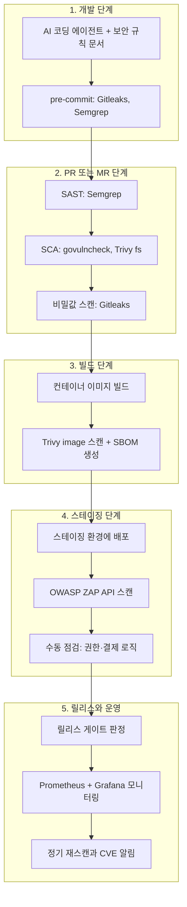
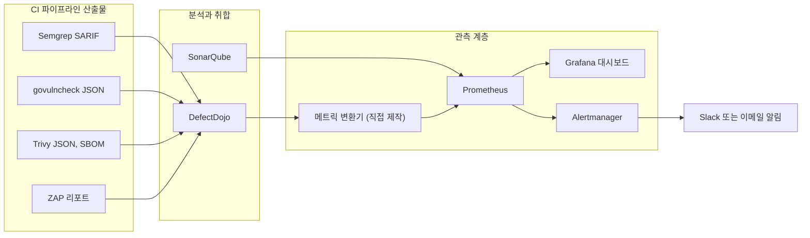
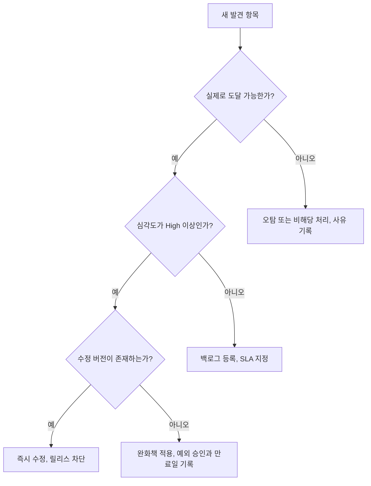

- 작성일자: 2026-10-19
- 대상 독자: 바이브 코딩으로 백엔드를 빠르게 만들었고, 이제 출시 전 보안 검증 체계를 갖추려는 개발자·아키텍트
- 조사 방식: 2026-10-19 기준 웹 검색으로 각 도구의 공식 문서, 릴리스 정보, 보안 사고 보고서, 연구 자료를 확인했습니다.


## 0. 이 문서를 읽는 법 (확인 수준 표기)

이 문서의 모든 주장에는 근거의 성격을 표시했습니다. 추측이 사실처럼 읽히지 않도록 하기 위함입니다.

| 표기 | 의미 |
|---|---|
| [공식] | 도구 제작사의 공식 문서·저장소·공식 블로그에서 확인한 내용 |
| [보고서] | 보안 업체·연구기관·공공기관이 발표한 사고 분석 또는 연구 자료 |
| [2차] | 블로그·정리 사이트 등 2차 자료에서 확인한 내용. 도입 전 공식 문서로 재확인 권장 |
| [설계 제안] | 검색으로 확인한 사실이 아니라, 확인된 사실을 바탕으로 제가 제안하는 구성 |

참고로 질문에 포함된 Threads 게시글 링크는 사이트 정책상 자동 접근이 차단되어 직접 열어보지 못했습니다. 게시글 내용은 질문에 붙여 주신 본문을 기준으로 해석했습니다.

---

## 1. 질문에 대한 짧은 답: 보안도 바이브 코딩의 영역인가?

결론부터 말씀드리면 "보안은 바이브 코딩이 끝난 뒤에 붙이는 별도 작업이 아니라, 바이브 코딩 루프 안에 들어가야 하는 검증 단계"입니다. 다만 여기서 중요한 구분이 있습니다. AI에게 보안 코드를 짜게 시키는 것과, AI가 짠 코드를 보안 도구로 검증하는 것은 전혀 다른 일입니다. 전자는 바이브 코딩의 영역이지만, 후자는 사람이 설계하고 결정론적(deterministic) 도구가 수행해야 하는 영역입니다. AI가 쓴 코드를 같은 AI의 "괜찮아 보입니다"라는 말로 검증하면 검증이 아니기 때문입니다.

### 1.1 왜 이런 구분이 필요한가: 연구 결과

AI가 생성한 코드의 보안 수준에 대해서는 2026년에 들어서도 여러 자료가 비슷한 방향을 가리킵니다.

- Cloud Security Alliance(CSA) AI Safety Initiative의 2026년 연구 노트는 Veracode의 2025 GenAI Code Security Report를 인용합니다. 100개가 넘는 LLM을 80개의 보안 민감 코딩 과제로 시험했더니, 생성된 코드의 45%가 OWASP Top 10 기준 보안 테스트에 실패했다는 내용입니다. [보고서]
- 같은 CSA 노트는 개발자 인식과 현실의 간극도 지적합니다. 한 설문에서 응답자의 75% 이상이 AI 생성 코드가 사람이 쓴 코드보다 안전하다고 믿으면서도, 56%는 AI가 보안 문제를 자주 만든다고 인정했다고 합니다. [보고서]
- 2026년 6월 arXiv에 공개된 논문(2606.23130, "Understanding the (In)Security of Vibe-Coded Applications")은 배포된 바이브 코딩 앱을 체계적으로 분석했습니다. 초록에 따르면 바이브 코딩 앱에서는 자리표시자(placeholder) 로직, 필터링되지 않은 입력, 비밀값 노출 같은 반복 패턴이 나타나며, 이 문제는 AI 에이전트의 기억 손실, 국소 최적화된 목표, 부족한 보안 지식 같은 구조적 한계에서 비롯됩니다. 또한 LLM 성능 향상과 프롬프트 개선이 취약점 발생을 줄이긴 하지만 근본 위험을 없애지는 못한다고 결론짓습니다. [보고서(논문 초록)]

이 수치들은 "AI 코드는 쓰지 말라"는 뜻이 아닙니다. "기능이 돌아간다는 사실과 안전하다는 사실은 별개이므로, 안전은 별도의 장치로 확인해야 한다"는 뜻입니다. 질문에 인용하신 Threads 글의 "아무리 바이브 코딩으로 백엔드를 구성했더라도 할 건 해야지"라는 문장이 정확히 이 지점을 가리킵니다.

### 1.2 스캐너가 잡는 것과 못 잡는 것

도구를 붙이기 전에 한계를 정확히 아는 편이 좋습니다. 이 문서에서 다룰 도구는 모두 "알려진 패턴"을 찾는 데 강합니다. 반면 다음과 같은 영역은 도구만으로 잡기 어렵습니다. 아래는 제 설계 관점의 정리입니다. [설계 제안]

- 비즈니스 로직 결함: 예를 들어 "남의 주문 번호로 조회하면 남의 주문이 보이는" 권한 검증 누락(IDOR)은 스캐너가 의미를 이해하지 못하면 놓칩니다.
- 결제·인앱 결제 흐름: 영수증 재사용, 서버 측 영수증 검증 누락, 웹훅 서명 검증 누락 같은 문제는 앱의 도메인 규칙을 알아야 판단됩니다.
- 설계 수준 문제: 인증 방식 선택, 토큰 수명, 권한 모델 같은 것은 코드 스캐너의 관할이 아닙니다.

그래서 이 문서의 파이프라인은 "자동화 도구 + 사람의 위협 모델링과 수동 점검"을 한 세트로 봅니다. 자동화 도구는 지루하고 반복적인 부분을 맡고, 사람은 도메인 로직을 맡는 분업입니다.

---

## 2. Threads 게시글의 도구 구성 해설과 보정

> 
> https://www.threads.com/share/_7Zag9GY6/
> 
> 아무리 바이브코딩으로 백엔드를 구성했다고 하더라도.. 할 건 해야지..
> 
> 소스 코드 보안 검사
> 1. SQL Injection·XSS·인증·인가 관련 코드의 취약점 분석
> 2. CodeQL(얘는 상용), Semgrep(무료)
> 3. CVE 검사
> 4. Go 의존성·Docker 이미지·OS 패키지의 알려진 취약점 탐지
> 5. govulncheck, Trivy (다 무료)
> 6. 동적 보안 검사
> 7. 실행 중인 API에 실제 공격 요청을 보내 방어 여부 확인
> 8. OWASP ZAP Active Scan (일단 무료)
> 9. Semgrep + govulncheck + Trivy + OWASP ZAP 사용...
> 
> 일단 k6 끝나고 ㅋㅋㅋ 
> 
> 개발은 한달인데, 보안, 실무 테스트도 한달이겠네 ㅋㅋㅋ
> 
> 인앱 결제 테스트는 끝냈으니..
> 

게시글은 보안 검사를 세 가지 축으로 나눕니다. 정적 분석(소스 코드 취약점), CVE 검사(의존성·이미지·OS 패키지), 동적 검사(실행 중인 API 공격 시험)입니다. 이 구분은 DevSecOps의 표준적인 분류와 일치합니다. 다만 몇 가지 표현은 2026년 10월 기준으로 보정이 필요해서 정리합니다.

### 2.1 SAST: Semgrep (그리고 CodeQL)

**Semgrep**

- 무료라는 말은 맞습니다. Semgrep Community Edition(CE)은 엔진이 LGPL-2.1이고, 무료이며 상업적 사용도 가능합니다. [공식]
- 다만 보정할 점이 두 가지 있습니다. 첫째, CE는 단일 파일·단일 함수 범위로 분석하므로 파일을 넘나드는 데이터 흐름(cross-file taint)은 놓칠 수 있습니다. 파일 간 분석은 유료 제품(Semgrep Code)의 기능입니다. [공식 문서 + 2차]
- 둘째, Semgrep이 관리하는 룰은 별도의 Semgrep Rules License v1.0 아래에 있고, 내부 업무 용도로는 쓸 수 있지만 그 룰을 넣어 만든 스캔 서비스를 판매하려면 라이선스가 필요합니다. 자사 서비스의 코드를 자사가 스캔하는 용도라면 제약이 거의 없습니다. [공식]
- 커뮤니티 룰은 약 2,800개, 유료 Pro 룰은 2만 개 이상이라는 비교가 있습니다. [2차]
- 확인된 최신 릴리스 정보는 v1.168.0(2026-06-24)입니다. 다만 이 날짜는 2차 정리 사이트의 표기이므로 설치 시 공식 릴리스 페이지에서 직접 확인하시기 바랍니다. [2차]

**CodeQL**

- 게시글의 "CodeQL(얘는 상용)"은 절반만 맞습니다. CodeQL의 쿼리 라이브러리는 MIT 라이선스로 공개되어 있지만, CodeQL CLI(엔진)는 별도 라이선스이며 오픈소스 코드 분석은 무료, 비공개(closed-source) 코드 분석에는 GitHub의 상용 라이선스가 필요하다고 정리되어 있습니다. [2차]
- GitHub에서는 공개 저장소에 대해 무료이고, 비공개 저장소에는 GitHub Code Security(과거 GitHub Advanced Security의 분리 상품)를 구독해야 합니다. 가격은 한 비교 사이트 기준으로 커미터당 월 30달러 수준으로 소개되어 있으나, 이는 2차 자료이므로 GitHub 공식 가격 페이지를 확인하셔야 합니다. [2차]
- 결론적으로 비공개 백엔드를 GitHub에서 운영하면서 비용을 쓰고 싶지 않다면 Semgrep CE가 현실적인 선택이고, GitLab을 쓰면 GitLab 자체 SAST가 내부적으로 Semgrep 기반 분석기를 쓰므로 이 선택은 더욱 자연스럽습니다(3.1절 참고).

### 2.2 CVE 검사: govulncheck와 Trivy

두 도구의 역할을 게시글보다 조금 더 명확히 구분하면 이해가 쉽습니다.

- **govulncheck**는 Go 모듈의 알려진 취약점을 찾되, "내 코드가 그 취약한 함수까지 실제로 호출하는가"를 호출 그래프로 따져 도달 가능한 취약점만 보여 주는 것이 특징입니다. 소스 모드와 바이너리 모드(`-mode binary`)를 지원합니다. [공식 문서 + 2차]
- **Trivy**는 컨테이너 이미지, 파일시스템, Git 저장소, 가상 머신 이미지, 쿠버네티스를 대상으로 OS 패키지·언어 의존성의 CVE, 설정 오류(IaC misconfiguration), 비밀값을 점검하는 범용 스캐너입니다. 라이선스는 Apache-2.0입니다. [공식]
- 따라서 게시글의 "Go 의존성·Docker 이미지·OS 패키지" 중 Go 의존성은 govulncheck가 가장 정밀하게 보고, Docker 이미지와 OS 패키지는 Trivy가 담당합니다. 둘을 함께 쓰면 "Trivy는 넓게, govulncheck는 정확히"라는 보완 관계가 됩니다. 실제로 Zarf 프로젝트는 소스에 대해서는 govulncheck(도달 가능성), 빌드된 바이너리에 대해서는 Grype(전체 의존성 목록)를 병행하며, 전자는 호출 경로를 보여 주고 후자는 실행되지 않는 코드의 의존성까지 보고한다고 설명합니다. [공식 문서]
- 한 가지 주의점: 도달 가능성(reachability)은 "우선순위를 정하는 데 쓰되, 무시하는 근거로 쓰지는 말라"는 취지의 조언이 도구 문서에 있습니다. [공식 문서]

### 2.3 동적 검사: OWASP ZAP

- ZAP은 Apache-2.0 라이선스의 무료 도구입니다. 2.16부터 "ZAP by Checkmarx" 브랜딩으로 발전하고 있으며, 2.16.0부터 Java 17 이상이 필요합니다. [공식 블로그 + 패키지 정보]
- 안정 버전은 2.17.0이며, 로드맵에는 2.18 릴리스가 2026년 계획으로 올라 있습니다. [공식]
- 백엔드 API가 대상이라면 `zap-api-scan.py`로 OpenAPI(또는 GraphQL, SOAP) 정의를 읽어 엔드포인트를 목록화하고 공격 요청을 보냅니다. 여러 단계를 코드로 관리하려면 YAML 기반 Automation Framework를 쓰는 것이 권장됩니다. [공식 + 2차]
- 게시글에서 말한 "Active Scan"은 실제 공격 요청을 보내기 때문에 운영 환경에 돌리면 안 됩니다. 한 정리 자료는 `zap-full-scan.py`를 야간·주간 예약 실행용으로 한정하라고 조언합니다. [2차]

### 2.4 "개발은 한 달, 보안·실무 테스트도 한 달"에 대한 의견

게시글 작성자의 일정 감각은 현실적입니다. 다만 도구 설치 자체는 하루면 끝나고, 시간이 드는 곳은 "탐지 결과를 분류(triage)하고 고치는 작업"입니다. 첫 스캔에서 수십~수백 건이 나오는 일이 흔하기 때문에, 한 달의 대부분은 오탐 판별, 예외 처리 기준 합의, 수정 및 재검증에 쓰이게 됩니다. 이 부분은 8장에 주차별 계획으로 정리했습니다. [설계 제안]

---

## 3. DevSecOps 프로세스 전체 그림

DevSecOps의 핵심은 "검사를 한 번에 몰아서 하지 않고, 코드가 흘러가는 길목마다 알맞은 검사를 배치한다"는 것입니다. 일찍 발견할수록 고치는 비용이 작고, 늦게 발견할수록 비용이 커집니다.

아래 도식은 제안하는 전체 흐름입니다. [설계 제안]



### 3.1 단계별 설명

**1단계: 개발 단계 (가장 싼 지점)**

이 단계에서는 사람이 커밋하기 전에 빠르게 막습니다. 바이브 코딩에서 가장 흔한 사고가 API 키·DB 비밀번호를 코드에 박아 넣는 일입니다. CSA 노트도 AI 생성 코드에서 자격 증명 노출이 두드러진다고 정리합니다. [보고서] 그래서 Gitleaks 같은 비밀값 탐지기를 pre-commit 훅으로 걸어 커밋 단계에서 막는 것이 효과적입니다. Gitleaks는 MIT 라이선스이며 pre-commit 훅, GitHub Action, 직접 실행(git/dir/stdin 모드)을 지원합니다. [공식 + 2차] 다만 한 정리 자료는 유지보수자가 후속 프로젝트(Betterleaks)로 무게를 옮기고 있어 Gitleaks가 보안 패치 중심 모드로 접어드는 중이라고 소개합니다. 이는 2차 자료이므로 도입 시점에 저장소의 공지를 확인하시기 바랍니다. [2차]

또 하나, AI 코딩 에이전트에 "보안 규칙 문서"(예: 프로젝트 지침 파일)를 주는 방식이 있습니다. 파라미터 바인딩 사용, 서버 측 권한 검증, 비밀값은 환경 변수나 시크릿 매니저에서만 읽기 같은 규칙을 적어 두는 것입니다. 이것은 사고를 줄이는 보조 수단일 뿐, 위 논문 초록이 말하듯 프롬프트 개선만으로 위험이 사라지지는 않으므로 검증 도구를 대체하지 못합니다. [설계 제안 + 보고서]

**2단계: PR/MR 단계 (품질 문)**

병합 전에 자동 검사를 돌리고, 기준을 넘는 결과가 있으면 병합을 막습니다. 여기서 SAST(Semgrep), SCA(govulncheck, Trivy fs), 비밀값 스캔이 함께 돌아갑니다. 이 단계는 속도가 중요하므로 수 분 이내에 끝나도록 구성하는 것이 좋습니다.

**3단계: 빌드 단계 (산출물 점검)**

컨테이너 이미지를 만든 뒤 Trivy로 OS 패키지와 의존성의 CVE를 점검합니다. 이때 SBOM(소프트웨어 자재 명세서)도 함께 뽑아 두면, 나중에 새 CVE가 공개되었을 때 "우리 이미지에 그 패키지가 들어 있는가"를 빠르게 답할 수 있습니다. Trivy는 SBOM 생성을 스캐너 기능 중 하나로 제공합니다. [공식]

**4단계: 스테이징 단계 (실제 공격 시험)**

실제로 띄운 API에 ZAP이 공격 요청을 보냅니다. 반드시 스테이징처럼 격리된 환경에서 돌려야 합니다. 활성 스캔은 데이터를 생성·변조·삭제하는 요청을 대량으로 보내기 때문입니다. 이 단계에 사람의 수동 점검(권한 우회, 결제·영수증 로직 등)을 함께 배치합니다.

**5단계: 릴리스와 운영**

릴리스 게이트가 모든 결과를 모아 통과·보류를 결정합니다. 운영 중에는 매일 새 CVE가 공개되므로, 이미 배포한 이미지와 의존성을 주기적으로 재스캔해야 합니다. 코드를 안 고쳤어도 어제의 "깨끗한" 이미지가 오늘의 "취약한" 이미지가 될 수 있기 때문입니다.

---

## 4. 2026년의 중요한 교훈: 보안 도구 자체도 공격 대상이다

이 문서에서 가장 먼저 짚어야 할 최신 사건이 있습니다. 게시글이 추천한 도구 중 Trivy가 2026년 3월에 공급망 공격을 받았습니다. 도구를 파이프라인에 넣는 방식에 직접 영향을 주므로 자세히 정리합니다.

### 4.1 사건 요약 [보고서·공식 보안 권고]

- 2026년 3월 19일, 위협 행위자(TeamPCP로 지칭)가 Aqua Security의 CI/CD 접근 권한을 이용해 악성 코드가 심어진 Trivy v0.69.4를 배포했고, `aquasecurity/trivy-action`의 버전 태그 77개 중 76개와 `aquasecurity/setup-trivy`의 태그 7개를 악성 커밋으로 강제 변경(force-push)했습니다. 이 악성 코드는 CI 환경의 비밀값을 탈취하는 자격 증명 탈취형이었습니다.
- 이 공격은 2월 말에 시작된 이전 침해의 연장선이었습니다. 3월 1일 공개된 첫 사건 이후 자격 증명을 교체했지만 한꺼번에(atomic) 모두 폐기하지 못해 공격자가 접근 권한을 유지했다고 Trivy 보안 권고문(GHSA-69fq-xp46-6x23)이 설명합니다.
- 노출 시간은 구성요소별로 달랐습니다. 권고문 표에 따르면 trivy v0.69.4는 약 3시간, trivy-action은 약 12시간, setup-trivy는 약 4시간입니다. 이후 3월 22일에는 Docker Hub의 v0.69.5, v0.69.6 이미지에서 2차 오염이 있었고 약 10시간 노출되었습니다.
- Docker는 3월 19일 18:24 UTC부터 3월 23일 01:36 UTC 사이에 0.69.4, 0.69.5, 0.69.6 및 latest 태그의 Trivy 이미지를 받은 고객은 CI/CD 비밀값, 클라우드 자격 증명, SSH 키 등이 유출되었을 수 있다고 안내했습니다.
- 유럽연합 CERT-EU와 유럽위원회는 위원회의 클라우드 침해 사건의 최초 침투 경로가 이 Trivy 공급망 사건이었다고 높은 확신으로 평가했습니다. 3월 19일에 AWS 비밀키가 탈취된 것이 출발점이었다고 설명합니다.
- 유지보수자 측은 당시 v0.69.3을 쓰라고 안내했습니다. 이후 릴리스는 계속 이어져 v0.71.0(2026-06-01), v0.72.0(2026-06-30), v0.73.0(2026-08-03)이 확인됩니다(pkg.go.dev 및 2차 자료 기준). 이 날짜들은 확인된 것일 뿐 "현재 최신"이라는 보증이 아니므로 도입 시점에 공식 릴리스에서 다시 확인하십시오.

### 4.2 우리 파이프라인에 주는 설계 원칙 [설계 제안, 사고 보고서의 권고를 바탕으로 함]

이 사고는 무료 도구를 쓰지 말라는 뜻이 아니라, 도구를 "가져오는 방식"을 바꾸라는 뜻입니다.

1. **GitHub Action은 태그가 아니라 커밋 SHA로 고정합니다.** 보고서들이 공통으로 지적하듯 `@v0.34.0` 같은 태그는 계약이 아니라 움직일 수 있는 포인터입니다. 실제로 76개 태그가 한꺼번에 바뀌었습니다.
2. **컨테이너 이미지는 `latest`를 쓰지 않고 버전 태그(가능하면 다이제스트)로 고정합니다.** Docker 안내에도 `latest` 태그가 오염되었음이 명시되어 있습니다.
3. **스캐너가 도는 CI 러너에는 최소 권한 자격 증명만 줍니다.** 스캐너 작업(job)에는 클라우드 키나 배포 키를 노출하지 않고, 스캔 전용 러너·작업 환경으로 분리합니다.
4. **도구 바이너리·이미지는 사내 레지스트리로 미러링하고, 업데이트는 검토 후 반영합니다.** 자동으로 최신을 당겨오는 구성이 가장 위험합니다.
5. **사고 시점(3월 19~23일)에 해당 도구를 실행한 이력이 있다면 비밀값을 교체합니다.** 로그에서 해당 기간 실행 여부를 확인하는 것이 권고문의 안내입니다.

이 원칙은 Trivy에만 해당하지 않습니다. Semgrep, ZAP, Gitleaks 등 모든 CI 도구에 똑같이 적용해야 합니다.

---

## 5. 오픈소스 솔루션으로 구현하기: GitLab 경로와 GitHub 경로

### 5.1 어느 플랫폼을 쓰든 공통인 부분

두 플랫폼 모두 "CI 작업 정의 파일 → 스캐너 실행 → 결과 파일(JSON/SARIF) 생성 → 게이트 판정 → 결과 보관"이라는 구조는 같습니다. 달라지는 것은 결과를 어디에 보여 주느냐입니다.

### 5.2 GitLab으로 구현하는 경우

GitLab은 보안 스캐너 템플릿이 내장되어 있어 YAML 몇 줄로 켤 수 있다는 장점이 있습니다.

**GitLab 티어별 현황 [공식 문서 + 2차, 일부 서술이 엇갈림]**

- SAST와 비밀값 탐지(Secret Detection)는 모든 티어에서 사용할 수 있습니다. 모든 티어에서 GitLab이 제공하는 분석기는 오픈소스 스캐너를 기반으로 하며, Go·Java·Python·JavaScript·C# 등은 "Semgrep 기반 분석기"로 지원됩니다. Ultimate에서는 파일·함수를 넘나드는 GitLab Advanced SAST가 추가됩니다. [공식 문서]
- 비밀값 탐지는 내부적으로 Gitleaks를 사용한다고 소개됩니다. [2차]
- 컨테이너 스캐닝, 의존성 스캐닝, DAST, IaC 스캐닝 등은 자료마다 티어 표기가 엇갈립니다. 어떤 자료는 컨테이너 스캐닝을 Free에 포함시키고, 어떤 자료는 Ultimate 기능으로 적습니다. DAST는 Ultimate로 표기한 자료가 다수입니다. 문서 버전에 따라 달라진 것으로 보이므로, 사용하시는 GitLab 버전의 공식 티어 비교 표를 반드시 확인하십시오. [2차, 확인 필요]
- 보안 취약점 보고서(Vulnerability Report)와 대시보드는 Ultimate 기능입니다. 즉 Free 티어에서는 스캔은 돌아가도 GitLab이 결과를 취합해 보여 주지는 못하므로, 파이프라인 아티팩트나 외부 취합 도구(6장의 DefectDojo)를 써야 합니다. [2차]

그래서 "GitLab Free/Premium + 오픈소스 스캐너 직접 호출" 구성이 현실적인 무료 경로입니다. 아래는 그 예시입니다. [설계 제안]

```yaml
# .gitlab-ci.yml (예시. 버전과 이미지는 반드시 고정해서 사용)
stages:
  - test
  - build
  - scan
  - dast

include:
  # GitLab 내장 템플릿: SAST(Semgrep 기반), 비밀값 탐지
  - template: Jobs/SAST.gitlab-ci.yml
  - template: Jobs/Secret-Detection.gitlab-ci.yml

variables:
  GOFLAGS: "-mod=readonly"

govulncheck:
  stage: test
  image: golang:<고정된 Go 버전>
  script:
    - go install golang.org/x/vuln/cmd/govulncheck@<고정된 버전>
    - govulncheck -json ./... > govulncheck.json
    - govulncheck ./...          # 도달 가능한 취약점이 있으면 실패
  artifacts:
    when: always
    paths: [govulncheck.json]
    expire_in: 30 days

semgrep:
  stage: test
  image: semgrep/semgrep:<고정된 버전>
  script:
    - semgrep scan --config p/golang --config p/owasp-top-ten --config p/secrets --sarif --output semgrep.sarif --error
  artifacts:
    when: always
    paths: [semgrep.sarif]
    expire_in: 30 days

trivy_image:
  stage: scan
  image:
    name: aquasec/trivy:<고정된 버전>   # latest 금지. 4장 참고
    entrypoint: [""]
  script:
    - trivy image --severity HIGH,CRITICAL --ignore-unfixed --exit-code 1
        --format json --output trivy.json "$CI_REGISTRY_IMAGE:$CI_COMMIT_SHA"
    - trivy image --format cyclonedx --output sbom.cdx.json "$CI_REGISTRY_IMAGE:$CI_COMMIT_SHA"
  artifacts:
    when: always
    paths: [trivy.json, sbom.cdx.json]

zap_api_scan:
  stage: dast
  image:
    name: ghcr.io/zaproxy/zaproxy:stable   # 가능하면 버전 태그로 고정
    entrypoint: [""]
  rules:
    - if: $CI_PIPELINE_SOURCE == "schedule"        # 야간 예약 실행
  script:
    - mkdir -p /zap/wrk
    - zap-api-scan.py -t "$STAGING_URL/openapi.json" -f openapi -r zap-api.html -J zap-api.json
  artifacts:
    when: always
    paths: [zap-api.html, zap-api.json]
```

위 예시에 대한 설명입니다.

- `include`로 불러오는 두 템플릿은 GitLab 공식 문서에 나오는 이름입니다. 나머지 작업(job)은 오픈소스 도구를 직접 호출하는 구조입니다. [공식 문서 + 설계 제안]
- `semgrep --error`는 결과가 있으면 비정상 종료 코드를 반환하게 하여 파이프라인을 실패시키는 용도입니다. 룰셋 이름(`p/golang` 등)은 Semgrep 레지스트리에서 제공되는 이름을 사용했으므로 실제 사용 전 레지스트리에서 존재 여부를 확인하십시오.
- Trivy의 `--ignore-unfixed`는 "패치가 아직 없는 취약점"을 게이트에서 제외합니다. 실패 기준을 현실적으로 만드는 대신, 제외된 항목이 영영 잊히지 않도록 6장의 취합 도구에서 따로 추적해야 합니다. [설계 제안]
- ZAP은 `rules`로 예약 실행(schedule)에만 걸었습니다. 매 커밋마다 활성 스캔을 돌리면 느리고 위험하기 때문입니다.
- 파일 경로(`/zap/wrk`)와 옵션은 ZAP 공식 Docker 스캔 스크립트 사용법을 따랐습니다. [공식 + 2차]

### 5.3 GitHub으로 구현하는 경우

GitHub에서는 Actions로 같은 도구를 호출하고, 결과를 SARIF 형식으로 만들어 "Code scanning 알림"으로 보여 주는 방식이 일반적입니다. 이때 알아야 할 제약이 있습니다.

- 공개 저장소에서는 SARIF 업로드와 CodeQL이 모두 무료입니다. [2차]
- 비공개 저장소에서 SARIF를 Security 탭에 올리려면 GitHub Advanced Security(현재는 Code Security로 분리 판매)가 활성화되어 있어야 합니다. Trivy 액션 문서에도 비공개 저장소에서 SARIF 업로드 오류가 나면 조직 관리자가 Advanced Security를 켜야 한다는 안내가 있습니다. [공식 + 2차]
- 따라서 비공개 저장소에서 비용을 쓰지 않으려면 SARIF 업로드 대신 결과 파일을 아티팩트로 보관하고, 6장의 취합 도구로 보내는 구성이 됩니다.

```yaml
# .github/workflows/security.yml (예시. 모든 uses는 태그가 아니라 커밋 SHA로 고정 권장)
name: security
on:
  pull_request:
  schedule:
    - cron: "0 18 * * *"   # 매일 UTC 18시 (한국 시간 새벽 3시)

permissions:
  contents: read

jobs:
  sast-and-sca:
    runs-on: ubuntu-latest
    steps:
      - uses: actions/checkout@<커밋 SHA>
      - uses: actions/setup-go@<커밋 SHA>
        with:
          go-version-file: go.mod
      - name: govulncheck
        run: |
          go install golang.org/x/vuln/cmd/govulncheck@<고정된 버전>
          govulncheck ./...
      - name: semgrep
        run: |
          pip install semgrep==<고정된 버전>
          semgrep scan --config p/golang --config p/owasp-top-ten --sarif --output semgrep.sarif --error
      - uses: actions/upload-artifact@<커밋 SHA>
        if: always()
        with:
          name: sast-results
          path: semgrep.sarif

  image-scan:
    runs-on: ubuntu-latest
    steps:
      - uses: actions/checkout@<커밋 SHA>
      - name: build
        run: docker build -t app:${{ github.sha }} .
      - name: trivy (직접 설치한 고정 버전 사용)
        run: |
          # 설치 방식은 사내 미러 또는 검증된 고정 버전으로. latest 금지
          trivy image --severity HIGH,CRITICAL --ignore-unfixed --exit-code 1 app:${{ github.sha }}
```

GitHub Actions 예시를 `uses: ...@<커밋 SHA>`로 표기한 이유는 4장의 사건 때문입니다. 또한 govulncheck에는 결과를 SARIF로 변환해 Code Scanning에 올려 주는 서드파티 액션(Templum/govulncheck-action 등)이 있으나, 서드파티 액션은 그 자체가 공급망 위험이므로 도입 전에 코드를 검토하고 SHA로 고정하십시오. [2차 + 설계 제안]

### 5.4 어느 쪽이 나은가

| 비교 항목 | GitLab | GitHub |
|---|---|---|
| 내장 SAST | 모든 티어에서 가능(Semgrep 기반 분석기) | CodeQL은 공개 저장소 무료, 비공개는 유료 |
| 결과 취합 화면 | Vulnerability Report는 Ultimate | Security 탭은 공개 저장소 무료, 비공개는 유료 |
| 무료 경로의 현실 | 스캔은 가능, 취합은 외부 도구 필요 | 마찬가지로 취합은 외부 도구 필요 |
| 직접 호스팅(self-managed) | 가능 | GitHub Enterprise Server 필요 |

사내 인프라에서 운영하는 환경이라면 GitLab self-managed + 오픈소스 스캐너 + DefectDojo + Grafana 조합이 비용 대비 구성의 자유도가 높습니다. 이것은 일반론이며, 실제 선택은 조직의 기존 플랫폼과 정책이 결정합니다. [설계 제안]

---

## 6. 모니터링: SonarQube와 Grafana로 보안·품질 상태를 한눈에

### 6.1 먼저 역할을 구분하기

모니터링에는 서로 다른 세 가지 질문이 섞여 있습니다. 이 구분을 하지 않으면 도구 선택이 헷갈립니다.

1. "우리 코드의 품질과 보안 상태는 좋아지고 있는가?" → 코드 품질·보안 추세. SonarQube의 영역입니다.
2. "발견된 취약점이 몇 건이고, 누가 언제까지 고쳐야 하는가?" → 취약점 관리. DefectDojo 같은 취합 도구의 영역입니다.
3. "지금 운영 중인 서비스가 정상이고 공격받고 있지는 않은가?" → 운영 관측. Prometheus와 Grafana의 영역입니다.

Grafana는 이 세 가지를 한 화면에 모아 보여 주는 "표시 계층"이지, 스캐너나 취약점 DB가 아닙니다. Grafana는 Prometheus, Elasticsearch, Loki 같은 여러 데이터 소스의 로그와 지표를 하나의 대시보드에서 조회·분석하게 해 주는 도구로 소개됩니다. [2차]

### 6.2 전체 구조도

아래 구조는 제가 제안하는 구성입니다. 각 상자의 개별 도구는 실존하고 문서화되어 있지만, "취합 도구의 데이터를 Grafana로 보내는 연결부"는 제품이 기본 제공하는 기능으로 확인된 것이 아니라 직접 만들어야 하는 부분입니다. [설계 제안]



### 6.3 SonarQube 도입 시 알아야 할 사실

**에디션과 제약 [공식 문서 + 2차]**

- 무료 에디션은 SonarQube Community Build(구 Community Edition)입니다. 사용자·프로젝트 수 제한 없이 자체 서버에서 운영할 수 있습니다. [2차]
- 가장 큰 제약은 **브랜치 분석이 안 된다**는 점입니다. 기본(main) 브랜치만 분석하므로 PR에 인라인 코멘트를 달거나 PR별 품질 게이트를 적용하는 기능이 없습니다. 이는 유료 Developer Edition 이상에서 제공됩니다. 또한 Community Build에는 보안 측면에서 가치가 큰 오염 분석(taint analysis)도 없다고 정리됩니다. [2차]
- 이 제약 때문에 "PR 단계의 보안 게이트"는 SonarQube가 아니라 Semgrep·govulncheck 같은 CI 도구가 맡고, SonarQube Community Build는 main 브랜치의 **장기 추세 관측**(코드 스멜, 중복, 커버리지, 기본 보안 규칙)에 쓰는 역할 분담이 현실적입니다. [설계 제안]
- 언어 지원은 공식 문서의 지원 언어 표에 Go, Java, Python 등이 올라 있습니다. 다만 표의 Go 지원 버전이 "1.0~1.21"로 적혀 있으므로, 사용하는 Go 버전이 이보다 높다면 분석 호환성을 직접 시험해 보셔야 합니다. [공식 문서]
- 릴리스는 월 단위로 나오며, Community Build에는 장기 지원(LTA) 버전 개념이 없어서 버그·보안 수정이 다음 월간 릴리스에서야 반영됩니다. 따라서 업그레이드 주기를 정해야 합니다. [2차]
- 라이선스 표기는 자료마다 다릅니다. 어떤 자료는 LGPL-3.0이라고 하고, 다른 자료는 2024년 말 무렵 분석기가 Sonar Source-Available License(SSALv1)로 바뀌었다고 적습니다. 사내 도입이나 재배포가 걸려 있다면 공식 라이선스 문서를 직접 확인하십시오. [2차, 확인 필요]

**Prometheus 연동 [공식 문서]**

- SonarQube Community Build는 Web API의 `/api/monitoring/metrics` 엔드포인트로 OpenMetrics 텍스트 형식의 지표를 내보내고, 선택적으로 JMX 지표를 Prometheus JMX Exporter로 노출할 수 있습니다(기본은 비활성). 문서는 Prometheus에 연결한 뒤 Grafana 같은 관측 플랫폼과 이어 쓰는 방식을 안내합니다. Datadog 연동도 안내합니다.
- 중요한 구분: 이 공식 지표는 **SonarQube 서버 자체의 운영 상태**(웹·Compute Engine 프로세스 등)를 감시하기 위한 것으로 소개됩니다. 프로젝트별 "품질 게이트 통과 여부 추세"나 "취약점 개수 추세"를 Grafana에 그리려면 다른 경로가 필요합니다. 구체적인 지표 목록은 공식 문서의 "List of Prometheus metrics"를 확인하십시오. [공식 문서]

**프로젝트 품질 추세를 Grafana에 올리는 방법 [설계 제안]**

SonarQube는 웹 API로 프로젝트 측정값(measures)을 조회할 수 있으므로, 일정 주기로 이 API를 호출해 값을 Prometheus 지표로 바꿔 주는 작은 변환기(exporter)를 만드는 방식이 한 가지 방법입니다. 변환기에 담을 항목은 품질 게이트 상태, 취약점·버그·코드 스멜 건수, 커버리지, 중복률 정도로 시작하는 것이 적당합니다. 이 방식은 제가 제안하는 설계이며, 사용하는 SonarQube 버전의 API 명세를 확인한 뒤 구현해야 합니다.

### 6.4 DefectDojo로 스캐너 결과 취합하기

여러 스캐너가 각자 다른 형식의 결과를 내놓기 때문에, 한곳에 모아 중복을 제거하고 담당자와 기한을 붙이는 도구가 필요합니다.

- DefectDojo는 오픈소스 취약점 관리 플랫폼이며, 공식 문서 버전 표기가 3.0.1입니다. 공식 데이터시트는 160~170여 종 이상의 보안 도구 결과를 가져올 수 있다고 소개합니다. [공식]
- REST API의 import-scan 엔드포인트로 CI에서 결과 파일을 올릴 수 있고, Jira 티켓 연동과 Slack 알림 구성도 가능하다고 설명하는 자료가 있습니다. [2차]
- 오픈소스 버전의 메인 대시보드는 고정된 구성입니다(진행 중인 점검 수, 최근 7일 새 발견 건수, 심각도별 분포 등). 위젯을 자유롭게 배치하는 맞춤 대시보드와 일부 고급 지표는 유료 Pro 기능으로 구분되어 있습니다. 따라서 오픈소스 버전으로 "원하는 형태의 추세 그래프"를 만들려면 Grafana가 필요해지는 것입니다. [공식 문서]
- DefectDojo의 데이터를 Grafana로 보내는 방법으로는 (a) REST API를 주기적으로 읽어 Prometheus 지표로 변환하는 변환기를 만들거나, (b) 읽기 전용 계정으로 DefectDojo의 데이터베이스를 Grafana 데이터 소스로 직접 연결하는 방법을 생각할 수 있습니다. 한 교육 자료도 DefectDojo API에서 값을 가져와 Prometheus로 내보내는 변환기와 Grafana 대시보드를 구성하는 예를 보여 줍니다. 다만 (b)는 DB 스키마가 버전마다 바뀔 수 있으므로 API 방식이 더 안전합니다. [2차 + 설계 제안]

### 6.5 Grafana 대시보드에 담을 지표 제안 [설계 제안]

한 화면에 너무 많이 넣으면 아무도 보지 않게 됩니다. 처음에는 아래 정도로 시작하시길 권합니다.

| 패널 | 데이터 원천 | 이유 |
|---|---|---|
| 심각도별 열린 취약점 수(추세) | DefectDojo | 전체 상태가 좋아지는지 한눈에 확인 |
| 수정 기한(SLA) 초과 건수 | DefectDojo | 방치되는 항목 감지 |
| 도달 가능한 Go 취약점 수 | govulncheck 결과 | 실제 위험의 핵심 지표 |
| 최신 스캔 시각 | CI 메타데이터 | 스캔이 멈춘 것을 감지 |
| 품질 게이트 상태와 추세 | SonarQube | main 브랜치의 품질 흐름 |
| 이미지별 High/Critical CVE 수 | Trivy 결과 | 배포 대상별 위험 파악 |
| 인증 실패·4xx/5xx 비율 | 애플리케이션 지표 | 운영 중 공격 징후 감지 |

알림은 "Critical 취약점 신규 발견", "SLA 초과", "스캔 24시간 이상 미실행" 세 가지만 먼저 거는 것이 좋습니다. 알림이 많아지면 무시되기 시작합니다.

마지막으로 모니터링 도구 자체도 취약점의 대상입니다. Grafana, Prometheus, SonarQube, DefectDojo는 모두 사내망에 열린 서비스이므로 버전을 최신으로 유지하고, 인터넷에 직접 노출하지 말고, 인증을 반드시 켜야 합니다. [설계 제안]

---

## 7. 결과가 쏟아졌을 때: 분류와 게이트 정책

도구를 붙이면 첫날 결과가 많이 나옵니다. 이때 "전부 막는" 게이트를 걸면 개발이 멈추고, "아무것도 안 막는" 게이트를 걸면 의미가 없습니다. 아래 판단 흐름을 기준으로 삼는 것을 제안합니다. [설계 제안]



### 7.1 권장 게이트 기준 [설계 제안]

| 단계 | 차단 기준 | 경고만 하는 기준 |
|---|---|---|
| pre-commit | 비밀값 탐지 | 그 외 |
| PR/MR | 비밀값, govulncheck의 도달 가능 취약점, Semgrep의 High 이상 | Medium 이하 |
| 빌드 | Trivy의 High/Critical(수정 버전이 있는 것) | 수정 버전이 없는 항목 |
| 스테이징 | ZAP의 High | Medium 이하 |
| 릴리스 | 열린 Critical이 하나라도 있으면 차단 | 예외는 승인자·만료일 필수 |

핵심은 **예외 처리에 반드시 만료일을 붙이는 것**입니다. 만료일 없는 예외는 영구 무시와 같습니다. Zarf 프로젝트도 영향 없음 판정을 재검토 가능한 예외 기록(VEX 문서 등)으로 남기고, 더 이상 해당하지 않는 항목은 정리하도록 하는 도구를 운용합니다. [공식 문서]

### 7.2 AI가 만든 코드를 위한 추가 점검 항목 [설계 제안 + 보고서 근거]

연구가 지적한 바이브 코딩 특유의 패턴(자리표시자 로직, 필터링 안 된 입력, 비밀값 노출)을 고려해 아래를 추가로 점검할 것을 권합니다.

- 코드 안에 남아 있는 임시 값·데모용 인증 우회·"TODO: 나중에 검증"류 주석
- 모든 엔드포인트의 서버 측 인증·권한 확인 여부(프런트엔드 검사에만 의존하지 않는지)
- 결제·영수증·웹훅 처리부의 서명 및 재사용(replay) 검증
- 환경 변수 및 설정 파일에 들어간 비밀값, 로그에 찍히는 민감 정보
- 에러 응답에 내부 구조(스택 트레이스 등)가 노출되는지

이 항목들은 스캐너가 일부만 잡으므로, 체크리스트로 만들어 PR 템플릿에 넣고 사람이 확인하게 하는 것이 효과적입니다.

---

## 8. 한 달 실행 계획 제안 (질문 속 "보안 한 달"의 구체화)

아래는 제안하는 일정입니다. 개발 규모와 팀 상황에 따라 조정이 필요합니다. [설계 제안]

| 주차 | 목표 | 주요 작업 | 완료 기준 |
|---|---|---|---|
| 1주차 | 기반 구축 | CI에 Semgrep, govulncheck, Trivy, Gitleaks 연결. 도구 버전·액션 SHA 고정. 첫 전체 스캔 | 모든 스캔이 CI에서 자동으로 돌고 결과 파일이 보관됨 |
| 2주차 | 분류와 수정 | 첫 스캔 결과의 오탐 판별, Critical/High 수정, 예외 기준 합의 | 열린 Critical 0건, High는 수정 또는 승인된 예외 |
| 3주차 | 동적 검사와 수동 점검 | 스테이징에서 ZAP API 스캔, 인증·권한·결제 로직 수동 점검, 위협 모델링 | ZAP High 0건, 수동 점검 체크리스트 완료 |
| 4주차 | 가시화와 운영 전환 | DefectDojo 취합, SonarQube main 분석, Grafana 대시보드와 알림, 릴리스 게이트 확정 | 대시보드와 알림이 가동되고 야간 재스캔이 돌고 있음 |

성능 테스트(k6)와의 관계도 정리해 둡니다. k6는 부하·성능 검증 도구이고 보안 도구가 아닙니다. 다만 두 가지가 겹치는 지점이 있습니다. 부하 테스트 중에 속도 제한(rate limit)이나 인증 처리가 어떻게 동작하는지 함께 보면 DoS 내성과 로그인 시도 제한 같은 항목을 같이 확인할 수 있습니다. 또한 ZAP의 활성 스캔과 k6 부하 테스트는 같은 스테이징 환경에서 동시에 돌리면 결과가 서로 오염되므로 시간대를 분리하는 것이 좋습니다. [설계 제안]

---

## 9. 자주 하는 오해와 정리

1. **"무료 도구를 붙였으니 보안 끝"은 오해입니다.** 도구는 알려진 패턴만 찾습니다. 비즈니스 로직과 설계 결함은 사람의 점검이 필요합니다.
2. **"결과가 0건이면 안전하다"도 오해입니다.** Semgrep CE처럼 파일 간 분석이 제한되는 도구는 놓치는 것이 있습니다. 0건은 "이 도구가 이 규칙으로는 못 찾았다"는 뜻입니다.
3. **"보안 도구는 믿어도 된다"는 전제는 2026년 3월에 흔들렸습니다.** 도구 자체도 공급망 위험의 대상이므로 버전·SHA 고정과 권한 최소화가 필요합니다.
4. **"활성 스캔은 운영에서 돌려도 된다"는 위험한 생각입니다.** 반드시 격리된 스테이징에서만 돌리십시오.
5. **"AI가 짠 보안 코드는 AI에게 검토시키면 된다"는 순환 논리입니다.** 검증은 AI와 독립된 결정론적 도구와 사람이 맡아야 합니다.

---

## 10. 한눈에 보는 도구 요약

| 도구 | 역할 | 비용·라이선스 | 이 문서에서 확인한 핵심 주의점 |
|---|---|---|---|
| Semgrep CE | SAST | 엔진 LGPL-2.1, 무료 | 단일 파일 범위 분석, 룰은 별도 라이선스(내부 사용 가능) |
| CodeQL | SAST | 공개 저장소 무료, 비공개는 GitHub 유료 | CLI의 비공개 코드 분석은 상용 라이선스 필요 |
| govulncheck | Go 의존성 CVE(도달 가능성) | BSD 계열, 무료 | Go 전용, 도달 가능성은 우선순위 판단용 |
| Trivy | 이미지·파일시스템·IaC·SBOM | Apache-2.0, 무료 | 2026-03 공급망 침해 사건, 태그·latest 사용 금지 |
| OWASP ZAP | DAST(API·웹) | Apache-2.0, 무료 | 활성 스캔은 스테이징에서만 |
| Gitleaks | 비밀값 탐지 | MIT, 무료 | 조직 저장소용 공식 Action은 라이선스 키 요구 보고, 유지보수 방향 변화 소개(2차) |
| SonarQube Community Build | 코드 품질·보안 추세 | 무료(라이선스 표기 자료별 상이) | 브랜치·PR 분석 불가, 월간 릴리스 |
| DefectDojo | 취약점 취합·관리 | 오픈소스(Pro는 유료) | 오픈소스 대시보드는 고정 구성 |
| Prometheus + Grafana | 지표 수집·시각화 | 오픈소스 | 보안 데이터 연결부는 직접 구성 필요 |

---

## 11. 참고 자료 (확인일: 2026-10-19)

**바이브 코딩 보안 연구**
- Cloud Security Alliance AI Safety Initiative, "Vibe Coding Security Debt: AI-Generated Vulnerabilities at Scale" (2026-04-06): https://labs.cloudsecurityalliance.org/research/csa-research-note-ai-codegen-vulnerability-debt-2026
- CSA 연구 노트 PDF (2026-03-31): https://labs.cloudsecurityalliance.org/wp-content/uploads/2026/03/CSA_research_note_AI_generated_code_security_vibe_coding_20260331-csa-styled.pdf
- arXiv 2606.23130, "Understanding the (In)Security of Vibe-Coded Applications" (2026-06-22, 초록 요약 페이지): https://www.emergentmind.com/papers/2606.23130

**Semgrep / CodeQL**
- Semgrep 공식 FAQ(라이선스): https://semgrep.dev/docs/faq/overview
- Semgrep CE 라이선스·상업적 사용 정리(2차): https://aicodereview.cc/blog/semgrep-free-commercial-use
- CodeQL 라이선스·가격 정리(2차): https://www.everydev.ai/tools/codeql , https://toolradar.com/tools/codeql/pricing
- GitHub Code Quality GA 보도(2026-07-20): https://letsdatascience.com/news/github-makes-code-quality-generally-available-b71016d1

**govulncheck**
- govulncheck 사용법과 도달 가능성 설명(2차): https://dev.to/gabrielanhaia/govulncheck-scan-go-code-for-cves-you-can-actually-reach-3fk5
- Zarf 취약점 관리 문서(소스는 govulncheck, 바이너리는 Grype 병행): https://docs.zarf.dev/contribute/vulnerability-management/

**Trivy와 2026-03 공급망 사건**
- Trivy GitHub 보안 권고 GHSA-69fq-xp46-6x23: https://github.com/aquasecurity/trivy/security/advisories/GHSA-69fq-xp46-6x23
- Aqua Security 공식 안내: https://www.aquasec.com/blog/trivy-supply-chain-attack-what-you-need-to-know/
- Microsoft Security 블로그: https://www.microsoft.com/en-us/security/blog/2026/03/24/detecting-investigating-defending-against-trivy-supply-chain-compromise/
- Docker 블로그: https://www.docker.com/blog/trivy-supply-chain-compromise-what-docker-hub-users-should-know/
- Wiz Research: https://www.wiz.io/blog/trivy-compromised-teampcp-supply-chain-attack
- CERT-EU(유럽위원회 클라우드 침해): https://cert.europa.eu/blog/european-commission-cloud-breach-trivy-supply-chain
- Trivy 릴리스(pkg.go.dev): https://pkg.go.dev/github.com/aquasecurity/trivy@v0.73.0

**OWASP ZAP**
- ZAP 공식 블로그·로드맵: https://zaproxy.org/tags/blog/ , https://zaproxy.org/docs/roadmap/
- ZAP 2026년 7월 소식: https://www.zaproxy.org/blog/2026-08-06-zap-updates-july-2026/
- ZAP 자동화(2차): https://www.jit.io/blog/how-to-automate-owasp-zap , https://www.appsecsanta.com/owasp-zap

**GitLab / GitHub**
- GitLab SAST 문서: https://new.docs.gitlab.com/user/application_security/sast
- GitLab 소규모 팀 가이드(티어별 보안 기능, 서술이 엇갈리는 부분은 공식 티어표 재확인): https://about.gitlab.com/get-started/small-business
- GitLab 보안 스캐닝 개요(2차): https://blog.codecentric.de/gitlab-security-scanning
- Semgrep의 GitHub Security 탭 업로드 안내: https://semgrep.dev/docs/kb/semgrep-ci/github-upload-findings-in-security-dashboard
- Gitleaks: https://github.com/gitleaks/gitleaks , https://appsecsanta.com/gitleaks

**SonarQube / DefectDojo / Grafana**
- SonarQube Community Build 공식 문서(Kubernetes 모니터링, 지원 언어): https://docs.sonarsource.com/sonarqube-community-build/server-installation/on-kubernetes-or-openshift/set-up-monitoring/introduction.md , https://docs.sonarsource.com/sonarqube-community-build/analyzing-source-code/languages/overview
- SonarQube 에디션 비교(2차): https://aicodereview.cc/blog/is-sonarqube-free , https://appsecsanta.com/sonarqube
- DefectDojo 공식 문서: https://docs.defectdojo.com/metrics_reports/dashboards/introduction_dashboard/
- DefectDojo + Prometheus + Grafana 구성 예(교육 자료, 2차): https://nerdleveltech.com/courses/devsecops-fundamentals/learn/compliance-governance/security-dashboards

---

작성 일자: 2026-10-19
