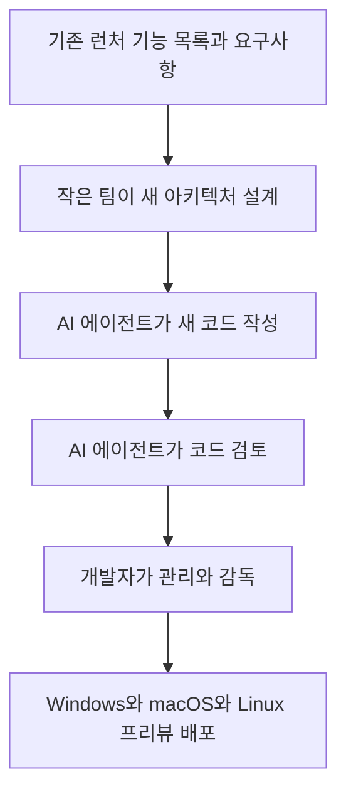
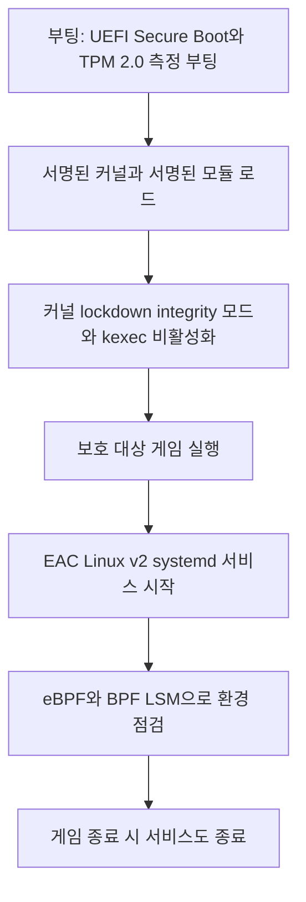
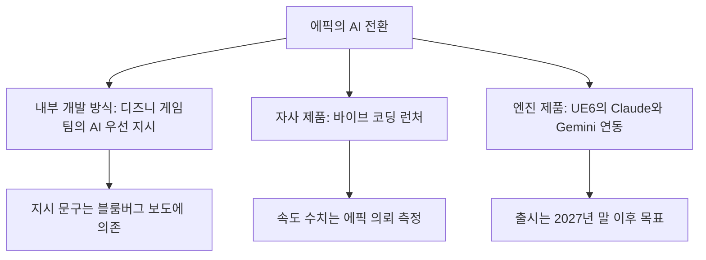

- 작성 일자: 2026-10-19
- 대상 보도: The Next Web "Epic says it vibe coded its new launcher because 'programming is hard'" (2026-10-16), The Verge "Epic is bringing Fortnite to Linux" (2026-10-14)
- 문서 성격: 새 런처의 정체, AI 활용 방식, 속도 주장의 검증 상태, Linux 지원과 새 안티치트의 기술적 의미를 서술형으로 풀어 쓴 해설서
- 관련 문서: 앞서 작성한 "팀 스위니의 70% 타이핑, 30% 난제 발언 해설"의 4장 후속편 성격

---

## 0. 이 문서를 읽기 전에: 확인한 것과 확인하지 못한 것

이 문서는 "막연한 추측 없이 확인된 사실만 쓴다"는 원칙으로 작성했습니다. 사용자께서 제공하신 The Next Web 본문 전체와 The Verge 본문 전체를 기준으로 삼고, 추가로 Tom's Hardware, Hardware Busters, PC Gamer, TweakTown, Inven Global, The Next Web의 언리얼 엔진 6 기사를 열어 내용을 대조했습니다. 상호 충돌하는 부분은 본문에서 그대로 밝혔습니다.

본문에서 "해석"이라고 표시한 부분은 사실이 아니라 제 의견입니다. 표시가 없는 서술은 출처가 있는 사실이며, 출처는 맨 끝에 모아 두었습니다. 에픽이 자체적으로 내놓은 수치와 주장은 "에픽의 주장"이라고 명시했습니다.

---

## 1. 한눈에 보기

에픽게임즈는 2026년 10월 14일 새 에픽게임즈 런처의 프리뷰 버전을 공개했습니다. 공식 발표문의 첫머리가 화제가 되었습니다. "프로그래밍은 어렵다. 그래서 그 대신 새 에픽게임즈 런처를 바이브 코딩했다"는 문장입니다. 이 런처는 Windows, macOS에 더해 처음으로 Linux를 지원합니다.

같은 날 에픽은 Linux에서 포트나이트를 실행할 수 있게 하겠다는 계획도 밝혔습니다. 핵심은 자사 안티치트 소프트웨어 Easy Anti-Cheat(EAC)를 Linux용으로 다시 만든다는 것이고, 이름은 EAC Linux v2입니다. 다만 출시 일정은 없습니다.

이 소식이 큰 파장을 낳은 이유는 타이밍입니다. 이틀 전인 10월 12일 블룸버그가 에픽이 디즈니 협업 게임 개발팀에 "AI 우선" 방식을 지시했다고 보도했고, 스위니가 "거대한 전환"을 공개적으로 인정한 직후였기 때문입니다. 그리고 런처 발표의 나흘 뒤인 10월 18일에는 스위니가 "코드 타이핑의 70%는 AI에 맡기는 것이 논리적"이라는 장문의 글을 올렸습니다.

---

## 2. 사건 순서

이 순서에서 눈여겨볼 지점이 있습니다. Valve가 10월 13일에 Steam 클라이언트 업데이트를 배포했는데, 변경 내역의 첫 줄이 "Steam 클라이언트 시작 성능 개선"이었습니다. 에픽이 속도 비교를 내놓기 하루 전입니다. 이것이 5장의 속도 논쟁과 직결됩니다.

---

## 3. 새 런처는 무엇이 달라졌나

### 3.1 확인된 사실

새 런처는 현재 프리뷰(Preview) 상태이며 launcher.epicgames.com에서 내려받을 수 있습니다. 지원 플랫폼은 Windows, macOS, Linux이고, 인텔 맥은 지원하지 않습니다. Linux 쪽은 공식적으로 Ubuntu 22.04 이상, Fedora 43 이상, Debian 12 이상이 지원 대상으로 안내되었습니다. 설치하면 기존 런처가 대체되고, 구매 내역과 설치된 게임, 클라우드 저장, 진행 상황은 그대로 이어진다고 보도되었습니다.

에픽 게임스 스토어 부사장 겸 총괄 마틴 킬리(Martin Keely)는 IGN에 라이브러리 로딩이 이전보다 30배 빨라졌고 용량은 약 300MB라고 말했습니다. 라이브러리 화면은 새로 설계되었고, Steam 같은 다른 런처에 설치한 게임의 바로가기를 추가할 수 있다고 PC Gamer가 전했습니다.
### 3.2 아직 부족한 부분

에픽은 스스로 이 첫 릴리스를 "요트가 아니라 쾌속정"이라고 불렀습니다. 즉 기능을 줄인 대신 빠르고 가볍다는 뜻입니다. The Next Web에 따르면 프리뷰에는 기존 런처의 일부 소셜 기능과 계정 옵션이 아직 빠져 있습니다. 에픽도 일부 기능은 쓸 수 없거나 예상과 다르게 동작할 수 있다고 경고했습니다.

### 3.3 "바이브 코딩"이라는 말

에픽의 발표문이 쓴 이 표현은 일반적으로 프롬프트로 AI 모델에게 소프트웨어를 만들게 하고 직접 쓰는 코드는 적은 방식을 가리킵니다. 다만 이 말은 사람에 따라 자동 완성 수준부터 대규모 코드 생성까지 폭넓게 쓰이므로, 실제 범위는 킬리의 설명으로 판단해야 합니다. 이 내용은 4장에서 다룹니다.

---

## 4. AI를 어떻게 썼나: 에픽이 밝힌 범위

킬리는 PC Gamer에 이렇게 설명했습니다. "우리는 처음부터 새로 시작했습니다. 스토어와 런처 셸 모두 완전히 새로운 아키텍처입니다." 기존 앱의 코드는 재사용하지 않았고, AI는 기존과 다른 기술 스택 위에서 새 기능을 쓰고 검토하는 도구로 쓰였다고 합니다. The Verge는 AI 에이전트가 코드를 쓰고 검토했으며 개발자가 이를 관리하고 감독했다고 전했습니다. IGN에는 AI 덕분에 작은 팀이 코드베이스를 다시 쓰고 여러 플랫폼에 더 빨리 내놓을 수 있었다고 말했다고 보도되었습니다.

이를 정리하면 아래와 같습니다.

여기서 확인되는 것과 확인되지 않는 것을 구분해야 합니다. 확인된 것은 "새 코드를 AI로 썼고, 사람이 감독했다"는 점입니다. 확인되지 않은 것은 전체 코드 중 AI가 쓴 비율, 사람이 직접 고친 부분의 크기, 테스트와 보안 검수의 구체적 방식입니다. PC Gamer는 발표 전 시연을 보았을 뿐 직접 테스트하지 않았고 측정 방법과 원자료는 기사에 나오지 않는다고 했습니다.

---

## 5. 속도 주장은 얼마나 검증되었나

### 5.1 에픽의 주장

에픽은 콜드 스타트(처음 실행)부터 스토어 화면까지 새 런처가 평균 5.47초이고 Steam은 10.07초라고 제시했습니다. 약 46% 빠르다는 뜻입니다. 시스템 트레이에서 다시 열어 라이브러리를 띄우는 시간은 0.36초 대 0.42초로, 약 14% 빠르다고 했습니다.

측정은 에픽의 의뢰로 Keywords Studios가 10월에 수행했습니다. The Next Web에 따르면 13대 PC에서 측정한 평균이며, 테스트한 기기 중 사양이 가장 낮은 세 대는 평균에서 제외했습니다. Inven Global은 각 PC에서 다섯 번씩 측정했다고 전했습니다. 에픽도 환경에 따라 결과가 달라질 수 있다고 인정했습니다.

### 5.2 반론과 독립 측정

| 항목 | 내용 | 비고 |
|---|---|---|
| 에픽 제시 수치 | 새 런처 5.47초, Steam 10.07초 | 에픽 의뢰 측정, 사양 낮은 3대 제외 |
| Steam의 업데이트 | 10월 13일 "클라이언트 시작 성능 개선" 배포 | 에픽 발표 하루 전 |
| 업데이트 후 Steam 측정 | 한 이용자 측정 5.23초, 다른 보고 약 5~7초대, 한 매체의 여러 기기 평균 6.52초 | 조건이 제각각인 사용자 측정 |
| Ars Technica | 새 런처가 Steam보다 몇 초 빨리 스토어에 도달 | The Next Web이 전한 내용 |
| 트레이 복원 | 한 독립 측정에서 에픽 런처가 여전히 더 빨랐음 | 중급 Windows PC |

Inven Global과 TweakTown은 에픽의 비교에 쓰인 Steam 수치가 Valve의 업데이트 이전 값이라고 지적했습니다. TweakTown이 소개한 단일 사용자 측정에서는 업데이트된 Steam이 5.23초로 에픽의 5.47초보다 약 0.24초 빨랐습니다. 다만 이것은 한 사람의 측정이며 PC 사양과 콜드 스타트 여부 같은 조건이 공개되지 않았고, Valve도 벤치마크 수치를 내놓지 않았습니다.

### 5.3 해석

사실로 말할 수 있는 것은 두 가지입니다. 에픽의 속도 수치는 에픽이 의뢰한 측정이고, Steam 쪽 비교 기준은 업데이트 이전일 가능성이 높다는 점입니다. 여기에 더해 제 해석을 덧붙이면, 이 비교는 "AI로 만든 소프트웨어가 상용 서비스에 쓰일 만한 성능을 낼 수 있다"는 사례로는 의미가 있지만 "AI 코딩이 사람 코딩보다 낫다"는 증거로 쓰기에는 조건이 맞지 않습니다. 새 런처가 기능을 덜어 낸 첫 버전이라는 점도 같은 이유로 중요합니다. 기능이 늘수록 시작 시 해야 할 일도 늘기 때문입니다.

---

## 6. Linux용 포트나이트와 EAC Linux v2

### 6.1 왜 지금까지 안 됐나

에픽의 안티치트 EAC는 이미 Linux를 지원했지만, 포트나이트는 그렇지 않았습니다. The Verge에 따르면 스위니는 2022년 2월 "다양한 커널 설정 아래에서 대규모로 치팅에 대응할 자신이 없다"고 말한 바 있습니다. Linux는 사용자가 커널을 마음대로 바꿀 수 있기 때문에, 치팅 도구가 끼어들 틈을 막기 어렵다는 논리입니다.

### 6.2 에픽의 새 접근

에픽은 EAC를 Linux용으로 재설계한 EAC Linux v2를 포트나이트에서 먼저 시험 운영하겠다고 밝혔습니다. 에픽은 배포판 관리자들과 보안 요구사항을 협의하고 있으며, "충분한 수의 배포판 관리자와 함께 동작하게 되면" 런처를 통해 포트나이트를 내놓겠다고 했습니다. 이 개선은 다른 개발사에도 제공해 자기 게임을 Linux에 내놓을 수 있게 하겠다고 밝혔습니다. 에픽 엔지니어링 디렉터 릭 데이스트(Rick Deist)는 The Verge에 출시 일정은 없다고 말했습니다.

기술적으로 가장 중요한 특징은 Windows의 EAC와 달리 커널 드라이버를 쓰지 않는다는 점입니다. 에픽은 EAC Linux v2가 커널 모듈을 설치하거나 로드하지 않으며, 보호 대상 게임이 실행 중일 때만 동작하는 systemd 서비스와 BPF LSM에 연결된 eBPF 프로그램을 쓴다고 설명했습니다. 게임을 종료하면 함께 종료됩니다.

### 6.3 요구사항 정리

| 요구사항 | 설명 |
|---|---|
| UEFI Secure Boot | 널리 알려진(well-known) 키로 부팅하는 환경 |
| TPM 2.0과 측정 부팅 | GRUB와 systemd-boot가 대체로 지원 |
| 서명된 커널과 커널 모듈 | 외부(out-of-tree) 모듈 포함 |
| 커널 lockdown | integrity 모드, kexec 비활성화, 부팅 시 명시 지정 |
| IOMMU | 활성화하고 passthrough는 끔(데스크톱과 노트북 기준) |
| LSM BPF | eBPF 기반 점검에 사용 |

Hardware Busters에 따르면 에픽이 인식하는 서명 키 목록에는 Canonical 계열(Ubuntu, Mint 등), Fedora, Universal Blue 계열(Bazzite, Bluefin, Aurora), Debian, openSUSE, SUSE Linux Enterprise, Rocky Linux, 그리고 shim에 서명하는 Microsoft UEFI CA가 들어 있습니다. 에픽은 이 목록을 오픈소스로 공개하고 풀 리퀘스트를 받겠다고 했습니다.

NVIDIA 드라이버에도 같은 원칙이 적용됩니다. 같은 매체의 해석으로는 Ubuntu가 Canonical 키로 서명해 배포하는 미리 빌드된 모듈은 조건을 충족하지만, DKMS나 akmods로 직접 빌드하고 자신이 등록한 키로 서명한 경우는 현재 문구상 목록 밖에 놓입니다.

에픽은 보안 요구사항을 원하지 않는 사용자에게는 요구사항을 충족하는 별도 부팅 항목을 만들어 보호 대상 게임에만 쓰라고 안내했습니다. 요구사항을 충족하지 못한 채 실행하면 오류가 표시되며, 이것만으로 계정이 제재되지는 않는다고 설명했습니다. 에픽은 이 요구사항을 시간이 지나며 조정할 계획이라고도 했습니다.

### 6.4 Steam Deck과 SteamOS

The Verge에 따르면 에픽은 Steam Deck이 EAC v2에 필요한 기능을 현재 지원하지 않는다고 밝혔고, Valve와 협의 중이며 앞으로 지원하기를 희망한다고 했습니다. 데이스트는 Valve의 Linux 기반 SteamOS와의 호환성도 "조사 중"이라고 말했습니다. 한편 킬리는 포트나이트를 Valve의 Steam 스토어에 내놓을 계획은 없다고 했습니다.

### 6.5 반응과 쟁점

이 소식에 대한 Linux 이용자들의 반응은 갈렸습니다. The Verge 댓글에는 환영하는 의견과 함께, 커널 접근 권한을 가진 안티치트가 Linux의 자율성 철학에 어긋난다는 우려가 나왔습니다. 다만 EAC Linux v2는 커널 드라이버를 쓰지 않고 요구 환경이 이미 Linux가 가진 보안 기능에 기반한다는 것이 에픽의 설명이어서, 우려의 대상은 "커널 접근"에서 "부팅 환경 제약"으로 옮겨 간 측면이 있습니다. Tom's Hardware는 엄격한 TPM 2.0과 Secure Boot 요구가 오픈소스 진영의 반발을 낳았다고 전했습니다. 이 반응들은 개별 이용자의 의견이며 전체 여론을 대표하지 않습니다.

해석: 이 방식은 "사용자 PC가 검증 가능한 상태로 부팅되었음을 증명하게 하는" 원격 증명(attestation)에 가까운 접근으로 보입니다. 이 방식이 통하려면 배포판들이 같은 보안 설정을 기본 제공해야 하므로, 에픽이 "배포판 관리자와 협의"를 출시 조건으로 건 것은 기술적으로 자연스럽습니다. 다만 실제로 치팅을 얼마나 막을지는 출시 후에야 알 수 있는 부분입니다.

---

## 7. 언리얼 엔진 6와 AI: 같은 흐름의 다른 조각

The Next Web 본문은 에픽이 언리얼 엔진 6에 Claude와 Gemini를 넣고 있다고 짧게 언급합니다. 별도 보도를 확인한 내용은 다음과 같습니다. 에픽은 언리얼 페스트 시카고의 기조연설에서 UE6가 Anthropic의 Claude와 Google의 Gemini 같은 모델 연동을 포함한다고 밝혔고, 이를 "창의성과 생산성의 배가 장치"로 소개했습니다. 연동은 모델 컨텍스트 프로토콜(MCP) 계층을 통해 이뤄지며, 스튜디오가 특정 모델에 묶이지 않고 원하는 모델을 고르는 구조입니다. 현재 UE 5.8에는 실험적 MCP 플러그인이 들어 있어 어떤 LLM이든 블루프린트, 에셋, 레벨, 머티리얼, 메시 같은 핵심 시스템에 연결할 수 있습니다.

일정도 확인됩니다. UE6의 얼리 액세스는 2027년 말이 목표이고 정식 출시는 그 뒤 12~18개월로 전망됩니다. 같은 기사는 GDC 2026 설문(응답자 2,300여 명)에서 52%가 생성형 AI가 업계에 부정적이라고 답했다고 전했는데, 2025년 30%, 2024년 18%에서 크게 늘어난 수치입니다.

이 내용을 앞의 사건들과 묶으면, 에픽의 AI 전환이 세 갈래로 동시에 진행되고 있음을 알 수 있습니다.

---

## 8. 종합: 무엇을 말할 수 있고 무엇을 말할 수 없나

말할 수 있는 것은 다음과 같습니다. 에픽은 새 런처의 코드를 AI로 새로 썼다고 공개했고, 이를 홍보 문구로 내세웠습니다. 이 런처는 Linux를 처음 지원하며, 에픽은 포트나이트의 Linux 이식을 위해 안티치트를 재설계하고 있습니다. 속도 우위 주장은 에픽 의뢰 측정에 기반하고 있고, 비교 대상 Steam은 발표 전날 성능 개선 업데이트를 받았습니다.

말할 수 없는 것은 다음과 같습니다. AI가 쓴 코드의 비율과 품질, 이 런처가 장기적으로 안정적인지, EAC Linux v2가 치팅을 실제로 막는지, 포트나이트가 언제 Linux에 나오는지입니다. 이 가운데 어느 것도 현재 공개된 자료로는 판단할 수 없습니다.

해석: 이번 런처 사례는 스위니의 글이 말한 "AI가 대량 구현을 맡는다"는 주장을 가장 구체적으로 보여 주는 공개 사례입니다. 하지만 사례의 성격은 기능을 줄인 첫 프리뷰 버전이고 검증 자료의 상당 부분이 에픽 자체 제공이라는 점에서, "가능성을 보여 주는 사례"로 읽는 것이 사실에 가깝습니다. 결과가 정말 좋았는지는 정식 출시 이후 사용자 데이터와 독립 검증이 쌓여야 가릴 수 있습니다. 참고로 스위니는 X에서 Linux 포트나이트 관련 계정의 글에 "we vibecoded linux support(우리가 Linux 지원도 바이브 코딩했다)"라고 답했는데, The Next Web은 이를 농담으로 전했습니다. 이 발언 외에 Linux 지원 코드를 AI로 썼다는 근거는 제가 확인한 자료에 없으며, EAC Linux v2의 구조는 6장에서 본 것처럼 에픽이 배포판 및 Valve와 협의하는 보안 설계의 문제입니다.

비판적 반응도 있었습니다. 크리스 프랭클린은 블루스카이에서 발표문의 첫 문장을 "완전히 말문이 막힌다(absolutely jawdropping)"고 평하며, 한때 엔진 기술력으로 이름났던 회사에서 나온 말이라는 점을 지적했습니다(The Next Web 인용).

---

## 9. 용어 해설

**런처(launcher)**: 게임을 구매, 설치, 실행하게 해 주는 플랫폼 클라이언트입니다. Steam이나 에픽게임즈 런처가 대표적입니다.

**바이브 코딩(vibe coding)**: AI에게 프롬프트로 원하는 바를 설명하고 결과를 확인하며 소프트웨어를 만드는 개발 방식을 가리키는 통칭입니다.

**콜드 스타트(cold start)**: 프로그램이 메모리에 올라와 있지 않은 상태에서 처음 실행하는 것입니다. 이미 실행 중이던 앱을 트레이에서 다시 여는 것과 구분됩니다.

**Easy Anti-Cheat(EAC)**: 에픽이 운영하는 안티치트 서비스로, 여러 게임이 이를 씁니다.

**커널 드라이버**: 운영체제의 가장 깊은 계층에서 동작하는 소프트웨어입니다. Windows용 안티치트가 흔히 사용하지만, 높은 권한 때문에 보안과 프라이버시 논쟁의 대상이 되어 왔습니다.

**Secure Boot / TPM 2.0 / 측정 부팅**: 부팅 과정의 각 단계가 서명되고 기록되어, 시스템이 변조되지 않았음을 검증할 수 있게 하는 하드웨어와 펌웨어 기능입니다.

**eBPF / BPF LSM**: Linux 커널 안에서 안전하게 작은 프로그램을 실행하게 해 주는 기술과, 이를 보안 정책 훅에 연결하는 방식입니다. 커널 모듈을 새로 올리지 않고도 점검을 할 수 있게 합니다.

**IOMMU**: 장치가 메모리에 접근하는 범위를 제한하는 하드웨어 기능으로, 외부 장치를 이용한 부정행위를 막는 데 쓰입니다.

**모델 컨텍스트 프로토콜(MCP)**: AI 모델이 외부 도구와 데이터에 접속하는 방식을 표준화한 규약입니다.

---

## 10. 확인된 사실과 확인하지 못한 사항

**확인한 사실**
- 10월 14일 새 런처 프리뷰 공개, 발표문의 "프로그래밍은 어렵다" 문구, 지원 플랫폼(Windows, macOS, Linux)과 인텔 맥 미지원
- 킬리의 "처음부터 새로 시작했다" 발언과, AI 에이전트가 코드를 쓰고 검토하며 개발자가 감독했다는 설명
- 에픽 제시 속도 수치(5.47초 대 10.07초, 0.36초 대 0.42초)와 Keywords Studios의 측정, 사양 낮은 세 대 제외
- Valve가 10월 13일 "시작 성능 개선" 업데이트를 배포한 사실
- EAC Linux v2의 요구사항, 커널 드라이버 미사용, 포트나이트에서 먼저 시험 운영, 일정 미정
- Steam Deck의 현재 미지원과 Valve와의 협의 중이라는 에픽의 설명

**확인하지 못했거나 제한이 있는 사항**
- 업데이트 이후 Steam 시작 시간의 신뢰할 만한 대규모 독립 측정은 찾지 못했습니다. 확인한 값은 소수 이용자와 일부 매체의 측정이며 조건이 서로 다릅니다.
- Ars Technica의 자체 테스트 내용은 원문이 아니라 The Next Web의 요약을 통해서만 확인했습니다.
- AI가 작성한 코드의 비율, 테스트 방식, 보안 검수 내용은 공개되지 않았습니다.
- 디즈니 프로젝트 관련 내용은 블룸버그 보도를 인용한 기사에 의존하며, 에픽이 지시 문구를 확인한 것은 아닙니다.
- Linux 이용자 반응은 일부 댓글과 매체 기사에서 확인한 것이며 전체 여론이 아닙니다.
- 포트나이트 Linux 출시일, EAC Linux v2가 치팅을 얼마나 막을지는 알 수 없습니다.

---

## 11. 출처

- The Next Web, 런처와 AI 전환 종합: https://thenextweb.com/news/epic-games-launcher-vibe-coded-ai-pivot-fortnite-linux
- The Verge, Linux용 포트나이트: https://www.theverge.com/games/1010808/epic-fortnite-linux-anti-cheat
- The Verge, 바이브 코딩 런처: https://www.theverge.com/games/1010751/epic-games-launcher-vibe-coded-ai-linux
- 에픽 공식 블로그, 런처 프리뷰: https://store.epicgames.com/news/epic-games-launcher-preview
- 에픽 온라인 서비스 공지, EAC Linux v2: https://onlineservices.epicgames.com/news/introducing-easy-anti-cheat-linux-v2
- PC Gamer, 런처와 킬리 발언: https://www.pcgamer.com/software/platforms/epic-says-its-new-vibe-coded-epic-games-store-launcher-is-faster-than-steam/
- Tom's Hardware, EAC Linux v2: https://www.tomshardware.com/video-games/pc-gaming/epic-introduces-an-improved-version-of-anti-cheat-for-linux-eac-linux-v2-will-finally-allow-linux-gamers-to-play-fortnite
- Hardware Busters, 요구사항과 지원 배포판: https://hwbusters.com/news/fortnite-on-linux-is-coming-and-easy-anti-cheat-v2-wants-secure-boot-a-tpm-and-not-your-steam-deck/
- TweakTown, 업데이트 후 Steam 시작 시간: https://www.tweaktown.com/news/114097/steam-now-boots-in-5-23-seconds-beating-epics-new-vibe-coded-launcher-in-an-early-test/index.html
- Inven Global, Steam 업데이트 시점: https://www.invenglobal.com/articles/27298/epic-games-store-claimed-to-be-faster-than-steam-left-red-faced-as-valve-boosted-speed-a-day-early
- GameRiv, 런처와 Steam 비교: https://gameriv.com/epic-takes-a-dig-at-valve-says-its-vibe-coded-launcher-is-faster-than-steam/
- The Next Web, 언리얼 엔진 6와 AI: https://thenextweb.com/news/epic-unreal-engine-6-ai-claude-gemini
- Game Developer, 디즈니 프로젝트 AI 우선 보도: https://www.gamedeveloper.com/programming/no-more-hand-written-code-epic-s-disney-project-reportedly-shifts-to-ai-first-development

---

작성 일자: 2026-10-19
