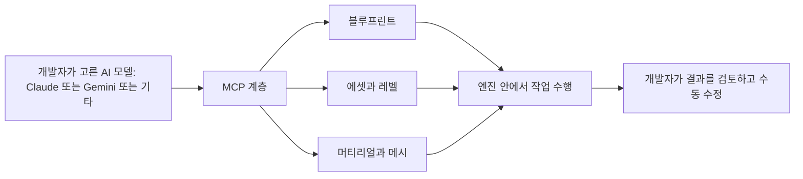
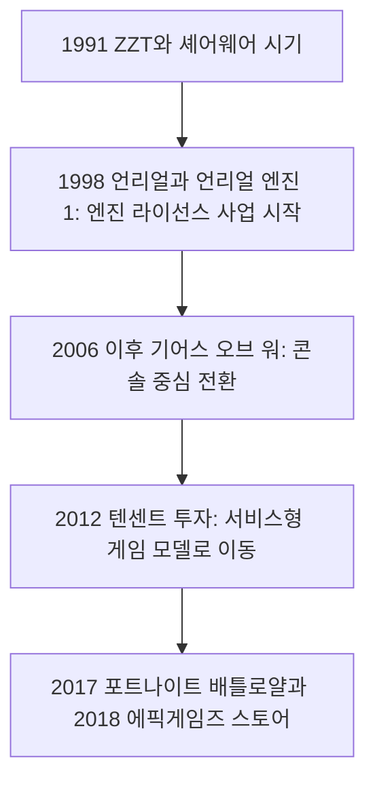
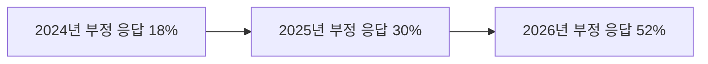
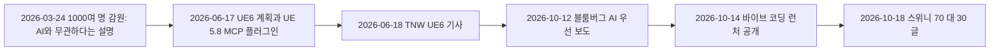

- 작성 일자: 2026-10-19
- 대상 기사: The Next Web "Epic is building Claude and Gemini into Unreal Engine 6, whether developers like it or not" (2026-06-18, 글쓴이 Darius Popa)
- 문서 구성: 기사 내용 풀이, Epic Games라는 회사, 글쓴이와 매체, 업계 반응, 최근 사건과의 연결
- 관련 문서: 앞서 작성한 "팀 스위니 70/30 발언 해설", "에픽 바이브 코딩 런처와 Linux용 포트나이트 해설"의 배경편

---

## 0. 이 문서를 읽기 전에: 확인한 것과 확인하지 못한 것

이 문서는 "막연한 추측 없이 확인된 사실만 쓴다"는 원칙으로 작성했습니다. 사용자께서 제공하신 기사 전문을 기준으로 하되, 다음 자료를 직접 열어 대조했습니다.

- 에픽이 직접 쓴 UE6 로드맵 글(The road to Unreal Engine 6)
- GDC가 공개한 2026 State of the Game Industry 보고서 요약
- 에픽게임즈 개요(위키백과)
- The Next Web의 글쓴이 프로필 페이지와 소개 페이지, 그리고 TNW 인수 관련 보도

본문의 "해석"은 사실이 아니라 제 의견이며, 표시가 없는 서술은 출처가 있는 사실입니다. 출처는 맨 끝에 모아 두었습니다. 한 가지 제한이 있습니다. TNW 폐쇄 보도를 다룬 Sifted 기사는 열람에 실패해 읽지 못했고, 같은 사안은 다른 보도를 통해서만 확인했습니다.

---

## 1. 한눈에 보기

2026년 6월 17일(수) 에픽게임즈는 미국 시카고에서 열린 언리얼 페스트의 기조연설 "State of Unreal"에서 차세대 엔진 언리얼 엔진 6(UE6)의 계획을 공개했습니다. 핵심은 세 가지입니다. 새 게임플레이 프로그래밍 모델 Verse, 콘텐츠와 코드의 이식성, 그리고 모델 컨텍스트 프로토콜(MCP)을 통해 Claude, Gemini 같은 AI 모델을 엔진에 연결하는 구조입니다.

The Next Web은 이 소식을 "개발자가 원하든 원하지 않든"이라는 제목으로 보도하며, 게임 개발자의 절반 이상이 생성형 AI를 부정적으로 본다는 설문 결과를 나란히 놓았습니다. 이 대비가 기사의 뼈대입니다. 엔진을 만드는 회사는 AI를 기본 부품으로 넣으려 하는데, 엔진을 쓰는 사람들은 불안해한다는 구도입니다.

이 기사는 약 4개월 뒤의 사건들과 이어서 읽을 때 의미가 커집니다. 10월 12일 에픽이 디즈니 협업 게임 개발팀에 "AI 우선" 방식을 지시했다는 블룸버그 보도가 나왔고, 10월 14일 "바이브 코딩" 런처가 공개되었으며, 10월 18일 스위니가 AI 코딩에 대한 장문의 글을 올렸습니다. 6월의 UE6 발표는 이 흐름의 출발점에 해당합니다.

---

## 2. 기사 내용을 풀어 읽기

### 2.1 무엇이 발표되었나

기사에 따르면 에픽은 UE6에 Anthropic의 Claude와 Google의 Gemini 같은 모델 연동을 넣고, 이를 "창의성과 생산성의 배가 장치"로 소개했습니다. 취지는 게임 제작의 "지루한 작업(tedious work)"을 모델에 넘기고 팀이 창작적 결정에 시간을 쓰게 하겠다는 것입니다.

UE6는 세 개의 축으로 설명되었고, 에픽 개발팀을 이끄는 마커스 와스머(Marcus Wassmer)가 발표했습니다.

| 축 | 기사의 설명 | 에픽 공식 글에서 확인한 보충 |
|---|---|---|
| 1. 프로그래밍 모델 | 새 게임플레이 모델 Verse, Python이나 C#을 써 본 사람에게 익숙하게 느껴질 언어 | Verse 위에 새 게임플레이 프레임워크 Scene Graph를 처음부터 구축. 모든 함수를 트랜잭션으로 실행하고 여러 서버에 자동 분산하는 것이 목표 |
| 2. 이식성 | 열린 표준으로 콘텐츠와 코드를 다른 게임과 엔진으로 옮길 수 있게 함 | glTF와 USD 같은 개방 표준을 1급 형식으로 지원. 첫 사례는 포트나이트 코스메틱 |
| 3. AI | MCP 계층으로 엔진을 노출해 원하는 모델을 골라 쓰게 함 | 레벨 구성, 캐릭터 리그, 파티클, 스키닝, 라이팅 같은 반복 수작업 감소가 목표 |

### 2.2 이미 나온 첫 버전: UE 5.8의 실험적 MCP 플러그인

기사는 같은 날 출시된 언리얼 엔진 5.8에 실험적 MCP 플러그인이 들어 있다고 전합니다. 이 플러그인은 임의의 LLM을 블루프린트, 에셋, 레벨, 머티리얼, 메시 같은 엔진 핵심 시스템에 연결해 줍니다. 시연에서 Claude Code는 에셋 라이브러리의 오브젝트로 가상 아파트를 꾸미고, 실제 참고 사진에 맞춰 도시 장면의 조명을 조정했다고 합니다. 이후 개발자가 모든 것을 손으로 다시 옮길 수 있다는 설명도 붙었습니다.

MCP는 AI 모델이 외부 소프트웨어와 데이터에 연결되는 방식을 표준화한 개방형 규약입니다. 그래서 기사의 표현대로 "특정 모델에 묶이지 않고 섞어 쓸 수 있는" 구조가 가능해집니다. 와스머는 "UE6는 자신이 선호하는 모델을 가져와 쓰는 도구와 워크플로를 갖추고 출시될 것"이라고 썼습니다.

### 2.3 일정

기사와 에픽 공식 글이 일치합니다. UE6 얼리 액세스는 2027년 말이 목표이고, 정식 출시는 그 뒤 12~18개월입니다. 에픽 공식 글에 따르면 UE5와 UEFN(Unreal Editor for Fortnite)을 하나로 합치는 작업에 약 2년이 걸리며, UE6 개발 스트림이 GitHub에 공개되어 있지만 알파 버전은 아닙니다. 또 5.8 이후의 공식 UE5 릴리스 계획은 없으나 필요하면 5.9를 낼 여지를 남겼습니다.

### 2.4 "진짜 변화는 엔진이 누구에게 의존하느냐"

기사는 이번 발표의 본질을 "AI가 언리얼에 들어왔다"가 아니라 "제3자 모델이 게임 제작 방식의 상시 부품이 된다"는 점이라고 짚습니다. 포트나이트부터 엔진을 라이선스하는 수많은 스튜디오까지, 업계의 상당 부분이 쓰는 도구 안에 외부 AI 업체의 모델이 자리 잡는다는 뜻입니다.

해석: 이 평가는 기사 필자의 관점이며, 에픽 공식 글은 오히려 "선택형 도구이고 모델은 개발자가 고른다"는 점을 강조합니다. 두 설명은 모순이 아니라 같은 사실의 다른 면입니다. 엔진 차원에서는 특정 업체에 묶이지 않도록 열어 두었지만, 개발 관행 차원에서는 AI 모델이 표준 작업 도구가 되는 것이기 때문입니다.

---

## 3. 에픽게임즈는 어떤 회사인가

### 3.1 연혁

에픽게임즈는 1991년 팀 스위니가 미국 메릴랜드주 포토맥의 부모님 집에서 Potomac Computer Systems라는 이름으로 세웠습니다. 첫 상업 게임 『ZZT』가 예상보다 잘 팔리면서 게임 회사로 방향을 잡았고, 1992년 초 Epic MegaGames로 이름을 바꾸었으며 마크 레인(Mark Rein)이 합류했습니다. 1999년 본사를 노스캐롤라이나주 캐리(Cary)로 옮기며 현재의 사명 Epic Games가 되었습니다.

이후 흐름은 크게 네 단계로 정리됩니다.

### 3.2 세 개의 사업 축

에픽의 사업은 세 축으로 이해하면 쉽습니다.

- **언리얼 엔진:** 외부에 라이선스되는 게임 엔진입니다. 2015년부터 무료로 배포되었고 로열티 5%를 받는 구조였으며, 이후 일정 매출까지 로열티를 면제하는 정책이 도입되었습니다. 게임뿐 아니라 영상 제작에도 쓰입니다.
- **포트나이트:** 2017년 배틀로얄 모드 출시 후 큰 성공을 거둔 서비스형 게임이자, 에픽의 핵심 수익원이면서 일종의 플랫폼입니다. UEFN으로 외부 제작자가 포트나이트 안에서 콘텐츠를 만들 수 있습니다.
- **에픽게임즈 스토어:** 2018년 출시된 PC 게임 상점으로, 수수료 12%를 내세워 Steam(30%)에 맞서 왔습니다.

이 세 축이 서로 맞물립니다. 엔진 수익과 포트나이트 수익이 다른 사업의 기술과 자금을 뒷받침하는 구조입니다. UE6가 UE5와 UEFN을 하나의 제품으로 합치는 것은 이 연결을 제품 구조에 그대로 반영하는 일입니다.

### 3.3 소유 구조

위키백과의 에픽게임즈 항목 기준으로, 주요 주주는 다음과 같습니다. 이 표는 해당 항목의 표기이며 최신 지분 변동은 반영되지 않았을 수 있습니다.

| 주주 | 지분 |
|---|---|
| 팀 스위니(창업자, CEO) | 41.4% |
| 텐센트 | 28% |
| 월트 디즈니 컴퍼니 | 9% |
| 소니 | 5.4% |
| 마크 레인 | 4% |
| 키르비(레고 모회사) | 3.2% |

스위니가 여전히 최대 주주입니다. 텐센트는 2012년 약 3억 3천만 달러에 지분을 얻었습니다. 디즈니는 2024년 2월 약 15억 달러를 투자하기로 했고, 두 회사는 게임 공동 개발과 디즈니 지식재산의 포트나이트 도입에 합의했습니다. 2026년 보도에 따르면 디즈니 캐릭터를 쓰는 익스트랙션 슈터도 개발 중입니다. 10월 블룸버그 보도에서 AI 우선 방식이 지시된 것은 디즈니와 협업하는 미발표 슈팅 게임이며, 이 두 보도가 같은 프로젝트를 가리키는지는 제가 확인한 자료만으로 단정할 수 없습니다.

### 3.4 굵직한 분쟁과 사건

- **Apple 소송:** 2020년 8월 포트나이트가 Apple 결제를 우회하는 할인을 도입해 앱스토어에서 퇴출되자, 에픽은 Apple과 Google을 반독점 혐의로 제소했습니다. 2021년 1심은 대부분 Apple의 승리였지만 외부 결제 유도 제한 쟁점에서는 에픽이 이겼고, 2025년 4월 법원은 Apple의 후속 조치가 불충분하다고 판단했습니다. 이후 에픽게임즈 스토어가 iOS에 다시 들어왔습니다.
- **Google 소송:** 2023년 12월 배심원단이 Google의 독점 행위를 인정했습니다.
- **FTC 제재:** 2022년 12월 어린이 개인정보 보호법 위반과 다크 패턴 관련 제재가 합쳐져 총 5억 2천만 달러가 부과되었습니다.
- **감원:** 2023년 9월 약 870명, 2026년 3월 1,000명 이상을 감원했습니다. 2026년 감원은 포트나이트 참여도 하락으로 회사가 버는 것보다 훨씬 많이 쓰고 있었기 때문이며, 스위니는 직원 공지에서 "감원은 AI와 무관하다"고 밝혔습니다. 계약직, 마케팅, 미충원 포지션 축소를 합친 절감액은 5억 달러가 넘는다고 했습니다.

현재 직원 수는 정확히 확인하지 못했습니다. 위키백과 요약은 2023년 감원 후 4,000명 이상이었다고 하고 2026년 감원 후의 정확한 인원은 따로 확인되지 않아, 이 문서에서는 수치를 단정하지 않겠습니다.

### 3.5 스위니라는 사람

창업자 팀 스위니는 지금도 회사의 최대 주주이자 CEO이며, 엔진의 초기 버전을 직접 쓴 프로그래머이기도 합니다. 앞선 문서에서 다뤘듯 언리얼 엔진 1 코드의 대부분을 직접 작성했다는 것이 여러 인터뷰에서 확인됩니다. 즉 이 회사는 기술 창업자가 지배 주주로 남아 방향을 직접 정하는 보기 드문 구조이고, 그래서 6월의 UE6 발표부터 10월의 70/30 글까지 AI 전환이 일관된 메시지로 나오는 것을 이해할 수 있습니다.

---

## 4. 업계 반응: 설문 숫자는 어디까지 믿을 수 있나

기사는 GDC 2026 State of the Game Industry 설문을 인용해, 응답자 2,300여 명 중 52%가 생성형 AI가 업계에 부정적 영향을 준다고 답했고 이는 2025년 30%, 2024년 18%에서 급증한 것이라고 전합니다. 긍정적이라는 응답은 7%였습니다.

GDC의 공개 요약을 직접 열어 확인한 결과, 기사의 수치는 정확히 일치합니다. 추가로 확인된 내용도 있습니다. 긍정 응답은 2025년 보고서의 13%에서 7%로 줄었고, 직군별 부정 응답은 시각·기술 아트 64%, 게임 디자인·내러티브 63%, 게임 프로그래밍 59%였습니다. 같은 보고서에서 응답자의 28%가 최근 2년 안에 해고를 겪었고, AAA 스튜디오 종사자의 3분의 2가 소속 회사의 감원을 경험했다고 합니다.

이 숫자를 읽을 때 주의할 점이 있습니다. 설문은 업계 종사자 중 응답한 사람의 의견이며 모든 개발자를 대표하지 않습니다. 또 "생성형 AI가 업계에 부정적"이라는 응답은 엔진에 AI 연동 도구를 넣는 것에 대한 직접 질문이 아니므로, 기사가 두 사실을 나란히 놓은 것은 맥락 제공이지 인과 증명이 아닙니다. 해석하자면 부정 응답이 가장 많은 직군이 시각·기술 아트와 디자인이라는 점은, AI 도구가 콘텐츠 생산 영역에서 사람의 일을 대체할 수 있다는 우려가 반영된 것으로 보이지만, 이는 설문 요약만으로 확정할 수 없는 부분입니다.

기사는 두 가지 사례도 전합니다. 『뱀파이어 서바이버즈』 개발사 Poncle이 생성형 AI 발표 뒤 포트나이트와의 협업을 "검토 중"이라고 밝혔다는 점, 그리고 스위니가 지난해 11월 "AI가 앞으로 거의 모든 제작에 관여할 것이므로 게임 상점의 'AI 사용' 태그는 말이 되지 않는다"고 주장했다는 점입니다. 이 두 건은 기사 인용이며 저는 원 발언을 별도로 확인하지 못했습니다.

---

## 5. 글쓴이와 매체: 이 기사를 어떻게 읽어야 하나

### 5.1 글쓴이 Darius Popa

기사 하단에 표기된 글쓴이는 Darius Popa입니다. The Next Web의 글쓴이 프로필 페이지에는 자신을 "기술 애호가이자 The Next Web의 인턴"이라고 소개하고 있으며, 리서치 기반 콘텐츠를 쓰고 신기술과 국제 이슈를 조사한다고 적혀 있습니다. 기술이 비즈니스 안에서 어떤 서사와 인식으로 형성되는지에 관심이 있다고도 밝혔습니다.

프로필에 표시된 최근 기사는 전기차 판매와 충전 인프라, 소니 워크맨과 아마존의 웨어러블 같은 가전, 클라우드 게임과 가정용 콘솔 시장 전망, 기업용 Firefox, 테슬라 로보택시, 프랑스 슈퍼마켓 냉장 설비 해킹 등 폭넓은 주제를 포함합니다. 이 문서의 대상 기사 외에도, 앞선 문서에서 다룬 10월 16일자 에픽 런처 기사 역시 같은 글쓴이의 기사로 표기되어 있었습니다. 즉 에픽의 AI 전환을 반복해서 다루고 있는 필자입니다.

제가 확인한 범위는 여기까지입니다. 이 필자의 학력, 경력, 개인적 입장은 TNW 프로필 외의 자료에서 확인하지 못했고, 추측하지 않겠습니다.

### 5.2 독자가 알아 둘 점

필자의 직함이 인턴이라는 사실이 기사의 신뢰도를 곧바로 낮추는 것은 아닙니다. 기사의 사실 주장은 아래처럼 1차 자료와 대조해 검증할 수 있고, 실제로 대조 결과 주요 수치와 일정은 일치했습니다.

| 기사의 주장 | 대조한 자료 | 결과 |
|---|---|---|
| UE6에 Claude와 Gemini 등 연동, MCP 계층, 세 개의 축 | 에픽 공식 UE6 로드맵 글 | 일치 |
| 얼리 액세스 2027년 말, 정식 출시는 12~18개월 뒤 | 에픽 공식 UE6 로드맵 글 | 일치 |
| 부정 52%, 2025년 30%, 2024년 18%, 긍정 7% | GDC 공개 요약 | 일치 |
| 3월 1,000명 이상 감원, 포트나이트 참여도 둔화가 배경 | BNN Bloomberg 등 앞선 문서의 보도 | 일치 |
| Claude Code 시연 내용 | 에픽 공식 글에서 별도 확인하지 못함 | 기사 단독 서술 |
| Poncle의 협업 "검토 중" | 별도 확인하지 못함 | 기사 단독 서술 |
| 스위니의 지난해 11월 AI 태그 발언 | 별도 확인하지 못함 | 기사 단독 서술 |

또 이 기사는 기조연설과 에픽 공개 자료, 설문 보고서를 엮어 쓴 정리형 기사로 읽힙니다. 필자가 에픽 관계자를 직접 인터뷰했다는 표시는 없습니다. 제목의 "개발자가 원하든 원하지 않든"과 "개발자의 절반 이상이 나쁜 생각이라고 본다"는 부제는 필자와 매체의 해석이 들어간 표현이므로, 사실 서술과 구분해서 읽는 것이 좋습니다. 특히 부제의 "나쁜 생각이라고 본다"는 설문이 실제로 묻는 "생성형 AI가 업계에 부정적 영향을 준다고 보는가"와 정확히 같은 문장이 아닙니다.

### 5.3 The Next Web이라는 매체

TNW는 네덜란드 암스테르담에서 시작된 기술 매체이자 행사 브랜드입니다. 소개 페이지에는 "The heart of tech"라는 문구가 있고 Media, Events, Spaces, Programs의 네 영역이 제시되며, 푸터에 "A Tekpon Company"라고 표기되어 있습니다.

소유 구조는 최근 바뀌었습니다. 루마니아 경제 매체 보도에 따르면 파이낸셜 타임스(FT)는 2025년 9월 TNW의 미디어와 행사 사업을 폐쇄하기로 결정했고, 이후 루마니아 사업가 알렉산드루 스탄(Alexandru Stan)이 이 사업의 100%를 인수했다는 소식이 2025년 12월 9일 보도되었습니다. 인수자는 SaaS 마켓플레이스 Tekpon의 공동창업자이자 CEO이며, 거래 금액은 공개되지 않았습니다. 인수 대상에는 웹사이트, 브랜드, 소셜 미디어 계정, 약 3,000명의 기고자가 포함되었다고 합니다. 이 보도는 영국 기자 마이크 부처(Mike Butcher)의 사이트가 먼저 전한 것으로 인용되었습니다. 이 인수 보도는 한 매체를 통해서만 확인했다는 한계가 있습니다.

해석: 독자에게 의미 있는 사실은 "TNW는 2025년 소유주가 바뀐 뒤 운영되고 있는 매체이며, 인턴을 포함한 소규모 편집 인력이 기술 뉴스를 대량으로 정리해 내는 구조일 수 있다"는 정도입니다. 다만 이 구조가 기사 품질에 어떤 영향을 주는지는 제가 확인한 자료로는 판단할 수 없습니다. 중요한 주장은 이 문서처럼 1차 자료와 대조해서 읽는 것이 안전합니다.

---

## 6. 6월에서 10월까지: 하나의 흐름으로 보기

이 순서를 놓고 사실로 말할 수 있는 것은, 에픽이 3월에는 감원이 AI와 무관하다고 선을 그었고, 6월에는 엔진에 AI 연동을 넣겠다고 공개했으며, 10월에는 내부 개발 방식과 자사 제품 개발에서 AI를 전면에 내세웠다는 점입니다. 세 단계가 시간 순서대로 이어집니다.

해석: 이를 에픽의 사전 계획이 3월부터 있었다는 증거로 읽을 수는 없습니다. 공개된 자료로 확인되는 것은 공개 시점의 순서일 뿐, 내부 의사결정 순서는 알 수 없기 때문입니다. 다만 6월 발표 시점에 에픽이 이미 내부에서 코드 인덱싱, 크래시 원인 분석, 테스트 생성에 코드 생성 도구를 쓰고 있다고 공식 글에서 밝혔다는 점은 확인됩니다. 10월의 AI 우선 지시는 이 내부 활용이 한 단계 넓어진 것으로 볼 수 있습니다.

---

## 7. 용어 해설

**언리얼 엔진(UE)**: 에픽이 만들어 라이선스하는 게임 엔진입니다. 숫자는 세대를 뜻하며 현재 UE5가 쓰이고 UE6가 개발 중입니다.

**UEFN(Unreal Editor for Fortnite)**: 포트나이트 안에서 돌아가는 콘텐츠를 만드는 에디터입니다. UE6는 UE5와 UEFN을 한 제품으로 합칩니다.

**Verse**: 에픽이 만든 프로그래밍 언어입니다. 모든 함수를 트랜잭션으로 실행하고 여러 서버에 분산하는 모델을 지향합니다. 에픽은 아직 일반 사용을 목적으로 한 단계는 아니라고 밝혔습니다.

**Scene Graph**: Verse 위에 새로 짓는 게임플레이 프레임워크입니다. 초기 UE6에는 기존 Actor와 블루프린트가 함께 들어가고, 새 프레임워크가 성숙하면 이전 방식은 단계적으로 폐기됩니다.

**MCP(Model Context Protocol)**: AI 모델이 외부 도구와 데이터에 연결되는 방식을 표준화한 개방형 규약입니다.

**블루프린트**: 언리얼 엔진의 시각적 스크립팅 시스템입니다.

**glTF와 USD**: 3D 에셋을 주고받기 위한 개방형 파일 형식입니다. 에픽은 이를 UE6의 1급 형식으로 지원하겠다고 밝혔습니다.

**GDC 설문**: 게임 개발자 콘퍼런스(GDC)가 매년 업계 종사자를 대상으로 하는 State of the Game Industry 조사입니다.

---

## 8. 확인된 사실과 확인하지 못한 사항

**확인한 사실**
- UE6의 세 축(Verse 기반 프로그래밍 모델, 이식성, MCP를 통한 AI 연동)과 얼리 액세스 2027년 말, 정식 출시 12~18개월 뒤라는 일정(에픽 공식 글)
- UE5와 UEFN을 하나로 통합하는 방향과 Scene Graph, 포트나이트 코스메틱 이식성 계획(에픽 공식 글)
- GDC 설문의 부정 응답 52%(2025년 30%, 2024년 18%), 긍정 약 7%(2025년 13%)
- 에픽게임즈의 설립 연도와 연혁, 주요 제품, 위키백과 표기 기준 소유 구조, 주요 소송과 감원 이력
- TNW 글쓴이 프로필의 소개 내용, TNW 소개 페이지의 "A Tekpon Company" 표기

**확인하지 못했거나 제한이 있는 사항**
- 기조연설의 Claude Code 시연 세부 내용, Poncle의 입장, 스위니의 지난해 11월 발언은 기사 외 자료로 확인하지 못했습니다.
- 위키백과 기반 소유 구조 표는 최신 변동을 반영하지 않았을 수 있습니다. 현재 직원 수도 확인하지 못했습니다.
- TNW의 폐쇄 결정과 인수 소식은 한 경제 매체의 보도를 통해서만 확인했고, Sifted 기사는 열람하지 못했습니다.
- 글쓴이에 대해서는 TNW 프로필에 적힌 소개와 표시된 기사 목록까지만 확인했으며, 그 밖의 경력이나 입장은 알 수 없습니다.
- UE6 출시 이후 실제 개발자 반응이나 채택 현황은 아직 확인할 수 없습니다.

---

## 9. 출처

- The Next Web, UE6와 AI 기사(대상 기사): https://thenextweb.com/news/epic-unreal-engine-6-ai-claude-gemini
- 에픽게임즈, The road to Unreal Engine 6: https://www.unrealengine.com/news/the-road-to-ue-6
- 에픽게임즈, State of Unreal 2026 주요 소식: https://www.unrealengine.com/news/state-of-unreal-2026-top-news-from-the-show
- GDC, 2026 State of the Game Industry: https://gdconf.com/article/gdc-2026-state-of-the-game-industry-reveals-impact-of-layoffs-generative-ai-and-more/
- 위키백과, Epic Games: https://en.wikipedia.org/wiki/Epic_Games
- The Next Web, 글쓴이 Darius Popa 프로필: https://thenextweb.com/author/darius-popa
- The Next Web, 소개 페이지: https://thenextweb.com/about
- Economedia, TNW 인수 보도: https://economedia.ro/alexandru-stan-omul-de-afaceri-roman-care-detine-tekpon-preia-publicatia-olandeza-the-next-web-si-conferinta-anuala-cu-acelasi-nume-de-la-grupul-media-britanic-financial-times.html
- BNN Bloomberg, 2026년 3월 감원: https://www.bnnbloomberg.ca/business/2026/03/24/epic-games-to-cut-more-than-1000-jobs-as-fortnite-usage-falls
- The Next Web, 런처 기사: https://thenextweb.com/news/epic-games-launcher-vibe-coded-ai-pivot-fortnite-linux
- Game Developer, 디즈니 프로젝트 AI 우선 보도: https://www.gamedeveloper.com/programming/no-more-hand-written-code-epic-s-disney-project-reportedly-shifts-to-ai-first-development

---

작성 일자: 2026-10-19
