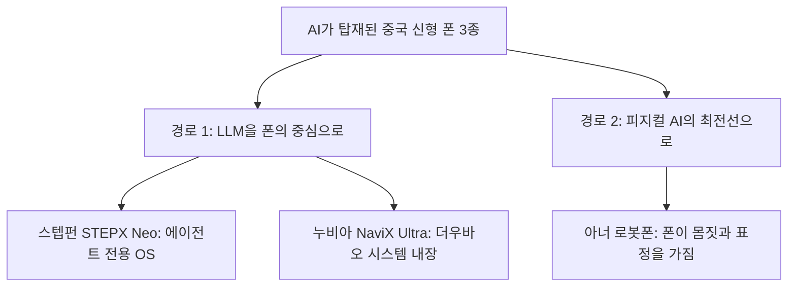
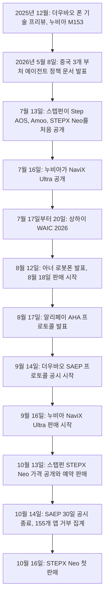
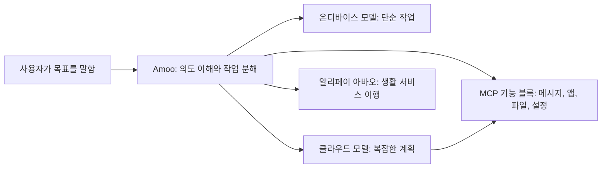
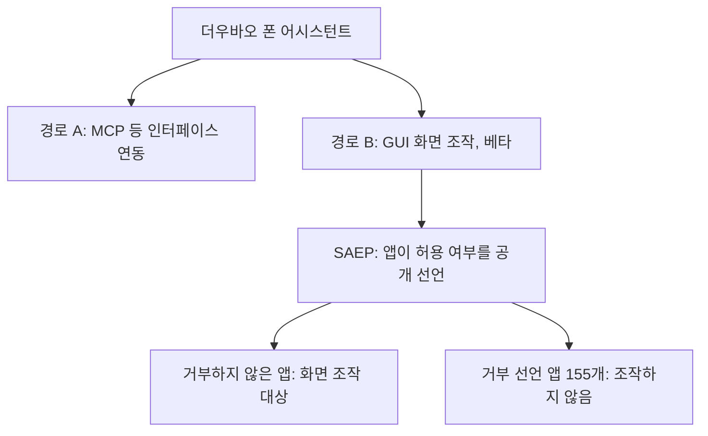
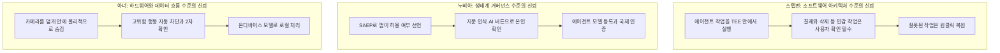
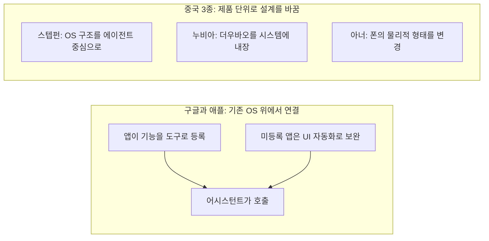

- 대상 글: 임선영 작가의 #중국AI미래지도 연재 글 "에이전트폰의 세대교체, AI와 피지컬 AI의 경계에서 진정한 비서로 탈바꿈한 중국 모바일폰"
- 작성 기준일: 2026-10-19
- 작성 방식: 원문 본문을 먼저 정리한 뒤, 원문이 말하는 사실 하나하나를 최신 보도·공식 자료로 다시 확인했습니다. 확인된 것, 회사가 주장하는 것, 근거를 찾지 못한 것을 구분해서 적었습니다.

---

## 0. 이 문서를 읽는 법

이 문서는 원문이 "무엇을 말하는 글인지"를 아주 자세히 풀어 쓰고, 그 내용이 지금(2026년 10월 19일) 기준으로 얼마나 정확한지 점검한 결과를 함께 담았습니다. 문장 끝이나 문단 안에 다음 네 가지 표시를 붙였습니다.

- **[확인]**: 서로 다른 복수의 보도나 공식 자료에서 같은 내용이 확인된 사실입니다.
- **[기업 발표]**: 회사가 직접 밝힌 수치나 주장입니다. 보도는 있지만 독립적인 검증은 하지 못했습니다.
- **[미확인]**: 이번 검색에서 뒷받침하는 근거를 찾지 못한 내용입니다. 틀렸다는 뜻이 아니라, 확인하지 못했다는 뜻입니다.
- **[원문 해석]**: 원문 필자의 해석이나 의견입니다. 사실과 구분해서 읽으시기 바랍니다.

원문 가운데 확인 결과가 원문과 달랐던 부분은 본문에서 "정정 포인트"로 따로 표시했고, 마지막 12장에 한 표로 모아 두었습니다.

---

## 1. 한눈에 보기

원문의 핵심 주장은 한 문장으로 줄이면 이렇습니다. "2026년 하반기에 중국에서 정식 출시된 AI 핸드폰 세 종이 겉보기에는 모두 'AI 탑재 폰'이지만, 사실은 서로 다른 두 갈래의 진화 경로를 대표한다."

첫 번째 갈래는 대형 언어 모델(LLM)을 폰의 새로운 두뇌이자 운영체제의 중심으로 삼는 길입니다. 스텝펀(StepFun)의 STEPX Neo와 누비아(Nubia)의 NaviX Ultra가 여기에 속합니다. 두 번째 갈래는 AI에게 물리적인 몸을 주고 핸드폰을 피지컬 AI의 최전선에 두는 길입니다. 아너(Honor)의 로봇폰이 여기에 속합니다.

원문은 이 두 갈래가 폰으로 하려는 일뿐 아니라 개인정보 보안을 다루는 방식도 서로 다르다고 설명합니다. 스텝펀은 소프트웨어 구조로, 누비아는 생태계 규칙으로, 아너는 하드웨어와 데이터 흐름으로 신뢰를 만들려 한다는 것입니다. 그리고 구글과 애플이 "폰은 폰, 에이전트는 에이전트"라는 분리 구조를 유지하는 것과 달리, 중국은 폰 자체를 에이전트로 다시 설계하고 있다고 비교합니다.

그런데 원문은 한 가지를 분명히 해 둡니다. 세 회사가 같은 행사(상하이 세계인공지능대회, WAIC)에서 동시에 '세계 최초'를 외칠 수 있었다는 것은 이 시장에 아직 표준이 없다는 뜻이라는 점입니다. 이 문서를 읽으실 때도 "최초"라는 표현은 각 회사의 마케팅 문구로 받아들이시는 편이 안전합니다.

---

## 2. 에이전트폰이 무엇인지부터 쉽게 풀어 보기

원문을 이해하려면 "에이전트폰"이라는 말부터 정리해야 합니다.

우리가 지금 쓰는 스마트폰의 기본 단위는 **앱**입니다. 택시를 부르려면 택시 앱을 열고, 목적지를 입력하고, 차종을 고르고, 결제 수단을 확인합니다. 사람이 앱 하나하나를 직접 열어서 손가락으로 조작합니다. AI 비서가 있더라도 대부분은 "질문에 답해 주는 존재"에 가깝습니다.

에이전트폰은 이 관계를 뒤집으려는 시도입니다. 사용자는 "강남역 가는 택시 불러 줘"라고 목표만 말하고, 폰 안의 에이전트가 앱을 대신 열고 입력하고 선택하고 결제 단계까지 이어서 처리합니다. 즉 사람이 도구(앱)를 조작하던 구조에서, 사람은 목표만 말하고 에이전트가 도구를 조작하는 구조로 바뀌는 것입니다. 스텝펀이 출시 행사에서 "에이전트 시대에 AI는 스마트폰의 부가 기능이 아니라 제품 그 자체"라고 말한 것도 같은 맥락입니다. [확인]

여기서 바로 어려운 문제가 생깁니다. 에이전트가 다른 회사의 앱을 대신 조작하려면 그 앱이 허락해야 합니다. 앱을 만든 회사 입장에서는 자기 앱의 화면과 데이터를 남의 AI가 마음대로 쓰는 것이 달갑지 않습니다. 에이전트가 앱 사이에 끼어들면 사용자와 앱의 접점, 곧 광고와 거래 수익의 길목을 빼앗길 수 있기 때문입니다. 원문이 누비아의 1세대 폰이 위챗·알리페이·메이투안 같은 앱들에게 집단으로 차단당했다고 쓴 것은 바로 이 갈등을 가리킵니다. 이 갈등을 세 회사가 각각 어떻게 풀려고 하는지가 이 글의 줄기입니다.

앱을 조작하는 방식은 크게 두 가지로 나눌 수 있습니다.

첫째는 **화면 조작(GUI 에이전트) 방식**입니다. 에이전트가 사람처럼 화면을 보고, 버튼 위치를 찾고, 손가락 대신 가상의 터치를 흉내 냅니다. 앱이 별도로 협조하지 않아도 되지만, 앱 입장에서는 통제 불가능한 접근이라 차단당하기 쉽고 속도와 안정성도 떨어집니다.

둘째는 **프로토콜(인터페이스) 연동 방식**입니다. 앱이나 서비스가 "이 기능은 에이전트가 이런 형식으로 불러 쓰세요"라고 정해진 창구를 열어 주고, 에이전트가 그 창구로 직접 요청합니다. 빠르고 안정적이지만 앱이 자발적으로 창구를 열어 주어야 합니다. 여기서 자주 나오는 이름이 MCP(Model Context Protocol)입니다. MCP는 AI가 외부 도구와 서비스에 연결되는 방식을 표준화한 규약입니다.

원문에 나오는 세 제품은 이 두 방식 사이에서 서로 다른 지점을 선택했다고 이해하시면 됩니다.

---

## 3. 2026년 하반기 사건의 흐름

원문은 "WAIC의 발표가 두 달 만에 현실이 되다"라는 소제목으로 시작합니다. 실제 날짜를 확인해 보면 원문의 큰 흐름은 맞습니다. 사건들을 시간 순서로 놓으면 다음과 같습니다.

몇 가지를 짚어 둡니다.

**출시 순서는 원문과 일치합니다.** 8월 아너, 9월 누비아, 10월 스텝펀 순서입니다. [확인] 다만 "정식 출시"의 의미는 제품마다 조금 다릅니다. 아너는 8월 12일에 가격을 공개하고 예약을 열었으며 8월 18일에 판매를 시작했습니다. 누비아는 9월 16일에 발표와 판매를 같은 날 진행했습니다. 스텝펀은 7월 13일에 시스템과 폰을 처음 보여 주면서 가격과 판매일은 밝히지 않았고, 10월 13일 저녁에 가격을 공개하며 예약 판매를 시작해 10월 16일에 첫 판매를 했습니다. [확인]

**누비아의 2세대는 1세대 이후의 두 번째 시도입니다.** 2025년 12월에 ZTE 누비아와 바이트댄스가 더우바오 폰 기술 프리뷰(엔지니어링 시제품 M153)를 내놓았습니다. 당시 가격은 3,499위안이었고 첫 3만 대가 발매 당일 매진되었다는 보도가 있습니다. [확인] 이 1세대가 위챗, 알리페이 등 주요 앱의 제한을 받았다는 점은 케이신(Caixin) 보도에서도 확인됩니다. [확인]

**세 회사가 WAIC에서 각자 '세계 최초'를 주장한 부분은 실제 보도와 맞아떨어집니다.** 스텝펀은 7월 13일에 STEPX Neo를 "세계 최초의 에이전트 네이티브 스마트폰"이라고 소개했고, 누비아는 7월 16일에 NaviX Ultra를 "세계 최초의 AI 에이전트폰"이라고 소개했으며, 아너는 "세계 최초의 로봇폰"이라는 표현을 썼습니다. [확인] 각자 다른 기준으로 '최초'를 붙인 것이어서, 원문의 "표준이 없다"는 진단은 합리적입니다.

---

## 4. 제품 1 — 스텝펀 STEPX Neo: LLM을 위해 다시 만든 OS

### 4.1 스텝펀은 어떤 회사인가

스텝펀은 2023년 상하이에서 마이크로소프트 출신 장다신(Jiang Daxin, 姜大昕)이 세운 AI 모델 회사이며, 폰 제조사가 아닙니다. 장다신은 현재 CEO입니다. [확인] 원문이 "스텝펀 회장 인치(Yin Qi)"라고 쓴 인물은 얼굴인식 기업 메그비(Megvii)의 공동창업자이자 전 CEO인 인치(印奇)로, 2026년 1월 26일 약 50억 위안 규모의 B+ 라운드 마감과 함께 스텝펀 회장으로 선임되었습니다. 그는 지리(Geely) 계열의 스마트 드라이빙 기업 치엔리 테크놀로지(Qianli Technology)의 회장도 맡고 있습니다. [확인] 그러니 원문의 인물 표기는 정확합니다.

### 4.2 Step AOS: "방문객이 아니라 원주민으로"

원문은 인치 회장의 비유를 소개합니다. 기존 시스템에 에이전트용 문을 하나 열어 주면 에이전트는 영원히 방문객에 머물고, 전용 실행 환경을 지어 줘야 비로소 원주민이 된다는 말입니다. 이 비유는 원문이 인용한 발언이며, 이번 검색에서 인치 회장의 이 표현 자체를 따로 찾지는 못했습니다. [미확인]

다만 취지는 스텝펀의 공식 설명과 겹칩니다. 스텝펀은 기존 시스템에 AI를 얹은 것이 아니라 에이전트를 위해 Step AOS 1.0을 처음부터 설계했고, 장기 기억, 작업 스케줄링, 보안 통제를 시스템 하부 계층에 넣었다고 밝혔습니다. [기업 발표]

**정정 포인트 (표현의 정밀도).** 원문은 "기존 안드로이드 위에 AI를 얹지 않고 새로 만들었다"고 쓰는데, 복수의 보도에 따르면 스텝펀 스스로 Step AOS 1.0을 안드로이드, 리눅스, 실시간 운영체제(RTOS) 구성요소를 혼합한 시스템이라고 설명합니다. [확인] 즉 "안드로이드를 전혀 쓰지 않는 완전히 새로운 OS"라기보다 "에이전트를 중심에 두고 구조를 다시 짠 혼합형 OS"로 읽는 것이 정확합니다. 이것은 폄하가 아니라 정확성의 문제입니다.

Step AOS의 구조를 원문과 보도를 합쳐서 풀어 보면 다음과 같습니다.

**1) 기능을 블록으로 쪼갠다.** 메시지, 앱, 파일, 설정 같은 폰의 기능을 에이전트가 직접 부를 수 있는 작은 블록으로 나누고, 이를 MCP로 호출하게 했습니다. [확인] 그래서 사용자가 앱을 열 필요 없이 목표만 말하면 됩니다. 택시를 부를 때 앱을 열고 주소를 입력하고 차종을 고르는 단계 없이 "어디로 가자"고만 말하면 나머지를 에이전트가 이어서 처리하는 시연이 대표적입니다. [확인]

**2) 기억을 두 종류로 나눈다.** 원문이 말하는 '이중 도메인 기억'은 사용자의 사실·습관·선호에 관한 기억과, 에이전트가 학습한 작업 수행 방식에 관한 기억을 따로 저장하는 구조를 가리킵니다. 이 두 종류 기억 구조는 보도로 확인됩니다. [확인]

**3) 일은 폰과 클라우드가 나눠 한다.** 알람 설정 같은 단순한 명령은 폰 안의 작은 모델이 처리하고(일부는 오프라인에서도 동작), 여러 앱에 걸친 복잡한 요청은 클라우드 모델이 계획을 세워 단말로 내려보냅니다. [확인] 스텝펀은 고빈도·경량 작업의 90% 이상을 온디바이스에서, 복잡한 다단계 작업의 10% 미만을 클라우드에서 처리한다고 설명한 것으로 보도되었습니다. [기업 발표]

### 4.3 알리페이와의 연동

원문은 알리페이의 생활 서비스 300여 개가 연동되어 외식, 택시, 택배, 정부 서비스까지 음성만으로 처리할 수 있다고 씁니다. 이 부분은 맞습니다. 알리페이와 스텝펀의 협력 발표에 따르면 우선 배달, 교통, 물류·택배, 가사 청소·수리, 정부·공공 서비스 등 고빈도 서비스 300여 개를 연동했고, 알리페이의 AI 결제 상품 Vibe Pay도 하드웨어 파트너로는 STEPX Neo에 처음 탑재되었습니다. [확인] 알리페이 외에도 메이투안, 디디, 씨트립, JD닷컴, 바이두 등 약 100개 회사·제품이 Amoo와 연동되었다고 보도되었습니다. [확인]

### 4.4 가격 구조: "풀스택 가격"

원문이 가장 정확하게 짚은 부분이 이 가격 철학입니다. 3,999위안은 폰 하드웨어, Step AOS, 개발 도구 Step Studio, Step 시리즈 모델 사용권을 한 묶음으로 판매하는 "소프트웨어·하드웨어·모델 풀스택 가격"이고, 여기에 12개월 동안 매월 100억 토큰이 포함됩니다. [확인]

**정정 포인트 (토큰 단위).** 영어권 일부 매체(KuCoin, DigitalToday 영문판 등)는 이 토큰 규모를 "매월 1,000억(100 billion) 토큰"이라고 적었지만, 중국어 공식·보도 자료의 표기는 "每月100亿Token"입니다. 중국어의 억(亿)은 1억이므로 100亿은 100억, 곧 영어로 10 billion입니다. 따라서 원문의 "매월 100억 토큰"이 중국어 원자료와 일치하고, 영어 매체의 "100 billion"은 단위 환산 오류로 보입니다. [확인] (영어 매체를 인용할 때 주의하셔야 합니다.)

가격 외 구성은 다음과 같습니다. 선행 버전은 16GB 메모리와 256GB 저장공간 구성이며, 퀄컴 스냅드래곤 8 시리즈 칩, 6.36인치 1.5K 화면, 그리고 후면에 에이전트의 상태를 표시하는 MiniLED 보조 화면을 갖췄습니다. [확인] 예약 판매는 10월 13일 21시에 시작했고 10월 16일 10시 13분에 첫 판매가 열렸으며, 판매 채널은 JD닷컴, 톈마오, 더우인입니다. [확인] 지정된 성장 과제를 완료한 선착순 1만 명에게는 향후 5년 내에 STEPX Neo를 다른 STEPX 신제품으로 교체해 주는 혜택도 공개되었습니다. [기업 발표]

원문은 "하드웨어는 수익원이 아니라 서비스로 들어가는 입구"라는 선언이라고 해석합니다. 이 해석은 공개된 구조와 맞아떨어집니다. 3,999위안에 12개월치 토큰이 들어 있고, 12개월 이후의 요금은 스텝펀이 공개하지 않았습니다. [확인] 원문이 말한 "1단계에서는 출하량을 쫓지 않는다"는 발언은 이번 검색에서 원문 그대로는 확인하지 못했지만, 스텝펀이 출하량 목표를 따로 두지 않고 에이전트 사용 경험을 다듬는 것을 우선한다고 밝힌 것으로 보도되었습니다. [기업 발표]

### 4.5 숫자 점검: 4,200만 대와 12억 위안

원문은 "스텝펀 모델의 누적 탑재량은 이미 4,200만 대를 넘었고 2026년 예상 매출은 약 12억 위안"이라고 씁니다. 두 숫자 모두 근거가 있지만 해석에 주의가 필요합니다.

4,200만 대는 STEPX Neo의 판매량이 아닙니다. 스텝펀의 모델이 OPPO, 아너, ZTE 같은 **다른 제조사의 폰**에 탑재된 누적 설치 대수(2025년 말 기준)입니다. 스텝펀이 공시한 수치입니다. [기업 발표] 한편 2026년 예상 매출 약 12억 위안은 중국 매체 '재경(财经)'이 보도한 수치(2025년 매출은 약 5억 위안)이며, 스텝펀 측은 공식적으로 응답하지 않았다고 보도되었습니다. [미확인 성격의 보도] 따라서 이 숫자들은 "회사의 설명에 따르면" 혹은 "언론 보도에 따르면"이라는 전제로 읽으셔야 합니다.

### 4.6 아직 남은 질문

STEPX Neo에는 아직 독립적인 보안 감사 결과가 공개되지 않았고(2026년 10월 14일 기준), 알리페이·디디·메이투안 등 중국 서비스 중심으로 통합된 구조라 해외 출시 계획도 밝혀지지 않았다는 리뷰가 있습니다. [확인] 또한 중국어 매체의 신제품 소개에서도 "진짜 시험대는 앱을 가로지르는 작업의 성공률, 생태계의 깊이, 권한 관리"라는 평가가 나옵니다. [확인] 원문도 마지막에 이 제품들이 "데모에서 안정적 사용으로 넘어가는 오르막길 위에 있다"고 평가하는데, 이 평가는 위의 보도들과 같은 방향입니다.

---

## 5. 제품 2 — 누비아 NaviX Ultra: GUI에서 프로토콜로 진화한 실전형

### 5.1 누구의 폰인가

원문은 이 폰을 "더우바오 폰"이라 부릅니다. 정확히는 ZTE의 누비아가 바이트댄스(틱톡 모회사)와 공동 개발했고, 바이트댄스의 AI 모델 더우바오(豆包)에 기반한 '더우바오 폰 어시스턴트 소비자 버전'을 처음 탑재한 제품입니다. [확인] 폰의 운영체제는 안드로이드 16을 기반으로 한 누비아의 AIOS(Nebula AIOS)입니다. [확인]

### 5.2 가격, 사양, 판매 성적

가격은 12GB+512GB 모델이 5,999위안이고 국가 보조금을 적용하면 5,499위안부터이며, 16GB+512GB가 6,499위안, 16GB+1TB가 7,499위안입니다. 퀄컴 스냅드래곤 8 엘리트 Gen 5, 6.78인치 144Hz OLED, 2억 화소 카메라, 7,100mAh 배터리를 갖췄습니다. [확인]

원문은 "9월 16일 출시 직후 1초 만에 매출 1억 위안을 돌파했다"고 쓰는데, 누비아 측이 직접 발표한 내용입니다. [기업 발표] 다만 원문의 "사전 예약 36만 대 이상", "전체 출하량 약 20만 대 수준" 두 숫자는 이번 검색에서 근거를 찾지 못했습니다. [미확인] 인용하실 때는 출처를 별도로 확인하시길 권합니다.

### 5.3 2세대의 전략: 섞어서 쓴다

원문의 설명대로, 1세대가 앱들의 차단을 당한 뒤 2세대는 노선을 바꿨습니다. 소개 자료에 따르면 GUI 방식의 폰 조작 기능은 유지하되 '베타'로 두었고, 한쪽으로는 MCP 같은 연동 방식과 SAEP를 함께 밀고 있습니다. [확인] 더우바오 측이 MCP와 SAEP를 서로 다른 두 연결 경로로 나란히 추진한다는 설명이 보도되었습니다. [확인]

**정정 포인트 (A2A).** 원문은 "A2A(Agent-to-Agent)나 MCP 같은 표준 인터페이스"라고 쓰지만, 이번에 확인된 누비아 관련 보도에서 명시적으로 나온 것은 MCP와 SAEP이며 A2A는 찾지 못했습니다. [미확인] A2A는 에이전트끼리 서로 대화하는 규약을 가리키는 일반 용어입니다. 알리페이의 AHA 프로토콜 안에 에이전트 간 연결 규약이 들어 있어서(7장 참고) 혼동되었을 가능성이 있으나, 이는 추정이므로 사실로 적지 않겠습니다.

### 5.4 SAEP: 앱이 스스로 "허용/거부"를 선언하는 규칙

SAEP(Screen Automation Execution Protocol, 화면 자동화 조작 선언 프로토콜)는 이 제품을 이해하는 핵심 열쇠입니다. 쉽게 말하면 이렇습니다. 앱 개발자가 "우리 앱은 AI가 화면을 조작하는 것을 허용하지 않습니다"라고 공개 선언할 수 있는 규칙입니다.

작동 방식은 다음과 같습니다. 더우바오 폰 어시스턴트 소비자 버전과 함께 9월 14일에 SAEP를 공개했고, 이날부터 30일간 공시 기간을 두었습니다. 개발자가 이 기간에 거부 의사를 밝히지 않은 앱은 기본적으로 GUI 에이전트의 조작을 허용하는 것으로 간주한다는 방식입니다. [확인] 그리고 공시가 끝난 10월 14일을 기준으로 위챗, 알리페이, 타오바오, 메이투안 등을 포함해 155개 앱이 자동화를 거부한 것으로 집계되었습니다. 상위 앱(상반기 사용자 규모 기준) 가운데 명시적으로 거부하지 않은 곳은 더우인과 JD닷컴 정도였다는 보도가 있습니다. [확인]

한 가지 짚을 점이 있습니다. 보도마다 공시 기간 중의 동작 범위를 다르게 설명합니다. 한 보도는 공시 기간 중 더우바오가 시스템 앱, 바이트댄스 계열 앱, 그리고 SAEP나 이메일로 명시적으로 승인받은 앱에서만 동작하고 나머지는 기본 비활성이라고 전하고, 다른 보도는 거부하지 않은 앱은 기본 허용이라고 전합니다. 두 설명은 "공시 기간 중"과 "공시 이후"로 시점을 나누면 양립할 수 있지만, 시점별 세부 동작은 이번 검색으로 확정하지 못했습니다. 이 부분은 [부분 확인]으로 적어 둡니다.

원문은 155개 거부를 이렇게 해석합니다. "역설적이게도 이 숫자는 SAEP가 실제로 작동하는 통제 장치라는 증거"라는 것입니다. [원문 해석] 이 해석은 한 가지 읽기입니다. 같은 숫자는 다르게도 읽을 수 있습니다. 주요 플랫폼 앱 대다수가 자동화를 거부했으니 GUI 방식의 영향 범위가 크게 제한된다는 읽기, 그리고 이 갈등이 아직 통일된 해결 기준 없이 임시로 눌러져 있다는 읽기가 보도에도 나옵니다. [확인] 두 읽기 모두 가능하므로, 이 숫자를 하나의 결론으로 단정하지 않으시길 권합니다.

### 5.5 보안 장치

누비아는 폰 옆면에 지문 인식이 들어간 독립 AI 물리 버튼(주황색)을 달았습니다. 이 버튼을 눌러 신원을 확인한 뒤에야 에이전트가 작업을 실행하는 구조입니다. [확인] 그리고 누비아는 이 폰이 에이전트 대형 모델의 공식 등록(备案)을 먼저 마친 단말이라고 밝혔고, 전체 보안 구조에 SAEP, 잠금 화면 권한 통제, 국제 개인정보 인증을 포함한다고 설명합니다. [기업 발표] 원문의 "클라우드가 관여하는 경우에도 저장하지 않고 학습하지 않는다는 원칙, 프라이버시 백서 공개"는 이번 검색에서 확인하지 못했습니다. [미확인]

작업 성공률에 대해서는 누비아가 종단 간 작업 성공률 80% 이상이라고 발표했습니다. [기업 발표] 독립 기관의 검증은 찾지 못했습니다.

---

## 6. 제품 3 — 아너 로봇폰: AI에 몸을 주다

### 6.1 무엇이 다른가

원문이 말하듯 아너 로봇폰은 앞의 두 제품과 질문 자체가 다릅니다. "AI가 폰 안에 있어야 하는가, 아니면 폰이 로봇이 되어야 하는가"를 먼저 묻고 후자를 택했습니다.

이 폰을 평소에 보면 평범한 슬래브형 스마트폰입니다. 뒷면 카메라 부분의 덮개가 열리면 모터로 움직이는 짐벌(gimbal, 카메라 흔들림을 잡고 방향을 바꿔 주는 회전 장치)이 튀어나오고, 이 짐벌 위에 2억 화소 메인 카메라가 얹혀 있습니다. [확인] 원문의 표현대로 이 짐벌은 카메라 액세서리가 아니라 AI의 '신체 기관' 역할을 합니다. 에이전트 YOYO가 짐벌을 움직여 끄덕이거나 사용자를 따라 몸을 돌리는 식으로 몸짓을 표현합니다. [확인]

### 6.2 하드웨어 사양

원문이 적은 "4축 티타늄 합금 짐벌"과 "2.6g 모터"는 맞습니다. 4자유도(4DoF) 티타늄 짐벌이며 아너가 직접 만든 2.6g 모터를 썼고, 100개가 넘는 정밀 부품과 60개 이상의 제조 공정이 들어갔다고 합니다. 메커니즘의 부피는 일반 구조보다 65% 줄였다고 합니다. [기업 발표] 폰의 두께는 약 9.6mm, 무게는 248g이며, 6.31인치 LTPO OLED, 스냅드래곤 8 엘리트 Gen 5, 7,060mAh 배터리, 2억 화소 메인과 2억 화소 잠망경 망원, 5,000만 화소 초광각 구성입니다. 영화 장비 회사 ARRI와 협업해 10비트 LogC3 촬영을 지원합니다. [확인]

**확인하지 못한 수치.** 원문의 "0.8초 만에 튀어나와 360도 전방위 추적"에서 360도 추적은 짐벌 모터가 초당 360도 회전할 수 있다는 보도와 방향이 맞지만, "0.8초"라는 전개 시간은 찾지 못했습니다. [미확인] 또한 원문은 YOYO 로봇 모드가 "100종이 넘는 표현"을 지원한다고 쓰는데, 한 매체(포브스)는 짐벌이 끄덕임 등 10가지 제스처를 지원한다고 전합니다. 세는 기준(제스처, 표정, 리듬 동작 등)이 다를 수 있어 서로 상충한다고 단정하기는 어렵지만, 확정하지 못했습니다. [미확인]

### 6.3 판매 성적

가격은 12GB+512GB가 9,999위안, 16GB+1TB가 12,999위안으로, 아너의 지금까지 가장 비싼 모델입니다. 2026년 8월 12일에 발표하고 8월 18일에 판매를 시작했습니다. [확인] 예약 물량이 40만 대를 넘었다는 것은 아너가 직접 밝힌 수치입니다. [기업 발표] 이커머스 전 채널에서 판매 개시 후 1분 안에 매진되었다는 설명도 아너의 발표로 보도되었습니다. [기업 발표] 원문의 "출시 당일 전량 매진"은 이 발표와 취지가 같지만, 이 폰이 한정 수량 생산이라는 보도도 있어서 "매진"이 곧 큰 판매량을 뜻하지는 않는다는 점을 함께 고려하셔야 합니다. [확인]

회의적인 시각도 있습니다. 한 중국 IT 매체는 이 가격이 시장 기대에는 못 미치고 DJI 포켓 4P(3,799위안)나 인스타360 루나(3,999위안) 같은 전용 짐벌 카메라와 비교하면 경쟁력이 낮다고 평가했고, 실제 판매량에 대한 의문도 남아 있다고 적었습니다. [확인] 아너는 2025년 연간 출하량이 12.6% 감소했고 2026년 2분기 중국 점유율이 11.3%로 다시 떨어졌다는 분석도 있습니다. [확인] 반면 IDC의 3분기 자료에서 아너는 직전 분기 대비 출하량이 늘어난 유일한 주요 중국 브랜드였습니다. [확인] 이 폰은 중국 전용 제품으로, 해외 출시는 확정되지 않았습니다. [확인]

### 6.4 "두뇌"는 누구의 것인가

원문은 "아너의 진짜 경쟁력은 LLM 자체보다 정밀 기계 구조, 피지컬AI 센싱, 물리적 인터랙션 경험에 있다. LLM은 알리바바의 큐웬(Qwen)을 외부에서 공급받는다. 교체할 수 있는 두뇌 공급원에 가깝다"고 해석합니다.

보도로 확인되는 것은 다음 범위까지입니다. 아너가 이 폰의 AI에서 알리바바의 큐웬 모델과 긴밀히 협업했고, 로봇폰과 함께 처음 공개된 YOYO 프로 모드가 큐웬(Qianwen) 모델과 깊게 통합되어 초장기 작업 실행과 생태계 간 연동을 지원한다고 합니다. 이 모드는 복잡한 작업 100여 개를 처리하고 단일 라운드 작업 수행 효과가 90.4%라고 아너가 밝혔습니다. [기업 발표] 다른 한편 YOYO가 아너 자체 모델(Magic 대형 모델 3.0)에 기반한다는 설명도 있어서, 자체 모델과 외부 모델이 함께 쓰이는 구조일 수 있습니다. 어느 쪽이 "교체 가능한 공급원"이고 어느 쪽이 "핵심 자산"인지에 대한 판단은 원문 필자의 해석이며 [원문 해석], 이번 검색으로 입증하지는 못했습니다.

---

## 7. 개인정보 보안: 세 가지 신뢰 구축 전략

시스템 수준의 권한을 가진 AI가 결제, 메시지, 파일에 손을 댈 수 있다는 점은 편리함의 뒷면에 구조적 위험이 있다는 뜻입니다. 원문은 세 회사가 같은 문제에 서로 다른 답을 냈다고 정리합니다.

### 7.1 스텝펀: 4차원 프레임워크

스텝펀은 상하이 인공지능연구소와 함께 "차세대 에이전트 시스템 보안 기술 백서"를 공개하고 보안을 "믿을 수 있는가(可信)·볼 수 있는가(可见)·통제할 수 있는가(可控)·복원할 수 있는가(可逆)"의 네 가지 차원으로 정의했습니다. 모든 에이전트 작업이 신뢰 실행 환경(TEE) 안에서 이뤄지고 모든 단계를 감사·추적할 수 있으며, 잘못된 작업은 원클릭으로 되돌릴 수 있다고 설명합니다. [확인] 사용자가 권한과 기억을 관리하고 작업 과정을 볼 수 있다는 점도 공식 소개에 나옵니다. [확인] 결제나 파일 삭제 같은 민감 작업에서 시스템이 사용자 확인을 강제한다는 원문의 설명은 이 방향과 일치하지만, 개별 작업의 확인 규칙 전체는 이번에 확인하지 못했습니다.

원문은 알리페이와의 분업을 이렇게 설명합니다. 스텝펀의 Amoo는 의미 이해와 의도 분해만 맡고 알리페이 계정이나 자금에는 접근하지 않으며, 알리페이의 '아바오'는 서버 쪽에서 서비스를 이행할 뿐 사용자 기기를 조작하지 않는다는 것입니다. 이 분업 구조(이해하는 에이전트와 이행하는 에이전트를 분리하고, 이행 쪽은 폰을 조작하지 않는다)는 알리페이와 OPPO의 협력 발표에서 같은 문구로 확인됩니다. [확인, OPPO 사례] 스텝펀에서도 Amoo와 아바오가 협력해 선택·주문 흐름을 완결한다는 설명은 확인되지만, "Amoo가 알리페이 계정과 자금에 접근하지 않는다"는 문장이 STEPX Neo에 그대로 적용된다는 근거는 이번 검색에서 직접 찾지 못했습니다. [미확인] 구조의 원리는 같은 방향으로 보이나 이는 확정이 아니므로 STEPX Neo에 대한 사실로는 적지 않습니다.

기술 리뷰 쪽에서는 한 가지 경계 의견도 있습니다. MCP를 핵심으로 쓰는 STEPX Neo의 설계가 혁신적이지만, 그 프로토콜 자체에 알려진 보안 문제가 있고 독립 감사가 아직 없다는 지적입니다. [확인]

### 7.2 누비아: 생태계 거버넌스

SAEP와 지문 AI 버튼은 5장에서 설명했습니다. 원문의 평가대로 "개발자가 거부할 수 있는 길을 공개 규칙으로 만들고, 기기를 잃어버려도 제3자가 AI를 통해 데이터에 접근하기 어렵게 물리 인증을 단 것"이 누비아의 접근입니다. 지문 버튼이 신원 확인 후 에이전트 작업을 실행하게 한다는 점은 확인됩니다. [확인] 다만 "기기 분실 시 제3자 접근을 물리적으로 막는다"는 표현은 원문의 요약이며, 구조상의 의도를 설명한 것이지 보안 검증 결과를 인용한 것은 아닙니다. [원문 해석]

### 7.3 아너: 하드웨어와 데이터 흐름

카메라를 숨기는 점은 확인됩니다. 짐벌이 접혀 있을 때 카메라는 덮개 안으로 들어가 있습니다. [확인] 다만 원문이 "소프트웨어 차단과 달리 하드웨어 차원"이라고 한 부분은 설계 의도에 대한 필자의 풀이입니다. [원문 해석]

원문이 말하는 "랍스터 유니버스", "메인 새우·서브 새우", "독립 안전 새우"는 실제 아너의 공식 개념입니다. 중국어로는 '龙虾(랍스터)'라 부르는 에이전트 생태계 구상으로, 아너는 2026년 4월 13일에 단말 측 '랍스터' AI 에이전트 YOYO Claw를 발표했고(MagicBook 노트북이 첫 탑재 제품), 5개의 메인 새우와 23개의 서브 새우를 시스템에 기본 탑재하며, 그중 '독립 안전 새우'가 모든 AI 작업을 처음부터 끝까지 감시하고 하드디스크 포맷이나 시스템 재설치 같은 고위험 행동을 자동으로 막으며 로그인·결제·카메라 켜기 같은 민감 작업에는 사용자의 2차 확인을 요구한다고 밝혔습니다. [확인] 원문의 설명과 일치합니다.

그러나 이 구조는 **노트북용 YOYO Claw 발표에서 나온 설명**입니다. 이것이 아너 로봇폰에 그대로 탑재되어 있다는 공식 설명은 이번 검색에서 확인하지 못했습니다. [미확인] 같은 브랜드 체계 안의 개념이므로 폰에서도 비슷한 구조가 쓰일 가능성은 있으나, 사실로 적을 만한 근거는 아직 없습니다. 또한 "Magic Guard의 두 개의 잠금 + 하나의 칩 하드웨어 TEE" 메커니즘은 이번 검색에서 찾지 못했습니다. [미확인] 로봇폰의 YOYO가 온디바이스 모델로 음성 대화·문자 전사·요약을 네트워크 없이 처리한다는 설명 방향은 아너의 온디바이스 AI 설명과 맞지만, "100% 로컬 보존"이라는 표현은 아너의 주장이며 독립 검증은 없습니다. [기업 발표]

### 7.4 종합

원문의 결론은 "스텝펀은 소프트웨어 아키텍처 수준, 누비아는 생태계 거버넌스 수준, 아너는 하드웨어와 데이터 흐름 수준의 신뢰 구축을 택했다"입니다. 이 분류는 [원문 해석]이며, 위에서 확인한 공개 사실과 대체로 어긋나지 않는 요약입니다. 다만 세 회사 모두 아직 독립 기관의 보안 검증 결과를 공개하지 않았다는 점은 함께 기억하셔야 합니다.

---

## 8. 미국과의 차이: "폰 따로, 에이전트 따로" 대 "폰이 곧 에이전트"

원문은 구글과 애플의 접근을 "폰은 폰, 에이전트는 에이전트"로 요약하고, 중국은 OS 커널, 시스템 내장, 폰의 형태 자체까지 더 깊이 바꾼다고 비교합니다.

### 8.1 구글: AppFunctions

원문은 "구글이 안드로이드 17에 AppFunctions API를 도입했다"고 씁니다. 구글이 AppFunctions를 앱이 자기 기능을 AI가 호출할 수 있는 도구로 등록하게 하는 방식이며 "모바일판 MCP"로 부를 수 있다는 설명은 맞습니다. 구글의 개발자 블로그는 AppFunctions를 "MCP 클라우드 서버가 백엔드 기능을 선언하는 것에 대응하는 안드로이드 앱용 온디바이스 방식"이라고 설명합니다. [확인]

**정정 포인트 (시점).** 그러나 AppFunctions가 처음 들어온 것은 안드로이드 16(API 레벨 36)입니다. 안드로이드 17은 이를 더 많은 기기와 제조사로 넓히고 런타임 등록 같은 기능을 보강한 단계입니다. [확인] 안드로이드 17은 지원되는 픽셀 기기에 이미 공개되었고, Gemini와 AppFunctions의 통합은 신뢰 테스터 대상 비공개 프리뷰 상태라고 보도되었습니다. [확인] 따라서 "안드로이드 17에 도입"보다는 "안드로이드 16에서 도입되어 17에서 확대"가 정확합니다.

또 하나 덧붙일 점이 있습니다. 구글은 AppFunctions를 연동하지 않은 앱을 위해 에이전트가 화면 상호작용을 흉내 내어 작업을 수행하는 **UI 자동화 보완 경로**도 함께 만들고 있다고 밝혔습니다. [확인] 즉 구글도 중국의 GUI 방식과 비슷한 보완책을 갖고 있습니다. 원문이 "해외 진영은 개발자가 API를 자발적으로 열어 주기를 기다린다"고 쓴 대목은 절반만 맞고, 구글은 개발자의 협조 없이도 동작하는 경로를 병행하는 중입니다. 다만 구글은 이를 플랫폼 차원의 통제 아래 두는 방식이고, 사용자 가시성과 구매 같은 민감 작업의 확인 절차를 설계의 중심에 둔다고 강조합니다. [확인]

### 8.2 애플: 새 시리

애플은 2026년 6월 8일 WWDC에서 iOS 27과 함께 재설계한 시리(Siri AI)를 공개했습니다. 구글 제미나이 기술을 바탕으로 한 파운데이션 모델을 쓰고, 개인 맥락(메시지·메일·사진·캘린더 등)과 화면 인식을 이해하며, 앱을 가로지르는 작업 실행과 독립 시리 앱을 포함합니다. [확인] 올가을 정식 출시되며 초기에는 EU와 중국에서는 제공되지 않습니다. [확인] 원문이 "시리도 개인 맥락과 화면을 이해하게 되었다"고 쓴 부분은 이 내용과 맞습니다. 다만 "여전히 사용자가 요청해야 움직이는 시스템"이라는 평가는 [원문 해석]이며, 새 시리가 앱을 가로질러 작업을 실행한다는 점을 함께 고려하셔야 합니다.

### 8.3 중국의 정책 환경

원문은 중국 정부가 《AI 에이전트 규범 응용과 혁신 발전 실시 의견》을 통해 에이전트와 폰·자동차·가전·일상용 로봇의 협력 발전을 명시했다고 씁니다. 이 문서의 정식 이름은 《智能体规范应用与创新发展实施意见》이며, 2026년 5월 8일에 국가인터넷정보판공실, 국가발전개혁위원회, 공업정보화부가 공동으로 발표했습니다. 에이전트를 "자율적으로 인지·기억·의사결정·상호작용·실행할 수 있는 지능 시스템"으로 처음 정의했고, 스마트폰·컴퓨터·자동차·스마트홈·웨어러블·소비자 로봇과 에이전트의 협력 발전을 촉진해 앱 간·기기 간 작업 수행 능력을 높이도록 명시했습니다. [확인]

법적 성격에 대해서는 보도가 갈립니다. 일부 분석은 2026년 7월 15일부터 시행된다고 쓰고, 다른 분석은 이 문서가 "의견" 형태여서 구속력 있는 법규(조치·규정)보다 아래 단계라고 설명합니다. [확인, 서로 다른 해석] 어느 쪽이 맞는지 이번 검색으로 정리하지는 못했으므로, "정부가 에이전트와 단말의 협력 발전을 공식 방향으로 제시했다"는 데까지만 사실로 받아들이시면 됩니다.

원문이 말하는 구도, 곧 "중국이 먼저 달리고 미국이 두 개의 글로벌 OS를 기반으로 따라가는 구도"라는 평가는 [원문 해석]입니다. 이 문서에서 확인한 사실만으로는 "누가 앞서 있다"를 단정하기 어렵고, 확인되는 것은 출시 방식과 설계 철학의 차이입니다.

---

## 9. 폰 바깥으로 넓어지는 생태계

원문은 "에이전트폰의 진짜 가치는 폰 바깥에 있다"고 말합니다. 그 근거로 든 알리페이 AHA 프로토콜은 사실로 확인됩니다.

알리페이는 2026년 8월 17일 항저우에서 첫 AI 생태계 대회를 열고, 중국 최초의 '풀스택 에이전트 상업 기반'과 AHA(Agent Hub Access) 다중 에이전트 기기 간 연동 프로토콜 묶음을 발표했습니다. [확인] AHA는 세 가지 프로토콜로 구성됩니다. 사용자와 에이전트의 대화를 규정하는 스킬 상호작용 표준(Skills Interface Standards), 에이전트끼리 연결하는 Agent Hub Access, 에이전트와 스마트 단말을 잇는 기기 인지·실행 프로토콜(X User Interface)입니다. [확인] 알리페이는 큐웬, 화웨이, OPPO, vivo, 샤오미, 아너, BYD, 지리, 리오토, NIO, 스텝펀 등 20여 곳과 연합을 구성했고, 알리페이의 에이전트 '아바오'는 1만 개 이상의 서비스를 AI화했으며 5개 폰 브랜드(시장 점유율 70% 이상)와 16개 완성차 업체로 연결된다고 밝혔습니다. [확인] 원문이 쓴 "5개 폰 브랜드와 16개 자동차 제조사"가 이 수치입니다. AHA는 2025년 10월 OPPO 개발자 대회에서 OPPO와 알리페이가 공동으로 처음 선보인 방식에서 출발했다는 설명도 있습니다. [확인]

원문의 "스텝펀의 Amoo는 BYD 차량과 연동되어 주차비 결제와 커피 주문을 처리하고, 아너의 YOYO는 사회보험 조회와 생활 요금 납부를 넘어 AI 콕핏과 AI 홈으로 영역을 넓히고 있다"는 구체적 사례는 이번 검색으로 확인하지 못했습니다. [미확인] 알리페이 AHA 연합에 스텝펀과 BYD가 함께 이름을 올렸다는 점까지가 확인된 범위입니다. 정부 정책 문서가 에이전트와 단말의 협력 발전을 명시한 부분은 8장에서 정리했습니다.

---

## 10. 시장의 현실: 폰 시장은 줄고 있다

원문은 마지막에 IDC 전망과 시장 위축을 함께 언급합니다. 이 부분은 숫자를 하나씩 보는 것이 중요합니다.

### 10.1 IDC 전망: 1억 4,700만 대, 53%

원문은 "IDC는 올해 중국 에이전트폰 출하량을 1억 4,700만 대, 전체 시장의 53%로 내다본다"고 씁니다. IDC가 2026년 중국 AI 폰 출하량을 1억 4,700만 대로, 전체 스마트폰 시장의 53%로 전망한다는 내용은 누비아 출시 당일(9월 16일) 중국 매체 보도에서 확인되며, 다른 중국 매체는 같은 수치를 "업계 전망"으로 소개합니다. [확인]

**정정 포인트 (용어).** 다만 이 수치의 대상은 "AI 폰(AI手机)"이고, 원문처럼 "에이전트폰"으로 한정한 수치가 아닙니다. AI 폰은 AI 기능을 갖춘 폰 전반을 가리키는 더 넓은 범주입니다. 따라서 이 전망을 "에이전트폰 1억 4,700만 대"로 읽으면 과대 해석이 됩니다. [확인] 같은 보도에서는 에이전트 배포가 앱 권한 접근, 프로토콜 표준화, 온디바이스 연산 제약 같은 현실적 장애물에 직면해 있고 대부분의 제품이 기술 검증에서 대규모 상용화로 넘어가는 단계에 있다는 업계 인사의 발언도 함께 전해졌습니다. [확인]

IDC 자체의 입장은 더 신중합니다. IDC는 7월 분석에서 "AI 에이전트 폰이 현재의 정체를 깨는 방향이 될 수 있지만, 실제 AI 채택은 하드웨어·운영체제·생태계·대형 모델이 함께 작동해야 한다"고 썼고, 장기적으로 이런 경험이 업그레이드 수요를 되살리는 시점을 2028~2029년으로 내다봤습니다. [확인]

### 10.2 3분기 시장 수치

원문이 쓴 "3분기 중국 스마트폰 시장은 전년보다 15.4% 줄어 6분기 연속 하락"은 정확합니다. IDC에 따르면 2026년 3분기 중국 스마트폰 출하량은 약 5,790만 대로 전년 대비 15.4% 줄었고 6분기 연속 감소입니다. 직전 2분기는 약 6,600만 대, 4.3% 감소였습니다. [확인] 화웨이(점유율 약 21%)만 주요 업체 중 두 자릿수 성장을 했고, 오포·비보·샤오미는 각각 17.6%, 24.9%, 20.4% 줄었습니다. [확인] 다른 조사기관 옴디아는 3분기를 5,930만 대, 12% 감소로 집계했고 연간 약 7% 감소를 전망했습니다. [확인] 이 분기는 3분기 기준으로 2013년 이후 가장 낮은 수준이라는 보도도 있습니다. [확인]

IDC는 원인을 메모리 등 부품 가격 급등으로 설명합니다. 비용 상승이 가격 인상으로 이어져 "가격 급등, 물량 감소" 양상이 생겼고, 소비자가 교체 시기를 늦추고 있다는 것입니다. 또한 4분기에 신제품이 많이 나오더라도 중국 시장이 반등하기는 어렵고 출하 압력은 2027년 상당 기간 이어질 것이라고 봤습니다. [확인] 글로벌 시장도 3분기에 22% 감소한 2억 5,530만 대로, 단일 분기 기준 역대 최대 낙폭이라고 IDC가 발표했습니다(10월 15일). [확인]

원문의 "평균 교체 주기 40.2개월"은 이번 검색에서 근거를 찾지 못했습니다. [미확인] IDC가 교체 주기가 길어지고 있다고 설명한 것은 확인되지만, 구체적인 개월 수는 확인하지 못했습니다.

### 10.3 원문의 마지막 질문

원문은 "위축되는 시장을 에이전트폰이 되살릴 수 있을지가 관건"이라고 끝맺습니다. 이번에 확인한 사실로는 이렇게 정리됩니다. 시장은 부품 비용 때문에 빠르게 줄고 있고, IDC는 에이전트 경험이 수요를 되살릴 가능성을 언급하되 그 시점을 단기가 아니라 2028~2029년으로 제시했습니다. 따라서 "관건"이라는 원문의 표현은 사실과 어긋나지 않지만, 이 시점에서 에이전트폰이 시장을 되살릴지 여부에 대한 확정된 근거는 없습니다.

---

## 11. 이 글이 말하는 핵심 메시지

원문의 마지막 단락을 풀어 쓰면 이렇습니다. 스텝펀이 OS 커널을 다시 짜고, 누비아가 155개 앱과 협상 테이블을 만들고, 아너가 폰에 로봇 팔을 다는 동안, "AI가 폰을 지배하는 시대"와 "AI가 몸을 갖는 시대"가 동시에 열리고 있다는 것입니다. 그리고 에이전트폰은 스마트폰의 다음 세대가 아니라 AI가 물리 세계, 사람들의 일상, 기존 산업 생태계로 들어오는 첫 번째 관문이라는 평가입니다. 이 부분은 [원문 해석]입니다.

이 문서에서 확인한 사실 기준으로 이 메시지에서 근거가 단단한 부분과 아직 열려 있는 부분을 나누면 다음과 같습니다.

**근거가 단단한 부분.** 2026년 8~10월에 세 제품이 실제로 판매되기 시작했다는 점, 세 제품이 에이전트를 시스템 수준에 두는 설계 철학을 공유한다는 점, 앱 연동 방식(MCP 계열 인터페이스 대 화면 조작)과 그에 따른 앱과의 갈등이 실제로 존재한다는 점(SAEP 155개 앱 거부), 정부 정책과 알리페이 AHA 같은 인프라가 폰 바깥으로의 확장을 뒷받침하고 있다는 점입니다.

**아직 열려 있는 부분.** 판매 규모(여러 숫자가 회사 발표이거나 미확인), 에이전트의 실제 작업 성공률(회사 발표 80% 이상 외에 독립 검증 없음), 보안 구조의 실효성(독립 감사 부재), 폰 시장 회복에 대한 기여(IDC도 단기 반등은 어렵다고 봄), 그리고 미국 진영과의 우열(확인된 사실만으로는 단정 불가)입니다.

원문은 정보 보안 이슈가 더 커질 전망이니 그것이 시스템적으로 어떻게 보완되어 가는지가 우리에게 시사점이 크다고 마무리합니다. 이 문서의 7장이 보여 주듯, 세 회사의 보안 접근은 서로 다르고 아직 외부 검증이 없으므로, 앞으로 추적하실 때는 독립적인 보안 감사 공개 여부, SAEP 같은 규칙의 이후 조정, 정책 문서의 구체적 표준 정비를 확인하는 것이 유효한 관찰 지점입니다.

---

## 12. 사실 확인 요약표

| 원문의 주장 | 확인 결과 | 판정 |
|---|---|---|
| 출시 순서: 8월 아너, 9월 누비아, 10월 스텝펀 | 8/12 발표·8/18 판매, 9/16, 10/13 가격 공개·10/16 첫 판매 | 확인 |
| 스텝펀 3,999위안, 12개월 매월 100억 토큰 | 중국어 자료 "每月100亿Token"과 일치. 일부 영어 매체의 "100 billion"은 단위 오기 | 확인 (영어 매체 주의) |
| 스텝펀 회장 인치(Yin Qi) | 2026-01-26 선임, 메그비 공동창업자 | 확인 |
| Step AOS를 처음부터 새로 만듦 | 회사 설명은 맞으나 안드로이드·리눅스·RTOS 혼합 구성 | 표현 보정 필요 |
| 알리페이 생활 서비스 300여 개 연동 | 알리페이·스텝펀 협력 발표에서 확인 | 확인 |
| 스텝펀 모델 누적 탑재 4,200만 대 | 타 제조사 폰에 탑재된 2025년 말 기준 누적 설치 수. 회사 공시 | 기업 발표 |
| 스텝펀 2026년 예상 매출 약 12억 위안 | 중국 매체 보도, 회사 공식 응답 없음 | 보도 (미확정) |
| 누비아 9월 16일 출시, 1초 만에 1억 위안 | 누비아 발표 | 기업 발표 |
| 누비아 사전 예약 36만 대, 출하 약 20만 대 | 근거를 찾지 못함 | 미확인 |
| A2A나 MCP 같은 표준 인터페이스 | MCP와 SAEP는 확인, A2A는 찾지 못함 | 일부 미확인 |
| SAEP 30일 공시 후 155개 앱 거부 | 확인. 공시 중 동작 범위 설명은 보도마다 다름 | 확인 (세부 부분 확인) |
| 누비아 지문 통합 독립 AI 버튼 | 확인 | 확인 |
| 누비아 "저장·학습 안 함", 프라이버시 백서 | 근거를 찾지 못함 | 미확인 |
| 아너 9,999위안, 예약 40만 대 | 아너 발표. 이커머스 전 채널 1분 내 매진도 아너 발표 | 기업 발표 |
| 4축 티타늄 짐벌, 2.6g 모터 | 확인 | 확인 |
| 0.8초 전개, 100종 이상 표현 | 근거를 찾지 못함, 한 매체는 10가지 제스처로 보도 | 미확인 |
| 아너 LLM은 큐웬을 외부 공급 | 큐웬과 긴밀히 협업·통합은 확인, 자체 모델 기반 설명도 있음 | 부분 확인 |
| 랍스터 유니버스, 독립 안전 새우 | 아너 공식 개념(2026-04-13 YOYO Claw 발표). 로봇폰 탑재 여부는 미확인 | 개념 확인, 폰 적용 미확인 |
| Magic Guard 두 개의 잠금 + 하나의 칩 | 근거를 찾지 못함 | 미확인 |
| 구글이 안드로이드 17에 AppFunctions 도입 | 안드로이드 16에서 도입, 17에서 확대 | 정정 |
| 알리페이 AHA, 5개 폰 브랜드·16개 제조사 | 2026-08-17 발표, 확인 | 확인 |
| Amoo-BYD 주차비·커피 결제 사례 | 근거를 찾지 못함 | 미확인 |
| 정부 에이전트 정책 문서 | 2026-05-08 발표, 확인. 시행 성격은 보도마다 다름 | 확인 (성격은 갈림) |
| IDC 1억 4,700만 대, 53% | IDC 전망으로 보도되나 대상은 "AI 폰" 전체 | 확인 (용어 정정) |
| 3분기 중국 폰 시장 15.4% 감소, 6분기 연속 | IDC 확인 | 확인 |
| 평균 교체 주기 40.2개월 | 근거를 찾지 못함 | 미확인 |

---

## 13. 용어 풀이

- **에이전트(Agent)**: 목표를 받으면 스스로 계획하고 도구를 써서 끝까지 수행하는 AI입니다. 질문에 답만 하는 챗봇과 구분됩니다.
- **에이전트폰**: 에이전트가 시스템 수준에서 앱과 기능을 대신 다루도록 설계된 폰입니다.
- **LLM(대형 언어 모델)**: 방대한 텍스트로 학습한 AI 모델로, 더우바오, 큐웬, Step 시리즈 등이 여기에 속합니다.
- **온디바이스 모델**: 클라우드 서버가 아니라 폰 안에서 직접 돌아가는 AI 모델입니다. 속도와 프라이버시에 유리합니다.
- **GUI 에이전트**: 화면을 보고 사람처럼 눌러서 앱을 조작하는 방식의 에이전트입니다.
- **MCP(Model Context Protocol)**: AI가 외부 도구와 서비스에 연결되는 방식을 표준화한 규약입니다. 구글은 AppFunctions를 이것의 온디바이스 대응물로 설명합니다.
- **A2A(Agent-to-Agent)**: 에이전트끼리 서로 통신하고 협업하는 방식을 가리키는 일반 용어입니다.
- **TEE(신뢰 실행 환경)**: 칩 안에 따로 격리된 안전 영역으로, 민감한 연산과 데이터를 외부와 분리해 처리합니다.
- **SAEP**: 더우바오가 공개한 화면 자동화 조작 선언 프로토콜입니다. 앱이 AI의 화면 조작을 허용할지 선언합니다.
- **AHA(Agent Hub Access)**: 알리페이가 발표한 다중 에이전트·기기 간 연동 프로토콜 묶음입니다.
- **짐벌(Gimbal)**: 카메라가 흔들려도 수평을 유지하고 방향을 바꿔 주는 회전 장치입니다.
- **토큰(Token)**: AI가 글을 처리하는 기본 단위입니다. 사용량과 요금을 재는 기준으로 쓰입니다.
- **WAIC**: 매년 7월 상하이에서 열리는 세계인공지능대회입니다. 2026년은 7월 17~20일이었습니다.
- **IDC**: 스마트폰 출하량 등을 집계하는 시장조사기관입니다.

---

## 14. 출처

핵심 사실의 확인에 사용한 자료입니다. 접속일은 모두 2026-10-19입니다.

**스텝펀 STEPX Neo**
- StepFun (Wikipedia): https://en.wikipedia.org/wiki/StepFun
- Chinese Startup StepFun Launches a Phone Built Around an AI Agent, Not Apps (Bitbase): https://www.bitbase.com/news/chinese-startup-stepfun-phone-ai-agent
- 阶跃星辰发布STEPX Neo，3999元全栈价，含12个月百亿Token (Sohu): https://www.sohu.com/a/1087488587_99978709
- 阶跃星辰STEPX Neo售价3999元，首款新机能否探索智能体手机新形态？ (腾讯新闻): https://news.qq.com/rain/a/20261015A0EETP00
- 阶跃STEPX Neo先行版售价及销售计划 (新浪): https://www.sina.cn/weibo/detail/5353652590216243.html
- 阶跃终端正式发布STEPX Neo (新浪科技): https://finance.sina.com.cn/tech/roll/2026-10-13/doc-inivawmy0546861.shtml
- Stepfun Unveils World's First Agent Phone STEPX Neo (BigGo Finance): https://finance.biggo.com/news/8ef30b97-f37c-4942-8cae-f8ec28c6f3f2
- STEPX Neo AI Phone Launches with 300+ Alipay Services (KuCoin News): https://www.kucoin.com/news/flash/stepx-neo-ai-phone-launches-with-300-alipay-services-for-in-chat-transactions
- STEPX Neo Review (TechTimes, 2026-10-15): https://www.techtimes.com/articles/329058/20261015/stepx-neo-review-stepfun-ships-first-agent-phone-mcp-core-under-chinas-intelligence-law.htm
- Zhidx/36Kr, World's First AI Agent Smartphone (2026-07-13): https://eu.36kr.com/en/p/3894202301250819
- 阶跃造手机，只发布了“一半” (21财经): https://m.21jingji.com/article/20260714/herald/305eb5f9ca1de3b70afae20ff43a4825.html
- Geely-linked tech veteran Yin Qi joins StepFun as chairman (SCMP): https://www.scmp.com/tech/big-tech/article/3341257/geely-linked-tech-veteran-yin-qi-joins-chinese-ai-start-stepfun-chairman
- 阶跃星辰计划年内港股上市，2025年收入约5亿元 (《财经》): https://www.mycaijing.com/article/detail/564409?source_id=40&open_tag=0

**누비아 NaviX Ultra·SAEP**
- Nubia Releases Second-Generation AI Phone (Caixin Global, 2026-09-17): https://www.caixinglobal.com/2026-09-17/nubia-releases-second-generation-ai-phone-102485820.html
- Doubao Phone Assistant launches consumer version (TechNode, 2026-09-14): https://technode.com/2026/09/14/doubao-phone-assistant-launches-consumer-version-with-beta-phone-controls/
- Nubia launches AI-powered phone with Doba Assistant (KuCoin News): https://www.kucoin.com/news/flash/nubia-launches-ai-powered-phone-with-doba-assistant-sparks-debate-on-app-permissions
- Doubao Phone Blocked by 155 Apps from Agent Operations (PANews): https://panews.io/articles/01a13cf8-b32e-750e-8074-a39f759f3206
- 155 apps reject AI phone automation (KuCoin News): https://www.kucoin.com/news/flash/155-apps-reject-ai-phone-automation-including-tencent-alibaba-meituan
- nubia NaviX Ultra launched with 6.78-inch 1.5K 144Hz OLED display (PhoneBunch): https://www.phonebunch.com/news/nubia-navix-ultra-launch-price-specifications-cn_9716.html
- 5499元起！“豆包二代手机”正式发布 (同花顺): https://news.10jqka.com.cn/20260916/c679977487.shtml

**아너 로봇폰**
- Honor unveils world's first robot phone (BigGo Finance): https://finance.biggo.com/news/d9a804a5-0be7-4893-937a-1adf5baa1ce6
- Honor Robot Phone launched (91mobiles): https://www.91mobiles.com/hub/honor-robot-phone-launched-200mp-gimbal-camera-price-features/
- Honor's Robot Phone Officially Launches (TechEBlog): https://www.techeblog.com/honor-robot-phone-launch-specs-price-hands-on/
- Honor puts Robot Phone to the test amid smartphone market downturn (KrASIA): https://kr-asia.com/honor-puts-robot-phone-to-the-test-amid-smartphone-market-downturn
- Honor's Ambition Demands More Than a Gimbal-Equipped Phone (AsiaICT): https://asiaict.com/digitallive/19059.html
- Honor Robot Phone introduces YOYO Pro Mode (Huawei Central): https://www.huaweicentral.com/honor-robot-phone-powered-by-agentic-os/
- The Honor Robot Phone Is A Ridiculous Idea That Actually Works (Forbes): https://www.forbes.com/sites/prakharkhanna/2026/08/13/the-honor-robot-phone-is-a-ridiculous-idea-that-actually-works/
- 荣耀发布自研龙虾AI智能体YOYO Claw (21财经): https://m.21jingji.com/article/20260413/herald/4c0a94e994104e474b6da061efc433c0.html
- 荣耀做了个“养虾本” (36氪): https://www.36kr.com/p/3765331768967686

**알리페이 AHA·정책·구글·애플**
- Alipay Unveils Full-Stack Agentic Commerce Infrastructure in China (Crowdfund Insider): https://www.crowdfundinsider.com/2026/08/298068-alipay-unveils-full-stack-agentic-commerce-infrastructure-in-china/
- Alipay AHA protocol analysis (Stellagent): https://stellagent.ai/insights/alipay-full-stack-agentic-commerce-aha-protocol
- Alipay and OPPO Strengthen AI Ecosystem Partnership (iTiger): https://www.itiger.com/news/1115772697
- China Issues First National Policy Framework Dedicated to AI Agents (NYU Shanghai RITS): https://rits.shanghai.nyu.edu/ai/china-issues-first-national-policy-framework-dedicated-to-ai-agents/
- China's AI Agent Regulation Enters Enforcement (CSA Labs): https://labs.cloudsecurityalliance.org/research/csa-research-note-china-ai-agent-regulation-enforcement-2026/
- How China is governing agentic AI (Oliver Patel): https://oliverpatel.substack.com/p/how-china-is-governing-agentic-ai
- The intelligent OS making AI agents more helpful for Android apps (Android Developers Blog): https://developer.android.com/blog/posts/the-intelligent-os-making-ai-agents-more-helpful-for-android-apps
- Google Releases Android 17 For Supported Pixel Devices (Pulse 2.0): https://pulse2.com/google-releases-android-17-for-supported-pixel-devices/
- Google Android App Functions Built a Security Cage (remio): https://www.remio.ai/post/google-android-app-functions-built-a-security-cage-but-most-ai-agents-remain-out
- Apple Unveils Gemini-Powered Siri and iOS 27 at WWDC 2026 (Let's Data Science): https://letsdatascience.com/news/apple-unveils-gemini-powered-siri-and-ios-27-at-wwdc-2026-b757953c

**시장 수치**
- IDC, China smartphone market decline Q2 2026: https://www.idc.com/resource-center/blog/china-smartphone-market-decline-q2-2026/
- IDC, Smartphone Shipments in China Fall 15.4% in Q3 (I-Connect007, 2026-10-14): https://iconnect007.com/article/151982/smartphone-shipments-in-china-fall-154-in-q3-amid-rising-costs/151979/ein
- China smartphone shipments fall for 6th straight quarter (Reuters via Asharq Al-Awsat): https://english.aawsat.com/technology/5328995-china-smartphone-shipments-fall-6th-straight-quarter-idc
- China's Q3 Smartphone Shipments Hit 13-Year Low (BigGo Finance): https://finance.biggo.com/news/7970575c-cafc-4f9d-8778-5196079d5645
- Global Smartphone Shipments Fall 22% in Q3 2026 (GSMDome): https://www.gsmdome.com/global-smartphone-shipments-fall-22-in-record-q3-2026-slide-idc-says
- 正式上市销售额一秒破亿 (财闻, IDC 1.47亿台 전망 인용): https://stock.10jqka.com.cn/20260916/c679984837.shtml

---

## 15. 작성 정보

- 대상 원문: 사용자가 제공한 본문 텍스트(작성자 임선영, #중국AI미래지도 연재). 링크 원문은 직접 열람하지 않고 제공된 본문 기준으로 정리했습니다.
- 검증 범위: 위 출처의 공개 보도와 공식 자료. 회사의 비공개 자료나 독립 보안 감사 결과는 확인하지 못했습니다.
- 작성 일자: 2026-10-19
