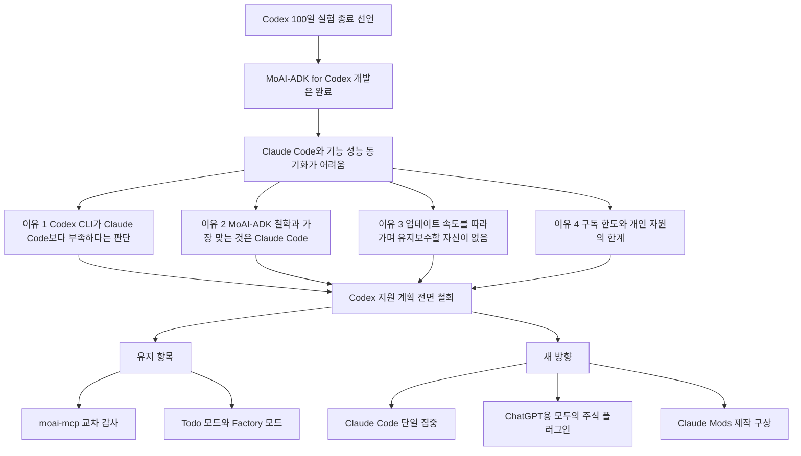
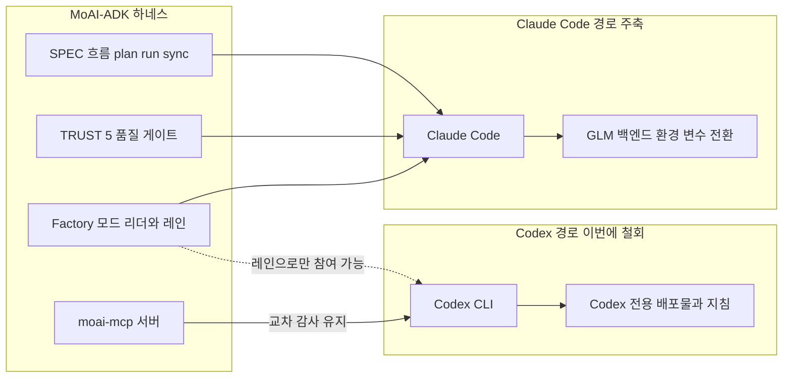
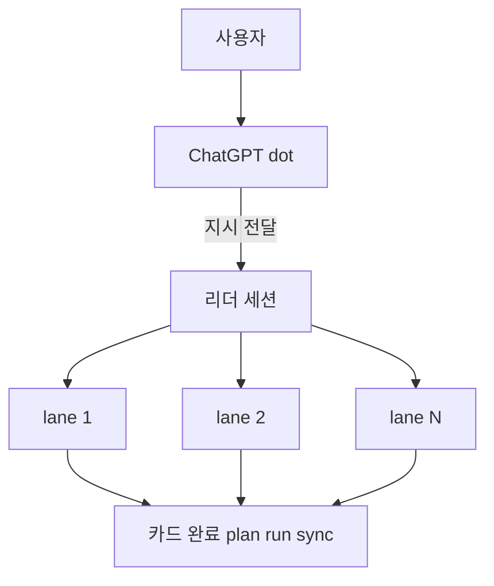
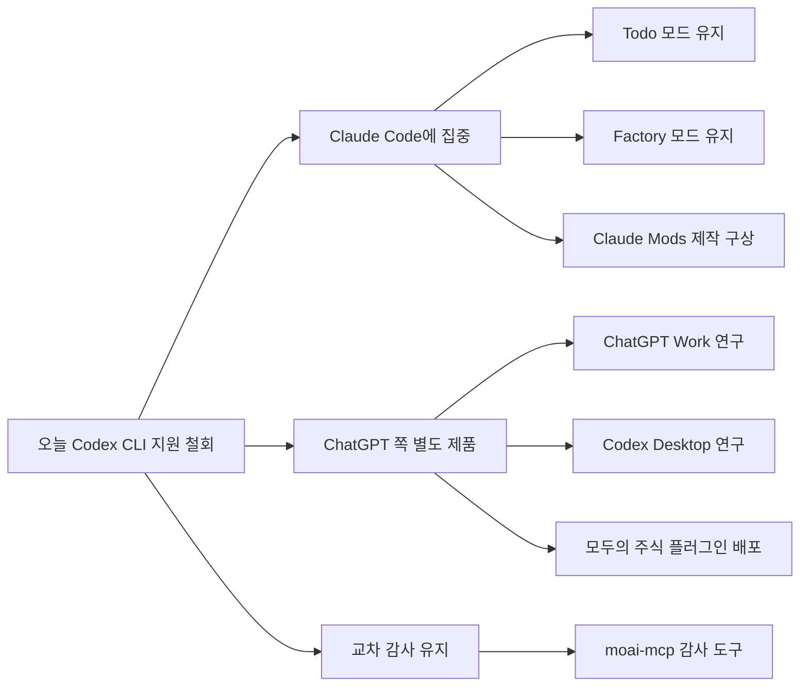

- 작성 기준일: 2026-10-20
- 대상 글: Goos Kim 님이 페이스북에 올린 "계획했던 100일간의 Codex 실험을 오늘 부로 종료"로 시작하는 글
- 작성 원칙: 웹 검색으로 확인된 사실과 글쓴이 본인의 주장(체감, 판단)을 구분해서 적었고, 확인하지 못한 항목은 마지막 장에 따로 모았습니다.

> 
> 계획했던 100일간의 Codex 실험을 오늘 부로 종료. 
> 
> 그리고 MoAI-ADK for Codex 개발 완료 되었으나 기능과 성능 동기화를 Claude Code에 맞추기가 정말 쉽지가 않네요. 
> 
> LLM 개별 성능은 모르겠지만 Claude Code에 비해서 Codex CLI 너무 부족하다고 판단이 들어 지원 계획 전면 철회 합니다. 
> 
> Claude Code <-> Codex 각자 취향대로 선택해서 사용을 하면 되지만 MoAI-ADK의 철학과 가장 잘 맞는것은 Claude Code라고 생각합니다. Claude + GLM 조합으로 충분한데 많은 분들이 Codex 용으로 지원을 원하셨지만 혼자서 Codex까지 오픈소스로 개발 후 유지 보수까지 자신이 없네요.
> 
> 이유는 이미 Claude Code는 사람의 손을 떠나 AI Agent가 Agent를 개발하고 있는 현실에 제가 Claude Code 업데이트 속도를 따라가기 너무 벅찬 상황인데 Codex까지 구겨서 넣으려고 하다보니 MoAI-ADK의 본질을 많이 포기를 해야 하는 부분이 많네요.
> 
> 솔직히 다 만들어서 그냥 사용해도 되는데 유지 보수 할 자신이 없습니다. 그나마 Codex 업데이트 속도는 1주일 2~3번 정도인데 Claude Code는 하루에 2번 까지도 배포가 됩니다. 
> 
> 그냥 전 클로드 장인으로 고집을 피우기로 하였습니다. 오래 기다려 주셨는데 생성되는 품질 만큼은 포기를 못하겠네요. Codex를 실패로 인정하고 빡세긴 하겠지만 Codex 관련 코드와 지침을 덜어 내야 하는데도 적지 않은 분량이네요.
> 
> 지금도 Max 계정 4개 모두 한도 소진이라 Claude Code + Codex는 무리였고 GLM까지가 딱 제가 할 수 있는 범위 였는데 너무 욕심을 냈던 거 같네요.
> 
> 그래도 moai-mcp로 Claude Codex <-> Codex 감사 기능은 매우 요긴하게 사용 중입니다. 그리고 ChatGPT Dots가 Orca Leader 세션에 지시를 내리면 일괄 크로스 터미널 통신으로 lane 세션에 지령 전달해서 완료.
> 
> Todo 와 팩토리 모드는 매우 만족스럽게 사용하고 있습니다. 꽤 분량이 크지만 Codex 덜어 내고 앞으로 Claude Code에만 더 집중하겠습니다.
> 
> 대신 ChatGPT Work와 Codex Desktop을 좀더 파면서 모두의 주식 플러그인은 ChatGPT 용으로 제작해서 배포하겠습니다.
> 
> Codex CLI는 도무지 눈감고 코딩하는 기분이 들정도로 TUI/TUX가 Claude Code에 너무 길들여 졌네요. 
> 
> 그리고 아직 시작 못하고 구상중이었지만 Claude Mods로 만들고 싶은게 너무 많은데 그동안 그 많은 토큰과 시간을 Codex 접 붙이는데 다 써버렸네요.
> 
> 이제 삽질 그만하겠습니다. 
> 
> 미안하다 Codex, 잘가라.
> 
> 넌 내 타입이 아니다.
> 
> https://www.facebook.com/share/19fVp1z3tK/
> 

---

## 1. 한 문단 요약

이 글은 오픈소스 프로젝트 MoAI-ADK의 만든 사람이 "Claude Code용 하네스인 MoAI-ADK를 Codex CLI에서도 똑같이 동작하게 만들려던 100일간의 시도를 접는다"고 밝히는 공지입니다. 개발 자체는 끝났지만, Claude Code 쪽 기능과 성능에 맞춰 Codex 쪽을 동기화하는 일이 너무 어렵고, 혼자서 두 개의 서로 다른 도구를 오픈소스로 계속 따라가며 유지보수할 자신이 없다는 것이 핵심 이유입니다. 그래서 Codex 지원 계획은 전면 철회하고, 앞으로는 Claude Code에만 집중하겠다고 합니다. 다만 Codex가 완전히 사라지는 것은 아니어서, 두 모델이 서로의 결과를 검토하는 교차 감사 기능은 계속 쓰고, ChatGPT 쪽 신기능(ChatGPT Work, Codex Desktop)은 별도로 파서 "모두의 주식" 플러그인을 ChatGPT용으로 만들어 배포하겠다는 계획도 함께 적혀 있습니다.

---

## 2. 먼저 알아야 할 배경 지식

글에는 전문 용어가 많이 나옵니다. 이 장에서 한 번에 정리하고, 이후 장에서는 이 용어들이 이미 설명되었다고 보고 진행합니다.

### 2.1 MoAI-ADK란 무엇인가

MoAI-ADK는 "Agentic Development Kit"의 약자입니다. GitHub의 공식 저장소(modu-ai/moai-adk)는 이것을 "Claude Code를 위한 에이전트형 개발 하네스"라고 소개합니다. 여기서 하네스(harness)란, AI 모델이 코드를 쓰는 동안 모델 바깥에서 비용 한도, 품질 검증, 세션 연속성 같은 것을 강제해 주는 틀을 뜻합니다. 저장소의 설명을 풀어 쓰면, 모델은 토큰을 하나씩 이어 붙이는 확률적 작업자라서 "이번 작업에 돈이 얼마나 들어도 되는지", "결과물이 충분히 좋은지", "지난 세션이 어디까지 갔는지"를 매 턴마다 스스로 기억하지 못하고, 그래서 그 세 가지를 바깥에서 붙잡아 주는 구조가 필요하다는 것입니다.

저장소가 내세우는 세 개의 축은 다음과 같습니다.

- **비용 축(Tokenomics)**: 작업마다 적절한 모델과 추론 강도를 배정해서 같은 품질을 더 적은 토큰으로 얻는다.
- **자기 개선 축(Agentic Loop)**: 실행 기록과 실패 패턴을 규칙으로 바꿔 다음 세션이 이전 실수를 반복하지 않게 한다.
- **품질 통제 축(Agentic Harness)**: SPEC(명세) 기반의 plan → run → sync 단계, TRUST 5 품질 게이트, 작업 격리를 통해 "끝났다"는 말이 검증된 완료를 뜻하게 한다.

사용 방법도 단순합니다. `/moai plan "..."`으로 명세를 쓰고, `/moai run`으로 구현하고, `/moai sync`로 문서 동기화와 PR 생성까지 마치는 흐름입니다. 단일 Go 바이너리로 배포되며, 원래 Python으로 약 7만 3천 줄 규모였던 것을 Go로 다시 썼다는 내용이 포크 저장소의 README에 적혀 있습니다.

### 2.2 이 프로젝트가 걸어온 길

검색으로 확인된 이력만 시간순으로 적으면 다음과 같습니다. 2025년 9월 18일 작성자가 Threads에 "만들어 쓰고 있고 곧 배포 예정"이라고 올렸고, 2025년 10월 3일에는 첫 에이전트 "Alfred"와 함께 테스트 공개가 이뤄졌습니다. 2026년 1월 12일에는 v1.0.0 정식 릴리스가 나왔고, 이후 Go 재작성, 멀티 LLM(Claude × GLM) 지원, Kanban 모드(v3.1), Factory 모드(v3.2)로 이어졌습니다. GitHub 저장소는 확인 시점에 별 약 1.2천 개, 포크 약 218개로 표시되었습니다. 구름(goorm) 기술 블로그에는 작성자가 "MoAI-ADK 개발기" 세션의 연사로 소개된 글도 있습니다.

### 2.3 Claude Code, Codex CLI, GLM은 각각 무엇인가

**Claude Code**는 Anthropic의 터미널 기반 코딩 에이전트이고, **Codex CLI**는 OpenAI가 만든 비슷한 성격의 터미널 도구입니다. **GLM**은 중국 Z.ai(옛 Zhipu AI)의 모델 계열입니다. Z.ai는 2026년 6월 13일 GLM-5.2를 내놓으면서 "GLM Coding Plan"이라는 정액 구독을 함께 시작했고, 이 구독은 Anthropic 프로토콜과 호환되는 전용 엔드포인트를 제공해서 환경 변수만 바꾸면 Claude Code 안에서 Claude 대신 GLM을 부를 수 있습니다. MoAI-ADK는 이 점을 활용해 `moai cc`(Claude만), `moai glm`(GLM만), `moai cg`(Claude 리더 + GLM 작업자) 세 가지 실행 모드를 제공하고, 저장소는 CG 모드가 구현 비중이 큰 작업에서 60~70% 비용 절감을 낸다고 설명합니다. 이 수치는 프로젝트 자체 설명이므로 독립 검증된 값은 아닙니다.

글 속의 "Claude + GLM 조합으로 충분하다"는 문장은 바로 이 구조를 가리킵니다.

### 2.4 "lane", "leader", "Factory 모드"

Factory 모드는 MoAI-ADK v3.2의 기능입니다. 저장소 설명에 따르면 **리더 세션 하나**와 **번호가 붙은 레인(lane) 세션 여러 개**로 일을 나눕니다. 리더는 대기열을 지켜보다가 놀고 있는 레인에 "카드"를 넘기고, 카드 하나는 단계마다 세션을 옮겨 다니지 않고 **통째로 한 레인에 들어가서** 그 레인이 plan → run → sync를 끝까지 책임집니다. 레인은 사람이 터미널을 하나씩 열어 직접 띄워야 하는데, 한 세션이 다른 세션을 스스로 띄울 수는 없기 때문이라고 합니다. 레인은 백엔드를 고를 수 있어서 `moai cc -l`은 Claude 레인, `moai glm -l`은 GLM 레인, `moai codex -l`은 Codex 레인입니다. 그리고 저장소에는 "moai codex는 리더 자리로는 들어갈 수 없고 레인으로만 참여할 수 있다"고 명시되어 있습니다. 즉 Codex는 지금까지도 보조 레인 역할로만 지원되고 있었습니다.

글 끝부분에 나오는 "Todo와 팩토리 모드가 매우 만족스럽다"는 이 기능들을 말합니다.

### 2.5 moai-mcp와 교차 감사

MoAI-ADK는 `moai mcp-server`라는 로컬 MCP(Model Context Protocol) 서버를 함께 제공하고, 저장소 설명에 따르면 17개의 도구가 다섯 묶음으로 들어 있습니다. 그중 "Cross-model audit" 묶음(`audit_multi`, `claude_audit`, `codex_audit`, `glm_audit`, `audit_cache`)이 서로 다른 모델이 결과를 검토하게 하는 기능이고, "Codex delegation" 묶음(`codex_task`, `codex_setup`, `codex_job_*`)은 Codex에게 백그라운드 작업을 맡기는 기능입니다. 저장소는 모든 백엔드가 "fail-open"이라서 Codex나 GLM이 없어도 오류가 아니라 "결론 불가(inconclusive)"를 돌려준다고 설명합니다. 글에서 "moai-mcp로 Claude Code ↔ Codex 감사 기능은 매우 요긴하게 사용 중"이라는 부분이 이것입니다. (원문에는 "Claude Codex"로 적혀 있는데, 문맥상 Claude Code의 오타로 보입니다.)

---

## 3. 글의 내용을 흐름대로 풀어 읽기

### 3.1 글 전체의 논리 구조

아래 도표는 글이 전개되는 순서를 정리한 것입니다. 결론은 하나(Codex 지원 철회)이지만, 그 결론에 이르는 이유가 네 갈래로 겹쳐 있습니다.

### 3.2 첫 문단 — "개발은 끝났지만 맞추기가 어렵다"

글은 "계획했던 100일간의 Codex 실험을 오늘 부로 종료"라는 한 줄로 시작하고, 곧바로 "MoAI-ADK for Codex 개발은 완료되었으나 기능과 성능 동기화를 Claude Code에 맞추기가 정말 쉽지가 않다"고 이어 갑니다. 여기서 "동기화"가 핵심 단어입니다. 만든 사람의 목표는 Codex에서 돌아가는 별도 제품을 만드는 것이 아니라, Claude Code에서 누리는 것과 같은 수준의 기능(SPEC 흐름, 품질 게이트, 상태 표시, 병렬 세션 등)을 Codex에서도 그대로 재현하는 것이었다는 뜻으로 읽힙니다.

이 어려움을 뒷받침하는 사실이 저장소 README에 하나 있습니다. Codex를 켠 환경(`moai init --llm gpt|both`)에서는 Codex의 상태 줄(status line)이 내장 식별자 배열만 지원해서, goal·todo·SPEC 상태 같은 MoAI 고유 항목을 표시할 수 없다는 안내입니다. README는 이것을 "openai/codex#17827에서 명령 기반 상태 줄이 들어오기 전까지의 알려진 한계"라고 적고 있습니다. 글 뒤쪽에서 작성자가 "눈 감고 코딩하는 기분"이라고 표현한 TUI/TUX(터미널 사용자 인터페이스·경험) 불만과, 저장소가 문서로 남긴 이 제약은 같은 방향을 가리킵니다. 다만 "눈 감고 코딩하는 기분"이라는 표현이 정확히 이 상태 줄 문제만을 뜻하는지는 글에 설명이 없으므로, 둘의 직접적 인과는 확인할 수 없습니다.

### 3.3 둘째 문단 — "LLM 개별 성능은 모르겠지만 CLI가 부족하다"

이 문장은 비교의 대상을 신중하게 한정합니다. 작성자는 모델 자체(Claude 대 GPT)의 우열을 말하는 것이 아니라고 먼저 선을 긋고, **도구(Codex CLI 대 Claude Code)** 가 부족하다고 판단했다고 말합니다. 이 구분은 중요합니다. "Codex를 실패로 인정한다"는 뒤쪽 문장도 모델이 아니라 하네스를 얹을 바탕으로서의 CLI에 대한 평가로 읽어야 정확합니다.

### 3.4 셋째·넷째 문단 — 철학, 그리고 "혼자서는 못 한다"

"Claude Code ↔ Codex 각자 취향대로 쓰면 되지만, MoAI-ADK의 철학과 가장 잘 맞는 것은 Claude Code"라는 말은 취향의 문제로 정리하는 동시에, 이 프로젝트가 처음부터 Claude Code를 전제로 설계되었다는 점을 상기시킵니다. 실제로 저장소의 첫 문장이 "Claude Code용 하네스"이고, 문서 사이트도 "Claude Code를 위해 설계된 전략적 오케스트레이션 프레임워크"라고 소개합니다.

이어지는 부분이 이 글에서 가장 솔직한 대목입니다. 작성자는 "Claude Code는 이미 사람의 손을 떠나 AI 에이전트가 에이전트를 개발하는 현실"이라고 말하고, 그 업데이트 속도를 따라가는 것만으로도 벅찬데 Codex까지 끼워 넣다 보니 MoAI-ADK의 본질을 많이 포기해야 했다고 말합니다. 그리고 "다 만들어서 그냥 사용해도 되지만 유지보수할 자신이 없다"고 덧붙입니다. 즉 **기술적으로 불가능해서가 아니라, 지속 가능성 때문에** 접는다는 설명입니다.

"AI 에이전트가 에이전트를 개발하는 현실"이라는 진단 자체는 글쓴이의 관찰이며, 이 문서에서 외부 자료로 검증할 수 있는 성격의 주장은 아닙니다. 다만 그 진단이 암시하는 것, 즉 Claude Code의 변경이 매우 잦다는 점은 아래 5장에서 수치로 확인합니다.

### 3.5 업데이트 속도 비교 — "Codex는 주 2~3번, Claude Code는 하루 2번까지"

글은 Codex의 배포 빈도를 "1주일 2~3번", Claude Code를 "하루에 2번까지"라고 비교합니다. 이 부분은 5장에서 외부 집계와 대조합니다. 결론만 먼저 적으면, 두 도구 모두 매우 자주 배포되고 Claude Code가 더 자주 배포된다는 방향은 외부 집계와 일치하지만, 글에 적힌 숫자 그대로는 아닙니다.

### 3.6 자원 이야기 — "Max 계정 4개가 모두 한도 소진"

작성자는 지금도 Max 계정 4개가 모두 한도를 소진한 상태여서 Claude Code + Codex는 무리였고, GLM까지가 자신이 할 수 있는 범위였는데 욕심을 냈다고 말합니다. 이것은 개인의 운영 상황에 대한 서술이므로 외부에서 검증할 수는 없습니다. 다만 저장소가 비용 축(Tokenomics)을 프로젝트의 첫 번째 축으로 내세우고, 구독 한도가 모든 모델이 공유하는 주간 쿼터를 갉아먹는다고 설명하는 점을 보면, 이 프로젝트에서 한도 관리가 얼마나 일상적인 제약인지는 짐작할 수 있습니다. 이것은 글쓴이의 상황을 확정하는 근거가 아니라 프로젝트의 문제의식을 보여주는 맥락입니다.

---

## 4. 철회되는 것과 남는 것

### 4.1 구조로 보는 MoAI-ADK와 Codex의 위치

아래 도표는 저장소가 설명하는 현재 구조에서 Codex가 차지하던 자리를 보여줍니다. 중앙의 하네스가 Claude Code를 감싸고, GLM은 같은 Claude Code 안에서 백엔드만 바꾸는 방식으로 붙는 반면, Codex는 별도의 CLI이기 때문에 별도의 배포 형태(`.codex/`, `AGENTS.md` 등)와 별도의 레인 진입 명령이 필요했습니다.

점선은 Codex가 리더가 아니라 레인으로만 붙을 수 있었다는 저장소 설명을 나타냅니다. 맨 아래 연결은 글에서 "계속 요긴하게 쓴다"고 밝힌 교차 감사를 뜻합니다. 즉 **Codex를 "함께 일하는 주요 실행 환경"으로 지원하는 것은 접지만, "다른 눈으로 검토해 주는 외부 감사자"로 쓰는 것은 유지**하겠다는 구분입니다.

### 4.2 철회 작업의 크기

작성자는 "Codex 관련 코드와 지침을 덜어 내야 하는데 적지 않은 분량"이라고 말합니다. 이를 뒷받침하는 사실이 있습니다. 저장소 문서에는 Codex 전용 배포 방식(`--llm gpt`는 `AGENTS.md`와 `.codex/`, `.agents/skills/` 중심으로만 설치하고 Claude 쪽 파일은 만들지 않음, `--llm both`는 Claude 배포에 Codex 연결을 추가), Codex 레인 진입 명령, 상태 줄 제약 안내, `moai clean --codex-skills` 같은 정리 명령까지 흩어져 있습니다. 또 2026년 9월 16일에는 GPT 모델을 번역 게이트웨이로 Claude Code에 연결하던 예전 `moai gpt` 실행기가 이미 제거되고 "GPT 모델은 Codex CLI라는 자체 하네스로 쓴다"는 방향으로 정리된 사실이 README에 적혀 있습니다. 따라서 Codex 관련 흔적은 여러 층에 걸쳐 있고, 걷어내는 일이 하루 이틀 분량이 아니라는 설명은 저장소 구조와 모순되지 않습니다. 다만 실제로 얼마의 코드가 지워지는지는 이 시점에서 확인되지 않습니다.

### 4.3 남는 것 1 — 교차 감사

서로 다른 모델이 서로의 결과를 읽게 하는 것은 하네스 철학과 잘 맞습니다. 저장소가 "집필하는 쪽이 자기 결과를 스스로 채점하지 않도록 계획과 감사를 처음부터 분리한다"고 설명하는 것과 같은 맥락입니다. 같은 모델 계열 안에서 감사하면 같은 맹점을 공유할 수 있으므로, 다른 계열의 모델을 감사자로 두는 것은 합리적인 설계입니다. 이 기능이 계속 쓰이는 것은 Codex를 주 실행 환경에서 빼도 Codex 모델의 가치는 남는다는 작성자의 입장과 일관됩니다.

### 4.4 남는 것 2 — Todo와 Factory 모드, 그리고 ChatGPT Dots

글의 가장 구체적인 사용 장면은 이것입니다. "ChatGPT Dots가 Orca Leader 세션에 지시를 내리면, 일괄 크로스 터미널 통신으로 lane 세션에 지령을 전달해서 완료한다."

이 문장을 이해하려면 두 가지를 알아야 합니다.

첫째, **Dots**는 OpenAI가 2026년 9월 29일 DevDay에서 공개한 ChatGPT 안의 상시 구동형 에이전트입니다. 여러 보도와 해설에 따르면 GPT-6 Astra 모델 위에서 돌고, 각 dot이 자신의 클라우드 컴퓨터와 브라우저를 가지며, 대화가 끝나도 계속 일하고, ChatGPT·Slack·Teams를 통해 접근할 수 있습니다. 공개 당시 Pro와 Business Premium 구독자 중 해당 지역에서 먼저 제공되었고(Pro는 유럽경제지역·스위스·영국 제외), 첫 dot이 요금제에 포함된다고 합니다. 4,000개 이상의 앱을 플러그인 생태계로 연결할 수 있다고 소개되었으며, 한 해설은 공개 시점 기준으로 dots용 API는 발표되지 않았다고 적었습니다.

둘째, **리더 세션과 레인 세션**은 2.4절에서 설명한 Factory 모드의 구조입니다.

따라서 이 문장은 "사람이 일일이 터미널을 오가며 지시하지 않고, 상위의 ChatGPT dot에게 지시하면 그 지시가 Factory 모드의 리더로 전달되고, 리더가 여러 레인 터미널에 작업을 분배한다"는 운영 방식을 말하는 것으로 읽힙니다. 이 흐름을 도표로 그리면 다음과 같습니다. 다만 도표에서 dot과 리더 사이의 구체적 연결 방식(어떤 도구로 전달되는지)은 글에 적혀 있지 않아 "지시 전달"이라는 추상적 표현으로만 두었습니다.

"Orca"가 무엇인지는 이 문서를 작성하면서 확인하지 못했습니다. 검색 결과에서 MoAI-ADK의 리더 세션과 연결되는 "Orca"라는 이름의 도구나 문서를 찾지 못했기 때문에, 글의 해당 표현은 작성자가 쓰는 개인 도구나 별칭일 수 있다는 정도만 말할 수 있고 그 이상은 단정하지 않습니다.

---

## 5. 글의 주장을 외부 자료와 대조하기

### 5.1 업데이트 속도

개발 도구 릴리스를 추적하는 집계 사이트(Havoptic)의 수치는 다음과 같습니다.

| 항목 | Claude Code | Codex CLI |
|---|---|---|
| 최근 30일 릴리스 수 (2026-10-09경 집계 페이지) | 25회 | 16회 |
| 그 이전 한 달 집계 | 30회 (9월 6일경 집계 기준) | 19회 (9월 30일경 집계 기준) |
| 올해 누적 릴리스 번호 | 209번째가 9월 5일 | 102번째가 9월 30일 |
| 평균 간격 표기 | 약 1일 | 약 1.3일 |
| 최신 버전 | v2.1.296 (10월 9일) | rust-v0.163.0 (10월 15일, 별도 해설 기준) |

이 표에서 읽을 수 있는 것은 세 가지입니다.

첫째, 두 도구 모두 사람이 한 주도 쉬지 않고 따라가기 벅찬 빈도로 배포됩니다. 글에서 말한 "Codex는 주 2~3번"보다 이 집계의 Codex 수치가 더 잦지만, 집계 사이트가 사전 배포(alpha)나 패치를 어떻게 세는지가 다르고 작성자가 체감하는 "의미 있는 업데이트" 기준도 다를 수 있어서 직접 비교는 조심해야 합니다.

둘째, 방향은 글과 일치합니다. 같은 집계 기준에서 Claude Code가 Codex CLI보다 더 자주 배포되고, 연간 누적으로 보면 격차가 더 큽니다.

셋째, 격차의 크기는 글이 주는 인상보다 작습니다. 최근 한 달 기준으로는 배포 횟수가 대략 1.3~1.6배 차이인데, 글은 "주 2~3회 대 하루 2회"라는 훨씬 큰 대비로 표현했습니다. 이것은 글이 틀렸다는 뜻이 아니라, 작성자의 체감과 외부 집계가 정량적으로는 완전히 겹치지 않는다는 뜻입니다.

그리고 속도 자체보다 더 중요한 것은 **변경의 성격**입니다. 하네스는 도구 내부의 훅, 설정, 명령 체계에 깊게 의존하므로, 배포 횟수보다는 하네스가 의존하는 표면이 얼마나 바뀌느냐가 유지보수 비용을 결정합니다. 이 관점에서 두 가지 사실이 눈에 띕니다.

- **Codex 쪽**: Codex CLI는 `codex mcp-server` 명령과 독립 실행형 `codex-mcp-server` 바이너리를 2026년 8월 24일 폐지 예고 후 9월 5일 제거 PR이 병합되어 0.154.0(9월 9일 공개)부터 없앴고, 대신 앱 서버 방식을 쓰라고 안내했습니다. 이는 Codex를 외부에서 부르는 통합을 만든 쪽이 따라가야 하는 변경의 구체적 사례입니다. 다만 이 변경이 MoAI-ADK에 실제로 영향을 주었는지, 또는 이번 철회 결정에 영향을 주었는지는 확인되지 않습니다.
- **Claude Code 쪽**: 10월 1일 v2.1.287에서 "Claude Mods"가 도입되었고, 그 직후 며칠 동안도 훅 동작, 권한 규칙, 모델 기본값 등이 연달아 바뀌었습니다. 하네스 입장에서는 이쪽 역시 따라가야 할 표면이 넓습니다.

즉 "Claude Code 하나도 따라가기 벅차다"는 말은 외부 데이터와 충돌하지 않습니다. 오히려 그 한 개의 대상에 한 번 더 다른 대상을 얹는 비용이 추가로 든다는 것이 이번 결정의 구조적 이유라는 점은 5장 데이터와 일관됩니다.

### 5.2 GLM 조합이 "충분하다"는 말

GLM Coding Plan은 Lite, Pro, Max의 세 단계이고, 여러 해설이 GLM-5.2가 2026년 6월 13일부터 모든 단계에 적용되었다고 정리합니다. Z.ai 문서는 이 플랜이 Claude Code, Cline, OpenCode 등 공식 지원 도구에서만 쓸 수 있다고 못 박고 있습니다. 가격은 출처마다 표기가 다르고(월 18달러부터라는 곳, 프로모션과 연 결제 할인을 섞어 표기한 곳 등), MoAI-ADK 저장소는 "월 10달러부터"라고 적고 있어 어느 하나로 단정하기 어렵습니다. 따라서 이 문서는 구체 가격을 인용하지 않습니다. 확실한 것은 "정액 구독이고, Claude Code에 환경 변수로 연결되며, MoAI-ADK가 이를 1급 기능으로 지원한다"는 구조입니다. 작성자가 "Claude + GLM이면 충분하다"고 말하는 것은 이 구조 위에서 하는 말입니다.

### 5.3 Codex 쪽 상태 줄 제약

앞 3.2절에서 소개한 대로, 저장소가 직접 "Codex는 상태 줄에 내장 식별자만 지원하므로 MoAI 고유 항목을 표시할 수 없다"고 문서화하고 있습니다. 이는 작성자가 "TUI/TUX가 Claude Code에 너무 길들여졌다"고 한 불만이 단순한 기호 문제가 아니라, 하네스의 핵심 가시성 기능(현재 SPEC 단계, 목표 상태, 컨텍스트 사용률 등)이 Codex에서 구현되지 않는 구체적 제약과 연결될 수 있음을 보여줍니다. 다만 "눈 감고 코딩"이 이 한 가지만을 의미하는지는 글만으로는 알 수 없습니다.

---

## 6. 앞으로의 계획 — 세 갈래

글의 후반부는 세 가지 방향을 말합니다. 여기에 외부에서 확인된 맥락을 붙이면 다음과 같습니다.

### 6.1 Claude Code 단일 집중과 Claude Mods

작성자는 "아직 시작은 못 했지만 Claude Mods로 만들고 싶은 게 너무 많은데, 그동안의 토큰과 시간을 Codex 접붙이는 데 다 써버렸다"고 말합니다.

**Claude Mods**는 2026년 10월 1일 Claude Code v2.1.287에서 도입된 기능입니다. 공식 문서와 해설을 종합하면, 모드는 플러그인 안에 담겨 배포되는 TypeScript 함수로서 Claude Code 프로세스 안에서 실행되며, 도구 호출 행, 스피너, 질문 대화상자처럼 Claude Code가 직접 그리는 화면 요소를 바꾸거나 이벤트(도구 호출, 프롬프트 제출, 화면 렌더링)에 끼어들 수 있습니다. 기본으로 켜져 있고 Claude Code CLI와 Claude 데스크톱 앱의 Code 탭에서 동작하며, 설치는 `/plugin` 흐름을 따릅니다. 반면 VS Code 확장이나 `claude -p` 같은 환경에서는 동작 범위가 다르다고 안내됩니다. 그리고 해설들은 모드가 샌드박스 안에 있지 않아 Claude Code와 같은 시스템 권한으로 돌기 때문에 서드파티 모드는 의존성처럼 검토해야 한다고 경고합니다. 공식 문서는 모드가 권한 확인 화면은 바꿀 수 없다고 적고 있습니다.

기존의 훅·스킬·상태 줄·MCP 서버는 Claude Code 바깥에서 동작하지만 모드는 안쪽에서 동작한다는 차이가 있어서, 그동안 외부 하네스가 우회로 해결하던 화면 표시와 동작 개입 문제를 더 직접 다룰 수 있게 됩니다. 작성자가 이 기능에 기대를 거는 이유로 충분히 이해되는 대목이지만, 어떤 모드를 만들겠다는 구체 계획은 글에 없으므로 이 문서도 추측하지 않습니다.

### 6.2 ChatGPT Work와 Codex Desktop, 그리고 "모두의 주식" 플러그인

작성자는 "ChatGPT Work와 Codex Desktop을 더 파면서 모두의 주식 플러그인은 ChatGPT용으로 제작해서 배포하겠다"고 말합니다.

여기서 중요한 것은 **Codex CLI와 Codex Desktop은 별개의 표면**이라는 점입니다. OpenAI는 2026년 7월 9일 ChatGPT Work를 발표하면서 기존 Codex 앱을 새 ChatGPT 데스크톱 앱에 통합했습니다. 새 앱은 Chat(질문과 대화), Work(조사와 완성된 산출물), Codex(소프트웨어 개발)를 한 곳에 묶고 macOS와 Windows에서 제공되며, 공식 발표는 Free를 포함한 모든 요금제에서 데스크톱 앱 이용이 가능하다고 설명합니다. 플러그인은 스킬, 앱, 앱 템플릿을 묶어 특정 업무 흐름에 맞게 포장한 것으로서 웹과 데스크톱의 ChatGPT, 그리고 Work와 Codex에서 쓸 수 있고, 통합 플러그인 디렉터리가 기존 앱 디렉터리를 대체했습니다.

그러므로 작성자의 계획은 모순이 아닙니다. 터미널 CLI(Codex CLI) 지원은 접지만, 사용자가 훨씬 많이 쓰는 ChatGPT 데스크톱·웹 환경에서는 "플러그인"이라는 배포 단위로 별도 제품을 만들겠다는 것입니다. 이는 두 도구를 한 하네스에 억지로 맞추는 대신, 각 환경의 고유한 배포 단위에 맞춰 따로 제작한다는 방향 전환으로 이해할 수 있습니다.

"모두의 주식" 플러그인이 구체적으로 어떤 기능인지는 검색으로 확인하지 못했습니다(7장 참고).

### 6.3 앞으로의 방향 요약

---

## 7. 이 문서에서 확인하지 못한 것들

사실을 지키기 위해 확인되지 않은 항목은 따로 적습니다. 아래 항목은 글쓴이의 서술을 그대로 소개했을 뿐이며 이 문서가 사실로 보증하지 않습니다.

1. **"Orca Leader"가 무엇인지**: MoAI-ADK 저장소와 문서에서 이 이름을 찾지 못했습니다. 리더·레인은 확인되지만 "Orca"의 정체는 불명입니다.
2. **"모두의 주식 플러그인"의 기능과 현재 상태**: 관련 공개 자료를 검색으로 찾지 못했습니다.
3. **Dots가 터미널 세션에 지시를 내리는 구체적 방법**: Dots는 공개 자료로 확인되지만, 이 글이 말하는 "일괄 크로스 터미널 통신"이 어떤 도구와 방식으로 구현되는지는 확인되지 않았습니다. Dots에 대해 공개 시점 해설은 API가 발표되지 않았다고 적었으므로, 글의 방식은 작성자가 별도로 구성한 연결일 가능성이 있으나 이것은 추측이므로 결론으로 삼지 않습니다.
4. **100일 실험의 실제 시작 시점과 투입량**: 글에 시작일이 적혀 있지 않아 확인할 수 없습니다.
5. **Codex 관련 코드의 삭제 범위와 일정**: 글은 "덜어내야 하는데 분량이 적지 않다"고만 말하고, 저장소에서 아직 제거되었는지는 이 시점에 확인하지 못했습니다.
6. **"Max 계정 4개 소진"과 "AI가 AI를 개발하는 현실"**: 글쓴이 개인의 상황과 관찰이라 외부에서 검증할 수 없습니다.
7. **원문 게시 시각**: 글에는 상대 시각으로만 표시되어 있어 정확한 게시 시각을 확인할 수 없고, 이 문서는 "작성 기준일 2026-10-20"에 맞춰 정리했습니다.
8. **GitHub 저장소 화면 정보의 시차**: 검색에 잡힌 저장소 페이지 중 일부는 이전 시점의 복사본으로 보이는 정보(예: 버전 배지)가 섞여 있었습니다. 버전·별 개수 같은 숫자는 대략적인 참고용입니다.

---

## 8. 정리하며 — 이 글이 알려 주는 것

이 글의 요점은 "Codex가 나쁘다"가 아니라 **"하나의 하네스가 두 개의 빠르게 변하는 대상을 동시에 따라가려면 비용이 두 배 이상이 된다"** 는 판단입니다. 작성자는 그 비용을 혼자 감당할 수 없다고 인정하고, 설계 철학이 이미 Claude Code에 맞춰져 있다는 사실을 근거로 범위를 줄입니다. 외부 자료는 이 판단의 전제 조건을 대체로 뒷받침합니다. 두 도구 모두 매우 자주 배포되고, Claude Code가 더 자주 배포되며, Codex 쪽에는 하네스의 상태 표시를 막는 문서화된 제약이 있고, Codex 쪽 통합 인터페이스도 실제로 바뀐 사례가 있습니다. 반면 글이 제시한 배포 빈도 숫자는 집계와 정확히 맞지는 않는다는 점은 구분해서 읽는 것이 좋습니다.

한편 "접는다"는 말이 "관계를 끊는다"는 뜻은 아닙니다. 교차 감사는 남기고, 전혀 다른 배포 단위(ChatGPT 플러그인)로 옮겨 가는 길을 열어 두었습니다. 범위를 줄이는 대신 남기는 것을 분명히 하는 결정이며, 그 결정의 근거와 한계를 이 글 안에서 스스로 밝히고 있다는 점이 이 글의 특징입니다.

---

## 9. 출처

검색과 페이지 조회로 확인한 자료입니다. 글 속 주장은 이 문서가 재서술했으며, 인용 문장을 그대로 옮기지 않았습니다.

**MoAI-ADK**
- [GitHub — modu-ai/moai-adk](https://github.com/modu-ai/moai-adk)
- [moai-adk README (중국어판, Codex 레인·GPT 게이트웨이 철회 안내 포함)](https://github.com/modu-ai/moai-adk/blob/main/README.zh.md)
- [moai Claude Code 플러그인 소개 (Factory 모드 v3.2)](https://www.claudepluginhub.com/plugins/modu-ai-moai-plugins-moai)
- [moai-adk 요약 (Kanban·Factory 모드 v3.1)](https://skillsllm.com/skill/moai-adk)
- [MoAI-ADK 공식 문서 색인](https://docsearch.algolia.com/mcp/docs/repo/modu-ai/moai-adk)
- [MoAI-ADK v1.0.0 정식 릴리스 글](https://goos.kim/ko/blog/moai-adk-v1-release)
- [Threads — MoAI-ADK 배포 예고 (2025-09-18)](https://www.threads.com/@goos.kim/post/DOwwDb3kpvi/moai-adk-%EB%A7%8C%EB%93%A4%EC%96%B4-%EC%82%AC%EC%9A%A9%ED%95%98%EA%B3%A0-%EC%9E%88%EC%96%B4%EC%9A%94-%EA%B3%A7-%EB%B0%B0%ED%8F%AC%EC%98%88%EC%A0%95-%EC%9E%85%EB%8B%88%EB%8B%B7)
- [Threads — Alfred 테스트 공개 (2025-10-03)](https://www.threads.com/@goos.kim/post/DPVxtXGkgFG/moai-adkagentic-development-kit-w-aialfred-%ED%85%8C%EC%8A%A4%ED%8A%B8-%EC%98%A4%ED%94%88%EC%95%88%EB%85%95%ED%95%98%EC%84%B8%EC%9A%94-%EB%AA%A8%EB%91%90%EC%9D%98ai-%EA%B3%B5%EC%9E%A5%EC%9E%A5-%EC%9E%85%EB%8B%88%EB%8B%A4%EA%B7%B8%EB%8F%99%EC%95%88-%EC%98%A4%EB%9E%98%EA%B8%B0%EB%8B%A4%EB%A6%AC%EC%85%A8%EB%8D%98-?hl=ko)
- [구름 기술 블로그 — MoAI-ADK 개발기 세션 안내](https://tech.goorm.io/2603_commit/)
- [Go 재작성 설명이 있는 포크 저장소 README](https://github.com/lesang73/moai-adk)

**릴리스 속도 및 Claude Code**
- [Havoptic — What's new in Claude Code](https://www.havoptic.com/whats-new/claude-code)
- [Havoptic — Claude Code 2026년 10월 릴리스](https://www.havoptic.com/releases/claude-code/2026/10)
- [Havoptic — Claude Code v2.1.263](https://www.havoptic.com/r/claude-code-2.1.263)
- [Claude Code Mods 공식 문서 (한국어)](https://code.claude.com/docs/ko/plugins/mods/overview)
- [Claude Code v2.1.287 업데이트 해설 (classmethod)](https://dev.classmethod.jp/en/articles/20261002-cc-updates-v2-1-287/)
- [Claude Code Mods 해설 (vibecodingacademy)](https://www.vibecodingacademy.ai/blog/claude-code-mods)

**Codex**
- [Havoptic — What's new in OpenAI Codex CLI](https://www.havoptic.com/whats-new/openai-codex)
- [Havoptic — Codex CLI rust-v0.159.3](https://www.havoptic.com/r/openai-codex-rust-v0.159.3)
- [Codex MCP 서버 제거와 앱 서버 이전 해설](https://www.developersdigest.tech/blog/codex-mcp-server-removed)

**GLM / Z.ai**
- [Z.ai 공식 문서 — GLM Coding Plan 개요](https://docs.z.ai/devpack/overview)
- [GLM Coding Plan 해설 (hyscaler)](https://hyscaler.com/insights/glm-coding-plan-review)
- [ZCode 소개 및 GLM-5.2 정리 (amplifying.ai)](https://amplifying.ai/coding-agents/zcode)

**OpenAI — ChatGPT Work, Codex 앱, Dots**
- [OpenAI — ChatGPT Work 발표 (2026-07-09)](https://openai.com/index/chatgpt-for-your-most-ambitious-work)
- [OpenAI — 릴리스 노트](https://openai.com/ar/products/release-notes/)
- [OpenAI — Codex 앱 업데이트 (2026-04-16)](https://openai.com/index/codex-for-almost-everything/)
- [Gigazine — ChatGPT Work 설치 후기](https://gigazine.net/gsc_news/en/20260710-openai-chatgpt-work/)
- [BetaNews — OpenAI dots 공개](https://betanews.com/article/openai-dots-agents-chatgpt/)
- [Flavio Copes — dots 상세 해설](https://flaviocopes.com/openai-dots/)
- [Tom's Guide — dots 이용 가능 범위](https://www.tomsguide.com/ai/openai-just-launched-dots-heres-why-most-chatgpt-users-cant-try-them-yet)
- [AI Weekly — dots 공개 요약](https://aiweekly.co/alerts/openai-unveils-dots-always-on-chatgpt-agents-at-devday)

---

작성 일자: 2026-10-20
