- 부제: 즉흥적 프롬프팅에서 에이전틱 엔지니어링으로
- 대상 자료: (1) 구글 백서 원문 PDF, (2) Rahul Gite의 Medium 해설 글 [「What Google's New SDLC Paper Got Right About AI-Assisted Software Development」](https://levelup.gitconnected.com/what-googles-new-sdlc-paper-got-right-about-ai-assisted-software-development-9bcc97879498?sk=74d5baa17940da01e32c410ab02a8d6d)(2026-09-28)
- 작성 기준일: 2026-10-20 (웹 검색으로 최신 동향을 교차 확인함)

---

## 0. 이 문서를 읽는 방법

이 문서는 두 개의 글을 함께 다룹니다. 하나는 구글이 발행한 51쪽짜리 백서 원문이고, 다른 하나는 그 백서를 읽은 한 개발자가 자기 경험을 섞어 정리한 Medium 해설 글입니다. 두 글은 내용이 많이 겹치지만 성격이 다릅니다. 백서는 "구글 저자들이 제시하는 프레임워크"이고, 블로그는 "그 프레임워크를 읽은 실무자의 감상과 해석"입니다. 이 둘을 섞어 읽으면 누가 무엇을 주장했는지 흐려지기 쉬우므로, 본문에서는 출처를 다음과 같이 표기합니다.

- **(백서 p.N)**: 백서 원문 N쪽에 있는 내용입니다.
- **(블로그)**: Medium 해설 글에 있는 내용이며, 대개 글쓴이의 개인 경험이나 해석입니다.
- **(최신 확인)**: 이번에 웹 검색으로 따로 확인한 외부 정보입니다. 백서에 없는 내용이므로 백서의 주장과 구분해서 읽어 주세요.

수치와 사실관계는 원문에 적힌 것만 옮겼고, 원문에 근거가 없는 내용은 "근거가 제시되지 않았다"고 명시했습니다. 검색으로 확인되지 않는 것은 추측하지 않고 확인되지 않았다고 적었습니다.

---

## 1. 한 문단 요약

백서의 핵심 주장은 이렇습니다. 소프트웨어 개발의 병목이 "코드를 타이핑하는 일"에서 "무엇을 만들지 정확히 정의하고, 만들어진 결과가 맞는지 검증하는 일"로 옮겨 가고 있다는 것입니다. 그래서 개발자의 주된 산출물은 코드 자체가 아니라 "코드를 만들어 내는 시스템"(명세, 컨텍스트, 테스트, 가드레일, 피드백 루프)이 됩니다. 이 시스템을 구성하는 핵심 개념이 컨텍스트 엔지니어링과 하네스 엔지니어링이며, 바이브 코딩은 틀린 방식이 아니라 "위험이 낮은 작업에 맞는 한쪽 끝"이고 반대쪽 끝에 규율 있는 에이전틱 엔지니어링이 있다는 것이 백서의 틀입니다. 어느 지점을 택할지는 그 작업의 위험도(stakes)가 정합니다.

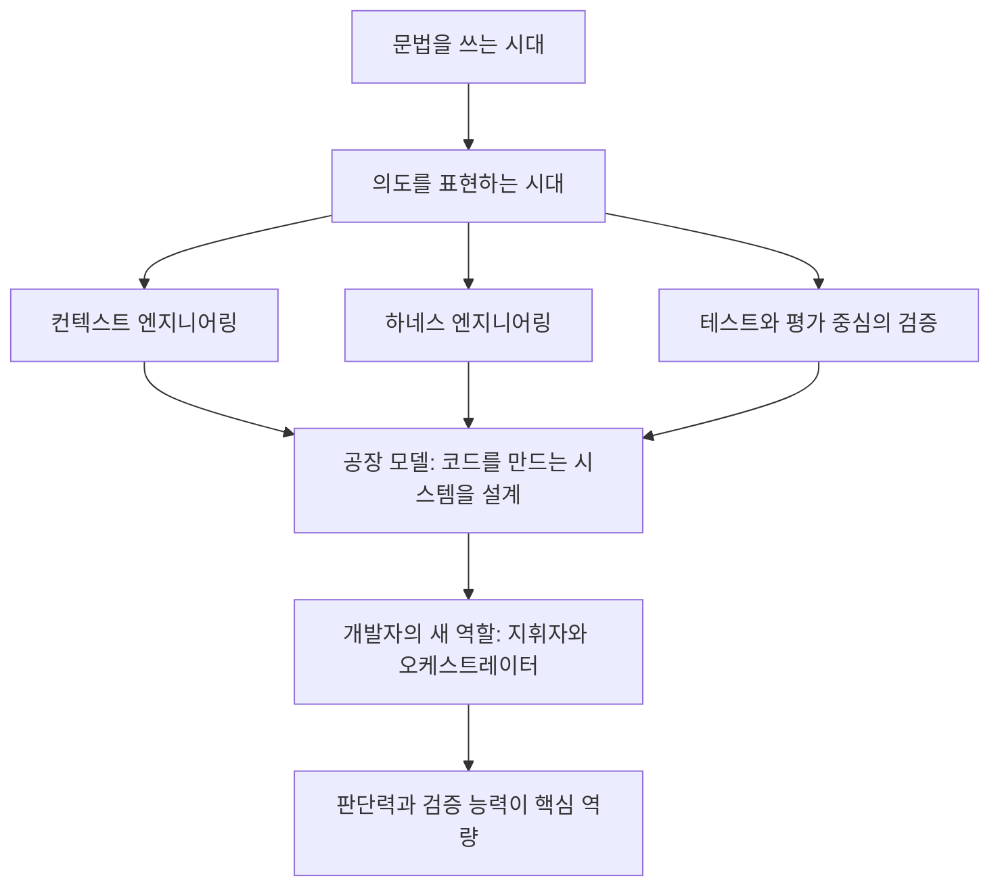

---

## 2. 백서는 어떤 문서인가

### 2.1 기본 정보

백서의 제목은 「The New SDLC With Vibe Coding」이고 부제는 「From ad-hoc prompting to Agentic Engineering」입니다. 저자는 Addy Osmani, Shubham Saboo, Sokratis Kartakis 세 사람이며, 감사의 글에는 내용 기여자로 Elia Secchi, Julia Wiesinger, Anant Nawalgaria, 큐레이터 겸 편집자로 Anant Nawalgaria, 디자이너로 Michael Lanning이 올라 있습니다(백서 p.2). 문서 하단에는 "May 2026"이 찍혀 있고, 총 51쪽이며 마지막 3쪽가량이 32개 항목의 미주입니다(백서 p.49~51).

(최신 확인) 이 백서는 Kaggle에서 운영한 "5-Day AI Agents Intensive Vibe Coding Course"의 1일 차 읽기 자료로 소개됩니다. 한 2차 글(DEV Community)은 해당 과정이 2026년 6월 15일부터 19일까지 열렸다고 적고 있고, 같은 글이 백서를 "6월에 나왔다"고 쓴 반면 문서 자체와 다른 2차 글은 2026년 5월로 표기합니다. 즉 공개 시점 표기가 자료마다 엇갈립니다. 확실한 것은 문서 하단의 "May 2026" 표기이며, 6월은 코스 일정과 혼동되었을 가능성이 있습니다만 이는 확정할 수 없습니다. 또 다른 2차 글은 이 백서가 같은 시리즈의 첫 번째 문서이며, 본문에서 예고하듯 3일 차(컨텍스트 엔지니어링: 세션, 스킬, 메모리)와 5일 차(명세 기반 프로덕션급 개발) 문서가 따로 있다고 설명합니다. 본문에도 "Day-3 paper", "Day 5 companion paper"가 언급됩니다(백서 p.18, p.23, p.39).

### 2.2 누구를 위한 글인가

백서는 소프트웨어 엔지니어, 엔지니어링 매니저, 아키텍트, 기술 리더를 독자로 삼습니다. 현대적 개발 관행에는 익숙하지만 AI나 머신러닝의 세부에는 익숙하지 않은 독자를 가정합니다(백서 p.9). 그리고 이 글의 목적은 "몇 달이면 낡을 도구 스냅샷"이 아니라 도구가 바뀌어도 쓸모 있는 원칙과 사고 모델을 제공하는 것이라고 밝힙니다(백서 p.9).

### 2.3 읽을 때 염두에 둘 점: 저자와 시각

세 저자는 구글 소속이고(블로그와 2차 글들이 구글 엔지니어링 인력으로 소개), 백서 후반부에는 구글의 제품과 기술(ADK, Agents CLI, Jules, Antigravity, Gemini Code Assist 등)이 사례로 등장합니다. 이는 사실이며, 그 자체가 내용의 오류를 뜻하지는 않지만 "구글이 자기 생태계를 소개하는 문서이기도 하다"는 점은 알고 읽는 편이 균형 잡힌 독해입니다. 다만 백서는 Claude Code, Codex, Cursor, Cline 같은 타사 도구도 폭넓게 언급하며, Agents CLI가 어떤 코딩 에이전트와도 함께 쓰인다고 설명합니다.

---

## 3. 출발점: 문법에서 의도로

### 3.1 프로그래밍은 번역이었다

백서는 서론에서 프로그래밍을 "번역 행위"로 규정합니다. 사람의 말로 문제를 이해하고, 추상적인 용어로 해법을 설계하고, 그것을 기계가 실행할 수 있는 문법으로 옮긴다는 것입니다. 단계마다 마찰이 생기는데, 그 마찰이 지금 무너지고 있다는 것이 백서의 진단입니다(백서 p.6). 수십 년 동안 개발자와 기계 사이의 인터페이스는 중괄호, 세미콜론, 타입 어노테이션 같은 문법이었는데 그 시대가 끝나 간다고 봅니다. 이제 개발자는 "어떻게 만들지"가 아니라 "무엇을 만들고 싶은지"를 표현하고, 기계가 구현을 맡으며, 사람은 의도와 아키텍처와 판단을 제공한다는 새로운 패러다임이 열렸다는 것입니다(백서 p.7).

### 3.2 얼마나 퍼졌나: 수치와 그 성격

백서는 2026년 초 기준으로 전문 개발자의 85%가 AI 코딩 에이전트를 정기적으로 쓰고, 51%가 매일 쓰며, 신규 코드의 약 41%가 AI가 생성한 것으로 추정된다고 적습니다(백서 p.7). 이 수치의 출처는 미주 1번인 GetPanto와 Index.dev의 통계 블로그 글입니다(백서 p.49). 구글이 직접 측정한 수치가 아니라 2차 통계라는 점을 기억해 두세요. 41%는 "추정치(estimated)"라고 백서 자신도 명시합니다.

(최신 확인) 다른 2차 글은 "구글 내부에서 신규 코드의 75%가 AI 생성"이라고 적었지만, 이 수치는 제가 본 백서 본문에는 없으므로 백서의 주장으로 인용하지 않습니다.

### 3.3 다섯 단계의 진화

백서 8쪽의 진화 도표는 AI 보조 개발이 다섯 단계를 거쳤다고 보여 줍니다. 약 2021년 자동완성(다음 몇 글자를 추측), 약 2022년 인라인 코드 제안(함수 전체 완성), 약 2023년 채팅 기반 생성(자연어로 기능을 설명하고 구현을 받음), 약 2024~25년 코딩 에이전트(다중 파일 편집, 도구 호출, 테스트 실행, 자기 수정), 약 2025~26년 자율 에이전트(저장소 복제, 다중 파일 변경 계획, 샌드박스 실행, 풀 리퀘스트 제출)입니다. 도표의 메시지는 각 세대가 앞 세대를 보존하면서 한 명의 엔지니어가 해낼 수 있는 일의 상한을 끌어올렸다는 것입니다. 연도는 "약(~)"으로 표기된 개념적 구분이므로 정밀한 연표로 읽을 필요는 없습니다.

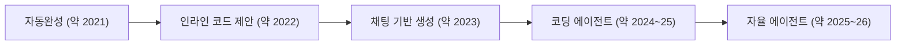

### 3.4 CTO에게 보고하는 두 가지 방식

백서는 같은 AI 활용이라도 전하는 말에 따라 전혀 다른 대화가 된다는 예를 듭니다. 팀이 결제 처리 시스템을 "바이브 코딩"한다고 말하면 경보가 울려야 하지만, 팀이 "에이전틱 엔지니어링"을 실천한다고, 곧 사람이 설계한 제약 아래서 AI가 구현을 맡고 테스트 커버리지가 정확성을 보증한다고 말하면 근본적으로 다른 대화라는 것입니다(백서 p.8). 이 구분이 백서 전체를 관통하는 문제의식입니다.

---

## 4. 용어 정리 ①: AI 에이전트란 무엇인가

백서는 먼저 에이전트를 정의합니다. AI 에이전트는 목표를 인식하고, 목표에 도달할 단계를 계획하고, 도구를 통해 행동하고, 결과를 관찰하며, 목표가 달성되거나 중단 조건에 걸릴 때까지 반복하는 소프트웨어 시스템입니다. 챗봇이 응답을 하나 내놓고 다음 프롬프트를 기다리는 것과 달리, 에이전트는 자기 루프를 스스로 돌립니다. 사람이 최상위 목표를 주면 에이전트가 매 단계 다음 행동을 결정합니다(백서 p.10).

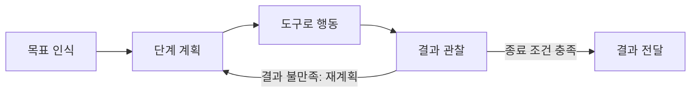

백서는 에이전트가 다섯 부분으로 이루어진다고 설명합니다. 모델은 추론 엔진으로서 현재 컨텍스트를 읽고 다음 생각, 다음 도구 호출, 다음 메시지를 만듭니다. 도구는 모델을 세상과 연결하며 API, 실행할 코드, 질의할 데이터베이스, 위임할 다른 에이전트를 포함합니다. 메모리는 상태로서 과거 상호작용을 기억하고 프로젝트별 규칙을 불러오며 세션을 넘어 맥락을 유지하게 합니다. 오케스트레이션은 루프를 실행하는 코드로서 매 모델 호출의 컨텍스트를 조립하고 도구 호출을 보내고 결과를 받아 계속할지 판단합니다. 배포는 프로토타입을 서비스로 바꾸는 호스팅, 신원, 관측 가능성, 운영 인프라입니다(백서 p.11).

> 독해 주의: 백서는 "다섯 부분"이라고 해 놓고 바로 뒤 문단에서 "이 네 부분이 연속 루프로 함께 작동한다"고 씁니다(백서 p.11). 편집 과정에서 생긴 표기 불일치로 보이며, 내용상 다섯 번째인 배포는 루프의 일부라기보다 운영 기반입니다.

---

## 5. 용어 정리 ②: 바이브 코딩과 에이전틱 엔지니어링

### 5.1 바이브 코딩의 기원

백서에 따르면 2025년 2월 안드레이 카르파시가 새로운 프로그래밍 방식을 묘사하는 글을 올렸고 소프트웨어 공학계에서 폭넓은 공감을 얻었습니다. 분위기에 완전히 몸을 맡기고, 기하급수적 발전을 받아들이고, 코드가 존재한다는 사실마저 잊는 방식이었습니다. 이 방식에서 개발자는 원하는 것을 자연어로 설명하고, AI의 출력을 받아들이고, 무언가 깨지면 오류 메시지를 프롬프트에 붙여 넣어 고쳐 달라고 합니다(백서 p.11~12).

이 용어는 현실의 무언가를 정확히 포착해서 퍼졌고, 몇 달 만에 AI 보조 개발 전반을 가리키는 말로 쓰이면서 의미가 흐려졌습니다. 숙련된 엔지니어가 AI로 명세가 잘 된 기능을 구현하는 것도 바이브 코딩인지, 치밀한 아키텍처를 AI 에이전트로 실행하는 팀도 그런지 헷갈리게 된 것입니다(백서 p.12).

### 5.2 에이전틱 엔지니어링의 등장

백서는 2026년 초에 카르파시 본인이 원래 틀이 너무 좁았음을 인정하며 "에이전틱 엔지니어링"이라는 말로 규율 있는 쪽 끝을 가리켰다고 설명합니다(백서 p.12).

(최신 확인) 이 부분은 검색으로 교차 확인되었습니다. The New Stack의 2026년 2월 10일 기사에 따르면 카르파시는 바이브 코딩 1주년 즈음의 글에서 LLM이 훨씬 좋아져 바이브 코딩이라는 표현이 한물갔다고 말하며 "에이전틱 엔지니어링"을 제안했습니다. 그의 설명은 대략 다음과 같습니다. "에이전틱"은 이제 코드를 직접 쓰는 일이 거의 없고 코드를 쓰는 에이전트들을 지휘하며 감독하는 것이 기본값이라는 뜻이고, "엔지니어링"은 거기에 배우고 숙련할 수 있는 기술과 전문성이 있음을 강조한다는 것입니다. 한편 2차 글들은 카르파시가 2026년 4월 말 Sequoia Ascent에서 바이브 코딩은 바닥을 끌어올리고 에이전틱 엔지니어링은 천장을 끌어올린다는 취지로 발표했다고 전합니다. 이는 발표 영상이나 원문을 제가 직접 확인한 것이 아니라 2차 보도이므로, 정확한 표현은 원 출처에서 확인하시기 바랍니다. 또 다른 2차 글은 2025년 10월 사이먼 윌리슨이 "vibe engineering"이라는 표현을 제안했다고 소개하는데, 이 역시 해당 글을 통해서만 확인한 정보입니다.

### 5.3 스펙트럼: 이분법이 아니라 연속선

백서는 바이브 코딩과 에이전틱 엔지니어링을 이분법이 아니라 한 스펙트럼의 양 끝으로 봅니다. 두 끝을 가르는 기준은 AI를 쓰느냐가 아니라 AI의 출력을 둘러싼 구조, 검증, 사람의 판단이 얼마나 있느냐입니다(백서 p.12). 백서의 표 1을 한국어로 옮기면 다음과 같습니다(백서 p.13).

| 차원 | 바이브 코딩 | 구조화된 AI 보조 코딩 | 에이전틱 엔지니어링 |
|---|---|---|---|
| 의도 명세 | 가벼운 자연어 프롬프트 | 예시와 제약이 포함된 상세 프롬프트 | 공식 명세, 아키텍처 문서, 메모리 파일 |
| 검증 | "되는 것 같은가?" | 수동 테스트, 부분 점검 | 자동화된 테스트 스위트, CI/CD 게이트, LM 심판 |
| 코드베이스 이해 | 최소한. 생성된 코드를 읽지 않을 수도 있음 | 핵심 경로만 선택적으로 검토 | 아키텍처를 포괄적으로 검토하고 구현 세부는 AI가 처리 |
| 오류 처리 | 오류 메시지를 AI에게 붙여 넣기 | 개발자가 원인을 진단하고 AI가 수정 구현 | 에이전트가 정해진 범위 안에서 자가 진단, 사람은 아키텍처 문제를 처리 |
| 적절한 범위 | 프로토타입, 스크립트, 개인 프로젝트, 해커톤 | 기존 코드베이스 안의 기능 | 프로덕션 시스템, 팀 규모 개발 |
| 위험 프로필 | 높음. 버려도 되는 코드에는 허용 | 중간. 핵심 지점에서 사람이 판단 | 낮음. 모든 단계에서 체계적 검증 |

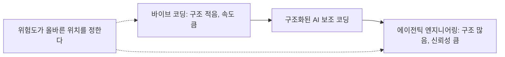

백서의 "적용 팁"은 이렇게 요약됩니다. 주말 프로토타입은 순수한 바이브 코딩이어도 되고, 금융 거래를 다루는 프로덕션 API는 에이전틱 엔지니어링이어야 하며, 대부분의 실제 업무는 그 사이에 있으므로 작업마다 선을 어디에 그을지 아는 것이 기술이라는 내용입니다(백서 p.14). 블로그 글쓴이도 이 대목을 가장 먼저 꼽으며, 바이브 코딩을 무조건 나쁜 것으로 보지 않고 스펙트럼에 올려놓는 틀이 좋았다고 적습니다. 그는 작은 프로토타입이나 빨리 버릴 수 있는 사내 유틸리티에는 정교한 워크플로가 필요 없고, 결제 흐름은 주말 프로토타입과 같은 절차를 따를 수 없다고 말합니다(블로그).

### 5.4 가장 중요한 차이: 검증

백서는 양 끝을 가르는 가장 큰 단일 차이를 "출력이 어떻게 검증되느냐"로 꼽습니다. 바이브 코딩에서는 검증이 선택 사항이라 개발자가 코드를 돌려 보고 맞아 보이는지 확인하면 끝입니다. 에이전틱 엔지니어링에서는 두 메커니즘이 함께 작동합니다. **테스트**는 시스템의 결정적인 부분, 곧 이 입력을 주면 저 출력이 나오는지를 코드로 검증합니다. **평가(eval)** 는 결정적이지 않은 부분, 곧 에이전트가 올바른 궤적으로 단계를 밟았는지, 알맞은 도구를 골랐는지, 최종 응답이 품질 기준을 넘는지를 라벨이 달린 데이터셋, 채점 루브릭, LM 심판으로 검증합니다. 백서는 둘 다 없으면 프롬프트가 아무리 정교해도 그 실천은 언제나 바이브 코딩이라고 못 박습니다(백서 p.14~15). 이 문장 하나가 "구조와 검증이 없으면 에이전틱 엔지니어링이 아니다"라는 백서의 기준선입니다.

---

## 6. 컨텍스트 엔지니어링: 진짜 기술

### 6.1 프롬프트보다 컨텍스트

백서는 분야가 성숙하면서 AI가 생성하는 코드의 품질이 프롬프트의 영리함보다 제공되는 컨텍스트의 질에 더 달려 있다는 통찰이 나왔다고 말합니다. 이로부터 컨텍스트 엔지니어링, 곧 코드베이스, 아키텍처, 관례, 의도에 대한 풍부하고 구조화된 정보를 에이전트에게 주는 실천이 생겼다는 것입니다(백서 p.15). 백서는 모델이 영리한 문구를 필요로 하는 것이 아니라 유능한 인간 개발자가 좋은 일을 하기 위해 필요로 하는 것과 같은 맥락을 필요로 한다고 설명하며, 질문을 "어떻게 AI를 속여 좋은 코드를 쓰게 할까"에서 "새 팀원이 효과적으로 기여하려면 무엇을 알아야 하고, 그 지식을 AI가 쓸 수 있는 형태로 어떻게 담을까"로 바꾸라고 권합니다(백서 p.18).

블로그 글쓴이는 이를 자기 경험에 연결합니다. 큰 저장소에서 코딩 에이전트를 진지하게 쓰면 프롬프트만으로는 금세 한계가 오고, 에이전트가 저장소 구조, 팀이 따르는 아키텍처 패턴, 써야 하는 라이브러리와 쓰면 안 되는 라이브러리, 코딩 관례, API 계약, 테스트 기대치, 보안 제약, 과거의 아키텍처 결정을 알아야 한다고 적습니다. 자신이 일부 저장소에 명세와 지침 문서를 유지하기 시작했고 그 차이가 "놀랍게 컸다"고 말합니다(블로그). 이것은 글쓴이 개인의 경험담이며 백서가 제시한 근거가 아니라는 점을 구분해 읽으세요.

블로그가 제시한 "컨텍스트 없는 상호작용"과 "컨텍스트 있는 상호작용"의 비교 흐름은 글쓴이 자신이 만든 설명이고 백서에는 없는 도식입니다. 아래는 그 취지를 다이어그램으로 옮긴 것입니다.

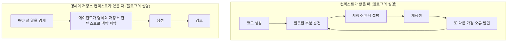

### 6.2 여섯 가지 컨텍스트

백서는 개발자가 고려할 컨텍스트를 여섯 종류로 나눕니다(백서 p.15).

첫째는 지침(Instructions)으로 에이전트의 핵심 역할, 목표, 운영 경계입니다. 둘째는 지식(Knowledge)으로 검색된 문서, 아키텍처 다이어그램, 도메인 데이터입니다. 셋째는 메모리(Memory)로 방금 일어난 일을 담은 단기 세션 로그와 프로젝트가 무엇인지를 담은 장기 지속 상태입니다. 넷째는 예시(Examples)로 소수 샷 행동 시연과 코드베이스의 참조 패턴입니다. 다섯째는 도구(Tools)로 에이전트가 호출할 수 있는 API, 스크립트, 외부 서비스의 정밀한 정의입니다. 여섯째는 가드레일(Guardrails)로 강한 제약, 형식 규칙, 안전 검증입니다.

### 6.3 정적 컨텍스트와 동적 컨텍스트

여섯 요소를 에이전트가 처음부터 갖고 있을 것인지, 필요할 때 가져올 것인지의 균형이 설계 문제입니다. 백서는 이를 정적과 동적으로 나눕니다(백서 p.16).

**정적 컨텍스트**는 항상 로드됩니다. 시스템 지침, 규칙 파일(AGENTS.md, CLAUDE.md, GEMINI.md), 전역 메모리, 페르소나 정의가 여기 속합니다. 에이전트가 누구이고 어떻게 행동하는지를 정하지만, 모든 토큰이 모든 상호작용에 실리므로 관련 여부와 무관하게 비용이 큽니다. **동적 컨텍스트**는 필요할 때 로드됩니다. 작업 매칭으로 발동하는 스킬 지침, 실행 중 가져온 도구 결과, RAG 파이프라인에서 가져온 문서, 창으로 잘라 쓰는 세션 기록이 여기 속합니다. 필요한 순간에만 토큰 비용을 치르므로 효율적입니다. 정적 컨텍스트가 너무 많으면 토큰을 낭비하고 신호가 희석되며, 너무 적으면 에이전트가 중요한 규칙을 잊습니다. 그래서 백서는 이 경계를 다른 설정과 똑같이 리뷰하고 버전 관리하는 일급 아키텍처 결정으로 다루라고 권합니다. 블로그도 같은 요지를 짧게 전합니다(블로그).

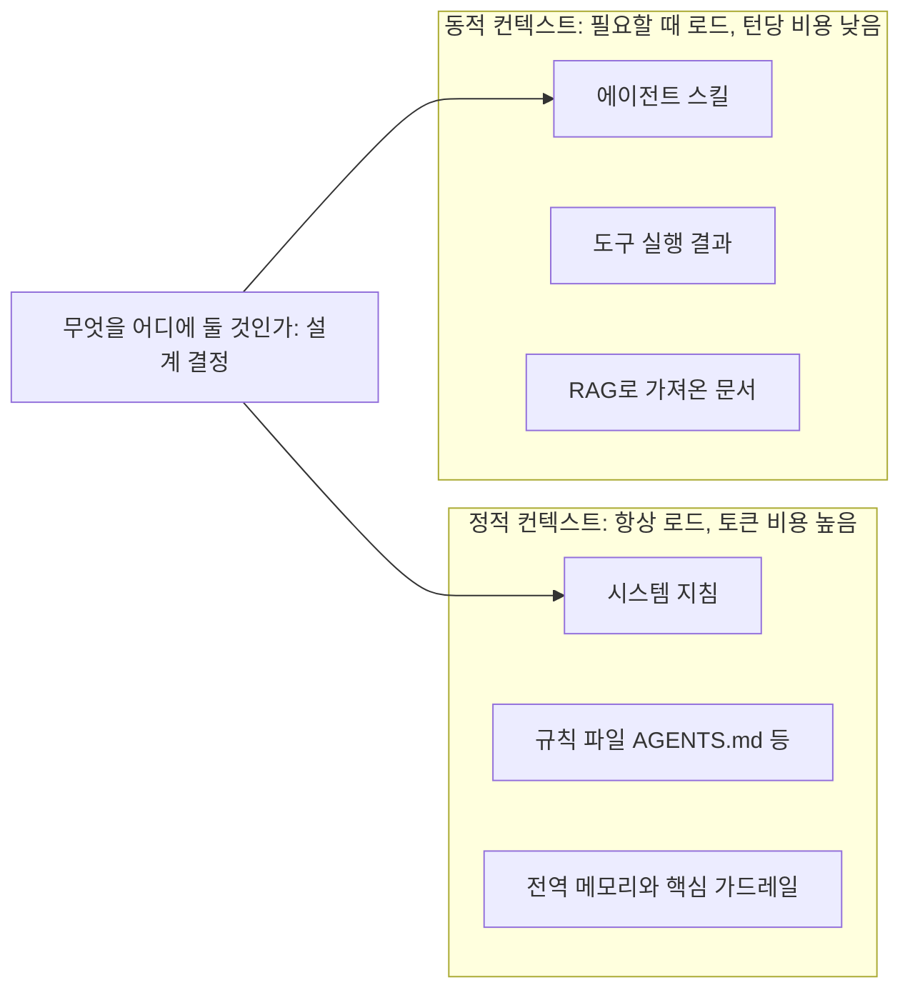

### 6.4 에이전트 스킬: 동적 컨텍스트의 핵심 패턴

백서는 동적 컨텍스트를 관리하는 가장 강력한 패턴으로 **에이전트 스킬**을 꼽습니다. 스킬은 에이전트가 작업이 요구할 때만 불러오는 구조화되고 이식 가능한 절차 지식 꾸러미입니다. 모든 전문 지식을 시스템 프롬프트에 욱여넣는 대신, 에이전트는 가벼운 제너럴리스트로 남았다가 필요할 때 전문가 역할로 바뀝니다. 이때 쓰는 방식이 점진적 공개(progressive disclosure)입니다. 에이전트는 시작할 때 가벼운 메타데이터만 보고, 작업이 맞으면 전체 지침을 로드하고, 깊은 참고 자료는 명시적으로 필요할 때만 가져옵니다. 그래서 수십 개의 전문 능력을 지니고도 지금 쓰는 하나의 비용만 치릅니다(백서 p.17).

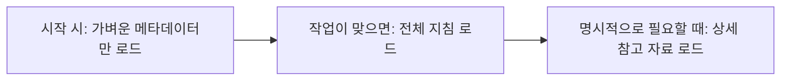

백서는 스킬이 빠르게 퍼진 이유를 네 가지 문제를 풀어 주기 때문이라고 정리합니다. 과적재된 프롬프트에서 생기는 컨텍스트 부패(context rot), LLM에게 절차 기억이 없다는 문제, 다중 에이전트 아키텍처의 운영 부담, 도구와 벤더를 넘나드는 이식성의 필요입니다(백서 p.18).

(최신 확인) 스킬이 업계 공통 요소가 되고 있다는 흐름은 검색에서도 보입니다. GitHub CLI에 에이전트 스킬을 설치, 고정, 게시하는 `gh skill` 미리보기 기능이 있고 여러 코딩 에이전트 호스트를 대상으로 하는 개방형 에이전트 스킬 명세를 따른다고 소개한 글이 있습니다. 다만 이 기능의 정확한 현재 상태는 공식 문서에서 확인하는 것이 안전합니다.

---

## 7. 새로운 소프트웨어 개발 수명주기(SDLC)

### 7.1 전통적 SDLC가 받는 압력

백서는 SDLC가 이미 한 번 큰 변환을 겪었다고 상기시킵니다. 지난 20년간 기업은 순차적 폭포수 프로세스에서 애자일 스프린트, 지속적 통합, DevOps 파이프라인, 빠른 릴리스 주기 같은 반복 모델로 옮겨 갔습니다. AI는 이 주기를 극적으로, 그러나 고르지 않게 압축합니다. 몇 주 걸리던 구현이 몇 시간에 끝나는 반면 요구사항, 아키텍처, 검증은 여전히 사람의 속도로 움직입니다. 결과는 옛 SDLC의 가속판이 아니라 다른 워크플로이며, 단계 사이의 경계가 흐려지고 반복 주기는 주 단위에서 분 단위로 줄고 개발자의 역할은 주 구현자에서 시스템 설계자이자 품질 판정자로 이동합니다(백서 p.19).

백서 20쪽의 비교 도표는 전통적 반복형 SDLC의 단계별 소요를 요구사항 2~3일, 설계 1~2일, 구현 1~3주, 테스트 3~5일, 리뷰와 배포 2~3일, 유지보수 지속으로 예시하고 스프린트 주기를 "주 단위"로 둡니다. AI 기반 SDLC는 같은 단계가 있되 병목이 달라서, 요구사항에서는 명세의 질이 새 병목이고, 설계에서는 아키텍처 결정이 규모 있게 증폭되며, 구현은 분에서 시간 단위이고, 테스트에서는 결과 평가와 궤적 평가를 함께 하며, 주기는 "분에서 시간"이라고 표시합니다. 이 소요 시간은 개념을 보여 주는 예시이며 실측 통계로 제시된 것은 아닙니다.

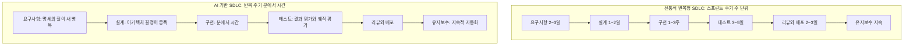

백서는 이 비교가 2026년 중반 시점의 모습이며 빠르게 바뀌고 있다고 못 박습니다. 압축이 구현 너머로 번지고 있고, 일부 팀은 명세에서 곧바로 리뷰로 가고 구현, 테스트, 배포를 에이전트가 배경에서 처리하는 워크플로를 실험하고 있으며, 여기서 그은 경계는 12개월 뒤 다르게 보일 수 있다는 것입니다. 변하지 않을 것은 사람의 판단, 취향, AI 출력을 검증하는 기술이라고 말합니다(백서 p.20).

### 7.2 단계별 변화

**요구사항과 계획.** 의도와 구현의 간극이 역사적으로 가장 넓었던 단계입니다. AI는 제품 개요에서 사용자 스토리를 만들고, 사람이 놓친 엣지 케이스를 찾고, 자연어 설명에서 API 스키마를 만들고, 명세 문서에서 상호작용 프로토타입을 만드는 식으로 요구사항 정제에 직접 참여합니다. 설명에서 동작하는 프로토타입까지 몇 분이면 되어 요구사항과 프로토타입 사이 피드백 루프가 거의 0이 됩니다. 요구사항은 팀 사이에 넘기는 문서가 아니라 사람과 AI의 대화가 되어 명세와 초기 구현을 동시에 만들어 냅니다(백서 p.21).

**설계와 아키텍처.** 가장 끈질기게 사람 중심으로 남는 단계입니다. 아키텍처 결정은 일관성 대 가용성, 복잡성 대 유연성, 구축 대 구매 같은 트레이드오프이고, 이는 사업 맥락, 조직 제약, 장기 전략에 달려 있어 AI가 온전히 파악하지 못한다는 것이 이유입니다. 반면 결정이 내려진 뒤 그것을 구현하는 데는 AI가 뛰어납니다. 개발자의 역할은 보일러플레이트를 쓰는 일에서 그 보일러플레이트가 구현하는 구조적 결정을 내리고 문서화하는 일로 바뀝니다(백서 p.21~22).

**구현.** 현대 코딩 에이전트는 자연어 설명으로 기능 전체를 만들고, 복잡한 알고리즘을 구현하고, 함께 올바르게 동작하는 다중 파일 변경을 만들어 냅니다. 백서는 업계 조사에서 25~39%의 생산성 향상이 보고된다고 적습니다(백서 p.22). 그러나 실상은 헤드라인 수치보다 미묘하다며 METR 연구를 인용합니다. 숙련 개발자가 AI 도구를 쓸 때 특정 작업에서 오히려 19% 더 오래 걸렸고, 백서는 그 원인을 주로 AI 출력을 검증하고 디버깅하고 바로잡는 데 든 시간으로 해석합니다. 결론은 AI가 구현 노동을 없애는 것이 아니라 쓰기에서 검토, 안내, 검증으로 바꾼다는 것입니다(백서 p.22).

> **(최신 확인) METR 연구의 후속 결과.** 이 대목은 최신 정보와 함께 읽어야 정확합니다. 백서가 인용한 19% 느림은 METR의 2025년 초 무작위 대조 실험(숙련된 오픈소스 개발자 16명, 실제 이슈 246건)의 결과입니다. 개발자들은 24% 빨라질 것으로 예상했고 전문가 예측은 38~39% 단축이었지만, 실제로는 19% 더 걸렸습니다. 그런데 METR은 2026년 2월 24일 업데이트에서 2025년 후반 데이터에 속도 향상의 증거가 일부 보인다고 밝혔습니다. 2차 보도들은 같은 계열의 개발자 집단에서 약 18% 빨라진 방향의 추정이 나왔다고 전하지만, 신뢰구간이 넓고 METR 스스로 선택 편향과, 여러 에이전트를 동시에 쓰는 개발자의 작업 시간 측정이 부정확하다는 한계를 지적했다고 합니다. 또 일부 개발자가 AI 없이 일하기를 거부해 반복 실험 자체가 어려워졌다는 보도도 있습니다. 즉 "AI는 숙련 개발자를 느리게 만든다"는 2025년 결과를 현재의 일반 결론처럼 인용하면 곤란하고, 최신 추정은 방향이 바뀌었으나 불확실성이 크다고 이해하는 것이 정확합니다. 백서가 이 후속 결과를 반영하지 않은 것은 백서의 작성 시점 이전 연구를 인용했기 때문으로 보이며, 이는 제 해석이므로 확정은 아닙니다.

**테스트와 품질 보증.** AI가 만든 코드는 무엇을 만들었는지뿐 아니라 어떻게 거기 도달했는지까지 평가해야 합니다. **출력 평가**는 최종 산출물이 컴파일되는지, 테스트가 통과하는지를 봅니다. **궤적 평가**는 도구 호출 순서와 중간 추론의 전체 흐름을 봅니다. 백서는 둘 다 필요한 이유로, 검증 단계를 건너뛰고도 매끄러워 보이는 출력이 눈에 보이는 오류보다 더 위험한 실패이기 때문이라고 설명합니다(백서 p.22). AI는 사람이 떠올리지 못할 엣지 케이스나 속성 기반 테스트를 만들 수도 있고, 더 중요하게는 테스트와 평가가 AI에게 의도를 전달하는 주된 수단이 됩니다. 잘 쓴 평가 스위트는 AI에게 "올바르다"가 무엇인지 알려 주고 자동 검증 수단도 줍니다(백서 p.23).

백서는 이런 실천이 지속적 품질 플라이휠로 묶일 때 가장 효과적이라고 말합니다. 벤치마크 스위트로 평가하고, 실패의 근본 원인을 군집화해 진단하고, 그 원인이 된 프롬프트나 도구를 최적화하고, 회귀 스위트로 수정을 검증하고, 운영 트래픽에서 새 실패 양상을 모니터링하는 순환이며, 한 바퀴 돌 때마다 효과가 복리로 쌓입니다(백서 p.23).

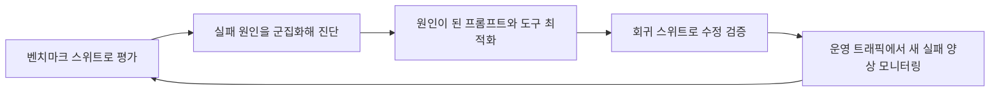

**코드 리뷰와 배포.** AI가 1차 리뷰어로서 버그, 스타일 위반, 보안 취약점, 성능 문제를 사람이 보기 전에 찾아 줍니다. 설계, 유지보수성, 전략 정합성 같은 맥락 의존 결정에는 여전히 사람의 판단이 필요하므로 사람 리뷰를 대체하지는 못하지만 리뷰어의 인지 부담을 크게 줄입니다. 배포 파이프라인도 AI를 인식하게 되어, 에이전트가 배포 상태를 감시하고 문제 있는 릴리스를 자동으로 롤백하고 변경의 성격과 범위로 배포 위험을 예측할 수 있습니다. 에이전트 출력이 늘어 PR 물량이 커질 때 사람 리뷰어에게 무엇이 달라지는지는 시리즈 5일 차 문서가 다룬다고 안내합니다(백서 p.23).

**유지보수와 진화.** 백서가 "가장 과소평가된 변화"로 꼽는 대목입니다. 신규 팀원에게는 뚫을 수 없던 레거시 코드베이스를 AI의 도움으로 탐색하고 이해하고 수정할 수 있게 됩니다. 에이전트는 코드베이스를 읽고 패턴을 이해하고 변경에 관련된 파일을 찾고 기존 아키텍처를 존중하며 수정합니다. 원작자만 이해해서 "건드리기에 너무 위험"하던 코드를 안전하게 리팩터링하고 현대화하고 확장할 수 있으며, 프레임워크 간 이전, 폐기된 API 갱신, 테스트 스위트 현대화처럼 너무 지루하고 위험해서 아예 하지 않던 작업이 가능해진다는 것이 기술 부채에 대한 함의입니다(백서 p.24).

---

## 8. 공장 모델: 코드를 만드는 시스템을 만든다

백서는 이 모든 변화를 묶는 사고 모델로 **공장 모델**을 제시합니다. 이 모델에서 개발자의 주된 산출물은 코드가 아니라 코드를 만들어 내는 시스템입니다. 그 시스템에는 무엇을 만들지 정의하는 명세와 컨텍스트, 명세를 구현으로 번역하는 에이전트, 정확성을 검증하는 테스트와 품질 게이트, 실패를 에이전트에게 되돌려 보내 수정하게 하는 피드백 루프, 에이전트를 안전하고 예측 가능한 행동에 가두는 가드레일이 들어갑니다(백서 p.24).

비유는 공장 관리자입니다. 공장 관리자는 모든 제품을 손으로 조립하지 않고 조립 라인을 설계하고 품질 관리를 보장합니다. 현대의 개발자는 개발 시스템을 설계하고 그 출력이 요구 수준을 충족하는지 보장하며, 성공은 에이전트에게 단계별 지시 대신 성공 기준을 주고 반복하게 하는 데서 나온다고 백서는 말합니다(백서 p.25).

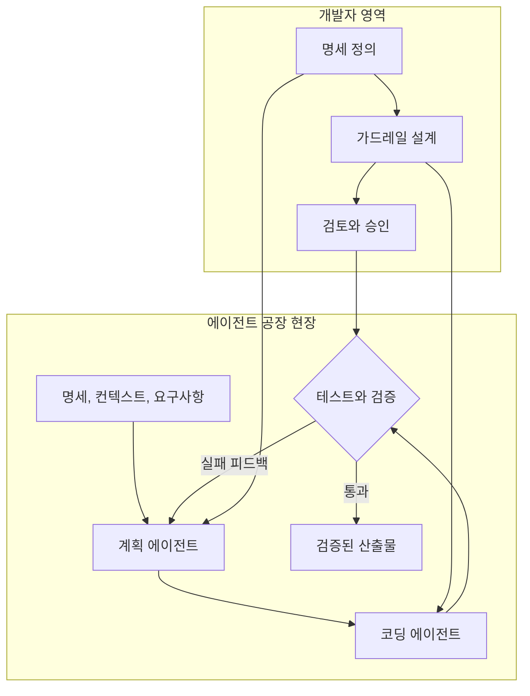

블로그 글쓴이는 이 모델에 공감하면서도 선을 긋습니다. 개발자가 갑자기 코드를 쓰지 않게 된다고 생각하지는 않지만, 직접 코드를 쓰는 시간의 비중은 줄고 AI가 개발 과정에 참여하는 방식을 설계하는 시간의 비중이 늘 것이라는 것입니다(블로그). 이 문장은 글쓴이의 전망이지 백서의 인용이 아닙니다.

---

## 9. 하네스 엔지니어링: 모델을 둘러싼 모든 것

### 9.1 에이전트 = 모델 + 하네스

백서는 개발자가 에이전트를 처음 쓸 때 모델을 시스템 전체와 동일시하는 유혹이 있다고 말합니다. 새 모델이 나오면 에이전트가 똑똑해지고 오래된 모델이면 나빠지니, 모델이 모든 좋고 나쁨의 설명이 되어 버린다는 것입니다. 백서는 이 직관이 틀렸고 잘못된 투자로 이어진다고 말합니다. 모델은 실행 중인 에이전트의 한 입력일 뿐이고, 프롬프트, 도구, 컨텍스트 정책, 훅, 샌드박스, 서브 에이전트, 관측 가능성 같은 나머지 전부가 **하네스**, 곧 모델이 실제로 무언가를 끝내게 해 주는 모델 주위의 비계(scaffolding)입니다. 그래서 등식은 다음과 같습니다(백서 p.26).

> **Agent = Model + Harness**

날것의 모델은 에이전트가 아니며, 하네스가 상태, 도구 실행, 피드백 루프, 강제 가능한 제약을 줄 때 비로소 에이전트가 됩니다. 개발자가 Claude Code, Cursor, Codex, Antigravity, Aider, Cline을 쓸 때 겪는 행동은 아래 어떤 모델이 깔려 있느냐 못지않게 하네스가 하는 일이 좌우한다는 것이 백서의 주장입니다(백서 p.27). 백서의 도해는 모델을 엔진에, 하네스를 자동차와 도로와 교통법규에 비유하고 모델 약 10%, 하네스 약 90%로 표기하는데, 이 비율은 비유를 위한 표기이며 측정된 값으로 설명되지 않습니다.

### 9.2 하네스를 이루는 여섯 가지

백서가 꼽는 하네스의 구성은 다음과 같습니다(백서 p.28). 지침과 규칙 파일은 에이전트가 누구이고 무엇을 중시하며 무엇이 금지인지 정하는 텍스트로 AGENTS.md, CLAUDE.md, GEMINI.md, 스킬 파일, 서브 에이전트 프롬프트를 포함합니다. 도구는 에이전트가 호출할 함수, MCP 서버, API와 언제 어떻게 부를지 알려 주는 설명문입니다. 샌드박스와 실행 환경은 에이전트의 코드가 실제로 도는 곳과 접근할 수 있는 것, 없는 것입니다. 오케스트레이션 로직은 서브 에이전트 생성, 모델 라우팅, 전문가 사이 인계, 각자가 언제 발동하는지의 규칙입니다. 가드레일과 훅은 도구 호출 전, 파일 수정 후, 커밋 전 같은 생애주기 지점에서 도는 결정적 코드로, 에이전트가 잊어서는 안 되지만 자주 잊는 일을 맡깁니다. 관측 가능성은 로그, 추적, 평가, 비용과 지연 계측이며, 이것이 없으면 에이전트가 잘하고 있는지 조용히 표류하는지 알 길이 없습니다. 백서는 이 표면적이 넓고, 그것이 모델 제공자가 아니라 팀의 몫이라고 못 박습니다.

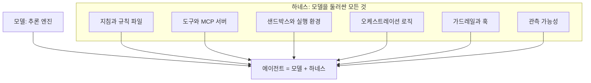

### 9.3 SDLC 단계마다 하네스가 하는 일

백서는 하네스가 에이전트가 일하는 모든 단계에 있어야 한다며 네 단계로 설명합니다(백서 p.29~30).

요구사항, 계획, 아키텍처 단계는 "하네스를 구성하는" 단계입니다. AI가 프로덕션 코드를 쓰기 전에 개발자가 AGENTS.md 같은 규칙 파일과 아키텍처 제약을 만들고, 에이전트가 쓸 도구(특정 API나 데이터베이스 스키마)를 정하며 어길 수 없는 기본 규칙을 세웁니다. 구현 단계는 "하네스를 실행하는" 단계로, 모델이 코드를 생성하면 하네스의 격리된 샌드박스에서 실행하고 파일을 읽거나 웹을 검색할 때는 하네스가 제공한 도구를 씁니다. 테스트와 QA 단계는 "피드백 루프"입니다. 하네스가 자동화된 테스트를 돌릴 실행 환경을 제공하고, 테스트가 실패하면 오케스트레이션 로직이 오류 출력을 잡아 모델에게 되돌려 다시 시도하게 하며, 이것이 자동화된 생각-행동-관찰 루프를 만듭니다. 코드 리뷰, 배포, 유지보수 단계는 "하네스를 관찰하는" 단계로, 예를 들어 에이전트가 하드코딩된 비밀번호를 푸시하려 하면 결정적 훅이 커밋을 막고, 관측 계층이 토큰 비용, 지연, 에이전트 표류를 추적해 사람이 에이전트가 특정 배포 결정을 왜 내렸는지 감사할 수 있게 합니다.

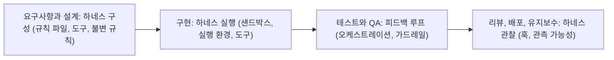

### 9.4 "바이브 코딩"과 "에이전틱 엔지니어링"의 실제 경계

백서는 둘의 차이가 쓰는 도구에 있지 않다고 강조합니다. 같은 에이전트로 바이브 코딩도, 에이전틱 엔지니어링도 할 수 있습니다. 차이는 하네스를 얼마나 의도적으로 구성하고 적용하느냐입니다. 바이브 코딩은 순수한 빠른 구현을 겨냥한 최소한의, 암묵적인 비계에 의존하고, 에이전틱 엔지니어링은 첫 기획 문서부터 프로덕션 모니터링까지 AI를 이끄는 명확하고 광범위한 하네스 추상화에 의존합니다(백서 p.31).

### 9.5 하네스의 효과: 벤치마크 근거와 최신 확인

백서는 하네스 효과의 크기를 공개 벤치마크로 보여 준다며 두 가지를 말합니다. 하나는 Terminal Bench 2.0에서 한 팀이 모델은 그대로 두고 하네스만 바꿔 코딩 에이전트를 상위 30위 밖에서 상위 5위로 올렸다는 것이고, 다른 하나는 LangChain의 별도 연구가 고정된 모델 주위의 시스템 프롬프트, 도구, 미들웨어만 손봐 같은 벤치마크 점수를 13.7점 올렸다는 것입니다(백서 p.31). 백서는 이 두 가지의 출처를 미주에서 명확히 밝히지 않습니다.

(최신 확인) 검색 결과로는 두 사례가 사실상 같은 실험으로 보입니다. 2026년 2월 17일 보도에 따르면 LangChain의 코딩 에이전트(Deep Agents)가 Terminal Bench 2.0에서 52.8%에서 66.5%로 13.7점 올라 상위 30위 밖에서 상위 5위로 진입했고, 그동안 GPT-5.2-Codex 모델은 고정한 채 시스템 프롬프트, 도구, 미들웨어 훅만 바꿨습니다. 개선 요소로는 자기 검증을 유도하는 장치, 작업 환경 정보를 미리 주입하는 로컬 컨텍스트 미들웨어, 같은 파일을 반복 수정하면 접근을 재고하라고 알리는 루프 감지 미들웨어, 시간 예산 관리가 소개되었습니다. 백서가 이를 "별개의 두 사례"로 서술했는지, 같은 사례를 두 방식으로 서술했는지는 백서만으로는 단정할 수 없으므로 "보도상 동일 사례로 보인다"까지만 말씀드립니다. Terminal-Bench 2.0 자체는 스탠퍼드와 Laude Institute가 만든 89개 과제의 벤치마크로, 2025년 11월에 공개되었고 arXiv 논문(2601.11868)이 있습니다. 벤치마크 순위는 계속 바뀌므로 현재 순위는 공식 리더보드에서 확인해야 합니다.

핵심 시사점은 백서가 덧붙인 일상의 관찰입니다. 에이전트가 잘못하면 첫 본능은 모델 탓이지만, 더 자주 실패의 원인은 빠진 도구, 모호한 규칙, 없는 가드레일, 잡음으로 가득 찬 컨텍스트 창입니다. 백서는 "정직하게 들여다보면 대부분의 에이전트 실패는 구성 실패"라고 말합니다(백서 p.31). 블로그 글쓴이도 조직에서 모든 엔지니어에게 AI 코딩 도구를 주는 것은 쉽지만, 에이전트가 조직의 아키텍처, 보안 정책, 개발 관행, 품질 기준을 일관되게 따르도록 만드는 것은 전혀 다른 문제이며 엔지니어링 업무가 옮겨 갈 곳이 거기라고 적습니다(블로그).

---

## 10. 개발자의 진화하는 역할: 지휘자와 오케스트레이터

백서는 AI가 구현을 더 많이 맡으면서 개발자의 역할이 "흥미롭고도 당혹스럽게" 변한다고 하며, 개발자가 유동적으로 오가는 두 모드를 제시합니다(백서 p.31).

**지휘자(Conductor)** 모드에서 개발자는 AI 페어 프로그래머와 실시간으로 일합니다. IDE 안에서 코드가 나타나는 것을 보며 프롬프트와 수정으로 AI를 이끌고, 무엇이 쓰이는지 세밀하게 통제합니다. 복잡한 로직, 까다로운 디버깅, 낯선 코드베이스처럼 개발자가 변경을 하나하나 이해해야 하는 일에 알맞습니다. 전통 엔지니어링 배경의 개발자에게 자연스럽고 이해와 통제의 감각을 보존해 주지만, 모든 키 입력을 직접 지휘하면 처리량 향상이 제한되는 병목이 될 위험이 있습니다(백서 p.32~33).

**오케스트레이터(Orchestrator)** 모드에서 개발자는 더 높은 추상 수준에서 일합니다. 목표를 정의하고 에이전트에게 할당하고 결과를 검토하되 코드가 한 줄씩 나타나는 것을 보지 않습니다. 에이전트는 코드베이스의 다른 부분에서 배경에서 병렬로 일할 수 있고 개발자는 주기적으로 확인하며 방향을 수정합니다. 버그 수정, 확립된 패턴에 따른 기능 구현, 코드베이스 이전, 테스트 생성 같은 잘 정의된 과제에 알맞고, 샌드박스에서 저장소, 빌드 도구, 테스트 스위트에 전체 접근 권한을 가지고 비동기로 실행되는 방식입니다(백서 p.33). 이 모드는 문법과 언어 관용구의 깊은 전문성 대신 다음 네 가지 기술을 요구합니다. 모호함 없이 에이전트가 수행할 수 있게 과제를 정밀히 정의하는 **명세**, 큰 일을 에이전트가 실행하기 알맞은 크기로 나누는 **분해**, 에이전트 출력이 품질 기준을 충족하는지 빠르게 판단하는 **평가**, 에이전트를 생산적으로 유지하는 제약과 테스트와 피드백 루프를 설계하는 **시스템 설계**입니다(백서 p.33~34).

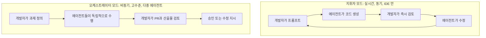

백서는 둘이 양자택일이 아니라 작업에 따라 둘을 오가는 것이라고 말하고, 블로그 글쓴이도 같은 경험을 적습니다. 낯설거나 구조적으로 복잡한 작업에서는 지금도 지휘자이고 싶고, 잘 정의된 이전, 테스트 생성, 반복적 코드 변경에서는 점점 오케스트레이터에 만족한다는 것입니다(블로그). 백서는 지휘자 모드의 대표 도구로 GitHub Copilot, Gemini Code Assist, Cursor, Windsurf를, 오케스트레이터 모드의 도구로 Google Jules, GitHub Copilot 에이전트 모드, Cursor 백그라운드 에이전트, Claude Code를 듭니다(백서 p.33). 도구 지형은 빠르게 바뀌는 만큼 이 목록은 작성 시점의 예시로 보시면 됩니다.

### 10.1 80% 문제

백서가 이름 붙인 **80% 문제**는 이렇습니다. AI 에이전트는 기능 코드의 약 80%를 빠르게 생성하지만, 나머지 20%, 곧 엣지 케이스, 오류 처리, 통합 지점, 미묘한 정확성 요구는 현재 모델이 자주 갖추지 못한 깊은 맥락 지식을 요구합니다. AI의 오류도 단순한 문법 실수에서 더 교묘한 개념적 실패로 진화했습니다. 비즈니스 로직에 대한 잘못된 가정, 모호한 요구사항을 두고 명확화를 구하지 않는 것, 빠진 엣지 케이스, 미묘한 장기 유지보수 부담을 만드는 아키텍처 결정 같은 것입니다. 코드가 "올바르게 보이고" 기본 테스트를 통과하기까지 하므로 오히려 발견하기 어렵습니다. 이 난관을 잘 넘는 개발자는 AI가 잘하는 일(명세가 잘 된 과제의 빠른 구현)에는 AI를 쓰고, AI가 어려워하는 일(모호한 요구사항, 아키텍처 트레이드오프, 정확성 검증)에는 자기 주의를 아껴 둡니다. 백서의 표현으로 이들은 AI가 만든 것을 다 받아들여서 빨라지려 하지 않고, 전문성이 가장 중요한 곳에 집중해서 빨라지려 합니다(백서 p.34).

블로그는 이 대목을 가장 크게 와닿은 부분으로 꼽습니다. 다만 수치는 "첫 70~80%"라고 조금 달리 쓰며(블로그), 백서는 "약 80%와 나머지 20%"입니다(백서 p.34). 두 표현의 취지는 같지만 숫자는 백서 쪽을 기준으로 삼는 것이 정확합니다. 80이라는 숫자 자체도 정밀 측정이 아니라 "대부분은 빠르고 마지막이 어렵다"는 감각을 표현하는 이름으로 이해하시기 바랍니다. 블로그 글쓴이는 코드가 컴파일되고 테스트도 통과할 수 있지만 그것이 정확성을 보장하지 않는다는 점, 그리고 에이전트가 엣지 케이스를 오해했거나 아키텍처 가정을 어긴 지름길을 택했거나 당장의 문제를 풀면서 시스템을 유지하기 어렵게 만들 수 있다는 점을 자기 경험으로 덧붙입니다(블로그).

---

## 11. 실전: 코딩 에이전트는 개발자의 하루 어디에 들어오나

### 11.1 세 곳에 동시에

백서는 코딩 에이전트가 일상 업무의 세 곳에 나타나고 대부분의 개발자가 셋을 동시에 쓴다고 합니다(백서 p.35~36). **에디터 안**에서는 입력 중 다음 줄을 제안하는 인라인 완성, 코드를 제자리에서 설명하거나 수정하는 채팅 패널, IDE 안의 코드베이스 전체 인식이 있으며 GitHub Copilot, Cursor, Windsurf, JetBrains AI Assistant가 예시입니다. **터미널 안**에서는 명령줄에서 에이전트를 띄워 평이한 언어로 목표를 주면 코드베이스 전반에서 일하며, 전체 파일 시스템 접근, 다중 파일 수정, 도구와 테스트를 돌려 결과에 따라 반복하는 능력이 있습니다. 백서는 "진지한 바이브 코딩이 오늘날 일어나는 곳"이라 부르며 Antigravity CLI, Claude Code, Codex CLI, Open Code, Cline을 예로 듭니다. **배경에서**는 클라우드 샌드박스에서 몇 시간씩 자율적으로 돌며 풀 리퀘스트를 산출물로 내놓는 에이전트로, 개발자는 맡겨 놓고 나중에 검토합니다. Google Jules, GitHub Copilot 에이전트 모드, Cursor 백그라운드 에이전트, 구글의 알고리즘 설계용 AlphaEvolve가 예로 나옵니다.

선택 기준은 작업입니다. 코드를 쓰는 중에 제안, 빠른 수정, 설명이 필요하면 에디터 에이전트, 다중 파일 작업이나 낯선 코드베이스 탐색이나 에이전트가 코드를 실행하고 관찰에 반응해야 하는 작업에는 터미널 에이전트, 한 문단으로 설명하고 떠날 수 있는 잘 정의된 작업(알려진 버그 수정, 테스트 스위트 생성, 프레임워크 이전)에는 배경 에이전트가 맞습니다. 백서는 "올바른 출발점은 작업에 달려 있지, 어느 범주가 자율성의 사다리 위쪽에 있느냐에 달려 있지 않다"고 말합니다(백서 p.36).

### 11.2 에이전트 자체를 바이브 코딩으로 만든다

여기까지가 코딩 에이전트로 소프트웨어를 만드는 이야기라면, 만들려는 것이 에이전트 자체라면 어떨까요. 환불 요청을 처리하는 고객 지원 봇, 출처를 교차 참조해 근거 있는 보고서를 쓰는 리서치 어시스턴트, 컴플라이언스를 감시하고 이상을 표시하는 내부 도구는 터미널의 코딩 에이전트로 풀 일이 아니라, 자기 도구, 메모리, 평가, 배포 인프라가 필요한 제품입니다. 백서는 프로토타입 스크립트를 만들던 터미널 중심 워크플로가 이제 이런 프로덕션 에이전트에도 닿았다고 말합니다. 영속 메모리, 거버넌스, 관측 가능성을 갖춘 실제 에이전트를 만들고 평가하고 배포하는 일이 프레임워크와 클라우드 콘솔 작업에서 같은 터미널에서 같은 코딩 에이전트와 대화하는 일로 옮겨 왔다는 것입니다(백서 p.36~37).

### 11.3 Agents CLI

백서는 구글의 **Agents CLI**를 이 아이디어의 구현으로 소개합니다. 구글 클라우드에서 에이전트를 만드는 스킬을 묶은 작은 명령줄 도구이며, 개발자가 선호하는 어떤 코딩 에이전트(Claude Code, Codex 등)와도 함께 동작합니다. 한 번 설치하면 코딩 에이전트가 ADK 수명주기 전체, 곧 프로젝트 스캐폴딩, 에이전트 코드 작성, 평가, Agent Runtime 배포, 관측 가능성 연결을 다루는 일곱 가지 새 스킬을 얻고, 개발자는 새 SDK를 배우는 대신 원하는 것을 설명하면 됩니다(백서 p.37). 직접 몰고 싶은 개발자를 위해 같은 작업이 `agents-cli create`, `agents-cli playground`, `agents-cli eval`, `agents-cli deploy` 명령으로도 제공됩니다(백서 p.38).

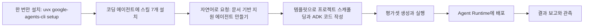

(최신 확인) 검색 결과로 확인되는 내용은 다음과 같습니다. Agents CLI는 구글의 오픈소스 도구로 2026년 4월 8일 공개된 것으로 한 정보 사이트가 기록하고 있고, PyPI 패키지명은 `google-agents-cli`이며, 코딩 에이전트 자체가 아니라 CLI와 일곱 개 스킬 파일을 기존 코딩 에이전트에 설치하는 형태라고 설명됩니다. 설치 안내에는 Node.js가 스킬 설치 경로에 필요하다는 언급이 있습니다. 명칭 면에서는 소스마다 "Agent Runtime", "Agent Engine", "Gemini Enterprise Agent Platform", "Agent Platform"이 섞여 나옵니다. 백서의 코드 예시는 "Agent Engine"에 배포하라고 적지만 본문 설명은 "Agent Runtime"을 씁니다(백서 p.37~38). 구글 클라우드 제품명이 바뀌는 중일 가능성이 있으나 제가 그 사유를 확인하지는 못했으므로, 실제 사용 시에는 공식 문서(google.github.io/agents-cli)에서 현재 명칭과 명령을 확인하세요.

백서는 프로토타입과 프로덕션이 별개 스택과 워크플로이던 시절이 지나 "어제 노트북에서 돌던 프로토타입이 오늘 실사용자를 상대하는 프로덕션 에이전트가 될 수 있다"고 주장하며, 한 에이전트에서 여러 에이전트로 확장할 때 ADK의 그래프 기반 워크플로와 다중 에이전트 워크플로, 공유 세션 상태, LLM 주도 위임, 명시적 호출을 조합하고, 에이전트 사이 조율은 간단하면 공유 세션 상태, 도구 접근은 MCP, 에이전트 간 위임은 A2A(Agent2Agent) 프로토콜로 한다고 설명합니다(백서 p.38).

### 11.4 사례: 에이전트 팀이 C 컴파일러를 만들다

백서는 Anthropic 엔지니어링 팀이 2026년 초 공개한 실험을 인용합니다. 에이전트 팀이 두 주에 걸쳐 Rust로 동작하는 C 컴파일러를 만들었고, 사람은 방향을 정하고 출력을 검토했지만 구현을 직접 쓰지는 않았으며, 병목이 코드 작성에서 무엇을 해야 하는지 명세하고 에이전트가 해냈는지 검증하는 일로 이동했다는 것입니다(백서 p.38~39).

(최신 확인) 이 사례는 여러 보도로 교차 확인됩니다. 연구자 Nicholas Carlini가 Claude Opus 4.6의 "에이전트 팀" 기능으로 16개 인스턴스를 각자 Docker 컨테이너에서 돌려, 공유 Git 저장소를 복제하고 잠금 파일로 과제를 선점한 뒤 완성한 코드를 푸시하게 했고, 이를 조율하는 별도의 지휘 에이전트는 두지 않았다고 보도됩니다. 규모는 약 2주, 약 2,000건의 Claude Code 세션, 약 10만 줄의 Rust 코드, 약 2만 달러의 API 비용이며, 결과물은 x86, ARM, RISC-V용 Linux 6.9 커널을 컴파일할 수 있고 PostgreSQL, SQLite, Redis, FFmpeg, QEMU 같은 오픈소스 프로젝트도 빌드했다고 합니다. 원 출처는 Anthropic 엔지니어링 블로그의 「Building a C compiler with a team of parallel Claudes」로 소개됩니다. 중요한 단서도 있습니다. 보도에 따르면 Anthropic 스스로 이 컴파일러가 프로덕션 준비 상태가 아니며 생성 코드의 효율이 낮고 Rust 코드 품질이 숙련 전문가 수준에 못 미친다고 밝혔고, 일부 커뮤니티 반응에는 한계를 더 비판하는 의견도 있습니다. 또 이 실험은 백서가 설명하는 ADK, MCP, A2A 기반이 아니라 Claude Code의 에이전트 팀과 저장소 기반 조율을 쓴 것으로 보도되었는데, 백서의 "이런 종류의 아키텍처"라는 표현이 어디까지를 가리키는지는 불명확합니다. 한 2차 분석은 에이전트 팀이 장기 작업을 지속하려면 실행 상태를 저장소, 빌드 시스템, 테스트 결과로 외부화해야 하고, 완료 판단은 에이전트가 스스로 내리지 못한다는 점을 시사점으로 꼽았습니다. 이는 백서의 "명세와 검증이 병목"이라는 주장과 결이 같습니다.

---

## 12. AI 개발의 경제학: 속도가 아니라 총소유비용

### 12.1 문제 제기

AI의 영향을 평가할 때 대화는 흔히 "코드를 얼마나 빨리 쓰나"라는 개발자 속도에서 시작해서 끝납니다. 백서는 엔지니어링 리더에게 더 중요한 지표가 총소유비용(TCO)이라고 말합니다. 워크플로에 따라 재무적, 운영적 부담이 CapEx(무언가를 만드는 초기 투자)와 OpEx(그것을 돌리고 고치고 유지하는 지속 비용)로 이동하는 방식이 다르고, AI 시대의 OpEx는 **토큰 경제**가 크게 좌우한다고 설명합니다(백서 p.39).

### 12.2 바이브 코딩의 숨은 부채 (낮은 CapEx, 높은 OpEx)

바이브 코딩은 언뜻 비용 효율이 극단적으로 좋아 보입니다. 진입 장벽은 사실상 0이고 AI 어시스턴트 월 구독과 몇 번의 가벼운 프롬프트면 되므로, 시스템 설계에 시간을 쓰지 않고 모델의 기본 능력에만 기대는 탓에 CapEx는 미미합니다. 그러나 백서는 그 뒤에 복리로 쌓이는 OpEx가 숨어 있다고 말합니다(백서 p.40~41).

첫째는 **토큰 소각률**입니다. 바이브 코딩에서 개발자는 구조화되지 않은 큰 파일을 컨텍스트 창에 쏟아붓고 모델이 낸 검증되지 않은 실수를 모델에게 반복해서 고치게 합니다. 이는 첫 시도 성공률이 낮은 값비싼 "프롬프팅 루프"를 만듭니다. 둘째는 **유지보수세**입니다. 즉흥적 프롬프팅으로 쓴 코드는 구조적 일관성이 없는 경우가 많아, 6개월 뒤 버그가 나면 사람이 AI가 만든 "스파게티 코드"를 역공학하느라 며칠을 씁니다. 셋째는 **보안 수정**입니다. 자동화된 평가 하네스가 없으면 코드의 빠른 생성이 취약점의 빠른 생성으로 이어지고, 운영에서 보안 결함을 고치는 비용은 설계 단계에서 잡는 비용보다 훨씬 큽니다.

### 12.3 에이전틱 엔지니어링의 투자 (높은 CapEx, 낮은 OpEx)

에이전틱 엔지니어링은 이 경제 모델을 뒤집습니다. 프로덕션 코드 한 줄이 생성되기 전에 엔지니어링 시간과 자원을 의도적으로 선투자해야 합니다. 이때 CapEx는 API 스키마 설계, 결정적 테스트 스위트 구축, 그리고 무엇보다 에이전트 컨텍스트 구조화를 포함합니다. 초기 비용은 더 높지만, 기능을 출시하고 유지하는 한계 비용은 극적으로 떨어집니다. AI가 엄격하게 통제되는 "공장" 안에서 일하므로 출력이 구조적으로 건전하고, 사전 테스트되었으며, 회사 표준에 맞다는 것이 백서의 논리입니다(백서 p.41).

백서 40쪽의 개념도는 두 곡선이 교차하는 지점을 표시하고, 거기서부터는 바이브 코딩이 기능당 3~10배 더 비싸다고 적습니다. 이 수치는 개념도에 붙은 표기이며 본문에서 실측 근거가 제시되지 않았으므로 정량적 사실로 받아들이지는 마세요. 곡선의 모양, 곧 "초기에는 바이브 코딩이 싸지만 시간이 갈수록 총비용이 역전된다"는 구조가 백서의 주장입니다. 이 역전을 실제 조직 데이터로 실증한 근거도 백서에는 제시되지 않습니다.

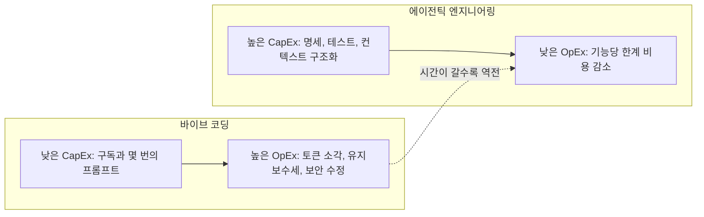

블로그 글쓴이는 이 주장을 자기 말로 이렇게 풀어 쓰며 가장 설득력 있는 부분 중 하나로 꼽습니다. 구현 자체가 비쌌던 때는 구현 시간을 줄이는 쪽으로 최적화했지만, 구현이 훨씬 싸지면 명세를 더 잘 쓰는 데 한 시간을 더 쓰는 것이 오히려 더 빠른 길일 수 있다는 것입니다. 그래서 최적화 목표가 "얼마나 빨리 코딩을 시작할 수 있나"에서 "구현 전에 얼마나 명확히 해서 첫 구현이 이미 정답에 가깝게 만들 수 있나"로 바뀐다고 적습니다(블로그). 이 해석은 백서의 논지와 일치하지만 문장은 글쓴이의 것입니다.

### 12.4 컨텍스트 엔지니어링은 재무 레버

백서는 토큰 경제에서 컨텍스트 엔지니어링이 기술이자 재무 전략이라고 말합니다. LLM은 보내는 정보마다 비용을 받으므로, 10만 토큰짜리 저장소 전체를 모든 프롬프트에 넣는 것은 규모에서 재무적으로 성립하지 않습니다. 정확한 AGENTS.md와 아키텍처 가드레일 같은 조밀하고 신호가 높은 페이로드를 주면 에이전트의 첫 시도 성공률이 크게 올라 시행착오 루프를 피할 수 있습니다(백서 p.41~42). 더 나아가 동적 컨텍스트(스킬, MCP 서버 같은 도구 호출)로 OpEx를 최적화하는데 자세한 내용은 3일 차 문서에 맡깁니다(백서 p.42).

### 12.5 지능형 모델 라우팅

바이브 코딩에서 개발자는 오타를 고치거나 기본 단위 테스트를 만들 때에도 하나의 거대한 최전선 모델에 프리미엄 토큰 가격을 냅니다. 잘 설계된 공장 모델은 이 낭비를 피합니다. 요구사항, 아키텍처, 초기 구현 같은 복잡한 작업에는 크고 진보한 모델을 쓰고, 테스트 생성, 코드 리뷰, CI/CD 모니터링처럼 결정적이고 복잡도가 낮은 작업은 더 작고 빠르고 훨씬 싼 모델로 자동 라우팅합니다. 이렇게 다중 모델 생태계를 오케스트레이션하면 최고 품질을 유지하면서 운영 토큰 비용을 체계적으로 낮출 수 있다는 것입니다(백서 p.42).

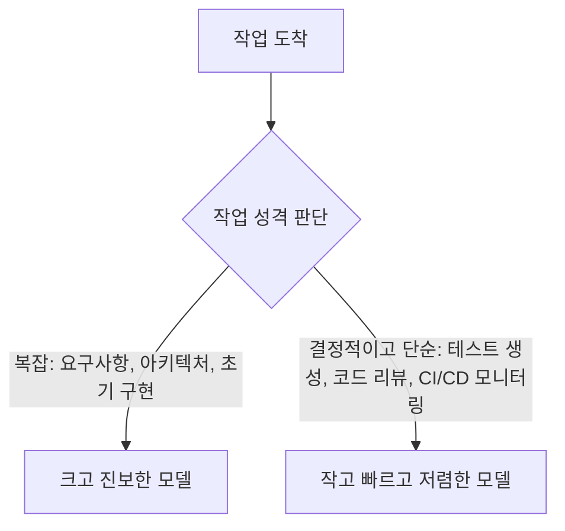

---

## 13. 어디서 시작할까: 실천 지침

백서의 실천 지침은 개인, 리더, 조직 세 층위로 나뉩니다. 공통 원칙은 "AI는 그것이 놓이는 엔지니어링 문화를 증폭한다"입니다(백서 p.43).

### 13.1 개인 개발자를 위한 여섯 가지

첫째, 프로젝트에 AGENTS.md(또는 쓰는 에이전트에 맞는 동등한 파일)를 만드는 것입니다. 스택, 관례, 절대 규칙, 워크플로 정도 열 줄로 시작하고, 에이전트가 다시는 하지 말아야 할 일을 할 때마다 규칙을 한 줄 더하라고 권합니다. 둘째, 에이전트를 만들고 평가하고 배포하고 최적화하는 스킬 묶음(Agents CLI 같은)을 코딩 에이전트에 설치하는 것입니다. 셋째, 반복적인 업무 하나를 골라 첫 에이전트로 만드는 것입니다. 프로토타입은 코딩 에이전트로 만들고 쓸 만하다고 입증되면 Agents CLI로 프로덕션 에이전트로 졸업시키라는 안내이며, 하나를 끝까지 만들어 보는 것이 백 개를 읽는 것보다 더 많이 가르쳐 준다고 말합니다. 넷째, 코드를 생성하기 전에 테스트와 평가를 쓰는 것입니다. 둘이 합쳐 AI와의 계약이며, 잘 쓴 테스트와 평가 스위트는 어떤 자연어 프롬프트보다 의도를 더 정확히 전달하고 AI 보조 개발을 바이브 코딩에서 에이전틱 엔지니어링으로 바꾼다고 합니다. 다섯째, 출시될 코드는 에이전트가 만든 모든 줄을 검토하는 것입니다. 영리해 보이는 것은 의심하고, import가 실재하는 패키지인지 확인하고, 오류 처리가 현실적인 실패 양상을 덮는지 검증하라고 합니다. 여섯째, 개발자 기술을 유지하는 것입니다. AI가 루틴을 처리해 개발자가 어려운 일에 집중하게 해 주려면 디버깅, 시스템 설계, 성능과 정확성에 대한 직관이 날카롭게 남아 있어야 하며, AI는 전문성을 대체하는 것이 아니라 더 큰 규모로 적용하는 방법이라고 말합니다(백서 p.43~44).

### 13.2 엔지니어링 리더를 위한 다섯 가지

첫째, 컨텍스트 엔지니어링을 팀의 일급 엔지니어링 실천으로 삼는 것입니다. AGENTS.md, 시스템 프롬프트, 평가 스위트, 스킬 라이브러리를 코드처럼 다뤄 PR로 리뷰하고, 프로젝트와 함께 버전 관리하며, 이름 있는 엔지니어가 소유하게 하라고 합니다. 그렇지 않으면 하네스가 표류하고 에이전트 행동이 팀 안에서 재현 불가능해진다고 경고합니다. 둘째, 기준을 데모가 아니라 평가에 두는 것입니다. 동작하는 데모는 에이전트가 한 번 성공할 수 있음을 증명하고, 통과하는 평가 스위트는 안정적으로 성공함을 증명하며, 루브릭 없는 평가는 아무것도 측정하지 못한다고 합니다. 점수 매길 대상(과제 성공, 도구 사용 품질, 궤적 준수, 환각, 응답 품질)을 정의하고, 공유 워크플로에 들어가는 모든 에이전트에게 명확한 루브릭이 있는 평가 커버리지를 전제 조건으로 요구하라는 것입니다. 셋째, AI 생성 코드를 위해 코드 리뷰를 다시 설계하는 것입니다. 사람이 쓴 코드와 같거나 더 높은 엄격함이 필요하며, 환각된 의존성, 부족한 오류 처리, 얼핏 맞아 보이는 미묘한 정확성 결함에 특히 주의하라고 합니다. 넷째, 팀 규범에서 프로토타이핑 작업과 프로덕션 작업을 구분하는 것입니다. 바이브 코딩은 탐색에 맞는 속도이고 에이전틱 엔지니어링은 프로덕션에 맞는 규율이며, 어떤 프로젝트, 브랜치, 환경에 어떤 방식이 필요한지 경계를 명시하라고 합니다. 이 구분이 흐리면 프로토타입이 사고로 출시된다는 것입니다. 다섯째, 하네스 구성요소를 팀 공유 자산에 투자하는 것입니다. 재사용 가능한 시스템 프롬프트, 스킬 라이브러리, MCP 서버 연결, 평가 하네스는 프로젝트를 가로질러 복리로 쌓이니 인프라처럼 문서화하고 유지하고 개선하라고 합니다(백서 p.44~45).

### 13.3 조직을 위한 다섯 가지

첫째, AI 보조 개발을 생산성 기능이 아니라 엔지니어링 투자로 다루는 것입니다. 가장 큰 이득을 보는 팀은 AI 도구에 평가 커버리지, 관측 가능성, 명확한 아키텍처 표준을 짝지은 팀이고, 그런 비계 없이 코딩 에이전트를 배포하면 품질 없는 속도가 나오고 이는 어떤 팀도 갚을 수 없는 속도로 기술 부채를 키운다고 경고합니다. 둘째, 규모를 키우기 전에 프로덕션 기반에 투자하는 것입니다. 노트북 위의 바이브 코딩 프로토타입은 프로덕션 시스템이 아니며, 둘을 가르는 것은 CI에서 도는 궤적과 최종 응답 평가, 에이전트 실행 전체의 추적, 에이전트별 범위 한정 권한, 생성 코드의 실패 양상에 맞춘 보안 리뷰라는 운영 규율입니다. 이 기반은 첫 프로덕션 에이전트가 나가기 전에 만들어야 합니다. 셋째, 도구와 에이전트 간 통신에 개방형 표준을 채택하는 것입니다. 도구 접근의 MCP와 에이전트 간 위임의 A2A가 다중 에이전트 시스템의 결합 조직으로 수렴하고 있으니, 지금 택하면 벤더와 프레임워크를 섞을 선택지를 열어 두고 나중에 플랫폼을 갈아엎는 일을 피한다는 것입니다. 넷째, 사람 전용도 에이전트 전용도 아닌 사람과 에이전트의 혼성 팀을 계획하는 것입니다. 지난 1년 가장 강한 프로덕션 결과는 사람이 방향을 정하고 에이전트가 구현하며 명확한 인계 프로토콜이 경계를 다스리는 구조에서 나왔고, 코드 리뷰 프로세스, 온콜 순번, 팀 구조도 에이전트가 이제 도구가 아니라 참여자임을 반영하도록 진화해야 한다고 합니다. 다섯째, 채용과 역량 개발을 구현만이 아니라 판단 중심으로 재설계하는 것입니다. 구현이 빨라지고 자동화될수록 병목은 명세, 평가, 아키텍처 판단, 리뷰로 옮겨 가므로 그 기술을 의도적으로 채용하고 키우라고 하며, 향후 몇 년간 가장 가치 있는 엔지니어는 코드를 가장 많이 쓰는 사람이 아니라 에이전트를 잘 지휘하는 사람이라고 말합니다(백서 p.45~46).

---

## 14. 결론: 의도가 새로운 인터페이스

백서의 결론은 문법에서 의도로의 전환이 미래의 예측이 아니라 현재의 현실이며, 질문은 이 변화가 일어날지가 아니라 개인, 팀, 조직이 얼마나 효과적으로 헤쳐 나가느냐라는 것입니다(백서 p.47). 그리고 세 가지 지속적 원칙을 꼽습니다.

첫째, **구조는 규모에 맞고 분위기는 맞지 않습니다.** 바이브 코딩은 탐색, 프로토타이핑, 개인 프로젝트에는 타당하지만, 조직이 의존하는 소프트웨어에는 명세, 테스트, 가드레일, 아키텍처에 대한 사람의 감독이라는 에이전틱 엔지니어링의 규율이 선택이 아닙니다. "되는 것 같다"와 "모든 조건에서 올바르게 동작한다" 사이의 간극에 프로덕션 장애, 보안 취약점, 유지보수 악몽이 산다는 것입니다. 둘째, **AI는 엔지니어링 문화를 증폭합니다.** 강한 테스트 관행, 명확한 아키텍처 표준, 건강한 코드 리뷰를 갖춘 조직이 그렇지 않은 조직보다 훨씬 큰 가치를 얻으며, AI는 힘의 승수여서 강점과 약점을 모두 곱합니다. 셋째, **사람의 역할은 줄어드는 것이 아니라 진화합니다.** 아키텍처를 이해하고, 정밀한 명세를 정의하고, 출력을 비판적으로 평가하고, 제약과 피드백 루프의 효과적 시스템을 설계하는 빌더가 어느 때보다 가치 있고, 중요한 기술이 구현에서 판단으로, 코드를 쓰는 일에서 코드를 만들어 내는 시스템을 설계하는 일로 이동한다는 것입니다(백서 p.47~48).

백서의 마지막 문장은 다음과 같습니다(백서 p.48).

> "Generation is solved. Verification, judgment, and direction are the new craft."

블로그 글쓴이는 이 문장 앞부분을 조금 누그러뜨려야 한다고 말합니다. 생성이 완전히 해결된 것은 확실히 아니라는 것이지만, 방향은 옳다고 느낀다고 덧붙입니다(블로그). 아래 15장에서 저도 이 문장이 사실 서술이라기보다 수사적 선언에 가깝다는 점을 짚습니다.

---

## 15. 블로그 해설 글 분석

### 15.1 글의 개요

블로그는 Level Up Coding 매거진에 실린 Rahul Gite의 11분짜리 글로, 게재일은 2026년 9월 28일이고 멤버 전용 글입니다. 글쓴이는 지난 1년간 Codex와 Cursor 같은 코딩 에이전트를 업무와 개인 프로젝트에 폭넓게 써 왔고, 기능 출시 속도가 분명 빨라졌지만 코드를 더 빨리 만드는 것이 흥미로운 부분은 아니라는 생각에 이르렀다고 밝힙니다. 병목이 다른 곳으로 옮겨 가고 있다는 것이고, 구글 백서가 그 생각들에 구조를 부여해 주었다는 것입니다(블로그).

### 15.2 섹션별 대응표

| 블로그 섹션 | 백서의 대응 부분 | 블로그가 더한 것 |
|---|---|---|
| 바이브 코딩이 반드시 나쁜 것은 아니다 | 스펙트럼, 적용 팁 (p.12~14) | 프로토타입과 결제 흐름의 대비 예시 |
| 프롬프트보다 컨텍스트 | 컨텍스트 엔지니어링, 정적과 동적 (p.15~18) | 저장소 명세를 유지해 본 개인 경험, 전후 비교 흐름 |
| 모델은 에이전트의 일부일 뿐 | 하네스 엔지니어링 (p.26~31) | 조직에서 에이전트가 표준을 따르게 하는 문제로 연결 |
| 구현은 싸지고 검증은 그렇지 않다 | 80% 문제, 출력 평가와 궤적 평가 (p.22, p.34) | 20개 파일을 바꾸는 에이전트의 최종 diff만 보는 것의 한계 |
| 에이전트가 코드를 쓰기 전에 테스트를 쓰자 | 개인 개발자 지침 4 (p.43) | 명세, 테스트, 구현, 검증의 순서도 |
| AI 보조 개발의 경제학 | TCO, CapEx와 OpEx (p.39~42) | 명세에 한 시간 더 쓰는 것이 더 빠를 수 있다는 해석 |
| 코드를 쓰는 것에서 코드를 쓰는 시스템 만들기로 | 공장 모델 (p.24~25) | 수동 코딩 시간 비중이 줄 것이라는 전망 |
| 지휘자 대 오케스트레이터 | 개발자 역할 (p.31~34) | 작업별로 모드를 바꾸는 자기 사례 |
| 소프트웨어 엔지니어는 어떻게 되나 | 조직 지침 5, 개인 지침 6 (p.43~46) | 일을 잘하는 엔지니어의 아홉 가지 역량 목록, 기본기가 더 중요해진다는 주장 |
| 코드를 쓰는 것이 가장 중요한 부분은 아니었는지도 | 결론 (p.47~48) | 마지막 문장의 앞부분을 누그러뜨리는 코멘트 |

### 15.3 블로그가 백서에 충실한 점과 그렇지 않은 점

충실한 점부터 말하면, 블로그는 백서의 핵심 구조(스펙트럼, 컨텍스트 엔지니어링, 하네스, 80% 문제, 평가와 검증, 경제학, 공장 모델, 지휘자와 오케스트레이터, 판단 중심의 역량 변화)를 빠뜨리지 않고 순서도 비슷하게 따라갑니다. 글쓴이는 스스로 선도 긋습니다. "구글이나 빅테크가 전통적 코딩 능력이 더 이상 중요하지 않다고 선언했다는 뜻은 아니며, 그렇게 말하면 백서가 말한 것을 과장하는 것"이라고 적습니다(블로그). 이 단서는 정확합니다. 백서의 결론도 "사람의 역할은 줄어드는 것이 아니라 진화한다"입니다(백서 p.48).

조금 다른 점도 있습니다. 첫째, 80% 문제를 블로그는 "첫 70~80%"로 쓰는데 백서는 "약 80%와 나머지 20%"입니다. 둘째, 블로그는 백서를 "50쪽짜리"라고 소개하는데 실제 문서는 미주 포함 51쪽입니다. 사소한 차이입니다. 셋째, 블로그가 보여 주는 "컨텍스트가 없을 때와 있을 때"의 흐름, "명세, 테스트, 구현, 검증"의 순서도, 일을 잘하는 엔지니어의 아홉 가지 역량 목록은 백서에 그대로 있는 것이 아니라 글쓴이가 백서의 취지에서 끌어낸 정리입니다. 이를 "백서가 말했다"로 인용하면 부정확합니다. 넷째, 블로그는 "백서가 테스트와 평가를 AI와의 계약이라 부른다"고 쓰는데, 백서의 해당 문장은 "개인 개발자 지침 4번"에서 나옵니다(백서 p.43). 맥락은 맞지만 위치가 다릅니다.

---

## 16. 비판적으로 읽기: 한계와 주의점

백서와 블로그를 존중하면서도 독자가 알아야 할 점을 정리합니다. 아래는 모두 원문과 검색 결과로 확인되는 사실이거나, 그렇지 않은 경우 그렇다고 표시한 제 해석입니다.

**통계의 성격.** 서론의 85%, 51%, 41%는 2차 통계 블로그를 출처로 하고 "추정"이라는 표현이 붙어 있습니다. 그리고 생산성 25~39% 향상도 업계 조사의 인용이며, 백서의 미주 9번에는 본문에서 인용 표시가 없는 Deloitte 30~35% 항목이 있습니다. 이 수치들을 구글의 실증 결과처럼 인용하지 않는 것이 좋습니다.

**METR 인용의 시점.** 앞서 설명했듯 백서가 인용한 19% 느림은 2025년 초 연구이고 2026년 2월의 후속 업데이트에서 방향이 달라졌습니다. 백서가 "특정 작업에서"라고 한정한 것은 합리적이지만, 독자는 이 수치를 현재의 결론으로 전달하면 안 됩니다. 후속 추정도 불확실성이 크다는 것까지 함께 전해야 정확합니다.

**각주 번호의 어긋남.** 백서 본문의 위첨자 번호가 미주 목록과 맞지 않는 곳이 있습니다. 예를 들어 METR 연구 인용에 붙은 번호(8)는 미주 8번인 Osmani의 「The Factory Model」을 가리키고, METR 업데이트는 미주 10번입니다(백서 p.22, p.49). 4장에서 다룬 에이전트 구성 설명에 붙은 번호(2)는 미주 2번인 카르파시의 X 게시물을 가리키지만 실제 출처는 11번(구글 Introduction to Agents)으로 보입니다(백서 p.11, p.49). 원 출처를 확인할 때는 번호 대신 제목으로 찾으세요.

**본문에 없는 분류.** 결론은 "ambient, workflow, autonomous 에이전트의 분류"를 틀의 하나로 언급하지만(백서 p.47), 제가 본 본문에서는 그 분류를 설명한 대목을 찾지 못했습니다. 본문의 분류는 에디터, 터미널, 배경의 세 곳입니다. 초안에 있던 내용이 빠진 것으로 추정되나 이는 추측입니다.

**표기 불일치.** "다섯 부분"과 "네 부분"(4장), Agent Engine과 Agent Runtime(11장)의 혼용, 도표의 수치(모델 10%와 하네스 90%, 3~10배)에 근거가 제시되지 않은 점은 사실로 확인되는 편집상의 한계입니다.

**수사적 선언.** "Generation is solved"는 백서 스스로 80% 문제를 인정하는 내용과 긴장 관계에 있습니다. 생성 능력이 크게 좋아진 것은 맞지만, "해결되었다"고 하면 생성 품질이 더 개선될 필요가 없다는 뜻으로 읽힐 수 있습니다. 블로그 글쓴이도 같은 이유로 이 부분을 누그러뜨렸고, 저는 이 문장을 연구 결과가 아니라 결론부의 메시지로 읽는 것이 적절하다고 봅니다.

**이해관계와 도구 편향.** 저자가 구글 소속이고 후반부 사례가 구글 제품에 기울어 있다는 점은 2.3절에서 말했습니다. 또한 Anthropic의 C 컴파일러 사례는 인상적이지만, Anthropic 스스로 한계를 밝혔고 평가가 분분합니다. 이 사례를 "에이전트가 프로덕션급 소프트웨어를 만들 수 있다"는 증거로 쓰는 것은 과장입니다.

**비용과 효과의 실증 부족.** "에이전틱 엔지니어링이 장기적으로 총비용이 낮다"는 핵심 주장은 논리적으로 설득력이 있지만, 백서는 조직의 실측 TCO 데이터를 제시하지 않습니다. 이 주장은 검증된 사실이라기보다 합리적인 가설로 다루는 편이 정확합니다.

---

## 17. 최신 동향 검증 요약

| 항목 | 백서 또는 블로그의 서술 | 검색 확인 결과 | 판정 |
|---|---|---|---|
| 백서 발행 시점 | 문서에 2026년 5월 표기 | 2차 글은 5월 또는 6월로 엇갈림. Kaggle 코스는 2026년 6월 15~19일로 보도 | 문서 표기를 기준으로 하되 6월 표기는 코스 일정과 혼동 가능 |
| 카르파시의 바이브 코딩 | 2025년 2월 게시 | 2025년 2월 2일(일부는 3일)로 보도 | 일치 |
| 에이전틱 엔지니어링 명명 | 2026년 초 카르파시가 제안 | 2026년 2월 8일경 게시, 2월 10일 The New Stack 보도. 4월 Sequoia Ascent 발표는 2차 보도 | 일치(4월 건은 2차 자료) |
| METR 19% 느림 | 숙련 개발자가 19% 더 걸림 | 2025년 초 RCT 결과로 확인. 2026년 2월 업데이트에서 방향이 바뀌어 약 18% 빨라졌다는 추정이 보도되나 불확실성 큼 | 사실이지만 현재의 결론으로는 낡음 |
| Terminal Bench 2.0 하네스 효과 | 상위 30위 밖에서 상위 5위, 13.7점 상승 | LangChain, 52.8%에서 66.5%, 모델 고정, 2026-02-17 보도. 두 사례가 같은 실험으로 보임 | 일치(동일 사례 가능성) |
| Agents CLI | 7개 스킬, 코딩 에이전트 무관 | 2026-04-08 공개, PyPI `google-agents-cli`, 스킬 7개 확인. 제품 명칭은 소스마다 혼재 | 일치(명칭은 공식 문서 확인 필요) |
| Anthropic C 컴파일러 | 에이전트 팀이 2주 만에 Rust로 컴파일러 제작 | 16개 에이전트, 약 2,000 세션, 약 10만 줄, 약 2만 달러, Linux 6.9 컴파일. 한계도 공개됨 | 일치(한계 단서 필요) |
| 85%, 51%, 41% | 2026년 초 통계 | 백서 인용 외 2차 글들이 같은 수치를 재인용. 독립 확인은 못함 | 백서 인용치로만 취급 |
| 구글 내부 AI 코드 75% | 백서에 없음 | 2차 글만 주장 | 백서의 주장으로 인용 금지 |

---

## 18. 한눈에 보는 용어집

- **바이브 코딩(Vibe Coding)**: 원하는 것을 자연어로 설명하고 AI가 낸 코드를 대체로 받아들이며 고쳐 가는 방식. 카르파시가 2025년 2월에 명명. 백서는 이를 코드를 읽지 않는 쪽 끝으로 놓고, 위험이 낮은 용도에 맞는다고 봅니다.
- **에이전틱 엔지니어링(Agentic Engineering)**: 명세, 아키텍처 문서, 테스트, CI/CD 게이트, 평가, 가드레일로 구조화된 환경에서 AI가 일하고 사람이 아키텍처와 품질을 감독하는 방식.
- **컨텍스트 엔지니어링(Context Engineering)**: 코드베이스, 아키텍처, 관례, 의도에 대한 구조화된 정보를 에이전트에게 설계해 제공하는 실천.
- **정적 컨텍스트와 동적 컨텍스트**: 항상 로드되는 정보(규칙 파일 등)와 필요할 때 로드되는 정보(스킬, 도구 결과, RAG 문서 등).
- **에이전트 스킬(Agent Skill)**: 필요할 때만 불러오는 이식 가능한 절차 지식 꾸러미. 점진적 공개로 토큰을 아낍니다.
- **하네스(Harness)**: 모델을 제외한 에이전트의 모든 것. 규칙 파일, 도구, 샌드박스, 오케스트레이션, 훅, 관측 가능성.
- **공장 모델(Factory Model)**: 개발자의 산출물을 코드가 아니라 코드를 만드는 시스템으로 보는 사고 모델.
- **지휘자와 오케스트레이터**: 에이전트와 실시간으로 함께 일하는 모드와, 목표를 위임하고 결과를 검토하는 비동기 모드.
- **80% 문제**: 에이전트가 기능의 대부분을 빠르게 만들지만, 엣지 케이스와 통합과 정확성 같은 나머지가 깊은 맥락 지식을 요구하는 문제.
- **출력 평가와 궤적 평가**: 최종 산출물이 맞는지 보는 평가와, 그에 이르는 단계와 도구 사용이 적절했는지 보는 평가.
- **CapEx와 OpEx**: 초기 투자 비용과 지속 운영 비용. 백서는 바이브 코딩을 낮은 CapEx와 높은 OpEx로, 에이전틱 엔지니어링을 그 반대로 설명합니다.
- **MCP와 A2A**: 도구 접근을 위한 Model Context Protocol과 에이전트 간 위임을 위한 Agent2Agent 프로토콜.
- **AGENTS.md, CLAUDE.md, GEMINI.md**: 코딩 에이전트가 읽는 프로젝트 규칙 파일.

---

## 19. 이 해설의 핵심 메시지 다섯 줄

1. AI 시대의 병목은 코드 타이핑이 아니라 명세와 검증으로 옮겨 가고 있다는 것이 백서의 중심 주장입니다.
2. 바이브 코딩은 나쁜 것이 아니라 위험이 낮은 작업에 맞는 한쪽 끝이고, 프로덕션에는 구조와 검증이 필요합니다. 위험도가 위치를 정합니다.
3. 에이전트의 품질은 모델만이 아니라 컨텍스트와 하네스가 크게 좌우하며, 에이전트의 실패는 대개 구성의 실패입니다.
4. 개발자의 가치는 코드를 빨리 쓰는 능력에서 명세, 분해, 평가, 시스템 설계로 이동하며, 기본기는 오히려 더 중요해집니다.
5. 다만 통계와 일부 수치는 2차 출처나 개념 도표에 기대고 있으며 METR 같은 연구는 후속 결과로 이미 달라졌으므로, 인용할 때는 출처와 시점을 함께 확인해야 합니다.

---

## 20. 출처

**원문 자료**
- 구글 백서: The New SDLC With Vibe Coding (Addy Osmani, Shubham Saboo, Sokratis Kartakis, 2026년 5월 표기), Kaggle 백서 페이지: https://www.kaggle.com/whitepaper-the-new-SDLC-with-vibe-coding
- Rahul Gite, "What Google's New SDLC Paper Got Right About AI-Assisted Software Development", Level Up Coding (Medium), 2026-09-28: https://levelup.gitconnected.com/what-googles-new-sdlc-paper-got-right-about-ai-assisted-software-development-9bcc97879498

**최신 확인에 사용한 검색 자료**
- The New Stack, "Vibe coding is passé. Karpathy has a new name for the future of software." (2026-02-10): https://thenewstack.io/vibe-coding-is-passe-karpathy-has-a-new-name-for-the-future-of-software/
- DEV Community, "Google's Vibe Coding Whitepaper, Explained in Plain English": https://dev.to/jahanzaibai/googles-vibe-coding-whitepaper-explained-in-plain-english-2ig2
- ai2.work, "Google Hands Every Engineer an AI Coding Playbook Enterprises Can Copy": https://ai2.work/blog/google-hands-every-engineer-an-ai-coding-playbook-enterprises-can-copy
- Karpathy의 Sequoia Ascent 2026 발표를 요약한 2차 글 (aibuilderclub): https://aibuilderclub.com/blog/karpathy-agentic-engineering
- METR 블로그(2차 인용 경로로 확인): https://metr.org/blog/2025-07-10-early-2025-ai-experienced-os-dev-study/ , https://metr.org/blog/2026-02-24-uplift-update/
- Manifold Markets, METR 업데이트 요약: https://manifold.markets/event/what-will-be-the-metr-ai-coding-upl
- Value Add VC, "AI Coding Productivity Study Data: What METR, McKinsey, and GitHub Found in 2026": https://valueaddvc.com/blog/ai-coding-productivity-study-data-what-metr-mckinsey-and-github-actually-found-in-2026
- LangChain 하네스 엔지니어링 글: https://blog.langchain.com/improving-deep-agents-with-harness-engineering
- Blockchain.News, LangChain Terminal Bench 보도 (2026-02-17): https://blockchain.news/zh/news/langchain-terminal-bench-harness-engineering-breakthrough
- ExplainX, "Agent harness engineering: when the model stays fixed and the scaffolding wins": https://www.explainx.ai/blog/agent-harness-engineering-terminal-bench-langchain-2026
- Terminal-Bench 2.0 논문(arXiv): https://arxiv.org/pdf/2601.11868
- Agents CLI 개요(Cloud Native Landscape 항목): https://landscape.jimmysong.io/projects/agents-cli/
- Agents CLI 공식 문서(검색 결과에서 언급된 주소): https://google.github.io/agents-cli
- Anthropic 엔지니어링 블로그, "Building a C compiler with a team of parallel Claudes": https://www.anthropic.com/engineering/building-c-compiler
- Futurum Group, "Truth or Dare: What Can Claude Agent Teams And Developers Create Today?": https://futurumgroup.com/insights/truth-or-dare-what-can-claude-agent-teams-and-developers-create-today/
- Fanatical Futurist, "16 Claude Code Agents Built a New C Compiler for $20,000 From Scratch in 2 weeks": https://www.fanaticalfuturist.com/2026/01/16-claude-code-agents-built-a-new-c-compiler-for-20000-from-scratch-in-2-weeks/

> 참고: 검색 결과에서 직접 확인하지 못한 원문(METR 블로그 본문, Sequoia Ascent 발표 영상 등)은 2차 보도를 통해서만 확인했으므로, 정확한 문구나 수치가 필요하면 위 원 출처에서 직접 확인하시기 바랍니다.

---

작성 일자: 2026-10-20
