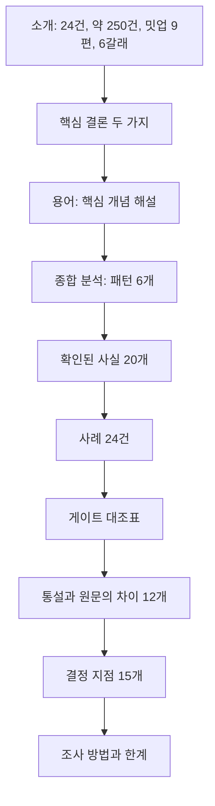
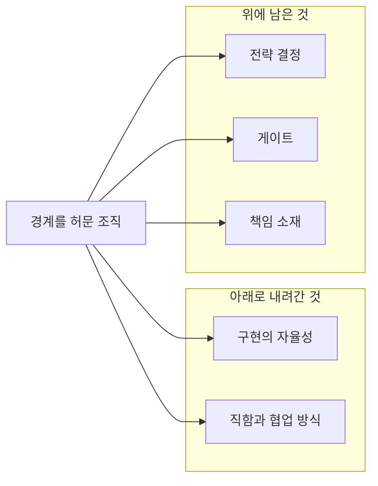
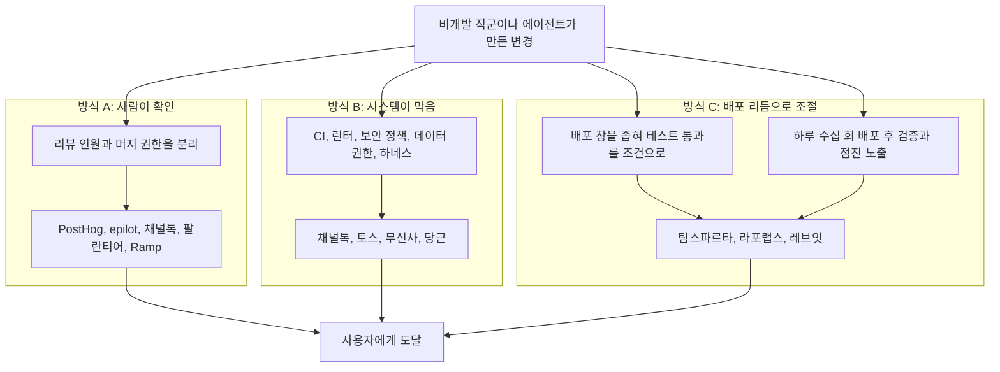
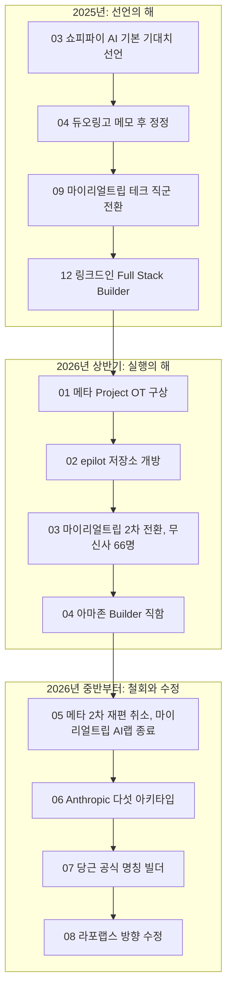
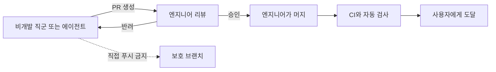
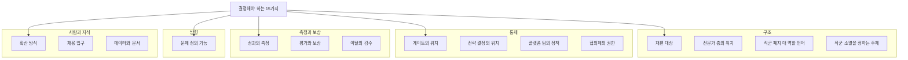

| 항목 | 내용 |
| --- | --- |
| 작성일 | 2026-10-20 (서버 시각 확인: 2026-10-20 21:33, 한국 표준시) |
| 해설 대상 | 아정당 공개 사이트 `ajd-builder-cases.netlify.app` (사이트 표기 작성일 2026.09.18)와, 이 사이트를 소개한 Threads 게시글 |
| 해설 방식 | 사이트 본문 전체를 직접 열어 읽고, 문서가 다루는 사례를 웹 검색으로 다시 확인한 뒤 서술형으로 정리 |
| 읽는 요령 | 분량이 많으므로 1장과 3장을 먼저 읽으면 요지를 잡을 수 있고, 나머지는 필요한 장만 골라 읽어도 됩니다 |

---

## 0. 먼저 알아 둘 것

### 0.1 이 해설이 지키는 원칙

이 해설의 본업은 아정당 문서에 **무슨 내용이 어떤 순서로 적혀 있는지** 쉽게 풀어 주는 것입니다. 그래서 문서에 없는 내용을 제가 보태지 않으려고 했습니다. 문서 밖의 정보는 웹 검색으로 직접 확인한 것만 썼고, 출처를 본문과 15장 참고 자료에 달았습니다. 확인하지 못한 것은 확인하지 못했다고 적었습니다.

문장의 성격을 구분하기 위해 두 가지 표시를 씁니다. **[풀이]** 는 문서의 내용을 이해하기 쉽게 제가 다시 설명한 부분이고, **[비유]** 는 이해를 돕는 비유입니다. 표시가 없는 문장은 문서가 말한 내용이거나 출처를 단 사실입니다.

### 0.2 검증 표기

문서가 다루는 사례마다 제가 외부 자료로 다시 확인한 정도를 세 단계로 표시했습니다.

| 표기 | 뜻 |
| --- | --- |
| ✅ 재확인 | 문서의 핵심 서술(사건, 시점, 핵심 수치)을 회사 공식 글이나 복수의 언론 보도로 따로 확인함 |
| ◐ 부분 확인 | 일부 사실만 확인했거나, 수치와 세부는 확인하지 못했거나, 시점이 문서와 어긋남 |
| ○ 문서 기재만 | 이번 검색에서 확인하지 못함. 맞다는 뜻도 틀리다는 뜻도 아님 |

`○`는 특히 오해하기 쉬우니 한 번 더 적어 둡니다. 검색 도구가 한국어 자료와 특정 회사의 내부 문서를 충분히 찾아 주지 못한 경우가 있었고, 그 경우에도 `○`로 남겼습니다. 문서가 틀렸다는 근거로 읽으시면 안 됩니다.

---

## 1. 한눈에 보기

### 1.1 이 문서는 무엇인가

아정당은 AI를 중심에 두고 제품을 만드는 방식, 곧 프로덕트 AX를 진행하면서 이른바 **빌더 조직**을 직접 만들어 가고 있습니다. 직군을 어떻게 나눌지, PM은 어떤 역할을 맡아야 하는지, 누구나 만들 수 있게 되면 품질은 어떻게 지킬지, 채용과 평가는 무엇을 바꿔야 하는지에 대한 고민이 컸다고 합니다. 그래서 먼저 이 길을 간 회사들이 공개한 자료를 모아 읽었습니다. 국내외 24개 사례, 약 250건의 자료입니다. 블로그, 핸드북, 채용 공고, 경영진의 글, 사내 메모를 다룬 보도, 당근 빌더 밋업 발표 9편이 들어 있습니다.

이 문서는 결론을 하나로 모으지 않습니다. 같은 문제에 정반대의 답을 낸 회사들이 있었기 때문입니다. 그래서 원문을 기준으로 **사실**과 **해석**을 절별로 나눠 적었고, 읽지 못한 자료는 본문 미확인으로 표시했습니다. 아정당이 무엇을 택했는지는 문서에 담겨 있지 않습니다.

### 1.2 문서가 내린 결론 두 가지

첫째, 직군을 없앤 회사로 알려진 곳을 원문까지 읽어 보면 직함을 바꾼 곳은 늘었지만 **제너럴리스트만으로 굴러가는 조직은 어디에도 없었습니다.** 모두 전문가 층을 어딘가에 다시 세웠습니다.

둘째, 경계를 허문 조직이 공통으로 남겨 둔 것은 권한이 아니라 **게이트**였습니다. 게이트는 만든 것이 사용자에게 닿기 전에 반드시 지나야 하는 지점입니다. 문서는 조사한 24건 중 전략 결정을 아래로 내린 사례도, 게이트를 완화한 사례도 없었다고 정리합니다.

### 1.3 한 장 요약표

| 질문 | 문서의 답 |
| --- | --- |
| 직군을 없앤 조직은 제너럴리스트만으로 굴러갔나 | 아니요. 모두 전문가 층을 다시 세웠다 (레브잇은 세 단계에 걸쳐 되돌림) |
| 경계를 허문 조직이 남긴 것은 | 전략은 위에서, 게이트는 유지 또는 강화, 책임은 만든 사람에게 |
| 게이트는 어떻게 세웠나 | 사람이 확인(A), 시스템이 못 하게 막음(B), 배포 리듬으로 조절(C) |
| PM을 극소로 줄인 조직의 조건은 | 고객이 개발자나 제품팀이고, 규모가 작고, 채용 기준이 극단적으로 높음 |
| 가장 흔한 실패는 | 산출량과 성과의 괴리, 전담 조직의 병목, 도구만 주는 확산, 기준 없는 자동화, 인프라 없는 선언 |
| 문서의 마지막은 | 어느 조직이든 스스로 정해야 하는 15개의 결정 지점 |

### 1.4 제가 다시 확인한 결과 (요약)

문서가 사례 카드로 다루는 24건 가운데 **10건은 ✅ 재확인, 8건은 ◐ 부분 확인, 6건은 ○ 문서 기재만**으로 분류했습니다. 확인된 범위에서는 문서의 서술이 외부 자료와 대체로 맞았습니다. 다만 문서 안의 수치와 서술이 서로 어긋나는 곳 4건, 문서와 외부 자료가 맞지 않아 보이는 곳 3건(시점 2건, 사건의 성격 1건), 표현을 조심해서 읽어야 하는 곳 2건을 찾았습니다. 자세한 내용은 13장에 모아 두었습니다. 문서가 나온 9월 18일 이후의 새 동향도 12장에 따로 정리했습니다.

---

## 2. 이 자료의 정체: 누가, 왜, 무엇을 공유했나

### 2.1 Threads 게시글

사이트를 소개한 Threads 게시글은 계정 `jonghun__seo`가 올렸습니다. 게시글의 흐름은 이렇습니다.

먼저 아정당이 프로덕트 AX를 진행하며 AX 빌더 조직을 직접 부딪쳐 가며 만들고 있다고 밝힙니다. 그 과정의 고민으로 직군 나누기, PM의 역할, 누구나 만들 수 있을 때의 품질 관리, 채용과 평가의 변화를 듭니다. 이어서 먼저 이 길을 간 팀들이 공개한 자료를 모았다고 설명합니다. 국내외 24개 회사의 블로그, 핸드북, 채용 공고, 경영진 글, 밋업 발표 약 250건이고, 해외 사례(쇼피파이, 링크드인, 아마존, 메타)와 국내 사례(당근, 토스, 채널톡, 무신사, 마이리얼트립), 직군 통합·PM 축소·채용과 평가 개편·중간에 방향을 고친 사례, 당근 빌더 밋업 9편, 용어 정리가 담겼다고 적습니다.

게시글은 **"아정당이 무엇을 취하고 무엇을 결정했는지는 담겨 있지 않다"** 고 분명히 밝힙니다. 그리고 공유하는 이유를 하나 더 듭니다. 채용을 진행하며 수백 장의 이력서를 받았고 지금도 면접을 이어 가고 있는데, AI로 무언가를 만들어 본 사람은 많아도 **AI로 실제 고객의 문제를 해결해 본 사람**은 만나기 어렵다는 것입니다. 지원자가 부족해서가 아니라, 고객 앞에서 그런 경험을 쌓을 수 있는 팀이 아직 많지 않기 때문일 것이라고 보고, 그런 경험을 가진 사람이 늘어 시장에 선순환이 생기려면 여러 팀이 함께 커야 한다고 말합니다. 끝에는 사이트 주소와 아정당 프로덕트&테크 채용 페이지 주소가 붙어 있습니다.

### 2.2 사이트의 구성

사이트는 소개 영역, 핵심 결론, 그리고 일곱 개 메뉴로 이루어져 있습니다. 문서 맨 끝에는 조사 방법과 한계가 따로 있습니다.

문서 앞부분(용어, 종합 분석, 확인된 사실, 사례, 대조표, 통설과 원문)은 **사실**을 다루고, 마지막 "결정 지점"부터는 문서 스스로 **해석**이라고 밝힙니다. 그리고 "통설과 원문의 차이"는 조사 초기에 담았던 오류를 원문을 확인해 고친 기록이라고 밝힙니다.

### 2.3 이 자료가 다루지 않는 것

문서가 다루는 대상은 앞서 이 길을 간 회사들입니다. 아정당 자신의 직군 설계, PM의 역할, 평가 기준은 담겨 있지 않으므로 이 해설도 다루지 않습니다. 참고로 구인 사이트 원티드에는 `아정네트웍스-[아정당] AX LEAD (서울)` 공고가 올라와 있고, 요건에 LLM과 AI 에이전트 빌더 도구에 대한 이해, 에이전트를 직접 설계하거나 파이프라인을 구축한 경험이 적혀 있습니다([원티드 공고](https://www.wanted.co.kr/wd/379091)). 공고의 세부 내용과 현재 모집 여부까지는 확인하지 못했습니다.

한 가지 짚어 둘 점이 있습니다. 문서의 작성 주체는 같은 조사 결과로 채용도 진행 중인 회사입니다. 사이트 하단에 채용 바로가기가 붙어 있고, 게시글도 채용 경험을 공유 동기로 밝힙니다. 이것은 문서가 감추는 사실이 아니라 문서와 게시글에 그대로 드러나 있는 맥락입니다. 문서가 자료의 한계(성공 사례 위주의 공개 채널, 자동 전사의 오인식 등)를 스스로 밝히고 있다는 점과 함께 읽으시면 됩니다.

---

## 3. 핵심 결론 풀이

### 3.1 "제너럴리스트만으로 굴러가는 조직은 어디에도 없었다"

세상에는 "AI 덕분에 직군이 사라지고 모두가 빌더가 된다"는 이야기가 많습니다. 문서는 그렇게 알려진 회사들의 원문을 읽어 본 결과를 이렇게 정리합니다. 직함을 합치거나 바꾼 회사는 늘었지만, 전문가가 필요 없어진 회사는 없었다는 것입니다.

가장 뚜렷한 예는 레브잇입니다. 창업 초기에는 Problem Solver라는 단일 직군 20명으로 갔습니다. 그러다 성숙한 제품에서는 직군을 다시 나눴고, 새 탐색 조직 안에서도 두 역할(Problem Solver와 Product Engineer)로 갈라졌습니다. 마이리얼트립은 프로덕트 엔지니어로 직군을 합치면서도 각 버티컬(사업 영역)에 도메인을 깊이 아는 담당을 남겼습니다. PM을 줄여서 유명해진 PostHog와 Linear도 결국 PM을 뽑는 쪽으로 돌아왔다고 문서는 적습니다.

> **[풀이]** 문서의 문장은 "조사한 24건 안에서는"이라는 범위가 붙은 주장입니다. "세상 어디에도 없다"가 아니라 "이번에 원문까지 읽은 사례 중에서는 없었다"로 읽으셔야 정확합니다.

### 3.2 "남겨 둔 것은 권한이 아니라 게이트였다"

**권한**은 누가 무엇을 할 수 있는가에 관한 이야기이고, **게이트**는 만든 것이 사용자에게 닿기 전에 반드시 지나야 하는 지점입니다. 문서는 경계를 허문 조직이 모두에게 전권을 준 것이 아니라 "무엇을 주지 않을지 먼저 정한" 조직이었다고 말합니다.

> **[비유]** 공항을 떠올리시면 쉽습니다. 누구나 여행 계획을 세우고 짐을 쌀 수 있습니다(경계가 낮아짐). 그러나 비행기에 타려면 모두가 보안 검색대를 지나야 합니다(게이트). 여행이 쉬워질수록 검색대는 더 중요해지지, 없어지지 않습니다. 문서가 말하는 것은 이런 구조입니다.

이 결론을 떠받치는 세 층(전략, 게이트, 책임)은 5.2절에서 자세히 풀겠습니다.

---

## 4. 용어 해설

문서는 뜻이 회사마다 갈리는 말과 이 조사가 특정한 의미로 쓰는 말만 골라 풀었습니다. 문서가 "갈림"이라고 표시한 말은 **정의가 하나로 모이지 않는다는 것 자체가 조사 결과**입니다.

### 4.1 게이트 (gate)

만든 것이 사용자에게 닿기 전에 반드시 지나야 하는 지점입니다. 사람이 보는 코드 리뷰만이 아니라 자동 검사, 배포 창, 권한 분리, 플랫폼이 강제하는 정책까지 모두 포함합니다. 문서는 이 말을 "조직마다 가장 크게 갈린 축이고, 경계를 허문 조직이 공통으로 남겨 둔 것"이라고 부릅니다.

### 4.2 빌더 (builder) — 갈림

같은 말이 세 가지 다른 자리를 가리킵니다. 첫째는 **직함**으로, 직군을 합쳐 구성원 전원에게 붙인 이름입니다(아마존, 링크드인, 당근). 둘째는 **별도 트랙**으로, 사내 업무 자동화를 만드는 자리입니다(라포랩스와 국내 스타트업 공고 다수). 셋째는 **태도**로, 기획부터 배포까지 혼자 끝내는 사람을 가리키는 일반 명사이고 채용 브랜딩에서 주로 씁니다.

외부 자료로는 아마존이 Ring과 Blink 사업부에서 단일 직군 "Builder"를 도입했다는 보도([Reuters 기사 재게재](https://finance.yahoo.com/sectors/technology/articles/two-amazon-units-builder-replaces-152346465.html))와, 메타가 일부 조직에 "AI Builder" 직함을 쓴다는 보도([The Decoder](https://the-decoder.com/?p=33636))가 있어 "직함" 용법은 확인됩니다.

### 4.3 프로덕트 엔지니어 (product engineer) — 갈림

회사마다 거의 정반대의 뜻으로 씁니다. 사례를 비교할 때 이 차이를 먼저 봐야 합니다.

| 용법 | 뜻 | 사례 |
| --- | --- | --- |
| 결정권형 | 제품 결정과 가격과 지표까지 소유하는 엔지니어 | PostHog, Linear |
| 통합 직함 | PM과 디자이너를 포함해 제품 관련 전 직군을 합친 이름 | 마이리얼트립 |
| 기반 담당 | 제너럴리스트가 빠르게 판단하도록 데이터와 인프라를 받치는 자리 | 레브잇 |

### 4.4 구현의 자율성과 전략의 자율성

무엇을 만들지 정하는 권한(전략)과 어떻게 만들지 정하는 권한(구현)을 나눈 구분입니다. 문서는 조사한 24건 중 **앞의 것을 아래로 내린 사례는 없었다**고 정리하고, 자율성을 준다고 말할 때 둘 중 어느 쪽인지가 실제 차이를 만든다고 짚습니다.

> **[비유]** 운전에 빗대면, 목적지는 위에서 정하고 운전 방법(경로, 속도 조절)은 운전자에게 맡기는 구조입니다. "자율성을 준다"는 말을 들을 때는 운전대만 맡긴 것인지 목적지까지 맡긴 것인지를 확인해야 합니다.

### 4.5 다섯 아키타입 (five archetypes)

직군 대신 **일하는 성향**으로 사람을 나눈 분류입니다. 한 사람이 두세 개에 걸치고, 제품 단계에 따라 필요한 조합이 달라집니다. 외부 자료로 확인한 결과, 이 분류는 Anthropic의 Claude Code 책임자 Boris Cherny가 2026년 6월 28일 X에 올린 글에서 나왔고, 문서의 설명과 일치합니다([The Business Engineer](https://businessengineer.ai/p/the-rise-of-the-agentic-product-manager), [TechNews](https://technews.tw/2026/06/29/five-key-archetypes-for-future-product-teams/)). 다음은 분류 자체를 풀어 쓴 표입니다.

| 아키타입 | 하는 일 |
| --- | --- |
| 프로토타이퍼 | 새 아이디어를 쏟아내며, 대부분은 제품이 되지 못함 |
| 빌더 | 살아남은 프로토타입을 프로덕션 수준으로 바꿈 |
| 스위퍼 | 정리하고 단순화하고, 쓸모없는 기능을 덜어냄 |
| 그로워 | 이미 나온 제품을 반복 개선해 시장 적합성을 높임 |
| 메인테이너 | 성숙한 시스템의 안정성과 보안을 지킴 |

제품 단계별로 필요한 조합도 함께 제시됩니다. 시장 적합성을 찾기 전의 제품은 프로토타이퍼, 빌더, 스위퍼가 중심이고, 성장기에는 빌더, 스위퍼, 그로워에 약간의 메인테이너가 필요하며, 성숙한 제품은 스위퍼, 그로워, 메인테이너에 약간의 빌더가 필요하다고 합니다. 원 게시글은 이 역할들이 직군과 관계없이 나타난다고 말하고, 같은 디자이너 안에서도 프로토타이퍼에 가까운 사람과 스위퍼에 가까운 사람이 있다고 예를 듭니다. 문서에 따르면 마이리얼트립 CTO가 이 다섯을 조직 설계의 재료로 명시적으로 채택했습니다.

### 4.6 하네스 (harness)

AI 에이전트를 감싸서 **무엇까지 할 수 있는지, 결과를 어떻게 검증할지, 실패하면 어떻게 처리할지**를 통제하는 층입니다. 에이전트에게 작업 공간 전체를 주는 대신 변경 제안만 받게 하고, 실제 반영은 사람이 검수한 뒤에 하도록 잠그는 장치가 여기 속합니다.

> **[비유]** 새 직원에게 금고 열쇠를 주는 대신 "제안서를 접수창구에 내면 담당자가 확인하고 처리한다"는 규칙을 건물에 설치해 두는 것과 같습니다.

### 4.7 가드레일 지표와 점진 배포

가드레일 지표는 실험이나 배포에서 **절대 나빠지면 안 되는 안전선**입니다. 목표 지표와 함께 미리 정해 두고, 이 선이 무너지면 즉시 중단하고 되돌립니다. 점진 배포는 변경을 한 번에 열지 않고 1%, 5~10%, 전체 순으로 노출을 넓히며 단계마다 확인하는 방식입니다.

> **[비유]** 새 메뉴를 전국 매장에 한꺼번에 내놓지 않고 일부 매장에서 먼저 팔아 보며 손님 불만이 늘면 바로 거두는 방식입니다.

### 4.8 전방 배치 엔지니어 (forward deployed engineer, FDE)

자기 회사가 아니라 **고객사 안에 들어가 앉아** 고객의 문제를 자사 제품 위에서 직접 코드로 푸는 엔지니어입니다. 팔란티어에서 나온 직무이고, 제품 조직이 아니라 사업개발 조직에 속한다는 점이 특징입니다. 현장에서 만든 산출물을 일반화해 제품으로 만드는 별도 팀이 뒤에 있어야 성립한다고 문서는 설명합니다.

### 4.9 AI 능숙함과 AI 주체성

도구를 잘 다루고 최신 동향을 말할 수 있는 것이 **능숙함**이고, 자기 업무 방식 자체를 그 도구 위에서 다시 짠 것이 **주체성**입니다. 채용에서 이 둘을 구분해 본 조직들은 격차가 생각보다 크다고 기록했습니다. 스펙이 알려 주지 않을 때 무엇을 해야 하는지 스스로 파악하는가로 가르는 곳도 있습니다.

### 4.10 1차 자료와 2차 자료

문서의 표기 방식입니다. 회사가 직접 쓴 글, 핸드북, 채용 공고, 사내 문서 원문, 당사자 발언이 **1차**이고, 기사와 요약, 벤더 행사의 전언은 **2차**입니다. 사례마다 어느 쪽에 근거했는지 표시했고, 읽지 못한 자료는 미확인으로 남겼습니다. 24건 중 크래프톤·배민·올리브영 카드만 2차 자료로 표시되어 있습니다.

---

## 5. 종합 분석: 24건을 가로지르는 여섯 가지 패턴

문서는 사례를 나열하기 전에 반복적으로 나타난 패턴을 먼저 정리합니다. 유형 분포, 조직이 남겨 둔 것, 게이트를 세운 방식, 작동 조건, 2년간의 시간 흐름, 반복된 실패가 그 여섯 가지입니다.

### 5.1 전환의 여섯 갈래

"빌더 전환"이라는 하나의 이름 아래에서 실제로는 서로 다른 여섯 가지 일이 벌어졌다는 것이 문서의 첫 정리입니다.

| 유형 | 건수 | 해당 사례 |
| --- | --- | --- |
| 게이트 설계 | 11 | 왓낫, PostHog, Ramp, 팔란티어, epilot, 무신사, 채널톡, 토스, 라포랩스, 팀스파르타, 레브잇 |
| 경계 넘기 장려 | 9 | epilot, Anthropic, Intercom, 쇼피파이, 당근, 채널톡, 토스, 라포랩스, 팀스파르타 |
| 채용·평가 전환 | 7 | 링크드인, 세일즈포스, Zapier, 쇼피파이, 마이리얼트립, 무신사, 크래프톤 계열 |
| 직군 통합 | 5 | 메타, 아마존, 링크드인, 마이리얼트립, 레브잇 |
| PM 극소화 | 4 | 왓낫, Factory, PostHog, Linear |
| 철회·정정 | 4 | 메타, 듀오링고와 에어비앤비, 라포랩스, 레브잇 |

한 사례가 여러 유형에 걸치기 때문에 합계는 24가 아니라 40입니다(제가 표의 이름을 세어 확인했습니다). 문서가 가장 강조하는 해석은 **게이트를 새로 설계한 사례(11건)가 직함을 실제로 합친 사례(5건)의 두 배가 넘는다**는 것입니다. 경계를 허무는 일보다 그 경계를 받쳐 줄 장치를 만드는 일이 더 많았다는 뜻입니다.

> **주의.** 문서 본문은 "가장 많은 것은 직군을 그대로 두고 경계를 넘는 행동만 장려한 유형"이라고 쓰지만, 같은 표에서 건수가 가장 많은 것은 게이트 설계(11건)이고 경계 넘기 장려는 9건입니다. 서술과 숫자가 맞지 않습니다. 13장의 D1에서 다시 다룹니다.

### 5.2 경계를 허문 조직이 남겨 둔 세 층

직함과 협업 방식은 크게 흔들렸지만, 어느 사례에서도 다음 세 가지는 아래로 내려가지 않았다는 것이 문서의 주장입니다. 전권을 준 조직이 아니라 **무엇을 주지 않을지 먼저 정한** 조직이 살아남았다고 표현합니다.

**전략은 위에서 정합니다(조사한 24건 중 예외 없음).** 왓낫은 문서에 자율성은 구현의 자율성이고 전략의 자율성은 누구도 갖지 않는다고 못 박았습니다. PostHog는 소규모 팀의 리드가 무엇을 만들지 정하지만 월간 리뷰에서 CEO가 가정을 반박하고 책임을 묻습니다. Linear는 창업자가 방향을 소유합니다. 마이리얼트립은 아래에서 먼저 구현한 뒤 경영진이 이미 만들어진 것을 보고 투자를 결정합니다.

**게이트는 유지되거나 오히려 강화됩니다(완화한 사례 없음).** 배포가 늘어난 조직은 게이트를 없애지 않고 좁혔습니다. 팀스파르타는 상시 배포를 하루 두 번의 정기 배포로 조정했고, 채널톡은 개발자 두 명의 리뷰를 필수로 두고 디자이너에게 머지 권한을 주지 않았습니다. epilot은 리뷰를 우회한 배포 사고를 겪은 뒤 "접근을 열기 전에 권한을 잠가라"고 적었습니다. 예외처럼 보이는 사례가 하나 있는데, 당근의 디자인 시스템 팀이 구현 단계의 API 제약을 풀었다는 것입니다. 문서는 이것이 제약을 없앤 것이 아니라 **디자인 리뷰라는 사람 게이트로 옮긴 것**이라고 해석합니다.

**책임은 만든 사람이 집니다(AI가 만든 것도 예외 없음).** PostHog는 승인이 책임을 옮기지 않는다고 규정했고, epilot은 에이전트를 트리거한 사람이 산출물을 책임진다고 썼으며, 왓낫은 AI로 찾은 데이터든 AI가 쓴 코드든 좋은 분석인지 좋은 코드인지 확인할 책임에서 면제되지 않는다고 적었습니다.

외부 확인: epilot이 직접 쓴 글에서 비개발자 한 명이 전체 푸시 권한으로 CI를 우회해 리뷰 없이 프로덕션에 배포한 일, "접근을 열기 전에 머지와 푸시 권한을 잠가라"는 교훈, 이후 비개발자와 에이전트는 PR만 만들고 엔지니어가 리뷰하고 머지하는 구조로 바꾼 것을 확인했습니다([epilot, DEV Community](https://dev.to/epilot/our-entire-company-ships-code-now-40-prs-from-non-engineers-in-60-days-jo5)). 채널톡의 개발자 두 명 리뷰와 디자이너 머지 권한 없음은 채널톡 기술 블로그에서 확인했습니다([채널톡 기술 블로그](https://tech.channel.io/ko/articles/%EC%A0%9C%ED%92%88-%EA%B0%9C%EB%B0%9C-%EC%9D%B4%ED%9B%84-%EA%B7%B8-%EB%B0%94%EA%B9%A5%EC%9D%98-AI---%EB%B2%84%EA%B7%B8-%EC%9E%A1%EB%8A%94-%EB%94%94%EC%9E%90%EC%9D%B4%EB%84%88-b053eb17)). 팀스파르타의 하루 두 번 정기 배포는 5.3절에서 다룹니다.

### 5.3 게이트를 세운 세 방식

게이트의 위치가 갈립니다. **사람이 확인하는 방식(A)**, **시스템이 애초에 못 하게 막는 방식(B)**, **배포 리듬 자체로 조절하는 방식(C)** 입니다.

**방식 A(사람이 확인)** 는 가장 흔하고 가장 먼저 세워지는 장치입니다. 비개발 직군은 변경을 제안할 수 있지만 합치는 것은 자격 있는 사람만 합니다. 리뷰 인원과 머지 권한을 분리하는 것이 핵심입니다.

**방식 B(시스템이 막음)** 는 규칙을 설명하는 대신 어길 수 없게 만듭니다. 지속적 통합 검사와 린터, 플랫폼이 자동 적용하는 보안 정책, 타입 계약, 데이터 권한 계층, 패치 제안만 허용하는 하네스가 여기 속합니다. 문서는 국내 네 회사(채널톡, 토스, 무신사, 당근)가 서로 참조 없이 이 방식에 도달한 것이 조사에서 가장 선명한 수렴이라고 평가합니다. "서로 참조 없이"라는 부분은 문서의 판단이며 제가 확인한 것은 아닙니다.

**방식 C(배포 리듬)** 에서는 같은 문제에 정반대의 답이 나왔습니다. 팀스파르타는 배포 창을 좁혀 자동 테스트 통과를 조건으로 걸었습니다. 반면 라포랩스는 하루 10~30회 배포를 전제로 배포 후 검증하고 테스트 실행 권한을 전사에 열었으며, 레브잇은 가드레일 지표를 두고 1%에서 5~10%, 전체로 노출을 넓힙니다.

팀스파르타의 배경은 제가 팀 블로그에서 확인했습니다. 회사 전체 QA 매니저가 2명이고 연간 배포가 약 1,300건에 이르자 안정성을 챙기기 위해 상시 배포를 하루 2회 정기 배포로 조정하고 핵심 여정마다 E2E 테스트를 붙였다고 합니다. 처음에는 Datadog의 합성 테스트로 효과를 확인한 뒤 Playwright로 내재화했습니다. 퍼블리싱 자동화 도구를 도입해 마케터의 실험과 배포가 10배 늘었을 때도 E2E 테스트가 실험과 고객 경험을 지키는 데 쓰였다는 취지의 대목도 있습니다([팀스파르타 팀 블로그](https://blog.career.spartaclub.kr/prd-2025-year-end-party2)).

**방식 B의 반례도 있습니다.** 문서의 확인된 사실 09번에 따르면 당근의 디자인 시스템 팀은 일관성을 API 제약으로 강제하자 제품팀이 시스템을 이탈해 비슷한 컴포넌트를 따로 만들었고, 그래서 구현 제약은 풀고 일관성은 디자인 리뷰에서 지키기로 했습니다. 문서는 "게이트를 시스템에 박는 것이 언제나 답은 아니라는 반례"라고 부릅니다. 당근 채용 공고에는 AI 시대에 디자인 시스템이 해야 할 역할을 고민하며, 프롬프트만으로 자사 디자인 시스템 기반 화면을 만들고 결과가 기준에 맞는지 검증하는 디자인 에이전트를 실험하고 있다는 설명이 있어, 문서가 "진행 중인 실험"이라 부른 부분과 방향이 일치합니다([당근 채용 공고](https://careers.daangn.com/jobs/role/7791182003/)).

### 5.4 어떤 조건에서 작동했나

문서는 PM을 극소로 줄인 조직에 공통 조건이 있었다고 말합니다. 고객이 엔지니어이거나 제품팀이고, 규모가 작고, 채용 기준이 극단적으로 높다는 것입니다. 그리고 **사업 조직이 강한 중개형이나 소비자 사업에서 이 모델이 검증된 1차 자료는 조사 범위에서 찾지 못했다**고 적습니다. 왓낫만이 소비자 마켓플레이스이면서 PM 밀도를 낮게 유지한 사례입니다.

| 모델 | 규모 조건 | 고객·사업 형태 | 함께 있던 전제 | 사례 |
| --- | --- | --- | --- | --- |
| PM 극소화 | 50~200명, 팀 단위 2~6명 | 개발자·제품팀 대상 도구, 셀프서브 | 유급 실무 시험, 시니어 전용 채용, 창업자가 방향 소유 | PostHog, Linear, Factory |
| PM 극소화 + 소비자 사업 | 1,200명에 PM 20명 | 라이브 커머스 마켓플레이스 | 전 직원 판매·구매·고객문의 처리 의무, 게이트 단일화, 시니어 편중 | 왓낫 |
| 직군 통합 | 70~500명 | 여행·커머스 등 소비자 사업 | 평가 축 신설, 인위적 결핍, 전문가 층 재구축 | 마이리얼트립, 레브잇 |
| 직군 통합 | 수천~수만 명 | 대형 플랫폼·리테일 | 사업부 단위 시범 적용. 전사 확대는 두 곳 모두 하지 않음 | 메타, 아마존 |
| 경계 넘기 장려 | 40~4,000명 | 업종 무관 | 문서화 자산, 플랫폼 가드레일, 팀별 챔피언 | 당근, 채널톡, 토스, epilot |
| 전방 배치 엔지니어 | 고객팀 4~5명, pod 약 15명 | 대형 계약 B2B, 정부·엔터프라이즈 | 재사용 플랫폼, 산출물을 제품화하는 별도 팀, 큰 계약 규모 | 팔란티어, OpenAI, Ramp |

**[풀이]** 이 표는 "그 모델이 우리 조직에도 맞는가"를 판단할 때 규모, 고객, 전제 조건을 먼저 대조하라는 뜻으로 읽으시면 됩니다. 문서가 사례 카드 맨 끝에서 당근의 한 리더의 당부를 옮기며 "결과보다 조건을 대조하라"고 한 것과 같은 방향입니다.

PostHog 쪽 근거는 외부에서 일부 확인했습니다. 공동창업자 CEO 인터뷰에서 팀은 6명 이내의 다기능 구성이고 팀 하나가 섬처럼 제품 전체를 출시할 수 있어야 한다고 말합니다([인터뷰 정리](https://agents.truthliesandwork.com/segments/189-who-is-james-hawkins-and-intro-to-posthog.md)). 아마존과 메타가 전사가 아니라 일부 조직에서 시험했다는 점은 보도로 확인됩니다(6장의 해당 사례 참조).

### 5.5 2025년 3월부터 2026년 8월까지의 시간 흐름

시간 순으로 놓으면 2025년은 **선언의 해**, 2026년 상반기는 **실행의 해**, 2026년 중반부터는 **철회와 자기 수정이 잇따른 시기**입니다. 문서는 철회한 조직들이 방향을 부정하지 않고 순서와 속도를 수정했다고 정리합니다.

다음은 문서의 연표 항목별로 제가 확인한 결과입니다.

| 시점 | 문서의 서술 | 제 확인 |
| --- | --- | --- |
| 2025.03 | 쇼피파이 CEO가 AI 사용을 기본 기대치로 선언. 성과 평가와 인원 요청 조건을 함께 바꿈 | ✅ 메모는 2025년 3월 하순에 직원에게 전달됐고 4월 7일 CEO가 X에 공개. "인원을 요청하기 전에 AI로 못 하는 이유를 증명하라"와 평가 항목 추가 확인 |
| 2025.04 | 듀오링고 AI 퍼스트 메모, 3주 뒤 CEO 정정 | ✅ 4월 하순 메모, 5월 하순 CEO의 링크드인 정정. 간격은 3~4주 |
| 2025.05 | 당근이 승인 절차를 걷어내고 주간 사례 공유 시작 | ○ |
| 2025.09 | 마이리얼트립 테크 직군 전환. 당근 사내 해커톤에서 빌더라는 말 처음 사용 | 마이리얼트립 ✅ (회사 채용 페이지). 당근 ◐ (D7 참조) |
| 2025.12 | 링크드인 APM 폐지와 Full Stack Builder 모델 공개 | ◐ 외부 자료는 APM→APB 전환을 2025년 8월에 이미 언급 (D5 참조) |
| 2026.01 | 메타 Project OT 구상. 링크드인 APB 1기 시작, CPO 퇴사 | 메타 ✅ (1월 하와이 리트릿). 링크드인 1기 시작과 CPO 퇴사는 ○ |
| 2026.02 | epilot이 219개 저장소 개방. 토스 어드민 플랫폼 공개 | epilot ◐ (사건과 교훈 확인, 저장소 수는 확인 못 함). 토스 ○ |
| 2026.03 | 마이리얼트립 2차 전환과 평가 AI 축. 무신사 66명 | 마이리얼트립 ✅ (회사 페이지: PM·PD·CD까지 일괄 전환). 평가 AI 축 ◐ (명문화는 확인). 무신사 ✅ (3월 30일 발표) |
| 2026.04 | 아마존 두 사업부 직함 폐지. 메타 사내 경고 | 아마존 ✅ (4월 23일 Reuters 보도, 직함 변경은 다음 달부터). 메타 사내 경고 게시글의 존재는 ✅, 게시 시점은 확인 못 함 |
| 2026.05 | 메타 2차 재편 취소. 마이리얼트립 AI 전담팀과 챔피언 제도 해체. 세일즈포스 빌더 1,000명 | 메타 ✅ (5월 19일 저녁 결정, 20일 10% 감원). 마이리얼트립 AI랩 종료 ✅, 챔피언 제도 해체는 ○. 세일즈포스 ◐ (D6 참조) |
| 2026.06 | Anthropic 다섯 아키타입. 토스 테크니컬 라이터 자기 소멸 선언 | Anthropic ✅ (6월 28일). 토스 ○ |
| 2026.07 | 당근 채용 리뉴얼에서 공식 명칭 빌더. 레브잇 두 역할 분화 | 당근 ○ (현재 채용 사이트가 빌더를 쓰는 것은 확인). 레브잇 ◐ |
| 2026.08 | 라포랩스 방향 수정. 메타 실패 전모 보도. 채널톡 디자인 시스템 재설계 | 라포랩스 ✅. 메타 ✅ (8월 26일 Reuters 조사 보도). 채널톡 ○ |

### 5.6 반복적으로 실패한 지점

실패의 모양이 다섯 가지로 수렴한다는 것이 문서의 정리입니다.

**첫째, 산출량과 성과의 괴리입니다.** 메타의 사내 데이터에서 내부 소프트웨어 플랫폼과 인프라의 변경은 1년간 220% 늘었지만 사용자에게 도달한 신규·개선 기능은 36%만 늘었습니다. 무작위 대조 실험에서는 숙련 개발자가 AI를 쓸 때 19% 더 오래 걸렸는데도 스스로는 빨라졌다고 믿었습니다. 두 수치는 제가 다시 확인했습니다. 메타의 수치는 Reuters 조사 보도를 인용한 기사에 CTO Bosworth의 사내 게시글로 소개되어 있고([Mezha](https://mezha.net/eng/news/e536ceb7_meta_cut_10/)), 무작위 대조 실험은 METR이 2025년 7월 발표한 연구입니다. 이 연구는 16명의 숙련 오픈소스 개발자가 246개의 실제 과제를 맡은 실험이고, 개발자들은 사전에 24% 빨라질 것으로 예상했으며 사후에도 약 20% 빨라졌다고 믿었습니다([DX 해설](https://getdx.com/blog/metr-study-on-how-ai-affects-developer-productivity/), [The Decoder](https://the-decoder.com/ai-coding-can-make-developers-slower-even-if-they-feel-faster/)).

> **주의.** METR 연구는 2025년 초의 도구와 대형 오픈소스 저장소를 다룬 표본 16명의 실험입니다. 연구진도 도구가 빠르게 발전해 결과가 달라질 수 있다고 밝혔습니다([The Daily Star](https://online.thedailystar.net/node/3937931)). "AI는 모든 개발자를 느리게 한다"로 일반화하면 안 되고, 문서도 일반화하지 않고 "산출량이 성과로 이어지지 않는 사례"로만 씁니다. 문서가 함께 인용한 DORA 연구는 이번에 확인하지 못했습니다.

**둘째, 전담 조직의 병목입니다.** AI 전담팀이 대신 만들어 주는 방식은 세 회사에서 같은 한계에 부딪혔고, "내가 만들지 않으면 내가 유지보수할 수 없다"는 문장으로 정리되었습니다.

**셋째, 도구만 주는 확산입니다.** 설치하고, 떠올리고, 자료를 찾아 넘기는 일이 사람 몫으로 남으면 아무도 쓰지 않았습니다.

**넷째, 기준 없는 자동화입니다.** 자동 생성이 붙은 뒤에야 무엇이 최신이고 누가 책임지는지 정해져 있지 않다는 사실이 드러났습니다.

**다섯째, 인프라 없는 선언입니다.** 같은 문장이 인프라를 먼저 깐 회사에서는 통하고 그렇지 않은 곳에서는 3주 만에 정정되었습니다. 쇼피파이는 메모 전에 사내 프록시와 코딩 도구, 법무 합의를 이미 깔아 두었다고 문서가 서술하고, 듀오링고는 메모 발표 후 한 달이 채 안 되어 CEO가 링크드인에서 메시지를 명확하게 전하지 못했다고 인정했고, 이후 인터뷰에서도 맥락이 충분하지 않았다고 말했습니다([Entrepreneur](https://www.entrepreneur.com/business-news/duolingo-ceo-clarifies-ai-stance-after-backlash-read-the-memo/492141), [Fortune](https://fortune.com/2025/08/18/duolingo-ceo-admits-controversial-ai-memo-did-not-give-enough-context-insists-company-never-laid-off-full-time-employees)). 쇼피파이의 사전 인프라 준비는 이번에 확인하지 못했습니다.

---

## 6. 확인된 사실 20개

문서의 "확인된 사실"은 자료에서 확인된 것만 적고 각 항목 끝에 근거가 된 사례를 표시한 절입니다. 20개를 주제별로 다섯 묶음으로 나누어 풀겠습니다. 번호는 문서의 번호(01~20)를 그대로 따랐습니다.

### 6.1 조직 구조에 관한 사실

**01 제너럴리스트만으로 굴러가는 조직은 없었다.** 3.1절에서 설명한 내용입니다. 레브잇은 단일 직군 20명 → 성숙 제품의 직군 분화 → 탐색 조직 안에서도 두 역할 분화로 세 단계에 걸쳐 전문가 층을 다시 세웠습니다. 근거 사례는 레브잇, 마이리얼트립, PostHog, Linear입니다.

**10 같은 회사 안에서도 스테이지마다 답이 달랐다.** 당근은 제품을 다섯 스테이지로 나누어, 초기 팀은 SaaS를 그대로 쓰고, 성장기는 플랫폼화하며, 큰 팀은 브랜드와 안정성으로 판단합니다. 알바팀은 단계마다 테스트 없음에서 테스트로, 다시 린트와 사후 리뷰로 게이트 강도를 올렸습니다. 40명 규모에서는 경계 넘기보다 정렬이 우선이라고 했습니다. 이 항목은 당근 키노트와 알바팀의 밋업 발표(자동 전사)를 근거로 합니다.

**17 다섯 아키타입이라는 공통 언어가 생겼고 국내에서 채택됐다.** 4.5절에서 풀었습니다. Anthropic의 게시글이 출처이고, 문서는 마이리얼트립 CTO가 이를 조직 설계의 재료로 채택했다고 적습니다.

**18 직군이 없어지는 건강한 형태가 하나 있다.** 토스의 테크니컬 라이터 챕터는 전 인원 약 4,000명에 세 명뿐이었는데, 스스로 없어지겠다고 선언했습니다. 직접 쓰고 다듬는 일을 AI에게 넘기고, 지식이 생기고 순환하고 정리되는 구조를 설계하는 쪽으로 자기를 재정의했습니다. 문서는 "위에서 없애는 것"과 "안에서 재정의하는 것"의 차이를 이 사례로 보여 줍니다. 제가 확인한 범위에서는 토스 채용 공고가 테크니컬 라이터의 일을 문서 작성의 자동화와 AI 파이프라인 구현까지 포함해 설명하고, 토스 구성원이 링크드인에서 테크니컬 라이터가 "문서를 쓰는 사람"에서 "조직의 지식 시스템을 설계하는 사람"으로 일을 넓혀 왔다고 소개합니다([토스 공고](https://career.rememberapp.co.kr/job/posting/312006), [링크드인 게시글](https://kr.linkedin.com/in/shinyura)). 방향은 일치하지만 "스스로 없어지겠다"는 선언과 인원 수는 확인하지 못했습니다.

### 6.2 속도와 성과에 관한 사실

**03 산출량이 늘어도 성과는 그만큼 늘지 않았다.** 5.6절에서 다룬 메타와 METR의 수치입니다(✅).

**14 빠른 실행만으로는 부족하다는 것을 수치로 인정했다.** 라포랩스는 실험 실패율이 25%에서 43%로 오른 뒤 방향을 수정하고 문제 정의를 통과 게이트로 만들었습니다. 조직 안에서 "우리는 고객을 모릅니다"라고 말하기 시작했습니다. 라포랩스 PO 챕터 리더의 글을 제가 열어 확인했습니다. 6개월간 184개의 실험을 진행했고, 실패율은 2월 약 25%에서 5월 약 43%로 올랐으며, "그 착각을 깨는 데 실패율 18%p가 필요했다"고 쓰고 있습니다([라포랩스 팀 블로그](https://blog.rapportlabs.kr/249418)). 문서의 서술과 일치합니다(✅).

**20 통합을 가장 강하게 주장하는 사람도 성과 전환은 아직이라고 했다.** 링크드인 Full Stack Builder 설계자가 청중에게 "무엇을 만들었다고들 하지만 그것이 고객 가치로 수렴하는지, AI가 실제 매출로 전환된 것을 본 사람이 얼마나 되는지"를 물었고, 대부분은 아직 기다리고 있다고 답했다는 서술입니다. 설계자가 링크드인 CPO 출신의 Tomer Cohen이고 Full Stack Builder 모델을 이끌었다는 점은 Lenny's Podcast 소개글로 확인했지만([Lenny's Newsletter](https://www.lennysnewsletter.com/i/180042347/my-takeaways-from-this-conversation)), 청중 질문과 답의 내용은 확인하지 못했습니다(○).

### 6.3 사람과 제도에 관한 사실

**04 직함을 바꾸면 승진과 보상을 먼저 묻는다.** 아마존 직원들은 senior와 lead 같은 직함이 사라지면 승진과 임금 인상 경로가 어려워질 것을 우려했고, 회사는 경로가 그대로라고 답했습니다. 메타에서는 팟을 맡은 직원이 매니저 교육도 평가 도구 접근권도 없다고 사내 게시판에 적었습니다. 두 사실 모두 외부 보도로 확인했습니다(✅). 아마존의 우려와 회사 해명은 Reuters 보도에 있고, 메타의 사례는 Reuters 조사 보도를 인용한 기사에 있으며 메타는 평가와 승진 결정은 사람이 한다고 답했습니다.

**05 평가를 바꾼 사례는 설계가 강했다.** 마이리얼트립의 평가 축은 업적, 핵심가치, AI 활용 세 개이고, 그중 AI 축에만 0점 등급이 있습니다. 다른 두 축이 최고여도 AI 축이 0이면 종합 평가가 기대 충족에 머뭅니다. 측정 기준은 AI 사용량이 아니라 AI로 만든 고객과 사업의 가치입니다. 도입은 리더가 평가할 준비가 될 때까지 1년 미뤘습니다. 이 중 "올해부터 성과 평가 항목에 AI 네이티브니스를 명문화한다"는 것은 월간인물 인터뷰로 확인했지만([월간인물](https://www.monthlypeople.com/news/articleView.html?idxno=701859)), 0점 등급 구조와 1년 유예는 확인하지 못했습니다(◐).

**06 직군 통합의 비용을 회사가 직접 기록했다.** 부전공으로 영역을 넓힌 엔지니어는 3주간 전공자를 7회 이상 찾았고, 전공자의 생산성 저하를 조직 과제로 제기했습니다(마이리얼트립). 프런트엔드와 백엔드를 합친 당근의 한 팀은 완료량은 지켰지만 실제로 한 일의 3분의 2가 계획 밖이었고 팀으로서의 응집이 약해졌습니다. 그 팀 리더는 밋업에서 직군 관점 검토 감소, 지식 쏠림, 전문성 심화 지연의 세 위험을 지켜보는 중이며 관리 체계는 아직 없다고 말하고, 결과보다 조건을 대조하라고 당부했습니다(자동 전사). 이 항목은 이번에 확인하지 못했습니다(○).

**07 경계를 넘는 사람의 편향을 당사자가 말했다.** 엔지니어 출신 제품 리더들이 기획을 겸하면 구현 부담을 알아서 스스로 스펙을 줄여 유저 문제를 제대로 못 푼 일, 폼으로 풀 일을 개발로 풀려 한 일을 사례로 들었습니다. 겸업의 장점인 사이즈 판단과 빠른 검증과 나란히 놓인 비용입니다(당근 제품 리더 패널, 자동 전사, ○).

**08 PM 없는 팀의 실체는 절차였다.** 당근페이의 5명 팀은 PM도 분석가도 없이 대시보드에서 막힌 지표로 다음 문제를 고르고, 의견이 갈리면 실험으로 정하고, 실험으로 못 가리는 일은 제안한 사람이 정하며 그 지표까지 책임집니다. 데이터로 증명하지 못하면 만들지 않습니다. 비용(사람이 한계를 느끼는 점 등)은 발표에서 다루지 않았다고 문서가 덧붙입니다(자동 전사, ○).

### 6.4 게이트와 통제에 관한 사실

**02 남겨 둔 것은 권한이 아니라 게이트였다.** 5.2~5.3절에서 설명했습니다.

**09 강한 구조적 제약은 시스템 이탈을 낳았다.** 5.3절의 반례입니다(당근 디자인 시스템 팀, ◐).

**13 자동화는 기준이 없다는 사실을 드러낸다.** 토스는 문서를 자동 생성하게 만든 뒤 비슷한 문서가 쌓여 무엇이 최신인지 알 수 없게 되었고 봇이 낡은 정책으로 틀린 답을 냈습니다. 그래서 만든 것이 **권한 있는 협의체**입니다. 자발적 모임(길드)은 무언가를 결정하거나 강제할 힘이 없었는데, 새 협의체는 결정이 실제 효력을 갖는다는 점이 다르다고 합니다(○).

**15 배포 게이트에서 국내 두 회사가 정반대를 택했다.** 5.3절에서 설명한 팀스파르타(하루 2회 정기 배포, 자동 테스트 통과 필수)와 라포랩스(하루 10~30회 배포, 배포 후 검증, 테스트 실행 권한 전사 개방)입니다. 앞쪽은 확인했고(✅) 뒤쪽 수치는 확인하지 못했습니다(○).

**16 비개발자가 고객용 프로덕션에 닿은 범위는 여전히 좁다.** 문서는 세 가지 범위를 대비합니다. 채널톡은 UI 스타일 수정까지이고 머지 권한이 없습니다. 토스는 사내 어드민이고 보안은 플랫폼이 강제합니다. 마이리얼트립은 고객 서비스까지 갔습니다. 그리고 **결제, 계약, 정산처럼 되돌리기 어려운 영역을 비개발 직군에 맡긴 회사는 확인되지 않았다**고 적습니다. 채널톡의 첫 번째 사례는 제가 확인했습니다. 채널톡 프로덕트 디자이너의 첫 AI PR이 다른 제품 영역의 메시지 스트림 전체를 건드렸고, 프런트엔드 개발자의 리뷰가 잡아냈다고 합니다(◐).

### 6.5 확산과 전담 조직에 관한 사실

**11 AI 전담팀이 대신 만들어 주면 병목이 된다.** 마이리얼트립, 팀스파르타, 채널톡 세 회사가 같은 결론에 도달했고, 모두 각 팀에 챔피언을 두는 쪽으로 옮겼으며 두 곳은 전담 장치를 해체했다고 문서는 적습니다. 마이리얼트립의 AI랩이 2024년에 신설되어 2026년 5월에 약 2년 만에 종료되었다는 것은 보도로 확인했습니다([아주경제](https://www.ajunews.com/view/20260618084521625), [월간인물](https://www.monthlypeople.com/news/articleView.html?idxno=701859)). 나머지 두 회사와 챔피언 제도의 향방은 확인하지 못했고, 이 항목이 문서 안에서 연표와 어긋나 보이는 점은 13장 D4에 적었습니다.

**12 도구를 나눠주는 것으로는 확산되지 않았다.** 토스가 문서 작성 도구를 만들어 공개했지만 아무도 쓰지 않았고, 해법은 업무 흐름의 트리거에 심는 것이었습니다(○).

**19 선언만 한 회사는 역풍을 맞았다.** 인프라를 먼저 깐 회사는 통했고, 같은 문장을 인프라 없이 발표한 회사는 3주 뒤 정정했습니다. 메타는 인력 축소와 직함 변경을 동시에 밀었고 6개월 만에 되돌렸습니다. 듀오링고의 정정과 메타의 되돌림은 확인했습니다(✅). 쇼피파이가 사전에 인프라를 깔았다는 점은 확인하지 못했습니다.

---

## 7. 사례 24건 상세

문서는 회사마다 세 축을 같은 자리에 놓습니다. **비개발 직군이 코드에 닿는 범위**, **무엇을 만들지 정하는 주체**, **품질 게이트**입니다. 자료가 침묵하는 칸은 "미서술"로 표시합니다. 아래는 사례마다 문서의 서술을 먼저 적고, 이어서 제가 외부 자료로 확인한 내용을 적었습니다. 문서가 사례 24건을 지역(해외 15, 국내 9)과 유형으로 걸러 볼 수 있게 한 것과 같은 순서입니다.

### 7.1 해외 15건

#### 7.1.1 메타 — ✅ 재확인 (직군 통합, 철회·정정)

**문서의 서술.** 팀 규모를 최대 60%까지 줄이고 직군을 없애 3~5명 팟으로 재편하려 했습니다. 팟은 빌더 3~4명에 방향 리드 1명이고, 전문가는 여러 팟이 공유하는 풀에 둡니다. 5월 정리해고 몇 시간 전에 2차 계획을 취소했습니다. 코드 범위와 게이트는 미서술이고, 전략 쪽에서는 조직장 한 명이 30~50명을 맡고 팟 리드는 일상을 이끌지만 공식 관리 권한이 없다고 합니다.

**수치와 부작용(문서).** 코드 변경 +220%, 사용자 도달 +36%, 사고 +40%, 해결에 걸린 시간 +70%(문서 표기는 "진화 시간"), 직원 긍정 응답 74%에서 55%. 직원들이 자기 대체물을 학습시킨다고 믿게 되어 사내 게시판이 항의로 채워졌고 노조 결성 움직임에 힘이 붙었습니다.

**외부 확인.** Reuters 조사 보도(2026년 8월 26일)를 인용한 기사에서 거의 모든 핵심 내용이 확인됩니다([Mezha](https://mezha.net/eng/news/e536ceb7_meta_cut_10/), [Engadget](https://engadget.com/2244816/meta-reportedly-abandoned-an-ai-focused-restructuring-plan/)). 1월 하와이 리트릿에서 "AI 네이티브" 구상을 논의했고, 계획은 5월과 11월 두 차례의 웨이브였습니다. 5월 19일 저녁 첫 웨이브 몇 시간 전에 마크 저커버그가 방향을 바꿔 다음 날 인력의 10%를 줄였으나 11월 단계는 접었습니다. 한 사내 실험은 엔지니어 2~3명과 디자이너 1명으로 구성한 작은 기술 팟 다섯 개였고, 6개월 계획 주기 대신 4주 스프린트로 일했으며, 팟 구성원이 "빌더"라는 직함을 공유하는 안이 제시되었습니다. 6월까지 최소 11개 부서가 팟을 도입했습니다. 7월에는 저커버그가 개편 속도를 잘못 판단했다고 사내 회의에서 인정했다고 합니다. 문서의 수치(220%, 36%, 40%, 70%, 74%→55%)도 이 기사에 같은 값으로 적혀 있습니다.

다만 두 곳을 조심해서 읽어야 합니다. 첫째, "60%"는 문서가 쓴 "팀 규모를 최대 60%까지"가 맞지만, 같은 기사에 메타는 개별 팀에 대해 60% 감축 시나리오를 검토했을 뿐 **전체 인력의 60%를 해고하려 한 것은 아니라**고 해명했다고 적혀 있습니다. 둘째, 인력의 10% 감원은 실제로 시행되었습니다. "2차 계획 취소"가 "감원 취소"는 아닙니다.

#### 7.1.2 아마존 — ✅ 재확인 (직군 통합)

**문서의 서술.** Ring과 Blink 두 사업부 수백 명의 직함을 없애고 전원을 builder, 상사를 builder lead로 바꿨습니다. 성공의 정의를 한 질문으로 압축했는데, "당신이 만든 고객 가치의 범위와 크기가 무엇인가"입니다. 전략·게이트는 변화 없음입니다. 직원들은 senior와 lead가 사라지면 승진과 임금 인상 경로가 어려워질 것을 우려했고 회사는 경로가 그대로라고 답했습니다.

**외부 확인.** Reuters가 2026년 4월 23일 보도했습니다. 연간 평가 시즌에 수백 명이 직함을 잃게 되며, 제품을 맡은 화이트칼라 직원이 다음 달부터 "builder", 상사가 "builder lead"가 된다는 내용입니다. 사내 메모는 단일 직군 Builder로 이동한다고 쓰고 성공을 "고객 가치의 범위와 크기"라는 한 질문으로 정의합니다. 이 변화가 **시험(test)** 이라는 점, 메모를 쓴 제품 책임자(Jason Mitura) 본인의 직함도 바뀔 수 있다는 점, 잘 안 되는 프로세스는 되돌리겠다는 취지의 설명도 같은 보도에 있습니다. 승진 경로 우려와 회사의 해명도 확인됩니다([Reuters 재게재](https://finance.yahoo.com/sectors/technology/articles/two-amazon-units-builder-replaces-152346465.html), [WHBL 전문](https://whbl.com/2026/04/23/in-two-amazon-units-builder-replaces-traditional-job-titles/), [Shopifreaks 요약](https://www.shopifreaks.com/amazon-is-piloting-a-program-at-ring-and-blink-that-replaces-traditional-job-titles-for-product-employees-with-simply-builder/)). 문서의 "같은 보도에 자포스의 홀라크라시 중단이 반례로 실렸다"는 부분은 이번에 확인하지 못했습니다.

#### 7.1.3 링크드인 — ◐ 부분 확인 (직군 통합, 채용·평가 전환)

**문서의 서술.** APM 프로그램을 폐지하고 Full Stack Builder 직함과 커리어 래더를 만들었습니다. 2026년 1월 Associate Product Builder 1기를 시작했고 2027년 1월 기수를 모집합니다. 설계자인 CPO는 2026년 1월 퇴사했습니다. 디자이너가 PR을 올리고 PM이 지라 버그를 직접 수정하며, 임원진은 직군 리더에서 프로덕트 영역 리더로 재편되었습니다. 사람 리뷰는 자체 에이전트의 비평으로 대체해 가는 중입니다. 수치는 개인당 주 수 시간 절약, 실패한 빌드의 절반 자동 처리, 2년 로테이션입니다. 부작용으로 외부 도구가 기성품 상태로 링크드인 스택에서 작동한 적이 한 번도 없었고, 전체 지식베이스를 붙이면 환각이 심했으며 성과가 상위 성과자에게 몰렸습니다.

**외부 확인.** 링크드인이 APM 프로그램을 없애고 Associate Product Builder 프로그램으로 바꾸었으며 Full Stack Builder 직함과 커리어 래더를 만들었다는 점, 모델의 세 기둥이 플랫폼, 에이전트, 문화이고 문화가 가장 중요하다는 점, 아이디어를 비평하고 취약점을 찾는 전문 에이전트를 만든다는 점, 기성 AI 도구가 맞춤 작업 없이는 기업 코드에서 작동하지 않았다는 점이 Lenny's Podcast 소개글에 있습니다([Lenny's Newsletter](https://www.lennysnewsletter.com/i/180042347/my-takeaways-from-this-conversation)). APB는 2년 로테이션 프로그램이고 지원은 60초 제품 시연과 짧은 서술 답변 여섯 개이며 이력서가 없다는 설명이 있습니다([APM List](https://apmlist.org/blog/linkedin-apm-associate-product-manager-builder)). 다만 **시점은 문서와 어긋납니다**. 13장 D5를 보십시오. CPO 퇴사와 개별 수치, 2027년 기수는 확인하지 못했습니다.

#### 7.1.4 세일즈포스 — ◐ 부분 확인 (채용·평가 전환)

**문서의 서술.** Builder 프로그램으로 신입과 인턴 1,000명을 채용해 자사 에이전트 제품을 만들게 한다고 공표했습니다. 대상은 엔지니어링, 제품, 영업에 걸칩니다. 문서는 이 글이 든 성과 수치가 **자사 측정이 아니라 외부 설문과 컨설팅 보고서**여서 근거로 쓰기에 적합하지 않다고 경고합니다.

**외부 확인.** 세일즈포스의 공식 글 "Salesforce Commits to Hiring 1,000 AI-Native Grads"가 Builder 프로그램, 1,000명 규모, 엔지니어링과 제품과 영업이라는 범위, 대학 채용 프로그램 Futureforce를 통한 운영을 설명합니다([Salesforce 공식](https://www.salesforce.com/news/?p=93431)). **시점은 문서의 연표(2026.05)와 다릅니다.** 13장 D6를 보십시오.

#### 7.1.5 왓낫 — ◐ 부분 확인 (PM 극소화, 게이트 설계)

**문서의 서술.** 직원 60명당 PM 1명을 유지해 왔고, 200명일 때 1명, 400명일 때 4명, 1,200명일 때 20명입니다. PM을 팀이 아니라 문제에 배치하고, 게이트는 프로덕트 리뷰 하나뿐입니다. CPO가 바이브코딩을 실험했으나 프로덕션 코드는 자격 있는 사람의 영역으로 남겼습니다. 전략은 CEO와 CPO와 시니어가 6개월 단위로 정하며 "구현의 자율성은 있으나 전략의 자율성은 없습니다." 2025년 실험이 750건이었고, 지난 2년간 지원자 31,832명 중 1명을 채용했습니다. 부작용으로 비전문가가 만든 반쯤 된 데이터 분석을 데이터 과학자가 검증만 하게 되는 문제를 인정했고, 모두가 PM 일을 하고 싶어 하지는 않는다고도 적었습니다.

**외부 확인.** 2026년 8월 2일 Lenny's Podcast에서 왓낫 CPO Tom Verrilli가 지난 2년간 PM 지원자 31,832명 중 한 명을 채용했다고 말했고, "We regret that product management exists"라고 했습니다. 왓낫이 문제와 계획 주기와 책임 DRI를 중심으로 제품 일을 조직하고 6개월 계획 주기를 쓰며 이해관계자 관리형 후보가 줄어든다는 설명도 소개글에 있어 문서와 일치합니다([TLDL 요약](https://www.tldl.io/episodes/18879)). 따라서 "후회한다"는 발언 자체는 실제입니다. 문서가 바로잡은 것은 그 발언에서 "엔지니어가 제품을 직접 결정한다"는 추론으로 건너뛰는 부분입니다(9장). 한편 PM 비율 서술은 숫자와 맞지 않습니다. 13장 D2를 보십시오.

#### 7.1.6 Factory — ○ 문서 기재만 (PM 극소화)

**문서의 서술.** PM이 없습니다. 엔지니어가 고객과 대화하고 참여도를 보고 계획을 쓰고 일정을 정합니다. 엔지니어 35명, 전 직원 170명입니다. 문서는 이 근거가 구성원의 발언이며 회사 공식 문서가 아니라고 밝히고, 같은 스레드에 "이런 이야기는 개발자를 고객으로 둔 제품에서 자주 나온다", "결국 다들 PM을 뽑는다"는 반론이 붙었다고 적습니다.

#### 7.1.7 PostHog — ◐ 부분 확인 (PM 극소화, 게이트 설계)

**문서의 서술.** 엔지니어가 스프린트와 스펙과 가격을 소유하고 PM은 맥락을 댑니다. 4년 전 PM을 절대 안 뽑겠다고 한 CEO가 틀렸다고 번복했고, 지금은 PM 채용과 온보딩 기준까지 문서화했습니다. 디자이너가 React를 작성하는 것을 가치로 명시하고, 소규모 팀 리드가 무엇을 만들지 최종 결정하되 월간 리뷰에서 CEO가 가정을 반박하고 책임을 묻습니다. 모든 PR에 사람 리뷰가 필수이고 에이전트가 쓴 PR도 사람 리뷰를 거쳐야 하며 승인이 책임을 옮기지 않습니다. 팀 규모 2~6명, 엔지니어 비율 약 60%, 제품 8개 이상 출시. 디자인 일관성이 결국 떨어질 것이라고 인정했습니다.

**외부 확인.** 공동창업자 CEO James Hawkins가 PostHog 자체 글에서 "한때 제품 담당자가 필요 없다고 생각했으나 틀렸다"고 쓰고, PostHog 뉴스레터는 "제품 담당자를 너무 늦게 뽑은 것"을 실수 중 하나로 꼽으면서 필요했던 것은 기술을 이해하는 제품 담당자와 제품 감각이 있는 엔지니어(프로덕트 엔지니어)였다고 정리합니다([PostHog 창업자 글](https://posthog.com/founders/product-360), [PostHog 뉴스레터](https://newsletter.posthog.com/p/6-mistakes-weve-made-at-posthog-and)). "4년 전", 채용 기준 문서화(2026년), 승인 에이전트 설명은 확인하지 못했습니다.

#### 7.1.8 Linear — ○ 문서 기재만 (PM 극소화)

**문서의 서술.** 프로젝트마다 리드가 있고 엔지니어나 디자이너가 맡으며, 공식 직책이 아니라 배정입니다. 2023년 50명 시절 PM은 1명이었고 지금도 PM 공고가 열려 있습니다. 창업자가 방향을 잡고 모든 프로젝트와 이슈에 단일 소유자가 있으며 큰 PR은 지양합니다. 채용 유지율 96%, 유급 실무 시험 2~5일. 창업자는 PM 일을 하고 싶어 하는 사람이 있어야 하고 채용 기준이 매우 높아야 한다는 두 조건을 달았습니다.

#### 7.1.9 Ramp — ○ 문서 기재만 (게이트 설계)

**문서의 서술.** 사업 조직이 강한 핀테크에서 전방 배치 엔지니어를 운영합니다. 답은 PM 제거가 아니라 사업 역할(전략가)과 엔지니어 역할의 소유 범위를 문장으로 갈라 둔 것입니다. 전략가가 사업 발견과 투자 대비 효과 서사와 이해관계자 정렬을, 엔지니어가 기술 설계와 프로덕션 준비를 맡습니다. 보안 모델, 평가 계획, 운영 계획을 산출물로 요구하며 이것이 없으면 진행하지 않습니다. 고객사 7만 개 이상, pod 약 15명.

#### 7.1.10 팔란티어와 OpenAI — ○ 문서 기재만 (게이트 설계)

**문서의 서술.** 전방 배치 엔지니어는 사업개발 조직 소속입니다. 현장에서 빠르게 풀고 그것을 제품화하는 별도 엔지니어 팀이 뒤에 있으며, 팔란티어 매출의 절반 이상이 이 경로에서 나온 제품입니다. 현장 근무 25~50%, 고객 팀 4~5명. 현장 코드는 빠르지만 기술 부채와 임시 우회가 따른다고 전직자가 적었고, 투자사는 흉내만 내면 소프트웨어 밸류에이션을 못 받는 값비싼 서비스 회사가 된다고 경고했습니다. 제품팀이 코드를 리뷰하고 OpenAI는 평가 기반 검증 단계를 딜리버리 앞에 둡니다.

#### 7.1.11 epilot — ✅ 재확인 (경계 넘기 장려, 게이트 설계)

**문서의 서술.** 2026년 2월 219개 저장소를 비개발 직군에 개방했고, 60일간 머지된 PR 629건 중 40건이 비개발자 11명의 것이었습니다. PM이 스펙만 쓰던 기능을 직접 구현했고 디자이너가 UX를 고쳤습니다. 비개발자와 에이전트는 PR만 생성하고 엔지니어가 리뷰하고 머지하며 보호 브랜치 직접 푸시를 금지합니다. 개방 몇 주 뒤 전체 푸시 권한을 가진 비개발자 한 명이 CI를 우회해 리뷰 없이 프로덕션에 배포했습니다. 피해는 없었지만 회사는 운이 좋았다고 적고 권한을 잠갔습니다.

**외부 확인.** epilot이 직접 쓴 글에서 60일 동안 머지된 PR 629건, 비개발자 11명의 PR 40건, 모든 팀에 Claude Code로 코드베이스에 기여한 사람이 최소 한 명이라는 점이 확인됩니다. CI를 우회해 배포한 사고와 "운이 좋았다", 그리고 "병합과 푸시 권한을 먼저 잠그라"는 교훈, 샌드박스 실행만 허용하고 고객 데이터와 프로덕션 DB 접근을 막은 전용 봇 계정도 나옵니다. 또 비개발자의 기여가 엔지니어에게 요구하는 수준을 낮추지 않는다는 문장도 있습니다([epilot 글](https://dev.to/epilot/our-entire-company-ships-code-now-40-prs-from-non-engineers-in-60-days-jo5)). 글에 사용된 저장소 도구는 GitLab입니다. 219개 저장소와 에이전트 책임 원칙의 원문은 확인하지 못했습니다.

#### 7.1.12 Anthropic — ✅ 재확인 (경계 넘기 장려)

**문서의 서술.** 직군을 없애는 대신 역할 언어를 얹었습니다. Claude Code 팀에서 다섯 아키타입이 보이고 이 역할은 직군과 무관하게 나타난다고 관찰했으며, 제품 단계별로 필요한 조합도 제시했습니다. 법무가 전화 트리 시스템을, 재무가 예측 모델을, 데이터 과학자가 코드를 이해하지 못한 채 시각화 앱을 만든 사례가 있습니다. 디자인 팀은 자율로 일하게 한 뒤 최종 다듬기 전에 해법을 검토하며, 비개발 실험은 샌드박스에서 진행합니다. 코딩은 엔지니어링의 한 부분일 뿐이고 나머지는 아직 해결되지 않았다고 명시했고, 아키타입이 사람을 고정할 위험에는 역할이 시간과 프로젝트에 따라 바뀐다고 동의했습니다.

**외부 확인.** Boris Cherny가 2026년 6월 28일 X에 올린 글이 다섯 아키타입과 단계별 조합의 출처이고, 문서의 설명과 같습니다(4.5절). 다만 법무·재무·데이터 과학자의 구체 사례와 샌드박스 서술은 확인하지 못했습니다.

#### 7.1.13 Intercom과 Zapier — ○ 문서 기재만 (경계 넘기 장려, 채용·평가 전환)

**문서의 서술.** Intercom은 비개발자 약 1,000명에게 회사 데이터에 연결된 코딩 도구를 원클릭으로 깔아 주었고(접근 1,000명 이상, 주간 활성 300명 이상), 비개발자의 산출물은 사내 발행 플랫폼에 올립니다. 고객용 제품 코드베이스는 아닙니다. Zapier는 전 신규 채용에 AI 유창성 4단계 기준을 걸었는데, 외부에서 이 기준이 비엔지니어 직군에 지나치게 기술적이어서 다양한 배경의 지원자를 배제할 수 있다는 우려가 제기되었다고 문서는 적습니다.

#### 7.1.14 쇼피파이 — ✅ 재확인 (채용·평가 전환, 경계 넘기 장려)

**문서의 서술.** 직군은 건드리지 않고 평가와 자원 규칙과 인프라를 바꿨습니다. AI 사용을 기본 기대치로 선언하고 성과 평가에 항목을 넣었으며, 인원을 요청하기 전에 AI로 못 하는 이유를 증명하게 했습니다. 영업과 지원 직군이 내부 도구를 만들고 프로덕션 배포 권한은 자료에 없습니다. 부작용으로 인원 요청 조항이 실제 운영에서는 AI를 더 쓰면 자원을 더 준다는 쪽으로 뒤집혔고, 규모가 커지자 규칙 파일 표준이 갈려 도구 사이에 판단이 쪼개졌다고 합니다.

**외부 확인.** CEO Tobi Lütke의 "AI 사용은 이제 기본 기대치"라는 메모는 3월 말 직원들에게 전달되었고 유출 보도가 나오자 4월 7일 X에 전문이 공개되었습니다. "인원과 자원을 요청하기 전에 AI로 왜 할 수 없는지 보여야 한다", AI 활용 질문을 성과·동료 평가에 추가한다, 가능한 한 최신 AI 도구를 접근하게 한다는 내용이 확인됩니다([CNBC 재게재](https://nbcconnecticut.com/news/business/money-report/shopify-ceo-says-staffers-need-to-prove-jobs-cant-be-done-by-ai-before-asking-for-more-headcount/3537432), [Business Insider](https://www.businessinsider.nl/shopify-ceo-says-before-hiring-anyone-new-employees-must-prove-ai-cant-do-the-job-better)). 인원 조항의 실제 운영 변화, 규칙 파일 표준 문제는 확인하지 못했습니다.

#### 7.1.15 듀오링고와 에어비앤비 — ✅ 재확인 (철회·정정)

**문서의 서술.** 두 회사 모두 선언이 실제보다 크게 퍼진 뒤 CEO가 직접 정정했습니다. 듀오링고는 계약직 업무의 AI 전환을, 에어비앤비는 고전적 PM 기능 폐지를 말했습니다. 듀오링고는 품질에 작은 타격을 감수한다고 명시했고, 정정까지 약 3주가 걸렸으며 회사 SNS 댓글이 항의로 채워지고 구독 취소 선언이 이어졌습니다. 에어비앤비의 실제 변화는 PM과 프로덕트 마케팅의 결합과 소규모 시니어화였는데 PM 전부 폐지로 읽혔습니다.

**외부 확인.** 듀오링고 CEO Luis von Ahn은 2025년 4월 말 "AI 퍼스트" 메모에서 AI가 할 수 있는 일에는 계약직을 점차 쓰지 않겠다고 썼고, "품질에 가끔 작은 타격이 있더라도 서두르겠다"는 취지의 문장도 있습니다. 몇 주 뒤 링크드인에 글을 올려 메시지가 명확하지 못했다고 인정하고 직원을 AI로 대체하려는 것이 아니며 채용도 이전과 같은 속도로 이어 간다고 밝혔습니다([Entrepreneur](https://www.entrepreneur.com/business-news/duolingo-ceo-clarifies-ai-stance-after-backlash-read-the-memo/492141), [Business Today](https://www.businesstoday.in/amp/tech-today/news/story/duolingo-goes-all-in-on-ai-phases-out-contractors-in-favour-of-automation-474009-2025-04-29)). 에어비앤비는 **2023년** Figma Config 행사에서 CEO Brian Chesky가 "고전적 제품 관리 기능을 없앴다"고 말했다가, 이후 말이 명확하지 못했고 PM 역할이 사라지는 것이 아니라 전통적 기능이 바뀐 것이라고 설명했습니다. PM 기능을 제품 마케팅과 결합하고 프로그램 관리 기능은 프로그램 매니저에게 넘겼다고 합니다([LogRocket](https://blog.logrocket.com/product-management/is-product-management-going-away/), [airfocus](https://airfocus.com/blog/airbnb-pm-shift)). 문서가 연표에 넣지 않은 점이라 연도를 덧붙입니다.

### 7.2 국내 9건

#### 7.2.1 마이리얼트립 — ✅ 재확인 (직군 통합, 채용·평가 전환)

**문서의 서술.** 2025년 9월 테크 직군, 2026년 3월 PM과 디자이너까지 프로덕트 엔지니어로 통합했습니다. 국내에서 가장 멀리 간 사례입니다. 새 프로젝트에 9명이 필요하다던 자리에 3명만 배정하는 **인위적 결핍**을 적용했습니다. 마케터가 항공가 스캐너를 정식 서비스로 출시했고 디자이너와 인턴이 리셀마켓을 한 달에 구축했으며 인사·홍보 8명 전원이 깃허브에 커밋했습니다. 전략은 아래에서 먼저 구현하고 경영진이 이미 만들어진 것을 보고 투자를 결정합니다. 게이트는 구현 전 정책·계획·스펙을 가볍게라도 리뷰하는 것이고, 비개발 직군도 기본 변경은 직접 머지·배포하며 개발팀은 고난도 과제만 지원합니다. 수치는 2025년 매출 1,120억 원(+26%), 인원 동결 성장, 프로덕트 엔지니어 약 70명, AI 구독비 10배입니다. 과거 기준으로 최상위 평가를 받던 전문가들이 떠났고 처음에는 반발이 컸습니다. AI 전담팀은 병목이 된 뒤 2026년 5월 해체되었습니다.

**외부 확인.** 회사 채용 페이지가 "2025년 9월 전 테크 직군에 이어 2026년 3월에는 PM·PD·CD까지 제품 관련 직군 전체를 프로덕트 엔지니어로 일괄 전환했다"고 직접 설명합니다([마이리얼트립 채용 페이지](https://about.myrealtrip.com/work)). 프로덕트 엔지니어가 약 70명이라는 것([벤처스퀘어](https://www.venturesquare.net/1062378)), 2024년 신설한 사내 AI Lab을 약 2년 만인 2026년 5월에 종료한 것([아주경제](https://www.ajunews.com/view/20260618084521625)), 올해부터 성과 평가에 AI 네이티브니스를 명문화한다는 구상([월간인물](https://www.monthlypeople.com/news/articleView.html?idxno=701859))도 확인됩니다. 2026년 9월에는 현업이 찾은 고객 불편에서 출발한 AI 항공권 탐색 서비스 "럭키글라이드"와 전 직원에게 AI 도구와 교육을 제공해 비개발자도 서비스를 구현하게 한다는 보도가 있습니다([글로벌이코노믹](https://www.g-enews.com/article/Distribution/2026/09/2026092115334054401d2373fc0f_1)). 이 서비스가 문서의 "항공가 스캐너"와 같은 사례인지는 확인하지 못했습니다. 매출, 인원 동결, AI 구독비, 평가의 0점 등급, 인위적 결핍, 전문가 이탈은 확인하지 못했습니다. 문서가 연표에서 "AI 전담팀과 챔피언 제도"를 함께 해체했다고 쓴 부분은 13장 D4를 보십시오.

#### 7.2.2 당근 — ◐ 부분 확인 (경계 넘기 장려)

**문서의 서술.** 2026년 7월 채용 리뉴얼에서 구성원의 공식 명칭을 메이커에서 빌더로 바꿨고, 일하는 방식을 소수정예, 경계 없음, 빌더 세 단어로 정의했습니다. 어원은 2025년 9월 사내 해커톤이라고 합니다. 밋업 발표자들은 빌더를 직군을 넘어 문제를 직접 찾고 바로 만들고 빠르게 배우는 사람으로 풀었고 직군 이름은 그대로 두었습니다. 제품을 스테이지로 나누어 스테이지마다 협업 모델과 게이트 강도를 달리합니다. 비개발자의 범위는 내부 도구 다수이고, 고객 기능 코드는 엔지니어가 작성합니다. 포장주문팀에서는 디자이너가 스킬로 화면을 고치면 PR이 생성되고 운영 매니저가 AI 루프로 매장 CS를 처리합니다(격리된 POS, 팀 자체 도구). 당근페이 팀은 PM 없이 절차(막힌 지표 → 실험 → 제안자가 정하고 지표 책임)로 결정합니다. 부작용으로 대표 고객 기능인 매물 요약이 개선을 위해 중단되었고, 합친 팀은 계획 밖 업무가 3분의 2였으며, 디자인 시스템의 강한 제약은 이탈을 낳아 풀었습니다. 문서는 "AI 문구는 전사 표준이 아니라 일부 팀 공고에만 있다"고 덧붙입니다.

**외부 확인.** 당근 채용 사이트는 "소수정예 팀의 경계 없는 몰입"을 내세우고 "한 사람이 직무의 경계를 넘어 문제를 직접 해결"한다고 설명하며, 팀 문화 페이지에는 "빌더십"이라는 항목에서 디자이너가 현장 조사를, 엔지니어가 사용자 인터뷰를 직접 한다는 예가 있습니다([당근 채용](https://careers.daangn.com/), [당근 팀 문화](https://careers.daangn.com/culture/)). 소수정예, 경계 없음, 빌더가 일하는 방식의 세 단어라는 문서의 서술과 맞습니다. 채용 공고의 연관 콘텐츠에는 "2026 당근 빌더 밋업" 영상이 실제로 있고, 디자인 시스템 팀이 AI 결과물의 하한선을 지키는 방법과 디자인 에이전트를 실험하는 내용도 확인됩니다(5.3절). 비개발자 인턴이 회의봇 "당번이"를 만들어 구성원의 절반 이상인 251명이 쓰게 되었다는 사례도 있습니다([당근 블로그](https://careers.daangn.com/blog/post/%EB%8B%B9%EA%B7%BC-%EC%9D%B8%ED%84%B4-%ED%9A%8C%EC%9D%98%EB%B4%87-%EB%8B%B9%EB%B2%88%EC%9D%B4-%EB%B9%84%EA%B0%9C%EB%B0%9C-ai/)). **"빌더"라는 말의 어원은 문서와 어긋나 보입니다.** 13장 D7을 보십시오. 메이커에서 빌더로 바꾼 사실, 4,300만 명 등 규모 수치, 밋업 발표 내용은 확인하지 못했습니다.

#### 7.2.3 무신사 — ✅ 재확인 (채용·평가 전환, 게이트 설계)

**문서의 서술.** 4년 만의 대규모 신입 공채를 AI 네이티브 채용으로 설계했고, 지원자 2,000명 중 66명을 뽑았습니다. 모든 지원자에게 동일한 AI 환경을 제공한 이유를 공정성으로 설명했습니다. 사람과 시스템의 의사결정 책임 경계를 문장으로 명문화해, 소재 기획과 최종 검토는 사람이, 타겟 선별과 발송은 시스템이 맡습니다. 게이트는 AI가 패치 파일로 제안만 하고 실제 코드 변경은 하네스가 통제하며 사람이 검수한 뒤에 반영하는 것입니다. 합격률 3.3%, 면접관 20명 이상이 5일간 100명을 면접했습니다. 평가 자동화의 한계를 스스로 기록했는데, 면접관이 AI가 만든 가이드를 따라 질문하고 있다는 자기 발견, 그리고 시맨틱 레이어의 우월성은 대조군 비교를 하지 않아 가설로 남긴다는 서술입니다.

**외부 확인.** 무신사 뉴스룸이 세 번 공개했습니다. 1월 16일 이력서 없는 간편 지원 방식의 신입 개발자 공채 시작(4년 만), 2월 5일 2차 면접 대상자 전원에게 OpenAI 코딩 에이전트 Codex 제공, 3월 30일 최종 66명 선발(약 2,000명 지원, 코딩 테스트 1,700여 명, AI 도구 활용 2차 400명, 오프라인 면접 100명, 합격률 약 3.3%)입니다. 정규직 전환은 상대평가가 아닌 절대평가로 심사하고, 모든 지원자에게 동일한 AI 에이전트 환경을 주었다고 공정성을 강조합니다([2026-01-16](https://newsroom.musinsa.com/newsroom-menu/2026-0116), [2026-02-05](https://newsroom.musinsa.com/newsroom-menu/2026-0205), [2026-03-30](https://newsroom.musinsa.com/newsroom-menu/2026-0330)). 이 채용이 개발자 신입 공채라는 점은 문서의 "신입 공채"에 덧붙일 만한 정보입니다. 하네스 구조, 책임 경계 문장, 면접관 수는 확인하지 못했습니다.

#### 7.2.4 채널톡 — ◐ 부분 확인 (경계 넘기 장려, 게이트 설계)

**문서의 서술.** Cursor를 전사 도입하며 기존 IDE를 해지해 사용을 강제했습니다. 디자인팀의 기본 세팅을 팀 저장소와 코딩 에이전트로 통합하고 레벨별 기대 역할을 문서화했습니다. PM 직군은 그대로 있고 Lead PM을 채용 중입니다. 프로덕트 디자이너가 UI 스타일과 레이아웃 수정 PR을 올리며 범위를 명시적으로 한정합니다. 개발자 2명 리뷰가 필수이고 디자이너에게 머지 권한이 없으며, CI와 린터와 프리커밋 훅이 위반을 차단합니다. 인당 AI 코드가 250줄에서 1,000줄로, 문의 대응이 1시간에서 5분으로 줄었고, 한 엔지니어는 6개월간 직접 작성 0줄로 PR 560건, 97만 줄을 냈습니다. 디자이너의 첫 AI PR이 다른 제품 영역의 메시지 스트림 전체를 건드렸고 개발자 리뷰가 잡아냈으며, 도입 후 "왜 안 쓰냐"는 질문에 대한 대부분의 답이 "잘 안 된다"여서 확산이 정체되었습니다.

**외부 확인.** 채널톡 프로덕트 디자이너가 직접 쓴 기술 블로그 글이 확인합니다. 디자이너의 첫 PR이 팀 ALF의 메시지 스트림을 고치다 데스크 전체 메시지 스트림을 건드린 "대참사"였고 프런트엔드 개발자의 리뷰가 막았다는 것, 전사적 Cursor 사용과 함께 디자인팀에 공식으로 Cursor 계정과 GitHub 권한이 주어졌다는 것, 개발자 2명 리뷰가 필수이고 디자이너에게 머지 권한이 없다는 것, 안 되면 시간을 낭비하지 말고 개발자에게 넘기거나 티켓을 포기하라는 원칙이 있습니다([채널톡 기술 블로그](https://tech.channel.io/ko/articles/%EC%A0%9C%ED%92%88-%EA%B0%9C%EB%B0%9C-%EC%9D%B4%ED%9B%84-%EA%B7%B8-%EB%B0%94%EA%B9%A5%EC%9D%98-AI---%EB%B2%84%EA%B7%B8-%EC%9E%A1%EB%8A%94-%EB%94%94%EC%9E%90%EC%9D%B4%EB%84%88-b053eb17), 계정과 권한 부여, 포기 원칙은 같은 내용을 재정리한 [외부 요약글](https://the.uno.kim/article/bfdac891bb9287ad69d5)에서 확인). 기존 IDE 해지, 코드량 수치, PM 직군 현황, CI·린터 구성은 확인하지 못했습니다.

#### 7.2.5 토스 — ◐ 부분 확인 (경계 넘기 장려, 게이트 설계)

**문서의 서술.** 조직 구조를 건드리지 않고 시간과 사람에 투자했습니다. 매주 금요일을 AI 실험일로 두고 동료 추천으로 전파자 142명을 뽑았습니다. 비개발자가 자연어로 사내 어드민 화면을 생성하고(6개월간 프로젝트 439개, 페이지 2,418개) 개인정보 마스킹, 조회 사유 수취, 다운로드 암호화 같은 필수 보안 정책은 플랫폼이 자동 적용합니다. 지식 관리는 챕터가 전사 기준을, 도메인이 자기 영역 운영을 맡는 2층 구조입니다. 도구를 만들어 공개했는데 아무도 쓰지 않았고, 자동화한 뒤에는 비슷한 문서가 쌓여 최신 여부를 알 수 없고 봇이 낡은 정책으로 틀린 답을 냈습니다. 그래서 길드를 결정 권한이 있는 협의체로 바꿨습니다. 한 직군(테크니컬 라이터)이 스스로 없어지겠다고 선언했습니다.

**외부 확인.** 6.1절의 F18에서 적었듯 토스의 테크니컬 라이터가 문서 자동화와 지식 시스템 설계로 일을 넓히고 있다는 방향은 확인되지만 개별 수치와 선언 문구는 확인하지 못했습니다.

#### 7.2.6 라포랩스 — ✅ 재확인 (경계 넘기 장려, 게이트 설계, 철회·정정)

**문서의 서술.** 사내 자동화를 만드는 트랙에 Product Builder라는 이름을 붙였고, 2026년 8월 스스로 방향을 수정했습니다. 빠른 실행에 강하게 베팅한 결과 고객 이해가 속도를 못 따라갔다고 진단했습니다. PO 챕터는 고객 문제가 정의되지 않은 목표와 과제를 받지 않고 문제 정의를 통과 게이트로 씁니다. QA는 기획 시작 시점부터 참여해 요구사항 문서의 완성도를 함께 책임합니다. 배포 후 검증 방식이며 하루 10~30회 배포, 테스트 성공률 95% 이상. 비개발자는 출고비 계산기, 재고 슬랙봇, 세일즈 어드민 같은 사내 도구를 만들고 고객용 앱 배포는 엔지니어가 합니다.

**외부 확인.** PO 챕터 리더가 쓴 팀 블로그 글이 직접 확인합니다. 6개월간 184개 실험, 실패율 2월 약 25%에서 5월 약 43%, "우리는 고객을 모릅니다"라는 표현, 18%p의 값이라는 결론이 문서와 같습니다([라포랩스 팀 블로그](https://blog.rapportlabs.kr/249418)). 같은 글에 PO 6명이 워킹데이 기준 하루 평균 1.5개의 실험을 만들었다고 적혀 있습니다. 배포 횟수와 테스트 성공률, 비개발자 도구 사례는 확인하지 못했습니다.

#### 7.2.7 팀스파르타 — ✅ 재확인 (경계 넘기 장려, 게이트 설계)

**문서의 서술.** 전 직군에 AI 교육을 돌리고 제품실 안에서 직무 경계를 넘는 것을 장려했습니다. 그런데 배포가 폭증하자 게이트를 오히려 좁혔습니다. 상시 배포를 하루 두 번으로 조정하고 자동 테스트 통과를 배포 조건으로 걸었으며, QA가 통과 알림을 눌러 사인하고 개발자가 실서버에 배포합니다. 연 배포 1,314회, 자동 테스트 92개, QA 매니저 2명, AI 교육 출석 98%. AI 전담팀이 직접 문제를 해결하는 방식은 3명의 생산성에 묶였다며 문화 중심으로 옮겼고, 고객센터는 AI 채팅 상담을 축소하고 중장년 고객이 선호하는 전화와 사람 응대로 돌렸습니다.

**외부 확인.** 팀 블로그가 QA 매니저 2명, 연간 약 1,300건의 배포, 상시 배포를 하루 2회 정기 배포로 조정한 것, 핵심 여정마다 E2E 테스트를 붙인 것, Datadog 합성 테스트에서 Playwright로 옮긴 것을 확인합니다(5.3절). 92개와 1,314회의 정확한 값, AI 전담팀 전환과 고객센터 전환은 확인하지 못했습니다.

#### 7.2.8 레브잇 — ◐ 부분 확인 (직군 통합, 게이트 설계, 철회·정정)

**문서의 서술.** 국내에서 직군을 실제로 없앤 유일한 사례이자 되돌린 사례입니다. 창업 초기 Problem Solver 단일 직군 20명으로 갔고, 성숙 제품에서 직군 분화로 돌아왔으며, 신규 탐색 조직 안에서도 다시 두 역할로 갈렸습니다. 초기 정식 멤버 16명 중 14명이 비개발자 출신으로 입사 후 개발을 배워 풀스택으로 일했습니다. Problem Solver가 카테고리 오너로 대표와 직접 일하며 무엇을 풀고 무엇을 안 할지 정하고, 가드레일 지표를 함께 설정해 문제가 생기면 즉시 중단·롤백하며 1%에서 5~10%, 전체로 점진 배포합니다. 2025년 영업이익 26억 원 흑자, 현재 공고는 Engineer 12건과 Problem Solver 1건, 한 문제에 1~2명. 성숙 제품을 다룰 사람이 부족해 기술부채가 쌓였고, 결과 지표를 개인에게 얹으니 단기 기작에 집중하는 부작용이 있었습니다.

**외부 확인.** 레브잇 채용 사이트는 "Problem Solver, Product Engineer, Product Designer로 구성"되어 있다고 설명하고, 올팜 스쿼드 공고는 PM, FE, BE, PD, OM 등 다양한 직군이 함께한다고 적습니다. 한때 모두가 Problem Solver라는 직함을 쓰고 개발 경험자는 소수였다는 설명도 있습니다([레브잇 채용](https://team.alwayz.co/team), [올팜 PM 인턴 공고](https://www.wanted.co.kr/wd/285966), [브런치 정리](https://brunch.co.kr/@hiclemi/103)). 직군이 다시 분화한 현재 상태는 일치합니다. 수치, 공고 건수, 점진 배포 방식은 확인하지 못했습니다.

#### 7.2.9 크래프톤·배민·올리브영 — ○ 문서 기재만 (채용·평가 전환, 2차 자료)

**문서의 서술.** 경영진 레버를 당기거나 울타리 안에서만 개방한 사례입니다. 크래프톤은 AI First를 선언하고 채용을 동결했고(연 300억 원 도구 예산), 배민 해커톤에서는 36팀 중 개발자 없는 팀이 9팀(25%)이었으며 우수작만 실제 프로젝트로 연계했습니다. 올리브영은 라이브 코딩을 없애고 AI 과제 전형을 넣었고 개발자 1인당 AI 예산을 책정했으며, AI 코드 리뷰가 내부 규칙 준수 수준에 점수를 매기되 평가자가 아닌 코치로 위치합니다. 올리브영은 비개발자가 그럴듯한 결과물은 만들지만 실제 서비스에서 문제가 생겼을 때 디버깅하거나 리팩토링하는 것은 여전히 매우 어렵다고 밝혔습니다. 이 카드만 2차 자료에 근거합니다.

### 7.3 사례를 읽고 나서: 세 축으로 정리

세 축의 결과를 한 번에 보면 다음과 같습니다. 이 표는 문서 서술을 제가 요약한 것입니다.

| 축 | 문서가 읽어 낸 공통점 | 달랐던 지점 |
| --- | --- | --- |
| 비개발 직군이 닿는 코드 범위 | 대부분 내부 도구나 UI 수정 수준에서 시작하고 고객용 핵심 코드는 엔지니어가 맡음 | 마이리얼트립은 비개발 직군도 기본 변경을 직접 머지·배포, 채널톡은 머지 권한 자체가 없음 |
| 무엇을 만들지 정하는 주체 | 전략은 위(창업자, CEO, 경영진)가 쥠 | 당근페이는 PM 대신 절차, 왓낫은 문제 단위 DRI, 링크드인은 임원진을 영역 리더로 재편 |
| 품질 게이트 | 어느 곳도 게이트를 걷어내지 않음 | 사람 리뷰(A), 시스템 차단(B), 배포 리듬(C)으로 위치가 갈림 |

---

## 8. 게이트 대조표 해설

문서의 "게이트 대조표"는 사례 24건을 같은 세 질문으로 다시 정리한 표입니다. **누가 만든 것이 프로덕션에 들어갈 때 무엇이 그것을 막는지, 합치는 권한은 누구에게 있는지, 문제가 생기면 누가 책임지는지**입니다. 사례 카드가 회사별 이야기라면 이 표는 회사를 가로질러 같은 줄에 놓고 비교하게 해 줍니다.

### 8.1 대조표의 핵심 행

문서의 표에서 내용이 풍부한 열두 곳을 골라 옮기고, 제가 확인한 정도를 덧붙였습니다.

| 회사 | 막는 방식 | 머지·배포 권한 | 책임 소재 | 확인 |
| --- | --- | --- | --- | --- |
| PostHog | PR 리뷰 필수. 자체 승인 에이전트가 크기·소유권·티어를 먼저 결정론적으로 검사 | 사람만 머지. 긴급 머지는 감사 기록 | 정확성은 작성자에게. 승인이 책임을 옮기지 않음 | ○ |
| epilot | 샌드박스 실행만. 3단계 데이터 분류로 고객 개인정보 접근 차단 | 엔지니어만 리뷰·머지. 보호 브랜치 직접 푸시 금지 | 에이전트를 트리거한 사람. 예외 없음 | ✅ (권한·샌드박스) |
| 채널톡 | CI 아키텍처·유닛·통합 테스트, 포매터, 린터, 프리커밋 훅. 위반 시 머지 불가 | 개발자 2명 리뷰. 디자이너 머지 권한 없음 | 적합한 사용처와 검증 기준을 리드가 정의 | ◐ (리뷰·권한만 ✅) |
| 토스 | 개인정보 마스킹·조회 사유 수취·다운로드 암호화를 플랫폼이 자동 적용. API 호출 기록 자동 저장 | 화면은 AI가 생성. 정책은 플랫폼이 통제 | 지식은 책임자와 검토 주기를 정해 관리. 권한 있는 협의체가 기준 조율 | ○ |
| 무신사 | AI는 unified diff 제안만. 관점별 전용 하네스 4개를 병렬 실행 | 사람이 검수한 뒤에야 코드에 반영 | 실패가 곧 통과가 되지 않도록 하네스 경계를 잠금 | ○ |
| 당근 | 권한 밖 데이터는 계층에서 차단(블로그). 디자인 일관성은 리뷰에서, 구현 제약은 완화(밋업). 스테이지별로 강도가 다름 | 고객 기능 코드는 엔지니어 | 통합 팀은 담당자가 설계·개발·배포까지 끝까지. 기술 변경은 설계 문서로 팀·실 리뷰 | ◐ |
| 마이리얼트립 | 구현 전 스펙 리뷰 선행. 비개발 산출물은 git 리뷰 규칙과 미리보기 검토 | 비개발 직군도 기본 변경은 직접 머지·배포. 개발팀은 고난도 과제만 지원 | 문제를 발견한 사람이 끝까지 | ◐ |
| 팀스파르타 | 하루 2회 정기 배포. 자동 테스트 전부 통과해야 배포 승인 | QA가 통과 알림을 눌러 사인하고 개발자가 실서버 배포 | 핫픽스는 선 배포 후 공유 | ✅ (정기 배포·테스트) |
| 라포랩스 | 배포 후 자동 검증. 배포를 막는 게이트는 아님. 인증은 AX팀 라이브러리로 감쌈 | 고객용 앱은 엔지니어. 테스트 실행 권한은 전사 개방 | 내가 가능하다고 판단하면 실행하고 공유하고 회고 | ○ |
| 레브잇 | 가드레일 지표. 1%에서 5~10%로 확대한 뒤 전체 배포 판단 | Problem Solver가 직접 기획·개발·배포 | 결정의 주체가 나이고 결과의 책임도 나에게 | ○ |
| 왓낫 | 프로덕트 리뷰 단일 게이트. 피드백을 구했다는 사실로는 막지 않음 | 자격 있는 엔지니어 | AI 도구로 만든 것도 만든 사람이 품질을 책임짐 | ○ |
| 쇼피파이 | AI 코드 검토 워크플로가 단계별 추론을 남겨 결론에 이른 경로를 추적 | 미서술 | AI가 쓴 주간 업데이트는 담당자가 비판적으로 고침 | ○ |

### 8.2 표에서 읽을 것과 읽지 말 것

**읽을 것.** 책임 소재 칸에 "만든 사람", "트리거한 사람", "문제를 발견한 사람"이 거의 변함없이 등장합니다. 도구가 바뀌어도 책임이 AI나 승인자에게 옮겨 가지 않는다는 점입니다. 또 권한을 가장 넓게 연 곳(마이리얼트립, 레브잇)일수록 시스템 쪽 장치(스펙 선행 리뷰, 가드레일 지표와 점진 배포)가 눈에 띕니다.

**읽지 말 것.** 대조표에는 "미서술"과 "변화 없음"이 적잖게 있습니다. 메타와 세일즈포스는 세 칸 모두 미서술이고 아마존은 세 칸 모두 변화 없음입니다. 이것은 "게이트가 없다"는 뜻이 아니라 **자료가 침묵한다**는 뜻입니다. 문서가 이를 명시적으로 구분해 표시했다는 점이 이 표의 신뢰도를 높입니다.

### 8.3 비개발 직군이 프로덕션에 닿는 범위의 스펙트럼

확인된 사실 16번이 말한 "범위는 여전히 좁다"를 단계로 펼치면 다음과 같습니다. 문서의 사례를 제가 재배열한 것입니다.

| 단계 | 사례 | 머지 권한 |
| --- | --- | --- |
| 제안만 가능한 UI 수정 | 채널톡 | 없음 |
| PR 생성은 가능, 합치는 것은 엔지니어 | epilot, PostHog | 엔지니어만 |
| 사내 도구·어드민을 직접 생성 | 토스, 쇼피파이, Intercom | 플랫폼 정책이 통제 |
| 기본 변경은 직접 머지·배포 | 마이리얼트립 | 비개발 직군도 가능 |
| 문제 단위 전권과 점진 배포 | 레브잇 | 직접 배포, 가드레일 지표로 중단·롤백 |

문서는 이 중 결제, 계약, 정산처럼 되돌리기 어려운 영역을 비개발 직군에 맡긴 회사는 확인되지 않았다고 적습니다.

### 8.4 PR 흐름 한 장 그림

epilot과 채널톡이 택한 구조를 단순화하면 다음과 같습니다. 제안은 누구나 하지만 합치는 일은 엔지니어만 하고, 보호된 브랜치에는 직접 쓸 수 없습니다.

---

## 9. 통설과 원문의 차이

이 절은 널리 인용되는 서술과 원문이 어긋나는 열두 가지를 모았습니다. 문서는 "이 조사도 처음에는 같은 오류를 담았고, 원문을 확인해 정정했다"고 밝힙니다. 조사 결과를 자기 점검의 기록과 함께 공개한 셈입니다.

| 번호 | 통설(바로잡은 서술) | 문서가 확인한 원문 | 제 재확인 |
| --- | --- | --- | --- |
| 1 | 경계를 없앤 조직이 붙여 둔 유일한 장치는 문제를 맡은 사람의 전권과 책임이다 | 붙여 둔 것은 게이트와 위에서 정하는 전략이었다. 전권보다 게이트가 먼저였고 완화한 사례는 없었다 | ○ (문서 자체의 정정) |
| 2 | 왓낫은 PM이 존재하는 것을 후회한다는 전제로 엔지니어가 직접 제품을 결정한다 | 전략은 CEO·CPO·시니어가 6개월 단위로 정하고 팀에는 구현의 자율성만 준다. PM도 60명당 1명 비율로 유지 | ◐ "후회한다" 발언은 실제 (Lenny's). 6개월 주기와 문제 단위 구조도 일치. 비율은 D2 |
| 3 | 에어비앤비는 PM 직군을 폐지했다 | CEO가 직접 정정. 고전적 PM 기능을 없앴다는 말이 전부 폐지로 읽혔고, 실제는 PM과 프로덕트 마케팅 결합과 소규모 시니어화 | ✅ (2023년 Config 발언과 이후 정정) |
| 4 | 프로덕트 엔지니어 모델은 PM을 없앤 모델이다 | PostHog는 PM을 두되 소유물을 로드맵에서 맥락으로 바꿨고 CEO가 번복. Linear도 50명을 넘기며 PM을 뽑기 시작 | ◐ PostHog CEO의 번복 ✅, Linear ○ |
| 5 | PM 없는 조직은 AI 시대의 일반적인 방향이다 | 확인 사례는 개발자·제품팀을 고객으로 둔 200명 이하 회사에 집중 | ○ |
| 6 | 직군 통합은 속도를 높인다 | 실측치는 속도 유지. 얻은 것은 조율·대기 비용 제거, 잃은 것은 예측가능성 | ○ (당근 팀의 자동 전사 근거) |
| 7 | AI 전담 조직을 만들면 전사 전환이 빨라진다 | 세 회사에서 병목이 됨. 두 회사는 전담 장치를 해체하고 팀별 챔피언으로 이동 | ◐ 마이리얼트립 AI랩 종료 ✅, 나머지 ○ |
| 8 | 무신사의 AI 네이티브 운영 체계는 공개 자료로 확인할 수 없다 | 채용 설계 3부작, 시맨틱 레이어, 하네스 엔지니어링까지 테크 블로그에 공개 | ✅ 뉴스룸 보도자료 3건과 5월 29일 행사 보도로 공개 정도 확인. 블로그 글 자체는 열람 못 함 |
| 9 | 라포랩스는 빠른 실험으로 속도를 내는 조직이다 | 2026년 8월 방향 수정. 실패율 25%에서 43%, 문제 정의가 통과 게이트 | ✅ |
| 10 | 레브잇은 성숙 제품에서만 직군 분화로 되돌렸다 | 회귀는 3단계. 신규 탐색 조직에서도 PS와 PE로 갈림. 공고는 엔지니어 12건, PS 1건 | ◐ 직군 분화 현황은 일치. 공고 수 ○ |
| 11 | 당근은 디자인 시스템을 AI가 읽고 지킬 수 있게 다시 만들어 누가 화면을 만들든 최소 품질을 보장한다 | 밋업에서는 구현 제약을 풀고 일관성은 디자인 리뷰에서 지킨다고 함. 에이전트에 규칙을 심는 것은 진행 중 실험. "최소 품질"은 원문에 없음 | ◐ 아래 설명 참조 |
| 12 | 당근은 70% 확신이면 실행한다는 전사 기준으로 움직인다 | 블로그 한 글의 문장이고 밋업 9편 어디에도 없음. 팀마다 다른 기준 | ○ |

**11번에 대한 보충.** 당근의 디자인 엔지니어 채용 공고는 "AI가 만들어내는 결과물의 **하한선**을 지키기 위해 컴포넌트, 토큰, 패턴, 카피, 인터랙션 기준을 구조화한다"고 적습니다([당근 채용 공고](https://careers.daangn.com/jobs/role/7791182003/)). "하한선"은 "최소 품질"과 가까운 개념입니다. 문서의 정정은 **밋업 발표에서 그런 표현이 나오지 않는다**는 근거 위에 서 있으므로, 두 자료가 충돌하는 것은 아닙니다. 다만 "당근이 AI 결과물의 하한선이라는 개념을 쓰지 않는다"로 읽으면 안 되고, 어느 자료를 근거로 한 정정인지 구분해서 읽어야 합니다.

---

## 10. 결정해야 하는 것들 (15개의 결정 지점)

여기부터는 문서 스스로 "사실이 아니라 해석"이라고 밝힌 부분입니다. 사례들이 서로 다른 답을 낸 지점, 곧 **어느 조직이든 스스로 정해야 하는 항목**만 골랐습니다. 아정당의 선택은 담겨 있지 않으므로, 이 절은 "질문 목록"으로 읽는 것이 정확합니다.

### 10.1 구조에 관한 결정

**무엇을 재편 대상으로 삼습니까.** 신규 탐색 제품과 운영 중인 사업 제품에 서로 다른 조직 형태가 필요했다는 결론이 반복됩니다. 레브잇은 세 번에 걸쳐 이 결론에 도달했고, 마이리얼트립은 인위적 결핍을 새 프로젝트에만 적용했습니다. 당근은 제품을 스테이지로 나누어 "조직에 맞춰 제품을 움직이는 게 아니라 제품에 맞춰 조직이 움직여야 한다"는 입장입니다.

**전문가 층을 어디에 세웁니까.** 모든 사례가 이 층을 다시 만들었습니다. 데이터 파이프라인을 맡는 엔지니어(레브잇), 문제 단위로 배치되는 도메인 담당(마이리얼트립), 전사 기술 기반을 만드는 코어 팀(채널톡), 시맨틱 레이어와 하네스(무신사)가 각각의 답이었습니다.

**직군을 없앱니까, 역할 언어를 얹습니까.** 다섯 아키타입은 직함을 건드리지 않고도 "제품 단계에 따라 어떤 성향이 필요한가"로 질문을 바꿔 줍니다. 직함을 합친 조직과 역할 언어만 얹은 조직이 같은 문제에 다른 답을 냈습니다.

**직군이 없어지는 형태를 누가 정합니까.** 토스의 한 직군은 스스로 없어지겠다고 선언하고 자기 기준을 시스템에 남긴 뒤 판단하는 자리로 옮겼습니다. 위에서 없애는 것과 안에서 재정의하는 것의 차이가 여기서 갈립니다.

### 10.2 통제에 관한 결정

**게이트를 사람에 둡니까, 시스템에 둡니까.** 5.3절의 세 방식이 각각 다른 조직에서 작동했습니다.

**전략 결정을 어디에 둡니까.** 24건 중 전략 결정을 아래로 내린 사례는 없었습니다. 구현의 자율성과 전략의 자율성을 문서로 구분해 둔 조직(왓낫)이 가장 명확했습니다.

**플랫폼 팀의 정책을 하나로 둡니까.** 당근 한 플랫폼 팀은 하나의 정책과 장치로 열다섯 개 제품을 키울 수 없다며 도메인과 스테이지별로 장치를 여러 개 두고, 컨설팅에서 피드백으로, 필요하면 마지막에 정책으로 가는 순서를 택했습니다. 기준은 형평성이 아니라 성장이었습니다.

**그 협의체에 결정 권한이 있습니까.** 토스는 자발적 모임이 결정하거나 강제할 힘이 없었다는 경험 끝에 정해진 구성원이 권한을 갖고 결정이 실제 효력을 갖는 협의체로 바꿨습니다.

### 10.3 측정과 보상에 관한 결정

**성과를 무엇으로 측정합니까.** 산출량으로 재면 코드 변경과 사용자 도달의 괴리를 놓칩니다. 배포 안정성, 변경 묶음 크기, 장애율, 실험 실패율을 재편 전에 정해 둔 사례가 있습니다.

**평가와 보상을 함께 바꿉니까.** AI 활용을 평가의 독립 축으로 만들고 그 축에만 0점 등급을 둔 사례(마이리얼트립)가 있습니다. 도입을 1년 미룬 이유는 리더가 평가할 자격을 갖췄는지에 대한 회의였습니다.

**이탈을 어디까지 감수합니까.** 한 회사는 과거 기준으로 최상위 평가를 받던 전문가들이 떠났다고 기록했고, 다른 회사는 직원 정서 지표가 무너지고 노조 움직임이 생긴 뒤 계획을 멈췄습니다. 직함을 바꾼 조직에서는 승진과 보상 질문이 먼저 왔습니다.

### 10.4 방향에 관한 결정

**문제 정의 기능을 어디에 둡니까.** 만드는 비용이 내려갈수록 무엇을 만들지 정하는 일의 실패가 그대로 드러납니다. 문제 정의를 통과 게이트로 만든 조직(라포랩스)과 "나쁜 제품을 더 빨리 던지는 것은 혁명이 아니다"라고 적은 조직(왓낫)이 같은 지점을 가리킵니다. 가장 초기 팀이 PRD보다 철학 문서를 먼저 쓴 사례도 있습니다. PRD도 AI도 속력이고 방향은 따로 정해야 한다는 것입니다.

### 10.5 사람과 지식에 관한 결정

**확산을 도구에 겁니까, 흐름에 겁니까.** 도구를 만들어 공개했는데 아무도 쓰지 않은 사례가 있고, 해법은 업무 흐름의 트리거에 심는 것이었습니다. 도구를 강제하고 1:1로 교정한 사례도 함께 볼 수 있습니다.

**채용 입구를 바꿉니까.** 모든 지원자에게 동일한 AI 환경을 제공한 공정성 원칙(무신사), 실사용자가 있는 제품 데모와 실시간 빌드로 구성한 3단계 선발(링크드인), 한 영역에서 시니어 깊이를 필수로 둔 조건(카카오페이증권)이 각각의 답입니다. 12장에서 이 질문에 대한 마이리얼트립의 최근 답을 다룹니다.

**데이터와 문서가 준비돼 있습니까.** "팀의 지식이 AI의 연료였다"는 서술과 "미리 정리된 데이터 체계가 없었다면 아무것도 없었을 것"이라는 서술이 같은 방향을 가리킵니다. 한 회사는 도메인 지식을 위한 별도 레이어를 만들었습니다(당근, 무신사, 카카오벤처스).

---

## 11. 조사 방법과 한계

### 11.1 문서가 스스로 밝힌 한계

문서는 검색 결과 요약이 아니라 각 자료의 본문을 직접 읽었다고 합니다. 회사 블로그, 핸드북, 채용 공고, 경영진 게시글, 사내 메모 원문, 그리고 사내 문서를 취재한 보도를 1차 자료로 다뤘고, 접근이 막힌 자료는 텍스트 추출 프록시, 아카이브, 브라우저 직접 접속으로 재시도했으며 그래도 읽지 못한 것은 본문 미확인으로 표시했습니다.

그리고 한계를 네 가지로 적습니다. 첫째, 회사 채널은 성공 사례를 주로 게시하므로 이탈과 반발을 기록한 사례는 마이리얼트립, 레브잇, 메타뿐입니다. 둘째, 당근 빌더 밋업 9편은 자동 전사라 고유명사와 숫자의 오인식이 잦고, 확신도가 낮은 수치는 쓰지 않았으며 실제 행사일은 확인하지 못했습니다. 셋째, 벤더 행사와 판매용 콘텐츠의 수치는 자사 측정이 아닌 경우가 많고(세일즈포스 배포문이 예), 익명 커뮤니티 자료는 신뢰도 낮음으로 표시하고 사실 판단에 쓰지 않았습니다. 넷째, 일부 조직의 PM 인원수, 전사 성과 지표, 특정 행사 발언의 상세 내용은 비공개로 남아 있습니다. 사례별 원문 인용, URL, 게시일, 1차·2차 구분, 본문 확인 여부는 별도 부록 아홉 편에 있고, 밋업 정리 노트는 같은 조사 폴더에 타임스탬프와 확신도와 함께 있다고 합니다.

### 11.2 이 해설의 검증 범위와 한계

이 해설도 한계가 있습니다. 먼저 사이트 본문은 전부 열어 읽었지만, **부록 아홉 편으로 가는 링크는 제가 연 본문에서 보이지 않아** 부록과 밋업 정리 노트는 열람하지 못했습니다. 밋업 9편의 원본 영상도 보지 못했습니다. 둘째, 외부 검증은 웹 검색 도구로 했고 한국어 자료와 개별 회사의 내부 문서는 충분히 잡히지 않은 경우가 있었습니다. 그래서 `○`가 많습니다. 셋째, 메타 사례의 근거는 Reuters 조사 보도 원문이 아니라 그것을 인용한 기사입니다. 넷째, Threads 게시글은 제공받은 본문을 기준으로 읽었고, 게시자가 누구인지(직책 등)는 확인하지 않았습니다.

---

## 12. 문서 작성 전후에 확인한 새 동향

문서가 표기한 작성일은 2026.09.18입니다. 그 전후로 문서의 논점과 맞닿는 새 소식을 두 가지 확인했습니다. 둘 다 문서의 24건에는 들어 있지 않은 내용이므로 사실 확인의 대상이 아니라 **참고 정보**로 읽으시기 바랍니다.

### 12.1 마이리얼트립의 "직무 경계 없는" 신입 공개 채용 (2026년 9월 22일 발표)

문서의 사례 카드에서 마이리얼트립은 직군 통합이 가장 멀리 간 국내 사례였습니다. 그 회사가 9월 22일 **직무와 조직을 미리 정하지 않고 전공도 제한하지 않는 신입 공개 채용**을 발표했습니다. 여러 매체가 같은 내용을 보도했습니다([ZDNet Korea](https://zdnet.co.kr/view/?no=20260922155943), [DIGITAL iNSIGHT](https://ditoday.com/%EB%A7%88%EC%9D%B4%EB%A6%AC%EC%96%BC%ED%8A%B8%EB%A6%BD-%EC%A7%81%EB%AC%B4-%EA%B2%BD%EA%B3%84-%EC%97%86%EB%8A%94-%EC%8B%A0%EC%9E%85-%EA%B3%B5%EA%B0%9C-%EC%B1%84%EC%9A%A9/), [아이뉴스24](https://m.inews24.com/v/2008156), [스포츠월드](https://www.sportsworldi.com/newsView/20260922514108)).

| 항목 | 보도된 내용 |
| --- | --- |
| 기준 | "창업가처럼 일하는 인재". 정해진 역할에 경계를 두지 않고 문제를 자신의 것으로 받아들여 결과까지 만들어내는 사람으로 정의 |
| 평가 중심 | 어떤 문제를 맡아 스스로 답을 찾고 결과를 내봤는지 |
| 지원 자격 | 대학 졸업 예정자와 기졸업자. 11월 입사 |
| 일정 | 접수는 10월 11일까지 약 3주(**이미 마감**), 10월 중 1·2차 인터뷰, 11월 초 최종 합격자 발표 |
| 행사 | 9월 30일 온라인 설명회, 10월 1일 드림플러스 강남에서 대표가 참여하는 오프라인 밋업 |
| 입사 후 | 개인의 강점과 회사의 필요를 고려해 조직과 역할을 정함 |

같은 시기의 다른 보도에서는 마이리얼트립이 "AI 활용 문화가 전사에 자리 잡았다고 판단해" 별도 AI랩을 두지 않는다고 설명했고, 전 직원에게 AI 도구와 교육을 제공해 개발자와 비개발자의 업무 경계를 낮췄다고 합니다([글로벌이코노믹](https://www.g-enews.com/article/Distribution/2026/09/2026092115334054401d2373fc0f_1)). 확인된 사실 11번(전담팀이 병목이 되어 해체한 흐름)과 같은 방향입니다.

> **[풀이]** 문서의 10.5절 "채용 입구를 바꿉니까"라는 질문에 대한 새로운 답으로 읽을 수 있습니다. 문서가 소개한 무신사의 답은 평가 환경의 공정성(모든 지원자에게 같은 AI 환경), 마이리얼트립의 이번 답은 직무 자체를 미리 정하지 않는 것입니다. 이 방식의 결과(합격자의 배치, 역할 분화)는 아직 나오지 않았으므로 성패는 판단할 수 없습니다.

### 12.2 버즈빌: 디자이너의 프로덕션 PR 확대 (2026년 9월 4일 기준 수치)

광고 플랫폼 버즈빌의 기술 블로그 "이제 디자이너가 PR을 올립니다"는 문서의 확인된 사실 16번(비개발자가 고객용 프로덕션에 닿는 범위)과 같은 주제를 숫자로 보여 줍니다. 이 글은 회사 자체의 서술이라는 점, 문서가 다룬 24건에는 없는 사례라는 점을 먼저 밝혀 둡니다([버즈빌 기술 블로그](https://tech.buzzvil.com/blog/designers-open-the-prs-now)).

| 지표 | 2026 Q1 | 2026 Q2 | 2026 Q3 (9월 4일 기준) |
| --- | --- | --- | --- |
| 디자이너가 올린 PR | 10 | 177 | 245 |
| 참여한 팀 비율 | 17% | 100% | 100% |
| 머지율 | 90% | 82% | 87% |
| 작업한 레포 | 3 | 14 | 15 |

글은 PR을 "구글 문서의 제안 모드 편집"에 비유하며, 담당 엔지니어의 리뷰 없이는 아무것도 머지되지 않고 lint, 타입 체크, 테스트, CI, 코드 리뷰를 통과하기 전에는 사용자에게 닿지 않는다고 설명합니다. 대가도 적습니다. 리뷰 부담이 엔지니어에게 옮겨 간다는 점, 속도가 먼저 오르고 협업의 박자가 뒤늦게 따라붙었다는 점, 엔지니어가 아닌 사람에게 프로덕션 레포 쓰기 권한을 여는 일은 권한 설정 문제처럼 보이지만 사실은 **레포를 소유한 팀이 내려야 할 정책 결정**이라는 점입니다.

> **[풀이]** 방식 A(사람이 확인)가 실제로 어떻게 굴러가고 어디서 비용이 드는지를 보여 주는 사례입니다. 문서의 결론(권한이 아니라 게이트)과 같은 방향이지만, 한 회사의 서술이므로 일반화하지는 않았습니다.

---

## 13. 불일치와 주의할 점

문서를 읽고 외부 자료와 맞대어 보면서 찾은 어긋남을 모았습니다. 두 가지로 나뉩니다. 문서 안에서 서술과 숫자가 서로 맞지 않는 곳(D1~D4), 문서와 외부 자료가 맞지 않아 보이는 곳(D5~D7)입니다. 마지막으로 표현을 조심해서 읽어야 하는 곳(D8~D9)이 있습니다.

| 번호 | 구분 | 내용 | 근거 | 읽는 법 |
| --- | --- | --- | --- | --- |
| D1 | 문서 내부 | 5.1절 본문은 "가장 많은 것은 경계 넘기를 장려한 유형"이라 쓰지만 같은 표의 건수는 게이트 설계 11건, 경계 넘기 9건 | 문서의 유형별 사례 이름을 직접 센 결과 | 건수 기준으로는 게이트 설계가 가장 많다 |
| D2 | 문서 내부 | 왓낫이 "60명당 PM 1명"을 창업 초기부터 지켜 왔다고 쓰지만, 같은 문서의 수치는 200명에 1명, 400명에 4명, 1,200명에 20명 | 나누면 1명당 200, 100, 60명으로 줄어듦 | "60명당 1명"은 1,200명 시점의 비율로 읽는 것이 수치와 맞는다. 일정 비율 유지라는 서술은 수치로 뒷받침되지 않는다 |
| D3 | 문서 내부 | 서문은 "국내외 24개 회사"라 쓰지만 사례 카드 24건의 제목에 오른 회사 이름은 29곳(해외 18, 국내 11) | 카드 4개(팔란티어와 OpenAI, Intercom과 Zapier, 듀오링고와 에어비앤비, 크래프톤·배민·올리브영)가 둘 이상의 회사를 묶음 | "사례 24건"이 정확한 단위다 |
| D4 | 문서 내부 | 연표는 마이리얼트립이 "AI 전담팀과 챔피언 제도를 해체"했다고 쓰나, 확인된 사실 11번은 세 회사가 "모두 각 팀에 챔피언을 두는 쪽으로 옮겼고 두 곳은 전담 장치를 해체"했다고 씀 | 두 서술을 같은 회사에 적용하면 서로 맞지 않는 듯 읽힘 | 외부 보도로는 AI랩 종료만 확인됨. 챔피언 제도의 향방은 확인하지 못함 |
| D5 | 문서-외부 (시점) | 문서는 링크드인의 APM 폐지와 Full Stack Builder 공개를 2025.12로 표기 | 외부 글은 2025년 8월 8일자로 APM→APB 전환과 9월 2일 모집 개시를 안내 | 어느 쪽이 맞는지 확정하지 못함. 두 시점이 서로 다른 사건(모집 공고 개시와 모델 전체의 공개)일 수는 있으나 확인하지 못했다 |
| D6 | 문서-외부 (시점) | 문서의 연표는 세일즈포스의 빌더 1,000명 공표를 2026.05로 표기 | 외부 보도는 CEO의 X 게시를 2026년 4월 27일로 전함 | 공식 발표문의 정확한 날짜는 확인하지 못함 |
| D7 | 문서-외부 (성격) | 문서는 "빌더"라는 말의 어원을 2025년 9월 **사내 해커톤**으로 서술 | 당근 블로그의 "Builder's Camp"는 2025년 9월, **초청된 학생 엔지니어 20명** 대상의 비공개 해커톤 | 같은 사건인지 별개인지 확인하지 못함 |
| D8 | 표현 | 메타 사례의 "팀 규모를 최대 60%까지" | 메타는 개별 팀에 대한 시나리오였고 **전체 인력의 60%를 해고하려 한 것은 아니다**라고 해명 | "개별 팀 최대 60%"로 읽어야 한다 |
| D9 | 표현 | 메타 수치의 "진화 시간 +70%" | 원 보도는 사고를 해결하는 데 걸린 시간이 70% 늘었다고 씀 | "장애 해결 시간"으로 읽는 것이 자연스럽다 |

이 어긋남들이 문서의 두 핵심 결론(전문가 층은 남았고, 남긴 것은 게이트다)을 뒤집는 것은 아닙니다. 제가 확인한 범위에서는 두 결론과 충돌하는 자료를 찾지 못했습니다. 다만 `○`로 남은 항목이 많아 그 범위가 넓지는 않습니다. D1~D4는 문서를 고치면 해결되는 문제이고, D5~D7은 어느 쪽이 맞는지 원 자료(부록)를 보아야 가릴 수 있는 문제입니다.

---

## 14. 검증 요약

### 14.1 사례별 외부 재확인 결과

| 번호 | 사례 | 확인 | 메모 |
| --- | --- | --- | --- |
| 1 | 메타 | ✅ | 수치 5개, 5월 19일 결정, 10% 감원 확인. D8, D9 |
| 2 | 아마존 | ✅ | 4월 23일 보도, "시험", 5월부터 |
| 3 | 링크드인 | ◐ | APB와 Full Stack Builder 확인. 시점 D5 |
| 4 | 세일즈포스 | ◐ | 1,000명 프로그램 확인. 시점 D6 |
| 5 | 왓낫 | ◐ | 31,832명 중 1명과 "후회" 발언 확인. 비율 D2 |
| 6 | Factory | ○ | |
| 7 | PostHog | ◐ | CEO의 번복 확인 |
| 8 | Linear | ○ | |
| 9 | Ramp | ○ | |
| 10 | 팔란티어와 OpenAI | ○ | |
| 11 | epilot | ✅ | 629건, 40건, 11명, 우회 배포 사고 확인 |
| 12 | Anthropic | ✅ | 6월 28일 게시글, 다섯 아키타입과 단계별 조합 |
| 13 | Intercom과 Zapier | ○ | |
| 14 | 쇼피파이 | ✅ | 메모와 조항 확인 |
| 15 | 듀오링고와 에어비앤비 | ✅ | 정정 경위 확인 |
| 16 | 마이리얼트립 | ✅ | 일괄 전환, 약 70명, AI랩 종료. D4 |
| 17 | 당근 | ◐ | 채용 사이트와 일하는 방식 확인. D7 |
| 18 | 무신사 | ✅ | 66명, 3.3%, 단계별 인원 확인 |
| 19 | 채널톡 | ◐ | 디자이너 PR, 2명 리뷰, 머지 권한 없음 확인 |
| 20 | 토스 | ◐ | 방향만 확인 |
| 21 | 라포랩스 | ✅ | 184개 실험, 25%에서 43% 확인 |
| 22 | 팀스파르타 | ✅ | 하루 2회, E2E, 연 1,300건 확인 |
| 23 | 레브잇 | ◐ | 직군 분화 현황 확인 |
| 24 | 크래프톤·배민·올리브영 | ○ | |

✅ 10건, ◐ 8건, ○ 6건입니다.

### 14.2 이번에 확인하지 못한 문서 기재 수치

아래는 문서에 적혀 있으나 이번 검색에서 확인하지 못한 수치와 서술입니다. 틀렸다는 뜻이 아니라 확인하지 못했다는 뜻입니다. 채널톡의 인당 AI 코드량(250줄에서 1,000줄)과 엔지니어 한 명의 PR 560건·97만 줄, 토스의 전파자 142명과 어드민 프로젝트 439개·페이지 2,418개, Intercom의 비개발자 약 1,000명, Zapier의 4단계 기준, Factory의 35명과 170명, Linear의 채용 유지율 96%, Ramp의 고객사 7만 개, 팔란티어 매출의 절반 이상, 마이리얼트립의 2025년 매출 1,120억 원과 AI 구독비 10배와 평가의 0점 등급과 인위적 결핍(9명 요청에 3명 배정), 레브잇의 영업이익 26억 원, 크래프톤의 연 300억 원 도구 예산, 당근의 누적 가입자 4,300만 명과 15개 제품 5개 스테이지, 그리고 당근 밋업 9편의 발표 내용 전반입니다.

---

## 15. 참고 자료

성격 표기는 제가 붙였습니다. **공식**은 회사가 직접 낸 글·보도자료·채용 페이지, **언론**은 기사, **요약**은 제3자의 해설이나 정리, **개인**은 개인 게시글입니다.

### 15.1 해설 대상

- [아정당이 AX 빌더 조직을 만들어 가며 읽은 250개의 자료](https://ajd-builder-cases.netlify.app/) — 공식, 사이트 표기 작성일 2026.09.18
- Threads 게시글 (계정 [jonghun__seo](https://www.threads.com/@jonghun__seo/post/DescUt4jqSs)) — 개인, 제공받은 본문 기준
- [원티드: 아정네트웍스-[아정당] AX LEAD 공고](https://www.wanted.co.kr/wd/379091) — 공식 공고

### 15.2 해외 사례

- 메타: [Mezha, Reuters 조사 보도 인용(2026-09-05)](https://mezha.net/eng/news/e536ceb7_meta_cut_10/) — 언론 / [Engadget](https://engadget.com/2244816/meta-reportedly-abandoned-an-ai-focused-restructuring-plan/) — 언론 / [Free Press Journal](https://www.freepressjournal.in/tech/meta-explored-upto-60-per-cent-team-cuts-in-ai-overhaul-before-zuckerberg-pulled-back-report) — 언론 / [The Decoder](https://the-decoder.com/?p=33636) — 언론
- 아마존: [Reuters 재게재(2026-04-23)](https://finance.yahoo.com/sectors/technology/articles/two-amazon-units-builder-replaces-152346465.html) — 언론 / [WHBL](https://whbl.com/2026/04/23/in-two-amazon-units-builder-replaces-traditional-job-titles/) — 언론 / [Shopifreaks](https://www.shopifreaks.com/amazon-is-piloting-a-program-at-ring-and-blink-that-replaces-traditional-job-titles-for-product-employees-with-simply-builder/) — 요약
- 링크드인: [Lenny's Newsletter](https://www.lennysnewsletter.com/i/180042347/my-takeaways-from-this-conversation) — 요약 / [APM List](https://apmlist.org/blog/linkedin-apm-associate-product-manager-builder) — 요약 / [Sophia Sun, Substack(2025-08-08)](https://sophiasun.substack.com/p/linkedins-apb-associate-product-builder) — 개인
- 세일즈포스: [Salesforce 공식 글](https://www.salesforce.com/news/?p=93431) — 공식 / [Apex Hours](https://www.apexhours.com/marc-benioff-bets-against-the-ai-kills-junior-jobs-thesis-salesforce-hires-1000-new-grads/) — 요약, CEO의 X 게시(2026-04-27) 인용
- 왓낫: [TLDL, Lenny's Podcast 요약(2026-08-02)](https://www.tldl.io/episodes/18879) — 요약
- PostHog: [창업자 글](https://posthog.com/founders/product-360) — 공식 / [뉴스레터](https://newsletter.posthog.com/p/6-mistakes-weve-made-at-posthog-and) — 공식 / [CEO 인터뷰 정리](https://agents.truthliesandwork.com/segments/189-who-is-james-hawkins-and-intro-to-posthog.md) — 요약
- epilot: [회사 글, DEV Community](https://dev.to/epilot/our-entire-company-ships-code-now-40-prs-from-non-engineers-in-60-days-jo5) — 공식
- Anthropic: [The Business Engineer(2026-06-30)](https://businessengineer.ai/p/the-rise-of-the-agentic-product-manager) — 요약, 원 게시글 인용 / [TechNews(2026-06-29)](https://technews.tw/2026/06/29/five-key-archetypes-for-future-product-teams/) — 언론
- 쇼피파이: [CNBC 재게재](https://nbcconnecticut.com/news/business/money-report/shopify-ceo-says-staffers-need-to-prove-jobs-cant-be-done-by-ai-before-asking-for-more-headcount/3537432) — 언론 / [Business Insider](https://www.businessinsider.nl/shopify-ceo-says-before-hiring-anyone-new-employees-must-prove-ai-cant-do-the-job-better) — 언론
- 듀오링고: [Entrepreneur](https://www.entrepreneur.com/business-news/duolingo-ceo-clarifies-ai-stance-after-backlash-read-the-memo/492141) — 언론 / [Business Today(2025-04-29)](https://www.businesstoday.in/amp/tech-today/news/story/duolingo-goes-all-in-on-ai-phases-out-contractors-in-favour-of-automation-474009-2025-04-29) — 언론 / [Fortune(2025-08-18)](https://fortune.com/2025/08/18/duolingo-ceo-admits-controversial-ai-memo-did-not-give-enough-context-insists-company-never-laid-off-full-time-employees) — 언론
- 에어비앤비: [LogRocket](https://blog.logrocket.com/product-management/is-product-management-going-away/) — 요약 / [airfocus](https://airfocus.com/blog/airbnb-pm-shift) — 요약
- METR 연구: [DX 해설](https://getdx.com/blog/metr-study-on-how-ai-affects-developer-productivity/) — 요약 / [The Decoder](https://the-decoder.com/ai-coding-can-make-developers-slower-even-if-they-feel-faster/) — 언론 / [The Daily Star](https://online.thedailystar.net/node/3937931) — 언론

### 15.3 국내 사례

- 마이리얼트립: [채용 페이지](https://about.myrealtrip.com/work) — 공식 / [벤처스퀘어](https://www.venturesquare.net/1062378) — 언론 / [아주경제(2026-06-18)](https://www.ajunews.com/view/20260618084521625) — 언론 / [월간인물](https://www.monthlypeople.com/news/articleView.html?idxno=701859) — 언론 / [글로벌이코노믹(2026-09-21)](https://www.g-enews.com/article/Distribution/2026/09/2026092115334054401d2373fc0f_1) — 언론 / 신입 공채 보도 4건(12.1절 링크)
- 당근: [채용 사이트](https://careers.daangn.com/) / [팀 문화](https://careers.daangn.com/culture/) / [Builder's Camp 해커톤](https://careers.daangn.com/blog/post/%EB%8B%B9%EA%B7%BC-%ED%95%B4%EC%BB%A4%ED%86%A4-%EC%97%94%EC%A7%80%EB%8B%88%EC%96%B4-%EC%B1%84%EC%9A%A9/) / [디자인 엔지니어 공고](https://careers.daangn.com/jobs/role/7791182003/) / [회의봇 인턴 글](https://careers.daangn.com/blog/post/%EB%8B%B9%EA%B7%BC-%EC%9D%B8%ED%84%B4-%ED%9A%8C%EC%9D%98%EB%B4%87-%EB%8B%B9%EB%B2%88%EC%9D%B4-%EB%B9%84%EA%B0%9C%EB%B0%9C-ai/) — 모두 공식
- 무신사: [뉴스룸 2026-01-16](https://newsroom.musinsa.com/newsroom-menu/2026-0116) / [2026-02-05](https://newsroom.musinsa.com/newsroom-menu/2026-0205) / [2026-03-30](https://newsroom.musinsa.com/newsroom-menu/2026-0330) — 공식 / [뉴데일리(2026-06-04)](https://biz.newdaily.co.kr/site/data/html/2026/06/04/2026060400117.html) — 언론
- 채널톡: [기술 블로그](https://tech.channel.io/ko/articles/%EC%A0%9C%ED%92%88-%EA%B0%9C%EB%B0%9C-%EC%9D%B4%ED%9B%84-%EA%B7%B8-%EB%B0%94%EA%B9%A5%EC%9D%98-AI---%EB%B2%84%EA%B7%B8-%EC%9E%A1%EB%8A%94-%EB%94%94%EC%9E%90%EC%9D%B4%EB%84%88-b053eb17) — 공식 / [외부 요약글](https://the.uno.kim/article/bfdac891bb9287ad69d5) — 요약
- 토스: [테크니컬 라이터 공고](https://career.rememberapp.co.kr/job/posting/312006) — 공식 공고 / [링크드인 게시글](https://kr.linkedin.com/in/shinyura) — 개인
- 라포랩스: [PO 챕터 리더의 글](https://blog.rapportlabs.kr/249418) — 공식
- 팀스파르타: [제품실 송년회 2탄](https://blog.career.spartaclub.kr/prd-2025-year-end-party2) — 공식
- 레브잇: [채용 사이트](https://team.alwayz.co/team) — 공식 / [올팜 PM 인턴 공고](https://www.wanted.co.kr/wd/285966) — 공식 공고 / [브런치 정리](https://brunch.co.kr/@hiclemi/103) — 개인
- 버즈빌: [이제 디자이너가 PR을 올립니다](https://tech.buzzvil.com/blog/designers-open-the-prs-now) — 공식

---

## 부록 A. 검증 로그

외부 확인에 쓴 검색 주제와 결과를 간단히 남깁니다. 어떤 질의가 부실했는지 알아 두면 `○` 항목을 다시 확인할 때 도움이 됩니다.

| 주제 | 결과 |
| --- | --- |
| 사이트 본문 전체 열람 | 성공. 본문과 마지막 "조사 방법과 한계"까지 확인. 부록 링크는 보이지 않음 |
| 메타, 아마존, 링크드인, Anthropic, 쇼피파이, 듀오링고, 에어비앤비, METR | 성공. 복수 매체 확인 |
| epilot | 1차 검색은 무관한 결과, 영문 질의로 재검색해 성공 |
| 당근 빌더 밋업, 당근 메이커→빌더 | 한국어 질의가 무관한 결과를 다수 반환. 채용 사이트와 블로그로 우회해 일부만 확인 |
| 토스 테크니컬 라이터 선언 | 직접 근거를 찾지 못함. 방향만 간접 확인 |
| 채널톡 Cursor 도입과 IDE 해지 | 직접 근거를 찾지 못함. 디자이너 PR 글만 확인 |
| 라포랩스, 팀스파르타, 마이리얼트립, 무신사 | 회사 공식 글과 보도로 확인 |
| 레브잇 | 채용 사이트로 직군 구성만 확인 |

---

*작성일: 2026-10-20*

