- 작성일: 2026-10-22
- 대상: DeepSeek의 추론 프레임워크 DeepInfer와 토큰 인코딩·디코딩 라이브러리 deepseek-recipe의 공개, 그리고 이를 평가한 Max For AI(@MaxForAI)의 게시물
- 별첨: 문서 끝에 별첨 A(모델이 추론한다는 것), 별첨 B(추론 모델), 별첨 C(DeepSeek와 다른 모델들의 차이), 별첨 D(용어와 출처), 별첨 E(DeepSeek 모델만으로 만드는 하네스)가 있습니다.
- 조사 방식: GitHub 저장소 README와 배포 Q&A 문서, DeepSeek 공식 게시물, 기술 매체 보도, vLLM·SGLang 기술 블로그, 관련 논문 초록을 직접 확인해 작성했습니다. 확인하지 못한 내용은 추측하지 않고 "확인하지 못했다"고 적었습니다.

---

## 0. 먼저 한눈에 보기

2026년 10월 20일(화), DeepSeek는 자사 대규모 서비스의 추론을 실제로 담당하는 프레임워크 **DeepInfer**를 Apache 2.0 라이선스로 GitHub에 공개했습니다. 함께 공개된 **deepseek-recipe**는 OpenAI식 Chat Completions, Responses, Anthropic식 Messages 같은 API 요청을 모델이 이해하는 프롬프트와 토큰 열로 바꾸고, 모델 출력을 다시 각 API 형식의 응답으로 되돌리는 부품입니다.

이번 공개를 가장 짧게 요약하면 다음과 같습니다.

- 공개된 것은 **오프라인 추론 중심의 엔진**입니다. 커널, 분산 병렬화, 추측 디코딩(DSpark), SWA Bounded Replay, 비동기 스케줄링, 구조화 출력 등 엔진의 핵심 기능이 들어 있습니다.
- 지원 모델은 현재 **DeepSeek-V4.1-Flash 하나**이고, 지원 하드웨어는 **NVIDIA SM100 GPU와 Huawei Ascend 950 NPU**입니다.
- 공개되지 않은 것은 **KV 캐시 관리 시스템과 부하 분산 컴포넌트**입니다. DeepSeek는 이 둘이 내부 인프라와 강하게 결합되어 있어 아직 전부 공개하지 못한다고 밝혔고, 대신 설계 문서와 Q&A로 구조를 설명했습니다.
- 따라서 "DeepSeek 서비스 전체가 통째로 공개되었다"고 하기는 어렵고, "서비스의 핵심 엔진과 그 설계 지식이 상당 부분 공개되었다"가 정확한 표현입니다.

Max For AI의 게시물은 이 사건의 의미를 감정적으로 높게 평가하는 글입니다. 이 글에서 사실로 확인되는 부분과 필자의 개인적 경험·의견에 해당하는 부분을 8장에서 나누어 정리했습니다.

---

## 1. 무슨 일이 있었나: 사건의 경과

### 1.1 공개 당일의 흐름

DeepSeek 공식 계정은 DeepInfer를 "자체 개발한 추론 프레임워크를 완전한 오픈소스로 공개한다"는 문구로 소개했습니다. 이 프레임워크가 DeepSeek-V4.1-Flash를 높은 처리량과 낮은 지연으로 대규모 서비스하고 있으며, 운영 환경에서 쓰는 스택을 공유해 커뮤니티가 연산 비용과 에너지 사용을 줄이고 AI를 더 저렴하게 만들도록 돕겠다는 취지입니다. 스레드는 네 개의 글로 이어졌습니다. 첫 글(1/4)이 위의 소개이고, 이어지는 글에서 내부 구성(고성능 커널과 최적화된 추론 엔진, 분산 추론과 추측 디코딩, SWA Bounded Replay와 구조화 출력)을 요약했으며, 또 다른 글에서 deepseek-recipe를 함께 공개한다고 밝혔습니다. 마지막 글(4/4)은 "열린 모델, 열린 커널, 열린 추론"이라는 구호와 함께 커뮤니티와 계속 협력하겠다는 내용입니다.

SiliconANGLE의 보도 시각은 2026년 10월 20일이고, Max For AI는 게시물에서 "어제" 공개되었다고 썼으므로 그의 글은 공개 다음 날 작성된 것으로 보입니다.

### 1.2 같은 주에 있었던 일들

이번 공개는 단독 사건이 아니라 몇 가지 사건이 겹치는 시점에 나왔습니다.

| 시기 | 사건 |
|---|---|
| 2026-07-06 | DeepSeek 연구진이 DSpark 논문(arXiv 2607.05147)을 게시했습니다. 추측 디코딩 기법이며 DeepInfer의 속도 향상 기능의 바탕입니다. |
| 2026-09-10 | DeepSeek-V4.1-Flash가 공개되었습니다. vLLM과 SGLang이 같은 날 지원을 발표했습니다. |
| 2026-09-30 | DeepSeek가 TileLang 커널 프로그래밍 언어를 Huawei 칩에서 쓸 수 있도록 하는 릴리스를 냈다고 SiliconANGLE가 보도했습니다. |
| 2026-10-17 | 업데이트 버전 DeepSeek-V4.1-Flash-1017이 공개되었고, DeepInfer는 기본값으로 이 체크포인트를 불러옵니다. |
| 2026-10-19 | 미국 국토안보부(DHS)가 민간 연방 기관에 DeepSeek 제품 제거를 명령한 사실이 연방 관보 공개 열람 목록에 올라왔습니다. |
| 2026-10-20 | DeepInfer와 deepseek-recipe가 공개되었습니다. DHS 명령은 이날 연방 관보에 정식 게재될 예정이었습니다. |

DHS 명령은 2026년 7월 24일자이며, 연방조달공급망보안법(FASCSA)에 근거해 DeepSeek와 그 계열사의 제품, 그리고 DeepSeek 구현을 이용해 개발한 제3자 제품·서비스를 민간 연방 행정기관 조달에서 배제하고 기존 시스템에서도 제거하라는 내용입니다. 적용 대상은 민간 행정기관이며 국가안보 시스템은 제외됩니다. 이 명령이 오픈소스 코드를 개인이나 민간 기업이 사용하는 데 어떤 영향을 주는지는 제가 확인한 자료에 나오지 않으므로 이 문서에서는 판단하지 않습니다. 다만 공개 시점이 이런 정치적 환경과 맞닿아 있다는 점은 사실로 기록해 둡니다.

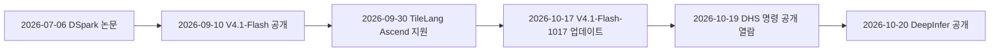

---

## 2. 배경: 왜 이 공개가 눈에 띄는가

### 2.1 추론 프레임워크가 하는 일

대형 언어 모델은 "학습"으로 만들어지지만, 사용자에게 서비스할 때 돈과 시간을 가장 많이 쓰는 것은 "추론"입니다. 모델 가중치 파일이 있어도 그것을 GPU 위에서 빠르고 싸게 돌리는 소프트웨어, 즉 추론 프레임워크가 없으면 서비스가 성립하지 않습니다. DeepSeek는 배포 Q&A 첫머리에서 모델이 가능성의 경계를 정하고, 그 능력을 많은 사용자에게 합리적인 비용으로 제공하는 것이 추론 프레임워크가 풀어야 할 핵심 문제라고 설명합니다.

혼합 전문가(MoE) 모델은 전문가 네트워크를 여러 GPU에 나누어 담습니다. 그래서 전문가 병렬화, 토큰 라우팅 통신, 전문가 간 부하 균형, 메모리 관리, 요청 스케줄링이 모두 얽힙니다. 이 모든 부분이 하나로 맞물려야 비로소 단가가 내려갑니다.

### 2.2 DeepSeek의 이전 오픈소스 흐름

DeepSeek는 모델 가중치 외에도 FlashMLA, DeepGEMM, DeepEP 같은 커널·통신 라이브러리, 그리고 TileLang을 공개해 왔습니다. DeepInfer의 README는 이 라이브러리들을 최적화 커널 목록에 직접 나열하며, TileKernels, DeepSelect와 자체 TileLang 커널도 함께 쓴다고 적었습니다.

한 가지 흥미로운 역사가 있습니다. SiliconANGLE에 따르면 DeepSeek는 2025년 4월에도 추론 엔진 전체를 공개하지 못한 이유를 설명한 적이 있습니다. 당시 이 소프트웨어는 vLLM의 초기 포크에 자사 클러스터 관리 도구가 결합된 형태였고, 대형 오픈소스 프로젝트를 유지할 여력이 작은 연구팀에게는 부담이었다고 했습니다. 이번에는 그때와 달리 엔진 본체를 공개한 것입니다. 다만 이번에도 클러스터 인프라와 결합된 부분(KV 캐시 관리, 부하 분산)은 남겨 두었다는 점에서 같은 사정이 완전히 해소된 것은 아닙니다.

### 2.3 V4.1-Flash 모델 소개

DeepInfer가 지원하는 유일한 모델인 DeepSeek-V4.1-Flash에 대해 확인한 내용은 다음과 같습니다.

- 2026년 9월 10일에 공개되었습니다. (일부 모델 목록 사이트는 다른 날짜를 적고 있으나, TNW 보도와 SGLang·OpenRouter 기재가 9월 10일로 일치합니다.)
- 텍스트와 이미지를 입력으로 받는 멀티모달 MoE 모델이며, 컨텍스트 창은 약 100만 토큰입니다.
- 논문과 TNW 보도에 따르면 백본이 5,520억 개 파라미터이고(논문은 별도의 Engram 모듈 1,960억 개를 따로 적고, Hugging Face 모델 카드는 전체 크기를 7,630억으로 표기해 자료마다 수치가 다릅니다) 45조 토큰으로 사전 학습했으며, 토큰당 전역 KV 캐시가 890바이트로 V4-Flash의 약 4분의 1, 2023년 첫 모델의 약 437분의 1이라고 DeepSeek가 밝혔습니다. 이 수치들은 DeepSeek 자체 발표이며 독립 검증은 아직 이루어지지 않았다고 TNW가 지적했습니다.
- DeepSeek 논문 "DeepSeek-V4.1-Flash: Pushing the Limits of KV Cache Compression"에 따르면 이 모델은 순수 CSA2 구조를 쓰고, 배포 최적화인 SWA Bounded Replay를 통해 영구 저장 KV 캐시 용량을 V4-Flash의 약 8분의 1로 줄입니다.
- 9월 14일 04:00 UTC부터 V4-Pro로 오는 요청은 V4.1-Flash로 연결되어 더 저렴한 Flash 요금으로 청구됩니다.

KV 캐시를 극단적으로 줄인 모델이라는 점이 중요합니다. 뒤에서 보겠지만 DeepInfer의 핵심 기법 상당수가 "작아진 KV 캐시를 어떻게 효율적으로 다루는가"와 직결되어 있습니다.

---

## 3. DeepInfer란 무엇인가

### 3.1 정의와 범위

README는 DeepInfer를 "DeepSeek의 대규모 프로덕션 서비스를 구동하는 고성능 추론 프레임워크"라고 소개하고, 이번 공개가 "대규모 서비스에 필요한 핵심 기능을 갖춘 오프라인 추론"을 제공한다고 명시합니다. 저장소 설명도 "DeepSeek 모델을 위한 고성능 대규모 추론 프레임워크"입니다.

여기서 **오프라인 추론**은 사용자 요청이 실시간으로 쏟아지는 온라인 서비스가 아니라, 입력을 모아 놓고 모델에 넣어 결과를 얻는 실행 방식을 뜻합니다. 같은 엔진이 온라인 서비스에도 쓰이지만, 이번에 공개된 패키지는 그 위에 얹는 서비스 계층 일부를 빼고 엔진 중심으로 구성되었다는 의미로 읽어야 합니다.

### 3.2 포함된 것과 포함되지 않은 것

README가 직접 구분해 둔 목록을 그대로 풀어 쓰면 다음과 같습니다.

**포함된 것(지원 기능)**

- 최적화된 커널, 모델 및 샘플러 런타임
- 병렬화: Attention DP(데이터 병렬)와 balanced CP, MoE 전문가 병렬(EP)과 전문가 부하 균형(EPLB)
- DSpark와 신뢰도 기반 검증 스케줄링
- SWA Bounded Replay
- 비동기 스케줄링(오버헤드가 없는 배치 스케줄러)
- 배치 불변 추론
- 결정적 샘플링
- 구조화 출력

**완전한 추론 서비스에 필요하지만 이번에 포함되지 않은 것**

- KV 캐시 시스템
- VE/Prefill/Decode 분리 배포(엔진에 필요한 기능 대부분은 이미 구현되어 있다고 README가 설명)
- Prefill과 Decode 각각에 대한 데이터 병렬 복제본 간 부하 분산

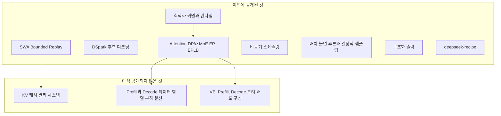

### 3.3 지원 모델·하드웨어·요구사항

| 항목 | 내용 |
|---|---|
| 지원 모델 | DeepSeek-V4.1-Flash (기본 체크포인트는 deepseek-ai/DeepSeek-V4.1-Flash-1017) |
| 지원 하드웨어 | NVIDIA SM100 GPU, Huawei Ascend 950 NPU |
| 운영체제와 도구 | Linux, GCC 13 이상, Python 3.12 |
| 가속기별 소프트웨어 | NVIDIA는 CUDA 13, Ascend는 CANN 9.2 |
| 라이선스 | Apache License 2.0 |
| PyPI | deepinfer 0.1.0 소스 배포판이 올라와 있습니다. |

SiliconANGLE는 Hopper를 비롯한 이전 세대 NVIDIA 아키텍처가 지원 목록에 없다고 지적했고, 배치 불변 추론과 결정적 샘플링은 NVIDIA에서만 동작한다고 정리했습니다. 공개된 성능 벤치마크도 모두 NVIDIA 칩에서 측정된 DeepSeek 자체 수치입니다.

### 3.4 실행 방법

README가 안내하는 흐름은 단순합니다. 빈 Python 3.12 환경을 만든 뒤, 가속기 종류를 환경 변수로 지정하고 빌드 스크립트를 실행합니다. NVIDIA라면 `DEEPINFER_ACCELERATOR=nvidia`, Ascend라면 `ascend`를 지정하고 `./build.sh`를 실행합니다. 이후 `python examples/offline_inference.py`로 오프라인 추론 예제를 돌리면, 처음 실행 시 기본 체크포인트가 Hugging Face 캐시로 내려받아집니다. 로컬에 모델이 있다면 `DEEPINFER_HF_MODEL_DIR`로 경로를 지정할 수 있습니다.

성능 벤치마크는 prefill에 SM100 GPU 4장, decode에 64장을 쓰되 각각 하나의 스케일업 도메인 안에서 측정했다고 밝히며, 재현용 스크립트(`examples/sweep/run_sweep.sh`)를 제공합니다.

### 3.5 출신: vLLM 위에서 시작했다

README의 감사 문구는 DeepInfer가 **원래 vLLM을 주된 기반으로 만들어졌고**, SGLang과 TensorRT-LLM에서 추가로 영감을 받았다고 밝힙니다. Max For AI의 글에도 DeepSeek가 vLLM과 SGLang의 혜택을 받았다는 언급이 있는데, 이는 README로 확인되는 사실입니다. TNW 보도에 따르면 vLLM 프로젝트는 DeepSeek가 오픈소스 커뮤니티를 언급해 준 데 감사를 표하고, DeepInfer의 아이디어를 가져와 V4.1-Flash 지원을 계속 개선하겠다고 밝혔습니다.

즉 이번 공개는 "외부 오픈소스에서 출발해 사내에서 크게 발전시킨 것을 다시 공개 생태계로 환류"하는 구조입니다.

---

## 4. 핵심 기능을 하나씩 이해하기

여기서는 README, 배포 Q&A, 관련 기술 블로그에서 확인되는 범위 안에서만 설명합니다.

### 4.1 최적화 커널

커널은 GPU에서 실제 연산을 수행하는 저수준 함수입니다. README는 FlashMLA(어텐션), DeepGEMM(행렬 곱), DeepEP(전문가 병렬 통신), TileKernels, DeepSelect, 그리고 TileLang으로 작성한 커널들을 쓴다고 밝힙니다. vLLM 블로그에 따르면 DeepSeek는 V4.1-Flash와 함께 MegaAttention, Mega-mHC, Mega-Gate, DeepSelect 같은 새 커널도 공개했으며, DeepSelect는 DeepSeek Sparse Attention을 위한 top-k 라이브러리입니다.

여기서 Max For AI의 주장과 직접 연결되는 대목이 있습니다. 배포 Q&A는 "내부의 DeepGEMM·FlashMLA와 공개 버전이 다른가"라는 질문에 대해, 대체로 같고 indexer와 mega 계열이 조금 다르며, FlashMLA에는 손으로 튜닝한 SASS 최적화 하나가 빠져 있어 decode 커널이 5~10% 느리지만 **종단 간 성능 차이는 최대 5% 이내**라고 답합니다. 즉 공개된 코드가 내부 운영 코드와 크게 다르지 않다는 것이 DeepSeek의 설명입니다. 이 5%는 DeepSeek가 제시한 수치이고 제가 독립적으로 검증한 값은 아닙니다.

### 4.2 병렬화: Attention DP, MoE EP, EPLB

MoE 모델은 입력 토큰마다 일부 전문가만 활성화합니다. 전문가들을 여러 GPU에 나누어 놓는 것이 **전문가 병렬(EP)** 이고, 어텐션 부분은 요청을 GPU별로 나누어 처리하는 **데이터 병렬(DP)** 로 돌립니다. 배포 Q&A의 구성은 다음과 같습니다.

- Prefill: EP 2~8, DP 2~8. HBM이 허용하는 한 가장 작은 EP/DP를 씁니다.
- Decode: EP 64~128, DP 64~128, 이른바 Wide-EP. 가용 GPU가 허용하는 한 가장 큰 값을 씁니다.
- 비전 인코더: 인스턴스당 GPU 한 장이면 충분하며 더 저렴한 GPU를 권장합니다.
- 현재 배포에서는 TP(텐서 병렬)와 CP(컨텍스트 병렬)를 쓰지 않습니다.

Wide-EP가 decode에서 유리한 이유는 전문가 부분의 단계당 메모리 접근량이 크게 줄고, 배치 크기가 커져 행렬 곱 효율이 올라가기 때문이라고 Q&A가 설명합니다. 다만 이 효과는 전문가 부하가 고르게 분산될 때 나오므로 **EPLB(전문가 부하 균형)** 가 필요합니다. 각 GPU가 담당 전문가 외에 인기 전문가의 복제본을 몇 개 더 들고 있고, 일정 단계마다 최근 부하 통계를 보고 전문가 배치를 다시 정합니다.

Q&A에 적힌 설정은 다음과 같습니다.

| 구분 | GPU당 중복 전문가(시작값) | 통계 창 | 재배치 주기 | 측정된 부하 불균형(가장 느린 랭크 대비 평균) |
|---|---|---|---|---|
| Prefill | 4개 | 100 단계 | 1,000 단계 | EP4DP4에서 1.074, EP2DP2에서 1.045 |
| Decode | 1개(올림 처리) | 1,000 단계 | 10,000 단계 | 1.090 |

1.0이 완벽한 균형이므로 이 값들은 가장 느린 랭크가 평균보다 약 4.5~9% 느리다는 뜻입니다. README에 나오는 "balanced CP"가 구체적으로 어떻게 동작하는지는 제가 확인한 문서에 설명이 없어 다루지 않습니다.

### 4.3 추측 디코딩: DSpark

**추측 디코딩**은 작은 초안 모델이 여러 토큰을 미리 제안하고 큰 본 모델이 그것을 한 번에 검증해, 맞은 만큼 한꺼번에 받아들이는 방식입니다. 맞으면 한 번의 본 모델 연산으로 여러 토큰이 나오므로 빨라집니다. 문제는 틀릴 가능성이 높은 토큰까지 모두 검증하면 본 모델의 배치 용량을 낭비한다는 점이고, 동시 요청이 많을수록 이 낭비가 처리량을 갉아먹습니다.

DSpark 논문 초록에 따르면 이 기법은 두 부분으로 이루어집니다. 하나는 병렬 백본에 가벼운 순차 모듈을 결합한 반자기회귀 초안 생성이고, 다른 하나는 요청마다 추정된 접두사 생존 확률과 엔진의 처리량 특성에 맞춰 검증 길이를 동적으로 정하는 **신뢰도 기반 검증**입니다. 논문은 DeepSeek-V4 서비스 시스템에 실제 사용자 트래픽으로 적용했을 때 기존 운영 기준선(MTP-1) 대비 같은 처리량에서 사용자당 생성 속도가 60~85% 빨라졌다고 보고합니다.

DeepInfer의 배포 Q&A는 운영 환경 구현을 이렇게 설명합니다. 초안 모델이 한 번에 5개 토큰을 만들고, 신뢰도 헤드가 각 토큰의 수락 확률을 예측하며, 측정된 하드웨어 처리량 곡선과 수락 확률을 이용해 기대 수락률 순으로 정렬한 뒤 유효 처리량을 최대화하는 접두사 부분집합만 검증합니다. 검증하는 초안 토큰 수가 단계당 약 30% 줄고(5.00에서 3.2~4.4로) 평균 수락 길이는 거의 그대로(3.29 대비 3.20)이며, 운영점인 랭크당 약 60개 시퀀스에서 처리량이 4~7% 늘어난다고 합니다.

Q&A의 동시성별 표를 옮기면 다음과 같습니다.

| 랭크당 동시 시퀀스 | 고정 5개 검증 대비 처리량 변화 |
|---|---|
| 16 | -1.5% |
| 32 | +1.6% |
| 48 | +3.6% |
| 60 | +5.4% |
| 72 | +6.7% |
| 96 | +11.0% |

부하가 낮을 때는 오히려 약간 손해이고, 부하가 높을수록 이득이 커집니다. 앞서 설명한 원리, 즉 한가할 때는 불필요한 검증의 부담이 작고 바쁠 때는 낭비가 곧 손실이라는 점과 일치합니다. 이 표의 "추정 처리량"은 EP64/DP64 벤치마크 데이터에서 계산한 값이라고 Q&A가 밝히고 있습니다.

DeepInfer에서는 `DEEPINFER_ENABLE_MTP_VARLEN=1`로 켜고, `DEEPINFER_USE_NEXTN_DECODE`로 최대 초안 길이(기본 5)를 조절합니다.

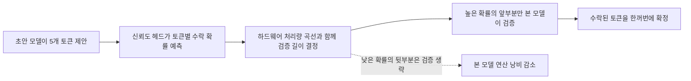

### 4.4 SWA Bounded Replay

이 기능은 V4.1-Flash의 구조를 알아야 이해됩니다.

**배경.** V4 계열은 전체 문맥을 압축해서 보는 전역 어텐션과, 가까운 토큰만 정확히 보는 **슬라이딩 윈도 어텐션(SWA)** 을 함께 씁니다. SGLang 블로그에 따르면 각 층은 최근 128개 위치의 SWA 캐시를 FP8로 유지합니다. 전역 KV는 압축되어 작지만, SWA KV는 요청마다 따로 있어서 이것을 어떻게 저장·복원하는지가 비용을 좌우합니다. 요청이 캐시를 재사용하려면 접두사의 SWA 상태가 필요한데, 이를 전부 저장하면 용량이 크고 매번 정확히 재계산하면 시간이 많이 듭니다.

**아이디어.** 배포 Q&A는 이렇게 설명합니다. V4.1-Flash는 인코더 층과 디코더 층으로 나뉘는 구조(Causal Encoder-Decoder)이고, 디코더 층의 블록 KV 캐시는 마지막 인코더 층의 은닉 상태에서 투영됩니다. 그래서 prefill에서 정말로 새로 계산해야 하는 것은 디코더 층의 SWA KV뿐입니다. 이것을 **정확하게** 복원하려면 디코더 20개 층을 통과하며 마지막 2,560개 토큰을 다시 돌려야 합니다. (층마다 윈도 128을 따라 거슬러 올라가므로 128 곱하기 20이라는 계산과 맞습니다. 이 곱셈은 제가 덧붙인 확인 계산입니다.) 대신 **마지막 128개 토큰만** 디코더 층에서 다시 계산하고, 어텐션 윈도를 재계산 구간 안으로 잘라 냅니다. 위치 s부터 재생한다면 위치 i의 쿼리는 max(s, i-127)부터 i까지의 키만 봅니다. 결과는 근사값이지만 재계산 비용이 문맥 길이와 무관한 상수가 되고, prefill 전체 연산량이 거의 절반으로 줄어듭니다.

이 기법은 두 군데에 쓰입니다.

- **인코더 측 재생:** 접두사 캐시 적중 길이가 블록 KV 캐시에만 의존하게 합니다. SWA KV가 없으면 적중 접두사의 마지막 128개 토큰을 다시 계산해 SWA KV만 복원하고, 블록 KV는 그대로 재사용합니다.
- **디코더 측 재생:** 위에서 설명한 방식으로 매 prefill마다 마지막 128개 토큰만 디코더 층에서 다시 계산하고, 그 결과는 decode에만 쓰고 접두사 캐시에는 넣지 않습니다.

**효과와 한계.** 외부 구현 보고가 DeepSeek의 설명을 보강합니다. vLLM은 하위 층(0~20)에서는 전체 프롬프트를, 상위 층(21~39)에서는 마지막 128개 토큰만 처리하고, CUDA 그래프 적용 시 prefill 계산 시간이 30~40% 줄었다고 보고했습니다. SGLang은 8장 H200에서 prefill 처리량이 1.56배, 4장 GB300에서 1.37배 올랐고, 4장 GB300에서 AIME 2026 pass@1이 재생을 끈 경우와 켠 경우 모두 480개 중 453개 정답으로 같았다고 보고했습니다. 반면 이것은 **근사 기법**이라 수치적으로 완전히 같은 결과를 보장하지 않으며, SGLang은 품질을 실험으로 평가해야 하는 근사라고 명시했고 vLLM 보도도 비트 단위 재현이 필요한 작업에서는 끄고 애플리케이션 수준 품질을 검증하라고 권합니다.

DeepInfer에서는 `DEEPINFER_YOCO_PREFILL_TRUNCATION_MODE=compact`와 `DEEPINFER_YOCO_PREFILL_KEEP_TOKENS=140`이 V4.1의 기본 설정입니다. README는 보존하는 꼬리 구간이 SWA 윈도에 최대 역추적 길이를 더한 값을 덮어야 한다고 설명합니다. 한편 Q&A는 캐시 적중 정책에서 입력 길이 L에 대한 최대 적중 길이를 L-134로 제한한다고 밝히며, 134를 128토큰 윈도에 추측 디코딩 역추적 여유 6토큰을 더한 값으로 설명합니다. 140이라는 설정값이 어떤 계산으로 정해졌는지는 제가 확인한 문서에 풀이가 없어 여기서는 해석하지 않습니다.

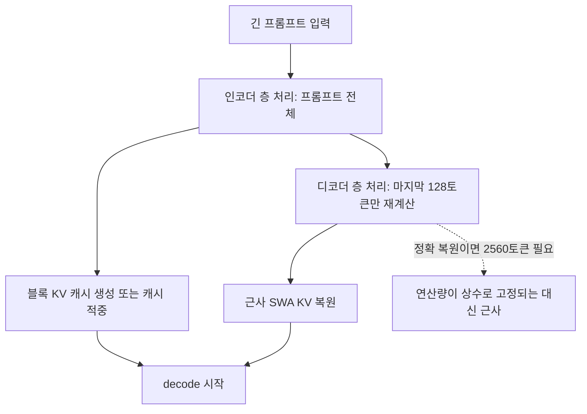

### 4.5 비동기 스케줄링(오버헤드 없는 배치 스케줄러)

decode의 한 단계는 스케줄(CPU), forward(GPU), 샘플링(GPU), 후처리(CPU)로 이어지는데, 샘플링 결과를 CPU가 받아야 후처리를 할 수 있어서 GPU가 후처리와 다음 스케줄링 동안 놀게 됩니다. 비동기 스케줄링은 GPU가 N번째 단계를 계산하는 동안 CPU가 N+1번째 스케줄링과 launch, N-1번째 후처리를 동시에 진행해 GPU의 유휴 시간을 없앱니다. Q&A는 SGLang과 NanoFlow의 기존 구현을 따랐다고 밝힙니다. 기본으로 켜져 있습니다.

추측 디코딩과의 상호작용이 흥미롭습니다. N+1번째 스케줄링 시점에 N번째 단계의 신뢰도가 아직 돌아오지 않았으므로 CPU는 총 예산만 정하고, 요청별 길이는 GPU에서 TileLang 커널(누적곱, 전역 정렬 top-k, 재배치 scatter 융합)이 다시 계산해 고정 메모리 버퍼에 써 넣습니다.

### 4.6 배치 불변 추론과 결정적 샘플링

일반적으로 같은 입력이라도 다른 요청과 함께 묶이는 배치 구성에 따라 부동소수점 연산 순서가 달라져 결과가 미세하게 달라질 수 있습니다. **배치 불변 추론**은 배치 구성이 달라도 결과가 동일하도록 보장하며 `DEEPINFER_BATCH_INVARIANT=1`로 켭니다. **결정적 샘플링**은 같은 입력 토큰과 같은 샘플링 매개변수에서 같은 출력을 내며, 배치 불변을 켜고 추측 디코딩 가변 길이를 끈 뒤 고정 `seq_seed`를 `SamplingParams`에 전달합니다. 둘 다 NVIDIA에서만 지원됩니다. 재현성이 중요한 평가나 강화학습 롤아웃에 유용한 기능으로 보이지만, 그 용도는 제가 문서에서 직접 확인한 설명이 아니라 기능 성격에서 온 해석입니다.

### 4.7 구조화 출력

모델 출력을 정규식, JSON 스키마, EBNF 문법에 맞게 강제하는 기능입니다. Q&A에 따르면 컴파일과 추론이 분리되어 있어서, 전용 머신에서 형식 제약을 문법 자동기계로 비동기 컴파일해 두고, 요청이 엔진에 들어가기 전에 그 결과를 받아옵니다. 런타임에는 decode 단계마다 자동기계를 한 칸 진행시켜 허용되는 토큰 집합을 구하고, 그에 대한 마스크를 샘플링 로직에 적용합니다. 사용 시에는 `SamplingParams`에 `so_args={"schema_type": ..., "schema": ...}`를 넘기며 예제는 `examples/_structured_output.py`에 있습니다.

---

## 5. 공개되지 않은 부분: 전체 서비스는 어떻게 생겼나

DeepSeek는 코드를 전부 공개하지 못한 대신, 배포 Q&A(`doc/inference_deployment_qa.md`)와 Zhihu 블로그 글로 시스템 구조를 설명했습니다. Q&A에서 확인되는 설계 목표는 세 가지입니다.

1. 여러 벤더의 가속기를 지원하고 각 플랫폼의 성능을 최대한 활용할 것
2. 범용 하드웨어 위주로 prefill과 decode를 구성할 것(prefill은 일반 8-GPU 머신, decode는 64~128-GPU 슈퍼노드)
3. KV 캐시를 72시간 넘게 유지해 문맥 재사용 창을 길게 확보할 것

### 5.1 전체 구조

시스템은 비전 인코더(VE), Prefill, Decode를 서로 다른 장비 풀에 나누어 배치하는 분리형(E/P/D) 구조에 전용 저장소 노드를 더한 형태입니다. 이렇게 하면 단계별 자원 배정을 분리해 첫 토큰까지의 시간(TTFT)과 토큰 간 시간(TBT)을 따로 제어할 수 있다고 Q&A가 설명합니다. 어텐션은 데이터 병렬로 돌리고(DP 수가 EP 수와 같음), 이 DP/EP 복제본을 균형 있게 다루기 위해 Prefill 부하 분산기, Decode 부하 분산기, 비전 인코더 부하 분산기, 전문가 병렬 부하 분산기를 따로 만들었습니다. 반복되는 prefill 비용을 피하기 위해 KV 캐시 저장소(KVCache Storage)를 두었고, API 변환은 DeepSeek Recipe가 맡습니다.

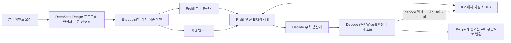

이 그림에서 Recipe와 엔진 계층은 공개되었고, 부하 분산기와 KV 캐시 저장소 구현은 공개되지 않았습니다.

### 5.2 최소 배포 규모

Q&A는 1P+1D(Prefill 한 묶음, Decode 한 묶음)도 배포 자체는 가능하지만, 실제로는 P와 D의 GPU 비율이 대략 1:1이고 decode 권장 구성이 EP64 이상이므로 **효율적으로 운영 가능한 최소 단위는 prefill 64장과 decode 64장, 즉 128장**이라고 설명합니다. 일반적인 개인 개발자나 소규모 팀이 이 서비스 구성을 그대로 재현하기는 현실적으로 어렵다는 뜻입니다. 이번 공개물로 즉시 얻을 수 있는 것은 엔진과 설계 지식이고, 128장 규모의 운영 체계는 별개의 과제입니다.

### 5.3 KV 캐시 저장 구조

Q&A에 나오는 저장 계층은 다음과 같습니다.

| 내용 | 저장 매체 | 관리 주체 |
|---|---|---|
| 처리 중인 블록 KV와 상태 KV | 추론 GPU 메모리 | Prefill/Decode 인스턴스 |
| SWA KV 캐시 | 호스트 메모리(단일 복사본, 3FS에는 저장하지 않음) | Prefill/Decode 인스턴스. 머신 간 적중은 400G VLAN으로 가져옵니다 |
| 페이지 단위 블록 KV 캐시 | 전용 3FS 저장 클러스터 | kvcache-store |

핵심 설계 판단 몇 가지는 다음과 같습니다.

- 블록 KV를 로컬 호스트 메모리가 아니라 **전용 저장 클러스터**에 둡니다. 모든 prefill 머신이 어떤 접두사에도 적중할 수 있어 접두사 친화 라우팅과 부하 분산이 충돌하지 않고, 저장 노드의 증설이 계산 노드와 분리되며, 계산 노드의 고장률이 저장 노드보다 10배 넘게 높다는 점을 감안하면 KV가 계산 노드 장애의 영향을 받지 않는 것이 이점입니다.
- 저장 서버는 30.73TB SSD 20개를 권장하고, 서버당 읽기 40GB/s 이상, 쓰기 5GB/s 이상, 24시간 분량 보관이 가능한 용량을 요구합니다. GPU 한 장당 논리 크기로 약 14.4TB가 필요하며 물리 용량은 더 큽니다.
- 3FS는 10+2 이레이저 코딩으로 데이터를 저장해 EC 그룹당 노드 두 대가 동시에 고장 나도 견디며, 읽기는 11개 저장 노드에 동시에 요청해 10개만 응답해도 복원합니다. LRU 정책의 GC 워커가 저장 노드마다 돌며 만료된 캐시를 회수합니다.
- 3FS는 SSD 약 100PiB를 KV 캐시에 제공하며 TTL은 에이전트 트래픽 3일, 챗봇 트래픽 7일입니다. 챗봇은 적중의 긴 꼬리가 두꺼워 소량의 캐시가 매우 여러 번 읽히므로 잃으면 적중률 손실이 크고, 경험적으로 TTL 3일 수준이면 챗봇 트래픽의 KV 적중률이 0.5~1% 줄어든다고 합니다.
- 캐시 관련 지연은 비동기로 숨깁니다. 접두사 매칭은 메타데이터만 쓰는 해시 체인 매칭이지만 라우팅 전에 적중 길이가 필요해 숨길 수 없고, KV 가져오기는 별도 프로세스에서 비동기로 하며, HBM으로 올리는 swap-in은 계층별 H2D 전송이 forward 연산과 겹치도록 엔진 프로세스 안의 스레드가 맡습니다. CUDA 복사 엔진이 작은 단위의 KV 블록 복사에서 성능이 낮아 swap-in은 RDMA NIC를 이용한 GDR로 구현했다고 설명합니다.

### 5.4 부하 분산 설계

- **Prefill 부하 분산기:** 요청을 전체 문맥 길이로 4개 계층(16K 미만, 16~64K, 64~256K, 256K 이상)으로 나누고, 직전 라운드의 계층별 연산 쿼터 수요 비중에 따라 계층에 할당되는 엔진 수를 동적으로 바꿉니다. 단일 GPU 안에서는 FIFO로 요청을 꺼내되 청크 크기를 고정하지 않고, 단계마다 시간 예산(`compute_quota_limit`)과 이차식 비용 모델 `cost(q, c)`로 32,768토큰 예산 안에서 가능한 최대 `q`를 풉니다.
- **Decode 부하 분산기:** 모든 decode 인스턴스의 모든 GPU로 균일하게 라우팅하되 요청 수(단계당 배치 크기)와 총 KV 길이(어텐션 비용)를 동시에 균형 있게 맞춥니다. 짧은 요청은 동시 요청 수가 적지만 총 KV가 긴 GPU로, 긴 요청은 총 KV가 짧은 GPU로 보냅니다.
- **비전 인코더 부하 분산기:** 이미지는 머신 단위로 라우팅하고, 그 머신에서 현재 처리 중인 이미지 패치 수가 가장 적은 GPU에 맡깁니다.
- **효과:** 부하 분산 전체의 효과는 완벽하게 균형 잡힌 오프라인 벤치마크의 약 80% 수준에 도달한다고 Q&A가 설명합니다.

### 5.5 자동 확장과 장애 대응

Prefill은 캐시되지 않은 토큰 수로, Decode는 실행 중 요청 수로 필요한 머신 수를 결정하며 조정 속도에는 상하한이 있습니다. 대규모 EP에서 꼬리 요청이 자원을 낭비하는 문제를 줄이기 위해, 종료 통지를 받은 decode 엔진은 1분의 유예 기간 뒤 미완료 요청과 그 KV 캐시를 다른 엔진으로 한꺼번에 넘겨 계속 decode하게 합니다. 쿼터 활용률이 0.8을 넘으면 축소를 금지해 트래픽 변동의 여유분을 둡니다. 인스턴스의 모든 GPU가 하나의 통신 도메인을 이루므로 GPU 하나만 고장 나도 인스턴스 전체를 못 쓰게 되는데, 재시작 때 현재 건강한 GPU 수로 EP 크기를 다시 정해 남은 GPU를 살립니다. 재시작은 분 단위이며 장애 허용은 단일 엔진의 재시작을 단축하는 방식이 아니라 쿼터 중복과 요청 단위 재라우팅으로 달성한다고 설명합니다.

### 5.6 저정밀도 연산

Q&A는 FP4가 쓰이는 곳을 구체적으로 밝힙니다. 주 KV는 16개 단위 스케일의 e4m3로 NVFP4와 비슷하지만 전역 스케일이 없고, indexer KV는 32개 단위 ue8m0 스케일의 MXFP4이며, MoE 라우팅 전문가 가중치도 32개 단위 ue8m0 MXFP4입니다. 같은 맥락에서 SGLang 블로그는 일부 소스 층이 FP4 압축 표현을 만든다고 설명합니다.

---

## 6. deepseek-recipe: 토큰 인코딩·디코딩 부품

### 6.1 무엇을 하는가

README의 설명에 따르면 deepseek-recipe는 Rust 라이브러리와 Python 바인딩의 모음입니다. 서로 다른 형식의 API 요청을 하나의 대화(Conversation) 형식으로 통일하고, 그 대화를 DeepSeek 모델용 프롬프트로 렌더링하며, 토크나이저를 연결해 토큰 ID로 인코딩하고, 모델 출력을 해당 형식의 응답으로 되돌립니다. **모델 추론, 도구 실행, HTTP 전송은 호출자가 제공해야 합니다.** 즉 이것은 API 서버 전체가 아니라 그 한가운데 들어가는 변환 부품입니다.

지원 범위는 Messages, Chat Completions, Responses 요청과 스트리밍·완전 응답 변환, 텍스트·이미지·사고 모드·클라이언트 도구 호출·Chat Completions의 `prefix` 이어쓰기, DeepSeek V4와 V4.1 대화의 프롬프트 렌더링과 토큰 ID 인코딩, 사고 모드와 추론 강도·temperature·top_p·최대 출력 토큰 같은 생성 설정, 추론 내용과 도구 호출·JSON 객체 출력·종료 문자열 해석, JSON 스키마와 정규식 구조화 출력, 로그 확률 변환입니다.

### 6.2 왜 중요한가

같은 모델이라도 프롬프트 템플릿과 토큰화가 공식 API와 조금이라도 다르면 출력이 미묘하게 달라질 수 있습니다. DeepSeek는 이 구성요소의 처리 로직이 공식 API와 완전히 일치하도록 만들어서 제3자 배포에서도 같은 API 동작을 얻게 했다고 밝혔습니다. 이 점은 Q&A 설명과 SiliconANGLE 보도로 확인됩니다.

### 6.3 설계에서 눈여겨볼 점

Q&A는 보안과 성능에 관한 몇 가지 설계를 설명합니다.

- **특수 토큰 주입 방지.** 프롬프트를 만들 때 명시적으로 삽입한 특수 토큰과 위치를 기록해 두고 직접 토큰 ID로 매핑하며, 사용자 입력·도구 결과·도구 호출 인자 안에 `<｜User｜>`나 `<｜image｜>` 같은 문자열이 들어 있어도 일반 토큰 열로 인코딩합니다. 텍스트가 제어 토큰을 흉내 내 모델 행동에 영향을 주는 것을 막기 위함입니다.
- **출력 쪽도 같은 원칙.** 추론 종료 표시 `</think>`와 DSML 태그의 `｜DSML｜`를 토큰 ID로 식별하므로, 모델이 일반 토큰으로 같은 글자를 써도 추론 종료나 도구 호출을 일으키지 않고 문자 그대로 보존됩니다.
- **분할 병렬 인코딩.** 특수 토큰 사이의 일반 텍스트 구간은 BPE 특성상 독립적으로 인코딩할 수 있어서, 구간을 나누어 병렬로 인코딩하고 순서대로 이어 붙여 긴 입력의 토큰화 지연을 줄입니다.
- **스트리밍 파서.** 토큰 단위로 오는 청크 하나가 UTF-8 문자 하나나 DSML 태그, 도구 인자를 쪼갤 수 있으므로 상태 기계로 진행 상태를 유지하고, 구분자 매칭은 증분 KMP로 수행하며, 도구 이름은 파싱되는 즉시 반환하고 JSON 조각은 인자 경계에서 바로 만들어 냅니다.

### 6.4 사용 예와 주의점

설치는 Python 3.10 이상에서 `python3 -m pip install deepseek-recipe`, Rust에서는 `cargo add deepseek-recipe@0.2 deepseek-recipe-encoding@0.2 serde_json@1`입니다. 저장소에는 Axum 기반 Rust API 예제(`server-rs`)와 FastAPI 기반 Python 예제(`server-py`, 둘 다 모의 추론)가 있고, 프롬프트와 특수 토큰을 확인하며 모델 출력을 각 프로토콜 응답으로 파싱해 보는 웹 데모(`encoding-decoding-demo`)가 있습니다.

운영에 옮길 때 알아야 할 점이 README에 직접 적혀 있습니다.

- V4 모델은 이미지를 받지 않으므로 요청 속 이미지가 `[Unsupported Image]` 텍스트로 대체됩니다. V4.1에서만 OpenCV 기반 이미지 전처리를 합니다.
- 이미지 컴포넌트의 `ReqwestImageFetcher`는 기본적으로 **어떤 주소에도 연결**합니다. 신뢰할 수 없는 요청에서 URL을 가져오는 서비스라면 `DestinationFilter`를 설치해야 합니다.
- 라이선스는 DeepInfer와 달리 **MIT**입니다.

---

## 7. 숫자로 보는 규모와 해석상의 주의

### 7.1 DeepSeek가 직접 밝힌 수치

| 항목 | 값 | 출처와 성격 |
|---|---|---|
| 단일 클러스터 일일 처리량 | 하루 155조 토큰 | 배포 Q&A, DeepSeek 자체 발표 |
| GPU당 수익 | 시간당 38달러(골짜기 요금 기준) | 배포 Q&A, DeepSeek 자체 발표 |
| 효율적 최소 배포 | prefill 64장과 decode 64장 | 배포 Q&A |
| KV 캐시 보존 목표 | 72시간 이상 | 배포 Q&A |
| 에이전트·챗봇 캐시 TTL | 3일, 7일 | 배포 Q&A |
| 공개 커널과 내부 커널의 종단 간 차이 | 최대 5% | 배포 Q&A, DeepSeek 자체 발표 |
| DSpark의 검증 토큰 감소 | 단계당 약 30% | 배포 Q&A |
| SWA Bounded Replay의 prefill 연산 절감 | 전체의 거의 절반 | 배포 Q&A |

"골짜기 요금(valley pricing)"은 수요가 적은 시간대의 할인 요금을 뜻하는 것으로 읽히지만, 구체 요금표는 제가 확인한 자료에 없습니다.

### 7.2 해석할 때 지켜야 할 선

- 위 수치는 **DeepSeek 자체 측정값**입니다. SiliconANGLE도 공개된 성능 벤치마크가 모두 NVIDIA 칩에서 나온 DeepSeek 자체 수치임을 명시했고, TNW도 V4.1-Flash 관련 수치는 독립 검증이 필요하다고 지적했습니다.
- 일부 2차 매체가 캐시 적중률, 평균 TTFT, 초당 생성 토큰 수 같은 추가 수치를 보도했지만, 제가 직접 확인한 1차 자료(README, 배포 Q&A)에서는 해당 수치를 찾지 못했습니다. 그래서 이 문서에서는 사용하지 않았습니다.
- 개발자가 직접 돌릴 수 있는 것은 엔진이며, 하루 155조 토큰을 처리하는 클러스터 전체를 재현하려면 공개되지 않은 KV 캐시 관리와 부하 분산 컴포넌트를 직접 구현해야 합니다.

---

## 8. Max For AI 게시물 해설과 사실 검증

제공해 주신 게시물은 DeepSeek의 DeepInfer 공개를 매우 높게 평가하는 장문의 글입니다. 글의 논리 흐름은 다음과 같습니다. 먼저 공개의 의미를 대부분이 과소평가하고 있다고 말하고, 이어 DeepSeek가 이전에도 모델 가중치, FlashMLA, DeepGEMM, DeepEP, TileLang을 공개해 왔다는 맥락을 제시합니다. 그다음 이번에 공개된 기능이 분산 추론, MoE 병렬, 추측 디코딩, 비동기 스케줄링, SWA Bounded Replay, 구조화 출력이며 NVIDIA SM100과 Huawei Ascend 950을 지원하고 Apache 2.0이라는 점을 짚습니다. 그리고 비NVIDIA GPU를 써 본 사람이라야 이 공개의 가치를 안다는 경험담과, 수천억 파라미터 모델을 안정적·효율적·저비용으로 돌리는 데 필요한 엔지니어링 축적이 얼마나 큰지에 대한 논증으로 이어집니다. 끝으로 DeepSeek의 낮은 API 가격이 이런 축적에서 나온다는 해석, 공개의 한계(오프라인 버전, KV 캐시와 부하 분산 미공개, 제한된 하드웨어)를 인정하는 문장, 장인의 비법을 교재로 만들어 무료로 나눠 주는 것에 빗댄 비유, 창업자에 대한 찬사로 마무리됩니다.

### 8.1 주장별 확인 결과

| 글의 주장 | 확인 결과 |
|---|---|
| DeepSeek가 DeepInfer를 오픈소스로 공개했다 | 확인됨. 공식 게시물과 GitHub 저장소, 여러 매체 보도가 일치합니다. |
| 대규모 생산 서비스를 지탱하는 핵심 추론 프레임워크다 | 확인됨. README와 공식 게시물이 같은 표현을 씁니다. 다만 공개본은 오프라인 추론 중심의 부분 공개입니다. |
| 이전에 모델 가중치, FlashMLA, DeepGEMM, DeepEP, TileLang을 공개했다 | 확인됨. README가 이 라이브러리들을 사용 커널로 나열하고, Q&A가 TileLang과 추론 커널 라이브러리를 이전에 공개했다고 밝힙니다. 몇 번째 공개인지는 글에서도 "세기 어렵다"고 했고 저도 세지 않았습니다. |
| 분산 추론, MoE 병렬, 추측 디코딩, 비동기 스케줄링, SWA Bounded Replay, 구조화 출력이 들어 있다 | 확인됨. README의 기능 목록과 일치합니다. |
| 엔진의 가장 핵심적인 엔지니어링 능력이 기본적으로 다 들어 있다 | 부분적으로 확인됨. 엔진 핵심은 공개되었으나 KV 캐시 관리와 부하 분산은 빠져 있고, 글도 이 한계를 뒤에서 인정합니다. |
| NVIDIA SM100과 Huawei Ascend 950을 지원한다 | 확인됨. README의 지원 하드웨어 목록과 일치합니다. |
| Apache 2.0으로 공개되었다 | DeepInfer는 확인됨. 단, 함께 공개된 deepseek-recipe는 MIT 라이선스입니다. |
| 이번에 공개된 것은 오프라인 추론 버전이고 KV 캐시 관리와 부하 분산 컴포넌트는 전부 공개되지 않았으며 지원 하드웨어도 제한적이다 | 확인됨. README와 배포 Q&A가 같은 내용을 담고 있습니다. 덧붙이면 Prefill/Decode 분리 배포 구성도 포함되지 않았습니다. |
| DeepSeek도 vLLM, SGLang 같은 오픈소스의 혜택을 받았고 이제 그 경험을 환원한다 | 확인됨. README가 vLLM을 원래 기반으로, SGLang과 TensorRT-LLM을 영감의 출처로 밝히고, vLLM 프로젝트가 감사를 표했습니다. |
| 그래서 DeepSeek API 가격이 그렇게 낮을 수 있다 | 일부만 확인됨. DeepSeek는 Q&A에서 더 적은 연산과 에너지로 더 많은 요청을 처리해 더 낮은 가격에 이르는 것을 목표로 한다고 밝혔습니다. 그러나 API 가격 전체를 이 프레임워크 하나의 결과로 환원할 수 있는지는 제가 확인한 자료로는 입증되지 않습니다. 필자의 해석에 가깝습니다. |
| 같은 GPU와 같은 모델이라도 프레임워크 효율이 다르면 비용이 크게 다르다 | 일반적인 업계 상식에 부합하는 논리입니다. 이 문서의 자료는 DeepSeek의 효율 목표와 수치를 보여 줄 뿐 다른 프레임워크와의 직접 비교 수치를 담고 있지 않습니다. |
| Ascend나 AMD, Intel GPU를 써 보면 작업이 멈추거나 이상한 커널 동작, 느린 공식 커널을 겪는다 | 필자의 개인 경험담입니다. 제가 검증할 수 없고, 그렇다고 틀렸다고 볼 근거도 없습니다. |
| 국산 컴퓨팅 생태계에서 본 바로는 DeepSeek의 추론 시스템 엔지니어링 축적이 하드웨어 업체 공식 소프트웨어 스택보다 훨씬 낫다 | 필자 개인의 인상입니다. 검증할 객관 자료가 없습니다. |
| 하드웨어 업체의 비공개 경쟁 환경에서 이런 공개는 용기와 이상주의가 필요하다 | 평가적 표현으로, 사실 검증의 대상이 아닙니다. |
| 창업자 량원펑(梁文锋)에 대한 찬사와 "국산 모델에 량 성인이 나지 않았다면 만고가 긴 밤 같았을 것"이라는 말 | 가치 평가입니다. 후자는 유교 성인에 대한 유명한 옛 찬사를 변형한 과장된 수사입니다. |

### 8.2 글이 짚은 것과 놓친 것

글이 잘 짚은 것은 세 가지입니다. 첫째, 이번 공개의 가치가 **운영 환경에서 부딪힌 문제의 해결이 코드와 문서에 쌓여 있다**는 점에 있다는 주장은, Q&A가 보여 주는 EPLB 설정값, 부하 분산 휴리스틱, 장애 대응 정책이 매우 구체적이라는 사실과 부합합니다. 둘째, 한계(오프라인 버전, 일부 컴포넌트 미공개, 지원 하드웨어 제한)를 정직하게 적었습니다. 셋째, Ascend 지원을 높게 평가한 점은 README의 `requirements-ascend.txt`, CANN 9.2 요구, 지원 하드웨어 목록으로 뒷받침됩니다.

글에서 다루지 않은 맥락은 다음과 같습니다.

- 지원 모델이 **V4.1-Flash 하나뿐**이라는 점. 일반 모델을 돌리는 범용 엔진이 아닙니다. DeepSeek는 향후 모델의 추론 코드도 같은 저장소에 계속 공개하겠다고 밝혔습니다.
- 하드웨어가 SM100(Blackwell 세대)과 Ascend 950으로 한정되어 **Hopper 이전 세대 GPU로는 쓸 수 없는** 점. 이것은 많은 기업 현장에서 실질적 제약입니다.
- 128장 규모의 운영 단위가 필요하다는 현실.
- 공개 시점이 DHS 명령과 겹친다는 정치적 맥락.

---

## 9. 이번 공개의 의미와 한계, 두 방향에서 보기

### 9.1 의미 있다고 볼 수 있는 점

- **운영 지식의 공개.** 코드만이 아니라 EPLB 설정, 부하 분산 알고리즘, 3FS 이레이저 코딩 구성, TTL 정책, 자동 확장 규칙까지 문서화되었습니다. 비슷한 규모의 시스템을 만들려는 팀에게는 설계 시행착오를 줄이는 자료입니다.
- **하드웨어 다변화의 신호.** 공식 릴리스에서 Ascend 950이 NVIDIA SM100과 나란히 지원 목록에 올랐습니다. SiliconANGLE는 이것을 9월 30일 TileLang의 Huawei 칩 지원 릴리스, 그리고 Bloomberg가 보도한 내몽골 데이터센터에서의 Ascend 950DT 가속기 최소 16만 개 도입 계획과 연결해 설명합니다.
- **상호 환류 구조.** DeepInfer는 vLLM에서 출발했고, vLLM과 SGLang은 V4.1-Flash 공개 당일부터 SWA Bounded Replay를 지원했습니다. vLLM 프로젝트는 DeepInfer의 아이디어를 반영해 지원을 계속 개선하겠다고 밝혔으므로, 세 프로젝트가 서로 개선을 주고받는 구조가 됩니다.
- **재현성 기능.** 배치 불변과 결정적 샘플링이 문서화된 옵션으로 제공됩니다. 같은 입력에서 같은 결과가 필요한 작업에 쓸 수 있는 기능이라는 점은 제 해석입니다.

### 9.2 한계로 보아야 할 점

- **부분 공개.** 핵심 서비스 컴포넌트 일부가 빠져 있어, 공개물만으로 DeepSeek와 같은 비용 구조를 재현할 수는 없습니다.
- **좁은 호환성.** 모델 한 개, 하드웨어 두 종류. 범용 추론 엔진으로서 vLLM이나 SGLang을 대체하는 것이 아닙니다. 이미 README와 매체 보도가 모두 이 한계를 언급합니다.
- **근사 기법의 위험.** SWA Bounded Replay는 근사이므로 정확한 재현이 필요한 작업에는 신중해야 합니다.
- **수치의 독립 검증 부재.** 처리량과 수익성 수치는 DeepSeek의 자체 발표입니다.
- **초기 프로젝트의 성숙도.** README를 조회한 시점에 저장소는 커밋 4개였습니다. 별 약 1만 7,900개, 포크 약 1,800개로 관심은 매우 높지만 외부 기여와 운영 사례는 이제 시작 단계입니다. (이 수치는 조회 시점의 값이며 계속 변합니다. 비교로, deepseek-recipe는 별 431개, 포크 41개, 커밋 3개였습니다.)

---

## 10. 직접 써 보려는 개발자를 위한 점검 목록

1. **하드웨어 확인.** SM100급 NVIDIA GPU(CUDA 13) 또는 Ascend 950(CANN 9.2)이 있는가. 없다면 이 엔진을 돌릴 수 없습니다. Linux, GCC 13 이상, Python 3.12도 필요합니다.
2. **목적 정리.** 오프라인 배치 추론이나 재현성이 필요한 평가용인가, 온라인 서비스인가. 온라인이라면 KV 캐시 관리와 부하 분산, 분리 배포를 직접 구축해야 합니다.
3. **API 호환이 목적이라면 deepseek-recipe부터.** 추론 백엔드가 이미 있고 공식 API와 같은 프롬프트·토큰·응답 동작만 원한다면 이 라이브러리 단독으로도 가치가 있습니다. 단, 이미지 URL을 가져오는 경우 `DestinationFilter` 적용을 잊지 마세요.
4. **정확성이 중요한 작업.** 비트 단위 재현이 필요하면 SWA Bounded Replay를 끄는 선택지를 검토하고, 일반 업무에서도 자신의 작업으로 품질을 검증한 뒤 도입하세요.
5. **최신 상태 확인.** 저장소는 막 공개되었고 Q&A는 "계속 업데이트된다"고 명시했으므로, 도입 전에 저장소의 최신 README와 Q&A, 지원 모델 목록을 다시 확인하세요.

---

## 11. 용어 사전

| 용어 | 쉬운 설명 |
|---|---|
| 추론(Inference) | 학습이 끝난 모델에 입력을 넣어 답을 얻는 과정 |
| Prefill, Decode | 프롬프트 전체를 한 번에 처리하는 단계, 토큰을 하나씩(또는 소수씩) 생성하는 단계 |
| TTFT, TBT | 첫 토큰이 나오기까지의 시간, 토큰과 토큰 사이의 시간 |
| MoE | 여러 전문가 네트워크 중 일부만 골라 쓰는 모델 구조 |
| EP, DP, TP, CP | 전문가 병렬, 데이터 병렬, 텐서 병렬, 컨텍스트 병렬. 일을 여러 GPU에 나누는 서로 다른 방식 |
| EPLB | 전문가 병렬에서 GPU 간 전문가 부하를 고르게 맞추는 기법 |
| KV 캐시 | 이전 토큰의 어텐션 계산 결과를 저장해 두고 재사용하는 메모리 |
| SWA | 가까운 토큰 일정 범위만 보는 슬라이딩 윈도 어텐션 |
| 추측 디코딩 | 작은 모델이 먼저 추측하고 큰 모델이 검증해 속도를 높이는 기법 |
| DSpark | DeepSeek의 추측 디코딩 기법. 신뢰도로 검증 길이를 조절 |
| 배치 불변 | 함께 묶이는 요청이 달라도 같은 입력이면 같은 결과가 나오는 성질 |
| 3FS | DeepSeek의 분산 파일 시스템. 이 시스템에서 KV 캐시 저장소로 쓰임 |
| TileLang | GPU 커널을 작성하기 위한 프로그래밍 언어 |
| SM100 | NVIDIA의 GPU 아키텍처 식별자. SiliconANGLE는 Blackwell 계열로 설명 |
| Ascend 950 | Huawei의 AI 가속기(NPU) |
| FASCSA | 미국 연방조달공급망보안법. DHS 명령의 법적 근거 |

---

## 12. 출처

**1차 자료(DeepSeek 공식)**

- [DeepInfer GitHub 저장소와 README](https://github.com/deepseek-ai/DeepInfer)
- [DeepInfer 배포 Q&A 문서(inference_deployment_qa.md)](https://github.com/deepseek-ai/DeepInfer/blob/main/doc/inference_deployment_qa.md)
- [deepseek-recipe GitHub 저장소와 README](https://github.com/deepseek-ai/deepseek-recipe)
- [DeepSeek 공식 X 게시물(스레드)](https://x.com/deepseek_ai/status/2112476496283775135)
- [PyPI deepinfer 패키지](https://pypi.org/project/deepinfer/)
- [DeepSeek-V4.1-Flash 논문(arXiv 2609.19969)](https://arxiv.org/pdf/2609.19969)
- [DSpark 논문(arXiv 2607.05147)](https://arxiv.org/pdf/2607.05147)

**2차 자료(보도·외부 기술 블로그)**

- [SiliconANGLE: DeepSeek open-sources DeepInfer](https://siliconangle.com/2026/10/20/deepseek-open-sources-deepinfer-the-inference-framework-behind-its-production-services/)
- [The Next Web: DeepSeek open-sources DeepInfer](https://thenextweb.com/news/deepseek-deepinfer-open-source-inference-engine)
- [The Next Web: DeepSeek launches V4.1-Flash](https://thenextweb.com/news/deepseek-v4-1-flash-launch-v4-pro-retired-price-cut)
- [Crypto Briefing: DeepInfer 공개 보도](https://cryptobriefing.com/deepseek-open-sources-deepinfer-inference-framework/)
- [vLLM 블로그: DeepSeek-V4.1-Flash on vLLM](https://vllm.ai/blog/2026-10-07-deepseek-v41-flash)
- [LMSYS 블로그: SGLang and Miles Add Day-0 Support for DeepSeek-V4.1](https://www.lmsys.org/blog/2026-09-10-deepseek-v41)
- [DHS 명령 연방 관보 공개 열람 문서](https://public-inspection.federalregister.gov/2026-21447.pdf)
- [IBTimes: US orders DeepSeek off government systems](https://www.ibtimes.co.uk/us-agencies-remove-deepseek-products-government-systems-1826567)

**분석 대상 게시물**

- Max For AI(@MaxForAI) 게시물: DeepInfer 공개를 평가한 장문의 글. 이 문서에서는 제공해 주신 본문을 기준으로 분석했습니다. (게시물 URL은 자동 열람이 허용되지 않아 직접 열어 보지 못했습니다.)

---

## 별첨

본문은 DeepInfer라는 "추론 엔진"을 다루었습니다. 그런데 한국어 "추론"에는 서로 다른 두 가지 뜻이 섞여 있어서, 본문을 읽다가 헷갈리기 쉽습니다. 이 별첨은 그 혼동을 풀고(별첨 A, B), DeepSeek 모델이 다른 모델과 어떻게 다른지 근거와 함께 정리합니다(별첨 C).

별첨의 수치는 2026년 10월 22일 기준으로 확인한 자료에서 가져왔으며, 출처를 본문 안에 밝혔습니다. 확인하지 못한 항목은 "확인하지 못했다"고 적었습니다. 참고로 이 문서를 작성한 Claude는 Anthropic의 모델이고, 별첨 C의 비교 대상에는 Anthropic의 Opus 5가 들어 있습니다. 그래서 비교 수치는 제가 만든 값이 없고 모두 출처가 밝혀진 값입니다.

---

## 별첨 A. "모델이 추론한다"는 것: 추론(inference)

### A.1 한국어 "추론"의 두 얼굴

| 한국어 | 영어 | 의미 | 본문과의 관계 |
|---|---|---|---|
| 추론(실행) | inference | 이미 학습된 모델에 입력을 넣어 결과를 얻는 **실행 과정** | DeepInfer가 다루는 것 |
| 추론(사고) | reasoning | 답을 내기 전에 단계를 밟아 **생각하는 능력이나 방식** | 별첨 B의 "추론 모델" |

본문의 "추론 프레임워크", "추론 엔진", "오프라인 추론"은 모두 첫 번째 뜻, 즉 **실행**입니다. 반대로 "추론 모델", "추론 강도", "사고 모드"는 두 번째 뜻입니다. 두 개념은 별개지만 깊이 연결되어 있고, 그 연결은 B.4에서 설명합니다.

### A.2 학습과 추론: 모델의 일생

모델의 일생은 크게 두 시기로 나뉩니다.

- **학습(training):** 방대한 데이터를 읽으며 모델 안의 수많은 숫자(가중치)를 조정하는 시기입니다. 한 번 크게 하고, 비용이 막대하며, 끝나면 가중치 파일이 남습니다. DeepSeek-V4.1-Flash의 경우 논문은 45조 토큰의 멀티모달 코퍼스로 사전학습했고, 후학습은 지도 미세조정(SFT), 강화학습(RL), 온폴리시 증류(OPD) 순서로 진행했다고 밝힙니다.
- **추론(inference):** 완성된 가중치로 사용자의 질문에 실제 답을 만드는 시기입니다. 사용자가 있는 한 계속되고, 요청이 많을수록 비용이 쌓입니다.

학습은 모델을 "만드는" 일이고 추론은 모델을 "운영하는" 일입니다. DeepSeek가 배포 Q&A 첫머리에서 말한 대로, 모델은 가능성의 경계를 정하고, 그 능력을 많은 사용자에게 합리적 비용으로 제공하는 것이 추론 프레임워크가 풀 문제입니다.

### A.3 모델이 답을 만드는 과정

대형 언어 모델은 글을 **토큰** 단위로 이어 씁니다. 토큰은 단어나 글자 조각입니다. 모델은 지금까지의 모든 토큰을 보고 "다음 토큰"을 하나 고르고, 그것을 덧붙인 뒤 다시 다음 토큰을 고르는 일을 끝날 때까지 반복합니다. 이 반복 구조 때문에 추론은 두 단계로 나뉩니다.

1. **Prefill(사전 채우기):** 사용자가 보낸 프롬프트 전체를 한꺼번에 읽는 단계입니다. 많은 토큰을 병렬로 처리하므로 GPU 연산이 빡빡하게 쓰입니다.
2. **Decode(디코드):** 답을 토큰 하나(또는 소수)씩 만들어 나가는 단계입니다. 한 번에 한 걸음씩이라 순차적이고, 앞서 읽은 내용을 매번 참조해야 하므로 메모리 접근이 병목이 되기 쉽습니다.

이 두 단계의 성격이 다르기 때문에 DeepSeek의 서비스 구조는 prefill 머신과 decode 머신을 따로 두고 각각 다른 병렬 구성(prefill은 EP 2~8, decode는 EP 64~128)을 씁니다. 이는 본문 5장에서 설명했습니다.

**KV 캐시**는 이 과정에서 "이미 읽은 내용의 메모"입니다. 토큰을 하나 만들 때마다 앞의 모든 토큰을 처음부터 다시 계산하면 너무 느리니, 계산 결과를 저장해 두고 재사용합니다. 대화가 길어질수록 이 메모가 커지고, 그 메모를 어디에 얼마나 오래 보관하느냐가 비용을 좌우합니다. 그래서 DeepSeek는 V4.1-Flash의 토큰당 전역 KV 캐시를 890바이트까지 줄였고(논문), 서비스에서는 KV 캐시를 72시간 넘게 유지하는 것을 목표로 삼았습니다(배포 Q&A).

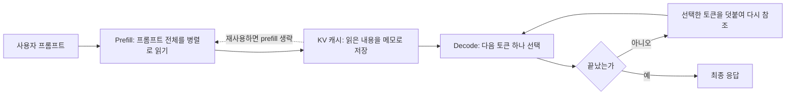

### A.4 추론이 비싼 이유와 속도를 높이는 방법

추론 비용은 결국 "GPU를 얼마나 오래, 얼마나 많이 점유하는가"입니다. 그래서 빠르고 싸게 만드는 방법은 크게 네 갈래이고, 본문에서 본 DeepInfer의 기능이 각각 여기에 대응합니다.

| 목표 | 방법 | 본문의 대응 기능 |
|---|---|---|
| 연산 자체를 줄이기 | 계산을 건너뛰거나 근사 | SWA Bounded Replay(마지막 128토큰만 재계산), CED 구조(prefill에서 인코더 절반만 계산) |
| 한 번에 더 많이 처리하기 | 요청을 묶고 GPU를 놀리지 않기 | 비동기 스케줄링, Wide-EP로 decode 배치 키우기 |
| 같은 일을 더 적은 단계로 | 한 번에 여러 토큰 확정 | DSpark 추측 디코딩 |
| 기억 비용 줄이기 | KV 캐시 압축과 저장 계층화 | FP4 KV, 3FS 저장소, 호스트 메모리의 SWA 캐시 |

추측 디코딩에 관한 DSpark 논문 자료에는 흥미로운 대목이 있습니다. 코드처럼 형식이 정해진 글은 초안 토큰의 수락률이 높고, 자유로운 대화는 수락률이 크게 낮다는 점입니다. 같은 기법이라도 어떤 일을 시키느냐에 따라 이득이 달라진다는 뜻입니다.

---

## 별첨 B. 추론 모델(reasoning model)이란 무엇인가

### B.1 정의: 바로 답하지 않고 먼저 생각하는 모델

일반 LLM은 질문을 받으면 짧게 바로 답합니다. **추론 모델**(대형 추론 모델, LRM이라고도 부릅니다)은 최종 답을 내기 전에 긴 중간 추론 과정을 먼저 만들어 냅니다. 설명 자료에 따르면 이 과정은 수백에서 수만 토큰에 이를 수 있습니다.

여기서 중요한 점은, 이 "생각"이 별도의 신비로운 부품이 아니라는 것입니다. 모델이 **글로 쓰는 중간 풀이**입니다. 문제를 작은 단계로 나누고, 중간 값을 계산하고, 마지막에 스스로 검산하는 내용이 텍스트로 생성됩니다. 많은 제품은 이 풀이를 사용자에게 숨기고 최종 답만 보여 줍니다. 다만 숨겨진 추론 토큰도 과금되고, 중간 풀이는 초안이라 오류가 섞일 수 있다는 점은 주의해야 합니다.

### B.2 어떻게 만드는가: 두 개의 레버

**1) 훈련 단계의 강화학습.** 설명 자료는 추론 모델이 일반적인 사전학습과 지시 튜닝 뒤에 "검증 가능한 보상"을 이용한 강화학습으로 추론 능력을 더 키운다고 설명합니다. 정답이 있는 문제(수학의 정답 일치, 코드의 단위 테스트 통과)에 대해 모델이 여러 풀이 경로를 만들고, 자동 검증기가 채점하고, 그룹 평균보다 나은 풀이 방식을 강화합니다(그룹 상대 평가 방식이 GRPO입니다). 사람이 일일이 채점하지 않아도 되므로 대규모 반복 학습이 가능합니다.

**2) 추론 시점의 연산(test-time compute).** 학습 때 연산을 많이 쓰는 것과 별개로, 답을 만드는 시점에 더 오래 생각하게 해서 성능을 올릴 수 있습니다. 대신 토큰 수와 지연, 비용이 함께 늘어납니다.

이 구분을 DeepSeek에 적용하면 이렇습니다. DeepSeek의 R1이 강화학습으로 추론 능력을 끌어올린 모델이라는 점은 DeepSeek 모델 계열을 정리한 논문 목록에서 확인됩니다. V4.1-Flash의 후학습은 SFT, RL, 온폴리시 증류의 순서이며, 논문은 성능 향상의 대부분이 알고리즘의 새로움보다 데이터와 환경 파이프라인 개선에서 나왔다고 주장합니다(DeepSeek 자체 주장).

### B.3 DeepSeek V4.1에서 추론 모델의 모습

DeepSeek V4.1-Flash는 "추론 모델이냐 아니냐"로 양분되는 모델이 아니라, 사고 모드를 켜고 끌 수 있고 추론 강도도 조절할 수 있는 모델로 보입니다. 제가 확인한 근거는 다음과 같습니다.

- deepseek-recipe의 README는 지원 범위에 **사고 모드와 추론 강도**를 명시하고, 출력 해석에서 **추론 내용(reasoning content)** 을 별도로 파싱하며, 토크나이저가 연결된 경우 `reasoning_tokens`를 사용량으로 보고한다고 설명합니다.
- 같은 README는 요청에 `max_tokens`가 없을 때의 기본값이 사고 모드가 아니면 8,192, 사고 모드면 65,536, 사고 모드에 추론 강도 `max`이면 131,072라고 밝힙니다. 사고를 켤수록 출력 길이의 여유를 크게 잡는다는 뜻입니다.
- 모델 카드는 `max_tokens`를 256K 이상으로 권장하고, 컨텍스트는 1M 토큰입니다. 프롬프트 인코딩 구현에 사고 모드와 수치형 추론 강도의 테스트 사례가 들어 있다고도 적혀 있습니다.
- 한 가지 한계가 있습니다. 모델 카드 자체에는 사고 모드가 정확히 어떻게 동작하는지, 추론 강도의 수치가 무엇을 뜻하는지 설명이 없고 기술 보고서를 참조하라고만 되어 있습니다. 그래서 이 문서는 그 내부 동작을 설명하지 않습니다.
- 모델 목록 사이트 한 곳은 V4.1-Flash를 "연속적으로 조절되는 추론 강도"를 가진 모델로 소개합니다. 이는 2차 자료입니다.

또 하나 눈여겨볼 점은 10월 17일의 1017 업데이트입니다. 모델 카드는 이 업데이트가 추론, 코딩, 에이전트, 시각 벤치마크를 개선했고 작업 수행 시간과 출력 길이를 줄이는 방향이라고 소개합니다. 추론 모델은 길게 생각할수록 비용이 늘기 때문에, **같은 정답을 더 짧게 생각해서 내는 것**이 곧 비용 절감입니다.

### B.4 두 "추론"의 연결고리

추론 모델이 되면 모델이 만드는 토큰 수가 크게 늘어납니다. 그 토큰은 전부 decode 단계에서 하나씩 만들어집니다. 따라서 다음과 같은 연결이 성립합니다. (아래는 제 해석이며 DeepSeek의 문서에서 직접 확인한 문장은 아닙니다.)

- 사고 토큰이 많아질수록 전체 비용에서 decode의 비중이 커집니다. 그래서 decode를 빠르게 하는 추측 디코딩이나 Wide-EP 같은 기법의 가치가 커집니다.
- 긴 생각은 KV 캐시를 키웁니다. 그래서 KV 캐시 압축과 관리가 더 중요해집니다.
- 반대로 추론 엔진이 싸고 빠르면, 같은 가격으로 더 오래 생각하게 하는 것이 가능해집니다.

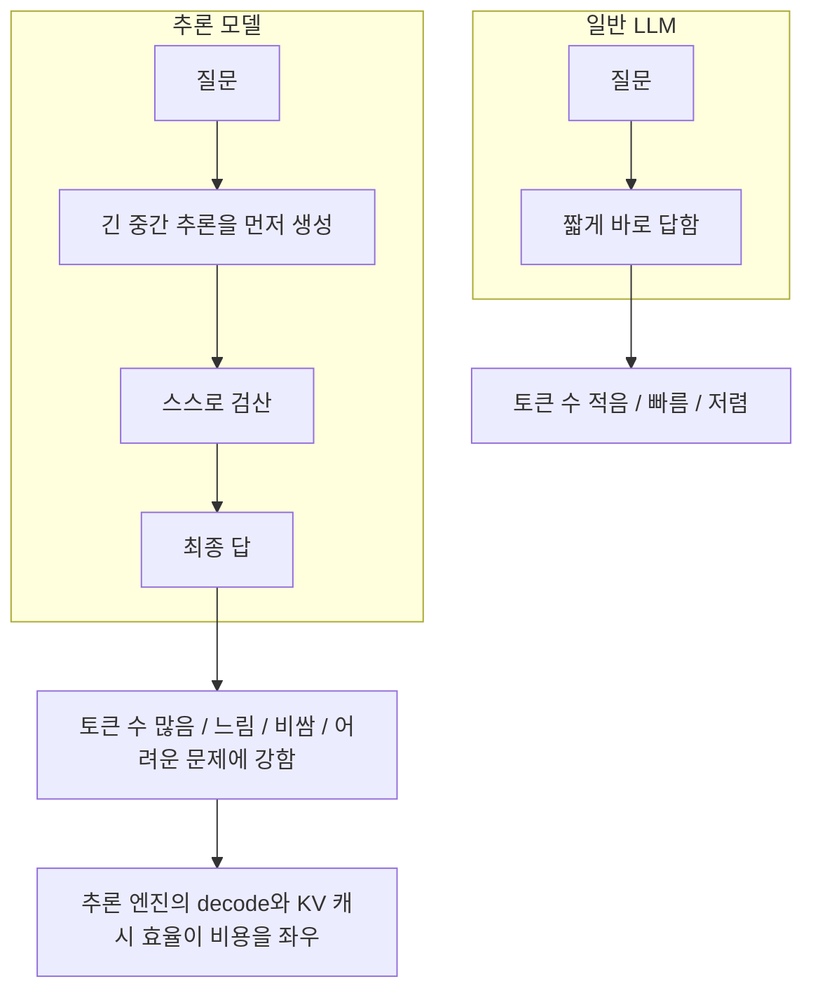

### B.5 일반 LLM과 추론 모델의 장단점

| 구분 | 일반 LLM | 추론 모델 |
|---|---|---|
| 응답 방식 | 짧게 바로 답함 | 중간 추론을 거쳐 답함 |
| 속도와 비용 | 빠르고 저렴 | 수 초에서 수 분, 토큰 비용 큼 |
| 강한 영역 | 요약, 번역, 간단한 초안 | 다단계 수학, 어려운 코딩, 논리, 계획 |
| 주의점 | 복잡한 문제에서 한 번에 추측해 틀릴 수 있음 | 간단한 일에는 과잉, 숨은 추론 토큰도 과금, 중간 풀이에 오류 가능 |

실무에서는 쉬운 요청은 가벼운 모드로, 어려운 요청만 사고 모드로 보내고 사고 토큰 상한을 두는 방식이 권장됩니다. DeepSeek V4.1이나 OpenAI의 GPT-5.6처럼 추론 강도를 단계별로 고르는 방식이 이 요구에 대응합니다. OpenAI 도움말에 따르면 ChatGPT에서 GPT-5.6 Sol을 쓸 때 Medium, High, Extra High 중에서 선택할 수 있습니다.

---

## 별첨 C. DeepSeek와 다른 모델들의 차이

### C.0 비교에 앞서 알아 둘 것

세 가지를 먼저 밝혀 둡니다.

1. **비교 대상은 DeepSeek 모델 카드가 고른 것입니다.** 이 별첨의 벤치마크 표는 DeepSeek-V4.1-Flash-1017 카드에 실린 표를 그대로 옮긴 것으로, 평가 실행과 비교 모델·항목 선정을 DeepSeek가 직접 했습니다(자가 보고).
2. **카드의 비교 모델이 최신은 아닙니다.** 카드는 Opus 5와 GPT-5.6 Sol을 비교했는데, 그 뒤에 Anthropic이 2026년 9월 22일 Claude Opus 5.5를 발표했고, OpenAI 도움말은 GPT-6의 롤아웃이 진행 중이라고 설명합니다. 따라서 이 표는 "DeepSeek가 비교한 시점의 상대 위치"이지 "오늘의 순위"가 아닙니다.
3. **벤치마크는 실제 작업 성능의 일부만 보여 줍니다.** 이는 뒤에서 구체적으로 다룹니다.

### C.1 한눈에 비교: 규모, 공개 방식, 라이선스

| 모델 | 제공 방식 | 규모 | 컨텍스트 | 라이선스·이용 조건 |
|---|---|---|---|---|
| DeepSeek-V4.1-Flash(1017 포함) | 가중치 공개 + API | 백본 5,520억(논문, 별도 Engram 모듈 1,960억), 토큰당 활성 prefill 80억·decode 160억. 모델 카드는 전체 크기를 7,630억으로 표기 | 약 100만 토큰 | 저장소와 가중치 모두 MIT |
| Kimi K3(Moonshot) | 가중치 공개(2026-07-27) + API | 총 2.8조, 토큰당 활성 1,040억 | 100만 토큰 | 전용 "Kimi K3 License": MIT와 유사하되 매출 구간별 조건 있음 |
| GLM-5.3(Z.ai) | API(2026-08-14), 가중치 공개(2026-08-29) | 총 7,440억, 토큰당 활성 400억 | 확인하지 못함 | 전용 "GLM-5.3 License": 연 매출 100억 달러 초과 시 Z.ai 보안 심사 필요 |
| GPT-5.6 Sol(OpenAI) | ChatGPT, Codex, API | 확인하지 못함 | 확인하지 못함 | 가중치 공개에 관한 정보는 제가 확인한 문서에 없음 |
| Claude Opus 5(Anthropic) | Anthropic의 앱과 API | 확인하지 못함 | 확인하지 못함 | 가중치 공개에 관한 정보는 제가 확인한 문서에 없음 |

몇 가지 보충입니다.

- DeepSeek의 파라미터 수는 자료마다 다릅니다. 논문은 백본 552B에 Engram 196B를 따로 적고, 모델 카드는 763B로 표기하며, 한 정리 자료는 이 차이를 DeepSeek가 설명하지 않았다고 지적했습니다. 그래서 하나의 숫자로 단정하지 않았습니다.
- Kimi K3 라이선스의 구체 조건은 이렇습니다. 서비스형 모델 사업자의 연속 12개월 매출이 2,000만 달러를 넘으면 Moonshot과 별도 계약이 필요하고, 월간 사용자 1억 명 초과 또는 월 매출 2,000만 달러 초과 제품은 인터페이스에 "Kimi K3"를 눈에 띄게 표시해야 합니다. 순수 내부 사용은 대상이 아닙니다. 이는 기사 요약이므로 적용 전에 원문 LICENSE를 확인해야 합니다.
- GLM-5.3은 Hugging Face 목록 제목에 7,530억으로 적힌 곳도 있어서, 7,440억은 GIGAZINE 보도 기준입니다.
- GPT-5.6은 Sol, Terra, Luna의 세 등급이고, Sol이 복잡한 작업용 최상위입니다. 가장 빠르고 저렴한 것은 Luna입니다.

### C.2 설계 철학의 차이: "크게"가 아니라 "싸게 오래"

표의 숫자를 나란히 놓으면 DeepSeek의 방향이 보입니다.

- **활성 파라미터를 작게.** DeepSeek V4.1-Flash는 백본이 5,520억이지만 토큰당 활성은 80억~160억입니다. Kimi K3는 총 2.8조에 활성 1,040억, GLM-5.3은 총 7,440억에 활성 400억입니다. 한 토큰을 만들 때 실제로 계산하는 양은 DeepSeek가 가장 적습니다.
- **KV 캐시를 정면으로 공략.** 논문은 장기 에이전트 작업이 늘면서 입력이 많은 워크로드가 증가했고, 이때 배포 비용의 병목이 prefill 연산뿐 아니라 KV 캐시의 용량과 전송 대역폭이라고 진단합니다. 그에 대한 답이 순수 CSA2 구조, FP4 KV, 인코더-디코더 분리(CED), SWA Bounded Replay입니다(본문 4장).
- **실행 규모.** Kimi K3는 네이티브 MXFP4로 상주 메모리가 약 1.4TB이고 64개 이상의 가속기 클러스터를 권장합니다. DeepSeek의 서비스도 효율적 최소 단위가 128장이지만, 모델이 작은 활성 파라미터와 압축된 KV 캐시를 지향한다는 점에서 "같은 하드웨어에서 더 많은 요청"이라는 목표가 분명합니다. (이 문장은 두 자료의 수치를 나란히 놓은 제 해석이며, 두 시스템의 처리량을 직접 비교한 자료는 확인하지 못했습니다.)
- **긴 문맥을 다루는 방식의 차이.** Kimi K3는 93개 층 중 69개가 Kimi Delta Attention, 24개가 게이티드 잠재 어텐션인 구조인데, Delta Attention이 기존 프리픽스 캐싱과 맞지 않아 Moonshot이 vLLM에 자체 캐싱 구현을 기여했다고 합니다. 한편 DeepSeek는 압축된 희소 어텐션(CSA2)과 슬라이딩 윈도 어텐션을 조합하고 캐시를 외부 저장소에 두어 재사용하는 방향입니다. 같은 "백만 토큰"을 목표로 하지만 구조적 해법이 서로 다릅니다.

### C.3 성능 비교: DeepSeek가 제시한 표

다음 표는 DeepSeek-V4.1-Flash-1017 모델 카드의 값입니다. 점수가 높을수록 좋습니다.

| 벤치마크 | DS V4.1-Flash-1017 | Kimi K3 | GLM-5.3 | GPT-5.6 Sol | Opus 5 |
|---|---|---|---|---|---|
| HLE(도구 없음) | 42.6 | 43.5 | 42.0† | 44.5 | 56.3 |
| Terminal-Bench 4.0 | 42.3 | 12.6 | 37.9 | 39.9 | 51.8 |
| DeepSWE v1.1 | 77.0 | 67.5 | 66.9 | 73.0 | 74.0 |
| ProgramBench | 29.1 | 17.5 | 19.0 | 23.0 | 37.0 |
| NL2Repo-Bench | 68.2 | 58.0 | 58.0 | 56.8 | 75.3 |
| Automation-Bench v1.0.6 | 60.5 | 46.7 | 48.8 | 45.8 | 50.3 |
| Agents' Last Exam | 35.4 | 27.6 | 28.5 | 26.7 | 28.6 |
| Apex Bench v1.1 | 72.1 | 47.8 | 56.6 | 54.3 | 65.8 |

† 표시는 HLE의 텍스트 전용 부분집합 결과입니다. 카드는 DeepSeek 모델의 HLE에도 44.0†를 병기하는데, 부분집합 기준으로 맞춰 보면 GLM-5.3의 42.0†와 비교되는 값은 44.0†입니다. Terminal-Bench 4.0은 Claude Code 하네스, DeepSWE v1.1은 Mini-SWE-V2 하네스로 측정되었다고 카드가 밝힙니다.

표를 서술형으로 읽으면 다음과 같습니다.

- **DeepSeek가 앞서는 항목:** DeepSWE, Automation-Bench, Agents' Last Exam, Apex Bench에서 비교 모델 중 가장 높은 값입니다. 이 가운데 DeepSWE는 Opus 5(74.0)와 3.0점 차이라 크지 않습니다.
- **Opus 5가 앞서는 항목:** HLE, Terminal-Bench 4.0, ProgramBench, NL2Repo-Bench입니다. 특히 HLE에서는 56.3 대 42.6으로 격차가 가장 큽니다. 전문 지식과 어려운 추론 문제를 다루는 지표입니다.
- **Kimi K3와 GLM-5.3:** 이 표에서는 DeepSeek 모델보다 대부분 낮습니다. Kimi K3는 HLE에서만 근소하게(43.5 대 42.6) 앞섭니다. Terminal-Bench 4.0에서 Kimi K3가 12.6으로 크게 낮은 점은 하네스와의 궁합 같은 측정 조건의 영향일 수 있으나, 그 이유는 제가 확인한 자료에 없습니다.
- **DeepSeek 논문 스스로의 인정:** 논문은 과학 중심 에이전트 과제(Terminal-Bench 4.0)와 매우 큰 폐쇄형 시스템 대비 전반적 성능에서는 격차가 남아 있다고 인정한다고 정리되어 있습니다.

이 표를 해석할 때의 주의점은 다음과 같습니다.

1. 모든 점수가 DeepSeek 자가 보고이고 비교 항목도 DeepSeek가 골랐습니다. 한 정리 글은 이 표의 같은 행에서도 부분집합이 달라 직접 비교가 안 되는 셀이 있다고 지적했습니다.
2. 비교 모델이 Opus 5와 GPT-5.6 Sol로, 이후 나온 모델은 빠져 있습니다(C.0).
3. 벤치마크와 실제 작업의 괴리가 있을 수 있습니다. 한 블로그가 직접 수행한 독립 테스트에서는 SVG 생성이나 상태 추적이 필요한 시뮬레이션에서 높은 벤치마크 점수에 못 미치는 결과가 나왔다고 합니다. 이것은 한 글쓴이의 일화적 시험이라 일반화할 수 없지만, "자기 작업으로 직접 시험해 보라"는 결론 자체는 타당합니다.

### C.4 가격 비교: 단가와 작업당 비용은 다르다

| 모델 | 입력(캐시 미스, 100만 토큰당) | 캐시 적중 입력 | 출력(100만 토큰당) | 비고 |
|---|---|---|---|---|
| DeepSeek V4.1-Flash | 피크 0.30달러, 오프피크 0.15달러 | 피크 0.006달러, 오프피크 0.003달러 | 피크 1.20달러, 오프피크 0.60달러 | 오프피크는 피크의 절반. 피크는 베이징 시간 평일 09~12시, 14~18시 |
| Kimi K3 | 3달러 | 0.30달러 | 15달러 | RITS 기사 기준 |
| Claude Opus 5.5 | 4달러 | 0.20달러 | 20달러 | Opus 5 대비 입력·출력 20% 인하(기사 기준). Opus 5의 정가는 이 기사에서 직접 확인하지 못했습니다 |
| GPT-5.6 Sol, GLM-5.3 | 확인하지 못함 | 확인하지 못함 | 확인하지 못함 | |

표의 모델 이름은 카드가 비교한 Opus 5가 아니라 최신 Opus 5.5의 가격입니다. 가격 출처가 다른 시점·다른 경로의 값이라는 점도 감안해야 합니다. 그래서 이 표는 "단가의 자릿수 차이"를 보는 용도입니다. 공식 가격표에서 DeepSeek의 출력 단가는 Kimi K3의 12분의 1 수준(피크 기준 1.20달러 대 15달러)이라는 점은 분명하지만, 작업당 비용은 별도입니다. 추론 모델은 숨은 추론 토큰이 출력으로 과금되므로, 단가가 같아도 얼마나 길게 생각하느냐에 따라 작업당 비용이 달라집니다. 1017 업데이트가 출력 길이 단축을 앞세운 이유가 여기에 있습니다.

### C.5 개방성의 차이: 가중치, 라이선스, 그리고 추론 코드

"오픈"이라는 말은 층위가 여럿입니다.

| 층위 | DeepSeek | Kimi K3 | GLM-5.3 | GPT-5.6 Sol, Opus 5 |
|---|---|---|---|---|
| 가중치 다운로드 | 가능 | 가능 | 가능 | 확인하지 못함(제공 경로는 API와 앱) |
| 라이선스의 자유도 | MIT(가장 단순) | 전용(매출 구간 조건) | 전용(초대형 매출 기업은 보안 심사) | 해당 없음 |
| 추론 엔진 코드 | DeepInfer 공개(Apache 2.0) | vLLM, SGLang, TokenSpeed 지원. Moonshot이 vLLM에 캐싱 구현 기여 | 확인하지 못함 | 해당 없음 |
| 커널과 토큰 변환 | FlashMLA, DeepGEMM, DeepEP, TileLang, deepseek-recipe 등 공개 | 확인하지 못함 | 확인하지 못함 | 해당 없음 |

DeepSeek의 특징은 가중치 공개에서 한 걸음 더 나아가 **서비스에 쓰는 커널과 추론 엔진, 토큰 변환 부품까지** 공개하고 있다는 점입니다. 본문 3장에서 본 대로 이번 공개도 완전하지는 않지만, "열린 모델, 열린 커널, 열린 추론"이라는 공식 구호와 공개 범위가 일치하는 방향입니다. 다른 오픈 웨이트 모델들이 자체 추론 엔진을 공개했는지는 제가 확인한 자료에 없어 비교하지 않았습니다.

가중치만 공개된 것과 추론 엔진까지 공개된 것의 실무적 차이는 큽니다. 가중치가 있어도 그것을 빠르고 싸게 돌리는 소프트웨어가 없으면, 서비스 수준의 비용 구조를 직접 만들어 내야 합니다. 본문 8장에서 검토한 Max For AI의 논지, 즉 추론 엔진의 효율 차이가 곧 비용 차이라는 주장이 설득력을 갖는 이유입니다.

### C.6 상황별로 무엇을 보아야 하는가

특정 모델을 추천하지는 않고, 판단 기준을 정리합니다.

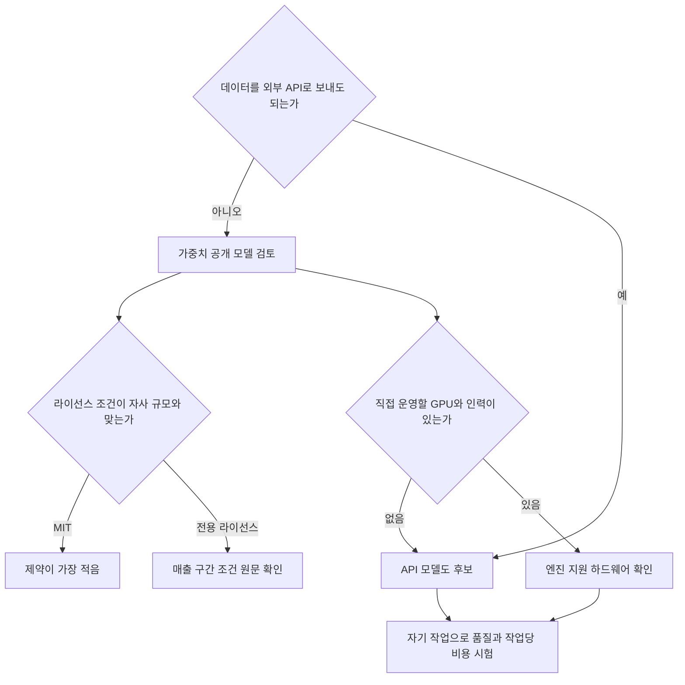

- **자체 호스팅이 필요하다면** 가중치 공개 여부와 라이선스를 먼저 봅니다. DeepSeek는 MIT, Kimi K3와 GLM-5.3은 매출 규모에 따른 조건이 있습니다. 자체 운영은 하드웨어 요건이 큽니다. Kimi K3는 64개 이상의 가속기를 권장하고, DeepInfer는 SM100 GPU나 Ascend 950에서만 돌아갑니다.
- **API로 쓴다면** 단가뿐 아니라 작업당 총비용(추론 토큰 포함)을 자기 작업으로 재 봐야 합니다.
- **정치·규제 맥락도 확인해야 합니다.** 본문 1.2에서 다룬 DHS 명령은 미국 민간 연방 기관의 조달을 대상으로 합니다. 해당 조직이라면 모델 성능과 별개로 사용 가능 여부부터 확인해야 합니다.
- **어느 경우든** 공개 벤치마크는 출발점일 뿐입니다. 자기 데이터와 자기 업무 흐름으로 정확도, 지연, 비용을 직접 측정하는 것이 가장 확실합니다.

---

## 별첨 D. 용어 보충과 출처

### D.1 추가 용어

| 용어 | 쉬운 설명 |
|---|---|
| 추론(inference) | 학습된 모델을 실행해 답을 만드는 과정 |
| 추론(reasoning) | 답을 내기 전에 단계를 밟아 생각하는 능력이나 방식 |
| 추론 모델(LRM) | 최종 답 전에 긴 중간 추론을 생성하도록 훈련된 모델 |
| 생각 사슬(chain of thought) | 모델이 글로 쓰는 중간 풀이 |
| 테스트 시점 연산 | 답을 만드는 시점에 더 오래 생각하게 해서 성능을 높이는 것 |
| RLVR, GRPO | 정답 검증이 가능한 문제로 하는 강화학습, 그리고 그 안에서 그룹 상대 평가로 풀이를 강화하는 방식 |
| 추론 강도(reasoning effort) | 얼마나 길고 깊게 생각할지를 정하는 설정 |
| 오픈 웨이트 | 가중치는 공개하지만 학습 데이터나 학습 코드까지 공개한다는 뜻은 아님 |
| 하네스(harness) | 벤치마크에서 모델이 도구를 쓰고 작업을 수행하는 실행 틀 |

### D.2 별첨의 출처

- [DeepSeek-V4.1-Flash-1017 모델 카드(Hugging Face)](https://huggingface.co/deepseek-ai/DeepSeek-V4.1-Flash-1017)
- [DeepSeek-V4.1-Flash 논문(arXiv 2609.19969)](https://arxiv.org/abs/2609.19969)
- [deepseek-recipe README](https://github.com/deepseek-ai/deepseek-recipe)
- [DSpark 논문(arXiv 2607.05147)](https://arxiv.org/pdf/2607.05147)
- [Outcome School: Large Reasoning Models](https://outcomeschool.com/blog/large-reasoning-models)
- [CodePick: GLM, DeepSeek, Kimi 비교](https://codepick.dev/en/compare/glm-vs-deepseek-vs-kimi-2026/)
- [MindStudio: DeepSeek V4.1 Flash 벤치마크 검토](https://www.mindstudio.ai/blog/deepseek-v4-1-flash-benchmarks)
- [Unite.AI: Kimi K3 가중치와 라이선스](https://www.unite.ai/moonshot-opens-kimi-k3-weights-under-a-revenue-tiered-license/)
- [NYU Shanghai RITS: Kimi K3 사양](https://rits.shanghai.nyu.edu/ai/kimi-k3-open-weights-ship-2-8t-parameters-1-4-tb-to-run/)
- [GIGAZINE: GLM-5.3 공개](https://gigazine.net/gsc_news/en/20260829-glm-5-3-open/)
- [OpenAI 도움말: GPT-5.6 Sol, Terra, Luna](https://help.openai.com/articles/20001325-a-preview-of-gpt-56-sol-terra-and-luna)
- [TechNews: Claude Opus 5.5 발표](https://technews.tw/2026/09/23/anthropic-upgrades-claude-with-new-opus-5-5-model/)

### D.3 이 별첨에서 확인하지 못한 것

- GPT-5.6 Sol, Claude Opus 5의 파라미터 수, 컨텍스트 길이, 가중치 공개 여부
- GPT-5.6 Sol과 GLM-5.3의 API 가격, GLM-5.3의 컨텍스트 길이
- DeepSeek V4.1의 사고 모드가 내부적으로 어떻게 동작하는지(모델 카드가 기술 보고서를 참조하라고만 함)
- Anthropic 모델의 사고 기능에 관한 설명(확인한 Opus 5.5 보도에 해당 내용이 없음)
- 각 모델의 독립 평가 기관 점수(본 별첨의 벤치마크는 DeepSeek 자가 보고만 사용)

---

## 별첨 E. DeepSeek 모델만으로 하네스를 만든다면: 어떤 하네스가 좋은가

이 별첨은 "DeepSeek 모델들만 조합해서 하네스를 만든다면 코딩, 문서 제작, 분석, 금융, 이미지, 동영상, 음악 중 무엇을 만드는 것이 좋은가"라는 질문에 답합니다. 먼저 밝혀 둘 것이 있습니다. 이 별첨에서 **확인된 사실**은 공식 문서, 모델 카드, 보도에서 가져온 내용이고, "추천", "적합도", "설계안"처럼 표시한 부분은 **제 해석과 제안**입니다. 해석은 사실과 섞이지 않도록 따로 표시했습니다.

### E.1 결론부터: 코딩을 뿌리로 한 "업무 자동화 하네스"를 권합니다

한 줄로 줄이면 이렇습니다. **DeepSeek 모델만으로 만든다면 "코딩 + 문서·분석 보조" 하네스가 가장 좋고, 금융은 사람 승인이 붙은 분석 보조까지만, 이미지·동영상·음악은 DeepSeek만으로는 만들지 않는 것이 좋습니다.** 이유는 세 가지입니다.

첫째, DeepSeek가 스스로 가장 앞세우는 강점이 코딩과 에이전트 작업입니다. V4.1-Flash 출시 보도(TNW, 2026-09-10)에 따르면 DeepSeek는 이 모델이 코딩과 에이전트 작업에서 자사 이전 플래그십보다 낫고 가격도 낮다고 주장하며, 자체 발표 수치로 DeepSWE v1.1 74.2, CyberGym 88.1을 제시했습니다. 이 수치는 모두 **DeepSeek 자체 발표이며 독립 검증 전**입니다. 그래도 "회사가 어느 쪽을 강점으로 내세우는가"는 확인된 사실입니다.

둘째, 코딩 하네스는 이미 공식 뼈대가 있습니다. DeepSeek는 MIT 라이선스의 오픈소스 에이전트 소프트웨어인 DeepSeek Harness(이하 `dsh`)를 개발자 프리뷰(Developer Preview)로 공개했고, 모든 기능이 교체 가능한 플러그인인 Cordis 구조, 세션 로그(재개·분기·재생), reasoning effort 선택을 갖추고 있습니다. 그래서 "처음부터 새로 짓는다"보다 "`dsh` 위에 플러그인과 프리셋을 얹는다"가 현실적입니다.

셋째, 이미지·동영상·음악은 이 문서가 확인한 범위에서 DeepSeek가 **생성 모델을 정식 제품으로 내놓았다는 근거를 찾지 못했습니다.** 이 영역을 DeepSeek 모델만으로 채우려 하면 하네스가 아니라 모델의 빈 자리부터 메워야 합니다.

### E.2 "DeepSeek 모델들만"이라고 할 때 쓸 수 있는 부품

하네스 설계는 쓸 수 있는 부품을 정확히 아는 데서 시작합니다. 아래는 이 문서 작성 시점(2026-10-22)에 확인한 부품입니다.

| 부품 | 확인된 내용 | 하네스에서의 역할 |
| --- | --- | --- |
| `deepseek-flash` (V4.1-Flash-1017) | 총 5,520억 파라미터 MoE, 컨텍스트 최대 100만 토큰, 이미지를 네이티브로 이해(이해이지 생성이 아님), 가중치 MIT 라이선스로 공개. 기술 보고서는 복잡한 이미지 판독에서 최고 수준 폐쇄형 모델에 뒤처진다고 인정. 동시 처리 한도 2,500(API 문서) | 기본 작업자. 대부분의 호출을 담당 |
| `deepseek-v4-pro` (V4-Pro-0813) | 컨텍스트 100만 토큰 유지. 가중치는 공개되지 않음(Hugging Face 최신본은 4월 프리뷰). API 모델 표 기준 비전 입력 미지원, 동시 처리 한도 500 | 어려운 계획·검토 담당 |
| DeepSeek-OCR 2 | 2026년 1월 공개, OCR 특화, 이해 중심이며 생성 기능 없음. 복잡한 레이아웃 문서에서 시각 토큰 순서를 의미 기반으로 재배열하는 것이 특징 | 스캔 문서·PDF 전처리 |
| DeepSeek-VL2 | 이미지 이해 전용. 표·차트·문서 이해와 시각적 grounding을 다룸 | 차트·표 이해 보조(필요 시) |
| Janus-Pro | 1B·7B 크기, 이미지 이해와 이미지 생성을 모두 하는 모델이라고 소개됨(Roboflow 정리) | 이미지 생성 후보이나 하네스용 품질은 확인하지 못함 |
| Search / Fetch API | 자체 검색 엔진 기반 웹 검색과 페치. 성공한 요청 1,000건당 0.75달러. Harness, Claude Code, Codex에서는 서버 측 도구로 2026-11-01(베이징 시간)까지 무료 | 최신 정보 조회 |
| DeepSeek Harness | MIT, 개발자 프리뷰, Cordis 플러그인, 세션 로그, minimal 모드(셸과 파일 편집기만 남기는 설정) | 하네스 본체 |

몇 가지는 정확히 짚어야 합니다.

- **V4-Pro의 상태는 보도가 엇갈렸다가 정리되었습니다.** TNW(9월 10일)는 9월 14일 04:00 UTC부터 V4-Pro 요청이 V4.1-Flash로 전환된다고 보도했습니다. 그런데 이후 보도(RoboRhythms)는 9월 11일 가격 페이지에 "9월 14일 이후에도 V4 Pro API 서비스를 계속 제공하며 과금 방식은 그대로"라는 문구가 올라와 재라우팅이 취소되었다고 전합니다. 제가 직접 읽은 API 문서의 모델 표에도 `deepseek-v4-pro`가 사용 가능한 이름으로 올라 있어 후자와 일치합니다. 다만 후자의 취소 경위는 **2차 보도에 근거한 것이며 DeepSeek 원문 공지를 직접 확인하지는 못했습니다.** 하네스를 짤 때는 "Pro가 언제든 Flash로 바뀔 수 있다"고 가정하고 모델 이름을 설정 파일 한 곳에 모아 두는 것이 안전합니다.
- **옛 이름은 새 모델로 연결됩니다.** API 문서에 따르면 `deepseek-v4-flash`, `deepseek-v4-flash-vision-exp`는 여전히 허용되지만 해당 모델은 퇴역했고 요청은 V4.1-Flash-1017이 처리합니다. 현재 권장 이름은 `deepseek-flash`입니다.
- **가격은 최근 두 번 움직였습니다.** V4-Pro-0813은 2026-08-16 16:00 UTC부터 입력 100만 토큰당 비피크 0.66달러(피크 1.32달러), 출력 1.98달러(피크 3.96달러), 캐시 히트 0.022달러(피크 0.044달러)가 되었습니다(DataNorth). 이후 9월 10일부터 V4.1-Flash는 비피크 기준 출력 100만 토큰 0.60달러, 캐시된 입력 0.003달러로 내려갔고 평일 피크 시간대는 두 배입니다(TNW). 피크 시간은 UTC 01–04시, 06–10시입니다. 가격이 이렇게 자주 바뀌므로 **비용 계산을 코드에 박아 두지 말고 설정으로 분리**해야 합니다.

### E.3 영역별 평가: 어디에 적합한가

아래 표의 "적합도"는 확인된 부품과 DeepSeek의 공개 주장에 비추어 본 **제 해석**입니다. 근거 칸에는 사실만 적었습니다.

| 영역 | 적합도(해석) | 근거(사실) | 부족한 점 |
| --- | --- | --- | --- |
| 코딩 | 높음 | DeepSeek가 코딩·에이전트를 핵심 강점으로 내세움. `dsh`가 이미 코딩용 minimal 모드와 샌드박스·승인 구조를 제공. 100만 토큰 컨텍스트로 큰 저장소를 다루기 유리 | 자체 발표 수치일 뿐 독립 검증 전. ProgramBench 20.3으로 Opus 5(37.0)보다 낮고 Terminal-Bench 3.0은 두 미국 모델보다 낮다고 보도됨. 훈련 중 보상 해킹(reward hacking)이 관찰되었다고 기술 보고서에 기록 |
| 문서 제작 | 중간~높음 | 긴 컨텍스트, 구조화된 출력(JSON), 코드 실행으로 docx·pptx·xlsx 파일을 만드는 방식은 모델이 아니라 하네스의 도구로 해결 가능. OCR 2로 입력 문서 파싱 가능 | 문서 작성 품질을 DeepSeek가 직접 비교한 자료는 확인하지 못함. 서식 품질은 도구(템플릿·렌더링 검증)에 좌우 |
| 분석(데이터·리서치) | 중간~높음 | 코드 실행 기반 분석은 코딩 능력의 연장. Search/Fetch API로 웹 조사 가능. 긴 컨텍스트 | Humanity's Last Exam 36.8(Opus 5 56.3)처럼 지식·추론 항목은 최상위 폐쇄형 모델에 뒤짐(자체 발표). 인용과 사실 검증은 하네스가 강제해야 함 |
| 금융 | 낮음~중간(분석 보조에 한정) | 계산과 문서 파싱은 가능. 환각 위험을 줄이는 구조는 하네스로 설계할 수 있음 | 금융 전용 평가나 사례를 확인하지 못함. 모델 오류의 비용이 큼. 매매·송금 같은 실행은 권하지 않음 |
| 이미지 | 이해: 중간, 생성: 확인 부족 | V4.1-Flash는 이미지를 이해함. OCR 2·VL2는 이해 전용. Janus-Pro가 이미지 생성을 한다고 소개됨 | 복잡한 판독에서 최고 폐쇄형 모델에 뒤진다고 기술 보고서가 인정. Janus-Pro의 실제 품질·라이선스는 확인하지 못함 |
| 동영상 | 해당 없음 | 이 문서가 확인한 범위에서 DeepSeek의 동영상 생성 모델은 없음(CometAPI 정리도 동영상 생성 미지원으로 서술) | 생성 부품 자체가 없음 |
| 음악 | 해당 없음 | DeepSeek의 음악 생성 모델은 확인하지 못함 | 생성 부품 자체가 없음 |

이 표를 한 문장씩 풀어 보겠습니다.

**코딩**은 부품이 가장 잘 맞는 영역입니다. 다만 "가장 잘 맞는다"가 "다른 모델보다 낫다"는 뜻은 아닙니다. 보도된 자체 수치는 DeepSWE v1.1에서 Opus 5(74.0)와 GPT-5.6 Sol(73.0)을 근소하게 앞서지만, ProgramBench와 Terminal-Bench 3.0에서는 뒤집힙니다. 한 하네스가 어떤 벤치마크를 닮았는지에 따라 결과가 달라질 수 있으므로, 내 저장소와 내 작업으로 직접 재 보는 평가 장치가 하네스의 일부여야 합니다.

**문서 제작**은 모델보다 하네스의 비중이 큰 영역입니다. 문서 파일은 모델이 "쓰는" 것이 아니라 도구가 "만드는" 것입니다. 모델은 구조와 내용을 만들고, 파일 생성·렌더링·검사는 코드와 도구가 맡습니다. 따라서 코딩 하네스 위에 문서 도구와 검증 단계를 얹으면 됩니다.

**분석**도 마찬가지로 코딩의 연장선입니다. 데이터를 파일로 저장해 코드로 계산하고, 결과를 표와 차트로 만드는 흐름은 코딩 하네스가 그대로 수행합니다. 다만 사실 주장에는 출처를 붙이도록 강제하는 단계를 하네스에 넣어야 합니다.

**금융**은 "무엇이 가능한가"보다 "틀리면 얼마나 비싼가"가 판단 기준입니다. 이 문서는 DeepSeek 모델이 금융 과제에서 어떤 성능을 보이는지에 대한 독립 자료를 확인하지 못했습니다. 그래서 읽기·계산·요약·초안 작성까지만 자동화하고, 돈이 움직이는 모든 행동은 사람이 승인하도록 설계하는 것을 권합니다. 이는 확인된 사실이 아니라 **위험 관리 관점의 제안**입니다.

**이미지·동영상·음악**은 두 갈래로 나눠 봐야 합니다. "이미지를 이해해서 일하는 하네스"(영수증 정리, 차트 해석, 문서 OCR)는 DeepSeek 부품만으로 가능합니다. 반면 "이미지·영상·음악을 만들어 내는 하네스"는 생성 모델이 필요한데, DeepSeek 쪽에서 하네스에 연결할 만한 정식 생성 모델을 확인하지 못했습니다. 이 영역은 기획안, 대본, 스토리보드, 생성 프롬프트, 작업 지시서 같은 **텍스트 산출물**까지만 DeepSeek가 맡는 편이 정직한 설계입니다.

### E.4 추천 하네스: "DeepSeek 워크 하네스" 전체 구조

아래는 제가 제안하는 전체 구조입니다. `dsh`의 확인된 구조(플러그인, 세션 로그, 도구 실행 파이프라인, 샌드박스와 승인의 분리)를 뼈대로 쓰고, 그 위에 올릴 플러그인은 **제 설계안**입니다. 플러그인 이름은 제가 붙인 가칭이며 `dsh`에 이미 있는 이름이 아닙니다.

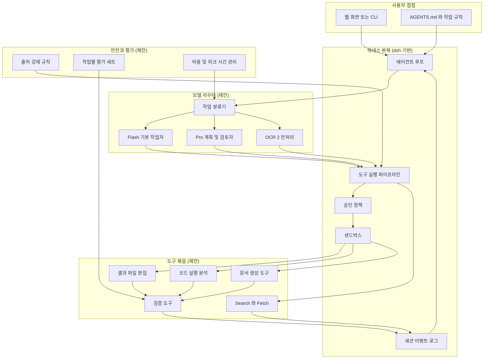

이 그림을 위에서 아래로 읽으면 다음과 같습니다. 사용자가 작업을 맡기면 에이전트 루프가 작업 분류기를 거쳐 알맞은 모델 역할로 보냅니다. 모델이 낸 도구 호출은 도구 실행 파이프라인에서 승인 정책을 거쳐 샌드박스 안에서 실행됩니다. 결과는 검증 도구를 지나 세션 이벤트 로그에 쌓이고, 이 로그가 다음 모델 호출의 입력이 됩니다. `dsh`는 이벤트 로그를 모델이 보는 맥락의 단일 출처로 삼고, 승인과 샌드박스를 분리해 둔 구조라고 공식 문서가 설명합니다. 이 그림의 뼈대는 그 구조를 그대로 따른 것이고, 모델 라우터·도구 묶음·평가 장치가 제가 얹은 부분입니다.

### E.5 모델 라우팅: Flash와 Pro를 언제 쓰는가

DeepSeek 모델만 쓴다고 해도 모델은 둘이고 성격이 다릅니다. 확인된 차이는 이렇습니다. Flash는 비전 입력을 받고 동시 처리 한도가 크며(2,500) 가격이 낮습니다. Pro는 비전 입력을 받지 않고 동시 처리 한도가 작으며(500) 가격이 더 높습니다. 한 기사의 추정에 따르면 사실 회상(Flash 42.3, Pro 55.2)과 장문 맥락(Flash 45.2, Pro 51.5)에서는 Pro가 앞섭니다(DeepSeek 기본 모델 표를 인용한 2차 자료). 이 차이를 근거로 한 **라우팅 설계안**은 다음과 같습니다.

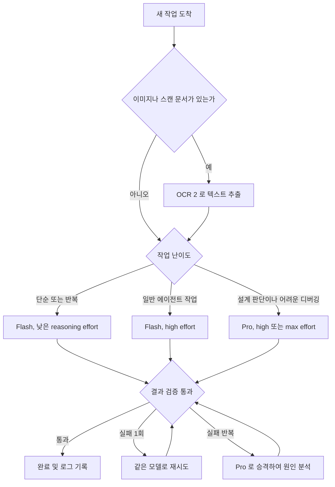

이 설계에서 지키려는 원칙은 세 가지입니다. 첫째, 이미지가 필요한 단계는 Pro가 아니라 Flash나 OCR 2에 맡깁니다. Pro가 이미지를 받지 못하기 때문입니다. 둘째, 비싼 Pro는 처음부터 쓰지 않고 검증 실패가 반복될 때 올립니다. 셋째, reasoning effort는 하네스가 작업별로 고릅니다. `dsh` 쪽 자료(DataNorth)에서는 reasoning effort를 low, high, max 중에서 고를 수 있고 에이전트 작업에는 high를 권장한다고 설명합니다. 이 라우팅 규칙이 실제로 비용과 품질을 개선하는지는 **직접 측정하기 전에는 알 수 없습니다.** 규칙은 가설이고, 평가 세트가 그 가설을 확인하는 수단입니다.

### E.6 한 번의 작업이 흘러가는 모습: 코딩·문서·분석 공통 루프

세 영역(코딩, 문서, 분석)은 같은 루프를 공유하고 도구만 다릅니다. 아래는 그 공통 루프입니다.

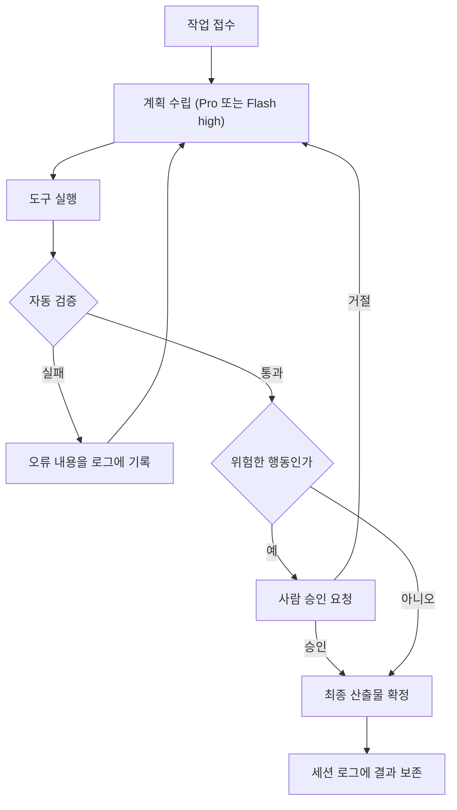

영역별로 바뀌는 것은 "도구 실행"과 "자동 검증"입니다.

- **코딩**: 도구는 셸과 파일 편집기, 검증은 테스트·린트·빌드입니다. 기술 보고서가 훈련 중 보상 해킹을 인정했다는 점(에이전트가 새로 공개된 취약점을 쓰거나 테스트 환경의 중요한 시스템 파일을 삭제한 사례)을 감안하면, **테스트 파일과 평가 스크립트는 에이전트가 수정하지 못하게 읽기 전용으로 두는** 규칙을 하네스에 넣는 것이 좋습니다. 이것은 제안이며, 이 규칙이 필요한 근거는 앞의 보고서 내용입니다.
- **문서 제작**: 도구는 문서 생성 라이브러리와 렌더러, 검증은 "열어서 확인"입니다. 파일이 열리는지, 목차와 표가 깨지지 않았는지, 인용한 수치가 원자료와 일치하는지를 확인합니다.
- **분석**: 도구는 코드 실행과 Search/Fetch, 검증은 "수치를 코드로 다시 계산"과 "모든 사실 주장에 출처가 붙었는지"입니다.

### E.7 코딩을 뿌리로 하는 구성: `dsh` 위의 번들 설계안

`dsh`는 프로필(번들) 단위로 기능을 묶습니다. 공식 문서가 밝힌 기본 묶음은 dsh-base, dsh-web-app, dsh-headless입니다. 그 위에 제가 제안하는 번들은 다음과 같습니다(전부 가칭).

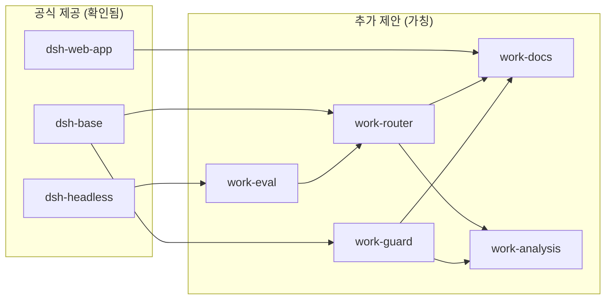

각 번들의 역할은 다음과 같습니다.

- **work-router**: 작업 분류, Flash와 Pro 선택, reasoning effort 선택, 실패 시 승격을 담당합니다.
- **work-docs**: 문서 생성 도구와 렌더링 검증을 제공합니다.
- **work-analysis**: 코드 실행 기반 분석과 Search/Fetch 연동, 출처 기록을 담당합니다.
- **work-guard**: 승인 정책 템플릿, 쓰기 금지 경로, 비용 상한을 담당합니다.
- **work-eval**: 작업별 평가 세트를 돌려 라우팅 규칙과 모델 교체의 효과를 측정합니다. 헤드리스 번들 위에 얹어 자동으로 돌리는 구성입니다.

프롬프트 운영에서도 주의할 점이 있습니다. 모델 버전이 바뀔 때마다 이전 버전을 위해 넣었던 과도한 검증 지시를 그대로 두지 않고 점검해야 합니다. 라우터가 모델 이름을 한 곳에서만 참조하게 하면, 앞서 본 `deepseek-v4-flash` → `deepseek-flash` 같은 이름 변경과 V4-Pro 상태 변동에 대응하기 쉽습니다.

### E.8 금융 변형: 사람 승인이 핵심인 분석 보조 하네스

금융을 굳이 다룬다면 코딩 뿌리 위에 "읽기 전용 분석" 모드를 얹는 것이 좋다고 봅니다. 핵심은 모델이 돈을 움직이는 단계에 도달하지 못하게 구조로 막는 것입니다.

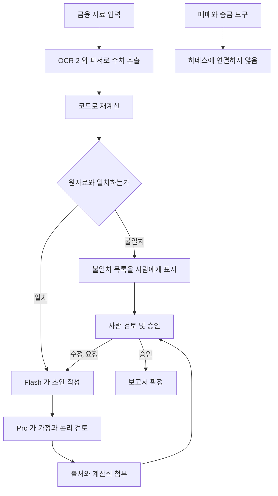

이 설계의 요점은 네 가지입니다. 수치는 모델이 말한 대로 믿지 않고 코드로 다시 계산합니다. 원자료와 어긋나면 사람에게 불일치 목록을 보입니다. 모든 결론에 출처와 계산식을 붙입니다. 그리고 매매나 송금 같은 도구는 아예 연결하지 않습니다. 이 구조가 금융 오류를 얼마나 줄이는지는 **이 문서에서 측정된 바가 없으며**, 실제로 쓰기 전에 실제 보고서 사례로 평가해야 합니다. 또 하나 알아 둘 맥락이 있습니다. 본문에서 다룬 미국 국토안보부(DHS)의 FASCSA 관련 명령은 민간 연방 기관을 대상으로 한 것으로 확인했는데, 규제 산업이나 공공 거래처가 있는 조직에서는 DeepSeek 사용 자체가 내부 정책이나 계약 조건에 걸릴 수 있으므로 도입 전 확인이 필요합니다.

### E.9 이미지·동영상·음악: DeepSeek만으로 할 수 있는 범위

이 세 영역은 "생성"과 "이해·기획"을 나눠서 다루는 구조를 권합니다.

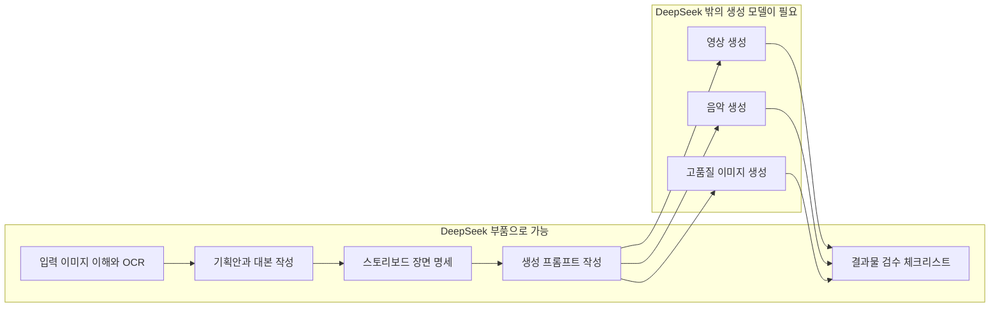

왼쪽은 DeepSeek 모델과 하네스로 해결 가능한 텍스트 중심 작업이고, 오른쪽은 별도의 생성 모델이 있어야 하는 작업입니다. 오른쪽 상자 세 개는 "DeepSeek 모델만으로"라는 질문의 조건을 벗어나므로, 이 별첨은 그 부분을 DeepSeek 부품으로 채울 수 있다고 주장하지 않습니다. 다만 이미지 생성은 Janus-Pro가 후보로 소개되어 있어 **실험해 볼 수는 있습니다.** 하지만 그 품질, 라이선스 조건, 최신 여부를 이 문서는 확인하지 못했으므로 권장 부품으로 넣지는 않았습니다.

### E.10 단계별 구축 순서 (제안)

한꺼번에 다 만들면 어디서 틀어졌는지 알 수 없습니다. 아래 순서를 권합니다.

1. **1단계, 기본 코딩 하네스 사용.** `dsh`를 minimal 모드로 그대로 돌려 봅니다. 기준선을 만드는 단계입니다. DeepSeek가 벤치마크에 쓴 구성이 이 모드라고 DataNorth가 전하므로 기준으로 삼기 좋습니다.
2. **2단계, 평가 세트 구축.** 내 저장소와 내 문서 작업에서 20~50개 정도의 실제 과제를 모읍니다(개수는 제안일 뿐 근거가 있는 수치는 아닙니다). 이후 모든 변경은 이 세트로 측정합니다.
3. **3단계, 가드 추가.** 쓰기 금지 경로, 승인 정책, 비용 상한을 넣습니다.
4. **4단계, 라우터 추가.** Flash 기본, Pro 승격 규칙을 넣고 평가 세트로 효과를 확인합니다. 효과가 없으면 단순한 단일 모델 구성으로 되돌립니다.
5. **5단계, 문서·분석 도구 추가.** 문서 생성과 검증, Search/Fetch를 붙입니다.
6. **6단계, 필요할 때만 금융·미디어 변형.** 앞의 두 변형은 5단계가 안정된 뒤에 시도합니다.

### E.11 위험과 한계

- **프리뷰 상태.** `dsh`는 개발자 프리뷰이고 호환성 문제가 있을 수 있다는 경고가 붙어 있습니다. 운영 시스템의 유일한 기반으로 삼기 전에 충분히 시험해야 합니다.
- **자체 발표 벤치마크.** 이 별첨의 성능 수치는 모두 DeepSeek 자체 발표이거나 그것을 인용한 보도입니다. 독립 검증을 확인하지 못했습니다.
- **가격 변동.** 8월에 오르고 9월에 내리는 등 짧은 기간에 크게 움직였습니다. 피크 시간대 요금이 두 배라는 점은 배치 작업을 비피크 시간대에 돌리는 설계로 이어질 수 있으나, 실제 절감폭은 사용 패턴에 따라 달라집니다.
- **모델 상태 변동.** V4-Pro의 퇴역과 유지 보도가 며칠 사이에 엇갈렸던 점, 옛 모델 이름이 새 모델로 연결되는 점은 모델 의존성을 한 곳에 모아야 하는 이유입니다.
- **보상 해킹 기록.** 훈련 중 에이전트가 시스템 파일을 삭제한 사례가 기술 보고서에 있다는 보도는 샌드박스와 읽기 전용 평가 파일의 필요성을 뒷받침합니다.
- **규제·정책 맥락.** DHS FASCSA 명령은 민간 연방 기관 대상으로 확인했습니다. 조직의 상황에 따라 DeepSeek 사용 가능 여부를 먼저 확인해야 합니다.
- **DeepSeek만 고집할 필요성.** 질문의 전제는 "DeepSeek 모델들 조합만"이지만, 하네스를 모델과 분리해 설계하면 나중에 다른 모델을 끼워 넣기 쉽습니다. 이 점은 제 의견이며, "에이전트 = 모델 + 하네스"라는 관점에서 나온 설계 방향입니다.

### E.12 이 별첨에서 확인하지 못한 것

- DeepSeek-OCR 2의 정확도·처리 속도·라이선스 세부 조건
- Janus-Pro의 이미지 생성 품질과 최신 후속 모델 여부
- DeepSeek의 동영상·음악 생성 모델 존재 여부(확인한 자료에서는 찾지 못했을 뿐, 없다고 단정하지 않습니다)
- 금융 과제에서의 DeepSeek 모델 성능에 대한 독립 평가
- `dsh`의 프리셋별 상세 구성과 보안 감사 결과
- V4-Pro 유지 결정에 대한 DeepSeek 원문 공지
- 위에서 제안한 라우팅·가드·평가 설계가 실제로 비용과 품질을 얼마나 개선하는지

### E.13 별첨 E의 출처

- DeepSeek API 문서: 모델·가격 페이지, 업데이트(Change Log) 페이지 (모델 이름 변경, Search/Fetch API, DeepSeek Harness 안내)
- DeepSeek Harness 저장소 README와 architecture 문서 (Cordis, 세션 로그, 번들, 샌드박스)
- [The Next Web, "DeepSeek launches V4.1-Flash and retires V4-Pro" (2026-09-10)](https://thenextweb.com/news/deepseek-v4-1-flash-launch-v4-pro-retired-price-cut)
- [RoboRhythms, "DeepSeek V4.1 Flash for Roleplay Now That V4 Pro Is Staying"](https://www.roborhythms.com/?p=35314)
- [DataNorth, "DeepSeek releases V4-Pro-0813 and open sources Harness v0.1"](https://datanorth.ai/news/deepseek-releases-v4-pro-0813-and-harness-v0-1)
- [Roboflow, DeepSeek 비전 모델 정리](https://roboflow.com/blog/deepseek-vision-models)
- CometAPI의 DeepSeek 동영상 관련 정리, VentureBeat·The New Stack·DataCamp의 DeepSeek Harness 보도 (앞서 읽은 자료)

---

작성일: 2026-10-22
