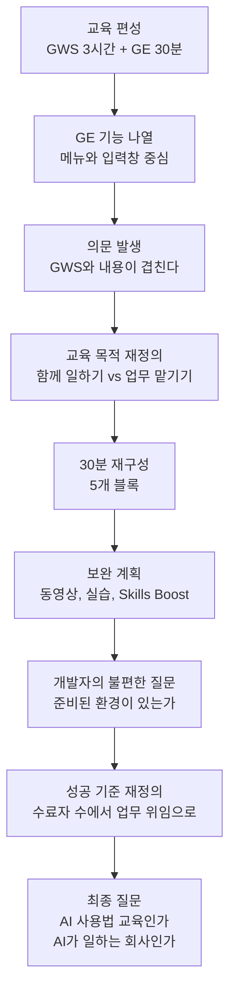
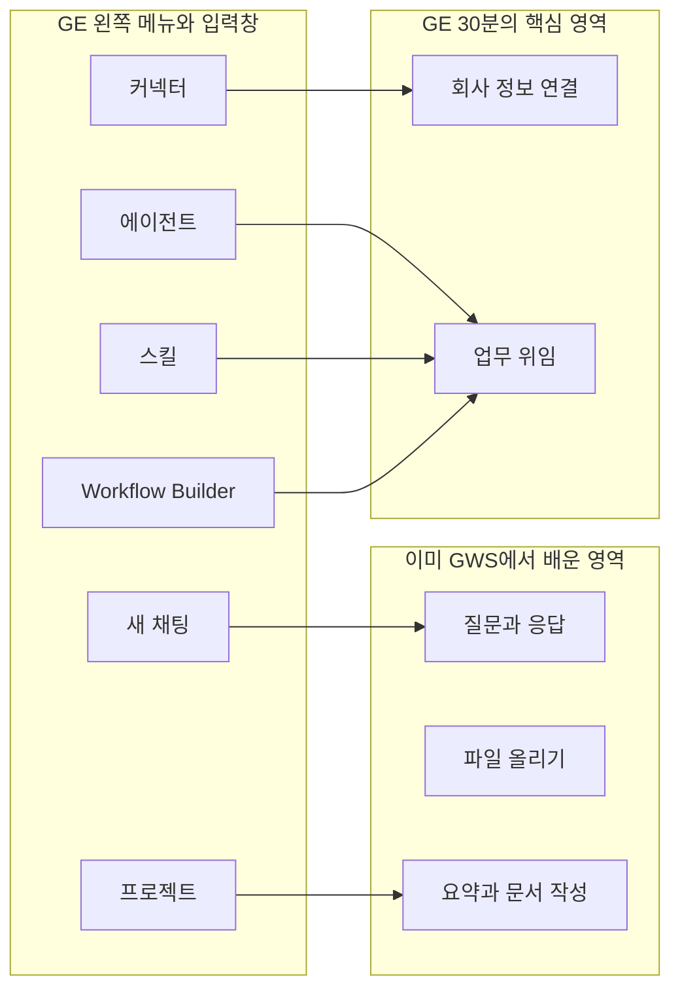
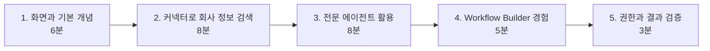
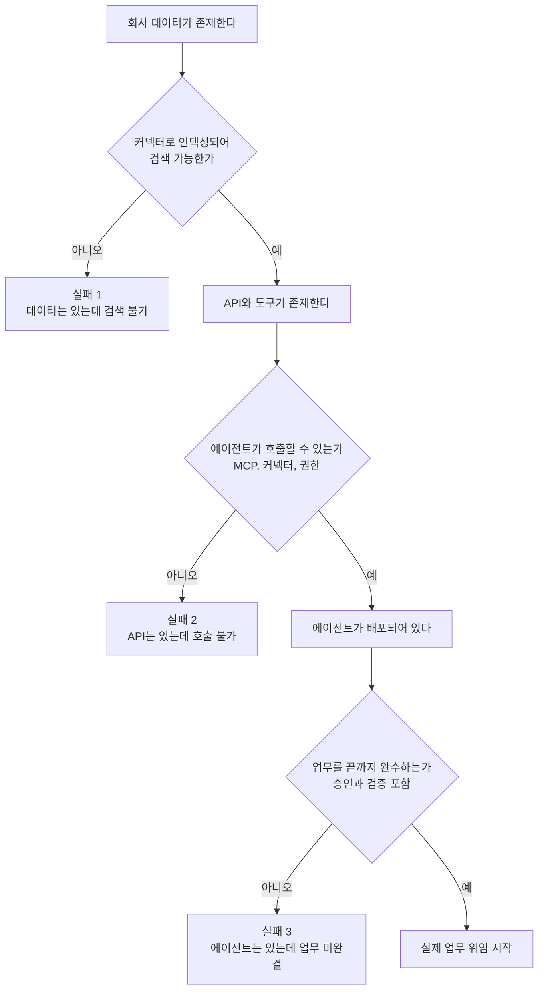
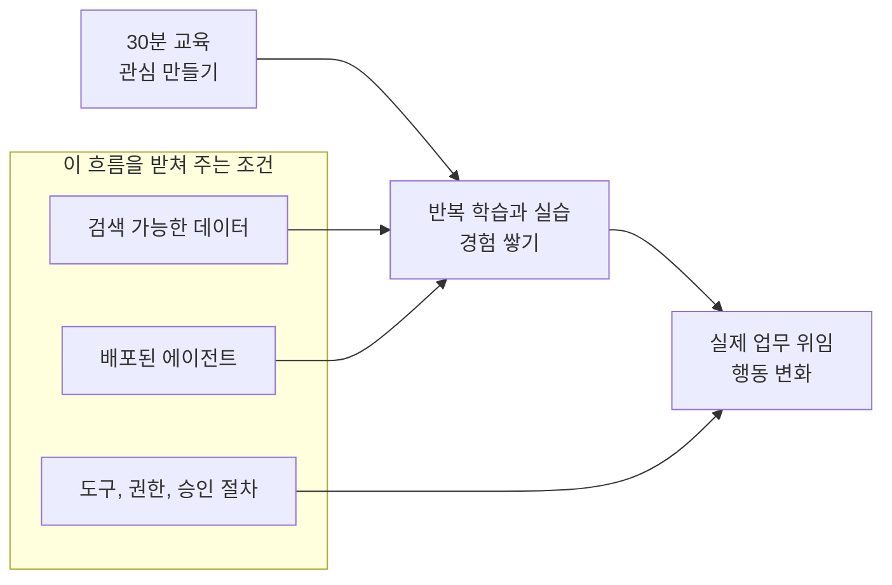

- 작성 일자: 2026-10-22
- 대상 글: [「단상 — Gemini Enterprise 처음 시작하기 (30분) 교육을 준비하며」](https://www.facebook.com/share/p/1FeavW2GH7/) (Facebook 게시글, #데리언의단상)
- 작성 방식: 글의 논리 구조를 따라가며 설명하고, 글에 등장하는 제품 기능은 2026년 10월 기준 Google 공식 문서와 공개 자료로 사실 여부를 확인해 덧붙였습니다.

```
단상

Gemini Enterprise 처음 시작하기 (30분) 교육을 준비하며

전사 구성원을 대상으로 AI 교육을 준비하고 있다.

Google Workspace 3시간, Gemini Enterprise 30분.

처음에는 GE의 왼쪽 메뉴와 입력창 기능부터 정리했다. 새 채팅, 에이전트, 스킬, 프로젝트, 커넥터, Workflow Builder…

그런데 정리하다 보니 이상했다.

앞에서 GWS를 3시간이나 배웠는데 GE에서 또 프롬프트 작성법을 가르쳐야 하나?

질문하고, 파일을 올리고, 요약하고, 문서를 만드는 건 이미 배웠을 텐데.

그렇다면 남은 30분에는 무엇을 가르쳐야 할까?

생각해 보니 교육의 목적부터 달라야 했다.

GWS에서는 AI와 함께 일하는 방법을 배운다.

GE에서는 회사의 정보와 시스템을 연결하고, AI에게 업무를 맡기는 방법을 경험해야 한다.

물론 GWS에서도 자동화할 수 있고 GE에서도 문서를 작성할 수 있다. 제품의 기능을 억지로 구분하자는 이야기는 아니다.

교육에서 전달할 경험이 달라야 한다는 뜻이다.

그래서 GE 30분을 다시 구성했다.

화면과 기본 개념 6분.
커넥터로 회사 정보 검색 8분.
전문 에이전트 활용 8분.
Workflow Builder 경험 5분.
권한과 결과 검증 3분.

그런데 30분이면 충분할까?

당연히 부족하다.

그래서 30분 교육은 시작점으로 정했다.

교육 이후 부족한 부분은 동영상 강의로 반복 학습하고, 온라인 실습 프로그램에서 직접 따라 해보고, 
Google Skills Boost로 더 깊이 학습하도록 보완할 계획이다.

한 번 듣고 끝나는 교육이 아니라, 필요할 때 다시 배우고 직접 실행해 보는 환경을 만들고 싶다.

하지만 여기서 개발자로서 불편한 질문이 생긴다.

회사 규정을 검색하라고 가르치려면 검색 가능한 데이터가 준비되어 있어야 한다.

에이전트에게 업무를 맡기라고 하려면 실제 사용할 수 있는 에이전트가 배포되어 있어야 한다.

Workflow Builder를 소개하려면 연결할 도구와 권한, 승인 절차도 준비되어야 한다.

그렇지 않으면 동영상도, 실습 프로그램도 결국 기능 소개에 그친다.

구성원 교육을 준비하면서 오히려 우리의 AI Ready 수준을 검증하게 되는 셈이다.

데이터는 있는데 검색할 수 없고, API는 있는데 에이전트가 호출할 수 없고, 
에이전트는 있는데 실제 업무를 끝내지 못한다면?

문제는 교육 시간이 부족한 게 아닐 수도 있다.

교육의 성공 기준도 달라져야 한다.

“몇 명이 교육을 수료했는가?“보다

“몇 명이 실제 업무를 AI에게 맡기기 시작했는가?”

나는 후자가 더 중요하다고 생각한다.

30분 교육으로 관심을 만들고, 반복 학습과 실습으로 경험을 쌓고, 실제 업무 위임으로 이어지게 하는 것.

그런데 정말 교육만 잘하면 가능할까?

우리는 구성원에게 AI 사용법을 가르치고 있는 걸까, 아니면 AI가 일할 수 있는 회사를 만들고 있는 걸까?

#데리언의단상 #GeminiEnterprise #GoogleWorkspace #AgenticAI #AIReady #AX #AI교육

https://www.facebook.com/share/p/1FeavW2GH7/
```

---

## 1. 한눈에 보는 요약

이 글은 전사 구성원을 대상으로 한 AI 교육을 준비하는 한 개발자의 고민을 담은 짧은 에세이입니다. 
교육 커리큘럼 설계 과정에서 출발하지만, 글이 도달하는 결론은 교육 자체가 아니라 **회사가 AI를 받아들일 준비가 되어 있는가**라는 질문입니다.

글의 흐름을 한 문장씩 줄이면 다음과 같습니다.

1. Google Workspace(GWS)는 3시간, Gemini Enterprise(GE)는 30분으로 교육이 편성되어 있다.
2. GE의 왼쪽 메뉴와 입력창 기능부터 나열해 보니, 이미 GWS 교육에서 배운 내용(질문, 파일 업로드, 요약, 문서 작성)과 겹친다.
3. 그래서 두 교육의 목적을 다르게 잡았다. GWS는 "AI와 함께 일하는 법", GE는 "회사의 정보와 시스템을 연결하고 AI에게 업무를 맡기는 법"이다.
4. 30분은 부족하므로 시작점으로 삼고, 동영상 강의, 온라인 실습, Google Skills Boost로 반복 학습을 보완한다.
5. 그런데 이 교육을 하려면 검색 가능한 데이터, 배포된 에이전트, 연결된 도구와 권한과 승인 절차가 먼저 준비되어 있어야 한다. 
   교육을 준비하다 보니 회사의 AI Ready 수준이 검증되는 셈이다.
6. 성공 기준은 "수료자 수"가 아니라 "실제 업무를 AI에게 맡기기 시작한 사람 수"여야 한다.
7. 마지막 질문: 우리는 구성원에게 AI 사용법을 가르치는가, 아니면 AI가 일할 수 있는 회사를 만드는가.

이 글의 가치는 제품 소개가 아니라 **관점의 전환**에 있습니다. "무엇을 가르칠까"에서 
"가르친 것을 실제로 쓸 수 있는 환경이 있는가"로 질문이 이동하는 과정이 글의 핵심입니다.



---

## 2. 글의 배경: 두 제품의 교육이 왜 따로 편성되었나

### 2.1 Google Workspace와 Gemini Enterprise는 서로 다른 제품이다

글의 전제는 구성원이 이미 Google Workspace 안에서 Gemini를 3시간 동안 배운다는 점입니다. 공식 자료를 확인해 보면 두 제품의 성격은 분명히 다릅니다.

Google Cloud는 Gemini Enterprise를 **"직원 모두를 위한 AI의 관문"** 으로 소개합니다. 한국어 공식 블로그는 Gemini Enterprise 앱이 조직 내 모든 직원을 위한 AI의 관문이며, 이와 함께 Gemini Enterprise Agent Platform이라는 새로운 개발자 플랫폼(Vertex AI가 진화한 것)이 에이전트를 만들고 Gemini Enterprise 앱에 노출하는 역할을 한다고 설명합니다. 즉 구조적으로 보면 다음과 같습니다.

- **Gemini Enterprise 앱**: 일반 직원이 쓰는 입구. 검색, 채팅, 에이전트 사용이 여기서 이루어집니다.
- **Gemini Enterprise Agent Platform**: 개발자가 에이전트를 만들고 운영하는 기반. Wikipedia 등 공개 자료에 따르면 Google은 2026년 4월 22일에 이를 Vertex AI의 후속 발전형으로 발표했습니다.

반면 Google Workspace 안의 Gemini는 Gmail, Docs, Drive 같은 개별 생산성 앱 안에서 AI 기능을 제공하는 쪽에 가깝습니다. 글쓴이가 "GWS에서는 AI와 함께 일하는 법을 배운다"고 정리한 것은 이 차이를 교육 관점으로 옮긴 표현으로 읽을 수 있습니다.

### 2.2 글쓴이가 직접 인정한 단서

글쓴이는 "GWS에서도 자동화할 수 있고 GE에서도 문서를 작성할 수 있다. 제품의 기능을 억지로 구분하자는 이야기는 아니다"라고 미리 선을 긋습니다. 이 문장은 중요합니다. 제품 기능이 실제로 상당 부분 겹친다는 사실을 인정하면서, 그럼에도 **교육에서 전달할 경험**은 달라야 한다고 주장하는 것이기 때문입니다. 기능표로 교육을 나누지 않고, "학습자가 어떤 경험을 해야 하는가"로 나눈다는 설계 철학이 여기서 드러납니다.

---

## 3. 글이 언급하는 GE 기능들: 사실 확인

글은 처음에 "새 채팅, 에이전트, 스킬, 프로젝트, 커넥터, Workflow Builder"를 정리했다고 말합니다. 각 항목이 실제로 어떤 기능인지 공식 문서 기준으로 확인한 내용은 다음과 같습니다.

### 3.1 새 채팅

릴리스 노트에는 "New chat을 누르면 컨텍스트를 지우고 처음부터 시작할 수 있다"는 설명이 있습니다. 대화를 주제별로 끊어서 시작하는 가장 기본적인 기능입니다.

### 3.2 에이전트와 Agent Gallery

공식 시작 가이드에 따르면 사용자는 Agent Gallery에서 Google이 만든 에이전트, 조직이 공유한 도구, 그리고 Workflow Builder로 만든 맞춤형 다단계 에이전트를 찾아볼 수 있습니다. 한국어 FAQ에는 Deep Research 에이전트가 직원을 대신해 복잡한 주제를 탐색하고, 내부와 외부 소스의 정보를 종합해 포괄적인 보고서로 제공한다고 되어 있습니다. 글에서 말하는 "전문 에이전트 활용 8분"이 바로 이 영역에 해당합니다.

### 3.3 스킬

릴리스 노트는 스킬을 "Gemini Enterprise 어시스턴트가 특정 작업을 수행하도록 돕는 재사용 가능한 맞춤 지침"으로 정의하고, 웹 앱에서 스킬을 만들고, 가져오고, 수정하고, 사용할 수 있다고 안내합니다. 또한 스킬을 만들고 업로드하고 공유하는 기능이 별도 항목으로 올라와 있습니다.

주의할 점이 하나 있습니다. 릴리스 노트 일부 항목에는 "GA with allowlist"라는 표기가 있습니다. 이는 조직 단위로 허용 목록에 등록되어야 쓸 수 있는 단계가 있었다는 뜻이므로, 실제 교육 전에 자사 환경에서 스킬 메뉴가 열려 있는지 확인하는 것이 안전합니다.

참고로 개인용 Gemini 앱에서도 스킬이 채팅에 도입되어 Gems를 대체한다는 공식 발표가 있었습니다. 다만 이는 소비자용 Gemini 앱의 이야기이며, Gemini Enterprise의 스킬과는 별개의 제품 영역입니다. 교육 자료를 만들 때 두 가지를 혼동하지 않아야 합니다.

### 3.4 프로젝트

릴리스 노트에 "프로젝트 만들기와 관리" 항목이 있습니다. 올해 상반기에 TestingCatalog가 Gemini Enterprise에서 프로젝트 기능이 준비 중인 것을 발견했다고 보도했는데, 대화를 주제별로 묶고, 파일을 올려 여러 채팅에서 참조하고, 목표를 설정해 응답 방향을 안내하는 기능으로 소개되었습니다. 현재는 공식 릴리스 노트에도 프로젝트 항목이 올라와 있습니다. 또한 Google Cloud 파트너사 EGEN의 정리 글에 따르면 프로젝트는 팀이 에이전트와 함께 협업하고 맥락을 체계적으로 공유하는 용도로 소개됩니다.

### 3.5 커넥터

커넥터는 이 글의 논지에서 가장 중요한 기능입니다. 공식 문서 설명은 다음과 같습니다.

- 커넥터는 Google 및 서드파티 데이터 소스의 데이터를 Gemini Enterprise로 가져와 전용 데이터 스토어에 저장합니다.
- 데이터 수집(인덱싱)은 데이터를 Gemini Enterprise 인덱스에 복사하는 방식입니다.
- 데이터 동기화는 **엔터티 데이터**(특정 데이터 소스의 내용)와 **ID 데이터**(역할, 권한, 사용자)를 원본에서 끌어와 갱신합니다.
- 데이터를 보내기 전에 원본의 접근 제어를 먼저 설정하라는 점검 목록이 문서에 명시되어 있습니다.

즉 "회사 규정을 검색한다"는 간단한 경험 뒤에는 데이터 수집, 인덱싱, 동기화, 권한 정보 반영이라는 준비 작업이 있습니다. 이 부분은 뒤에서 글의 핵심 논지와 연결됩니다.

최근 릴리스 노트에는 Google Drive, Microsoft SharePoint, Outlook, Box 커넥터에서 파일과 채팅하는 기능이 추가되었다는 항목이 있고, Confluence Data Center와 Jira Data Center, Microsoft Teams, Notion, Salesforce를 Workflow Builder에 연결하는 항목도 있습니다. 서드파티 해설(Zapier)은 100개 이상의 사전 구축 커넥터와 사용자 지정 커넥터를 언급하지만, 이는 공식 수치가 아니라 외부 정리이므로 정확한 지원 목록은 공식 문서에서 확인해야 합니다.

### 3.6 Workflow Builder

릴리스 노트에는 **Workflow Builder(이전 이름 Agent Designer)가 일반 제공(GA)되었다**는 항목이 있습니다. 공식 문서가 설명하는 주요 기능은 다음과 같습니다.

- 자연어로 워크플로를 설명하면 뼈대를 자동 생성합니다.
- 커넥터의 데이터가 바뀔 때 워크플로가 자동 실행되도록 트리거를 설정할 수 있습니다.
- Gemini Agent 단계에 Gmail, Jira, Google Drive 같은 커넥터의 읽기 및 쓰기(write-back) 도구를 연결해 검색, 메시지 전송, 레코드 관리를 할 수 있습니다.
- MCP 서버를 워크플로 단계 또는 Gemini Agent 단계의 도구로 연결할 수 있습니다.
- 이미 있는 에이전트(ADK 에이전트, A2A 에이전트)를 워크플로 단계로 추가해 다른 전문 에이전트에게 일을 넘길 수 있습니다.
- 워크플로 실행을 일정에 따라 반복 예약할 수 있습니다.

여기서 이름에 관한 참고가 하나 있습니다. Business 에디션 도움말은 아직 Agent Designer라는 이름을 쓰고 있고, Workflow Builder 문서는 Standard, Plus, Pay-as-you-go, Frontline 에디션을 대상으로 한다고 명시되어 있습니다. 따라서 **자사가 어느 에디션인지에 따라 화면의 용어와 사용 가능한 기능이 다를 수 있습니다.** 교육 자료를 만들 때 반드시 실제 환경에서 확인해야 하는 부분입니다.



---

## 4. 글의 핵심 논지 ① — 교육 목적의 재정의

### 4.1 "프롬프트 교육"의 중복 문제

글쓴이가 처음 느낀 위화감은 매우 현실적입니다. GWS를 3시간 배운 구성원에게 GE에서 다시 프롬프트 작성법을 가르치면 시간이 낭비됩니다. 질문하고, 파일을 올리고, 요약하고, 문서를 만드는 것은 이미 학습했을 것이라고 가정합니다.

이 지점에서 글쓴이는 "남은 30분에 무엇을 가르칠 것인가"를 질문하고, 교육의 **목적 자체**를 구분합니다.

| 구분 | GWS 교육 (3시간) | GE 교육 (30분) |
|---|---|---|
| 핵심 목적 | AI와 함께 일하는 방법 | 회사의 정보와 시스템을 연결하고 AI에게 업무를 맡기는 방법 |
| 학습자의 위치 | 도구를 쓰는 사람 | 업무를 위임하는 사람 |
| 경험의 성격 | 협업, 보조 | 연결, 위임 |

이 표는 글의 내용을 정리한 것으로, 글쓴이의 표현은 "AI와 함께 일하는 방법을 배운다"와 "회사의 정보와 시스템을 연결하고, AI에게 업무를 맡기는 방법을 경험해야 한다"입니다. 동사의 선택도 주목할 만합니다. GWS는 "배운다", GE는 "경험해야 한다"입니다. GE 교육은 지식 전달보다 체험이 중심이라는 뜻으로 읽을 수 있습니다.

### 4.2 30분의 재구성

글쓴이가 제시한 5개 블록은 다음과 같습니다. 시간을 합산하면 6 + 8 + 8 + 5 + 3 = 30분으로, 글에 제시된 총량과 정확히 일치합니다.



각 블록이 맡는 역할을 풀어서 설명하면 다음과 같습니다.

**1. 화면과 기본 개념 (6분)**
첫 블록은 방향 잡기입니다. 새 채팅, 에이전트, 스킬, 프로젝트, 커넥터 같은 메뉴가 각각 무엇인지 짚어 줍니다. 글쓴이가 처음에 기능 중심으로 정리했던 내용이 이 블록으로 압축된 것으로 보입니다.

**2. 커넥터로 회사 정보 검색 (8분)**
GWS 교육과의 가장 큰 차별점입니다. 개인이 올린 파일이 아니라 **회사가 보유한 정보**를 AI가 찾아 준다는 경험을 하게 합니다. 앞서 확인했듯 커넥터는 외부 시스템의 데이터를 인덱싱해 검색 가능한 형태로 만든 것이므로, 이 8분은 사실상 "AI가 회사의 지식에 접근한다"는 감각을 주는 시간입니다.

**3. 전문 에이전트 활용 (8분)**
범용 채팅이 아니라 특정 업무에 맞춰진 에이전트를 사용해 보는 시간입니다. Agent Gallery에서 에이전트를 찾아 쓰는 흐름이 이에 해당합니다.

**4. Workflow Builder 경험 (5분)**
가장 짧지만 상징적인 블록입니다. 직접 개발하는 것이 아니라 "맛보기"로 구성한 것으로 보이며, 자연어로 업무 절차를 설명하면 워크플로가 만들어진다는 공식 기능을 체험하게 하는 용도로 적합합니다.

**5. 권한과 결과 검증 (3분)**
마지막 블록은 책임 있는 사용입니다. 이 블록이 글의 뒷부분 논지와도 연결됩니다. 공식 문서에는 커넥터로 데이터를 추가하거나 수정하는 작업에 사람의 검토가 필요하다고 명시되어 있고, 에이전트가 커넥터를 통해 데이터에 접근할 때 사용자별 접근 제어 목록(ACL)과 권한이 유지된다고 되어 있습니다. 구성원이 이 두 가지, 즉 "AI는 내 권한 범위에서만 일한다"와 "AI가 한 일은 내가 검증한다"를 이해하는 것이 이 3분의 목표로 해석됩니다.

---

## 5. 글의 핵심 논지 ② — 30분은 부족하다, 그래서 시작점이다

글쓴이는 "30분이면 충분할까? 당연히 부족하다"고 스스로 답합니다. 부족함을 숨기지 않고 설계에 반영한 것이 인상적입니다.

보완 계획은 세 가지입니다.

1. **동영상 강의**: 다시 보면서 반복 학습
2. **온라인 실습 프로그램**: 직접 따라 해 보기
3. **Google Skills Boost**: 더 깊은 학습

### 5.1 Google Skills Boost의 현재 상태

확인한 공식 정보는 다음과 같습니다.

- Google은 학습 플랫폼을 **Google Skills**라는 새 이름으로 소개했습니다. 해당 공지는 Gemini Enterprise 출시와 같은 날 발표되었고, 학습 연속 일수(streak), 성취 배지 같은 게임화 기능과 AI 기반 학습 기능도 함께 소개했습니다.
- Google Skills에는 **"Gemini Enterprise and Gemini Notebook"** 학습 경로(6개 활동)가 있으며, 소개 문구는 AI 기반 엔터프라이즈 검색, 지능형 데이터 접근, 지식 교환을 익히는 것을 목표로 한다고 되어 있습니다. 한국어 페이지에서는 같은 경로가 "Gemini Enterprise and NotebookLM"으로 표기되는 등 언어와 시점에 따라 제품 이름이 다르게 보이는 사례가 있었습니다. 교육 자료에 링크를 넣을 때는 실제 접속해서 현재 표기를 확인하는 것이 좋습니다.
- 별도로 **"Introduction to Gemini for Google Workspace"** 라는 30분짜리 입문 과정이 있고, 한국어를 포함한 여러 언어로 제공됩니다.
- Google은 개발자 대상으로 **GEAR(Gemini Enterprise Agent Ready) 프로그램**을 발표했는데, 100만 명의 개발자가 에이전트를 만들기 시작하도록 돕는 것이 목표입니다. 이는 일반 구성원이 아니라 개발자를 위한 과정이라는 점에서, 글쓴이가 말한 "구성원 대상 Skills Boost 보완"과는 대상이 다릅니다. 개발자 트랙을 별도로 운영한다면 참고할 만합니다.

### 5.2 "한 번 듣고 끝나는 교육"에서 "필요할 때 다시 배우는 환경"으로

글쓴이의 문장 "필요할 때 다시 배우고 직접 실행해 보는 환경을 만들고 싶다"는 교육 설계의 방향성을 보여 줍니다. 30분은 **진입 장벽을 낮추는 도입부**이고, 실제 역량은 반복과 실습에서 만들어진다는 접근입니다.

---

## 6. 글의 핵심 논지 ③ — 교육은 AI Ready 수준을 비추는 거울이다

글에서 가장 날카로운 부분입니다. 글쓴이는 스스로를 "개발자"로 지칭하며 불편한 질문을 꺼냅니다. 요지는 이렇습니다.

- 회사 규정을 검색하라고 가르치려면 → 검색 가능한 데이터가 있어야 한다.
- 에이전트에게 업무를 맡기라고 하려면 → 실제로 쓸 수 있는 에이전트가 배포되어 있어야 한다.
- Workflow Builder를 소개하려면 → 연결할 도구와 권한, 승인 절차가 준비되어야 한다.
- 이것이 없으면 동영상도 실습도 결국 **기능 소개**에 그친다.

### 6.1 공식 문서가 뒷받침하는 선행 조건들

이 주장은 감상이 아니라 실제 제품 구조와 맞닿아 있습니다. 공식 문서에서 확인되는 선행 조건은 다음과 같습니다.

**① 관리자 활성화**
Workflow Builder 문서 여러 곳에서 "Gemini Enterprise 관리자가 앱의 기능 관리 설정에서 Workflow Builder 기능 토글을 활성화했는지 확인하라"는 전제가 반복됩니다. 일반 사용자가 에이전트와 워크플로를 만들 수 있지만, 그 행위는 관리자의 정책에 의해 통제됩니다. 공식 개요 문서에는 에이전트나 워크플로가 사용할 수 있는 동작과 도구가 **관리자가 제공한 데이터 커넥터, 도구, 권한으로 제한**된다고 명시되어 있습니다.

**② 데이터 준비와 권한 동기화**
커넥터는 원본 데이터를 인덱싱하고, 사용자 ID와 권한 정보도 동기화합니다. 문서의 사전 점검 목록은 데이터를 보내기 전에 원본의 접근 제어를 먼저 설정하라고 안내합니다. 또한 관리자는 IAM으로 앱과 데이터 스토어 단위의 세분화된 접근 제어를 구성할 수 있습니다. 설정 중 하나는 사용자에게 보이는 데이터 스토어와 커넥터를 해당 리소스에 대한 권한이 있는 것으로 필터링합니다.

**③ 보안 경계**
공식 문서는 데이터 유출 위험을 줄이려면 VPC Service Controls 경계를 구성해야 한다고 설명합니다. 이 경계가 적용되면 새 데이터 스토어 생성이 막히고, 관리자가 필요한 데이터 소스와 송신 도메인을 조직 정책에 추가해야 풀립니다. 즉 "커넥터를 하나 연결한다"는 일이 보안 설정과 무관하지 않습니다.

**④ 공유 범위 한도**
워크플로를 개인 계정 단위로 공유할 때는 최대 1,500개 개별 계정이라는 한도가 문서에 명시되어 있습니다. 이는 전사 배포를 계획할 때 개인 단위 공유가 아니라 그룹 단위 공유 설계가 필요하다는 점을 시사합니다. (정확한 그룹 공유 방식은 해당 문서에서 확인해야 합니다.)

**⑤ 외부 에이전트 연결 조건**
기존 에이전트를 워크플로 단계로 추가하는 기능은 ADK 에이전트와 A2A 에이전트를 지원하며, 에이전트 선택 목록에는 조직이 공유한 게시된 에이전트만 보입니다. 즉 **에이전트가 먼저 개발되고 게시되어 있어야** 구성원이 쓸 수 있습니다.

**⑥ 사람 검토**
커넥터를 통해 데이터를 추가하거나 수정하는 작업에는 사람의 검토가 필요합니다. 승인 절차는 제품이 기본 제공하는 안전장치이며, 조직은 이를 업무 프로세스와 맞물리게 설계해야 합니다.

### 6.2 글쓴이가 던진 세 가지 시나리오

글은 다음 세 가지 실패 시나리오를 제시합니다.

- 데이터는 있는데 **검색할 수 없고**
- API는 있는데 **에이전트가 호출할 수 없고**
- 에이전트는 있는데 **실제 업무를 끝내지 못한다면**

각각은 서로 다른 계층의 문제입니다. 공식 문서의 구조와 대응시키면 이해가 쉽습니다.



이 다이어그램이 보여 주듯 구성원이 "AI에게 맡겨 봐야지"라고 마음먹어도, 세 개의 관문 중 하나라도 막혀 있으면 경험은 실패로 끝납니다. 그리고 그 실패는 구성원의 AI 활용 능력 문제가 아니라 **회사의 준비 상태** 문제입니다. 글쓴이는 이 점을 "문제는 교육 시간이 부족한 게 아닐 수도 있다"는 한 문장으로 압축합니다.

---

## 7. 글의 핵심 논지 ④ — 성공 기준의 이동

글쓴이는 두 개의 질문을 대비시킵니다.

- 기존 지표: "몇 명이 교육을 수료했는가?"
- 제안 지표: "몇 명이 실제 업무를 AI에게 맡기기 시작했는가?"

그리고 후자가 더 중요하다고 말합니다.

### 7.1 왜 이 구분이 중요한가

수료율은 **활동 지표(output)** 이고, 업무 위임 시작은 **행동 변화 지표(outcome)** 입니다. 교육 부서가 보고하기 쉬운 지표는 전자이지만, 조직이 실제로 얻고 싶은 것은 후자입니다. 수료했지만 업무에 쓰지 않는다면 교육 투자는 성과로 이어지지 않습니다.

### 7.2 글쓴이가 제시한 3단계 구조

글의 마지막 부분에 암시된 흐름은 다음과 같습니다.



흥미로운 점은 이 구조에서 교육은 3단계 중 앞의 두 단계에만 걸쳐 있고, 세 번째 단계인 **실제 업무 위임**은 교육이 아니라 환경이 결정한다는 점입니다. 이것이 글의 마지막 질문으로 이어지는 논리적 연결입니다.

### 7.3 이 지표를 실제로 측정하려면

글은 지표를 제안할 뿐 측정 방법까지 제시하지는 않습니다. 참고로 Gemini Enterprise에는 관련 가능성이 있는 기능이 몇 가지 있습니다.

- 릴리스 노트에는 데이터 커넥터의 **엔드투엔드 트레이싱** 지원 항목이 있습니다.
- Workflow Builder에는 워크플로 실행 이력을 보는 **Runs 탭**이 있습니다.
- 관리자가 어시스턴트 채팅 기록의 보존 기간을 설정할 수 있다는 항목도 있습니다.

다만 이런 기능이 "몇 명이 업무를 AI에게 맡기기 시작했는가"라는 지표를 **그대로** 산출해 주는지는 공식 자료에서 확인하지 못했습니다. 이 지표를 운영하려면 어떤 로그와 통계를 쓸 수 있는지 자사 환경에서 별도로 검증해야 합니다.

---

## 8. 글의 마지막 질문 해석

> "우리는 구성원에게 AI 사용법을 가르치고 있는 걸까, 아니면 AI가 일할 수 있는 회사를 만들고 있는 걸까?"

이 질문은 두 가지 접근을 대비시킵니다.

| 관점 | 초점 | 책임 주체 | 성공의 모양 |
|---|---|---|---|
| AI 사용법을 가르친다 | 사람의 역량 | 교육 부서, 구성원 개인 | 수료, 이해도 |
| AI가 일할 수 있는 회사를 만든다 | 조직의 환경 | 개발, 데이터, 보안, 운영 조직 | 실제 업무 위임, 완결된 업무 |

글쓴이는 정답을 단정하지 않고 질문으로 끝맺습니다. 다만 글 전체의 논리를 따라가면, 두 가지가 **택일이 아니라 순서와 의존성의 문제**라는 입장으로 읽힙니다. 교육은 필요하지만, 환경이 없으면 교육만으로는 업무 위임에 이르지 못한다는 것입니다. (이 문단은 글의 흐름을 바탕으로 한 해석이며, 글에 명시된 문장은 아닙니다.)

---

## 9. 글에서 읽을 수 있는 실무적 시사점

글의 논지를 실제 교육 운영에 옮길 때 참고할 수 있는 점검 항목을 정리합니다. 모두 앞서 확인한 공식 문서의 구조에서 도출한 것입니다.

### 9.1 교육 전 환경 점검

- 자사가 사용하는 Gemini Enterprise **에디션**을 확인하고, 그 에디션에 맞는 문서와 용어(Workflow Builder 또는 Agent Designer)를 기준으로 교육 자료를 만든다.
- 관리자 설정에서 **Workflow Builder 기능 토글**이 켜져 있는지 확인한다.
- 스킬, 프로젝트 메뉴가 실제로 구성원 계정에서 보이는지 확인한다. 일부 기능은 허용 목록 단계가 있었습니다.
- 교육에서 시연할 커넥터가 **연결되어 있고 데이터가 인덱싱되어 있는지**, 그리고 시연 계정에 해당 데이터에 대한 **접근 권한**이 있는지 확인한다.
- Agent Gallery에 시연할 에이전트가 **게시**되어 있고 대상 구성원에게 **공유**되어 있는지 확인한다.

### 9.2 교육 중 설계

- "권한과 결과 검증 3분" 블록에서는 AI가 사용자 권한 범위 안에서만 일한다는 점과, 데이터를 변경하는 작업에는 사람의 검토 단계가 있다는 점을 실제 동작으로 보여 주는 편이 설득력이 있습니다.
- 공식 문서가 밝히듯 데이터 쓰기 작업에는 사람 검토가 필요하므로, 구성원에게는 "AI가 대신 실행한다"가 아니라 "AI가 준비하고 내가 승인한다"는 위임 모델을 설명하는 것이 정확합니다.

### 9.3 교육 후 측정

- 수료율은 보조 지표로 두고, 실제 업무 위임을 가늠할 수 있는 지표(에이전트 사용 횟수, 워크플로 실행 횟수, 커넥터 기반 검색 사용 등)를 어떤 경로로 얻을 수 있는지 먼저 확인한다.
- 이 지표들이 제품에서 바로 제공되는지는 이 문서를 작성하며 확인하지 못했으므로, 관리자 콘솔과 로그 기능을 직접 점검해야 한다.

---

## 10. 용어 정리

| 용어 | 설명 |
|---|---|
| GWS | Google Workspace. Gmail, Docs, Drive 등 Google의 업무용 앱 모음 |
| GE | Gemini Enterprise. 직원 모두를 위한 AI 앱과 에이전트 플랫폼을 포괄하는 Google Cloud의 엔터프라이즈 제품 |
| 커넥터 | 외부 데이터 소스의 데이터를 GE로 가져와 검색 가능하게 만드는 연결 장치 |
| 데이터 스토어 | 커넥터가 가져온 데이터가 저장되는 전용 공간 |
| 에이전트 | 특정 업무를 수행하도록 구성된 AI. 단일 단계 또는 다단계로 만들 수 있음 |
| Workflow Builder | 자연어와 시각적 편집기로 에이전트와 워크플로를 만드는 GE 기능. 이전 이름은 Agent Designer |
| 스킬 | 반복 작업을 위한 재사용 가능한 맞춤 지침 |
| MCP | Model Context Protocol. 외부 도구와 리소스를 AI에 연결하는 표준 |
| A2A / ADK | 에이전트 간 통신 프로토콜 / Google의 에이전트 개발 키트 |
| ACL | 접근 제어 목록. 누가 어떤 데이터를 볼 수 있는지 정의 |
| AI Ready | 조직의 데이터, 시스템, 권한 체계가 AI가 활용할 수 있는 상태로 준비된 정도 (글에서 쓰인 용어) |

---

## 11. 확인하지 못한 부분과 유의 사항

사실 오류를 피하기 위해 다음은 확인하지 못했거나 불확실하다고 명시합니다.

- 글쓴이 회사의 에디션, 활성화된 기능, 실제 교육 구성원 수와 같은 **내부 사정**은 글에 나오지 않으며, 이 문서에서도 추측하지 않았습니다.
- 스킬 기능의 조직별 사용 가능 여부는 릴리스 노트에 허용 목록 표기가 있어 **자사 환경에서 직접 확인**해야 합니다.
- 커넥터 개수 등 일부 수치는 서드파티 정리에서 나온 것으로 공식 확인이 필요합니다.
- Google Skills의 학습 경로 이름은 언어와 시점에 따라 표기가 다르게 보였습니다.
- 교육 효과 지표(업무 위임 시작 인원)를 제품 기능만으로 산출할 수 있는지는 확인하지 못했습니다.
- 제품 기능과 이름은 빠르게 바뀝니다. 이 문서는 2026-10-22 기준으로 확인한 내용입니다.

---

## 12. 참고 자료

- Workflows overview, Gemini Enterprise, Google Cloud Documentation: https://docs.cloud.google.com/gemini/enterprise/docs/workflow-builder/workflows
- Workflow Builder overview: https://docs.cloud.google.com/gemini/enterprise/docs/workflow-builder
- Gemini Enterprise release notes: https://docs.cloud.google.com/gemini/enterprise/docs/release-notes
- Get started with using the Gemini Enterprise app: https://docs.cloud.google.com/gemini/enterprise/docs/get-started
- Share a workflow: https://docs.cloud.google.com/gemini/enterprise/docs/workflow-builder/share-workflows
- Add an existing agent step: https://docs.cloud.google.com/gemini/enterprise/docs/workflow-builder/add-existing-agents
- Connect MCP servers: https://docs.cloud.google.com/gemini/enterprise/docs/agent-designer-eap/connect-mcp-servers
- Create a workflow chat agent: https://docs.cloud.google.com/gemini/enterprise/docs/workflow-builder/create-workflow-chat-agent
- Introduction to connectors and data stores: https://docs.cloud.google.com/gemini/enterprise/docs/introduction-to-connectors-and-data-stores
- Configure granular access controls for apps and data stores: https://docs.cloud.google.com/gemini/enterprise/docs/iam-policy-for-apps-and-data-stores
- Secure your app with VPC Service Controls: https://docs.cloud.google.com/gemini/enterprise/docs/use-vpc-service-controls
- 새로운 Gemini Enterprise: 에이전트 개발, 오케스트레이션 및 거버넌스를 위한 단일 플랫폼: https://cloud.google.com/blog/ko/products/ai-machine-learning/the-new-gemini-enterprise-one-platform-for-agent-development?hl=ko
- Gemini Enterprise 관련 자주 묻는 질문(FAQ): https://cloud.google.com/gemini-enterprise/faq?hl=ko
- Create and manage agents using Agent Designer (Business edition): https://support.google.com/g/answer/16540723?hl=en-GB
- Google Skills: Your new home for Google AI learning and more: https://cloud.google.com/blog/topics/training-certifications/google-skills-new-home-AI-learning
- Google Skills, Gemini Enterprise and Gemini Notebook 학습 경로: https://www.skills.google/paths/3666
- Google Skills, Introduction to Gemini for Google Workspace: https://www.skills.google/paths/249/course_templates/888
- EGEN, The new Gemini Enterprise features driving advanced agentic workflows: https://egen.ai/insights/new-gemini-enterprise-features-driving-advanced-agentic-workflows/
- TestingCatalog, Google tests Projects feature for Gemini Enterprise: https://www.testingcatalog.com/google-tests-projects-feature-for-gemini-enterprise/
- Google, Let skills in Gemini tackle your most repetitive tasks (소비자용 Gemini 앱): https://blog.google/products-and-platforms/products/gemini/automate-tasks-with-skills/
- Zapier, Gemini connectors (서드파티 정리): https://zapier.com/blog/gemini-connectors/

---

작성 일자: 2026-10-22
