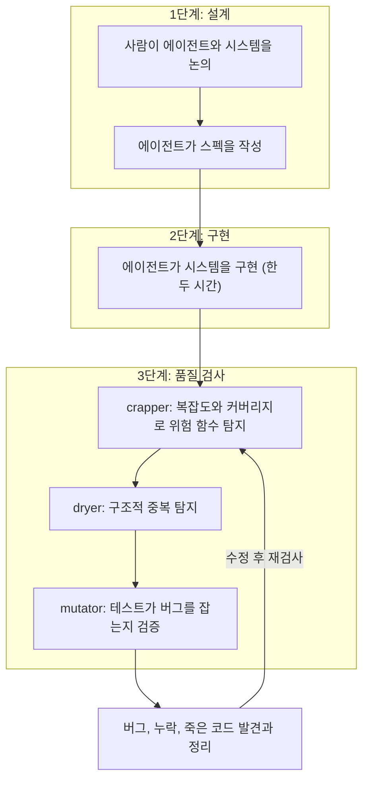
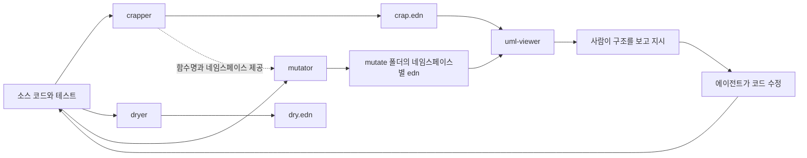
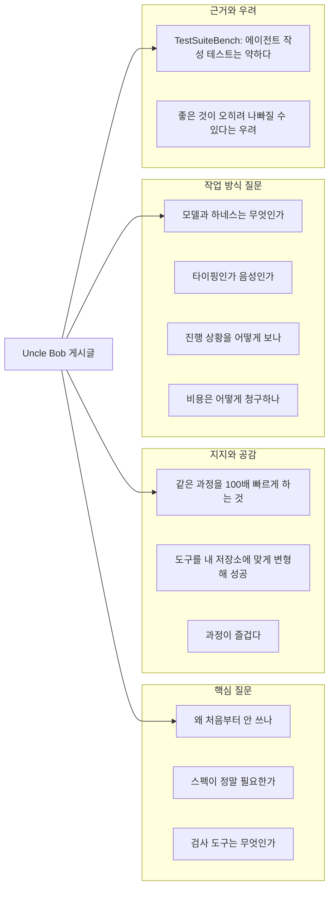
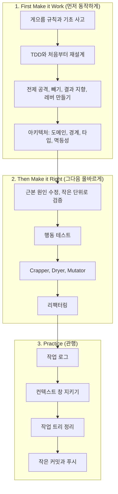
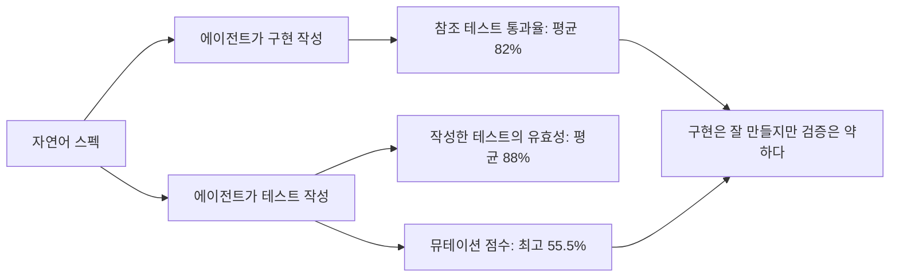
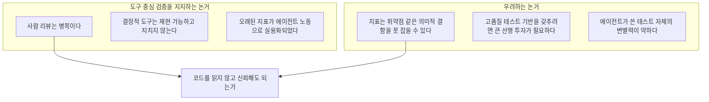

- 작성 일자: 2026-10-22
- 대상: Robert C. Martin(Uncle Bob)이 [2026년 10월 21일에 올린 게시글](https://x.com/unclebobmartin/status/2106046234729329064), 그 아래 달린 댓글과 답변, 그가 공유한 `ub-mode` 스킬 전문
- 보강 자료: unclebob의 GitHub 저장소(crapper, dryer, mutator, uml-viewer), ETH Zurich 연구진의 TestSuiteBench 논문(arXiv 2610.13065), 그리고 Uncle Bob의 AI 에이전트 활용 방식을 다룬 해설 글들

이 문서는 확인된 사실과 해석을 구분해서 씁니다. 출처에서 직접 확인한 내용은 사실로 서술하고, 제가 덧붙이는 설명은 "해석"이라고 표시합니다. 확인하지 못한 부분은 맨 끝의 "확인하지 못한 점" 절에 따로 모았습니다.

---

## 1. 한눈에 보기

Uncle Bob은 이번 게시글에서 자신의 요즘 개발 방식을 이렇게 요약했습니다. 에이전트들과 시스템에 대해 대화하면 에이전트가 스펙(명세서)을 만들고, 그 스펙대로 시스템을 구현합니다. 본인이 직접 만들면 일주일쯤 걸렸을 규모의 시스템을 한두 시간 만에 만들어 낸다고 합니다. 그다음 에이전트에게 `crapper`, `dryer`, `mutator`라는 세 가지 검사를 돌리게 하면, 수십 개의 버그와 놓친 부분, 죽은 코드(dead code)가 나오고 코드가 훨씬 깨끗한 상태로 정리된다는 이야기입니다.

이 글이 흥미로운 이유는 "AI가 코드를 빨리 짠다"는 평범한 자랑에 있지 않습니다. 핵심은 **AI가 짠 코드를 AI의 판단이 아니라 결정적(deterministic)인 도구로 검증하게 한다**는 점입니다. 복잡도와 테스트 커버리지를 결합한 지표(CRAP), 구조적 중복 탐지(DRY), 뮤테이션 테스트(mutation testing)는 모두 사람이 읽고 판단하는 대신 숫자로 합격·불합격을 가르는 도구입니다.

스레드 전체의 흐름은 다음과 같이 정리됩니다.

1. 한 개발자가 "에이전트가 버그를 찾을 만큼 똑똑하다면 왜 처음부터 안 쓰느냐"고 묻습니다.
2. Uncle Bob은 "코딩은 어렵고, 두세 번 검증하는 것이 잘 통한다. 단위 테스트가 더 잘 통하고, 뮤테이션 테스트는 그보다 더 잘 통하며, CRAP과 DRY가 전체를 깨끗하게 유지한다"고 답합니다.
3. 다른 사람들이 도구 공유, 스펙의 필요성, 사용하는 모델과 하네스(harness), 비용 구조 등을 물어봅니다.
4. 한 연구자(Oren Keinan)는 TestSuiteBench 논문을 근거로 "뮤테이터를 루프에 꼭 남겨 두라"고 조언합니다.

---

## 2. 맥락: 이 게시글이 나오기까지

### 2.1 Uncle Bob은 어떤 입장에서 말하고 있는가

Robert C. Martin은 『Clean Code』의 저자로 알려진 개발자입니다. 해설 글들에 따르면 그는 2025년 12월부터 AI 에이전트를 본격적으로 운용했고, 목표를 "에이전트가 쓴 코드를 직접 읽지 않는 것"으로 잡았습니다. 대신 에이전트를 둘러싼 제약을 극단적으로 강하게 두었다고 합니다. 단위 테스트, Gherkin 인수 테스트, QA 절차, 순환 복잡도(cyclomatic complexity) 한계, 모듈 크기 한계, 의존성 구조 분석, 뮤테이션 테스트, 커버리지 요구 같은 것들입니다.

이 접근의 중요한 특징은 오래된 아이디어를 재활용한다는 점입니다. 한 해설 글은 CRAP 점수와 뮤테이션 테스트가 2000년대 초에 이미 알려진 개념이었지만, 한 번 돌리는 데 밤새 걸릴 만큼 비실용적이어서 널리 쓰이지 못했다고 설명합니다. 에이전트의 노동력이 값싸지면서, 도구 자체는 바뀌지 않았는데도 실용적인 선택지가 되었다는 것이 그 글의 요지입니다.

### 2.2 최근 몇 주 사이의 변화

검색으로 확인된 Uncle Bob의 최근 발언 중 이 게시글과 직접 이어지는 것은 세 가지입니다.

첫째, 10월 2일 게시글입니다. 그는 언어별로 따로 만들던 `crap4clj`, `crap4go`, `crap4java` 같은 도구들을 두고 "왜 언어마다 따로 만들었지?"라는 생각이 들어 세 개의 도구(`crapper`, `dryer`, `mutator`)로 다시 만들었다고 밝혔습니다. 당시 Clojure, TypeScript, Rust, Python이 들어갔다고 했고, 지금 GitHub 저장소 설명에는 Java와 Go까지 포함되어 있습니다. 그는 이 도구들을 그대로 쓰지 말고, 에이전트에게 가리켜서 본인 상황에 맞게 고치거나 새로 만들게 하라고 권했습니다.

둘째, 에이전트 감독 방식에 대한 게시글입니다. 에이전트는 여전히 높은 수준의 감독이 필요하고, 사람이 코드를 일일이 리뷰하는 것은 병목이며, 엄격한 결정적 하네스는 이제 최적이 아니라는 전제에서 출발합니다. 그의 해법은 "질문 도구(interrogation tool)와 에이전트의 결합"입니다. 시스템 구조를 UML 비슷한 다이어그램으로 보여 주되, CRAP 점수와 뮤테이션 점수로 색을 입혀서 사람이 문제 구조를 찾아내 에이전트에게 고치라고 지시하게 하는 방식입니다. 이것이 뒤에서 설명할 `uml-viewer`입니다.

셋째, "다시 생각할 때가 됐다"는 취지의 게시글입니다. 몇 주 동안 에이전트를 원하는 방식으로 묶어 두는 하네스를 만들었고, 자리를 40분 비우고 돌아오면 CRAP이 충족되고 커버리지가 높고 뮤테이션 테스트가 끝나 있다고 했습니다. 동시에 그는 제약과 도구를 포기하지 않았다고 분명히 말했습니다. 다만 하네스가 에이전트를 소프트웨어 설계 속의 "부품"처럼 다루어서는 안 된다는 생각이 들기 시작했다고 했습니다.

이 세 흐름을 합치면, 이번 게시글의 "스펙 → 구현 → 세 가지 검사" 패턴은 갑자기 나온 것이 아니라 몇 달간 다듬어 온 작업 방식의 최신 모습이라고 볼 수 있습니다.

---

## 3. 작업 흐름을 풀어서 설명하면

게시글에 나온 작업 순서를 단계별로 그려 보면 다음과 같습니다. 세 가지 검사의 배치 순서는 뒤에서 다룰 `ub-mode` 스킬이 나열한 순서(crapper, dryer, mutator)를 따랐습니다. 게시글 자체가 순서를 못 박은 것은 아니므로, 이 순서는 참고용입니다.



각 단계를 서술형으로 풀어 보겠습니다.

**1단계, 설계.** Uncle Bob은 시스템을 "에이전트와 이야기하며" 정합니다. 여기서 눈여겨볼 점은 스펙을 사람이 처음부터 쓰지 않고 에이전트가 만든다는 것입니다. 사람의 역할은 방향을 제시하고 대화로 다듬는 것입니다. 이 부분은 스레드에서 "스펙 작성이 정말 필요하냐"는 질문으로 이어졌는데, 5장에서 다룹니다.

**2단계, 구현.** 스펙이 정해지면 에이전트가 시스템을 만듭니다. 그는 이것이 자기 손으로는 일주일이 걸렸을 일이라고 했습니다. 이 "일주일 대 한두 시간"은 본인의 체감 보고이며, 독립적으로 측정된 수치는 아닙니다.

**3단계, 품질 검사.** 구현이 끝나면 바로 끝내지 않고 세 가지 검사를 돌립니다. 결과로 수십 개의 버그, 간과된 부분, 죽은 코드가 나오고, 정리 과정에서 코드가 훨씬 좋은 상태가 된다고 합니다. 이 검사는 한 번으로 끝나는 것이 아니라 고치고 다시 돌리는 루프입니다. 해설 글들은 이것을 "반드시 통과해야 하는(must-pass) 루프"로 설명합니다.

---

## 4. 세 가지 검사 도구, 그리고 지켜보는 도구

세 도구는 모두 GitHub의 `unclebob` 계정에 공개되어 있고, 한 번 실행하면 파일마다 언어를 감지해 해당 언어의 규칙을 적용합니다. 검색 결과 기준으로 `crapper`와 `mutator`는 10월 21일, `dryer`는 10월 3일에 마지막으로 갱신되었습니다. 즉 이번 게시글이 올라온 날에도 도구가 손질되고 있었습니다. 라이선스는 0BSD로 표기되어 있습니다.

### 4.1 crapper: "복잡한데 테스트가 부족한 함수"를 찾는다

CRAP은 "Change Risk Anti-Patterns"의 약자로 알려진 지표인데, 이 저장소 설명에는 약어 풀이가 없고 공식만 나옵니다. 공식은 이렇습니다.

```
CRAP = CC² × (1 − coverage)³ + CC
```

`CC`는 순환 복잡도, 즉 함수 안에서 갈라지는 길의 수입니다. `coverage`는 테스트가 그 함수를 실행해 본 비율(0에서 1 사이)입니다. 이 공식의 직관은 단순합니다. 함수가 복잡할수록, 그리고 테스트가 덜 실행해 볼수록 점수가 급격히 나빠집니다. 복잡도가 높아도 테스트가 완벽히 덮고 있으면 점수는 복잡도 값 그대로(커버리지 100%이면 `CRAP = CC`)에 머물고, 복잡도가 낮은 단순한 함수는 테스트가 없어도 점수가 크게 오르지 않습니다.

저장소 설명에 따르면 점수 해석 기준은 다음과 같습니다. 1에서 5는 위험이 낮고, 5에서 30은 한 번 볼 만하며, 30 이상은 복잡하면서 테스트가 부족한 상태입니다.

실행하면 점수가 높은 함수부터 표로 출력하고, `.metrics/crap.edn` 파일을 갱신합니다. `--threshold 30`처럼 한계를 주면 최악의 점수가 그보다 높을 때 종료 코드 2로 끝나서, 자동화 파이프라인의 합격·불합격 판정에 쓸 수 있습니다. 테스트와 의존성 폴더(`test`, `spec`, `vendor`, `node_modules`, `target`)는 건너뜁니다.

언어마다 "복잡도를 무엇으로 세는지"가 정해져 있습니다. 예를 들어 Python은 `if`, `elif`, `for`, `while`, `except`, `match`의 각 case, 컴프리헨션의 필터, 조건 표현식, 그리고 `and`와 `or` 하나하나를 셉니다. 커버리지는 언어별 표준 도구(Python은 coverage.py, Go는 `go test -coverprofile`, Java는 JaCoCo, Rust는 `cargo llvm-cov` 또는 `cargo tarpaulin` 등)로 직접 측정해 옵니다. 도구가 없거나 테스트 실행이 실패하면 그 언어는 커버리지 0%로 처리하고 스냅샷은 그대로 씁니다.

### 4.2 dryer: "닮은 코드"를 찾는다

DRY는 "Don't Repeat Yourself"로 널리 알려진 원칙으로, 같은 지식이 여러 곳에 흩어지지 않게 하자는 뜻입니다. `dryer`는 중복 후보를 찾는 도구입니다.

작동 방식이 꽤 영리합니다. 코드를 글자 그대로 비교하지 않고, 이름·지역 변수·리터럴·키워드처럼 "우연히 다른" 요소를 걷어낸 뒤 구조(트리의 모양, 호출하는 함수나 메서드 이름, 연산자)의 지문을 비교합니다. 점수는 두 함수가 공유하는 지문의 수를 둘이 가진 전체 지문의 수로 나눈 자카드(Jaccard) 유사도입니다. 1.0이면 정규화된 구조가 완전히 같다는 뜻입니다. 저장소 예시에서는 변수 이름과 조건 함수만 다르고 모양이 같은 두 함수가 1.0점을 받습니다.

기본 설정에서는 유사도 0.82 이상을 후보로 보고합니다. 너무 작은 코드는 우연한 일치가 많으므로 최소 4줄, 정규화 후 구문 노드 20개 이상인 경우만 비교합니다. 이 값들은 `--threshold`, `--min-lines`, `--min-nodes` 옵션으로 바꿀 수 있습니다. 같은 언어 안에서만 비교하며, 결과는 `.metrics/dry.edn`에 저장됩니다.

여기서 한 가지 짚을 점이 있습니다. 뒤에서 볼 `ub-mode` 스킬은 "랭크 0.8 이상의 중복을 제거하라"고 적고 있고, 도구의 기본 임계값은 0.82입니다. 두 숫자가 정확히 일치하지는 않습니다. 스킬 쪽이 조금 더 느슨한 기준이거나, 사용자가 옵션으로 조정해 쓰는 것으로 보이지만, 이 차이가 의도된 것인지는 확인하지 못했습니다.

### 4.3 mutator: "테스트가 정말로 버그를 잡는가"를 시험한다

세 도구 중 가장 개념 설명이 필요한 것이 뮤테이션 테스트입니다. 커버리지는 "테스트가 이 줄을 실행했다"는 것만 알려 줍니다. 실행했다고 해서 그 결과를 제대로 검사했다는 보장은 없습니다. 아무것도 확인하지 않는 테스트도 커버리지는 올려 줍니다.

뮤테이션 테스트는 이 허점을 이렇게 메웁니다. 소스 코드의 일부를 일부러 틀리게 바꿉니다(예: `>`를 `>=`로, `+`를 `-`로, `true`를 `false`로). 이렇게 바뀐 코드를 "뮤턴트(mutant)"라고 부릅니다. 그리고 기존 테스트를 돌립니다.

- 테스트가 실패하거나 시간 초과가 나면 뮤턴트가 "죽은(killed)" 것입니다. 테스트가 변화를 알아챘다는 좋은 신호입니다.
- 테스트가 여전히 통과하면 뮤턴트가 "살아남은(survived)" 것입니다. 코드가 틀어졌는데도 테스트가 모른다는 뜻이므로 테스트에 구멍이 있는 것입니다.
- 커버리지 보고서상 한 번도 실행되지 않는 줄에 있는 변경은 "미커버(uncovered)"로 분류하고 실행하지 않습니다.

저장소 설명에 따르면 점수는 `killed / (killed + survived)`입니다. 즉 실행한 뮤턴트 중 몇 개를 잡았는가입니다.

운영상의 특징도 있습니다. 뮤턴트마다 테스트를 처음부터 다시 돌려야 하므로 비용이 큽니다. 그래서 같은 파일의 뮤턴트를 병렬 작업자(worker)로 동시에 돌리고(기본은 코어당 하나), 한 번 스냅샷이 생긴 뒤에는 "차등(differential)" 실행을 합니다. 즉 살아남았던 뮤턴트와 텍스트가 바뀐 함수의 변경 지점만 다시 돌립니다. 뮤턴트의 제한 시간은 기준 테스트 시간의 10배(최소 2초)입니다. 종료 코드는 모두 죽였으면 0, 기준 테스트가 이미 실패하면 2, 살아남은 뮤턴트가 있으면 3입니다.

Python의 변이 규칙은 Java 규칙을 Python 문법으로 옮긴 것으로, `and`/`or`, `not`, `True`/`False` 변환과 비교 연산자·산술 연산자 교체 등이 포함됩니다. 도구가 만든 변이가 컴파일(또는 실행)되지 않아 테스트가 깨지는 경우도 "죽은" 것으로 셉니다.

한 가지 설치상의 조건도 있습니다. `mutator`는 함수 이름과 네임스페이스를 `crapper`에서 가져오기 때문에 `crapper`가 바로 옆 디렉터리(`../crapper`)에 체크아웃되어 있어야 합니다.

### 4.4 uml-viewer: 사람이 "구조"를 보는 창

세 검사가 숫자를 만든다면, `uml-viewer`는 그 숫자를 사람이 볼 수 있게 해 주는 도구입니다. 저장소 설명에 따르면 프로젝트를 클릭해서 파고들 수 있는 동적 UML로 보여 주고, 맨 아래 소스 코드까지 내려갈 수 있습니다. 에이전트와 연동되어 있어서, 사람이 다이어그램을 보고 마음에 들지 않는 부분을 말하면 에이전트가 코드를 고치고 화면이 다시 그려집니다. "이렇게 바꾸면 어떨까"라는 구조 변경 제안(proposal)을 먼저 그려 보고, 마음에 들면 코드를 그 모양에 맞추게 할 수도 있습니다.

색은 CRAP과 뮤테이션 지표로 입힙니다. 그리고 클린 아키텍처의 의존성 규칙(의존성은 바깥에서 안쪽으로만 향해야 한다)을 어기는 화살표는 빨간색으로 표시합니다. 해당 데이터가 없으면 "알 수 없음"이 아니라 빨간색(최저 등급)으로 취급하는 점도 특징입니다. 측정되지 않은 코드를 안전한 코드로 착각하지 않게 하려는 설계로 읽힙니다.

참고로 이 `uml-viewer`의 현재 설명은 CRAP과 뮤테이션 스냅샷을 읽는다고 적혀 있고, `dryer`의 출력(`dry.edn`)을 읽는다는 언급은 없습니다.

### 4.5 도구들의 관계



이 그림에서 점선은 `mutator`가 `crapper`로부터 이름 체계를 빌려 온다는 뜻입니다. 이 덕분에 두 도구의 결과가 같은 함수 이름으로 합쳐져서 한 화면에 표시됩니다. `dry.edn`이 화면에 연결되지 않은 것은 현재 설명 기준으로 확인된 사실을 그대로 반영한 것입니다.

---

## 5. 스레드 속 질문과 답변 해설

게시글 아래에 달린 반응을 주제별로 묶어 설명합니다. 사용자 이름은 표시 이름 그대로 적습니다.

### 5.1 "왜 처음부터 버그를 안 쓰지?" (Sergei Kotau)

이 스레드에서 가장 본질적인 질문입니다. 요지는 "에이전트가 버그 수십 개를 찾아낼 만큼 똑똑하다면, 그 버그를 애초에 안 만들 만큼은 똑똑해야 하지 않느냐"입니다.

Uncle Bob의 답은 짧습니다. 코딩은 어려운 일이고, 두 번 세 번 확인하는 것이 꽤 잘 통하며, 단위 테스트는 그보다 더 잘 통하고, 뮤테이션 테스트는 그보다도 더 잘 통하며, CRAP과 DRY가 전체를 깨끗하게 유지해 준다는 것입니다. 원문은 "even for SI"라고 적었는데, SI가 무엇의 약어인지 원문에서는 풀이되지 않아 여기서는 뜻을 단정하지 않겠습니다.

**해석.** 이 문답은 소프트웨어 공학의 오래된 사실과 닿아 있습니다. 코드를 쓰는 일과 검증하는 일은 서로 다른 활동이고, 같은 작성자가 자기 결과를 한 번 더 보는 것만으로는 놓치는 것이 생깁니다. 사람 개발자도 코드 리뷰, 테스트, 정적 분석을 겹쳐 쓰는 이유가 여기에 있습니다. 에이전트 역시 한 번에 완벽하게 쓰지 못하는 것은 사람과 같으며, 다른 점은 이 반복을 아주 빠르게 돌릴 수 있다는 것입니다. 같은 맥락의 의견이 스레드에도 있습니다. Wes Higbee는 에이전트도 인간과 똑같은 코딩 과정과 똑같은 종류의 문제를 겪을 뿐이고, 100배 빠를 뿐이라고 주장합니다. 코딩이 본래 반복적이고 발견 지향적인 과정이라는 것입니다.

### 5.2 "스펙 작성이 정말 필요한가?" (Donio, TonyIsHere4You)

Donio의 질문에 Uncle Bob은 복잡한 시스템에서는 도움이 된다고 답합니다. 에이전트가 따를 기준을 주고, 사람이 기억하는 데도 도움이 된다는 이유입니다.

TonyIsHere4You는 스펙이 얼마나 자세하냐고 묻고, 코딩 에이전트 때문에 자연어 루프로 계속 돌아오게 되는 것이 이점보다 부담이 되어 간다는 경험을 적었습니다. 이 질문에 대한 Uncle Bob의 직접 답변은 제공된 스레드에서 확인되지 않았습니다.

한 해설 글은 Uncle Bob이 스펙 주도 개발을 1970년대 폭포수(waterfall)의 유혹이 돌아온 것으로 보는 면이 있다고 정리합니다. 이는 2차 해설이므로 그대로 단정하기는 어렵고, 이번 답변("복잡한 시스템에서는 도움이 된다")과 함께 놓고 보면 "스펙을 쓰되 상세 설계를 미리 다 못 박는 방식이 아니라, 에이전트와 대화하며 만들어 가는 기준 문서로 쓴다"는 정도로 읽는 것이 안전합니다. 이것은 제 해석이며 본인의 발언은 아닙니다.

### 5.3 "검사 도구가 정확히 뭐냐" (mr.intellego, Crimbo, Alejandro García Iglesias)

mr.intellego는 팀의 AI 전략에서 비(非)AI 자동 품질 검사가 약점이라며 검사를 더 설명해 달라고 합니다. Uncle Bob은 `github.com/unclebob`의 `crapper`, `dryer`, `mutator`, `uml-viewer`를 가리킵니다. Crimbo는 "crapper와 dryer가 린팅(linting)이냐"고 묻는데, 4장의 설명대로 정확히는 린팅과 다릅니다. 린터는 주로 코드 스타일과 흔한 오류 패턴을 규칙으로 검사하지만, crapper는 복잡도와 테스트 커버리지를 결합한 위험 점수를 계산하고, dryer는 구조적 유사도로 중복 후보를 찾습니다. 둘 다 "코드를 정적으로 분석한다"는 점에서 린터와 사촌 관계이지만 측정하는 대상이 다릅니다. 이 부분은 저장소 설명에 근거한 것이며, Uncle Bob이 Crimbo에게 직접 답했는지는 확인되지 않았습니다.

Alejandro García Iglesias는 CRAP/DRY/뮤테이션 감사를 위한 스킬을 공유해 달라고 요청했고, Uncle Bob이 `ub-mode`를 붙여 넣은 것이 이 대목입니다. 6장에서 상세히 다룹니다.

### 5.4 작업 환경과 비용에 대한 질문들

- Pete Reilly는 어떤 모델과 하네스를 쓰느냐고 묻습니다. 제공된 스레드에서는 Uncle Bob의 답이 확인되지 않습니다. 다만 앞서 본 uml-viewer 저장소의 에이전트 연동부가 Grok을 호출하는 구성으로 적혀 있다는 점, 그리고 Anthony Melei가 Grok을 막 쓰기 시작했다고 말하는 점은 사실 그대로 남겨 둡니다. 이것만으로 Uncle Bob의 현재 주력 모델이 무엇이라고 단정할 수는 없습니다.
- BigRobot(@jaysonambrose)은 "Them? 서브에이전트 접근은 버린 줄 알았는데 다시 돌아온 거냐"고 묻습니다. 2.2절에서 본 "에이전트를 설계 속 부품처럼 다루는 하네스에 대한 재고" 발언과 관련이 있어 보이지만, 질문자가 정확히 무엇을 가리키는지는 확인하지 못했습니다.
- tedious man은 타이핑이냐 음성이냐를 묻고, Sebastian Sosa는 "talk the system over"를 문자 그대로 받아들여 코딩 에이전트에게 소리 내어 말하며 작업하고, 막히면 시각 자료를 요청하면 차트를 화면에 띄워 주는 오픈소스 도구를 직접 만들었다고 소개합니다. (링크 주소는 잘려서 보이므로 여기에 옮기지 않습니다.)
- Rahul Karajgikar는 진행 상황을 어떻게 추적하고 시각화하느냐고 묻는데, 4.4절의 uml-viewer가 바로 그 문제에 대한 Uncle Bob의 이전 답이라고 볼 수 있습니다.
- John은 "고객이 똑같이 할 수 있다면 어떻게 비용을 청구하느냐"고 묻습니다. 이 질문에 대한 Uncle Bob의 답은 확인되지 않았습니다.
- 0x(@grave0x)는 자신은 같은 방식으로 하되 무료 이용이 가능한 채팅 모델과 대화한다고 합니다.

### 5.5 도구를 실제로 써 본 보고와 응용

Jeff Neet(@CrossBread)은 자기 프로젝트에서 에이전트를 Uncle Bob의 GitHub 저장소에 가리켜 자기 저장소에 맞게 도구를 고치게 했고, 에이전트가 이를 실행한 뒤 결과에 따라 스스로 여러 수정을 했다고 보고합니다. 이는 Uncle Bob이 권한 "그대로 쓰지 말고 에이전트가 맞춤 변형하게 하라"는 사용법과 정확히 맞닿아 있습니다. Lee Macdonald는 이동 가능한 카오스 몽키(chaos monkey) 테스트 생성 에이전트를 만드는 것이 꿈이라고 말합니다. Cupsey는 "Uncle Bob이 에이전트 팀으로 에이전트 코드를 리뷰하게 하다니 예상 못 한 반전"이라고 평합니다. ALBERT BRUGUÉ는 자신의 에이전트들이 게시 전에 매번 "ok?"라고 물어서 직원들에게 이렇게 철저히 관리당한 적이 없다고 농담합니다.

### 5.6 우려와 비판, 그리고 스레드와 무관한 글

Suman은 "좋은 것"이 결국 모두에게 나쁜 결과를 낳는 경우가 많다는 취지의 우려를 비꼬는 어조로 남기는데, 구체적으로 무엇을 우려하는지는 글에 서술되어 있지 않아 더 해석하지 않겠습니다. GG는 에이전트가 이전 개발자들이 남긴 형편없는 코드를 다시 써야 한다고 불평하기 시작할 때 인간 수준 지능에 도달한 것이라고 농담합니다. MalwareMuffin은 과정을 사랑하고, 기계들의 게임에서 말단이라도 생산적이라고 느낀다고 적습니다.

제공된 스레드에는 Stacy Schultz의 "광고" 표시가 붙은 게시물(영업 대행 에이전트 제품 홍보)도 섞여 있습니다. 이 글은 Uncle Bob의 게시글과 내용상 관련이 없으므로 분석에서 제외했습니다.

### 5.7 반응 지도



---

## 6. ub-mode 스킬 전문 해설

`ub-mode`는 Uncle Bob이 "요즘 쓰고 있다"며 공유한 스킬 파일(에이전트에게 주는 지시문 묶음)입니다. 파일 머리말의 설명은 "코드를 쓰거나 바꿀 때 축약된 원칙을 따르라. 모든 변경은 먼저 동작하게 만들고, 그다음 올바르게 만들고, 그다음 관행을 따른다"는 내용이며, 사용자가 `/ub-mode`를 실행하거나 축약 원칙을 요청할 때 쓰라고 되어 있습니다. 이름의 "ub"가 무엇의 약어인지는 글에 설명이 없습니다. Uncle Bob의 이니셜로 읽는 것이 자연스럽지만 확정은 아닙니다.

전체 구조는 세 덩어리입니다.



### 6.1 First Make it Work: 먼저 동작하게 만든다

이 덩어리에는 구현을 시작하기 전과 구현하는 동안의 사고방식이 모여 있습니다.

**게으름 규칙(Laziness Protocol).** 하나의 결정은 한 곳에만 둔다는 원칙과, 문제를 해결하는 가장 작은 수정만 내보낸다는 원칙입니다. 에이전트가 필요 이상으로 많은 코드를 쓰는 경향을 눌러 두려는 규칙으로 읽힙니다(해석).

**기초 사고(Foundational Thinking).** 논리를 쓰기 전에 데이터의 모양부터 바로잡고, 이후 모든 단계에 도움이 되는 일을 먼저 하라는 것입니다. 동시에 쓰는 주체가 있을 수 있다면 상태를 공유하지 말라고 합니다.

**TDD.** 코드를 바꾸기 전에 실패하는 테스트를 먼저 쓰고, 그 테스트가 기대한 이유로 실패하는 것을 확인하며, 통과시킬 가장 작은 수정만 합니다. 정직한 테스트를 쓰기 어려운 상황이라면 나쁜 테스트를 쓰지 말라는 단서도 붙습니다. 참고로 한 해설 글은 Uncle Bob이 TDD 같은 사람의 규율을 에이전트에게 강요해서는 안 된다고 본다고 서술하는데, `ub-mode`에는 TDD 항목이 들어 있어 얼핏 상충해 보입니다. 그 해설은 2차 자료이고 발언 시점과 맥락도 다를 수 있어, 두 서술이 실제로 충돌하는지는 판단하지 않겠습니다.

**처음부터 재설계(Redesign From First Principles).** 새 요구를 낡은 설계에 덧붙이지 말고, 처음부터 그 요구가 있었다면 무엇을 지었을지 생각한 다음 조각으로 나누어 전달하라는 규칙입니다.

**전제 공격(Attack the Premise).** 같은 전제를 공유하는 두 가지 수정이 같은 검문(gate)에서 모두 실패하면, 그 전제를 한 문장으로 적고 어느 쪽 행위자가 불균형을 가졌는지 세어 보라고 합니다. 그 할당을 없애고, 그 전까지 다른 수정을 시작하지 말라는 것입니다. 실패한 수정을 계속 쌓는 대신 근본 가정을 의심하게 하는 규칙입니다.

**빼기 먼저(Subtract Before You Add).** 무언가를 더하기 전에 복잡성을 먼저 덜어냅니다.

**결과 지향 실행(Outcome-Oriented Execution).** 확인 가능한 최종 상태를 겨냥하고, 중간에 일시적으로 깨지는 것은 계획되어 있고 되돌릴 수 있을 때만 허용합니다.

**레버 만들기(Build the Lever).** 한눈에 명확하지 않은 작업이면 그 작업을 대신 해 줄 도구를 만들라고 합니다. 한 단위를 손으로 먼저 해 보고, 도구를 그 단위에 맞춥니다.

**아키텍처 규칙.** 도메인을 불가능한 상태가 아예 표현되지 않는 구조로 모델링하고, 도메인 용어 사전을 유지하며, 이미 명확하고 국소적인 코드는 건드리지 않습니다. 데이터는 들어오는 경계에서 검증하고 내부에서는 신뢰하며, 비즈니스 로직은 순수 함수에 둡니다. 외부 데이터는 들어오는 곳에서 한 번만 파싱하고, 컴파일러를 침묵시키지 않습니다. 연산은 멱등하게 만들어서 두 번 돌리거나 중간에 죽고 다시 돌려도 같은 상태에 도달하게 합니다. 같은 가변 상태가 필요 없는 주체에게는 각자의 상태를 주고, 정말 공유해야 하면 쓰는 주체를 하나로 제한하되 그것을 구조로 강제합니다.

### 6.2 Then Make it Right: 그다음 올바르게 만든다

이 덩어리가 이번 게시글의 "세 가지 검사"가 놓이는 자리입니다.

**근본 원인 수정(Fix Root Causes).** 재현하고, 원인을 고칩니다. 충돌만 감추는 가드 코드는 수정이 아니라고 못 박습니다.

**검증 가능한 단위로 나누기.** 작은 단위 하나를 끝내고 확인한 다음 다음 단위로 넘어갑니다.

**구현이 아니라 행동을 테스트.** 테스트는 사용자가 호출하는 방식으로 코드를 호출하고, 사용자가 보게 될 결과를 확인해야 합니다. 모든 함수가 아무것도 반환하지 않아도 통과할 테스트라면 버립니다. 이 기준은 뮤테이션 테스트의 관점과 정확히 일치합니다. 아무것도 확인하지 않는 테스트는 뮤턴트를 하나도 못 죽입니다.

**Crapper.** 도구를 쓰고, 각 함수의 CRAP 점수를 10 미만으로 줄입니다. 함수를 쪼개거나, 테스트를 보강하거나, 둘 다 합니다. `case` 문은 줄일 가치가 있는지 따져 보라는 단서가 붙는데, 분기가 많아도 구조가 단순한 `case`는 복잡도 점수만 높고 실제 위험은 낮을 수 있기 때문으로 보입니다(해석). 앞서 본 저장소의 해석 기준(5 이하 낮음, 30 이상 위험)보다 `ub-mode`의 10이라는 목표가 더 빡빡하게 설정되어 있습니다. 또 한 해설 글은 Uncle Bob이 에이전트에게 CRAP 임계값 6이 맞느냐고 물었고 에이전트들이 동의했지만 그는 그 동의를 할인해서 받아들였다고 전합니다. 에이전트와의 토론 결과를 증거로 삼지 않는다는 태도입니다.

**Dryer.** 도구를 써서 유사도 랭크 0.8 이상의 중복을 제거합니다(4.2절에서 본 기본 임계값 0.82와의 차이는 확인하지 못했습니다).

**Mutator.** 도구를 쓰고, 덮이지 않은 곳을 덮고, 살아남은 뮤턴트를 죽이고, 죽은 코드를 삭제합니다. "죽은 코드 삭제"가 여기에 들어 있는 이유는 자연스럽습니다. 어떤 줄을 바꿔도 아무 테스트도 영향을 받지 않고 커버리지도 없는 코드는 실제로 쓰이지 않는 코드일 가능성이 높기 때문입니다. 게시글이 말한 "죽은 코드 발견"이 바로 이 단계의 결과로 보입니다(해석).

**리팩터링.** 코드가 하는 일을 먼저 고정하고(테스트로 못 박고), 구조를 바꾸고, 행동이 바뀌지 않았음을 증명합니다.

### 6.3 Practice: 관행

- **작업 로그**: 취한 모든 행동과 그 이유를 기록하고, 완료 시 그 로그를 보고합니다. 사람이 코드를 읽지 않는 방식에서 "무슨 일이 있었는지"를 확인하는 거의 유일한 창구입니다(해석).
- **컨텍스트 창 지키기**: 메인 스레드는 작게 유지하고, 부피가 큰 작업은 다른 곳으로 보내고 요약만 남깁니다.
- **작업 트리 정리**: 안전하게 지울 수 있는 것을 찾고, 쓰이는 것이 필요로 하지 않는지 확인한 뒤 디스크를 회수합니다. 커밋하지 않은 작업은 결정을 기다립니다.
- **커밋과 푸시**: 자주, 작은 순서로 커밋하고, 각 커밋에 이유·변경 내용·검증 방법을 적으며, 마지막에 메인 라인에 푸시합니다.

---

## 7. TestSuiteBench: 왜 "뮤테이터를 루프에 두라"고 했나

스레드 끝부분에서 Oren Keinan은 이렇게 조언합니다. 뮤테이터를 그 루프에 남겨 두라는 것입니다. 근거로 이번 달 arXiv에 올라온 TestSuiteBench를 인용하며, 최전선 에이전트들이 스펙으로부터 쓴 테스트 스위트는 뮤테이션 테스트에서 60% 미만을 기록한 반면, 같은 스펙으로 에이전트가 만든 코드는 참조 테스트의 82%를 통과했다고 요약합니다. 논문의 원본을 확인한 결과, 이 요약은 정확합니다.

### 7.1 논문이 한 일

논문의 제목은 "TestSuiteBench: Coding Agents Struggle to Generate Strong Test Suites from Specifications"입니다. 저자는 ETH Zurich와 LogicStar.ai 소속 연구자들(Kazuki Egashira, Niels Mündler-Sasahara, Mark Niklas Müller, Martin Vechev)입니다. 기존 테스트 생성 벤치마크가 함수 하나나 버그 수정 같은 작은 단위에 머물렀고, 항상 테스트할 구현체를 제공했다는 점에 착안해, 구현 없이 자연어 스펙만 주고 에이전트에게 전체 테스트 스위트를 쓰게 하는 벤치마크를 만들었습니다.

벤치마크는 165개의 오픈소스 애플리케이션으로 구성됩니다. 각 애플리케이션마다 상세한 스펙, 참조 구현, 참조 테스트 스위트, 그리고 평균 74개의 뮤턴트가 들어 있습니다. 뮤턴트는 스펙의 요구사항 하나를 위반하도록 만들어졌고, 73%는 참조 테스트 단 하나로만 죽습니다. 즉 "이 요구사항을 테스트가 정말 확인하는가"를 정밀하게 재도록 설계된 것입니다. 참조 테스트 스위트는 모든 뮤턴트를 죽이므로, 만점이 가능하다는 것도 구성상 보장됩니다. 대상은 Rust, Go, C/C++로 만든 명령줄 프로그램입니다.

### 7.2 결과

핵심 지표는 세 가지입니다. 뮤테이션 점수(M)는 생성된 테스트가 죽인 뮤턴트 비율이고, 유효성(V)은 생성된 테스트 중 참조 구현에서 통과하는 비율이며, 참조 통과율(R)은 에이전트가 만든 구현이 참조 테스트를 통과하는 비율입니다.

| 모델 | 뮤테이션 점수 M | 유효성 V | 참조 통과율 R | 인스턴스당 비용 | 평균 시간 |
|---|---|---|---|---|---|
| Claude Opus 5 | 55.5% | 96.1% | 91.8% | 10.56달러 | 37.0분 |
| GPT 6 Astra | 50.1% | 94.3% | 92.7% | 2.18달러 | 12.4분 |
| Gemini 3.8 Flash | 37.9% | 88.2% | 86.2% | 1.63달러 | 9.3분 |
| GPT 5.6 Sol | 37.7% | 94.4% | 86.9% | 0.89달러 | 8.2분 |
| DeepSeek V4 Flash | 28.6% | 78.1% | 66.8% | 0.14달러 | 19.0분 |
| GPT 5.6 Luna | 19.3% | 74.1% | 65.4% | 0.03달러 | 4.0분 |

표를 서술하면, 여섯 모델 중 가장 좋은 뮤테이션 점수가 55.5%(Opus 5)이고 그다음이 50.1%(GPT 6 Astra)이며, 나머지 네 모델은 모두 40%에 못 미칩니다. 그런데 DeepSeek V4 Flash와 GPT 5.6 Luna를 제외한 네 모델은 유효성이 88%에서 96% 사이, 참조 통과율이 86%에서 93% 사이로 높습니다. 논문 초록은 여섯 모델 전체의 평균으로 유효성 88%, 구현의 참조 통과율 82%를 제시하며, Oren의 요약에 나온 82%가 바로 이 값입니다. 논문은 이 간극을 "에이전트는 자기가 검증하지 못하는 소프트웨어를 만들 수 있다"로 요약합니다. 테스트가 올바르고 많아 보여도 정작 스펙 위반을 잡아내는 변별력은 낮다는 뜻입니다.



### 7.3 왜 점수가 낮았나: 논문의 분석

논문이 관찰한 원인은 세 가지입니다.

첫째, 생성된 테스트 스위트가 참조보다 작습니다. 테스트 개수의 차이는 모델마다 달라서, Opus는 참조와 비슷한 수(참조 대비 약 -8.9%)를 만드는 반면 GPT 5.6 Sol은 약 5배 작은 스위트(약 -79.9%)를 만들었습니다. 뮤테이션 점수가 높으려면 요구사항을 두루 덮어야 하므로 테스트 수가 많을수록 유리했습니다.

둘째, 입력 조합과 경계 사례가 빠집니다. 논문의 사례에서는 스펙이 "run 명령은 여러 파일을 받는다"고 요구하는데, 뮤턴트가 두 번째 파일을 무시하게 만듭니다. Opus가 쓴 테스트는 두 파일을 함께 넣어 이를 잡았고, Sol이 쓴 테스트는 파일 하나만 넣어 놓쳤습니다.

셋째, 스펙을 더 정확하게 해도 소용이 없었습니다. 참조 실행 파일까지 쥐여 줬을 때 Sol의 유효성은 94.4%에서 98.4%로 올랐지만 뮤테이션 점수는 37.7%에서 38.1%로 거의 움직이지 않았습니다. 논문은 병목이 스펙의 정밀도가 아니라 "테스트를 설계하는 능력"에 있다고 결론짓습니다. 또한 개발자가 쓴 기존 문서를 스펙 대신 주었더니(30개 인스턴스 부분집합, Sol 기준) 뮤테이션 점수가 25.5%에서 4.0%로 떨어졌습니다. 이 결과는 스펙의 상세함이 테스트 품질에도 크게 영향을 준다는 점을 보여 줍니다.

그 외에 흥미로운 관찰도 있습니다. 지시받지 않았는데도 스스로 구현이나 뮤턴트를 만들어 테스트 작성에 활용한 에이전트가 있었고(Opus가 가장 자주), 그 비율이 높은 모델일수록 점수가 높았습니다. 그럼에도 Opus조차 뮤턴트를 만든 인스턴스는 165개 중 33개뿐이어서, 뮤턴트 기반 테스트 생성 방법에 개선 여지가 있다고 논문은 말합니다. 세 모델의 테스트를 합쳐도 죽인 뮤턴트가 54%에서 59%로 늘 뿐, 41%는 어떤 모델도 죽이지 못했습니다.

### 7.4 이 논문을 Uncle Bob의 방식에 연결할 때의 주의점

**연결되는 점.** 에이전트가 쓴 테스트는 통과율이 높아도 믿을 수 없다는 것을 숫자로 보여 줍니다. Uncle Bob이 단위 테스트를 믿는 데서 멈추지 않고 뮤테이션 테스트를 한 겹 더 두는 이유와 방향이 같습니다. 한 해설 글이 소개한 Gherkin 기반 파이프라인 사례에서도, 뮤테이션 테스트는 생성된 테스트가 실제로 버그를 잡는지 확인하는 보조 층으로 쓰입니다.

**다른 점(해석).** 이 논문이 측정한 것과 Uncle Bob의 `mutator`가 하는 일은 같지 않습니다. 논문은 "스펙만 보고 쓴 새 테스트 스위트"를 사람이 정밀하게 만든 요구사항별 뮤턴트로 평가합니다. `mutator`는 이미 있는 코드에 연산자 교체 같은 일반 규칙의 뮤턴트를 만들어 기존 테스트를 시험합니다. 또 논문의 대상은 컴파일 언어로 만든 명령줄 프로그램이고, 논문 스스로 뮤턴트가 요구사항 하나씩을 위반하는 인위적 설계여서 실제 결함 분포를 대표하지 않는다고 한계를 적었습니다. 따라서 "논문이 Uncle Bob의 방식이 옳다고 증명했다"고 말할 수는 없고, "에이전트가 쓴 테스트를 그대로 믿으면 안 된다는 점을 지지하는 근거"로 읽는 것이 정확합니다.

---

## 8. 균형 잡힌 시각: 무엇이 확인되었고 무엇이 아직 주장인가

### 8.1 확인된 것

- 세 도구가 실제로 공개되어 있고, 각각의 기능과 지표 정의, 사용법이 저장소에 명시되어 있습니다.
- 이 방식이 Uncle Bob 개인의 갑작스러운 선택이 아니라 2025년 12월 이후 이어진 실천의 최신 형태임이 여러 해설 글에서 일관되게 서술됩니다.
- 에이전트가 쓴 테스트의 변별력이 약하다는 점이 별개의 학술 벤치마크에서 수치로 보고되었습니다.
- 다른 사용자(Jeff Neet)가 같은 도구를 자기 저장소에 적용해 에이전트가 결과를 보고 스스로 수정까지 했다고 보고했습니다.

### 8.2 아직 주장 수준인 것

- "일주일 걸릴 일이 한두 시간"과 "수십 개의 버그 발견"은 본인의 체감 보고이며, 시스템의 종류와 규모, 결과물의 최종 품질에 대한 독립적 측정은 제공된 자료에서 확인되지 않습니다.
- 이 방식이 팀 환경이나 다른 도메인에서도 같은 효과를 내는지는 알 수 없습니다. 한 해설 글은 이 접근이 상당한 선행 투자를 요구하며, 에이전트 도입 이전부터 고커버리지·뮤테이션 검증 스위트를 돌리던 팀이라야 따라 하기 쉽다고 지적합니다.

### 8.3 이견

한 보도에 따르면 Uncle Bob이 AI가 쓴 코드를 더 이상 읽지 않는다고 말하자, 그레이디 부치(Grady Booch)가 반대 입장을 냈습니다. 지표로는 경험 많은 엔지니어가 한눈에 알아보는 취약점과 죽은 코드를 잡을 수 없다는 주장입니다. 스레드의 Suman도 "멋진 것"의 결과를 걱정하는 취지를 남겼습니다. 이 논쟁에서 양쪽 논거를 정리하면 다음과 같습니다.



**해석.** 이 논쟁은 양자택일이 아니라 계층의 문제로 보입니다. Uncle Bob 자신도 아키텍처는 아직 자동화하지 못하는 부분이라고 하며 에이전트를 인터뷰하듯 구조를 캐묻고, 스크립트가 아닌 사람이 구조를 보는 `uml-viewer`를 만들었다고 전해집니다. 즉 "코드는 읽지 않지만 구조와 지표는 본다"는 쪽에 가깝고, "아무것도 보지 않는다"는 것은 아닙니다.

---

## 9. 직접 적용해 보려면 (제안)

아래는 제 제안이며, Uncle Bob의 발언이 아닙니다. 위에서 확인된 도구의 성격에 근거해 정리했습니다.

1. **지표부터 가시화합니다.** 먼저 `crapper`를 `--no-coverage` 없이 돌려 어떤 함수가 복잡하고 덜 테스트되었는지 표로 봅니다. 복잡도만 보고 싶다면 `--no-coverage` 옵션이 있습니다.
2. **뮤테이터는 작게 시작합니다.** 설명대로 첫 실행은 모든 커버된 뮤턴트를 돌리므로 오래 걸립니다. 지금 작업 중인 파일 하나부터 시작하고, 이후에는 차등 실행을 활용합니다.
3. **그대로 쓰지 말고 맞춥니다.** Uncle Bob이 직접 권한 방식입니다. 에이전트에게 저장소를 읽히고 팀의 언어, 테스트 도구, 폴더 구조에 맞게 고치게 합니다.
4. **임계값은 팀이 정합니다.** 저장소의 기준(5 이하 낮음, 30 이상 위험)과 `ub-mode`의 목표(10 미만)가 다르다는 점에서 보듯, 임계값은 고정된 진리가 아니라 조정 대상입니다. 에이전트와의 합의로 정하지 말고 팀의 근거로 정하는 편이 안전합니다(Uncle Bob이 에이전트의 동의를 할인했다는 서술과도 맞습니다).
5. **테스트는 사람이 설계하는 부분을 남깁니다.** TestSuiteBench의 시사점대로, 에이전트가 쓴 테스트가 통과한다는 사실만으로 안심하지 말고 뮤테이션 점수로 이중 확인합니다.
6. **작업 로그를 요구합니다.** `ub-mode`의 방식처럼 에이전트가 무엇을 왜 했는지 기록하고 보고하게 하면, 코드를 일일이 읽지 않아도 변경 의도를 추적할 수 있습니다.

---

## 10. 확인하지 못한 점

- 원본 게시글의 X(트위터) 페이지는 자동 접근이 차단되어 직접 열람하지 못했습니다. 게시글과 스레드 내용은 제공해 주신 자료를 기준으로 했고, 2026년 10월 2일 게시글과 일부 이전 게시글은 검색 결과의 본문 발췌로 확인했습니다.
- 스레드 속 "SI"의 정확한 뜻, BigRobot이 말한 "subs"가 가리키는 구체적 맥락, Sebastian Sosa가 공유한 저장소의 전체 주소는 확인하지 못했습니다.
- Pete Reilly(모델/하네스), John(청구 방식), TonyIsHere4You(스펙의 상세 정도)의 질문에 대한 Uncle Bob의 답은 제공된 자료에 없습니다.
- 해설 글(Howardism, Alex Rusin 블로그, explainx.ai, Startup Fortune)은 2차 자료입니다. 이 문서는 그 글들이 일관되게 서술하는 내용과 1차 자료(저장소, 본인 게시글 발췌)가 뒷받침하는 내용만 사용했고, 상충 가능성이 있는 부분은 그렇다고 표시했습니다.
- `ub-mode` 스킬이 실제로 어느 에이전트 환경에서 어떻게 호출되는지(슬래시 명령의 구체적 동작)는 스킬 본문만으로는 알 수 없습니다.
- Uncle Bob의 이번 게시글이 가리키는 구체적 프로젝트(어떤 시스템을 한두 시간에 만들었는지)는 글에 나와 있지 않습니다.

---

## 출처

- Uncle Bob Martin의 게시글과 스레드: 제공된 원문, 그리고 [2026-10-02 게시글](https://x.com/unclebobmartin/status/2106046234729329064) (도구 통합 안내), [에이전트 감독과 uml-viewer 소개 게시글](https://x.com/unclebobmartin/status/2100938985543446954), ["다시 생각할 때" 게시글](https://x.com/unclebobmartin/status/2098432570887217520)
- [unclebob/crapper](https://github.com/unclebob/crapper), [unclebob/dryer](https://github.com/unclebob/dryer), [unclebob/mutator](https://github.com/unclebob/mutator), [unclebob/uml-viewer](https://github.com/unclebob/uml-viewer), [unclebob 저장소 목록](https://github.com/unclebob?tab=repositories)
- [TestSuiteBench: Coding Agents Struggle to Generate Strong Test Suites from Specifications (arXiv 2610.13065)](https://arxiv.org/pdf/2610.13065)
- [Howardism: Robert C. Martin](https://www.howardism.dev/articles/robert-c-martin)
- [How Uncle Bob Uses AI Coding Agents (Alex Rusin Blog)](https://blog.alexrusin.com/uncle-bob-ai-coding-agents/)
- [Uncle Bob Doesn't Review AI Code. He Builds a Gauntlet Instead (explainx.ai, 2026-07-23)](https://explainx.ai/blog/uncle-bob-ai-coding-gauntlet-tests-not-reviews-july-2026)
- [Uncle Bob Martin says he no longer reads AI-generated code and the developer world is split (Startup Fortune)](https://startupfortune.com/uncle-bob-martin-says-he-no-longer-reads-ai-generated-code-and-the-developer-world-is-split/)

작성 일자: 2026-10-22
