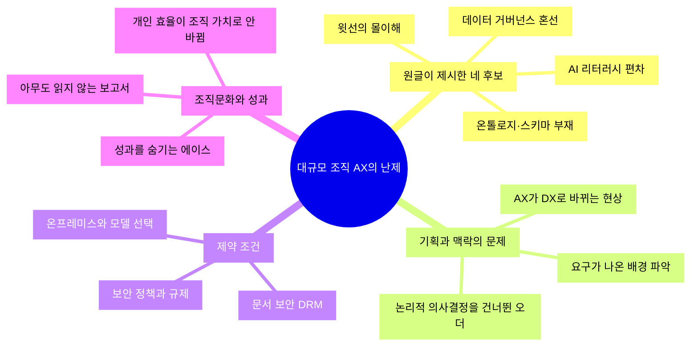
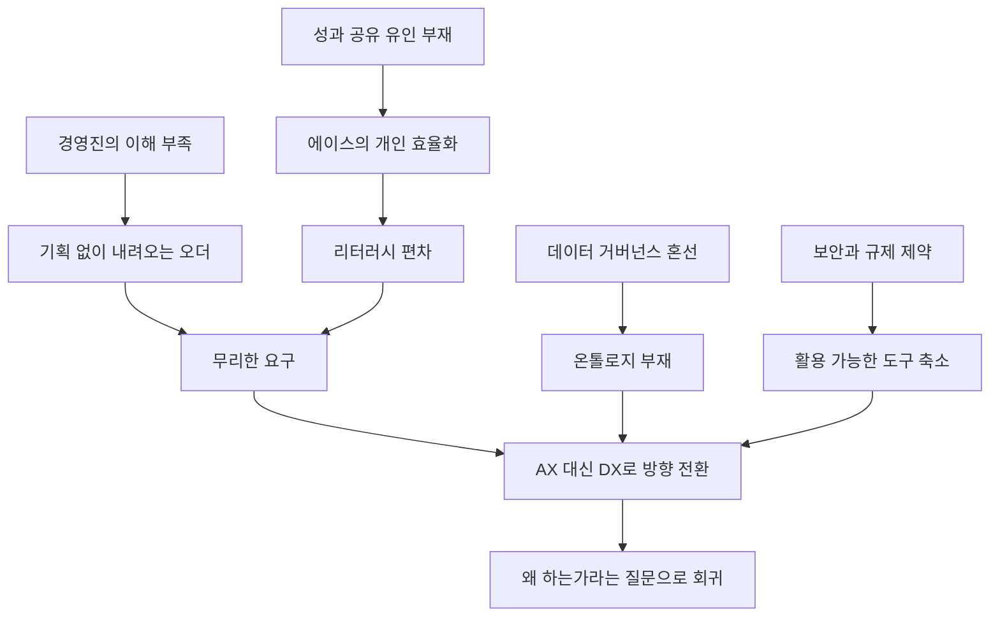
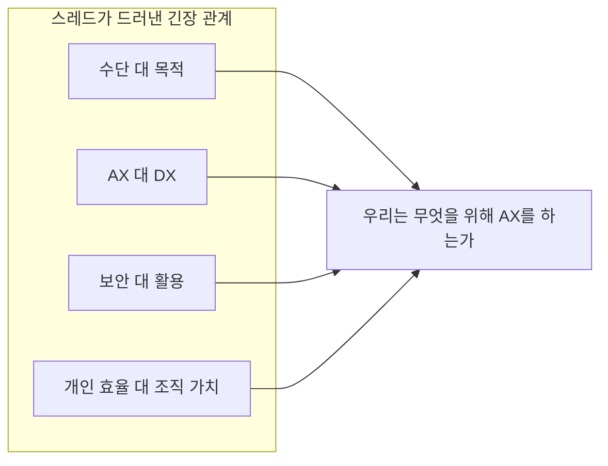

- 작성 기준일: 2026-10-22
- 대상: Threads "AI Threads" 커뮤니티에서 진행된 토론 스레드 (원글 작성자 [`nullfinding`](https://www.threads.com/share/_rT9mg6e4/))

---

## 0. 먼저 읽어 두면 좋은 안내

이 문서는 공유해 주신 스레드의 원글과 댓글 내용을 바탕으로, 각 발언이 어떤 맥락에서 나왔고 무엇을 뜻하는지를 풀어 설명한 해설서입니다. 여기에 2026년에 공개된 국내외 조사·보도·발표 자료를 검색해 덧붙여, 스레드에서 나온 이야기가 실제 데이터와 얼마나 맞닿아 있는지도 함께 살폈습니다.

몇 가지 한계를 미리 밝혀 둡니다.

- 스레드 링크는 자동 접근이 허용되지 않아 도구로 직접 열어 보지 못했습니다. 그래서 이 문서의 스레드 내용은 공유해 주신 화면 속 글과 댓글에 한정됩니다. 화면에 보이지 않은 댓글(예: "답글 보기"로 접힌 하위 답글)은 다루지 못했습니다.
- 좋아요·댓글 수 같은 수치는 시간이 지나면 변하므로, 문서에서는 꼭 필요한 곳에서만 "확인된 시점 기준"으로 언급합니다.
- 통계 수치는 제가 원 보고서를 직접 열람한 것이 아니라 검색 결과에 인용된 2차 자료에서 가져온 경우가 많습니다. 그런 경우에는 출처를 밝히고 "~라고 인용된다", "~라고 보도되었다"처럼 표현했습니다. 또 일부 조사는 AI 솔루션을 파는 업체가 실시한 것이어서 해석에 주의가 필요하며, 이 역시 본문에서 표시했습니다.
- 스레드 작성자나 댓글 작성자의 소속, 직무, 실제 조직 사정은 글에 드러난 범위를 넘어 추측하지 않았습니다.

---

## 1. 한눈에 보는 요약

이 스레드는 한 문장으로 줄이면 이렇습니다.

> "규모가 큰 조직에서 AX(AI Transformation, AI 전환)를 추진할 때 무엇이 가장 어려운가?"

원글 작성자는 후보를 네 가지로 제시합니다. 데이터 거버넌스의 혼선, 온톨로지·스키마의 부재, 구성원 사이의 AI 리터러시 편차, 그리고 윗선(경영진)의 몰이해입니다. 이에 대해 스레드에는 40여 개의 댓글이 달렸고(첫 화면 기준 41개), 댓글들은 원글이 던진 네 가지 후보를 확인해 주는 동시에 다음과 같은 새로운 축을 보태 줍니다.

1. **요구의 맥락 파악과 기획의 문제** — AI를 마법상자처럼 보고 내려오는 무리한 요구를 어떻게 다룰 것인가.
2. **AX와 DX의 경계** — 일을 분해해 보면 결국 AX가 아니라 DX(디지털 전환)로 결론이 나는 경우가 많다는 관찰.
3. **보안과 규제의 족쇄** — 보안 정책, DRM(문서 보안), 금융 지침, 사내 노하우 보호 때문에 손발이 묶이는 현실.
4. **개인 효율과 조직 가치의 단절** — 잘 쓰는 사람이 성과를 숨기고 혼자만 효율을 올리는 문제.
5. **정말 필요한 일인지에 대한 질문** — 자동화하려고 보니 아무도 읽지 않는 보고서였다는 이야기까지.

원글 작성자는 댓글마다 직접 답을 달며 토론을 이끌었고, 마지막에는 "댓글들이 퍼즐 조각 같다"는 말로 이 모든 문제가 서로 얽혀 있음을 정리합니다. 이 문서는 그 퍼즐을 한 장의 그림으로 맞춰 보는 것을 목표로 합니다.

---

## 2. 토론의 전체 구조

먼저 스레드가 어떻게 흘러갔는지를 그림으로 보겠습니다. 가운데에 원글의 질문이 있고, 가지가 뻗어 나가듯 댓글들이 서로 다른 장벽을 짚습니다.

이 구조를 보면 원글의 네 후보는 "조직 안에서 흔히 말하는 원인"이고, 댓글들이 추가한 가지는 "실무에서 부딪히는 구체적인 벽"이라는 점이 드러납니다.

---

## 3. 원글 해설 — 질문 속에 이미 들어 있는 네 개의 가설

원글은 질문 형태이지만, 실은 작성자가 생각하는 네 가지 가설을 함께 내밀고 있습니다. 하나씩 풀어 보겠습니다.

### 3.1 데이터 거버넌스 혼선

데이터 거버넌스란 조직의 데이터를 누가 소유하고, 누가 접근할 수 있으며, 어떤 기준으로 품질을 관리하는지를 정한 규칙과 체계를 말합니다. AI를 붙이려면 먼저 "이 데이터에 AI를 붙여도 되는가"에 답할 수 있어야 합니다. 그런데 큰 조직에서는 부서마다 데이터를 다르게 부르고, 소유자가 불분명하며, 허용 범위도 제각각인 경우가 많습니다. 이 상태에서는 AI 프로젝트가 시작도 하기 전에 "누구에게 허락을 받아야 하는가"에서 멈춥니다.

### 3.2 온톨로지·스키마 부재

스키마는 데이터가 어떤 칸(컬럼)과 형식으로 저장되는지를 정한 구조이고, 온톨로지는 한 걸음 더 나아가 "업무 세계의 개념들이 무엇이며 서로 어떤 관계인지"를 명시한 의미 체계입니다. 예를 들어 영업팀의 "매출"과 재무팀의 "매출"이 서로 다른 뜻이면, 사람은 문맥으로 구분하지만 AI는 그러지 못합니다. 조직 차원에서 의미를 합의해 둔 체계가 없다면 AI는 그럴듯하지만 틀린 답을 내놓기 쉽습니다.

### 3.3 AI 리터러시 편차

리터러시는 읽고 쓰는 능력, 곧 AI를 이해하고 쓰는 역량의 격차를 뜻합니다. 어떤 사람은 업무에 깊이 통합해 쓰고, 어떤 사람은 거의 쓰지 않습니다. 편차가 크면 교육 설계도, 협업 방식도, 기대 수준도 하나로 맞추기 어렵습니다.

### 3.4 윗선의 몰이해

경영진이 AI의 한계와 가능성을 정확히 이해하지 못하면, 예산·우선순위·일정에 대한 판단이 어긋납니다. 원글이 "그런 거?"라고 말끝을 흐린 데서 알 수 있듯, 작성자는 이 후보를 가장 조심스럽게 꺼내고 있습니다.

---

## 4. 댓글별 상세 해설

### 4.1 `junseo15901590` — 요구의 배경, 그리고 "AX가 아닌 DX"

이 스레드에서 가장 길고 구조적인 댓글이며, 원글 작성자가 "생각이 많아지는 댓글"이라고 답한 글입니다. 크게 세 가지를 말합니다.

**첫째, 리터러시 차이에서 나오는 무리한 요구를 어떻게 다룰지가 어렵다.** 단순히 "기술적으로 안 됩니다"라고 거절하기보다, 그 요구가 왜 나왔는지, 왜 필요한지, 우리가 줄 수 있는 최대의 가치는 무엇인지를 고민하는 일이 기획에 가깝다는 것입니다. 요구를 "거절할 대상"이 아니라 "해석할 신호"로 본다는 점이 핵심입니다.

**둘째, 작업자 입장에서는 '현업의 기존 파이프라인을 없애고 자동화하자'는 생각에서 벗어나기 어렵다.** 여기서 파이프라인은 현업이 일하던 기존의 처리 흐름을 뜻합니다. 개발자나 AI 담당자는 기존 흐름을 통째로 AI로 갈아 끼우고 싶은 유혹을 느끼지만, 그 흐름에는 이유가 있다는 지적입니다.

**셋째, AI의 불확실성을 감수할 수 있는지, 정확성과 재현 가능성이 더 중요한지, 그 사이의 처리 과정을 어떻게 설명할지 고민하다 보면 오히려 AX가 아닌 DX로 방향이 바뀌기도 한다.** AI는 같은 입력에도 결과가 달라질 수 있고 근거를 설명하기 어려운 경우가 있습니다. 반면 정확성·재현성·설명 가능성이 필수인 업무라면, 결국 규칙 기반의 전통적인 시스템화(DX)가 더 적합하다는 결론에 이르게 됩니다.

이 댓글은 마지막에 실무 원칙을 제시합니다. "AI라는 마법상자에 넣으면 결과가 나온다"는 접근 대신, 기존 업무를 분해해서 각 처리가 필요했던 이유를 파악하고, 어떤 부분을 AI나 알고리즘으로 대체·보조했는지, 왜 그 방식을 택했는지를 설명하라는 것입니다.

원글 작성자의 답글은 이 지점을 이렇게 받습니다. AX 논의가 DX를 심는 듯하지만 실무에서는 AX에서 다시 DX로 방향을 틀기도 한다는 점이 인상적이라는 것, 그리고 기획이나 논리적 의사결정을 건너뛰고 내려온 오더의 문제도 보인다는 것입니다.

### 4.2 `midnightai.dev` — "임원이 지식 0"과 작성자의 농담

짧고 거친 한마디이지만 원글의 네 번째 후보(윗선의 몰이해)를 가장 직접적으로 확인해 주는 댓글입니다. 작성자는 처음에 이 글을 "임원 이자식"으로 잘못 읽었다고 농담한 뒤, 이제 그런 임원들은 "옷을 벗어야" 하는 것인지, 아니면 이 파고도 금방 지나가고 넘어갈 것인지를 묻습니다. 참고로 "옷을 벗다"는 한국어에서 직을 잃고 물러난다는 뜻의 관용 표현입니다. 이 질문은 "AI 시대에 AI를 모르는 경영진은 도태되는가, 아니면 이번 유행도 지나가는가"라는, 진지한 물음을 농담에 싸서 던진 것으로 읽힙니다.

### 4.3 `orryyyy_pic` — "보안 핑계로 손발이 묶임"

이 댓글은 보안 정책이 AX를 가로막는다는 현실을 말합니다. 원글 작성자는 보안을 무시할 수도 없고, 직원 개인의 에이전트에게 무작정 권한을 줄 수도 없다고 답하며 "현실판 AX는 어렵다"고 정리합니다. 이 답변의 핵심은 보안이 단순한 핑계가 아니라 정당한 제약이기도 하다는 인식입니다. 즉 보안은 "치워야 할 장애물"이 아니라 "함께 설계해야 할 조건"입니다.

### 4.4 `im_man46` — "IT팀 말고는 아무도 이해 못 할 고충"과 건축 비유

이 댓글에 대한 작성자의 답글은 건축에 비유한 대목이 인상적입니다. 꼭 건축과 딱 맞지는 않겠지만, 실시설계(실제로 시공할 수 있도록 세부를 확정한 설계) 없이 조감도(완성 모습을 그린 개념도)만 현장에 던져진 느낌이 든다는 것입니다. 그러면서 기획과 전략적 의사결정은 IT의 일이 아닌데, 그럼 누구의 몫이냐고 되묻습니다.

이 비유를 풀면 이렇습니다. 경영진은 "AI로 이렇게 바뀐 회사"라는 조감도를 내려보내지만, 그 사이를 메울 상세 설계(어떤 업무를, 어떤 데이터로, 어떤 권한으로, 어떤 품질 기준으로)는 비어 있고, 그 공백이 IT팀 몫으로 떨어진다는 이야기입니다. 이는 앞의 `junseo15901590`이 말한 "논리적 의사결정을 건너뛴 오더"와 정확히 같은 현상을 다른 말로 표현한 것입니다.

### 4.5 `mcjk_sh` — "몰이해, 백엔드 이해 부족"

짧은 댓글이지만, 작성자의 답글 "AX가 DX와 아키텍처를 삼켜버리는 느낌"이 중요합니다. AI가 화제가 되면서 지금까지 쌓아 온 디지털 전환(DX)의 기반과 시스템 아키텍처에 대한 논의가 묻힌다는 문제의식입니다. AI 에이전트가 제대로 일하려면 결국 백엔드 시스템, API, 데이터 구조 같은 기반이 필요한데, "AI를 붙이면 된다"는 인식이 이 기반의 중요성을 가린다는 뜻으로 읽힙니다.

### 4.6 `hongcha_log` — 가장 촘촘한 현실 목록

이 댓글은 현장에서 겪는 문제를 압축해서 나열합니다. 풀어 보면 다음 네 가지입니다.

1. **임원의 무관심과 무지** — AI를 만능 해결사로 보거나, 아예 믿지 않는 극단적인 성향.
2. **현업의 지원 없이는 불가능한 온톨로지** — 업무 의미 체계는 현업이 참여해야만 만들 수 있다.
3. **리터러시 편차** — 아예 쓰지 않는 사람과 잘 쓰는 사람의 양극화.
4. **조용한 에이스** — 잘 쓰면서도 성과는 숨기고 혼자 효율만 올리는 사람들.

작성자의 답글은 두 번째와 네 번째 이야기에 중요한 구분을 붙입니다. 개인의 효율이 조직의 밸류로 치환되지 않는 것은 프로세스나 시스템 문제이기도 하면서 조직문화와도 연결된 지점이라는 것입니다. 반면 무관심과 무지는 결이 다른 문제라고 덧붙입니다. 다시 말해 "에이스가 성과를 숨기는 것"을 에이스 개인의 태도 문제로만 돌리지 않고, 성과를 공유할 유인이 없는 조직 구조를 함께 봐야 한다는 시각입니다.

### 4.7 `tommylee4949` — "모든 로컬 파일이 DRM"

이 댓글은 매우 구체적인 기술적 장벽을 보여 줍니다. 모든 로컬 파일이 DRM(디지털 저작권·문서 보안 기술)으로 암호화되어 있어, 스크립트가 파일을 읽지 못하고, 그래서 워크플로 기반 자동화가 불가능하다는 것입니다. 문서 보안 솔루션이 파일을 열 때만 복호화해 주는 환경에서는 자동화 스크립트가 파일 내용을 읽을 수 없다는 이야기입니다.

작성자의 답글은 한 걸음 더 나아갑니다. 그러면 "우리는 AX를 안 합니다"라는 딱 떨어지는 결론을 낼 수 있겠느냐는 것입니다. 국가 기간산업 관련 기관들이 AX를 하겠다며 컨설팅을 요청하는 경우를 보면서, 정말 해야 하는지 궁금했다고 합니다. 이 질문은 도발적이지만 중요합니다. 제약이 너무 크다면 "하지 않는다"도 정당한 전략적 선택일 수 있는데, 현실에서는 그 결론을 내리기가 어렵다는 점을 짚은 것입니다.

### 4.8 `traceback.py` — "규격화된 클린데이터"

가장 짧은 댓글이지만, 문제의 한 축을 정확히 가리킵니다. AI가 쓸 만한 데이터는 형식이 통일되어 있고 오류가 정리된 데이터라는 뜻입니다. 원글의 첫 번째·두 번째 후보와 이어지는 이야기입니다.

### 4.9 `ezi.ax` — "자동화하려고 뜯어보니 아무도 안 읽는 보고서"

이 댓글은 토론에서 가장 반전이 있는 사례입니다. 이 작성자는 보고서를 자동화하려고 업무를 뜯어보다가, 아무도 읽지 않는 보고서라는 사실을 발견하고 자동화하는 대신 그 보고서를 없앴다고 합니다. 이는 `junseo15901590`이 말한 "업무를 분해해 각 처리가 필요했던 이유를 파악하라"는 원칙이 실제로 작동한 사례입니다. 원글 작성자는 이 댓글들을 "퍼즐 조각 같다"고 정리하고, 다만 "맞추기 대따 어려운 퍼즐"이라고 덧붙입니다.

### 4.10 `brian.jung3448` — 보안 핑계 논쟁의 반론과 모델 선택

이 댓글은 앞선 "보안 핑계" 이야기에 반론 겸 현실 진단을 내놓습니다. 금융은 정부 지침이 있고, 제조는 사내 노하우를 지켜야 하니, 프런티어 모델(최상위 상용 모델)이 온프레미스(자사 서버 내 설치)로 제공되지 않는 한 방법이 없다는 것입니다. 그러니 중국이나 미국의 오픈웨이트 모델(가중치가 공개된 모델)을 가져다 쓸 수밖에 없고, 이 경우 모델을 학습시키는 것이 아니라 RAG나 CAG를 붙여서 쓰는 것이라고 설명합니다.

여기서 RAG(Retrieval-Augmented Generation)는 질문과 관련된 문서를 먼저 검색해 모델에 건네주는 방식이고, CAG(Cache-Augmented Generation)는 필요한 지식을 미리 모델의 문맥(캐시)에 올려 두고 쓰는 방식입니다.

작성자의 답글은 세 겹으로 되어 있습니다.

- 개인이 프런티어 모델을 쓰다가 보안을 열고 들어오는 경우와, 전사 온프레미스 도입은 별개의 문제다.
- 전사 온프레미스는 당장 구현하기도 어렵지만, 조직이 그것을 원하는지도 모르겠다. "무엇을 위해서인가"라는 질문이 빠져 있다.
- 오픈웨이트 모델을 쓴다면 그것은 AX라기보다 KMS(지식관리시스템)의 확장선에서 자동화하는 느낌을 내는 정도일 수 있다. 그것을 정말 원하는 것일까?

이 답변은 기술 선택 이전의 목적 질문으로 토론을 되돌립니다. 이는 토론 전체를 관통하는 흐름과 같습니다. 문제는 "어떤 모델을 쓸까"가 아니라 "무엇을 위해 AX를 하는가"라는 것입니다.

---

## 5. 댓글에서 뽑아낸 여섯 가지 장벽과 그 관계

스레드의 발언을 종합하면 AX의 장벽은 크게 여섯 가지로 묶입니다.

| 번호 | 장벽 | 스레드에서 나온 표현 | 한 줄 설명 |
|---|---|---|---|
| 1 | 데이터 기반 | 거버넌스 혼선, 규격화된 클린데이터 | AI가 믿고 쓸 수 있는 데이터가 정리되어 있지 않다 |
| 2 | 의미 체계 | 온톨로지·스키마 부재 | 업무 용어와 관계에 대한 조직 차원의 합의가 없다 |
| 3 | 사람의 역량 | AI 리터러시 편차 | 쓰는 사람과 안 쓰는 사람의 간극이 크다 |
| 4 | 의사결정 | 임원의 몰이해, 기획을 건너뛴 오더 | 조감도만 있고 실시설계가 없다 |
| 5 | 제약 조건 | 보안 핑계, DRM, 온프레미스 | 정당한 보안과 규제가 자동화를 막는다 |
| 6 | 조직문화 | 성과를 숨기는 에이스, 개인 효율의 비전환 | 개인의 성과가 조직의 가치로 바뀌지 않는다 |

이 여섯 가지는 따로 존재하지 않고 서로를 악화시킵니다. 아래 그림은 스레드에서 읽히는 인과 관계를 단순화한 것입니다. 화살표는 "~가 ~를 악화시킨다" 정도로 이해하시면 됩니다.

그림에서 모든 가지가 결국 "AX 대신 DX로 방향 전환" 또는 "왜 하는가라는 질문"으로 모이는 것은, 스레드의 토론이 실제로 그렇게 흘렀기 때문입니다.

---

## 6. 최신 자료로 확인해 본 스레드의 주장

스레드의 이야기가 개인의 체감에 그치는지, 아니면 조사 결과와도 맞는지를 확인하기 위해 2026년에 공개된 자료를 찾아보았습니다. 아래는 확인된 내용입니다.

### 6.1 데이터 준비 상태

- 2026년 3월 Cloudera와 Harvard Business Review Analytic Services가 기업 IT 리더 1,574명을 조사한 결과, 자사 데이터가 AI 도입에 완전히 준비되었다고 답한 곳은 7%에 그쳤다고 인용됩니다. (stobox 블로그 인용)
- 같은 글은 2026년 6월 IDC 조사에서 IT 리더의 94%가 데이터 품질을 AI 프로젝트 성패의 핵심 요인으로 꼽았다고도 전합니다. (2차 인용)
- Grant Thornton의 2026 AI Impact Survey에서는 CIO·CTO의 55%가 핵심 애플리케이션의 절반 미만만 AI에 대응할 준비가 되어 있다고 답했습니다.
- Deloitte의 "State of AI in the Enterprise 2026"은 기술 인프라 준비도 43%, 데이터 관리 40%, 거버넌스 30%, 인재 20%로 제시한다고 2차 자료(Modern Data 101의 통계 모음)가 전합니다.

이 수치들은 스레드의 `traceback.py`("규격화된 클린데이터")와 원글의 "데이터 거버넌스 혼선"이 개인의 체감이 아니라 광범위하게 보고되는 현상임을 보여 줍니다. 다만 위 수치들은 조사 대상, 문항 정의, 시점이 서로 달라 직접 비교할 수는 없습니다.

국내에서도 같은 이야기가 나옵니다. 2026년 8월 ZDNet Korea는 나노소재 기업들의 데이터가 장비·과제 등 부서별로 흩어져 있고 표준화된 기준이 없어 AI 학습에 쓰기 어려웠다고 전했고, 한국나노융합산업협회가 산업AI 솔루션 실증·확산 지원사업의 주관기관으로 이 문제 해결에 나선다고 보도했습니다. 전자신문의 제조 AX 좌담회 연재(2025년 12월)에서는 제조 분야에 데이터 거버넌스 체계가 국가 차원에서 아직 없다는 발언과, 보안·안전 규제가 AI 적용을 어렵게 하므로 데이터 중요도에 따라 유연한 거버넌스와 규제 특례가 필요하다는 의견이 나왔습니다. 이는 스레드의 "보안 핑계로 손발이 묶임"이라는 하소연과 같은 맥락입니다.

### 6.2 의미 체계(온톨로지·시맨틱 레이어)

스레드에서 "온톨로지·스키마 부재"는 다소 전문적인 용어로 던져졌는데, 2026년에 이 주제는 주요 데이터·클라우드 업체들의 공통 화두가 되었습니다.

- 2026년 4월 Databricks가 Unity Catalog Business Semantics를 정식 출시(GA)해, 지표 정의를 BI 도구가 아닌 데이터 계층 자체로 옮겼다고 보도되었습니다.
- Microsoft는 Fabric IQ의 온톨로지를 공개 MCP 엔드포인트로 접근할 수 있게 하겠다고 발표했다고 전해집니다.
- Neo4j의 CEO 에밀 아이프렘은 2026년 AI Engineer World's Fair 발표에서, 비즈니스 온톨로지와 기술 온톨로지, 에이전트 실행 기록을 묶은 공유 시맨틱 기반 위에 "얇은 에이전트"를 올리는 구조를 제안했습니다.
- 2026년 5월 Gartner가 "시맨틱의 부재가 부정확한 AI 에이전트를 낳는다"는 취지로 언급했다고 2차 자료(datahubanalytics)가 인용합니다.
- eccenca는 2026년 7월 30일 보도자료에서, Gartner 보고서가 엔터프라이즈 지식 그래프를 에이전트를 위한 시맨틱 컨텍스트 계층으로 다루었다고 밝혔습니다. (업체 보도자료이므로 홍보 목적이 섞여 있습니다.)

여기서 주의할 점이 있습니다. 위 소식 대부분은 온톨로지·시맨틱 레이어 제품을 파는 업체의 발표입니다. 그러니 "온톨로지가 필요하다"는 방향성은 여러 곳에서 확인되지만, "특정 제품이 해결해 준다"는 주장까지 곧이곧대로 받아들일 근거는 아닙니다. 스레드의 `hongcha_log`가 말한 "현업의 지원 없이 절대 불가능한 온톨로지"라는 지적은, 이런 제품이 있더라도 업무 의미를 정의하는 일은 결국 사람이 해야 한다는 점을 상기시킵니다.

### 6.3 리터러시 편차

2026년 기업 AX 교육 트렌드를 조사한 팀스파르타의 리포트(DIGITAL iNSIGHT 보도, 교육 사업자가 낸 자료라는 점을 감안해야 합니다)에 따르면 다음과 같습니다.

- AI 교육 이후 현업 적용에 한계를 느낀 비율이 53.0%였습니다.
- 그 원인으로 임직원 간 AI 활용 수준 편차(54.8%)와 직무·산업별 맞춤형 커리큘럼 부재(50.9%)가 꼽혔고, 예산·시간 부족은 21.8%에 그쳤습니다.

원글이 지목한 "AI 리터러시 편차"가 실제로 가장 많이 꼽히는 원인 중 하나임을 보여 주는 결과입니다. 또한 병목이 돈이 아니라 실행 설계에 있다는 해석은, 스레드의 "기획을 건너뛴 오더" 이야기와도 닿아 있습니다.

### 6.4 보안·거버넌스와 에이전트 권한

원글 작성자가 말한 "직원 개인 에이전트에게 마냥 권한을 줄 수 없다"는 우려에 대응하는 조사도 있습니다.

- AI 기업 WRITER의 2026년 설문(경영진·직원 2,400명 대상)에서, 경영진의 67%가 승인되지 않은 AI 도구 때문에 이미 데이터 유출이나 보안 사고가 있었다고 믿고, 직원의 35%가 공개 AI 도구에 사내 정보를 입력한 적이 있으며, 36%는 AI 에이전트를 감독할 공식 계획이 없다고 답했다고 합니다. (AI 업체 설문이라는 점에 유의)
- Grant Thornton 조사에서는 경영진의 78%가 90일 안에 독립적인 AI 거버넌스 감사를 통과할 자신이 강하지 않다고 답했고, 에이전트 AI에 데이터와 업무 프로세스 접근을 허용 중인 조직은 약 4분의 3에 달하지만 AI 사고 대응 계획을 검증해 둔 곳은 20%뿐이었습니다.
- SailPoint 연구는 AI 에이전트를 쓰는 조직의 80% 이상이 의도치 않은 에이전트 행동을 경험했고, 공식 거버넌스 프레임워크를 갖춘 곳은 44%라고 전합니다. 에이전트의 행동은 하나의 아이덴티티(계정·권한 주체)가 수행하는 일이므로 사람·머신 계정과 같은 수준의 거버넌스가 필요하다는 것이 이 자료의 논지입니다.

한편 `brian.jung3448`이 제기한 "프런티어 모델의 온프레미스 제공 문제"에 대해서는, 제가 찾은 범위에서 이를 직접 검증해 주는 신뢰할 만한 최신 자료를 확인하지 못했습니다. 이 부분은 해당 댓글의 주장과 작성자의 반응으로만 소개하며, 사실 여부를 단정하지 않습니다.

### 6.5 "AX가 DX로 돌아간다"는 관찰

`junseo15901590`이 말한 "기존 업무를 분해해서 이유를 파악하라"는 원칙과 가까운 이야기를 하는 자료가 몇 개 있습니다.

- Deloitte의 Tech Trends 2026을 요약한 글(GeekNews, 여러 자료를 취합한 2차 요약)은 에이전트 도입이 실패하는 원인이 기존 프로세스를 단순히 자동화하는 데 있다고 정리합니다.
- 한 기사에 소개된 웨스터먼 박사(기사 표기)는 현재의 AX 노력이 과업 단위로 사람을 대체하거나 보완하는 데 집중되어 있으며, 정작 필요한 것은 AI 우선 관점에서 프로세스를 재설계하는 일이라고 말했습니다.
- 삼성SDS의 한 그룹장이 엔터프라이즈 AI 프로젝트의 95%가 실패한다고 진단하며 원인으로 운영 고려 없는 도입, 기업 맥락이 빠진 에이전트, 경영진·현업·엔지니어링을 아우르는 통합 조직의 부재를 꼽았다는 내용이 블로그(ucanlabs)에 인용되어 있습니다. 같은 블로그가 인용한 MIT 보고서의 "생성형 AI 파일럿의 약 95%가 측정 가능한 성과를 내지 못했다"는 수치는 여러 2차 자료에서 반복해서 인용되는 유명한 숫자이지만, 수치의 정의와 범위에 대한 논쟁이 있을 수 있으므로 "그렇게 보고되었다" 수준으로만 받아들이는 편이 안전합니다.

두 발언의 결은 약간 다릅니다. `junseo15901590`은 "기존 업무를 분해해 이유를 이해하라"고 하고, 웨스터먼 박사는 "AI 우선으로 프로세스를 다시 설계하라"고 합니다. 겉으로는 반대 방향 같지만, 둘 다 "기존 업무를 그대로 AI로 바꿔 끼우는 것"을 경계한다는 점에서는 일치합니다. 분해해서 이유를 아는 것이 재설계의 전제가 된다고 읽을 수도 있으나, 이는 제 해석이며 두 사람이 그렇게 주장한 것은 아닙니다.

### 6.6 "성과를 숨기는 에이스"와 조직 운영

`hongcha_log`가 말한 에이스 문제에 정확히 대응하는 조사는 찾지 못했습니다. 다만 한 국내 기업 블로그(강남언니 운영사 힐링페이퍼의 AX 경험담, 2026년 5월 7일)는 비슷한 맥락의 실무 경험을 기록합니다.

- 경영진이 "AI는 비용이 아니라 투자"라고 공식 인정하고, 직군을 가리지 않고 AI 도구 비용을 회사가 지원하며, 안전성과 비용을 모니터링하는 최소한의 플랫폼과 책임자를 두는 것을 첫 단계로 삼았다고 합니다.
- 이후 단계에서는 직원들이 admin 권한, API 키, 웹서비스 호스팅을 요청하고 AI 비용이 불어나는 일이 생기므로, 이를 통제하는 "가두리(하네스)" 단계가 필요하다고 서술합니다. 이는 원글 작성자의 "직원 개인 에이전트에 마냥 권한을 줄 수 없다"는 말과 같은 문제의식입니다.
- 한 사람의 전문가가 전사를 가르치는 모델은 곧 작동하지 않으므로 준전문가를 양성해야 한다고도 주장합니다.

이 글은 한 회사의 경험담이라 일반화할 수는 없지만, 스레드의 논점이 실제 운영 현장에서 단계별로 나타난다는 사례로 읽을 수 있습니다.

---

## 7. 스레드가 드러내는 네 가지 긴장 관계

토론을 더 깊이 읽으면, 단순한 "원인 목록"이 아니라 서로 부딪히는 가치 사이의 긴장이 보입니다.

**첫째, AX와 DX의 긴장.** AI를 도입하자는 구호가 오히려 디지털 전환의 기반(백엔드, 아키텍처, 표준화)을 소홀히 하게 만들거나(`mcjk_sh`), 분석 끝에 DX가 더 적합하다는 결론에 이르게 합니다(`junseo15901590`). AX를 "AI를 쓰는 것"으로 정의하면 이 결론은 실패처럼 보이지만, "업무를 더 잘 바꾸는 것"으로 정의하면 성공일 수 있습니다.

**둘째, 보안과 활용의 긴장.** 보안을 이유로 아무것도 못 한다는 불만(`orryyyy_pic`, `tommylee4949`)과, 보안을 무시할 수는 없다는 현실(원글 작성자)이 맞섭니다. 위 6.4의 조사들이 보여 주듯 통제되지 않은 도입이 실제 위험을 낳는다는 보고도 있으므로, 이 긴장은 한쪽이 옳아서 해소되기보다 위험 수준별로 차등화된 설계로 풀어야 하는 문제로 보입니다. (이는 etnews 좌담회에서 나온 "데이터 중요도에 따른 유연한 거버넌스" 제안과도 방향이 같습니다.)

**셋째, 개인과 조직의 긴장.** 개인 차원에서는 AI로 효율을 올리지만 그 성과가 조직에 공유되지 않는 문제(`hongcha_log`)입니다. 원글 작성자는 이를 개인의 태도가 아니라 시스템과 문화의 문제로 보았습니다.

**넷째, 수단과 목적의 긴장.** 가장 근본적인 긴장입니다. `ezi.ax`는 자동화하려다 보고서를 없앴고, `tommylee4949`와 작성자는 AX를 안 한다는 결론도 가능한지 묻고, `brian.jung3448`과 작성자는 온프레미스 오픈웨이트 모델이 "무엇을 위해서인지"를 묻습니다. 세 경우 모두 AX 자체가 목적이 되어 버린 상황을 향한 의문입니다.

---

## 8. 실무에 주는 시사점

아래는 스레드와 위 자료에서 직접 확인되는 내용을 바탕으로 정리한 것입니다. 일부는 제 해석이 들어가 있으며, 그런 부분은 그렇게 표시했습니다.

1. **요구를 거절하기 전에 배경을 묻는다.** (`junseo15901590`) 무리한 요구도 그 뒤에는 해결하려는 문제가 있습니다. 요구의 배경, 필요성, 우리가 줄 수 있는 최대 가치를 먼저 정리하는 단계가 기획에 해당합니다.
2. **업무를 분해해서 이유를 파악한다.** (`junseo15901590`, `ezi.ax`) 처리 단계마다 필요했던 이유를 확인하고, AI로 대체할지, 보조할지, 알고리즘으로 처리할지, 아예 없앨지를 구분합니다. 선택의 이유를 설명할 수 있어야 한다는 점이 중요합니다.
3. **정확성과 재현성이 필요한 업무는 별도로 판단한다.** AI의 불확실성을 감수할 수 있는 업무와 그렇지 않은 업무를 구분하고, 후자는 전통적 시스템화가 맞을 수 있습니다.
4. **조감도와 실시설계 사이를 메우는 주체를 정한다.** (`im_man46`에 대한 답글) 기획과 전략적 의사결정을 누가 맡을지 정하지 않으면 그 공백이 IT팀에 떨어집니다. 힐링페이퍼 사례처럼 경영진의 공식 선언, 비용 지원, 책임자 지정을 초기 단계에 두는 방식이 하나의 참고가 됩니다.
5. **보안은 장애물이 아니라 설계 조건으로 다룬다.** 에이전트 권한은 최소 권한 원칙, 정기 권한 검토, 데이터 분류에 따른 차등 보안 같은 방식으로 관리하자는 실무 가이드가 나와 있습니다(Alchera 블로그, 2026년 4월 29일).
6. **성과 공유의 유인을 설계한다.** 에이스가 성과를 숨기는 것이 문화의 문제라면, 공유가 손해가 되지 않는 구조가 필요합니다. 이는 스레드의 논의에서 도출되는 방향이며, 구체적인 방법은 조직마다 다를 것입니다.
7. **"하지 않는다"도 선택지로 둔다.** (`tommylee4949`에 대한 답글) 제약이 크고 얻을 가치가 불분명하다면, AX를 하지 않거나 범위를 좁히는 결론도 정당한 전략입니다.

---

## 9. 용어 해설

| 용어 | 뜻 |
|---|---|
| AX | AI Transformation. 조직의 업무·의사결정·서비스를 AI 중심으로 바꾸려는 시도 |
| DX | Digital Transformation. 업무를 디지털 시스템과 데이터 기반으로 바꾸는 전환 |
| 데이터 거버넌스 | 데이터의 소유, 접근 권한, 품질, 사용 허용 범위를 정한 규칙과 책임 체계 |
| 스키마 | 데이터가 저장되는 구조(테이블, 컬럼, 형식)에 대한 정의 |
| 온톨로지 | 업무 세계의 개념과 그 관계, 규칙을 명시적으로 정리한 의미 체계 |
| 시맨틱 레이어 | 원시 데이터와 사용자·AI 사이에서 "이 용어가 무엇을 뜻하는지"를 번역해 주는 계층 |
| AI 리터러시 | AI를 이해하고 업무에 활용하는 역량 |
| DRM | Digital Rights Management. 여기서는 사내 문서 암호화·접근 통제 솔루션을 가리킴 |
| 온프레미스 | 외부 클라우드가 아니라 조직 자체 서버 환경에 설치해 운영하는 방식 |
| 프런티어 모델 | 성능이 가장 앞선 최상위 상용 AI 모델 |
| 오픈웨이트 모델 | 학습된 가중치가 공개되어 자체 환경에 내려받아 쓸 수 있는 모델 |
| RAG | 질문과 관련된 문서를 검색해 모델에 건네주고 답을 생성하게 하는 방식 |
| CAG | 필요한 지식을 미리 모델의 문맥(캐시)에 올려 두고 답을 생성하는 방식 |
| KMS | Knowledge Management System. 지식관리시스템 |
| 실시설계 | 건축에서 실제 시공이 가능하도록 세부까지 확정한 설계. 스레드에서는 "상세 실행 설계"의 비유로 쓰임 |
| 조감도 | 완성된 모습을 위에서 내려다본 것처럼 그린 개념도. 스레드에서는 "구호와 비전만 있는 상태"의 비유 |

---

## 10. 맺음말

이 스레드가 흥미로운 이유는 "무엇이 가장 힘든가"라는 질문에 단일한 정답이 나오지 않고, 오히려 "문제들이 서로 얽혀 있다"는 합의에 이른다는 점입니다. 원글 작성자는 마지막에 댓글들을 퍼즐 조각에 비유했습니다. 데이터, 의미 체계, 사람, 의사결정, 보안, 문화가 각각 한 조각이고, 이를 맞춰 가며 "무엇을 위해 하는가"라는 그림을 완성해야 한다는 이야기로 읽힙니다.

2026년의 조사와 보도를 보면 데이터 준비 부족, 거버넌스 미비, 역량 편차, 실행 설계 부재가 여러 곳에서 반복해서 지적됩니다. 스레드의 체감이 개인적인 푸념이 아니라 폭넓게 관찰되는 현상과 겹친다는 점은 확인되었습니다. 다만 개별 수치는 조사마다 정의와 대상이 달라 직접 비교하기 어렵고, 일부는 업체가 발표한 자료이므로 방향성을 읽는 용도로 쓰시길 권합니다.

---

## 출처

- [AX의 어려움은 전직원이 AI를 쓰고난 이후부터 진짜 시작된다 (힐링페이퍼 블로그, 2026-05-07)](https://blog.gangnamunni.com/post/ax-voyage-2026)
- [정부 AX 드라이브…산업계, AI 데이터 확보전 (ZDNet Korea, 2026-08)](https://zdnet.co.kr/view/?no=20260816133600)
- [체계적 AI 실행은 겨우 3.6%… 팀스파르타, 2026년 기업 AX 교육 트렌드 리포트 발간 (DIGITAL iNSIGHT)](https://ditoday.com/%EC%B2%B4%EA%B3%84%EC%A0%81-ai-%EC%8B%A4%ED%96%89%EC%9D%80-%EA%B2%A8%EC%9A%B0-3-6-%ED%8C%80%EC%8A%A4%ED%8C%8C%EB%A5%B4%ED%83%80-2026%EB%85%84-%EA%B8%B0%EC%97%85-ax-%EA%B5%90/)
- ["우리도 AI 했는데 왜 안 바뀔까" — 2026년, AX 성공과 실패를 가른 단 하나의 차이 (ucanlabs)](https://ucanlabs.kr/blog/ucanlabs-e2e-ax-episode0/)
- [[제조 AX(M.AX), 골든타임을 잡아라]〈끝〉(전자신문, 2025-12-21)](https://www.etnews.com/20251221000003)
- [정부, 데이터표준 정립해야 AX 성공기업 많아진다 (네이트 뉴스, 2026-07-22)](https://m.news.nate.com/view/20260722n28274)
- [기업 AI 에이전트 "데이터 보안", 도입 단계부터 고려해야 할 포인트 (Alchera, 2026-04-29)](https://www.alchera.ai/resource/blog/ac-enterprise-ai-agent-data-security)
- [AI 에이전트의 이해, 보안 및 거버넌스 (SailPoint)](https://www.sailpoint.com/ko/identity-library/securing-ai-agents-enterprise)
- [Enterprise AI adoption in 2026: Why 79% face challenges despite high investment (WRITER)](https://writer.com/blog/enterprise-ai-adoption-2026/)
- [The Data Readiness Gap: Why Enterprise AI Stalls in 2026 (stobox)](https://www.stobox.io/blog/business-intelligence-data-readiness-gap-enterprise-ai-2026)
- [2026 AI Impact Survey Report (Grant Thornton)](https://www.grantthornton.com/services/advisory-services/artificial-intelligence/2026-ai-impact-survey)
- [Top 50 AI Adoption Stats for 2026 (Modern Data 101)](https://www.moderndata101.com/blogs/ai-maturity-statistics-and-benchmarks)
- [Every Vendor Is Automating the Semantic Layer for AI Agents (timbr.ai)](https://timbr.ai/every-vendor-is-automating-the-semantic-layer-for-ai-agents-heres-what-theyre-missing/)
- [Thinner Agents on a Smarter Substrate: The Ontology-based Semantic Layer (AI Engineer World's Fair 2026)](https://ai.engineer/talks/thinner-agents-on-a-smarter-substrate-the-ontology-based-semantic-layer)
- [Enterprise Ontologies Are Becoming the Context Layer for Trusted AI and Analytics (Datahub Analytics)](https://datahubanalytics.com/enterprise-ontologies-are-becoming-the-context-layer-for-trusted-ai-and-analyticsenterprise-ontologies-are-becoming-the-context-layer-for-trusted-ai-and-analyticszero-trust-data-governance-is-becoming/)
- [eccenca Corporate Memory mentioned in Gartner research report (eccenca, 2026-07-30)](https://eccenca.com/article/eccenca-corporate-memory-mentioned-in-gartnerr-research-report-on-future-of-data-engineering)
- [가트너, 딜로이트, a16z 등 35개 자료로 취합한 2026년 전망 (GeekNews)](https://news.hada.io/topic?id=25465)

---

*작성 일자: 2026-10-22*
