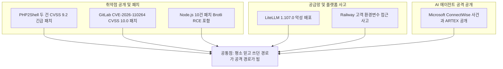
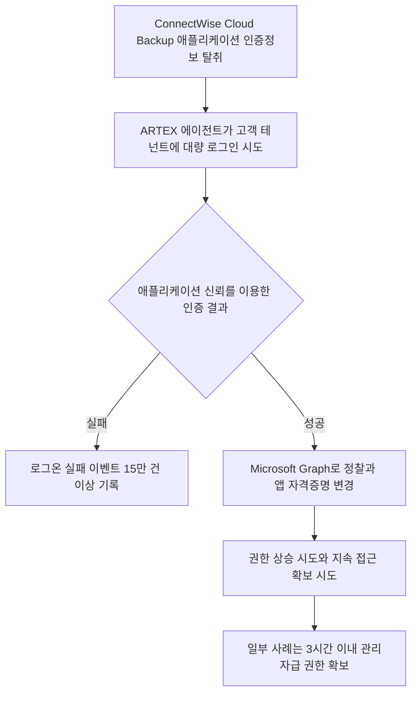
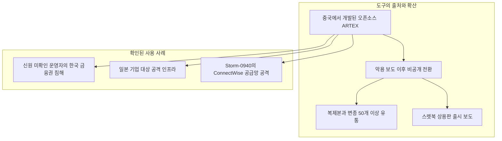
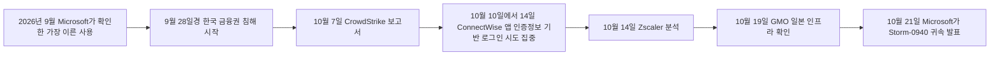
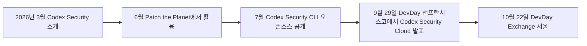

- 작성 일자: 2026-10-23
- 조사 기준: 2026-10-23 오전(KST)까지 공개된 자료
- 대상 자료: (1) Threads 계정 choi.openai의 15개 연재 중 첫 번째 게시물, (2) 10월 22일 서울 행사 참석 후 작성된 개인 글(보안 경고 포함)

>
> 
> 
> 어제 OpenAI DevDay는 어딜가서 DevDay라는 타이틀로 이런식 행사는 아닌거 같다. 그냥 마케팅 행사지 DevDay 행사라고 하기에는 많은 아쉬움이 남았다. 
> 
> 그래서 OpenAI는 애플같이 마케팅 회사라고 하는 이유다. 왜 이런 생각을 하는가 하면 새벽 기차를 타고 서울로 향한 이유는 보안관련 발표가 있을 것으로 예상해서 기대를 하고 참석을 했는데...
> 
> ARTEX 급은 아니더라도 뭔가 에이전틱한 자체 보안 솔루션을 소개하는 자리가 아니라 내부에서 사용하는 오픈소스 codex-security 를 이용해서 스캐닝의 결과르 보여주는데...  많은 아쉬움이 남았다.
> 
> Claude에 비해 Codex, Codex-Security 빼곤 나머진 완벽하다. Astra도 굉장한 모델이다. OpenAI 안좋다는게 아니라 Claude 처럼 선택과 집중이 아닌 다양한 도메인의 서비스들을 모두 범용적으로 통합을 하려고 하다보니 깊이와 넓이의 차이고 혼자만의 아쉬움이니 OpenAI 까는게 아님. 내가 기대를 너무 많이 했던 것이 패착.
> 
> 아무튼, 또 다시 이야기 하지만, PHP 사태는 시작에 불과 하다. 여전히 전세계 ATM기 Window XP에서 돌아가는 장비들이 꽤나 있다. 특히 동남아 같은 경우 여전히 보안 업데이트 없이 그냥 사용하는것들이 많다. 
> 
> 어디 그뿐이겠는가? 개인적으로 Y2K 보다 더 심각한 상황이라고 생각하고 보안 관련 기업 대표님들께도 상황을 체크해봐도 다들 역으로 나에게 물어본다.
> 
> 혼자 또 이렇게 떠들어 봤자, 혼자 서울역앞에서 '불신지옥' 외치는 웬 미친 놈 이라는 소릴 또 듣겠지만 지금 다들 만드는것에만 열광하지만 지금은 기존의 만든 것을 지켜 내야 하는 일이 더 시급한데 정부의 예산을 들여다 보면 보안 관련 예산 편성이 되어 있을까나??? 소잃고 외양간 고친다고 추경을 또 하겠지? 대국민 개인 정보가 전세계 공공 정보가 되었는데도 여전히 주민번호 인증은 바뀌지 않는다.
> 
> 그리고, 개인적으로 가장 위험한 곳이 Cafe24 라고 생각한다.
> 
> Cafe24 털리면 ... 상상만 해도... --; 
> 
> 시간 될 때 AI 보안 스캐너 하나 만들어 봐야겠다. 
> 
> 조만간 AI 발 보안 사고 아주 크게 조오올라 크게 터질 것 같다. 
> 
> 계속 잦은 전조 현상을 보니 AI 거품이 아니라 AI보안 사고 분명히 터진다.
> 
> https://www.facebook.com/share/1Dxx22byDe/
> 

---

## 0. 이 문서를 읽는 방법

이 문서는 두 개의 글을 하나로 묶어 설명합니다. 첫 번째는 Threads에 올라온 짧은 경보성 게시물로, 10월 21일 하루 동안 여러 보안 사건이 겹쳤고 그 중심에 AI 에이전트 기반 침투 도구 ARTEX가 있다는 내용입니다. 두 번째는 서울에서 열린 OpenAI 행사에 다녀온 사람이 쓴 글로, 행사에 대한 아쉬움과 함께 "지켜내는 일이 더 시급하다"는 보안 경고를 담고 있습니다. 두 글은 서로 다른 글이지만 "AI 시대에 보안은 누가 어떻게 책임지는가"라는 같은 질문으로 이어집니다.

글에 들어 있는 내용은 세 종류로 나뉩니다. 첫째는 검색으로 확인 가능한 **사실**, 둘째는 글쓴이의 **평가와 예측**, 셋째는 이번 조사에서 **확인하지 못한 것**입니다. 이 문서는 이 세 가지를 섞지 않으려고 항목마다 구분해 적었습니다. 출처에는 등급을 붙였습니다. 1차는 벤더나 프로젝트가 직접 낸 공식 문서, 2차는 전문 매체와 보안 업체 분석, 3차는 블로그·위키·재가공 글입니다. 3차 출처만 있는 내용은 문장에 그렇게 표시했습니다.

---

## 1. 한눈에 보기

10월 21일은 보안 담당자에게 유난히 길었던 하루였습니다. PHP는 서버를 원격으로 장악할 수 있는 치명적 취약점 두 건에 대한 긴급 패치를 냈고, GitLab은 만점(CVSS 10.0) 취약점의 패치를 냈으며, Node.js는 열 개의 취약점을 한꺼번에 고쳤습니다. 같은 날 LiteLLM은 배포 파이프라인이 탈취돼 악성 버전이 퍼졌고, 클라우드 개발 플랫폼 Railway는 고객 비밀값이 노출됐을 수 있다고 밝혔습니다. 그리고 Microsoft는 중국 국가 연계 그룹이 ARTEX라는 AI 침투 도구로 2,250개 넘는 Microsoft 365 테넌트에 로그인을 시도했다고 공개했습니다.

Threads 게시물의 핵심 주장은 대부분 사실로 확인됩니다. 다만 한 가지, 같은 날 CrowdStrike에서 해킹 사고나 취약점 발표가 있었다는 부분은 이번 검색으로 확인하지 못했습니다. 이 점은 3장에서 자세히 설명합니다.

서울 행사 후기 쪽에서는 먼저 짚어야 할 사실이 하나 있습니다. 어제(10월 22일) 서울에서 열린 행사의 공식 명칭은 "DevDay Exchange: Seoul"이며, 본행사 DevDay 2026은 9월 29일 샌프란시스코에서 이미 열렸습니다. 서울 행사는 본행사에서 발표한 내용을 각 지역 개발자 커뮤니티에 소개하는 순회 행사입니다. 이 구조를 알면 "새로운 보안 솔루션 발표를 기대했는데 기존 도구의 스캔 결과를 보여주는 데 그쳤다"는 아쉬움이 어디서 나왔는지 조금 더 선명해집니다. 5장에서 다룹니다.

---

## 2. 첫 번째 자료: Threads 게시물이 말하는 것

### 2.1 문장별로 풀어 읽기

게시물은 "도대체 무슨 일이 벌어지고 있는 거냐"는 감탄으로 시작해, 사람들이 지금 사이버 보안을 얼마나 간과하고 있는지 모른다고 말합니다. 이어서 10월 21일 하루 동안 Microsoft, CrowdStrike, PHP, GitLab, Node.js, Railway, LiteLLM에서 해킹 사고와 최고 등급 취약점 발표가 한꺼번에 나왔다고 적습니다.

핵심 문장은 그다음입니다. 중국 국가 배후의 해킹 조직이 AI 에이전트로 Microsoft 365 고객 2,250곳 이상에 분당 2,900번씩 로그인을 시도했고, 일부 기업은 3시간도 안 돼 관리자급 권한을 내줬다는 것입니다. 그리고 그 조직이 쓴 도구는 지난달 말 국내 금융사들을 뚫은 공격자가 쓴 것과 같은 ARTEX라고 설명하며 연재가 시작됩니다(1/15). 나머지 14개 게시물은 이번 조사에서 볼 수 없었습니다. 따라서 이 문서의 설명은 첫 게시물에 한정됩니다.

### 2.2 주장별 검증 결과

| 게시물의 주장 | 확인 결과 | 비고 |
|---|---|---|
| 10월 21일 Microsoft 관련 공개 | 확인됨 | Microsoft Threat Intelligence가 21일 Storm-0940과 ARTEX를 연결해 공개 |
| 2,250곳 이상, 분당 2,900번 | 확인됨 | Microsoft 수치. 단, "로그인 시도"이지 "침해 성공"이 아님 |
| 일부는 3시간 안에 관리자급 권한 | 확인됨 | 일부 공격이 최초 표적 선정에서 특권 접근까지 3시간 미만이었다고 보도 |
| 중국 국가 배후 | 부분 확인 | Microsoft는 "중국 국가 연계(state-aligned)"로 평가. 단정적 "배후"보다는 평가에 가까움 |
| 지난달 말 국내 금융사를 뚫은 것과 같은 도구 | 확인됨 | 같은 "도구"는 맞지만 같은 "공격자"라는 증거는 없음 |
| PHP 최고 등급 취약점 | 확인됨 | PHP2Shell, CVSS v4.0 9.2 |
| GitLab 최고 등급 취약점 | 확인됨 | CVE-2026-110264, CVSS 10.0 |
| Node.js 취약점 발표 | 확인됨 | 10건 패치, 최고 심각도는 High |
| Railway 사고 | 확인됨 | 고객 환경변수 접근 가능성 공개 |
| LiteLLM 사고 | 확인됨 | 1.107.0 악성 배포 |
| CrowdStrike 사고·취약점 | **확인 못함** | 21일자 침해 보도 없음. 관련 사실은 3.8절 |

---

## 3. 10월 21일의 사건들을 하나씩 보기

### 3.1 Microsoft, ConnectWise, 그리고 ARTEX

가장 먼저 사건의 구조를 이해해야 합니다. ConnectWise Cloud Backup(예전 이름은 SkyKick)은 관리형 서비스 제공업체(MSP)들이 고객사의 메일, 파일, Teams 데이터를 백업하는 데 쓰는 서비스입니다. 이 서비스는 고객의 Microsoft 365 환경에 접근하는 권한을 가진 "멀티테넌트 애플리케이션"으로 동작합니다. 공격자는 이 애플리케이션의 인증정보를 손에 넣었고, 그 신뢰를 이용해 고객 테넌트들에 들어가려 했습니다.

Microsoft에 따르면 이 활동은 Storm-0940이라는 중국 국가 연계 그룹의 소행이며, 이들이 ARTEX를 이용해 2,250개 이상의 테넌트에 분당 최대 2,900번의 로그인을 시도했습니다. 한 보도는 10월 10일부터 14일 사이 하나의 캠페인 구간에서만 15만 건이 넘는 로그온 실패 이벤트가 생성됐다고 전합니다. 시점 표기는 매체마다 조금 다릅니다. 어떤 매체는 침해 시점을 10월 15일로 적었고, 다른 매체는 10월 10~14일을 로그인 시도 집중 구간으로 적었습니다. 이 문서는 어느 쪽도 확정치로 쓰지 않습니다.

이 사건에서 가장 중요한 대목은 "사용자가 비밀번호를 입력하지 않았다"는 점입니다. 공격자는 사람의 계정이 아니라 애플리케이션 신원으로 인증했습니다. 그래서 사용자 계정에 걸어 둔 다중 인증(MFA)이 이 경로에서는 작동할 여지가 없었다는 분석이 나왔습니다. 앞선 비밀번호 대입 공격에서는 성공한 로그인이 관측되지 않았다고 Microsoft는 밝혔고, 이후 공격자가 탈취한 애플리케이션 신원으로 방향을 바꿨다고 합니다. 로그인에 성공한 뒤에는 Microsoft Graph를 통해 정찰하고, 애플리케이션 자격증명을 바꾸고, 권한을 올리려는 시도가 관측됐습니다. 원래 자격증명이 폐기돼도 접근을 유지하려는 시도였다고 해석됩니다. 한 탐지 항목은 애플리케이션이 스스로에게 전역 관리자(Global Administrator) 역할을 부여하는 경우까지 다룹니다.

숫자를 읽을 때는 주의가 필요합니다. 2,250개는 "접근을 시도한 테넌트 수"입니다. 앞서 나온 보도에서는 실제 무단 로그인이 확인된 테넌트가 173곳이라고 했고, 한 매체는 성공한 인증이 곧 데이터 탈취를 뜻하지는 않는다고 정리했습니다. 또 Microsoft는 자사 제품과 시스템이 침해되거나 취약했던 것은 아니라고 밝혔습니다. 즉 이번 사건은 Microsoft 제품의 결함이 아니라 서드파티 애플리케이션 신뢰 체인의 문제입니다.

### 3.2 PHP2Shell: PHP 엔진 자체의 치명적 결함

PHP2Shell은 PHP 코어에서 발견된 두 취약점 CVE-2026-109618과 CVE-2026-109619를 묶어 부르는 이름입니다. 두 건 모두 PHP 개발팀이 CVSS v4.0 9.2로 평가했고, 보안 업체 watchTowr는 10.0으로 평가했다고 합니다. 인증 없이 원격에서 서버의 코드를 실행할 수 있다는 점이 핵심입니다. 하나는 메모리가 부족한 상황(OOM)을 처리하다 요청 데이터가 반쯤 초기화된 채 남는 문제이고, 다른 하나는 이미 해제된 메모리를 가리키는 요청 상태가 다음 요청까지 남는 문제입니다. 이름이 말해 주듯 개별 홈페이지 코드를 아무리 안전하게 짰어도 PHP 환경이 취약하면 영향을 받을 수 있습니다.

타임라인도 중요합니다. PHP 팀은 10월 20일 긴급 보안 릴리스를 예고했고, 21일 14:00 UTC(한국 시간 23:00)에 패치를 배포했습니다. 그런데 예고 단계에서 상세 정보가 먼저 새어 나갔다는 보도가 있고, Amazon Threat Intelligence는 공개 4일 전인 10월 17일부터 악용 시도를 관측했다고 밝혔습니다. Cloudflare도 공개 전에 초기 악용 징후를 확인하고 임시 WAF 규칙을 배포했습니다. 여러 공개 PoC가 이미 나와 있다는 보고도 있습니다. 패치 버전은 8.5.12, 8.4.27, 8.3.36, 8.2.35이며, 미국 CISA도 즉시 패치를 촉구했습니다.

한국 쪽 반응도 빨랐습니다. 과기정통부와 KISA가 즉각 업데이트를 당부했고, 과기정통부는 10월 22일 정오를 기해 민간 분야 사이버위기 경보를 '관심'에서 '주의'로 올렸습니다. KISA는 지원 중인 8.2~8.5 버전을 최신으로 올리라고 안내하면서, 8.1 이하는 이미 공식 보안 지원이 끝났으니 지원되는 버전으로 업그레이드하라고 권고했습니다. 안랩이 인터넷 자산 조사 도구로 파악한 결과 취약한 PHP 버전이 올라간 국내 서버는 약 11만 건으로 세계에서 여섯 번째로 많은 규모였습니다. 카페24와 가비아 같은 주요 호스팅 업체들은 즉시 인프라 조치에 들어갔고, 카페24는 패치를 적용하고 고객에게 대응 요령을 안내했습니다. 카페24 관계자는 실제 피해 여부는 PHP 버전과 서버 설정에 따라 다르다고 설명했습니다.

한 가지 짚을 점은 영향 범위의 표기입니다. 위키백과 형식의 문서는 PHP 5.4~8.5가 영향권이라고 적고, KISA는 8.2~8.5와 지원 종료된 8.1 이하를 구분해 안내합니다. 어느 쪽이든 결론은 같습니다. 오래된 PHP를 쓰는 곳일수록 패치를 받을 수 없어 더 위험합니다.

### 3.3 GitLab: 12일 간격으로 나온 만점 취약점 두 건

GitLab은 10월 12일에 CVE-2026-97229(CVSS 10.0)를 패치했고, 21일에 다시 CVE-2026-110264(CVSS 10.0)를 패치했습니다. 둘 다 CI/CD 정규식 컴파일러의 정수 오버플로와 관련돼 있고, 둘 다 인증 없는 원격 코드 실행으로 이어질 수 있다고 설명됩니다. 21일 건은 자체 호스팅(self-managed) 버전 중 2014년 출시된 7.0까지 거슬러 올라가는 모든 릴리스가 영향권이라는 보도가 있습니다. 보도 중에는 10월 12일에 패치한 인스턴스도 다시 패치해야 한다고 강조한 것이 있습니다.

패치 버전은 19.5.1, 19.4.3, 19.3.6, 19.2.9, 19.1.9, 19.0.10, 18.11.13입니다. GitLab.com과 GitLab Dedicated는 이미 조치돼 있어 자체 호스팅 관리자만 대응하면 됩니다. 10월 22일 기준으로 실제 악용은 확인되지 않았고 CISA의 악용 확인 취약점(KEV) 목록에도 오르지 않았습니다. 다만 앞선 97229건은 공개 PoC가 나왔고, 그 PoC는 공개 프로젝트에 브랜치를 푸시할 수 있는 권한이 필요하며 git 계정 권한으로 실행된다고 설명됩니다. 21일 패치 묶음은 취약점 개수가 매체에 따라 11건 또는 12건으로 적혀 있습니다.

### 3.4 Node.js: 열 개를 한꺼번에

Node.js는 10월 21일 22.23.4, 24.22.1, 26.12.1을 내고 열 개의 취약점을 고쳤습니다. 네 건이 High이고, 그중 가장 심각한 것은 Node.js가 번들한 Brotli 압축 해제 라이브러리의 범위 밖 쓰기(CVE-2026-111497)입니다. 프로젝트는 이를 원격 코드 실행이 가능한 결함이라고 평가했습니다. 다만 과장하지 않을 필요가 있습니다. 10월 22일 공개된 PoC는 의도적으로 약화시킨 테스트 빌드에서만 코드 실행에 도달했고, 일반 빌드에서는 충돌과 제한적 메모리 읽기까지만 재현됐다고 합니다. 실제 악용 보고는 22일 기준 없었습니다. Vercel은 21일 이를 막는 방화벽 규칙을 추가했습니다. 지원이 끝난 20 이하 버전에는 수정이 제공되지 않습니다.

게시물이 "최고 등급"이라고 뭉뚱그렸지만, Node.js 쪽 최고 심각도는 Critical이 아니라 High였습니다. 사실관계를 엄밀히 하면 이 부분은 과장에 가깝습니다. 그래도 위험이 크다는 방향은 맞습니다.

### 3.5 LiteLLM: 배포 파이프라인이 털린 사고

LiteLLM은 여러 LLM API를 하나로 묶어 쓰게 해 주는 인기 파이썬 라이브러리이자 프록시입니다. 10월 21일 이른 아침, 이 프로젝트의 릴리스 파이프라인이 탈취돼 악성 버전 1.107.0이 PyPI와 Docker 레지스트리에 올라갔습니다. LiteLLM 자체 사고 보고에 따르면 Docker 태그 v1.107.0, latest, main-latest, main-stable이 11:46~14:20 UTC에 오염된 컨테이너 빌드를 가리켰고, PyPI의 악성 휠 일곱 개는 11:39 UTC경에 올라갔다가 13시대에 제거됐습니다. Wiz는 이 악성 버전이 약 4만 9천 번 다운로드됐다고 전합니다.

공격 경로는 흥미롭습니다. LiteLLM은 엔지니어 세 명의 GitHub 계정이 탈취된 정황이며, 훔친 GitHub CLI OAuth 토큰이 쓰인 것으로 보인다고 밝혔습니다. 공격자는 정상 저장소가 아니라 이름이 비슷한 공격자 통제 저장소에서 빌드를 돌렸습니다. 악성 코드는 파이썬이 시작될 때마다 .pth 파일을 통해 실행되는 방식이라, LiteLLM을 import하지 않아도 동작했다고 합니다. 목표는 클라우드 자격증명, 개발자 비밀값, 브라우저 데이터, AI 제공자 API 키였고, 추가 코드를 받아 실행하는 백도어 기능도 있었습니다. 같은 해 두 번째 LiteLLM 공급망 사고로 보도됩니다.

### 3.6 Railway: 고객 비밀값이 읽혔을 가능성

개발자 플랫폼 Railway는 10월 21일, 고객의 암호화된 환경변수가 담긴 시스템에서 이상 활동을 탐지했다고 공개했습니다. 외부인이 암호화된 환경변수에 접근했을 수 있고 일부는 복호화된 내용까지 얻었을 수 있다는 내용입니다. 초기 분석상 영향은 일부 사용자에 한정될 가능성이 있다고 했지만, 모든 사용자가 키를 교체하라고 권고했습니다. 플랫폼 전체 배포를 일시 중단했고, 10월 22일 04:17 UTC에는 모든 Railway API 토큰을 폐기했습니다. TechCrunch는 이 사건이 PHP2Shell과는 별개로 보인다고 보도했습니다. 영향받은 계정 수는 공개되지 않았습니다.

### 3.7 정리: 이 사건들은 서로 연결돼 있나

보도로 확인되는 연결 고리는 제한적입니다. PHP2Shell, GitLab, Node.js는 각각 별개의 취약점이고, LiteLLM과 Railway도 서로 연결된다는 공식 확인이 없습니다. 다만 공통된 패턴은 분명합니다. 사람이 아니라 "신뢰받는 경로"가 뚫렸다는 점입니다. 애플리케이션 신원, 빌드 파이프라인, 비밀값 저장소, 언어 런타임이 모두 그런 경로입니다.

### 3.8 CrowdStrike는 어떻게 된 걸까

게시물은 CrowdStrike에서도 같은 날 해킹 사고나 취약점 발표가 있었다고 읽히도록 적었지만, 이번 조사에서는 10월 21일자 CrowdStrike 침해 보도를 찾지 못했습니다. 확인된 CrowdStrike 관련 사실은 세 가지입니다. 첫째, 10월 7일 CrowdStrike가 한국 금융권 공격에 ARTEX가 쓰였다는 보고서를 냈습니다. 둘째, 9월 초에는 연구자가 CrowdStrike Falcon 센서의 권한 상승 취약점 개념증명 FalconFlank를 공개했고, 회사는 조사 중이라며 임시 설정 변경을 권고했습니다(9월 7일 기준 CVE 미부여). 셋째, 10월 21일 CrowdStrike는 NVIDIA와의 AI 에이전트 보안 협력 확대를 발표했습니다. 이 가운데 게시물이 말하려던 내용이 무엇인지는 알 수 없으므로, 이 문서는 "CrowdStrike 사고"를 사실로 쓰지 않습니다.

### 3.9 같은 날 보도된 그 밖의 사건 (3차 출처)

한 개발자 블로그의 10월 21일 보안 정리 글은 Oracle의 Java 긴급 경보(CVE-2026-91403), HTTP/3 QPACK 결함, 하루 전 OVHcloud 명령행 도구에 악성코드가 실린 공급망 공격을 같은 맥락에서 언급합니다. 이 항목들은 이번 조사에서 1차 출처로 교차 확인하지 못했습니다. 참고 정보로만 두겠습니다.

---

## 4. ARTEX를 자세히 보기

### 4.1 ARTEX는 무엇인가

ARTEX는 중국에서 개발된 오픈소스 AI 침투 테스트 프레임워크입니다. Microsoft는 이를 Go로 작성되고 Next.js 프런트엔드를 쓰는 다중 에이전트 프레임워크로 설명하며, 정찰에서 자격증명 공격, 취약점 탐색, 데이터 탈취까지 사람 개입을 최소화한 채 수행할 수 있다고 봅니다. 어떤 LLM과도 연결할 수 있는 구조이며, 중앙의 계획 에이전트가 작업을 쪼개 실행 에이전트들에게 맡기고 마지막에 검증된 발견 사항을 보고서로 만드는 흐름을 가집니다. Zscaler는 이런 조정 계층을 "하니스(harness)"라고 부릅니다.

중요한 점은 ARTEX가 악성코드가 아니라 **원래 보안 테스트용 도구**라는 사실입니다. 보안 담당자가 자기 시스템을 점검하려고 쓰면 방어 도구이고, 남의 시스템에 쓰면 공격 도구입니다. 한 보안 매체는 ARTEX가 새로 발견된 악성코드 계열이 아니라 보안 테스트 프레임워크라고 못 박았습니다.

### 4.2 한국 금융권 사건

한국 금융권 침해는 2026년 9월 28일경부터 10월 초까지 이어졌습니다. CrowdStrike는 10월 7일 보고서에서 "중간 정도의 확신(moderate confidence)"으로 중국어를 쓰는 금전 동기의 행위자가 ARTEX와 여러 AI 모델, 전통적인 공격 기법을 함께 써서 여러 한국 금융 표적을 공략했다고 평가했습니다. 특정 해킹 그룹의 이름은 지목하지 않았습니다.

흥미로운 대목은 공격자의 운영 보안 실수입니다. 공격자가 자신의 서버 디렉터리 목록을 열어 둔 탓에 CrowdStrike 연구원들이 Claude Code 세션 기록, ARTEX 설정 파일, Claude 메모리 파일 등을 확인할 수 있었습니다. 이를 근거로 ARTEX의 주 LLM이 DeepSeek v4.1-flash였고, 추가 세션에서 Zhipu AI의 GLM-5.3과 Grok 4.6이 쓰였다고 분석했습니다. 공격자는 Anthropic의 코딩 도구 Claude Code를 병행해 쓴 흔적도 남겼는데, 복구된 대화 중에는 한국 유출 데이터를 어디에 팔 수 있는지 묻거나 관련 텔레그램 그룹을 찾아 달라는 요청도 있었다고 보도됩니다. 한 은행에서는 중개인용 "대출 진행 조회 서비스"가, 다른 곳에서는 직원 모바일 업무 지원 시스템이 침투 경로였다고 합니다. 금고를 정면으로 뚫은 것이 아니라 옆문들을 노렸다는 의미입니다.

피해 규모 수치는 보도마다 다릅니다. 한 흐름은 금융기관 7곳, 약 6만 6천~6만 7천 명이라고 전하며, 신한은행, KB국민은행, 하나은행, BNK부산은행, 예가람저축은행, 웰컴저축은행, 현대캐피탈을 거론합니다. 다른 보도는 16개 금융사에서 10만 건이 유출됐다고 전합니다. 집계 기준이 다른 것으로 보이며, 이 문서는 어느 쪽도 최종 확정치로 사용하지 않습니다. 경찰은 28개 IP를 분석하며 국제 공조 수사를 진행 중이라고 보도됩니다. 금전 피해는 없었다는 금융당국 확인이 한 분석 블로그(3차 출처)를 통해 전해집니다.

Zscaler는 10월 14일 분석에서 ARTEX에 정부기관과 대학 도메인을 기본 차단하는 안전장치가 있었지만 금융기관에는 적용되지 않았다고 설명했습니다.

### 4.3 일본, 그리고 Microsoft

10월 19일 일본의 GMO Cybersecurity by Ierae는 일본 기업을 노린 공격 인프라에서 ARTEX 사용을 확인했다고 밝혔습니다. 약 20개 일본 기업을 겨냥한 인프라였고 이 중 8곳이 9~10월에 침해를 공개했지만, 개별 침해를 ARTEX와 일대일로 연결한 것은 아니며 완전 자율 성공이 입증된 것도 아니라고 합니다.

10월 21일 Microsoft는 Storm-0940이 ARTEX를 최소 2026년 9월부터 써 왔다고 밝혔습니다. 또 ARTEX가 여러 지역의 다른 위협 행위자들에게도 쓰이고 있다고 평가했습니다. 이는 한국 금융권 사건과 ConnectWise 사건이 고립된 사건이 아니라 더 넓은 확산의 초기 사례일 수 있다는 뜻입니다. 같은 맥락에서 Zscaler는 ThreatLabz 랜섬웨어 보고서(2025년 4월~2026년 3월 대상)에서 랜섬웨어 피해자 수가 전년 대비 일본 25%, 한국 175% 늘었다고 밝혔습니다.

### 4.4 도구는 어디로 퍼지나

ARTEX는 원래 개발자 핸들 "Autumn-27"로 GitHub에 공개됐습니다. 악용이 알려진 뒤 개발자는 프로젝트를 비공개로 돌렸지만, 이미 코드가 널리 복제된 뒤였습니다. 안랩 ASEC 관계자는 원본 저장소가 지금은 공개 접근이 안 되지만 사라지기 전에 코드가 널리 퍼졌다고 설명했고, 파이낸셜뉴스는 복제본과 파생 변종이 최소 50개에 이르며 한국어 현지화 버전("ScopeWeaver")까지 있다고 보도했습니다. 또 중앙이코노미뉴스는 중국 보안 기업 스렛북(ThreatBook)이 유료 상용판을 내놓는다는 소식을 전했고, 보도에 따르면 원 개발자가 스렛북의 위협 탐지 엔지니어였다고 합니다. 이 상용화 관련 내용은 단일 국내 매체 보도이므로 신중히 읽어야 합니다.

### 4.5 "AI가 알아서 해킹했다"는 말은 맞을까

이 대목은 정확히 말해야 합니다. 공개 분석들은 한국 금융권 사건에서 사람이 여전히 조종하고 있었다는 점을 강조합니다. 공격자가 한 일은 사람이 직접 하는 침투 작업을 AI로 가속한 것이지, AI가 스스로 목표를 정해 끝까지 수행한 것이 아닙니다. Microsoft도 기법 자체(탈취한 자격증명, 비밀번호 대입, 애플리케이션 악용)는 새롭지 않고 AI가 속도를 높였다고 설명합니다. 그래서 정확한 표현은 "AI가 해킹했다"가 아니라 **"AI가 공격의 속도와 규모를 바꿨다"** 입니다. 분당 2,900번의 시도와 3시간 미만의 권한 획득이 그 변화를 보여 줍니다. 방어 측이 탐지하고 대응할 시간이 그만큼 줄었다는 뜻입니다.

---

## 5. 두 번째 자료: 서울 행사 후기

### 5.1 어제 행사는 무엇이었나

글쓴이는 "어제 OpenAI DevDay"에 다녀왔다고 적었습니다. 공식 자료로 확인하면 어제(10월 22일, 목) 서울 강남구에서 열린 행사는 "OpenAI DevDay Exchange: Seoul"이었고 오후 2시에 시작했습니다. 연례 본행사 "DevDay 2026"은 9월 29일 샌프란시스코에서 열렸습니다. 그곳에서 Dots(지속적으로 일하는 AI 에이전트), GPT-6.1 Sol, Ultrafast 속도 계층, Agents API, 플러그인, Codex Security Cloud 등 20개 넘는 발표가 나왔습니다.

DevDay Exchange는 OpenAI가 "본행사에서 공개한 기술과 경험을 각 지역 개발자 커뮤니티로 확장하는 행사"라고 소개하는 순회 행사입니다. 올해는 벵갈루루(10월 16일), 도쿄(20일), 서울(22일), 베를린(26일), 파리(28일), 런던(11월 3일), 상파울루(11월 6일), 멕시코시티(11월 10일) 등 8개 도시에서 열립니다. 서울 프로그램은 기조연설을 앨버트 입 OpenAI 아시아태평양 테크니컬 석세스 총괄이 맡았고, 보니 채터지 API 응용 AI 엔지니어링 총괄과 코리 칭 개발자 경험 담당이 심화 세션과 시연을 진행하며, AWS와 LG CNS가 고객 사례를 발표하는 구성으로 사전 공지됐습니다. 주제는 ChatGPT 플랫폼과 플러그인, AI 에이전트 개발, 코덱스 보안, 실시간 음성과 시각 콘텐츠 생성 기술이었습니다. 참가는 무료이고 신청 후 승인된 사람만 입장하는 방식이었습니다.

이 구조에서 나오는 사실 하나가 있습니다. 순회 행사의 취지가 "소개와 교류"이기 때문에, 서울에서 새로운 제품이 처음 공개될 가능성은 구조적으로 낮았습니다. 글쓴이의 아쉬움은 이 취지와 기대 사이의 간극에서 나온 것으로 읽을 수 있습니다. 다만 이것은 행사 취지를 근거로 한 해석이고, 당일 세션의 실제 내용은 공개 자료로 확인하지 못했습니다. 이 문서는 글쓴이가 직접 본 내용(내부에서 쓰는 오픈소스 codex-security로 스캔 결과를 보여줬다는 설명)을 그대로 전제로 삼고, 그것이 공개 자료와 어떻게 이어지는지만 덧붙입니다.

### 5.2 Codex Security의 계보

공개 자료로 확인되는 Codex Security의 흐름은 다음과 같습니다. 2026년 3월 OpenAI가 애플리케이션 보안 에이전트로 Codex Security를 소개했고, 6월 오픈소스 프로젝트의 취약점 발굴을 돕는 Patch the Planet 프로젝트 출범에 쓰였으며, 7월에는 Codex Security CLI가 오픈소스로 공개돼 명령줄과 CI/CD 파이프라인에서 저장소를 점검할 수 있게 됐습니다. 9월 29일 DevDay에서는 클라우드판인 Codex Security Cloud가 발표됐습니다. 이는 GitHub 저장소를 스캔하고, 발견 사항을 조사하고, 중복을 제거하고, 승인용 수정안을 준비하며, 예약 스캔도 돌릴 수 있는 서비스입니다. Pro, Business, Enterprise, Edu 플랜의 데스크톱과 웹에서 제공된다고 합니다.

여기서 글쓴이의 기대와 연결되는 지점이 있습니다. 글쓴이는 "ARTEX급은 아니더라도 에이전틱한 자체 보안 솔루션"을 기대했다고 썼습니다. 공개 자료상 OpenAI의 자체 방어형 보안 제품은 이미 Codex Security Cloud라는 이름으로 9월에 발표된 상태였고, 서울 행사는 그것을 지역에 소개하는 자리였다고 볼 수 있습니다. 한편 OpenAI 문서는 이 도구가 정적 분석(SAST)을 보완하는 것이지 대체하지 않으며 수동 보안 검토도 대신하지 못한다고 한계를 밝히는 것으로 전해집니다. 또 ARTEX는 공격 자동화 프레임워크이고 Codex Security는 방어 목적의 점검 도구라서, 둘은 "급"으로 직접 비교하기 어려운 서로 다른 범주입니다.

### 5.3 글쓴이의 평가는 어떻게 읽어야 하나

글쓴이는 OpenAI가 Apple 같은 마케팅 회사라고 느꼈다고 하면서, Codex와 Codex-Security를 제외하면 나머지는 완벽하고 Astra도 굉장한 모델이지만 Claude처럼 선택과 집중이 아니라 다양한 도메인을 범용적으로 통합하다 보니 깊이와 넓이의 차이가 난다고 적었습니다. 그리고 이것은 OpenAI를 깎아내리려는 것이 아니라 혼자만의 아쉬움이며 기대가 컸던 것이 패착이라고 스스로 정리했습니다.

이 부분은 전부 **개인적 평가**이므로 사실 검증의 대상이 아닙니다. 참고로 확인되는 사실만 적으면, GPT-6 Astra는 실재하는 모델이고 DevDay에서 Astra를 Codex에서 초당 최대 300토큰까지 내는 Ultrafast 계층이 소개됐으며(속도 수치는 OpenAI 주장), GPT-6.1 Sol은 표준 토큰 가격이 Astra의 5분의 1이라고 안내됐습니다. 제품 철학을 비교한 평가에는 동의하거나 반박할 객관적 근거가 없으므로 이 문서는 평가를 내리지 않습니다.

---

## 6. 글쓴이의 보안 경고를 하나씩 점검하기

두 번째 글의 후반부는 사실이 아니라 **경고와 전망**이 중심입니다. 각 주장을 확인 가능한 부분과 아닌 부분으로 나눠 보겠습니다.

| 글쓴이의 주장 | 성격 | 이번 조사에서 확인된 것 |
|---|---|---|
| PHP 사태는 시작에 불과하다 | 전망 | 공개 PoC 다수, 공개 전 악용 시도(10월 17일), 국내 취약 서버 약 11만 건, 경보 '주의' 상향은 사실. "시작"인지는 향후에 달림 |
| 전 세계 ATM과 동남아 장비 중 Windows XP·무패치가 많다 | 사실 주장 | **검색으로 확인하지 않음**. 근거를 찾지 못했으므로 사실로 단정하지 않음 |
| Y2K보다 심각하다고 생각한다 | 의견 | 비교 기준이 달라 검증 불가. 다만 PHP가 영향을 미치는 범위가 넓다는 점은 사실 |
| 정부 예산에 보안 관련 예산이 편성돼 있을지 의문이다 | 의문 제기 | 일부 확인: 개인정보보호위원회의 2027년 예산안은 996억 원으로 올해 729억 원 대비 36.6% 증가. 다만 정부 전체 정보보호 예산의 충분성은 이번에 검증하지 못함 |
| 주민번호 인증이 여전히 바뀌지 않았다 | 사실 주장 | **검색으로 확인하지 않음** |
| 가장 위험한 곳은 카페24라고 생각한다 | 개인 판단 | 카페24가 PHP2Shell 조치를 했고 피해는 환경에 따라 다르다고 밝힌 것은 확인. 카페24 침해 보도는 이번 검색에서 찾지 못함 |
| AI발 보안 사고가 크게 터질 것이다 | 전망 | 10월 21일의 사건들과 ARTEX 확산은 그런 방향의 정황이지만, 미래 사건 자체는 확인 대상이 아님 |

한 가지는 글쓴이의 논점과 분명히 맞닿습니다. "지금은 만드는 것에만 열광하지만 기존에 만든 것을 지켜내는 일이 더 시급하다"는 취지입니다. 10월 21일의 사건 목록은 새로운 기능의 문제가 아니라 이미 운영 중인 시스템(PHP 서버, GitLab 인스턴스, 빌드 파이프라인, 비밀값 저장소)의 문제였다는 점에서 이 방향의 주장을 뒷받침합니다. 다만 이 일치는 취약점 통계의 일반 결론이 아니라 이번 하루의 사례들에 한정된 관찰입니다.

카페24에 대해서는 사실을 구분해 말씀드립니다. 카페24는 쇼핑몰과 웹호스팅 사업자이고, 웹호스팅 환경은 PHP 기반 사이트가 많아 이번 취약점의 영향권이었기 때문에 카페24와 가비아 같은 업체가 즉시 인프라 조치에 들어갔습니다. 보도에서 카페24는 패치를 적용했다고 했지만, "공유 호스팅에서 한 곳이 뚫리면 같은 서버의 여러 사업자에게 영향이 번질 수 있다"는 전문가 경고도 있었습니다(코리아타임스). 이것이 "가장 위험한 곳"이라는 판단까지 이어지는지는 비교 기준이 필요한 의견입니다.

---

## 7. 지금 해야 할 일: 확인할 버전과 순서

### 7.1 패치 버전 한눈에 보기

| 대상 | 확인할 것 | 패치 버전 또는 조치 |
|---|---|---|
| PHP | 서버에서 실행 중인 PHP 버전 | 8.5.12, 8.4.27, 8.3.36, 8.2.35. 8.1 이하는 지원 버전으로 업그레이드. 적용 후 PHP-FPM과 Apache 재시작 |
| GitLab 자체 호스팅 | 인스턴스 버전 | 19.5.1, 19.4.3, 19.3.6, 19.2.9, 19.1.9, 19.0.10, 18.11.13 중 해당 라인 |
| Node.js | 런타임 버전 | 22.23.4, 24.22.1, 26.12.1. 지원 종료 버전은 수정 없음 |
| LiteLLM | 10월 21일 설치·실행 이력 | 1.107.0을 설치했거나 해당 날 컨테이너를 받았다면 해당 호스트는 침해된 것으로 간주하라고 프로젝트가 안내 |
| Railway | 저장된 환경변수와 API 토큰 | 모든 환경변수·API 키 교체, 비공개 컨테이너 레지스트리 자격증명 교체, API 토큰 재발급 |
| Microsoft 365 | ConnectWise Cloud Backup 연동 앱, 감사 로그 | 앱 자격증명 추가·변경 이력, 앱의 전역 관리자 부여 여부, 비정상 로그인 점검 |

### 7.2 읽는 순서에 대한 조언

우선순위는 "인터넷에 노출돼 있고 인증 없이 공격 가능한 것"부터입니다. 이번 사건 중에서는 PHP2Shell과 GitLab 자체 호스팅 인스턴스가 여기에 해당합니다. 그다음은 비밀값 교체입니다. LiteLLM과 Railway는 패치가 아니라 "이미 빠져나갔을 수 있는 비밀값"의 문제라서, 버전을 올리는 것만으로는 충분하지 않고 키와 토큰을 새로 발급해야 합니다. 마지막으로 Microsoft 365 쪽은 외부 서비스에 위임한 권한의 목록을 점검하는 일입니다. 사용자 MFA와 별개로 애플리케이션 신원이 어떤 권한을 갖고 있는지가 이번 사건의 약한 고리였습니다.

PHP의 경우 패치 이전 임시 완화책으로 PHP 8.5의 fatal_error_backtraces 끄기, FPM 풀의 pm.max_requests 조정 같은 방법이 안내됐지만, PHP 측은 업데이트가 유일한 완전한 해결책이라고 밝혔습니다. 임시 완화책은 패치까지의 시간을 벌기 위한 수단으로만 보는 것이 안전합니다.

---

## 8. 이번 조사에서 확인하지 못했거나 불확실한 것

첫째, 연재 15개 중 첫 번째를 제외한 나머지 게시물의 내용은 보지 못했습니다. 둘째, 10월 21일의 CrowdStrike 사고 또는 취약점 발표는 찾지 못했습니다. 셋째, 서울 행사 당일 세션의 구체적 내용은 공개 자료로 확인하지 못했고 글쓴이의 서술에 의존했습니다. 넷째, 한국 금융권 피해 규모는 보도마다 달라 확정치가 없습니다. 다섯째, Railway의 영향 계정 수와 ConnectWise 사건에서 실제 데이터 유출이 있었는지는 공개되지 않았습니다. 여섯째, ARTEX 상용화와 개발자 신원에 관한 내용은 단일 국내 매체 보도입니다. 일곱째, ATM·Windows XP, 주민번호 인증, 정부 전체 보안 예산에 대한 주장은 이번에 검증하지 않았습니다. 여덟째, 이 문서의 조사는 2026-10-23 오전까지이며 사건들은 계속 진행 중이라 수치가 바뀔 수 있습니다.

---

## 9. 용어 풀이

- **원격 코드 실행(RCE)**: 공격자가 멀리서 대상 서버에 자기 명령을 실행시킬 수 있는 결함입니다. 인증 없이 가능하면 가장 위험한 부류로 분류됩니다.
- **CVSS**: 취약점 심각도를 0에서 10까지 점수로 나타내는 체계입니다. 9.0 이상이 Critical입니다. 이 문서에서 PHP2Shell의 9.2는 v4.0 기준, GitLab의 10.0은 v3.1 기준입니다.
- **공급망 공격**: 최종 표적이 아니라 그 표적이 믿고 쓰는 소프트웨어나 서비스(백업 앱, 빌드 파이프라인 등)를 먼저 뚫어 그 신뢰를 타고 들어가는 방식입니다.
- **MSP(관리형 서비스 제공업체)**: 여러 고객사의 IT를 대신 운영해 주는 업체입니다. 하나가 뚫리면 고객 전체가 위험해질 수 있어 공격자가 선호합니다.
- **애플리케이션 신원(OAuth 앱)**: 사람 계정이 아니라 서비스가 다른 서비스에 접속할 때 쓰는 자격입니다. 사용자 MFA가 적용되지 않는 경로가 될 수 있습니다.
- **KEV**: 미국 CISA가 실제 악용이 확인된 취약점을 모아 두는 목록입니다.
- **하니스(harness)**: LLM 주변에서 계획, 도구 사용, 작업 분배를 관리하는 조정 계층을 가리킵니다.
- **PoC**: 취약점이 실제로 동작함을 보여 주는 개념증명 코드입니다.

---

## 10. 출처 (등급 표기)

**Microsoft·ConnectWise·ARTEX**
- [2차] The Register, "Microsoft says ConnectWise breach let Chinese spies loose on 2,250 cloud tenants" — https://www.theregister.com/security/2026/10/22/microsoft-says-connectwise-breach-let-chinese-spies-loose-on-2250-cloud-tenants/5304687
- [2차] OfficeChai, "Chinese State Hackers Used AI Agent 'ARTEX'..." — https://officechai.com/ai/chinese-state-hackers-used-ai-agent-artex-to-breach-over-2250-microsoft-365-tenants-in-hours-microsoft-says/
- [2차] Brandefense, "Storm-0940 Used ARTEX Against ConnectWise" — https://brandefense.io/security-news/storm-0940-artex-connectwise-supply-chain-attack/
- [2차] Startup Fortune — https://startupfortune.com/china-linked-hackers-used-an-ai-agent-to-breach-connectwise-and-hit-msps/
- [2차] Cryptika (Cybersecurity News 재게재) — https://www.cryptika.com/china-linked-hackers-use-artex-ai-to-target-2250-microsoft-365-tenants-after-connectwise-breach/
- [2차] Tech Times — https://www.techtimes.com/articles/329360/20261022/chinas-ai-agent-hacked-2250-microsoft-365-tenants-hours-mfa-didnt-apply.htm
- [2차] Silicon UK — https://www.silicon.co.uk/cybersecurity/microsoft-connectwise-artex-631988

**한국 금융권·ARTEX 확산**
- [2차] Zscaler ThreatLabz, "Threat Actor Abuses Agentic AI Pentesting Framework to Target South Korean Financial Institutions" — https://www.zscaler.com/blogs/security-research/threat-actor-abuses-agentic-ai-pentesting-framework-target-south-korean
- [2차] BleepingComputer, "Hacker used ARTEX AI and Claude agents to target South Korean banks" — https://www.bleepingcomputer.com/news/security/hacker-used-artex-ai-and-claude-agents-to-target-south-korean-banks/
- [2차] Security Affairs — https://securityaffairs.com/200661/hacking/ai-driven-tool-artex-used-in-attacks-against-south-korean-banks.html
- [2차] Cyber Magazine — https://cybermagazine.com/news/crowdstrike-on-south-korea-bank-ai-cyber-attack
- [2차] The Epoch Times (GMO 일본 확인 포함) — https://www.theepochtimes.com/article/chinese-ai-tool-used-against-south-korean-banks-also-identified-in-cyberattacks-on-japanese-firms-report-6106746
- [2차] 이코노믹데일리/EKN — https://ekn.kr/web/view.php?key=20261007022523243
- [2차] 파이낸셜뉴스, "韓금융권 뚫은 中아르텍스… 한국어 패치 등 변종 속출" — https://www.fnnews.com/news/202610211827045741
- [2차] 중앙이코노미뉴스 — https://www.joongangenews.com/news/articleView.html?idxno=555748
- [3차] OrcaRouter 분석 블로그 — https://www.orcarouter.ai/ko/blog/2026-10-06-artex-ai-south-korea-banks
- [3차] Safe Security 블로그, tech-insider, SmartScope 블로그 (CrowdStrike 보고 재가공)
- [2차] Zscaler CXO Monthly Roundup (랜섬웨어 통계) — https://www.zscaler.com/blogs/cxo-insights/zscaler-cxo-monthly-roundup-september-2026

**PHP2Shell**
- [2차] CISA 경보 — https://www.cisa.gov/news-events/alerts/2026/10/21/critical-vulnerabilities-php-require-immediate-patching
- [2차] Help Net Security — https://www.helpnetsecurity.com/2026/10/21/php2shell-php-vulnerabilities-patched-cve-2026-109618-cve-2026-109619/
- [2차] Tenable FAQ — https://www.tenable.com/blog/php2shell-cve-2026-109618-cve-2026-109619-frequently-asked-questions-about-critical-php-remote
- [2차] Rapid7 — https://www.rapid7.com/blog/post/etr-cve-2026-109618-and-cve-2026-109619-critical-unauthenticated-remote-code-execution-in-php/
- [2차] Qualys — https://blog.qualys.com/vulnerabilities-threat-research/2026/10/20/php-announces-critical-security-release-for-two-vulnerabilities
- [2차] Cisco 보안 권고 — https://sec.cloudapps.cisco.com/security/center/content/CiscoSecurityAdvisory/cisco-sa-php-october26-Jj384Daq
- [3차] 위키백과 PHP2Shell — https://en.wikipedia.org/wiki/PHP2Shell
- [3차] 나무위키 PHP2Shell — https://namu.wiki/w/PHP2Shell
- [2차] The Korea Times — https://www.koreatimes.co.kr/business/tech-science/20261022/php-security-flaws-alarm-korean-government-companies
- [2차] ZDNet Korea — https://zdnet.co.kr/view/?no=20261022095839
- [2차] 청년일보 (안랩 11만 건 수치, 카페24 입장) — https://www.youthdaily.co.kr/news/article.html?no=228708
- [2차] 보안뉴스 — https://www.boannews.com/news/articleView.html?idxno=146632

**GitLab·Node.js·LiteLLM·Railway**
- [2차] The Hacker News, GitLab CVE-2026-110264 — https://thehackernews.com/2026/10/critical-gitlab-flaw-cvss-100-could.html
- [2차] BleepingComputer, GitLab CVE-2026-97229 — https://bleepingcomputer.com/news/security/gitlab-warns-of-max-severity-rce-flaw-in-regex-compiler-engine
- [2차] BigGo Finance GitLab 정리 — https://finance.biggo.com/news/10e05fba-b64f-44ef-bfe7-a64305ebdfe9
- [1차] Node.js 공식 보안 릴리스 공지 — https://nodejs.org/en/blog/vulnerability/october-2026-security-releases
- [2차] The Hacker News, Node.js Brotli — https://thehackernews.com/2026/10/nodejs-brotli-decoder-bug-could-allow.html
- [1차] LiteLLM 공식 사고 보고 — https://docs.litellm.ai/blog/security-incident-oct-21-2026
- [2차] Wiz — https://www.wiz.io/blog/litellm-compromised-steals-credentials
- [2차] StepSecurity — https://www.stepsecurity.io/blog/litellm-1-107-0-compromised-pypi-backdoored-wheels-credential-stealer
- [2차] Socket — https://socket.dev/blog/litellm-compromise
- [2차] The Hacker News, LiteLLM — https://thehackernews.com/2026/10/litellm-compromised-in-supply-chain.html
- [2차] TechCrunch, Railway — https://techcrunch.com/2026/10/22/developer-platform-railway-urges-all-users-to-revoke-secret-keys-after-cyberattack/
- [3차] 10월 21일 보안 정리(Java, OVH 포함) — https://dev.to/iamcanturk/october-21-security-roundup-php2shells-backstory-java-http3-node-railway-and-ovh-55m

**CrowdStrike**
- [2차] Investing.com, NVIDIA 협력 발표(10월 21일) — https://investing.com/news/company-news/crowdstrike-expands-nvidia-partnership-for-ai-agent-security-93CH-4962640
- [2차] BleepingComputer, FalconFlank — https://www.bleepingcomputer.com/news/security/new-crowdstrike-falconflank-zero-day-grants-system-privileges/

**OpenAI DevDay와 Codex Security**
- [2차] 뉴스탭, DevDay Exchange 서울 개최 — https://www.newstap.co.kr/news/articleView.html?idxno=335766
- [2차] AI매터스 — https://aimatters.co.kr/news-report/55275/
- [2차] ZDNet Korea — https://zdnet.co.kr/view/?no=20261015102313
- [1차] OpenAI DevDay Exchange 행사 페이지 — https://events.openai.com/devdayexchange2026/side-by-side-with-sessions?lang=ko
- [1차] OpenAI Developer Community, DevDay 2026 발표 정리 — https://community.openai.com/t/devday-2026-announcements-and-developer-resources/1402006
- [2차] The Decoder, Codex Security Cloud — https://the-decoder.com/openai-expands-codex-and-its-api-at-devday-with-security-scans-a-decisions-api-and-ultrafast/
- [3차] AgentPedia, DevDay 2026 전체 목록 — https://agentpedia.codes/blog/openai-devday-2026-everything-announced
- [3차] 위키백과 Codex — https://en.wikipedia.org/wiki/OpenAI_Codex_(AI_agent)

**정부 예산**
- [1차 자료 정리] KDI 경제교육·정보센터, 개인정보위 2027년 예산안 — https://eiec.kdi.re.kr/policy/materialView.do?num=286358

---

작성 일자: 2026-10-23
