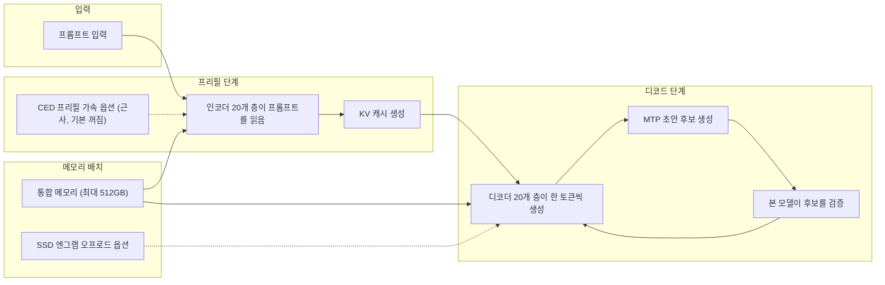
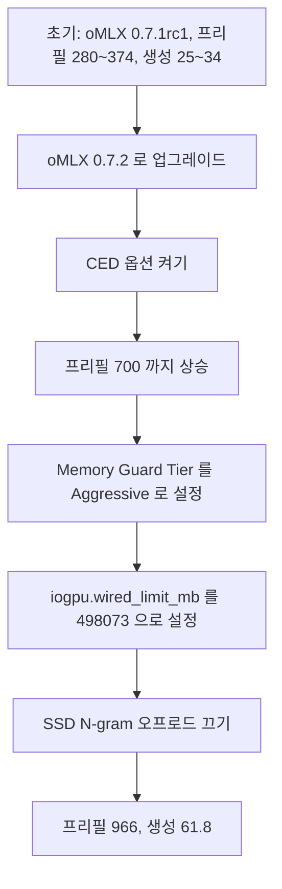
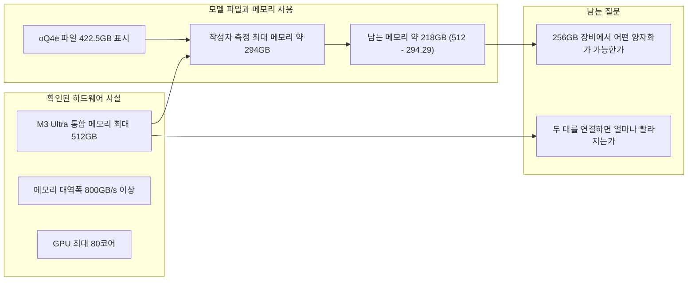
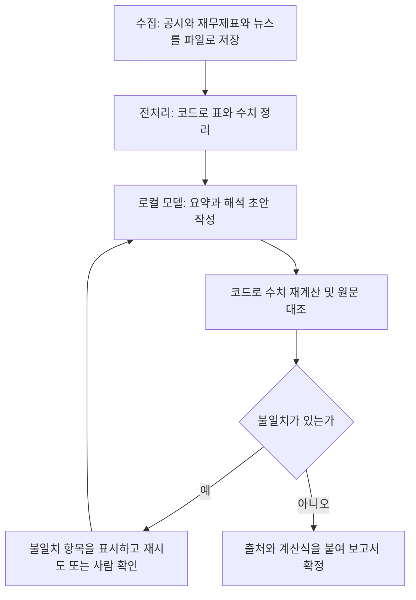

- 작성일: 2026-10-23
- 분석 대상: 아카라이브 알파카 채널 게시글 "deepseek v4.1 flash 1017 사용후기"(2026-10-22 게시)와 그 아래 댓글, 그리고 게시글에 첨부된 벤치마크 표
- 조사 방식: 게시글 원문과 댓글을 읽고, 모델 카드와 oMLX 릴리스 노트, 독립 평가 사이트, 구조 해설 글을 찾아 대조했습니다. 첨부된 벤치마크 표의 수치는 직접 검산했습니다.

## 읽는 법: 이 문서가 구분하는 네 가지 종류의 문장

이 문서는 서로 믿을 수 있는 정도가 다른 문장을 섞어 쓰지 않으려고 아래 네 가지를 구분해 적었습니다.

| 표시 | 의미 | 예 |
| --- | --- | --- |
| **확인된 사실** | 모델 카드, 릴리스 노트, 독립 평가 페이지 등 출처가 있는 내용 | "1017은 2026-10-17에 공개되었다" |
| **게시자 보고** | 게시글 작성자나 댓글 작성자가 자기 환경에서 겪었다고 쓴 내용. 저는 재현하지 못했습니다 | "환각이 없더라" |
| **직접 계산** | 첨부된 표의 숫자로 제가 계산한 값 | "프리필이 전체 시간의 99%" |
| **제 해석** | 사실과 보고를 바탕으로 한 제 추론. 틀릴 수 있습니다 | "코드 문맥이라 속도가 잘 나왔을 수 있다" |

확인하지 못한 것은 "확인하지 못했다"고 적었고, 맨 끝 9장에 따로 모았습니다.

---

## 0. 한눈에 요약

게시글의 핵심은 세 가지입니다. 하나는 "예전 DeepSeek Flash는 환각이 많고 추론이 지나치게 길었는데 1017은 안정적이라 코딩 주력 모델로 바꿨다"는 체감 보고입니다. 다른 하나는 "금융 같은 전문 영역은 답변에 오류가 있었다"는 약점 보고입니다. 마지막은 "M3 Ultra에서 프리필이 1000 tok/s에 육박하고 생성 속도도 훌륭하다"는 속도 보고입니다.

이 문서가 확인한 결과는 다음과 같습니다.

1. **모델 자체는 실재하고 공개 사양이 있습니다.** DeepSeek-V4.1-Flash-1017은 2026-10-17에 공개된 "마이너 업데이트"이고, 가중치는 MIT 라이선스로 Hugging Face에 올라 있습니다. 모델 카드 기준으로 12개 벤치마크 항목이 모두 9월 버전보다 올랐습니다. 다만 이 수치는 전부 DeepSeek 자체 발표입니다.
2. **게시글의 속도 표는 내부적으로 일관됩니다.** 첨부된 표의 TTFT는 "입력 토큰 수 ÷ 프리필 속도"와 소수점 둘째 자리까지 맞아떨어지고, 전체 지연시간과 처리량도 제 계산과 일치했습니다. 다만 "1000 tok/s 육박"이라는 표현은 표의 최고값 923.1 tok/s보다 후한 표현입니다.
3. **프리필 속도는 약 850~920 tok/s에서 평평해지고, 긴 입력에서는 대기 시간이 거의 전부 프리필입니다.** 입력이 200,000 토큰이면 첫 토큰까지 약 236초(약 3분 56초)가 걸립니다. 이 구간에서 총 소요 시간의 99.1%가 프리필입니다.
4. **같은 구성인데 속도가 안 나온다는 다른 이용자의 사례**가 댓글에 있습니다. 그분은 버전 업그레이드, CED 옵션, 메모리 보호 단계, wired 메모리 한도, SSD N-gram 오프로드를 한꺼번에 바꿨고, 그 결과 프리필 966, 생성 61.8 tok/s가 나왔다고 보고했습니다. 여러 변수를 동시에 바꿨기 때문에 **어느 설정이 원인인지는 이 자료만으로 알 수 없습니다.**
5. **"환각이 줄었다"와 "금융은 약하다"는 체감은 부분적으로만 뒷받침됩니다.** 독립 평가 사이트(Vals AI)의 금융 지수에서 1017은 30개 모델 중 7위로 확인되지만, 이 평가는 풀 정밀도 API 모델을 최고 추론 단계로 돌린 결과이며, 4비트 양자화한 로컬 모델의 품질을 측정한 자료는 찾지 못했습니다.

---

## 1. 게시글이 실제로 말한 것

### 1.1 작성자의 사용 맥락

작성자(닉네임 본능적눈사람)는 주로 코딩과 간단한 질문에 사용한다고 밝혔습니다. 과거 경위는 이렇게 적혀 있습니다.

- 예전 DeepSeek Flash는 환각이 있고 추론을 매우 길게 해서 **추론 토큰 상한을 걸어 두고** 사용했습니다.
- 이후 GLM-5.3 Flash로 갈아탔는데, 성능이 더 안정적이어서 한동안 DeepSeek를 쓰지 않았습니다.
- 이번에 1017의 벤치마크가 인상적이어서 다시 써 봤습니다.
- 레딧에서는 "추론 중 hmm 같은 말을 무한히 반복하는 문제가 아직 해결되지 않았다"는 이야기를 봐서 기대하지 않았지만, **추론 제한을 걸지 않고 풀어 놨는데도** 추론이 적당히 길고 답변과 코드 분석이 안정적이었다고 합니다.
- 체감상 코딩은 GLM-5.3 Flash보다 낫고 속도도 빨라서 1017을 주력으로 바꿨습니다.

### 1.2 작성자가 밝힌 약점

일반 질문은 웹 검색으로 자료를 모아 답하는데, 전문 영역은 미흡하다고 느꼈다고 합니다. 주로 금융 질문을 했고, 한글은 거의 완벽해 보이지만 답변 내용에 오류가 있었다고 적었습니다.

### 1.3 속도에 대한 주장

M3 Ultra에서 프리필이 1000 tok/s에 육박하고 생성(tg)도 훌륭하다고 했습니다. 이 벤치마크는 **엔그램(N-gram)을 SSD로 오프로드한 상태**이고, MTP와 CED("ced?"라고 물음표를 붙여 적었습니다) 옵션을 켜고 쓴다고 했습니다. 또 M5는 더 좋을 것이며, 학습은 하지 않고 추론 전용이라면 Mac이 나은 선택이 아니겠냐는 의견을 덧붙였습니다.

### 1.4 댓글에서 확인되는 내용 (정리)

| 작성자 | 시각 | 내용 요약 | 종류 |
| --- | --- | --- | --- |
| 크리크리트리 | 10-22 16:42 | 4비트로 풀 구동하려면 용량 압박이 큼. 256GB를 주문했고 2.5비트나 3비트를 써 보려는데, 4비트도 환상(환각)이 있으면 더 낮은 비트는 손실이나 환각이 더 많을 것 같다고 걱정 | 게시자 보고, 추측 |
| 본능적눈사람 | 10-22 16:49 | 며칠 써 봤는데 아직 환상이 없었고, 이전 모델은 추론 과정에서 환각을 수시로 목격 | 게시자 보고 |
| 크리크리트리 | 10-22 17:05 | 1017 퀄리티가 괜찮다고 평가. 256GB 장비를 추가 주문했으니 RDMA도 해 보겠다고 함 | 게시자 보고, 계획 |
| king | 10-22 16:59 | M3에서 이 정도면 실사용 충분하겠다 | 의견 |
| 본능적눈사람 | 10-22 20:44 | 매일 코딩만 하는 것도 아니고 오히려 활용을 못하는 건 아닌가 싶다. 로컬은 팍팍 굴려야 기계값이 아깝지 않다. 전업투자자라 주식이나 산업분석 파이프라인을 만드는 게 목표인데 쉽지 않다 | 게시자 보고 |
| John | 10-23 07:50 | 예전에는 이 정도 크기 모델이면 프리필 50 tps쯤 나왔을 텐데 엔진 향상이 대단하다 | 개인 기억 |
| shouting | 10-23 12:06, 15:46 | 같은 구성 같은데 왜 속도가 안 나오는지 질문. 이후 설정 변경으로 개선 보고 | 게시자 보고 |

(댓글 시각은 첨부된 화면에 표시된 값 그대로입니다. 게시글의 질문에 대한 본능적눈사람의 답변이 있었는지는 제공된 자료에 없어 확인하지 못했습니다.)

---

## 2. 이 글을 읽기 위한 용어 풀이

게시글에는 로컬 추론 커뮤니티의 약어가 많이 나옵니다. 먼저 정리합니다.

### 2.1 속도 지표

| 용어 | 뜻 | 비유 |
| --- | --- | --- |
| **pp (prompt processing) / 프리필(prefill)** | 입력으로 들어온 글(프롬프트)을 모델이 한꺼번에 읽어서 내부 기억(KV 캐시)을 만드는 단계 | 질문과 첨부 자료를 처음부터 끝까지 읽는 시간 |
| **tg (token generation) / 디코드(decode)** | 답을 한 토큰씩 만들어 내는 단계 | 답을 한 글자씩 쓰는 시간 |
| **TTFT (Time To First Token)** | 요청을 보낸 뒤 첫 토큰이 나올 때까지 걸리는 시간. 사실상 프리필 시간 | 읽기가 끝나고 첫 글자를 쓰기 시작할 때까지 |
| **TPOT (Time Per Output Token)** | 출력 토큰 하나당 걸리는 시간(ms/tok). 작을수록 빠름 | 글자 하나 쓰는 데 걸리는 시간 |
| **PP TPS / TG TPS** | 프리필, 디코드가 초당 처리하는 토큰 수 | 읽기 속도, 쓰기 속도 |
| **E2E 지연** | 요청부터 응답 끝까지 전체 시간 | 읽기 + 쓰기 전체 |
| **처리량** | (입력 + 출력 토큰) ÷ E2E 지연 | 전체 평균 속도 |

프리필과 디코드의 차이는 이 프로젝트의 앞선 문서(`deepinfer-open-source-analysis.md`) 별첨 A에서 더 자세히 풀었습니다. 여기서 기억할 것은 하나입니다. **긴 문서를 던질수록 프리필 시간이 길어지고, 답이 짧으면 그 프리필 시간이 체감 속도의 대부분이 됩니다.**

### 2.2 가속 기술과 모델 구조 용어

| 용어 | 확인된 설명 |
| --- | --- |
| **MTP / DSpark** | V4.1 Flash 구조 해설(Helix)에 따르면 V4.1은 기존 multi-token prediction(MTP) 모듈을 **DSpark**로 대체했습니다. DSpark는 작은 트랜스포머 블록이 한 번에 앞선 여러 위치의 후보를 만들고, 본 모델이 그 후보를 검증하는 방식(스펙큘러티브 디코딩 계열)입니다. oMLX는 이를 "Lightning MTP"라는 이름으로 구현합니다. oMLX 0.7.1 릴리스 노트에는 이 기능을 켜도 **그리디(greedy) 출력이 끈 경우와 토큰 단위로 일치한다**고 적혀 있습니다. 즉 속도만 올리고 답은 바꾸지 않는 종류입니다. |
| **CED (Causal Encoder-Decoder)** | **모델 구조의 이름**입니다. 40개 층을 20개의 인과적(causal) 인코더와 20개의 디코더로 나눕니다. 인코더는 프롬프트 토큰을 읽을 때(토큰당 활성 파라미터 약 8B), 디코더는 생성할 때(토큰당 약 16B) 쓰입니다. 프리필이 상대적으로 가벼운 이유가 여기 있습니다. |
| **oMLX의 "CED 프리필 가속"** | oMLX 0.7.0rc1 릴리스 노트에는 "CED 프리필 가속(#3607): **선택적 제한 재생(bounded replay)** 으로 M3 Ultra 벤치마크에서 프리필이 **최대 79%** 빨라졌고, **기본값은 꺼져 있으며 출력이 바뀔 수 있는 근사 모드**"라고 적혀 있습니다. 게시글의 "CED 옵션"은 이 기능을 가리킬 가능성이 높지만, 작성자가 확인한 것은 아니므로 **제 해석**입니다. |
| **엔그램(Engram) / N-gram 메모리** | 1번과 14번 층에 삽입된 약 1,960억 파라미터의 해시 기반 조회 테이블입니다. 입력 토큰의 2·3·4개 묶음(n-gram)을 해시해 표의 한 행을 가져옵니다. KV 캐시도 RAG도 아닌 **파라미터 메모리**입니다. 접근이 희소해서 SSD나 호스트 메모리로 내려 두는 오프로드가 가능합니다(LMSYS 글은 호스트 메모리 오프로드가 KV 캐시 용량을 36% 늘렸다고 보고). |
| **oQ4e, oQ2e 등** | oMLX가 쓰는 양자화 표기입니다. 릴리스 노트에는 oQ2e, oQ2.5e, oQ3e, oQ4e가 나옵니다. oQ4e는 MXFP 가중치를 읽는다는 언급이 있습니다. 그러나 **"oQ"와 "e"가 정확히 무엇의 약자인지 설명하는 자료는 확인하지 못했습니다.** |
| **통합 메모리(unified memory)** | Apple 칩에서 CPU와 GPU가 같은 메모리 풀을 쓰는 구조. M3 Ultra는 최대 512GB, 메모리 대역폭 800GB/s 이상, GPU 최대 80코어(Apple 보도자료 기준)입니다. |

### 2.3 한 번의 요청이 처리되는 흐름과 가속 옵션의 자리

그림을 말로 풀면 이렇습니다. 입력 글은 인코더가 읽어 KV 캐시를 만들고(프리필), 디코더가 한 토큰씩 답을 만듭니다(디코드). 점선으로 그린 세 가지, 즉 CED 프리필 가속, SSD 엔그램 오프로드, 그리고 디코드 중의 MTP 후보 검증이 이번 게시글에서 속도에 영향을 주는 선택지입니다. 이 가운데 **MTP는 출력을 바꾸지 않는다고 oMLX가 밝혔고, CED 프리필 가속은 출력이 바뀔 수 있는 근사 모드라고 밝혔다**는 차이를 기억해 두면, 뒤의 품질 논의를 읽기 쉽습니다.

---

## 3. 1017 모델은 무엇이고, 무엇이 달라졌는가

### 3.1 확인된 기본 정보

- **공개일: 2026-10-17.** TechNode(10-19 게시)와 Vals AI 페이지가 이 날짜를 확인합니다.
- **성격: 마이너 업데이트.** 모델 카드는 이전 DeepSeek-V4.1-Flash(9월 10일 공개)를 대상으로 한 "minor update"로 설명하고, 추론·코딩·에이전트 작업·시각 벤치마크가 개선되었으며 작업 실행 시간과 출력 길이를 줄여 더 빠르고 싸게 작업을 끝낼 수 있다고 합니다. 구체적인 변경 목록(changelog)은 카드에 없습니다.
- **공개 형태: 가중치 MIT 라이선스.** 컨텍스트 100만 토큰, 최대 출력 38.4만 토큰(Vals AI 기준)입니다.
- **권장 설정:** temperature 1.0, top_p 1.0, max_tokens 256K 이상. 추론 길이를 직접 정하는 권장값은 카드에 없습니다.
- **채팅 템플릿:** Jinja 형식이 제공되지 않고 Python 참조 구현(encoding.py)을 써야 한다고 카드에 적혀 있습니다. 로컬 엔진이 이를 잘못 구현하면 출력 품질이 흔들릴 수 있는 지점이지만, 이번 게시글의 환경에서 그런 문제가 있었는지는 확인하지 못했습니다(제 해석).

### 3.2 DeepSeek 자체 발표 벤치마크: 9월 버전 대비

(출처: 모델 카드, MetricNexus 정리 / 모두 자체 발표)

| 벤치마크 | 9월 V4.1 Flash | 1017 | 변화(직접 계산) |
| --- | --- | --- | --- |
| HLE (도구 없음) | 36.8 | 42.6 | +5.8 |
| Terminal-Bench 4.0 | 31.2 | 42.3 | +11.1 |
| DeepSWE v1.1 | 74.2 | 77.0 | +2.8 |
| ProgramBench | 20.3 | 29.1 | +8.8 |
| NL2Repo-Bench | 65.4 | 68.2 | +2.8 |
| Automation-Bench v1.0.6 | 54.8 | 60.5 | +5.7 |
| Agents' Last Exam | 31.8 | 35.4 | +3.6 |
| Apex Bench v1.1 | 64.6 | 72.1 | +7.5 |
| Chartography (도구 사용) | 78.9 | 83.0 | +4.1 |
| BabyVision (도구 사용) | 89.6 | 92.5 | +2.9 |
| ZeroBench-main (도구 사용) | 49.0 | 51.0 | +2.0 |

(HLE 텍스트 전용 행은 별도 시험이라 생략했습니다. 모델 카드 표의 가장 큰 상승은 Terminal-Bench 4.0과 ProgramBench이며, 하락한 항목은 없습니다. 벤치마크마다 채점 하네스가 다르고, Terminal-Bench 4.0은 Claude Code 하네스, DeepSWE는 Mini-SWE-V2 하네스에서 측정했다고 카드에 표시되어 있습니다.)

이 표는 게시글의 "벤치마크가 인상적이어서"라는 문장의 배경으로 보입니다. 그러나 **자체 발표라는 한계**가 있습니다. 같은 자료의 Opus 5 비교 열에서는 HLE(56.3), Terminal-Bench(51.8), NL2Repo(75.3) 등 어려운 추론·코드 작업에서 Opus 5가 앞선다고 MetricNexus가 정리합니다. 또 이 글이 비교 대상으로 삼은 GPT-5.6 Sol은 이미 GPT-6.1 Sol로 대체되었다는 점도 함께 적혀 있어, 비교 상대가 최신이 아닙니다.

### 3.3 독립 평가: Vals AI

Vals AI 페이지에서 1017은 다음과 같이 평가됩니다(평가 설정: DeepSeek API, temperature 1, reasoning effort **max**, 벤치마크에 따라 제공자와 파라미터가 다를 수 있다고 명시).

| 항목 | 정확도 | 순위 |
| --- | --- | --- |
| Vals Index (종합) | 61.26% (±1.05) | 26개 중 8위 |
| Vals Finance Index | 60.89% (±1.47) | 30개 중 7위 |
| Finance Agent v2.1 | 62.93% (±2.03) | 30개 중 12위 |
| Tax Agent Bench | 44.35% (±3.57) | 75개 중 6위 |
| Code Migration v1.1 | 67.52% (±2.76) | 28개 중 7위 |
| Vibe Code Bench v1.1 | 87.73% (±2.75) | 118개 중 11위 |
| Terminal-Bench 4.0 | 31.82% (±2.62) | 54개 중 18위 |
| Legal Research Bench | 45.19% (±3.46) | 84개 중 18위 |

주목할 점이 두 가지 있습니다.

첫째, **같은 이름의 벤치마크도 측정 주체가 다르면 값이 다릅니다.** Terminal-Bench 4.0은 DeepSeek 자체 발표가 42.3, Vals AI 측정이 31.82로 약 10.5포인트 차이입니다(직접 계산). 하네스, 제공자, 설정이 다르기 때문일 가능성이 크지만, 어느 쪽이 맞는지는 이 자료만으로 판단할 수 없습니다. 중요한 것은 "자체 발표 수치를 그대로 현실의 기대치로 삼지 말라"는 점입니다.

둘째, **금융 지수 7위는 게시글의 "금융은 미흡하다"와 단순 비교할 수 없습니다.** Vals의 금융 평가는 구조화된 금융 에이전트 과제이고, 작성자는 웹 검색 기반의 한국어 금융 질문을 했습니다. 또 Vals는 풀 정밀도 API 모델을 최고 추론 단계로 돌린 것이고, 작성자는 4비트급 양자화 모델을 로컬에서 돌립니다. 그래서 "상위권이다"와 "내가 쓴 환경에서 오류가 있었다"는 두 문장은 서로 모순되지 않으며, 한쪽으로 다른 쪽을 반박할 수 없습니다. 참고로 Finance Agent v2.1 정확도 62.93%는 "정확도 약 63%"라는 뜻으로 적혀 있을 뿐이어서, 이 정도 점수가 실무 투입에 충분한지는 판단하지 못합니다.

### 3.4 추론 길이: "적당히 길게"라는 체감과 제3자 측정

게시글의 "추론 제한 없이도 적당히 길었다"는 체감은 제3자 측정과 방향이 맞습니다. MetricNexus가 인용한 Sference의 측정(같은 문제, 같은 시드, 같은 하드웨어에서 이전 가중치와 비교)에 따르면 1017은 AIME 중앙값 출력 토큰이 1,681에서 1,124로 줄었고(-33%), 가장 긴 추론 체인은 3,814에서 1,880 토큰으로 줄었으며(-51%), 정답률은 노이즈 범위 안에서 유지되었다고 합니다. 이는 **2차 자료를 통한 인용이며 원본 측정을 직접 확인하지는 못했습니다.** 반면 같은 글이 소개한 Hacker News 후기는 한 팀이 "낮은 사고 수준에서 성능이 약하고, 최고 수준에서는 토큰이 과도하게 늘었다"고 보고했다고 전합니다. 개인 보고일 뿐 체계적 검증은 아닙니다.

---

## 4. 첨부된 벤치마크 표를 읽는다

작성자는 oMLX의 벤치마크 화면에서 다음 조건으로 측정했습니다. 모델은 `DeepSeek-V4.1-Flash-1017-oQ4e-mtp`(표시된 파일 크기 422.5 GB), 벤치마크 컨텍스트는 `Code (Python)`, 생성 길이는 128 토큰 고정이며 프롬프트 길이를 1,024에서 200,000 토큰까지 바꿔 가며 측정했습니다. 화면에는 "벤치마크 컨텍스트는 MTP나 DFlash 같은 가속 기능이 켜져 있을 때만 결과에 영향을 준다"는 안내가 있습니다.

### 4.1 원자료와 검산 결과

| 테스트 | TTFT(초) | TPOT(ms/tok) | PP TPS | TG TPS | E2E(초) | 처리량(tok/s) | 최대 메모리(GB) |
| --- | --- | --- | --- | --- | --- | --- | --- |
| pp1024/tg128 | 2.527 | 28.15 | 405.2 | 35.8 | 6.106 | 188.7 | 290.07 |
| pp4096/tg128 | 5.247 | 18.63 | 780.7 | 54.1 | 7.618 | 554.5 | 291.58 |
| pp8192/tg128 | 9.221 | 20.66 | 888.4 | 48.8 | 11.849 | 702.1 | 293.96 |
| pp16384/tg128 | 18.385 | 16.15 | 891.2 | 62.4 | 20.441 | 807.8 | 294.06 |
| pp32768/tg128 | 35.498 | 21.61 | 923.1 | 46.6 | 38.247 | 860.1 | 294.09 |
| pp65536/tg128 | 72.103 | 16.61 | 908.9 | 60.7 | 74.218 | 884.7 | 294.14 |
| pp131072/tg128 | 153.927 | 17.87 | 851.5 | 56.4 | 156.203 | 839.9 | 294.22 |
| pp200000/tg128 | 236.455 | 16.72 | 845.8 | 60.3 | 238.587 | 838.8 | 294.29 |

제가 직접 계산해 맞춰 본 결과입니다.

- **TTFT = 입력 토큰 ÷ PP TPS.** 8행 모두 소수점 둘째 자리까지 일치했습니다(예: 200,000 ÷ 845.8 = 236.46초).
- **E2E ≈ TTFT + 127 × TPOT.** 8행 모두 0.01초 안팎으로 일치했습니다. (첫 토큰은 TTFT에 포함되고 나머지 127개 토큰에 TPOT이 곱해지는 구조로 해석됩니다.)
- **처리량 = (입력 + 128) ÷ E2E.** 8행 모두 표의 값과 일치했습니다(예: 1,152 ÷ 6.106 = 188.7).
- TG TPS는 1000 ÷ TPOT과 몇 퍼센트 차이가 나는 행이 있습니다(예: 1000 ÷ 28.15 = 35.5, 표의 35.8). 계산 방식 차이로 보이며, 정확한 정의는 확인하지 못했습니다.

결론적으로 **표는 서로 모순되지 않고, 한 번의 일관된 측정으로 보입니다.** 이것이 표가 "맞다"는 증명은 아니지만, 숫자를 이어 붙이다 생긴 실수는 없어 보입니다.

### 4.2 표에서 읽어야 할 것

**① 프리필 속도는 길이가 길어져도 약 850~920 tok/s에서 평평합니다.**
1,024 토큰에서는 405.2 tok/s였다가 8,192 토큰에서 888.4로 오르고, 이후 32,768 토큰의 923.1이 최고값입니다. 그 뒤 131,072와 200,000 토큰에서는 851.5, 845.8로 소폭 내려갑니다. 짧은 입력에서 속도가 낮은 것은 시작 비용이 크기 때문일 수 있다는 것이 제 해석이며, 정확한 원인은 확인하지 못했습니다. oMLX 0.7.2 릴리스 노트에는 프리필이 8192 토큰 단위로 실행된다는 언급이 있습니다.

**② 긴 입력에서는 대기 시간의 거의 전부가 프리필입니다(직접 계산).**

| 입력 길이 | 첫 토큰까지 | 전체 시간 중 프리필 비중 |
| --- | --- | --- |
| 1,024 | 약 2.5초 | 41.4% |
| 8,192 | 약 9.2초 | 77.8% |
| 32,768 | 약 35.5초 | 92.8% |
| 131,072 | 약 154초(2분 34초) | 98.5% |
| 200,000 | 약 236초(3분 56초) | 99.1% |

에이전트 하네스에서 매 턴마다 긴 맥락을 처음부터 다시 읽게 되면 이 대기가 반복됩니다. 반대로 앞부분이 같은 요청은 캐시를 재사용해 프리필을 건너뛸 수 있습니다. oMLX 0.7.0rc1 노트에는 부분 블록 캐싱으로 13.4K 토큰 테스트에서 다음 턴 프리필 토큰이 1,174개에서 37개로 줄었다는 내용이 있습니다(Qwen3.6-35B-A3B 모델 기준이며 이 모델에서의 효과는 확인하지 못했습니다). 따라서 **로컬에서 긴 맥락을 쓸 때의 실사용 체감은 "캐시가 얼마나 재사용되느냐"에 크게 좌우될 것**이라는 것이 제 해석입니다. 작성자가 쓰는 하네스에서 캐시가 실제로 얼마나 맞는지는 자료에 없습니다.

**③ 생성 속도(TG)는 46.6~62.4 tok/s로 들쭉날쭉합니다.**
입력 길이와 단조로운 관계가 없습니다. 32,768 토큰 행(46.6)이 16,384 토큰 행(62.4)보다 느립니다. 128 토큰만 생성하는 짧은 측정이라 편차가 클 수 있고, 한 번 측정한 값인지 반복 평균인지도 표에 표시되어 있지 않습니다. 또한 벤치마크 컨텍스트가 `Code (Python)`이고 MTP가 켜져 있습니다. 화면 안내대로 MTP 같은 가속 기능이 켜져 있으면 컨텍스트가 결과에 영향을 주는데, 스펙큘러티브 디코딩은 다음 토큰이 예측하기 쉬울수록 후보가 많이 채택되어 빨라지는 구조입니다. 코드는 예측하기 쉬운 문맥이므로, **일반 한국어 산문이나 금융 분석 글에서는 생성 속도가 이보다 낮을 수 있다**는 것이 제 해석입니다. 이를 직접 비교한 측정은 확인하지 못했습니다.

**④ 메모리: 파일 크기 422.5GB인 모델이 최대 약 290~294GB를 썼습니다.**
최대 메모리는 입력이 1,024에서 200,000 토큰으로 늘어도 290.07GB에서 294.29GB로 4.22GB 늘어나는 데 그쳤습니다(직접 계산). 이는 KV 캐시가 작게 설계되었다는 공식 설명과 맞습니다. V4.1 Flash의 전역 KV 캐시는 토큰당 약 890바이트라고 TNW가 전합니다. 또 파일 크기 대비 최대 메모리가 약 69.7%라는 점(294.29 ÷ 422.5)은 엔그램을 SSD로 내려 두었다는 작성자의 설명과 일관됩니다. 다만 이것은 **정황상 일관된다는 것이지, 메모리 절감량의 원인을 이 표로 증명한 것은 아닙니다.** 파일 크기 단위가 GB인지 GiB인지도 화면에 표시된 대로 적었을 뿐 확인하지 못했습니다.

### 4.3 "프리필 1000 tok/s 육박"은 얼마나 정확한가

첨부된 표에서 프리필의 최고값은 923.1 tok/s(32,768 토큰)이고, 16,384 토큰에서는 891.2 tok/s입니다. oMLX 0.7.2 릴리스 노트의 표는 같은 모델의 `-mtp` 체크포인트를 M3 Ultra 512GB에서 16K 프롬프트로 측정해 **MTP + CED 프리필이 양자화별로 949~1010 tok/s**라고 적고 있습니다. 작성자의 16K 값(891.2)은 이 범위의 약 88~94%입니다(직접 계산). 작성자가 "1000에 육박"이라고 쓴 것은 릴리스 노트 범위를 염두에 둔 표현일 수 있으나, 제 표 기준으로는 "900 안팎"이 더 정확합니다. 이 차이가 측정 조건, 양자화 종류, 설정 차이 중 무엇 때문인지는 확인하지 못했습니다.

---

## 5. 같은 구성인데 왜 속도가 다를까: shouting 님의 사례

댓글 작성자 shouting 님은 "저랑 동일한 구성 같은데 저는 왜 저런 속도가 안 나올까요"라고 물으며 자기 환경을 적었습니다. 환경은 M3 Ultra 512GB, oMLX 0.7.1rc1, 모델 `DeepSeek-V4.1-Flash-1017-oQ4e-mtp`, 컨텍스트 Code (Python)입니다. 이후 수정 글에서 0.7.2로 올리고 CED 옵션을 켰더니 프리필이 700까지 올랐지만 릴리스 노트의 1000 t/s에는 못 미친다고 했고, 이어서 **Memory Guard Tier를 Aggressive로 설정하고 `sysctl iogpu.wired_limit_mb=498073`으로 wired 메모리 한도를 높이고 SSD N-gram 오프로드를 끄자 PP 966, tg 61.8까지 나왔다**고 보고했습니다.

### 5.1 두 측정의 직접 비교 (0.7.1rc1 시점 vs 작성자 표)

| 입력 | 작성자 PP | shouting PP | 비율 | 작성자 TG | shouting TG | 비율 |
| --- | --- | --- | --- | --- | --- | --- |
| 1,024 | 405.2 | 280.2 | 1.45배 | 35.8 | 25.2 | 1.42배 |
| 4,096 | 780.7 | 340.6 | 2.29배 | 54.1 | 27.6 | 1.96배 |
| 8,192 | 888.4 | 367.2 | 2.42배 | 48.8 | 27.7 | 1.76배 |
| 16,384 | 891.2 | 371.6 | 2.40배 | 62.4 | 29.7 | 2.10배 |
| 32,768 | 923.1 | 374.2 | 2.47배 | 46.6 | 33.7 | 1.38배 |

(비율은 직접 계산. shouting 님의 값은 첨부된 댓글 화면의 표에서 옮겼습니다. 이 비교는 서로 다른 버전, 설정, 측정 시점의 결과를 단순 비교한 것입니다.)

같은 하드웨어와 같은 모델 파일인데 프리필이 약 2.4배, 생성이 약 1.4~2.1배 차이가 났습니다. 이후 shouting 님의 개선 보고(PP 966, tg 61.8)는 작성자의 표와 비슷한 수준(작성자 pp16384 기준 891.2/62.4)이 되었습니다. 다만 개선 보고의 입력 길이 조건은 적혀 있지 않아 같은 입력에서의 비교는 아닙니다.

### 5.2 바뀐 변수들

이 흐름에서 말할 수 있는 것과 말할 수 없는 것을 나눠 보겠습니다.

**말할 수 있는 것 (확인된 사실과 게시자 보고):**
- oMLX 0.7.2 릴리스 노트에는 DeepSeek V4.1에 대한 융합 디코드 커널 확장과 프리필 개선(대략 31~36%)이 적혀 있습니다. 버전 업그레이드만으로도 속도가 달라질 이유가 문서상 있습니다.
- 0.7.1의 융합 디코드 커널은 oQ4e의 MXFP 가중치만 읽도록 되어 있어 oQ2e, oQ2.5e, oQ3e는 느린 일반 경로로 돌았고, 0.7.2에서 이 양자화들도 융합 커널을 쓰게 되었다고 릴리스 노트가 밝힙니다. 이번 대화의 모델은 oQ4e이므로 이 항목이 직접 해당하는지는 불분명합니다.
- shouting 님은 위 네 가지(버전, CED, 메모리 설정, 오프로드)를 한 번에 바꿨다고 적었습니다. 각각의 기여도를 분리해 측정했다는 내용은 없습니다.

**말할 수 없는 것 (확인하지 못한 것):**
- 어느 변경이 속도 개선의 주된 원인인지.
- Memory Guard Tier의 Aggressive가 무엇을 하는지, SSD N-gram 오프로드를 끄는 것이 왜 빠르게 하는지. 제가 읽은 0.7.2 릴리스 노트 페이지에는 Memory Guard Tier, `iogpu.wired_limit_mb`, SSD N-gram 오프로드에 대한 설명이 없었습니다. (오프로드는 Engram SSD 오프로드가 0.7.0rc1 노트에 "메모리 절감을 위한" 기능으로 나옵니다. 그러니 끄면 메모리를 더 쓰는 대신 SSD 읽기를 피한다는 것이 일반적 추론이지만, 이것은 제 해석입니다.)
- 작성자가 "SSD 엔그램 오프로드를 쓴 벤치마크"라고 밝혔는데 shouting 님은 오프로드를 끄고 개선했다고 보고했습니다. 두 분의 환경이 어떻게 다른지(예: 남은 메모리, wired 한도 설정 여부)는 자료에 없습니다. 이 점은 **서로 모순된 것이 아니라 비교 가능한 정보가 부족한 상태**입니다.

### 5.3 재현하려는 사람을 위한 기록 체크리스트 (제 제안)

속도 비교 글이 서로 어긋나는 가장 큰 이유는 조건이 적혀 있지 않기 때문입니다. 비교하려면 최소한 아래를 함께 적는 것이 좋습니다.

| 기록 항목 | 이유 |
| --- | --- |
| oMLX 버전(정식/rc 구분) | 0.7.1에서 0.7.2로 가며 커널과 프리필 청크 방식이 바뀜 |
| 모델 파일 이름과 양자화(oQ4e 등) | 양자화별로 디코드 경로가 달랐던 이력이 있음 |
| MTP 켬/끔, CED 켬/끔 | CED는 근사 모드로 출력이 바뀔 수 있음 |
| SSD 오프로드 켬/끔, Memory Guard Tier | 메모리 배치가 속도에 영향을 줄 수 있음 |
| wired 메모리 한도 값 | 한도가 낮으면 모델이 메모리에 상주하지 못할 가능성(제 해석) |
| 벤치마크 컨텍스트(Code 등) | MTP가 켜져 있으면 결과에 영향을 줌 |
| 측정 횟수와 평균/단일 여부 | TG가 들쭉날쭉하므로 |

---

## 6. 품질에 대한 후기를 어떻게 읽을 것인가

### 6.1 "환각이 줄었다"

작성자의 보고는 "며칠 써 봤는데 아직 환각을 못 봤다"는 수준이고, 이전 모델에서는 추론 과정에서 환각을 자주 봤다고 합니다. 이를 이렇게 정리할 수 있습니다.

- **확인된 사실:** 1017이 이전 버전보다 추론 길이가 줄었다는 제3자 측정(Sference, 2차 인용)이 있습니다. 모델 카드는 출력 길이를 줄였다고 설명합니다.
- **확인하지 못한 것:** 환각률(사실 오류 빈도)을 직접 측정한 자료는 제가 찾은 범위에 없었습니다. MetricNexus 글에도 환각에 대한 언급은 없다고 확인했습니다.
- **레딧 보고:** 작성자는 "레딧에서 hmm 반복 문제가 아직 해결 안 됐다고 한다"고 적었지만, **저는 해당 레딧 글을 찾지 못했습니다.** 관련해 찾은 유일한 자료는 MindStudio의 9월 10일자 테스트인데, 이는 1017이 아니라 9월 **프리뷰 버전**을 다룬 것으로, 물리 문제에서 한 번 반복 루프에 빠져 수동으로 중단해야 했고 두 번째 시도에서는 정답을 냈다고 기록했습니다. 따라서 "1017에서 반복 문제가 있다/없다"를 판단할 근거는 이 문서에 없습니다.

### 6.2 "코딩은 GLM-5.3 Flash보다 낫다"

이것은 **작성자의 체감**입니다. 제가 찾은 범위에서는 1017과 GLM-5.3 Flash를 같은 조건으로 비교한 독립 자료를 확인하지 못했습니다. Vals AI 페이지는 공통 벤치마크 비교 페이지로 가는 링크 목록에 일부 모델을 보여 주지만, GLM-5.3 Flash는 그 목록에 없었고 비교 점수도 본문에 없었습니다.

### 6.3 "금융 같은 전문 영역은 오류가 있다"

- 작성자 보고: 웹 검색으로 자료를 모아 답변하는데 한글은 거의 완벽하지만 내용에 오류가 있었음.
- 독립 평가(Vals): Finance Index 30개 중 7위, Tax Agent Bench 75개 중 6위로 상위권이지만, 풀 정밀도 API 모델을 최고 추론 단계로 돌린 결과입니다.
- 두 가지가 모순되는 것은 아닙니다. 측정 과제(구조화된 에이전트 과제 vs 한국어 웹 검색 질의), 모델 상태(풀 정밀도 vs 양자화), 설정이 다르기 때문입니다.
- **제 해석:** 금융 파이프라인(주식, 산업 분석)을 만들 목적이라면, 모델이 사실을 기억해 답하게 하기보다 **검색 결과·재무제표 같은 근거를 입력으로 넣고 계산은 코드로 검증하는 구조**가 오류에 덜 취약합니다. 이는 이 프로젝트에서 다뤄 온 "에이전트 = 모델 + 하네스" 관점의 설계 제안이며, 1017에서 이 구조의 효과를 측정한 자료는 없습니다.

### 6.4 양자화 수준과 품질 (크리크리트리 님의 걱정)

크리크리트리 님은 256GB 장비에서 2.5비트나 3비트를 쓰려는데, 4비트에서도 환각이 있다면 더 낮은 비트는 손실이 더 클 것 같다고 걱정했습니다. 일반적으로 양자화 비트가 낮아질수록 정밀도 손실이 커질 수 있다는 것은 널리 알려진 경향이지만, **oQ2e, oQ2.5e, oQ3e가 1017에서 4비트 대비 얼마나 품질이 떨어지는지 측정한 자료는 확인하지 못했습니다.** 또한 oQ는 층별로 비트를 섞는 방식일 가능성이 있지만 이 역시 확인하지 못해, 파일 크기를 비트 수에 비례해 줄여 계산하는 것은 부정확할 수 있습니다. 작성자 표에서 422.5GB 파일이 최대 메모리 약 294GB를 썼다는 사실만이 근거 있는 숫자입니다.

---

## 7. 하드웨어 논의: M3 Ultra, M5, RDMA

- **M3 Ultra:** Apple 보도자료 기준 통합 메모리 최대 512GB, 대역폭 800GB/s 이상, GPU 최대 80코어입니다. 게시글의 구성은 512GB 모델입니다.
- **남는 메모리:** 작성자 측정 최대 메모리 294.29GB를 512GB에서 빼면 약 217.7GB(직접 계산)입니다. 이는 이 측정 조건에서의 여유이며, 다른 앱, KV 캐시의 장시간 누적, 동시 요청에서는 달라질 수 있습니다. 또 oMLX 0.7.2 노트는 DeepSeek V4.1이 16K 프롬프트 기준 최대 메모리가 4~7GB 늘 수 있다고 안내합니다.
- **M5:** 작성자는 M5가 훨씬 더 좋을 것이라고 썼습니다. oMLX 0.7.0rc1 노트에는 M5 Max 128GB에서의 Qwen 벤치마크가 있지만, **DeepSeek V4.1 Flash의 M5 측정은 확인하지 못했습니다.**
- **여러 대 연결:** oMLX 0.7.2 노트에 따르면 두 대의 M3 Ultra를 Thunderbolt로 연결한 테스트에서 분산 추론의 디코드가 13~102% 빨라졌고, 이 테스트는 **RDMA가 아닌 TCP 링**을 썼다고 합니다. 크리크리트리 님이 말한 RDMA 시도는 아직 측정 결과가 없는 계획 단계입니다. 0.7.0rc1 노트에는 Mac과 CUDA 배포에서 RDMA 링크로 파이프라인 활성화 데이터를 전달할 수 있다는 언급이 있으나, 이번 모델에서의 효과는 확인하지 못했습니다.
- **"예전엔 프리필 50 tps"(John 님):** 개인의 기억이며 근거 자료는 없습니다. 다만 같은 하드웨어에서 엔진 개선에 따라 같은 모델의 프리필이 280~374에서 700, 966까지 보고된 흐름(5장)은 "엔진 업데이트가 체감 성능을 크게 바꾼다"는 방향과 맞습니다.
- **"Mac이 추론 전용으로 낫다":** 작성자의 의견입니다. 이 문서가 비교한 대안(NVIDIA GPU 서버 등)의 가격·성능 자료는 확인하지 못했으므로 옳다 그르다를 판단하지 않습니다. 다만 Helix의 구조 해설은 이 모델의 가중치 총량이 475.25GiB로 4-GPU 서버(382.37GiB)에도 들어가지 않았다고 적어, **대용량 단일 메모리가 갖는 접근성이 있다**는 점은 확인됩니다.

### 7.1 로컬과 API는 어떻게 다른가

- **API:** 1017의 공식 요금은 100만 토큰당 입력(캐시 적중) $0.003, 입력(캐시 미스) $0.15, 출력 $0.60(비피크 기준)이고, 평일 UTC 01–04시와 06–10시 피크 시간대에는 두 배입니다(MetricNexus 정리). Search/Fetch API는 성공 요청 1,000건당 $0.75이며 2026-10-31 16:00 UTC부터 과금됩니다(그 전까지 서버 측 도구는 무료).
- **로컬:** 토큰당 요금은 없지만 장비 구입비, 전력, 설정 시간이 듭니다. 작성자도 "로컬은 팍팍 굴려야 기계값이 아깝지 않다"고 썼습니다.
- **손익분기:** 장비 가격과 사용량을 알아야 계산할 수 있는데 이 문서는 해당 자료를 확인하지 못했으므로 계산하지 않았습니다.
- **품질:** API는 풀 정밀도 모델이고 로컬은 양자화 모델이라 **같은 모델 이름이어도 출력이 같다고 가정할 수 없습니다.** 벤치마크 결과를 로컬 모델에 그대로 적용하면 안 되는 이유입니다.

---

## 8. 이 후기로 알 수 있는 것과 알 수 없는 것

| 구분 | 내용 |
| --- | --- |
| **알 수 있는 것** | M3 Ultra 512GB에서 oQ4e 양자화 1017이 실제로 구동되고, 코드 문맥 기준 프리필 약 850~920 tok/s, 생성 약 36~62 tok/s가 한 사용자의 측정으로 나왔다. 긴 입력에서는 첫 토큰까지의 대기가 길다. 같은 구성에서 설정에 따라 속도가 크게 달라질 수 있다 |
| **알 수 없는 것** | 환각률이 실제로 낮은지, GLM-5.3 Flash보다 코딩이 나은지, 양자화로 인한 품질 손실 정도, 일반 문장에서의 생성 속도, 캐시를 쓰는 실제 에이전트 사용에서의 체감 속도, 속도 개선의 정확한 원인 |
| **주의할 점** | 게시글의 환각·코딩 평가는 체감이고, 벤치마크 수치는 대부분 DeepSeek 자체 발표이며, 독립 평가는 풀 정밀도 API 기준 |

### 8.1 활용 방식에 대한 제 해석: "로컬을 팍팍 굴리기"

작성자는 "코딩만 할 게 아니라 활용을 못하는 것 같다. 주식·산업분석 파이프라인을 만드는 게 목표인데 쉽지 않다"고 적었습니다. 이 목표에 맞춰 이 문서의 사실을 연결하면 다음과 같이 생각해 볼 수 있습니다(모두 제안이며 검증된 결과가 아닙니다).

이 구조는 6.3에서 말한 오류 위험(전문 영역의 사실 오류)을 줄이려는 설계입니다. 긴 문서를 한꺼번에 넣으면 프리필 대기가 길어지는 점(4.2의 ②)을 고려해, 입력을 쪼개거나 동일한 앞부분을 재사용하는 구성을 검토할 수 있습니다. 다만 이 파이프라인이 실제로 오류를 얼마나 줄이는지는 측정된 바가 없으므로 작은 사례로 먼저 평가해 보는 것이 안전합니다.

---

## 9. 이 문서에서 확인하지 못한 것

- 게시글 원문에 첨부된 모든 자료가 이 문서에 반영되었는지(제공받은 화면에 보이는 범위만 반영했습니다)
- 본능적눈사람 님이 shouting 님의 질문에 어떻게 답했는지
- 레딧의 "hmm 반복" 보고 원문
- 1017의 환각률을 직접 측정한 독립 자료
- 1017과 GLM-5.3 Flash의 같은 조건 비교
- oQ, oQ4e의 정확한 정의, oQ2e/oQ2.5e/oQ3e의 1017 품질 손실
- Memory Guard Tier, `iogpu.wired_limit_mb`, SSD N-gram 오프로드가 속도에 미치는 정확한 메커니즘
- oMLX의 "CED 옵션"이 0.7.0rc1의 "CED 프리필 가속(bounded replay)"과 정확히 같은 것인지
- 이 모델의 M5 실측, 두 대 연결(RDMA) 실측
- 일반 문장(비코드)에서의 생성 속도
- Vals AI 평가의 실시일(페이지에 출시일 외 날짜가 없음)
- Sference 원본 측정(MetricNexus의 2차 인용만 확인)

---

## 10. 출처

- [아카라이브 알파카 채널, "deepseek v4.1 flash 1017 사용후기" 게시글 및 댓글](https://arca.live/b/alpaca/186696426?p=1)와 사용자가 제공한 벤치마크 표 및 댓글 화면
- [Hugging Face, DeepSeek-V4.1-Flash-1017 모델 카드](https://huggingface.co/deepseek-ai/DeepSeek-V4.1-Flash-1017)
- [TechNode, "DeepSeek releases V4.1-Flash-1017 with stronger coding and agent capabilities" (2026-10-19)](https://technode.com/2026/10/19/deepseek-releases-v4-1-flash-1017-with-stronger-coding-and-agent-capabilities/)
- [MetricNexus, "DeepSeek V4.1 Flash 1017: Benchmarks and Pricing"](https://metricnexus.ai/blog/deepseek-v4-1-flash-1017-benchmarks-pricing)
- [Vals AI, DeepSeek V4.1 Flash 1017 평가 페이지](https://www.vals.ai/models/deepseek_deepseek-v4.1-flash-1017)
- [The Next Web, "DeepSeek launches V4.1-Flash and retires V4-Pro" (2026-09-10)](https://thenextweb.com/news/deepseek-v4-1-flash-launch-v4-pro-retired-price-cut)
- [MindStudio, "DeepSeek V4.1 Flash hands-on test" (2026-09-10, 9월 프리뷰 버전 대상)](https://www.mindstudio.ai/blog/deepseek-v4-1-flash-hands-on-test)
- [Helix, "DeepSeek V4.1 Flash explained"](https://helix.ml/blog/deepseek-v41-flash-explained)
- [LMSYS, "DeepSeek-V4.1 Day-0 support" (2026-09-10)](https://www.lmsys.org/blog/2026-09-10-deepseek-v41)
- oMLX 릴리스 노트: [v0.7.0rc1](https://newreleases.io/project/github/jundot/omlx/release/v0.7.0rc1), [v0.7.1](https://newreleases.io/project/github/jundot/omlx/release/v0.7.1), [v0.7.2](https://newreleases.io/project/github/jundot/omlx/release/v0.7.2) 및 [GitHub v0.7.2 릴리스](https://github.com/jundot/omlx/releases/tag/v0.7.2)
- [Apple 보도자료, M3 Ultra 및 Mac Studio (Business Wire)](https://www.businesswire.com/news/home/20250305561706/en)
- 이 프로젝트의 앞선 문서: `deepinfer-open-source-analysis.md` (별첨 A 추론, 별첨 E 하네스)

작성일: 2026-10-23
