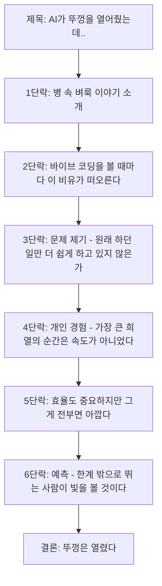
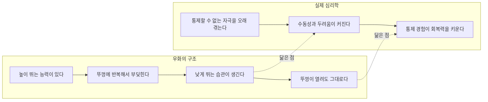
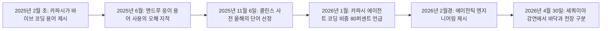
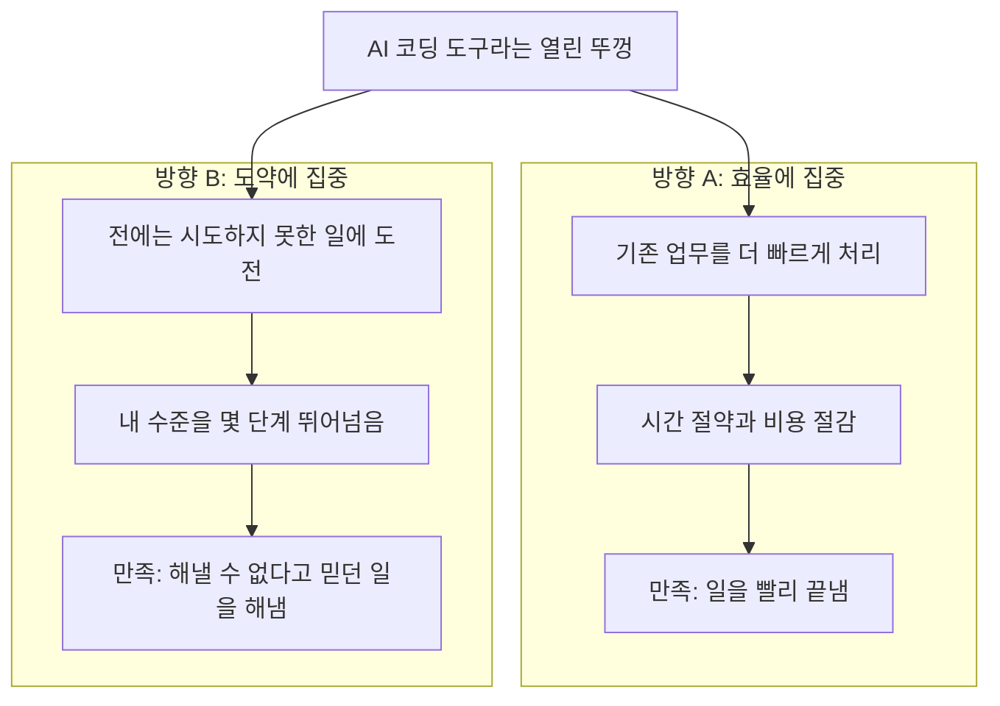

- 작성 일자: 2026-10-24
- 대상: SNS(Threads)에 게시된 짧은 글 한 편과 그 아래에 달린 댓글 대화
- 목적: 글이 무엇을 말하는지, 글이 빌려 쓴 비유와 개념(벼룩 병 이야기, 바이브 코딩)이 실제로 어떤 내용인지, 최신 정보와 함께 쉽고 자세하게 풀어 설명한다.

```
AI가 뚜껑을 열어줬는데..

병에 갇혔던 벼룩은 밖으로 꺼내줘도 병 높이까지만 뛴다는 이야기가 있다.
요즘 바이브 코딩을 보면서 이 비유가 자꾸 떠오른다.

할 수 있는 일은 훨씬 많아졌는데,
우리는 원래 하던 일을 더 쉽게 하는 데만 집중하는 건 아닐까.

바이브 코딩을 하면서 가장 큰 희열을 느낀 순간은,
하던 일을 빨리 끝냈을 때가 아니었다.

전에는 생각조차 못 했던 일을 해내고,
내 수준에서 몇 단계를 단숨에 뛰어넘었다고 느꼈을 때였다.

효율을 높이는 것도 중요하다.
하지만 그게 전부라면, 새로 생긴 가능성이 너무 아깝다.

바이브 코딩 시대에는
자신이 정해둔 한계 밖으로 뛰어보는 사람이
더 빛을 볼 것 같다.

뚜껑은 열렸다.

https://www.threads.com/share/BAWfSb2kYU/

```

---

## 0. 먼저 한눈에 보기

이 글은 한 문장으로 줄이면 이렇습니다.

**"AI 덕분에 우리를 가두던 뚜껑이 열렸으니, 같은 일을 더 빨리 하는 데서 멈추지 말고 전에는 상상도 못 했던 높이로 뛰어보자."**

글쓴이는 이 주장을 전달하기 위해 널리 알려진 우화인 '병 속 벼룩 이야기'를 빌려 옵니다. 그리고 그 우화를 요즘 화제인 '바이브 코딩(vibe coding)'에 겹쳐 놓습니다. 글 아래 댓글에서는 병원 업무 자동화를 직접 해 본 사람이 자신의 경험으로 공감을 표하고, 글쓴이가 짧게 화답합니다. 또 다른 댓글에서는 한 이용자가 스스로를 벼룩에 빗대어 반성하는 말을 남기고, 글쓴이는 "우주 끝까지 뛰는 벼룩이 되어 봅시다"라고 응원합니다.

이 문서는 다음 순서로 진행됩니다.

1. 글의 내용을 문단별로 풀어 읽기
2. 글이 빌려 온 '병 속 벼룩 이야기'가 실제로 어떤 이야기이며, 사실로 확인된 것과 아닌 것은 무엇인지
3. '바이브 코딩'이라는 말이 어디서 왔고 2026년 현재 어디까지 와 있는지
4. 댓글 대화 해설
5. 글의 주장이 갖는 힘과, 함께 생각해 볼 한계
6. 정리

한 가지 미리 밝혀 둡니다. 원문이 올라온 Threads 주소를 직접 열어 보려 했으나 해당 사이트가 자동 접근을 허용하지 않아 열리지 않았습니다. 그래서 글과 댓글의 내용은 대화에 직접 붙여 넣어진 본문과 댓글 화면에 보이는 텍스트를 기준으로 했고, 그 밖의 정보(벼룩 이야기, 바이브 코딩, 심리학 개념)는 웹 검색으로 확인한 자료를 근거로 했습니다. 확인되지 않은 부분은 확인되지 않았다고 표시했습니다.

---

## 1. 글의 내용을 차근차근 읽기

### 1-1. 글 전문의 흐름

글은 모두 일곱 덩어리의 짧은 단락으로 이루어져 있습니다. 각 단락이 맡은 역할을 따라가 보면 논리가 아주 단정하다는 것을 알 수 있습니다.



### 1-2. 단락별 해설

**제목 — "AI가 뚜껑을 열어줬는데.."**
제목 끝의 말줄임표가 중요합니다. '열어줬는데' 뒤에 오는 말은 생략되어 있지만, 문맥상 "그런데도 우리는 여전히 병 안에서만 뛰고 있다"는 아쉬움이라는 것을 글 전체가 뒷받침합니다. 제목이 곧 문제 제기입니다.

**1단락 — 비유의 제시.**
글쓴이는 "병에 갇혔던 벼룩은 밖으로 꺼내줘도 병 높이까지만 뛴다는 이야기가 있다"라고 씁니다. 여기서 눈여겨볼 표현은 "이야기가 있다"입니다. 글쓴이는 이것을 검증된 실험 결과라고 단정하지 않고, 널리 퍼진 이야기로 소개합니다. 뒤에서 확인하겠지만, 이 표현은 사실관계 면에서 정확한 선택입니다.

**2단락 — 현재와의 연결.**
"요즘 바이브 코딩을 보면서 이 비유가 자꾸 떠오른다." 비유가 왜 지금 필요한지를 밝히는 단락입니다. 이야기의 '뚜껑'이 무엇인지는 글 전체의 맥락에서 드러납니다. 뚜껑은 '내가 할 수 있는 일의 한계', 구체적으로는 코딩 지식, 시간, 비용 같은 제약이고, 'AI가 뚜껑을 열어줬다'는 것은 AI 코딩 도구가 그 제약의 상당 부분을 걷어냈다는 뜻입니다.

**3단락 — 날카로운 질문.**
"할 수 있는 일은 훨씬 많아졌는데, 우리는 원래 하던 일을 더 쉽게 하는 데만 집중하는 건 아닐까." 이 단락이 글의 핵심 질문입니다. 가능성의 범위는 넓어졌는데 사용 방식은 기존 업무의 자동화·가속에 머물러 있지 않느냐는 자기 성찰이자 문제 제기입니다.

**4단락 — 개인 경험에 의한 근거.**
글쓴이는 자신의 경험을 증거로 제시합니다. 바이브 코딩에서 가장 큰 희열을 느낀 순간은 "하던 일을 빨리 끝냈을 때"가 아니라 "전에는 생각조차 못 했던 일을 해내고, 내 수준에서 몇 단계를 단숨에 뛰어넘었다고 느꼈을 때"였다고 말합니다. 즉 '속도'가 아니라 '도약'이 만족의 원천이었다는 주장입니다. 이것은 통계가 아니라 개인의 체험담이므로, 일반 법칙이 아니라 하나의 진솔한 증언으로 읽어야 합니다.

**5단락 — 균형 잡기.**
"효율을 높이는 것도 중요하다. 하지만 그게 전부라면, 새로 생긴 가능성이 너무 아깝다." 글쓴이는 효율을 부정하지 않습니다. 효율은 필요하지만 그것만으로 끝나면 낭비라는 입장입니다. 이 한 줄 덕분에 글이 극단적인 주장이 아니라 균형 잡힌 제안으로 읽힙니다.

**6단락 — 예측.**
"바이브 코딩 시대에는 자신이 정해둔 한계 밖으로 뛰어보는 사람이 더 빛을 볼 것 같다." 여기서도 "~것 같다"라는 표현으로 단정이 아닌 전망임을 분명히 합니다. 핵심 어휘는 '자신이 정해둔 한계'입니다. 한계의 출처가 외부가 아니라 스스로 정한 선이라는 점이 벼룩 이야기와 정확히 맞물립니다.

**마무리 — "뚜껑은 열렸다."**
단 한 줄로 글을 닫습니다. 설명이 아니라 선언입니다. 이제 남은 일은 뛰는 것뿐이라는 메시지입니다.

### 1-3. 글에 곁들여진 삽화가 말해 주는 것


글에는 흑백 선화 한 장이 함께 있습니다. 뚜껑이 병 옆에 비스듬히 놓여 있고, 병 안의 벼룩들은 저마다 짧은 점선 궤적을 그리며 낮게 뛰고 있습니다. 반면 한 마리만 점선 궤적을 길게 그리며 병 입구 바깥 높은 곳까지 날아올랐습니다. 병 안의 벼룩 궤적이 모두 병의 상단보다 훨씬 아래에서 끝난다는 점이 '자기가 정한 높이'를 시각적으로 표현하고, 바깥으로 뛰어오른 한 마리가 글의 마지막 메시지를 대신 말해 줍니다. 즉 삽화는 글의 논지를 그대로 옮긴 것입니다. 열린 뚜껑이 그림 속에서도 '이미 열려 있다'는 사실을 분명히 보여 주고 있습니다.

---

## 2. 글이 빌려 온 비유: '병 속 벼룩 이야기'

### 2-1. 이야기는 어떤 내용인가

이야기는 여러 변형이 있지만 뼈대는 같습니다.

1. 벼룩을 병에 넣습니다. 벼룩은 본래 매우 높이 뛰므로 뚜껑이 없으면 곧바로 뛰쳐나갑니다.
2. 병에 뚜껑을 덮습니다. 벼룩은 힘껏 뛰다가 뚜껑에 부딪혀 떨어지기를 반복합니다.
3. 얼마 지나면 벼룩은 뚜껑에 닿지 않을 정도의 높이까지만 뜁니다.
4. 뚜껑을 열어도 벼룩은 예전 뚜껑 높이까지만 뛰고, 병 밖으로 나가지 못합니다.

이야기의 변형을 몇 가지 확인할 수 있었습니다. 어떤 글은 뚜껑을 덮은 채 사흘을 그냥 두었다고 쓰고, 어떤 글은 투명한 유리판을 뚜껑으로 썼다고 설명하며, 어떤 글은 새끼 벼룩들도 어른 벼룩을 따라 낮게 뛴다고까지 덧붙입니다. 이처럼 세부 내용이 글마다 다르다는 사실 자체가 이 이야기가 하나의 고정된 실험 기록이 아니라, 사람들 사이에서 조금씩 다르게 전해진 이야기라는 것을 보여 줍니다.

### 2-2. 사실인가? — 확인된 것과 확인되지 않은 것

이 부분은 정확하게 구분해야 합니다.

**확인되지 않은 것: 이야기 그대로의 실험.**
이 이야기를 검증하는 글들은 공통적으로, 이 실험을 뒷받침하는 동료평가(peer-review)를 거친 연구나 과학 문헌을 찾을 수 없다고 말합니다. 어떤 종의 벼룩을 썼는지, 누가 언제 왜 실험했는지, 몇 세대를 관찰했는지 같은 기본 정보도 확인되지 않는다고 지적하는 글도 있습니다. 또 다른 해설은 이 이야기를 '실험 결과가 아닌 우화(parable)'로 분류하면서, 그 교훈은 오랜 심리학 연구에 의해 뒷받침되는 면이 있다고 설명합니다. 즉 이야기 자체는 우화이고, 교훈의 일부는 다른 연구와 통하는 부분이 있다는 정리입니다.

**확인된 것: 벼룩의 점프 능력.**
벼룩이 매우 잘 뛴다는 점은 사실입니다. 백과사전 항목에 따르면 벼룩은 수직으로 최대 약 18cm, 수평으로 최대 약 33cm를 뛸 수 있습니다. 또 이 점프는 근육의 직접적인 힘만으로는 설명되지 않는 속도와 힘을 내는데, 벼룩이 근육 에너지를 '레실린(resilin)'이라는 탄성 단백질 패드에 저장했다가 한꺼번에 방출하는 방식(활시위를 당겼다 놓는 것과 비슷한 원리)을 쓰기 때문이라고 설명되어 있습니다. 따라서 "벼룩은 높이 뛴다"는 이야기의 전제는 사실이지만, "뚜껑 경험 때문에 그 능력을 스스로 제한한다"는 결론은 검증된 사실이 아닙니다.

정리하면 이렇습니다.

| 이야기의 요소 | 확인 상태 |
|---|---|
| 벼룩이 몸집에 비해 매우 높이 뛴다 | 사실로 확인됨 |
| 뚜껑에 반복해서 부딪힌 벼룩이 뚜껑을 연 뒤에도 같은 높이로만 뛴다 | 과학적 근거를 찾을 수 없음(우화로 분류됨) |
| 새끼 벼룩도 이를 모방한다 | 일부 글의 주장일 뿐, 근거를 찾을 수 없음 |

### 2-3. 그렇다면 글쓴이의 사용법은 적절한가

적절합니다. 이유는 세 가지입니다.

첫째, 앞서 보았듯 글쓴이는 "~는 이야기가 있다"라고 썼습니다. 사실이라고 단정하지 않고 이야기로 소개했습니다.
둘째, 글의 논지는 벼룩의 생물학이 아니라 '사람이 스스로 정한 한계'에 있습니다. 비유가 사실이냐 아니냐와 상관없이, 비유가 가리키는 인간의 경험(과거의 제약이 사라졌는데도 습관처럼 낮게 머무는 것)은 누구나 공감할 수 있습니다.
셋째, 이 비유는 그 자체로 널리 쓰이는 관용 비유입니다. 비즈니스, 조직 문화, 자기계발 글에서 오랫동안 반복해서 인용되어 왔습니다.

다만 읽는 사람은 이것이 '과학적으로 증명된 사실'이 아니라 '교훈을 전하기 위한 우화'라는 점을 알고 있어야 합니다.

### 2-4. 비유와 닿아 있는 진짜 심리학 개념: 학습된 무기력

이야기가 가리키는 현상과 가장 가까운 실제 심리학 개념은 '학습된 무기력(learned helplessness)'입니다. 마틴 셀리그먼(Martin Seligman)과 스티븐 마이어(Steven Maier) 등이 동물 실험에서 정립한 개념으로, 피할 수 없는 불쾌한 자극을 겪은 뒤에 수동성과 두려움이 커지는 현상을 말합니다.

여기서 흥미로운 점은 이 개념에 대한 해석이 최근 크게 바뀌었다는 것입니다. 2023년 5월 학술지 *Frontiers in Psychiatry*에 실린 바라타(Baratta), 셀리그먼, 마이어의 논문에 따르면 다음과 같습니다.

- **기존 설명:** 동물이 '결과는 내 행동과 무관하다'는 것을 배우기 때문에 무기력해진다. 통제 가능한 상황은 이런 학습이 없으므로 무기력을 낳지 않는다.
- **최근 신경과학적 관점:** 오히려 반대로, 오래 지속되는 혐오 자극 그 자체가 뇌간의 등쪽 솔기핵(dorsal raphe nucleus)에서 세로토닌 뉴런을 강하게 활성화해 무기력을 만든다. 그리고 '통제할 수 있다'는 경험(자신의 행동으로 상황을 바꾸는 경험)이 전전두엽 회로를 활성화해 이 반응을 누그러뜨리고, 이후의 스트레스에도 회복력을 키운다.

쉽게 말해, 최신 연구의 관점에서는 '무기력'이 학습되는 것이 아니라 기본 반응에 가깝고, 정작 '학습되는 것'은 '내가 통제할 수 있다'는 감각입니다. 이 해석을 글쓴이의 비유에 조심스럽게 대입해 보면 흥미로운 대응이 생깁니다. 글쓴이가 말한 "전에는 생각조차 못 했던 일을 해내는 경험"은 바로 '내가 상황을 바꿀 수 있다'는 통제 경험에 해당하고, 그것이 다음 도약의 심리적 바탕이 된다는 해석이 가능합니다. 다만 이 대응은 필자(이 문서)가 두 자료를 나란히 놓고 읽은 해석이며, 글쓴이가 이 연구를 언급한 것은 아닙니다. 또한 이 연구는 벼룩이 아니라 실험동물과 사람의 신경 반응에 관한 것임을 분명히 해 둡니다.

비유가 실제 실험이 아니라는 사실이 비유의 쓸모를 없애지는 않습니다. 다만 '증명된 법칙'이 아니라 '생각을 돕는 도구'로 쓰는 것이 정확합니다.



---

## 3. 바이브 코딩이란 무엇이며, 지금 어디까지 왔는가

### 3-1. 용어의 탄생

'바이브 코딩'은 오픈AI 공동 창업자이자 전 테슬라 AI 책임자인 안드레이 카파시(Andrej Karpathy)가 2025년 2월 초 X(옛 트위터)에 올린 글에서 처음 쓴 말입니다. 날짜는 자료마다 2월 2일 또는 3일로 조금씩 다르게 적혀 있어, 이 문서에서는 '2025년 2월 초'로 적습니다.

그가 설명한 핵심은 이렇습니다. 코드를 직접 한 줄씩 읽고 쓰는 대신, 자연어(말)로 AI에게 원하는 바를 전하고, AI가 낸 변경 사항을 일일이 읽지 않고 받아들이며, 오류가 나면 오류 메시지를 그대로 AI에게 되붙여 넣는 방식입니다. 스스로도 이 방식이 완벽하지 않다고 밝혔고, 주로 가볍게 만드는 일회성 프로젝트에 적합한 방식이라고 설명했습니다. 즉 처음부터 '거침없이 만들어 보는 즐거움'과 '검증을 건너뛴다는 위험'이 한 쌍으로 따라다니던 개념입니다.

### 3-2. 용어의 확산

- 2025년 초, 와이콤비네이터(Y Combinator) 2025년 겨울 배치의 상당수 스타트업이 코드의 대부분을 AI로 작성했다는 보도가 나오며 현실의 흐름으로 받아들여졌습니다. (이 수치는 2차 자료에서 확인한 것으로, 정확한 비율은 자료마다 표현이 다릅니다.)
- 2025년 6월, 앤드루 응(Andrew Ng)은 AI와 함께 코딩하는 일을 '바이브'라는 말로 부르는 것이 오해를 부른다고 지적했습니다. 그는 AI와 코딩하는 일이 깊은 지적 노동이며 하루를 마치면 몹시 지칠 정도라고 말했다고 전해집니다.
- 2025년 11월 6일, 영국 콜린스 사전(Collins Dictionary)이 '바이브 코딩'을 2025년 올해의 단어로 선정했습니다. 정의는 자연어로 AI에게 지시해 컴퓨터 코드를 작성하게 하는 것입니다.

### 3-3. 2026년의 변화: '바이브'에서 '에이전틱 엔지니어링'으로

가장 최신의 흐름을 살펴보면, 용어를 만든 카파시 본인이 개념을 한 단계 발전시켰습니다.

- 2026년 1월 카파시는 자신의 코딩 방식이 2025년 11월의 '직접 작성·자동완성 80%, 에이전트 20%'에서 '에이전트 코딩 80%, 수정·마무리 20%'로 뒤집혔다고 밝혔습니다.
- 2026년 2월경, 바이브 코딩이 등장한 지 1년을 맞을 즈음 카파시는 AI 모델이 훨씬 좋아졌으므로 '바이브 코딩'이라는 표현은 이미 한 시대 전의 것이라는 취지로 말하고, 전문 개발 환경을 위한 새 이름으로 '에이전틱 엔지니어링(agentic engineering)'을 제시했습니다. 보도에 따라 날짜 표기는 2월 8일 전후로 다소 다릅니다.
- 2026년 4월 30일 세쿼이아 캐피털의 'AI 어센트(AI Ascent) 2026' 강연에서 그는 이를 보다 정식으로 설명했습니다. 이 강연의 핵심 문장으로 소개되는 내용은, 바이브 코딩은 '바닥(floor)'을 끌어올려 코딩 경험이 없는 사람도 무언가를 만들기 시작하게 하고, 에이전틱 엔지니어링은 '천장(ceiling)'을 넓혀 전문가가 만들 수 있는 것의 한계를 확장한다는 것입니다. 이 강연에서 AI 에이전트는 '틀릴 수 있고 확률적(fallible and stochastic)'이므로 전문가의 감독이 필요하다는 점도 강조되었다고 전해집니다. 또한 바이브 코딩을 이유로 보안 취약점을 만드는 것은 허용되지 않고, 소프트웨어에 대한 책임은 이전과 다름없이 개발자에게 있다는 취지의 발언도 소개되어 있습니다.

간단히 비교하면 다음과 같습니다.

| 구분 | 바이브 코딩 | 에이전틱 엔지니어링 |
|---|---|---|
| 처음 쓰인 때 | 2025년 2월 | 2026년 2월(이후 4월 강연에서 정리) |
| 핵심 태도 | 의도를 말하고 결과를 받아들인다 | AI 에이전트를 지휘하되 계획·검증·감독을 한다 |
| 잘 맞는 곳 | 가벼운 프로토타입, 일회성 도구 | 실제로 배포하고 유지해야 하는 소프트웨어 |
| 위험 | 이해하지 못한 코드, 보안 구멍 | 감독을 소홀히 하면 같은 위험이 커짐 |



### 3-4. 한국에서의 현황, 그리고 주의점

국내 IT 매체와 블로그에서도 2026년을 바이브 코딩이 '개발 생태계의 패러다임을 바꾸는 흐름'으로 자리 잡은 해로 정리하고 있습니다. 한 기술 해설은 2026년 현재 비개발자가 사이드 프로젝트와 업무 도구를 직접 만드는 일반적인 방법으로 자리 잡았다고 설명합니다. 동시에 같은 글은 중요한 경고도 덧붙입니다. 다른 사람의 이메일·비밀번호를 받는 서비스나 결제·개인정보를 다루는 기능은 이해하지 못한 채 공개 서비스에 넣지 말아야 하고, 2025~2026년 사이 바이브 코딩으로 만든 서비스에서 데이터베이스가 통째로 노출된 사례가 해외에서 여러 차례 보고되었다고 합니다. 이 내용은 해당 해설 글이 전하는 것이며, 개별 사고의 상세 내용은 이 문서에서 따로 검증하지 않았습니다.

---

## 4. 두 가지 활용 방식: 글쓴이의 문제 제기를 그림으로 풀기

글쓴이의 3~5단락 주장은 AI 코딩 도구를 쓰는 두 가지 방향의 대비로 정리할 수 있습니다.



글쓴이는 A를 부정하지 않습니다. 5단락에서 효율이 중요하다고 분명히 인정합니다. 다만 "그게 전부라면 새로 생긴 가능성이 아깝다"고 말하며 B를 더해야 한다고 주장합니다. 이 점에서 이 글은 'A 대신 B'가 아니라 'A에 더해 B'를 요구하는 글입니다.

---

## 5. 댓글 대화 해설

글 아래에는 두 갈래의 댓글 대화가 있습니다. 둘 다 약 15~16시간 전에 작성된 것으로 표시되어 있습니다(작성 시점은 '몇 시간 전'이라는 상대 표기만 확인됩니다).

### 5-1. 병원 업무 자동화 경험을 말한 댓글과 글쓴이의 답

댓글 작성자는 병원 자동화 작업에서 가장 큰 변화를 느낀 순간이, 일을 빨리 끝냈을 때보다 예전에는 엄두도 못 냈던 환자 안내와 직원 인계 방식을 직접 시험해 본 때였다고 말합니다. 그리고 다음과 같은 취지의 의견을 덧붙입니다. 열린 뚜껑 밖으로 뛰려면 새 기능의 수보다 '누구의 어떤 하루가 달라졌는가'를 함께 봐야 가능성이 실제 변화로 남는 것 같다는 것입니다.

글쓴이는 현재 의료 쪽 외주 작업을 하고 있는데 직접 바이브 코딩을 하는 의료인을 만나 반갑다고 답하며, 변화를 만드는 것은 결국 상상과 실천의 힘이라고 말합니다.

이 댓글이 글에 더해 주는 것은 두 가지입니다.

1. **같은 방향의 현장 증언.** 글쓴이의 4단락(속도가 아니라 도약에서 희열을 느꼈다)과 같은 경험이 다른 분야(병원)에서도 있었다는 이야기입니다. 다만 이것도 한 사람의 경험담이라는 점은 같습니다.
2. **도약의 기준에 대한 보충.** 댓글 작성자는 도약을 '기능을 많이 만들었는가'로 재지 말고 '누구의 하루가 어떻게 달라졌는가'로 재자고 제안합니다. 이는 글 본문이 말하지 않은 부분을 채워 주는 의견입니다. 본문은 "한계 밖으로 뛰자"고 했지만 '어디로, 무엇을 기준으로 뛰었다고 판단할지'는 열어 두었는데, 댓글은 그 기준을 사람의 삶의 변화에 두자고 제안한 것입니다.

### 5-2. 스스로를 벼룩에 빗댄 댓글과 글쓴이의 응원

다른 이용자는 자신을 '벼룩 같은 미천한 존재'에 빗대며 글을 읽고 반성하게 된다고 말합니다. 글쓴이는 "우주 끝까지 뛰는 벼룩이 되어 봅시다!"라고 답합니다.

여기서 비유가 한 번 더 확장된 점이 눈에 띕니다. 원래 우화에서 벼룩은 '갇혀 낮게 뛰는 존재'였는데, 글쓴이의 답에서는 벼룩이 '우주 끝까지 뛰는 존재'로 바뀝니다. 같은 벼룩이어도 어떤 방향으로 읽느냐에 따라 한계의 상징이 되기도 하고 가능성의 상징이 되기도 합니다. 다만 '우주 끝까지'는 격려의 수사이며 실제 목표나 계획을 뜻하는 말은 아닙니다.

---

## 6. 글의 힘과 함께 생각할 점

### 6-1. 글이 강한 이유

1. **비유가 단순하고 오래 기억에 남는다.** 벼룩, 병, 뚜껑이라는 세 가지 사물만으로 '자기 제한'이라는 추상적인 개념을 전달합니다.
2. **질문의 방향이 정확하다.** "AI가 무엇을 할 수 있는가"가 아니라 "나는 AI를 어떻게 쓰고 있는가"라는 사용자의 태도로 초점을 옮깁니다.
3. **경험에서 출발한다.** 일반론을 늘어놓는 대신 '내가 가장 짜릿했던 순간'이라는 구체적 체험을 근거로 삼아 설득력이 높습니다.
4. **효율을 부정하지 않는다.** 균형 잡힌 문장 덕분에 반감을 줄입니다.

### 6-2. 함께 생각해 볼 점

이 부분은 글을 비판하려는 것이 아니라, 읽는 사람이 비유를 더 정확하게 쓰도록 돕기 위한 정리입니다.

**① 비유는 증명된 사실이 아니다.**
앞서 확인했듯 병 속 벼룩 실험은 우화이며 과학적 근거를 찾을 수 없습니다. 글의 논지는 우화의 사실성에 기대지 않으므로 큰 문제는 아니지만, 이 이야기를 '과학적으로 증명되었다'며 인용하면 부정확합니다.

**② 모든 한계가 '스스로 정한 한계'는 아니다.**
벼룩 이야기에서 뚜껑이 사라진 뒤에 남는 한계는 마음속의 선입니다. 하지만 현실의 한계에는 실제로 남아 있는 것도 있습니다. 보안, 개인정보 보호, 법적 책임, 의료와 같은 안전이 중요한 영역에서의 검증 요구가 그 예입니다. 앞서 본 것처럼 카파시 본인도 AI가 만든 코드라 해서 개발자의 책임이 사라지지 않는다는 점을 강조했고, 에이전틱 엔지니어링이라는 개념 자체가 '빠르게 뛰되 검증과 감독을 놓지 않는' 쪽으로 진화한 것입니다. 따라서 '한계를 넘자'는 말은 '검증 없이 뛰자'가 아니라 '검증하면서 더 높이 뛰자'로 읽는 것이 안전합니다. 글쓴이가 이를 부정한 것은 아니며, 글이 다루는 범위가 아닐 뿐입니다. 의료 분야의 사례가 댓글에 등장했다는 점에서 이 구분은 특히 중요합니다.

**③ '도약'의 기준을 정하는 일이 남는다.**
댓글에서 제안했듯 도약을 '누구의 하루가 달라졌는가'로 재는 것은 좋은 기준입니다. 기능이 늘어난 것과 실제 변화가 생긴 것은 다르기 때문입니다.

**④ 개인의 체험은 일반화에 한계가 있다.**
"나는 도약했을 때 가장 기뻤다"는 증언이 곧 "도약하는 사람이 더 성공한다"는 예측을 증명하지는 않습니다. 6단락의 "더 빛을 볼 것 같다"는 표현은 글쓴이 스스로 이 점을 인식하고 있음을 보여 줍니다. 이 예측이 맞는지는 시간이 지나야 알 수 있고, 현재로서는 검증된 결론이 아닙니다.

---

## 7. 정리

- 이 글은 '병 속 벼룩 이야기'를 빌려, AI 코딩 도구가 열어 준 가능성을 기존 업무의 효율화에만 쓰지 말고 이전에는 시도하지 못했던 일에 도전하는 데 쓰자고 제안합니다.
- 비유로 쓰인 벼룩 이야기는 널리 퍼진 우화이며, 이야기 그대로의 실험을 뒷받침하는 과학적 근거는 찾을 수 없습니다. 반면 벼룩이 잘 뛰는 것은 사실이고, 이야기의 교훈은 '학습된 무기력'과 그에 대한 최신 신경과학 연구(통제 경험이 회복력을 키운다)와 닿는 면이 있습니다.
- '바이브 코딩'은 2025년 2월 카파시가 제시한 말로, 2025년 11월 콜린스 사전의 올해의 단어가 되었고, 2026년에는 카파시 본인이 전문 개발을 위한 '에이전틱 엔지니어링'이라는 개념으로 발전시켰습니다. 그가 설명한 구도는 바이브 코딩이 '바닥'을, 에이전틱 엔지니어링이 '천장'을 올린다는 것입니다.
- 댓글에서는 병원 업무 자동화를 직접 해 본 사람이 같은 방향의 경험을 전하면서 '누구의 어떤 하루가 달라졌는가'라는 기준을 제안했고, 글쓴이는 상상과 실천의 힘을 강조했습니다.
- 글의 메시지를 안전하게 읽으려면 "한계를 넘자"를 "검증과 책임을 놓지 않은 채 더 높이 뛰자"로 이해하는 것이 좋습니다.

한 줄로 마무리하면, **뚜껑이 열렸다는 것은 출발선일 뿐이며, 어디까지 어떻게 뛸지는 쓰는 사람이 정하는 일**이라는 것이 이 글이 남기는 이야기입니다.

---

## 부록: 확인 상태 요약

| 항목 | 확인 방법 | 확인 결과 |
|---|---|---|
| Threads 원문 페이지 | 주소 직접 열람 시도 | 해당 사이트가 자동 접근을 허용하지 않아 열람하지 못함. 본문과 댓글은 대화에 제공된 텍스트 기준 |
| 병 속 벼룩 실험의 실재 | 웹 검색 | 뒷받침하는 과학 문헌을 찾을 수 없고 우화로 소개됨 |
| 벼룩 점프 능력 | 웹 검색(백과사전) | 수직 최대 약 18cm, 수평 최대 약 33cm, 레실린 에너지 저장 방식 |
| 학습된 무기력 최신 해석 | 웹 검색(2023년 논문) | 통제 경험이 회복력을 만든다는 관점 |
| 바이브 코딩 기원 | 웹 검색 | 2025년 2월 초 카파시의 X 게시물 |
| 콜린스 올해의 단어 | 웹 검색 | 2025년 11월 6일 선정 |
| 에이전틱 엔지니어링 | 웹 검색 | 2026년 2월경 제시, 2026년 4월 30일 세쿼이아 강연에서 정리(날짜 표기는 보도마다 다소 차이) |
| 와이콤비네이터 비율, 해외 데이터베이스 노출 사례 | 2차 자료 | 개별 수치와 사례는 직접 검증하지 못함 |

## 출처

- [The Flea in a Jar Experiment: What It Really Means](https://www.theuniverseunveiled.com/flea-in-a-jar-experiment/)
- [The Fleas in a Jar Experiment - Separating Fact from Fiction](https://buy-butterflies.com/the-fleas-in-a-jar-experiment/)
- [Is The Flea In A Jar Experiment Real](https://datasciencemilan.org/is-the-experiment-with-the-flea-in-a-jar-real.html)
- [The Invisible Lid (ProjectManagement.com)](https://www.projectmanagement.com/blog-post/3693/The-Invisible-Lid)
- [Flea (Wikipedia)](https://en.wikipedia.org/wiki/Flea)
- [From helplessness to controllability: toward a neuroscience of resilience (Frontiers in Psychiatry, 2023)](https://www.ncbi.nlm.nih.gov/pmc/articles/PMC10205144/)
- [Vibe Coding (Know Your Meme)](https://amp.knowyourmeme.com/memes/vibe-coding)
- [Vibe Coding (meme.com)](https://meme.com/memes/vibe-coding)
- [The vibe coding moment (Uxcel)](https://uxcel.com/lessons/the-vibe-coding-moment-456)
- [Vibe coding is passé. Karpathy has a new name for the future of software (The New Stack)](https://thenewstack.io/vibe-coding-is-passe-karpathy-has-a-new-name-for-the-future-of-software/)
- [Agentic Engineering: Karpathy's New Framework (AI Builder Club)](https://aibuilderclub.com/blog/karpathy-agentic-engineering)
- [Vibe Coding's 2026 Upgrade: A Six-Stage Agentic Engineering SOP](https://israynotarray.com/en/ai/2026/05/17/agentic-engineering-2026-six-stage-sop/)
- [Andrej Karpathy Retires Vibe Coding for Agentic Engineering (StartupHub.ai)](https://startuphub.ai/ai-news/ai-figures/2026/figure-andrej-karpathy-vibe-coding-agentic-engineering-2026-08-16)
- [바이브 코딩 시작 가이드 2026 (위키독스 블로그)](https://wikidocs.net/blog/@openwiki/23726/)
- [2026년 바이브 코딩 (요즘IT)](https://yozm.wishket.com/magazine/detail/3611/)

---

작성 일자: 2026-10-24
