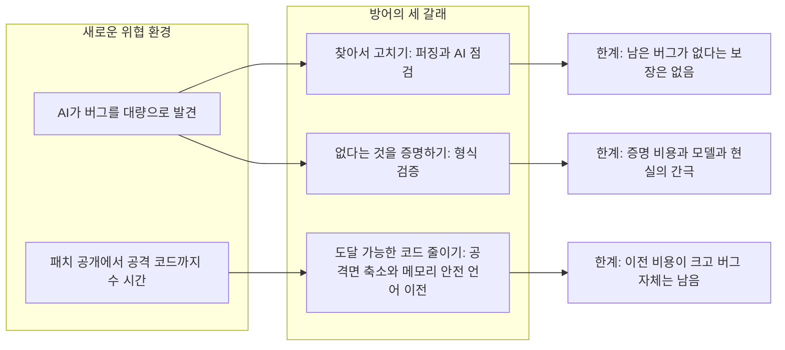
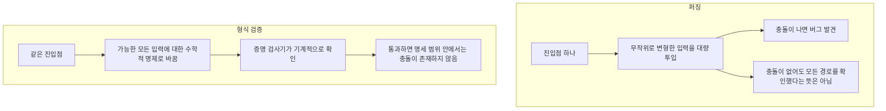
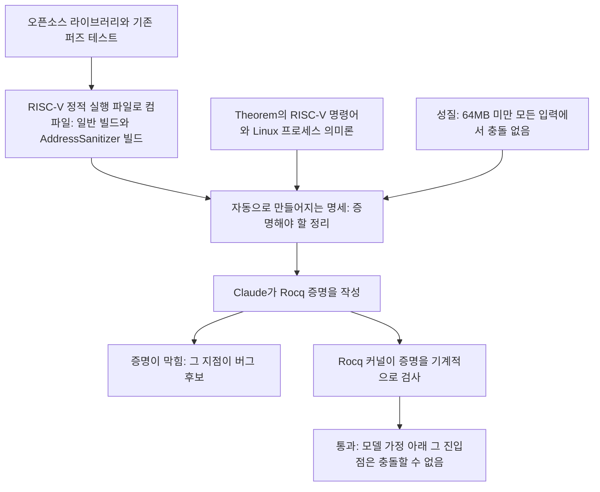
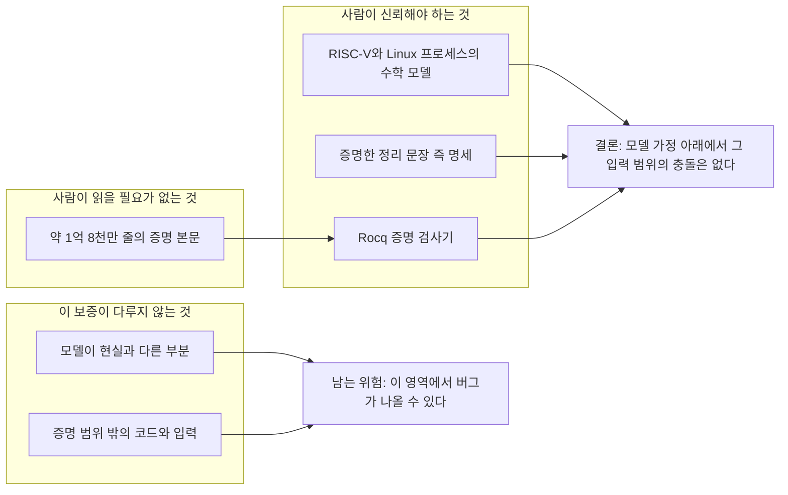
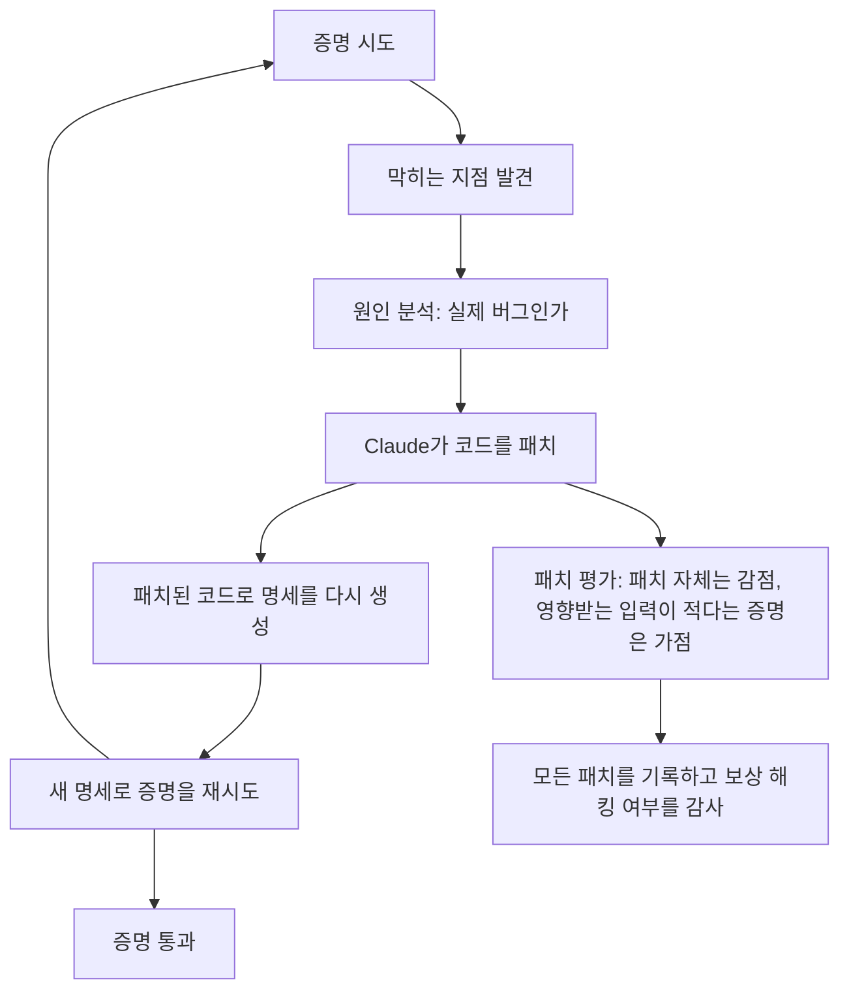
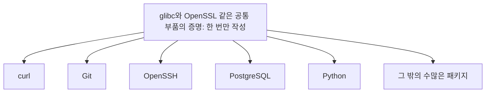
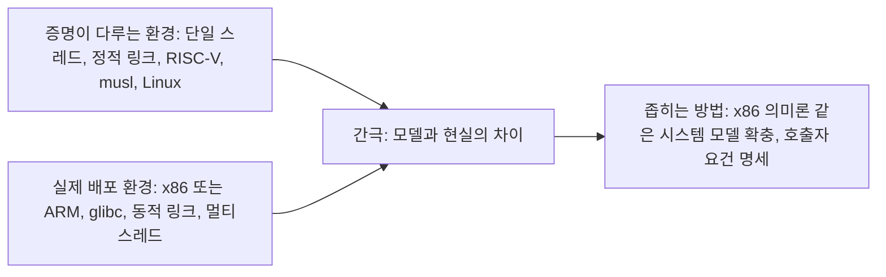

## Anthropic·Theorem의 대규모 소프트웨어 형식 검증 연구 상세 해설

| 항목 | 내용 |
|---|---|
| 작성일 | 2026-10-24 (서버 시각 2026-10-24 10:26 KST 확인) |
| 다루는 자료 | Anthropic Frontier Red Team 연구 글(2026-10-22 공개)과 그 부록, Theorem의 공개 문서와 저장소, 이를 13개 게시글로 풀어 쓴 Threads 연재 |
| 조사 방식 | 원문 직접 열람, 관련 1차 문서 교차 확인, 보도(2차) 대조, 스레드 서술의 항목별 사실 확인 |
| 문서 성격 | 해설 문서. 확인된 사실, 발표 주체의 자체 보고, 2차 보도, 필자의 해석을 구분해 표기 |

### 출처 표기 규칙

| 표기 | 의미 |
|---|---|
| 【원문】 | Anthropic과 Theorem이 직접 공개한 글, 부록, 공개 문서의 내용. 연구 결과 자체는 발표 주체의 보고이며, 이번 조사에서 외부 독립 검증 결과는 확인하지 못했습니다 |
| 【저장소】 | 공개 저장소와 공개 문서에서 직접 확인할 수 있는 사실 |
| 【보도】 | 언론과 블로그 등 2차 출처 |
| 【해석】 | 필자의 해석. 사실이 아니라 의견입니다 |

### 읽기 전에 알아둘 점

이 문서는 2026년 10월 22일에 공개된 Anthropic의 연구 글 [「LLMs are making formal software verification feasible at a much larger scale」](https://www.anthropic.com/research/formal-verification)와, 이 글을 풀어 쓴 Threads 연재(계정 [choi.openai](https://www.threads.com/share/_8UJQDnCc/), 총 13개 게시글)를 함께 다룹니다. Threads 페이지는 자동 열람이 제한되어 제공해 주신 스레드 본문을 기준으로 삼았고, 스레드의 사실 관계는 Anthropic 원문, 부록, Theorem의 문서와 GitHub 저장소를 직접 열어 한 줄씩 대조했습니다. 대조 결과는 9장의 표에 정리해 두었습니다. 스레드 게시글은 "n/13"처럼 게시글에 붙은 순번으로 부릅니다. 모든 수치는 2026-10-24 시점에 확인한 값이며, Theorem 저장소처럼 계속 갱신되는 자료는 이후 달라질 수 있습니다.

---

## 1. 한눈에 보는 요약

### 1.1 무슨 일이 있었나

2026년 10월 22일 Anthropic의 Frontier Red Team은 형식 검증 전문 스타트업 Theorem과 함께한 연구를 공개했습니다. 내용을 한 문장으로 줄이면 이렇습니다. 구글이 운영하는 오픈소스 지속 퍼징 서비스 OSS-Fuzz에 등록된 라이브러리 123개에서, 개발자들이 이미 작성해 둔 퍼즈 테스트의 진입점 239곳을 골라 "64MB 미만의 어떤 입력을 넣어도 이 프로그램은 충돌하지 않는다"는 명제를 Claude가 수학적으로 증명했고, 그 증명을 증명 검사기(Rocq)가 기계적으로 확인했다는 것입니다.

여기서 눈여겨볼 점은 증명의 대상이 소스 코드가 아니라 RISC-V 프로세서용으로 컴파일된 실행 파일, 곧 기계어라는 사실입니다. 이 증명들의 총 분량은 약 1억 8천만 줄의 Rocq 코드이고, 전형적인 증명 하나는 약 60만 줄이며, 증명 대상 프로그램의 중앙값 길이는 RISC-V 명령어 약 18,000개입니다. 이 작업은 몇 주에 걸쳐 이루어졌습니다. 【원문】

증명을 쓰는 과정에서 Claude는 증명이 막히는 지점에서 실제 버그를 찾아냈고, 그 버그를 스스로 고친 뒤 고친 코드로 다시 증명했습니다. 원문은 이 과정에서 수백 개의 버그가 나왔고, 그중에는 수조 번의 테스트 실행에도 수년간 드러나지 않았던 것이 있다고 적고 있습니다. 【원문】

### 1.2 핵심 수치

| 항목 | 값 | 출처 |
|---|---|---|
| 공개일 | 2026-10-22 | 【원문】 |
| 증명 대상 | OSS-Fuzz 라이브러리 123개, 진입점 239곳 | 【원문】 |
| 증명한 성질 | 64MB 미만 모든 입력에서 충돌, 메모리 안전 오류, 단언 실패 없이 정상 종료 (모델 가정 아래에서) | 【원문】 |
| 증명 대상의 형태 | 컴파일된 RISC-V 실행 파일 (소스 코드가 아님) | 【원문】 |
| 증명 분량 | 통과한 증명 합계 약 1억 8천만 줄 (Rocq), 전형적 증명 약 60만 줄 | 【원문】 |
| 프로그램 크기 | 중앙값 약 18,000 RISC-V 명령어 | 【원문】 |
| 시도 전체 분량 | 약 10억 줄을 작성했고 그중 약 1억 8천만 줄이 통과한 증명에 포함 | 【원문】 부록 |
| 발견한 버그 | 수백 개 | 【원문】 |
| 증명 비용 | 증명 하나에 수억 토큰까지 들 수 있음 | 【원문】 |
| 모델 개선 효과 | 작은 검증 과제 36개 중 절반을 Opus 5.5가 Opus 5보다 약 40% 적은 토큰으로 증명 | 【원문】 |
| 증명 재사용 효과 | 에이전트끼리 증명을 복사할 수 있게 하자 토큰이 17% 감소 | 【원문】 |
| 공개된 증명 | Theorem 저장소 기준 25개 라이브러리, 60개 진입점 (Rocq 9.2.0으로 검사) | 【저장소】 |

원문 본문은 입력 한도를 64 MB로 적었고, 부록과 Theorem 문서는 64 MiB로 적었습니다. MiB는 2의 거듭제곱 단위라서 약 67.1MB에 해당합니다. 이 문서에서는 편의상 64MB로 부르되 정확한 단위는 MiB임을 기억해 두시면 좋습니다.

### 1.3 이 연구가 보여준 것과 보여주지 않은 것

이 연구가 보여준 것은 세 가지입니다. 첫째, 대형 언어 모델이 사람이 읽을 수 없는 분량의 증명을 쓰더라도 증명 검사기가 기계적으로 확인해 주므로 신뢰의 근거가 유지된다는 점입니다. 둘째, 정답이 무엇인지 따로 적어 줄 필요 없이 이미 존재하는 퍼즈 테스트를 그대로 명세로 삼는 경로가 있다는 점입니다. 셋째, 증명을 시도하는 일 자체가 버그 탐지 수단이 된다는 점입니다.

반대로 보여주지 않은 것도 분명합니다. 123개 라이브러리에 버그가 없다는 뜻이 아닙니다. 실제 사용자 대부분이 쓰는 x86이나 ARM 환경, 동적 링크된 glibc 환경, 멀티스레드 환경에 대한 보증도 아닙니다. 라이브러리 전체 코드가 아니라 선택된 진입점이 도달하는 코드에 대한 증명이라는 점도 기억해야 합니다. Anthropic 스스로 "형식 검증되었다는 말은 버그가 없다는 말이 아니다"라고 못 박았습니다. 【원문】

---

## 2. 왜 지금 "버그가 없다는 증명"이 필요해졌나

### 2.1 AI가 버그를 찾고 공격하는 속도가 빨라졌다

원문의 서두는 대부분의 소프트웨어에 버그가 가득하고 AI가 이를 쉽게 찾고 악용할 수 있게 되었으니, 기존의 표준적 방어로는 충분하지 않고 코드에 버그가 없음을 증명하는 방법이 필요하다는 문제의식으로 시작합니다. 리눅스 커널을 사례로 들면서 가장 잘 검증된 소프트웨어 중 하나인 이 커널에서도 최근 1,000개가 넘는 취약점이 공개되었다고 짚습니다. 【원문】

스레드 11/13이 연결한 것이 바로 Anthropic이 2026년 6월 8일에 낸 N-day 연구입니다. N-day는 이미 공개되었지만 일부 기기에는 아직 패치가 적용되지 않은 취약점을 가리킵니다. 패치 자체가 버그 위치를 알려 주는 지도 역할을 하기 때문에 공격자는 패치 전후를 비교해 취약점을 역추적합니다. 과거에는 이 작업이 숙련된 전문가의 몇 주짜리 일이었습니다. 연구에서 확인된 수치는 다음과 같습니다. 【원문】

| 실험 | 결과 |
|---|---|
| Firefox 자바스크립트 엔진(SpiderMonkey) 패치 18개 | Mythos Preview가 14개에서 재현용 충돌(PoC)을 만들었고, 8개에서 임의 코드 실행 공격 코드를 자율적으로 완성 |
| 속도 | 첫 공격 코드는 1시간이 채 안 걸렸고, 8개를 모두 만드는 데 약 12시간. 이는 Mozilla가 패치를 낸 지 한 시간 안에 공격 코드가 나온 셈이며, 해당 패치가 담긴 Firefox 148이 출시되기까지는 18일이 더 남아 있던 시점 |
| Windows 커널 패치 21개 (소스 코드 없이 바이너리만 제공) | 18개에서 블루스크린 PoC, 서로 다른 8개의 권한 상승 전체 공격 체인 완성. 체인 8개에 들어간 API 비용은 약 15,700달러로 하나당 평균 약 2,000달러 |

연구진은 결론에서 "N-day"라는 말이 이제 오해를 부르며 "N-hour"가 현실에 더 가깝다고 썼습니다. 그리고 패치를 빨리 내는 것만이 아니라 버그의 공급 자체를 줄이는 쪽이 더 오래 갈 해법이라면서, 핵심 구성요소를 Rust 같은 메모리 안전 언어로 옮기거나 공격 기법 전체를 막는 완화책(Control Flow Guard, 하드웨어 섀도 스택 등)을 쓰라고 제안했습니다. 【원문】 스레드 11/13의 요약은 이 내용과 일치합니다.

### 2.2 이번 주에 실제로 벌어진 일

스레드 11/13은 이번 주 PHP와 GitLab에서 10년 넘게 숨어 있던 취약점이 터졌다고 언급합니다. 보도를 종합하면 PHP 쪽은 이렇습니다. PHP 프로젝트는 10월 21일 두 건의 치명적인 원격 코드 실행 취약점(통칭 PHP2Shell, CVE-2026-109618과 CVE-2026-109619)을 고치는 보안 릴리스를 냈고, 이 취약점들은 10년 넘게 코드에 숨어 있었으며 AI의 도움으로 발견되었다고 전해집니다. 【보도】

GitLab 쪽은 보도 사이에 차이가 있어 조심해서 읽어야 합니다. 10월 21일에 CVSS 10.0짜리 인증 없는 원격 코드 실행 취약점(CVE-2026-110264)이 패치되었고 영향 범위가 7.0(2014년 릴리스)까지 거슬러 올라간다는 보도가 있습니다. 한편 같은 달 12일에는 별개의 CVSS 10.0 취약점(CVE-2026-97229)이 패치되었는데, 이는 비교적 최근 버전에만 영향을 준다는 보도가 있어서 두 건을 혼동한 기사가 돌고 있는 것으로 보입니다. 따라서 "GitLab의 10년 넘은 취약점"이라는 표현은 10월 21일 건을 가리킬 때에 한해 보도 기준으로 맞고, 공식 권고문을 직접 확인한 것은 아니라는 점을 밝혀 둡니다. 【보도】

### 2.3 방어의 세 갈래

이 맥락에서 스레드 11/13은 형식 검증을 "세 번째 길"로 묘사합니다. 원문에도 근거가 있는 표현입니다. Anthropic은 일반적인 명세와 바이너리 수준 증명을 쓰면 코드베이스 전체를 다른 언어로 다시 쓰지 않고도 대규모 검증이 가능하다고 말합니다. 【원문】 이 세 갈래를 정리하면 다음과 같습니다. 【해석】

---

## 3. 이 연구를 이해하기 위한 핵심 개념

### 3.1 형식 검증이란

형식 검증은 코드를 수학적 모델로 바꾼 뒤, 그 코드가 정해 둔 규칙을 언제나 지킨다는 사실을 증명하는 방법입니다. 원문의 설명에 따르면 증명이 실패한다는 것은 규칙을 어기는 버그가 있을 수 있다는 신호이고, 실패한 모양이 버그의 성격을 암시합니다. 원인을 제거하고 다시 증명하기를 반복하다 보면 최종적으로는 그 규칙을 어기는 버그가 없다는 증명을 얻습니다. 【원문】

비유하자면 시험 문제 풀이와 닮았습니다. 테스트는 출제자가 적어 둔 몇 개의 문제를 풀어 보는 일이고, 퍼징은 무작위로 변형한 문제를 엄청나게 많이 풀어 보는 일입니다. 그러나 입력의 경우의 수는 사실상 무한하므로 아무리 오래 돌려도 모든 경우를 확인했다고 말할 수 없습니다. 반면 증명은 가능한 모든 입력에 대해 성립한다는 사실을 논리로 보입니다. Theorem의 설명 방식을 빌리면, 테스트와 퍼저가 확인하는 영역은 정사각형의 일부일 뿐이고 증명은 정사각형 전체를 덮는 셈입니다. 【원문】

### 3.2 테스트, 퍼징, 형식 검증 비교

| 구분 | 확인하는 방식 | 확인한 범위 | 약점 |
|---|---|---|---|
| 단위 테스트 | 사람이 적은 입력과 기대 결과를 확인 | 사람이 생각해 낸 입력 | 생각하지 못한 입력은 검사되지 않음 |
| 퍼징 | 무작위로 변형한 입력을 대량 투입해 충돌을 탐색 | 시도해 본 입력 | 아무리 오래 돌려도 모든 경로를 확인했다는 보장이 없음. 입력은 보통 1MB 정도 이하의 작은 크기에서 변형 |
| 형식 검증 | 모든 입력에 대해 성립한다는 사실을 증명하고 기계가 검사 | 명세가 말하는 범위 전체 | 증명 비용이 크고, 명세와 모델이 현실과 맞아야 의미가 있음 |

### 3.3 명세가 왜 가장 어려운 문제인가

증명을 하려면 먼저 "올바르다"가 무슨 뜻인지를 적어야 합니다. 이것이 명세(spec)입니다. PNG 디코더라면 표준 문서가 있으므로 바이트열을 어떤 픽셀 값으로 해석해야 하는지 비교적 명확히 적을 수 있습니다. 그러나 텍스트 편집기나 웹 브라우저가 올바르다는 것은 수식으로 적기가 어렵습니다. 원문은 포괄적이고 모호하지 않은 명세를 얻기 어렵다는 점이 대규모 검증의 큰 장애물이라고 말합니다. 【원문】

연구진의 해법이 영리했습니다. 개발자들이 이미 써 둔 퍼즈 테스트를 그대로 명세로 삼은 것입니다. 퍼즈 테스트의 약속은 단순합니다. 진입점에 어떤 입력이 들어오든 충돌해서는 안 됩니다. 그러므로 "이 테스트는 64MB 미만의 어떤 입력에도 충돌하지 않는다"가 곧 증명할 정리가 됩니다. 새로운 명세를 사람이 쓰지 않아도 되었습니다. 【원문】

### 3.4 증명 검사기와 신뢰의 근거

증명을 쓰는 쪽은 Claude이고 검사하는 쪽은 Rocq의 커널입니다. Rocq는 과거에 Coq로 불리던 증명 도구입니다. 증명 검사기는 계산기와 비슷해서, 증명이 정리를 정말 함의하는지를 오로지 규칙에 따라 확인하며 사람의 판단이나 모델의 "그럴듯함"이 개입하지 않습니다. 그래서 1억 8천만 줄을 사람이 읽을 필요가 없고, 신뢰는 검사기와 정리 문장과 모델로 좁혀집니다. 이 점은 4.5절에서 다시 다룹니다. 【원문】

수학 쪽에서는 비슷한 역할을 Lean이 맡습니다. Lean도 증명 검사기이며, Anthropic이 9월에 발표한 페르마의 마지막 정리 형식화에 쓰였습니다. 10.1절에서 다룹니다.

### 3.5 왜 소스 코드가 아니라 컴파일된 기계어인가

대부분의 형식 검증은 소스 코드를 Rocq나 Lean 같은 언어로 번역한 뒤 그 번역본을 증명합니다. 이때 번역이 틀리면 증명이 현실과 어긋날 수 있습니다. 부록은 이 위험을 짚으며, 소스를 번역하거나 인터프리터로 돌리는 방식은 번역 오류나 인터프리터와 실제 컴파일 결과의 불일치 위험이 있지만 컴파일된 바이너리를 형식 의미론으로 직접 해석하면 이 위험을 피한다고 설명합니다. 또한 컴파일러가 최적화 과정에서 "나머지가 올바르다면 불필요한" 검사를 지우기 때문에, 실제로 도는 기계어 수준에서 증명하면 발견되는 버그가 모델의 부산물이 아니라 진짜 버그가 된다는 것이 Theorem의 설명입니다. 【원문】

참고로 RISC-V는 x86이나 ARM처럼 프로세서가 수행하는 기본 명령어를 정의한 설계입니다. 소프트웨어가 최종적으로 컴파일되는 어셈블리 명령어의 집합을 뜻합니다. 【원문】

---

## 4. 연구가 실제로 한 일

### 4.1 전체 파이프라인

【원문】 정리하면 라이브러리와 퍼즈 테스트를 함께 RISC-V 실행 파일로 컴파일합니다. 이 실행 파일에 Theorem이 만든 RISC-V·OS 의미론과 "충돌하지 않는다"는 성질을 결합하면 증명해야 할 명세가 기계적으로 만들어집니다. Claude는 이 명세를 만족하는 증명을 쓰고, Rocq 커널이 명세에 대해 증명을 검사합니다. 증명이 막히는 곳이 생기면 그곳은 곧 버그가 있을 수 있는 곳이므로 5장의 수정 절차로 넘어갑니다.

### 4.2 AddressSanitizer가 하는 일

OSS-Fuzz는 C와 C++ 프로그램에 AddressSanitizer(ASan)를 자동으로 붙입니다. ASan은 컴파일러가 프로그램에 검사 코드를 넣어, 버퍼 오버플로나 해제 후 사용 같은 메모리 오류가 일어나는 순간 프로그램이 즉시 중단되게 하는 도구입니다. 메모리 오류는 소프트웨어 취약점의 주된 원인으로 꼽힙니다. 따라서 "ASan이 붙은 프로그램이 충돌하지 않는다"는 증명은 ASan이 잡아내는 종류의 메모리 오류가 일어나지 않는다는 증명이 됩니다. 스레드 5/13이 "충돌이 없다는 증명이 곧 메모리 안전성 증명"이라고 줄인 대목이 이 부분입니다. 다만 원문은 ASan이 모든 메모리 안전 버그를 탐지하지는 못한다고 분명히 밝혔습니다. 【원문】

### 4.3 세 개의 정리

부록은 증명하려는 내용을 세 개의 정리로 풀어 설명합니다. 사용자는 보통 ASan이 붙지 않은 프로그램을 쓰므로 ASan 빌드의 증명만으로는 부족하기 때문입니다. 【원문】

첫째, ASan이 붙은 빌드는 충돌하지 않습니다. 여기서 충돌은 잘못된 메모리 접근 같은 폴트, 단언 실패 같은 abort, 그리고 의미론이 정의하지 않은 동작(예를 들어 모델에 없는 시스템 호출)을 모두 포함합니다.

둘째, ASan 빌드와 일반 빌드는 같은 행동을 합니다. "같은 행동"의 기준은 표준 입력에서 읽은 바이트, 표준 출력과 표준 에러로 쓴 바이트, 종료 코드 또는 종료시킨 시그널, 마지막 파일 시스템 상태 네 가지입니다. 모든 입력과 모든 메모리 배치에서 이 기록이 같으면 같은 프로그램으로 봅니다. 성능이나 시간은 비교하지 않는 느슨한 정의라고 부록 스스로 인정합니다.

셋째, 일반 빌드도 충돌하지 않습니다. 이 정리가 따로 필요한 이유가 흥미롭습니다. 충돌이 일어나면 기록은 그 지점에서 끝날 뿐 충돌 사실 자체가 기록에 남지 않습니다. 그래서 일반 빌드가 어떤 분기에서 충돌하는데 ASan 빌드는 같은 자리에서 무한 루프를 도는 경우에도 두 프로그램이 "같다"고 판정될 수 있습니다. 일반 빌드가 충돌하지 않는다는 정리가 이 빈틈을 막습니다.

이 세 정리를 합치면 64MiB 미만의 모든 입력과 모든 메모리 배치에서 두 빌드 모두 폴트, abort, 미정의 동작을 겪지 않고 같은 읽기·쓰기 기록, 같은 종료 방식, 같은 파일 시스템 상태에 이른다는 명제가 됩니다. 【원문】

### 4.4 증명의 규모와 생김새

부록에 따르면 이 프로젝트에서 Claude는 몇백 개의 OSS-Fuzz 진입점을 증명하려는 시도 과정에서 약 10억 줄의 Rocq를 썼고, 그중 약 1억 8천만 줄이 명세를 충족해 검사기를 통과한 증명의 일부가 되었습니다. 스레드 1/13의 "1억 8천만 줄"은 통과한 증명의 분량이고, 시도 전체는 훨씬 많았다는 뜻입니다. 【원문】

전형적인 진입점이 가리키는 라이브러리 코드는 작아서 수백 줄의 C가 약 2,000개의 RISC-V 명령어로 컴파일되는 정도입니다. 그러나 증명은 C 런타임의 시작 과정, C 라이브러리의 메모리 할당기와 printf, ASan 자체의 런타임, 퍼즈 드라이버까지 프로세스 전체를 모든 입력에 대해 다뤄야 합니다. 지금은 이를 매번 처음부터 다시 증명하기 때문에 완성된 증명 하나가 약 60만 줄, 약 1,400개 파일에 이르고 라이브러리에 따라 33만 줄에서 90만 줄까지 달랐습니다. cJSON의 391줄짜리 파서 진입점에 63만 줄짜리 증명이 붙었고 그중 cJSON과 관련된 부분은 약 10분의 1에 불과했습니다. 연결된 코드가 5만 1천 줄로 Claude가 증명한 가장 큰 코드베이스 중 하나였던 fftw3에는 48만 줄짜리 증명이 붙었습니다. 증명 한 건을 검사기에 통과시키는 데에도 CPU 시간으로 30분에서 몇 시간이 걸린다고 합니다. 【원문】

증명의 내용을 보면 절반 이상이 Claude가 스스로 만든 도구가 기계적으로 생성한 코드(명령어 인코딩, 조회 표 등)이고, 정의, 기계 모델, 보조 정리, 증명 단계로 이루어진 증명 본문은 약 40%입니다. 이 가운데 일부도 사람이 쓰듯 직접 입력한 것이 아니라 스크립트가 만들어 낸 것이라고 부록은 덧붙입니다. 【원문】

부록은 사람 형식 검증 전문가의 눈에 이 증명이 어떻게 보이는가도 다룹니다. 에이전트들은 요구된 것보다 짧고 의미 있는 명세를 스스로 만들었습니다. 예를 들어 새니타이저 증명의 명세는 중앙값 약 110줄이었는데, 증명 대상 프로그램은 중앙값 약 86KB의 코드였고 증명은 그중 퍼즈 드라이버가 실행하는 약 20~50%를 다룹니다. 반면 증명 자체는 장황합니다. 레지스터 내용, 정수 변환, 주소가 서로 다르다는 사실까지 일일이 풀어 쓰는 반복이 많았고, 사람이었다면 호출 규약이나 서로소 포인터 집합 같은 추상화로 묶었을 부분입니다. 일부 에이전트는 분리 논리의 프레이밍 규칙과 비슷한 구조나 메모리 할당기 추상화를 도입했지만 증명 길이 감소 효과는 크지 않았습니다. 부록은 이런 장황한 방식이 더 복잡한 프로그램에서도 통할지는 아직 알 수 없으며, 다른 에이전트 기반 검증 프로젝트에서는 복잡도의 벽에 부딪혔다는 사례가 있다고 적었습니다. 【원문】

### 4.5 사람이 믿어야 하는 것

원문이 가장 강조하는 구조가 여기 있습니다. 증명이 아무리 길어도 증명 검사기가 명세 충족 여부를 확인하므로 사람이 믿어야 할 대상은 다음 세 가지로 좁혀집니다. 각주는 엄밀히는 Rocq 검사기가 의존하는 하드웨어, 운영체제, OCaml 컴파일러도 신뢰 대상이라고 덧붙입니다. 【원문】

원문은 이 구조의 장점을 이렇게 설명합니다. 남은 버그가 있다면 그것은 신뢰 대상(모델, 정리, 검사기) 안에 있거나 증명 범위 밖에 있다는 뜻입니다. 이 신뢰 대상을 단단히 만드는 일도 쉽지 않지만, 증명이 덮은 모든 코드를 한 줄씩 디버깅하는 것보다는 훨씬 다룰 만한 과제이며, 신뢰 대상의 크기를 키우지 않고도 임의 개수의 프로젝트를 같은 방식으로 보호할 수 있습니다. 【원문】

### 4.6 무엇이 공개되었나

Anthropic은 증명의 일부와 RISC-V·OS 의미론을 공개해 누구나 다시 검사하고 재사용할 수 있게 했습니다. 구체적으로는 이번 프로젝트를 위해 만든 신뢰 구성요소 중 아직 공개되지 않았던 것, 패치가 필요 없었던 퍼즈 테스트에 대한 Claude의 완전한 Rocq 증명, 증명에 이르지 못한 다른 퍼즈 테스트의 명세입니다. 아직 고쳐지지 않은 버그를 드러낼 수 있는 증명은 공개 대상에서 뺐습니다. 【원문】

Theorem의 공개 저장소(oss-verify-proofs)는 이 내용을 구체적으로 보여 줍니다. 【저장소】

- 현재 25개 라이브러리의 60개 진입점에 증명이 있습니다. 보고된 239개·123개보다 적은 이 공개분이 정확히 어떤 기준으로 걸러졌는지는 이번 조사에서 확인하지 못했습니다.
- 증명은 Rocq 9.2.0으로 검사되며, 정리는 Linux 프로세스가 RISC-V 바이너리를 실행하는 모델인 LPS로 서술됩니다. 저장소는 LPS가 최선의 노력으로 만든 불완전한 모델이며 증명은 LPS만큼만 믿을 수 있다고 직접 밝혔습니다.
- 증명된 라이브러리의 예로 cJSON, simdjson, zstd, libpcap, mbedtls, OpenSSL(일부 진입점) 등이 표에 올라 있습니다.
- OSS-Fuzz의 프로젝트 1,381개 중 427개 프로젝트의 퍼즈 타깃을 빌드할 수 있고, 그 프로젝트들의 퍼즈 타깃 5,290개 중 2,148개에 대해 정리(statement) 20,164개가 작성되어 있습니다. 이 중 증명된 것은 138개, 모델이 막고 있는 것이 229개, 나머지 19,797개는 열린 상태입니다. 저장소는 이것을 "결과가 아니라 진술"이라고 못 박습니다.
- 증명은 Docker 컨테이너로 직접 검사할 수 있고 16코어 기준 증명 하나를 검사하려면 최대 20GiB의 메모리가 필요하며, 지속적 통합(CI)이 매주 전체를 캐시 없이 다시 검사합니다.
- 라이선스는 저장소가 쓴 부분은 MIT이고, Anthropic이 Apache 2.0 또는 MIT(받는 사람 선택)로 공개한 증명에서 파생된 증명은 그 라이선스를 유지합니다.

---

## 5. 증명하다가 나온 버그

### 5.1 패치와 재증명의 순환

증명을 시도하다 보면 증명이 막히는 곳에서 실제 버그가 나옵니다. 사람이 매번 개입하면 진행이 멈추므로 연구진은 Claude가 직접 버그를 고치게 했습니다. 코드를 패치하면 명세가 패치된 코드에 맞춰 다시 만들어지고, Claude는 새 명세를 다시 증명합니다. 【원문】

여기에는 보상 해킹의 위험이 따릅니다. 보상 해킹은 AI가 의도한 목표는 달성하지 않고 겉으로만 목표를 충족하는 지름길을 찾는 현상입니다. 이 맥락에서는 프로그램을 아무 일도 하지 않는 코드로 바꿔 놓고 충돌이 없다고 증명하는 식의 꼼수가 가능합니다. 연구진은 패치에 벌점을 주고, 패치가 바꾸는 입력이 무엇이고 얼마나 적은지를 증명하면 가점을 주었으며, 모든 패치를 기록하고 이런 실패 양상이 있는지 감사했습니다. 【원문】

### 5.2 발견된 버그 사례

원문이 소개한 사례를 정리하면 다음과 같습니다. 라이브러리 이름은 libexpat 사례를 제외하고 원문에 명시되어 있지 않습니다. 【원문】

| 사례 | 드러나는 조건 | 퍼저가 놓치기 쉬운 이유 (첫 행 외에는 필자의 해석) |
|---|---|---|
| 압축 해제기의 카운터 언더플로가 범위 밖 쓰기로 이어짐 | 약 20MB 크기에 드문 특정 배치를 가진 입력 | 퍼저는 보통 작은 입력(대개 1MB 이하)을 변형하기 때문 |
| 그래픽 파일 디코더의 범위 밖 읽기 | 64MB 입력과 2GB가 넘는 메모리 | 입력과 메모리 요구량이 퍼징의 현실적 한도를 넘음 |
| 다른 라이브러리의 범위 밖 읽기 | 같은 파일에 대한 두 핸들에 걸친 특정 호출 순서 | 단일 입력 변형으로는 호출 순서 조합을 만들기 어려움 |
| libexpat에서 CVE-2026-56132를 재발견 | 깊이 중첩된 입력 | 깊은 중첩을 만들려면 입력 구조가 맞아야 함 |
| 충돌 없이 조용히 틀리는 논리 버그 | 애플리케이션이 불러올 수 있는 파일을 제한하는 기능이 항상 적용되지는 않음을 증명 도중 발견 | 충돌을 오라클로 쓰는 퍼징은 충돌하지 않는 오류를 보지 못함 |

퍼저는 코드 커버리지를 길잡이 삼아 작은 입력을 변형하며 버그에 접근합니다. 반면 증명은 모든 입력에 대해 성립해야 하므로, 드문 배치와 큰 입력과 긴 호출 순서도 피해 갈 수 없습니다. 이것이 수조 번의 테스트에도 드러나지 않던 버그가 증명 과정에서 나온 이유입니다. 참고로 OSS-Fuzz 저장소는 2025년 5월 기준 이 서비스가 약 1,000개 프로젝트에서 13,000개가 넘는 취약점과 5만 개의 버그를 찾아 고치는 데 기여했다고 소개합니다. 【저장소】

원문은 증명 시도 자체가 목표 달성 여부와 상관없이 고쳐야 할 진짜 버그를 낳는다는 점을 이 접근의 부수적 이득으로 꼽습니다. 【원문】

### 5.3 "충돌 없음"이 담는 더 큰 의미

"충돌하지 않는다"는 명제는 생각보다 많은 것을 담습니다. 실무의 퍼즈 테스트에는 압축했다가 풀면 원본과 같아야 한다, 같은 연산을 두 번 해도 결과가 같아야 한다, 참조 구현과 결과가 같아야 한다 같은 고수준 성질이 단언문으로 들어 있고, 이 조건이 깨지면 프로그램이 일부러 충돌하도록 짜여 있습니다. 그러므로 충돌이 없다는 증명이 곧 그 성질의 증명이 됩니다. 【원문】

부록의 예가 이해를 돕습니다. LZO 압축 퍼즈 타깃은 입력을 압축한 뒤 풀어 보고, 두 단계가 모두 성공하며 길이가 원래와 같다는 단언을 합니다. 두 단언이 발동할 수 없음을 보이려면 Claude는 LZO의 압축기와 복원기가 왕복해서 올바르다는 사실, 곧 메모리의 어디에 쓰는지가 아니라 라이브러리가 무엇을 계산하는지에 관한 진술을 증명해야 했습니다. p11-kit의 설정 파일 렉서는 PEM 블록 길이가 입력 버퍼의 끝을 넘지 않는다고 단언하는데, 이 검사가 실패하지 않음도 증명되었습니다. 또 cpp-httplib의 증명을 끝내려면 std::set 소멸자의 재귀가 스택 오버플로를 일으키지 않음을 보여야 했고, 재귀 깊이는 트리의 최대 깊이로 한정되므로 Claude는 libc++의 레드블랙 트리 재균형 알고리즘이 깊이를 로그 수준으로 유지함을 기계어 수준에서 증명해야 했습니다. 【원문】

---

## 6. 퍼징 증명 밖의 다른 실험들

원문은 퍼즈 테스트를 증명으로 바꾼 사례가 형식 검증의 한 가지 사용법일 뿐이라며, 다른 방식의 탐색도 소개합니다. 【원문】

### 6.1 zlib와 RFC 1950, 그리고 x86

Claude에게 zlib 압축 파일 형식을 정의한 문서 RFC 1950의 형식 명세를 쓰게 하고, 리눅스 커널의 zlib 구현이 그 명세를 올바르게 구현함을 증명하게 했습니다. 이번에는 RISC-V가 아니라 x86으로 컴파일된 바이너리를 직접 증명했고, 이를 위해 Claude가 생성하고 충분히 테스트한 x86 명령어 집합의 형식 의미론을 썼습니다. 같은 과정을 대여섯 개의 널리 쓰이는 라이브러리에도 적용해, 악용할 수 없는 사소한 모서리 사례의 버그 몇 개를 찾아 상위 프로젝트에 보고하는 중입니다. 연구진은 여기서 두 결론을 얻었다고 합니다. 매우 잘 테스트된 코드베이스는 이미 거의 완전히 올바르고, 실제 코드베이스에 대한 종단간 정확성 증명이 가능하다는 것입니다. 【원문】

각주에는 흥미로운 부수 결과가 있습니다. Claude가 x86 의미론을 완전히 자율적으로 생성했다는 사실 자체가 별도의 교훈이며, 이 의미론을 한 단계씩 실행해 리눅스 커널 위에서 Ubuntu 사용자 공간을 부팅할 수 있었다고 합니다. 이 의미론을 만드는 과정에서 공식 참조 문서의 오류가 수백 건, 하드웨어의 버그도 소수 확인되었습니다. 다만 의미론이 완벽하다고 보장할 수는 없다고 스스로 단서를 달았습니다. 【원문】

### 6.2 Rust로 만든 파이썬 인터프리터와 Verus

Claude가 파이썬의 상당 부분을 구현하는 인터프리터를 Rust로 개발하고, 검증 도구 Verus로 학술 논문(λπ 기반)의 의미론을 따른다는 것을 증명했습니다. 이 인터프리터는 17개 단계(tier)로 구성되고 각 단계의 정리가 오류 없이 검증되었습니다. 정리의 내용은 인터프리터가 결과를 돌려줄 때마다 그 결과가 형식 의미론이 규정한 결과와 같다는 것입니다. 형식 의미론과 실제 CPython의 연결은 증명이 아니라 실험으로 확인했습니다. 무작위로 생성한 파이썬 프로그램 170만 개를 돌려 99.95%에서 CPython과 같은 결과를 얻었고, 나머지는 알려진 모서리 사례였습니다. 【원문】

테스트와 증명의 차이를 보기 위해 초기 버전에 버그 7개를 일부러 심었더니, 무작위 테스트는 5개를 놓쳤고 증명은 7개를 모두 잡아냈다고 부록은 적었습니다. 【원문】

스레드 7/13은 이 실험을 "증명한 뒤 무작위 프로그램을 돌렸더니 CPython과 같았다"고 요약했는데, 정확히는 증명이 인터프리터와 형식 의미론의 일치를 보였고, 의미론과 CPython의 일치는 경험적으로 확인했다는 구조입니다. 이 구분을 지켜야 오해가 없습니다.

### 6.3 널리 쓰이는 응용 프로그램

원문은 몇몇 널리 쓰이는 핵심 응용 프로그램에 대해 단순한 보안 성질의 형식 검증을 시도하다 문제를 발견했다고 합니다. 한 곳에서는 10년 넘게 잠복한 미공개 논리 버그를 찾았고, 널리 쓰이는 PDF 리더를 검증하려던 한 주 동안에는 보통 1년 동안 보고되는 만큼의 보안 버그를 찾았습니다. 원문은 이 두 가지를 별개의 문장으로 서술하며, 10년 된 논리 버그가 PDF 리더에서 나온 것인지는 특정하지 않았습니다. 【원문】

---

## 7. 비용 문제와 낮아질 전망

### 7.1 현재의 비용

원문이 꼽은 핵심 한계 중 하나는 비용입니다. LLM을 이용한 형식 검증은 증명 하나를 만드는 데 수억 토큰이 들 수 있고, 비용 효율이 확보되어야 소프트웨어 생태계 전체로 확산할 수 있습니다. 【원문】 Anthropic은 낮아질 이유가 있다며 세 가지를 들었습니다. 새 모델일수록 토큰이 덜 든다는 점, 증명을 재사용할 수 있다는 점, 그리고 더 많은 코드가 형식화될수록 증명이 표준화되어 재사용 비용이 분산된다는 점입니다.

### 7.2 모델이 좋아질수록 적게 든다

연구진은 실제 OSS-Fuzz 코드를 줄여서 36개의 작은 검증 과제를 만들었습니다. 12개씩 세 묶음입니다. 첫 묶음은 축소판 ASan 빌드에서 오류가 없음을 증명하는 과제, 둘째는 더 큰 프로그램, 셋째는 첫 묶음 프로그램에서 더 복잡한 정리를 증명하는 과제입니다. 부록에 따르면 이 과제들은 명령어가 283~2,491개이고 입력을 64바이트로 제한했으며, 실제 ASan 런타임이 10만 개가 넘는 명령어를 쓰는 곳에 약 100개 명령어짜리 "미니 ASan"을 쓰는 등 실제보다 크게 줄인 것입니다. 이 과제에서 Opus 5.5는 절반을 Opus 5보다 약 40% 적은 토큰으로 증명했습니다. 비교 대상에는 Fable 5.1도 있었고, 각 과제는 단일 에이전트가 5M 토큰 예산으로 독립 시도를 세 번 했으며 첫 시도가 끝나는 시점에 증명 완료로 셉니다. 【원문】

스레드 8/13이 "실제 OSS-Fuzz 코드로 만든 검증 과제 36개"라고 쓴 것은 맞지만, 과제가 크게 축소된 작은 버전이라는 점은 알아 둘 필요가 있습니다. 이 결과를 실제 123개 라이브러리 규모의 비용에 곧바로 외삽할 수는 없습니다. 【해석】

### 7.3 증명도 소프트웨어처럼 재사용된다

에이전트가 따로 일하면 같은 노력을 중복하는 일이 많습니다. 증명은 소프트웨어처럼 더 작은 증명으로 재귀적으로 쌓이고, 작을수록 재사용성이 높습니다. 연구진은 에이전트들이 서로의 증명을 복사할 수 있게 하는 공유 작업공간을 실험했습니다. 그러자 혼자 작업할 때보다 토큰이 17% 덜 들었고, 일부 에이전트는 혼자서는 실패했던 과제를 성공했습니다. 36개 증명을 완료 순서대로 보면, 비교가 가능했던 34개 증명 중 30개에서 혼자 하는 평균 비용이 공유 작업공간에서보다 높았고, 혼자서는 끝내지 못한 증명이 2개 있었습니다. 【원문】

실제 규모에서도 같은 현상이 나타났습니다. 증명의 상당 부분이 모든 프로그램에 공통인 코드(C 런타임 초기화, ASan 초기화 등)에 관한 것이어서 서로 다른 프로그램의 증명이 크게 겹칩니다. 에이전트 팀은 다른 팀이 끝낸 증명을 복사한 뒤 자기 프로그램에 맞게 고쳐 썼고, 공통 부분에서는 새로 쓴 코드가 거의 없었습니다. 원문은 Lean의 수학 라이브러리 Mathlib이 약 30만 개의 정리와 700명이 넘는 기여자를 가진 거대한 라이브러리로 성장한 방식과 같은 원리라고 비유합니다. 【원문】

### 7.4 Theorem의 Nix 생태계 로드맵

원문 말미가 링크한 Theorem의 글(2026-09-29 게시, 10-19 갱신)은 의존 관계가 꼼꼼히 기록되는 Nix의 패키지 집합(nixpkgs)을 청사진 삼아 소프트웨어 전체를 검증하는 데 드는 비용과 시간을 추정합니다. 이것은 가정에 의존하는 시나리오이며 예측이 아님을 먼저 밝힙니다. 【원문】

| 항목 | 내용 |
|---|---|
| 분석 대상 | 2026-09-16 시점의 nixos-26.05 채널 스냅샷. x86 바이너리만 남겨 중복을 제거하면 패키지 28,650개, 바이너리 123,471개, 기계어 153.7GB |
| 핵심 관찰 | 공유 라이브러리 약 9MB만 증명하면 nixpkgs 기계어의 3분의 2가 필요로 하는 의존성이 모두 갖춰짐. 소수의 공통 부품만 한 번 증명해도 대부분이 그 증명을 재사용 가능 |
| 재사용의 값어치 | 각 패키지가 자기 런타임 의존성 전체를 따로 증명하면 약 1,900억 달러, 한 번씩만 증명하면 약 64억 달러로 추정. OpenSSL 증명은 약 22만 달러지만 그것에 기대는 약 16,000개 패키지에 나누면 패키지당 약 14달러 |
| 비용 모델의 가정 | 시작 속도 V = 시간당 0.5KB의 기계어를 검증, 비용 C = KB당 40달러. 이 작업의 모델 능력이 약 2개월마다 두 배가 된다고 가정 |
| 결과 | 연 1억 달러를 쓰면 2027년 말까지 nixpkgs 기계어의 95%를 검증하고 총 약 1억 3,400만 달러가 든다고 추정. 모델이 검증 능력에서 일반 능력보다 훨씬 빠르게 좋아진다는 조건 아래의 수치 |

"2개월마다 두 배"는 Theorem이 직접 측정한 값에 근거합니다. 작은 C 프로그램 36개(기계어 0.5~2.5KB)를 검증하는 과제를 Anthropic과 OpenAI의 모델 7개로 돌렸더니, 2026년 5월에서 9월 사이 검증 속도가 약 1.9개월마다 두 배가 되었고 Opus 4.8의 시간당 약 0.12KB에서 9월 모델들은 약 0.6~0.9KB로 올랐습니다. 이 글은 이 속도가 언어 모델 일반의 알고리즘 개선 속도(Epoch AI의 8개월 추정)보다 4배 빠르다고 스스로 설명합니다. 작은 프로그램에서 측정한 선형 확장이 큰 바이너리에서도 유지된다는 가정에 의존하므로 시나리오로 읽는 것이 적절합니다. 【원문】 【해석】

### 7.5 OSS Verify: 오픈소스 프로젝트에 무료로

Theorem은 이번 발표에 맞춰 자격을 갖춘 오픈소스 프로젝트에 이 검증을 무료로 제공하는 OSS Verify를 시작했습니다. 프로젝트는 "이 진입점은 어떤 입력에도 충돌하지 않는다"는 증명을 받고, 증명 과정에서 발견된 버그는 비공개로 보고받습니다. 【원문】

신청은 OSS-Fuzz 등록과 비슷하게 theorem-labs/oss-verify 저장소에 풀 리퀘스트를 열어 projects 디렉터리 아래에 project.yaml, Dockerfile, build.sh를 추가하는 방식입니다. 정적 riscv64 바이너리가 필요하므로 빌드를 이식해야 할 수 있어 AGENTS.md를 코딩 에이전트에 읽혀 진행하라고 권합니다. 자격은 안정적으로 유지되고 널리 쓰이는지, OSI 승인 라이선스인지, 보안 경계나 다른 소프트웨어의 기반에 놓여 있는지를 개별 심사하며, 프로젝트의 핵심 메인테이너만 등록할 수 있습니다. 증명은 며칠이 걸릴 수 있습니다. 발견 사항과 패치는 AI가 생성하며 사람이 검토한 뒤 보낸다는 약속은 하지 않고, 공개 기한을 두지 않으며 발견 사항을 대외에 공개하지 않습니다. 증명의 공개 시점은 `publish` 옵션으로 정할 수 있습니다. 일시 중지는 `disabled: true`로, 탈퇴는 디렉터리를 지우는 풀 리퀘스트로 합니다. 오픈소스가 아닌 코드는 Theorem에 별도로 문의해야 합니다. 【원문】

Theorem은 개발자가 자기 코드에 이 검증을 시작할 수 있도록 Claude 스킬도 공개했습니다. 【원문】

---

## 8. 한계와 주의

Anthropic은 한계를 숨기지 않았습니다. 원문의 한계 절과 Theorem 저장소의 설명을 합쳐 정리합니다.

| 번호 | 한계 | 내용 | 출처 |
|---|---|---|---|
| 1 | 검증됨이 버그 없음은 아님 | 증명 검사기는 증명이 명세를 충족하는지만 확인하며 명세가 현실과 맞는지는 알려 주지 못함. 검증된 코드에서 버그가 나온다면 명세나 가정한 기계 의미론이 현실과 다르기 때문 | 【원문】 |
| 2 | 현실의 기계가 모델과 다름 | 증명 대상은 단일 스레드 정적 RISC-V 바이너리(musl libc에 링크)인데 대부분의 사용자는 x86이나 ARM에서 glibc에 동적 링크해 씀 | 【원문】 |
| 3 | 퍼저가 돌린 바이너리와 증명 대상이 다름 | 증명은 소스 코드가 아니라 이 정적 riscv64 바이너리에 대한 것이며 OSS-Fuzz의 x86-64 빌드에 대한 것이 아님 | 【저장소】 |
| 4 | 주장이 다 덮지 못함 | ASan은 모든 메모리 안전 버그를 탐지하지 못함. 모든 진입점을 검증한 것도 아니고, 모든 진입점을 해도 죽은 코드 등 라이브러리 전체를 덮지는 못함 | 【원문】 |
| 5 | 호출하는 쪽의 오용 | 실제 프로그램이 라이브러리를 잘못 써서 호출자 쪽 메모리가 손상될 수 있음. 막으려면 공개 함수마다 호출자가 지켜야 할 요건을 명세하고 호출자가 엄격히 따라야 함 | 【원문】 |
| 6 | 입력 크기와 메모리 예산 | 입력은 64MiB 미만. 올리는 일은 매개변수를 바꾸고 명세를 다시 생성해 재증명하면 되며 사람의 수고는 사소하다고 원문 각주가 설명(재증명에 드는 계산 비용은 별도). 일반 빌드가 메모리 예산(ASan 정리는 2GiB, UBSan 정리는 16GiB)을 넘는 입력은 전제 밖 | 【원문】 【저장소】 |
| 7 | 끝나지 않는 실행은 배제하지 않음 | 현재 공개분의 어떤 증명도 프로그램이 반드시 종료한다는 정리는 증명하지 않았음 | 【저장소】 |
| 8 | 충돌하지 않는 오류 | 틀린 결과나 메모리 누수 같은 새니타이저가 잡지 못하는 오류는 배제되지 않음. 단, 하네스가 단언으로 검사하는 성질은 증명에 포함 | 【저장소】 |
| 9 | 모델이 불완전함 | LPS는 최선의 노력으로 만든 불완전한 모델이며 일부 가정은 검사되지 않음 | 【저장소】 |
| 10 | 신뢰 대상 | RISC-V·Linux 모델, 정리 문장, Rocq 검사기. 엄밀히는 검사기가 의존하는 하드웨어, OS, OCaml 컴파일러도 | 【원문】 |
| 11 | 보상 해킹 | 패치로 프로그램을 자명하게 만들어 증명을 통과하는 꼼수가 이론상 가능. 벌점과 감사로 대응했다고 보고 | 【원문】 |
| 12 | 공개 범위 | 미수정 버그를 드러낼 수 있는 증명은 비공개 | 【원문】 |
| 13 | 독립 검증 | 이번 조사에서는 외부 기관의 독립 검증 결과를 확인하지 못함 | 조사의 한계 |

### 8.1 증명 검사기도 소프트웨어다

신뢰 대상 가운데 하나인 증명 검사기에도 버그가 있을 수 있다는 점은 이웃 분야의 사례가 일깨워 줍니다. 10월 9일 테렌스 타오의 블로그에 실린 토머스 헤일스의 객원 글에 따르면, 2026년 여름 Lean의 커널에서 거짓을 증명할 수 있는 건전성 버그가 여러 건 발견되어 "건전성 버그의 여름"이라 불리게 되었습니다. 이 버그들은 보안 연구자의 손에 쥐어진 프런티어 AI가 찾았고 빠르게 수정되었으며, Mathlib은 수정된 커널로 다시 검증되었습니다. 이는 Lean의 이야기이지 이번 연구가 쓴 Rocq의 이야기가 아닙니다. 다만 "검사기는 신뢰 대상이며 그 자체의 버그도 점검 대상"이라는 구조는 이번 연구의 신뢰 구조와 같습니다. 【원문】 【해석】

---

## 9. 스레드 내용 사실 확인

스레드의 서술을 원문과 대조한 결과입니다. 판정 기준은 다음과 같습니다. "일치"는 원문과 같은 내용, "일치(보완)"는 맞지만 맥락을 덧붙여야 오해가 없는 경우, "해석"은 스레드 작성자의 견해, "확인 불가"는 이번 조사에서 근거를 찾지 못한 경우입니다.

| 게시글 | 스레드의 서술 | 원문 대조 | 판정 |
|---|---|---|---|
| 1/13 | Claude가 몇 주 동안 쓴 증명 코드가 1억 8천만 줄 | 원문과 일치. 부록에 따르면 시도 전체는 약 10억 줄이고 1억 8천만 줄이 통과한 증명 | 일치(보완) |
| 1/13, 2/13 | 오픈소스 라이브러리 123개가 특정 조건에서 절대 충돌하지 않음을 증명 | 라이브러리 123개에서 선택한 진입점 239곳에 대한 증명이며 라이브러리 전체가 아님. 조건은 64MB 미만 입력, 단일 스레드 정적 RISC-V 등 | 일치(보완) |
| 1/13 | 운영체제 커널 하나에 20인년이 들던 형식 검증을 몇 주 만에 해냈다 | 원문은 seL4의 구현 2인년, 검증 20인년을 형식 검증이 비쌌다는 사례로 제시. seL4 검증과 이번 증명은 대상과 성질이 달라 직접 비교한 것은 아님 | 해석 |
| 2/13 | 10월 22일, 239곳, 64MB, 컴파일된 RISC-V 실행 파일, 1억 8천만 줄, 명령어 1만 8천 개 안팎에 보통 60만 줄 | 모두 원문과 일치. 18,000은 중앙값, 60만 줄은 전형적인 증명 | 일치 |
| 2/13 | AI로 어셈블리 수준에서 형식 검증한 첫 대규모 사례 | 원문의 표현은 "우리가 아는 한 처음"이라는 Anthropic의 자체 주장 | 일치(보완) |
| 3/13 | 퍼징은 경우의 수가 무한해 모든 경로를 확인했다고 보장할 수 없고 증명은 모든 입력에 성립 | 원문과 일치 | 일치 |
| 4/13 | seL4는 만드는 데 2년, 검증하는 데 20년 | 원문의 단위는 인년(person-years)으로 투입된 노동량이며 달력상 기간이 아님 | 일치(보완) |
| 4/13 | 9월 Claude는 페르마의 마지막 정리 증명 전체를 11일 만에 Lean 1,300만 줄로 옮김 | 9월 4일 발표. 새 증명을 발견한 것이 아니라 와일스와 테일러의 기존 증명(다르몽·다이아몬드·테일러의 단순화본)을 컴퓨터가 검사하는 Lean으로 옮긴 것 | 일치(보완) |
| 5/13 | 올바르다를 정의하기 어렵고 퍼즈 테스트를 명세로 바꿈 | 원문과 일치 | 일치 |
| 5/13 | 충돌이 없다는 증명이 곧 메모리 안전성 증명 | ASan이 잡는 오류 범위에서 그렇다는 뜻. 원문은 ASan이 모든 메모리 안전 버그를 잡지는 못한다고 단서를 붙임 | 일치(보완) |
| 5/13 | Rocq 검사기가 확인하므로 사람이 믿을 것은 모델, 정리 문장, 검사기 | 원문과 일치 | 일치 |
| 6/13 | 증명 과정에서 버그 수백 개, 약 20MB 입력, 64MB와 2GB 넘는 메모리, 퍼저는 보통 1MB 이하 | 원문과 일치 | 일치 |
| 6/13 | 충돌 없이 조용히 틀리는 버그, 파일 로드 제한 기능이 항상 작동하지는 않음 | 원문과 일치 | 일치 |
| 7/13 | 퍼즈 테스트 상당수는 조건이 깨지면 충돌하도록 짜여 있어 충돌 없음 증명이 그 성질의 증명 | 원문과 일치 | 일치 |
| 7/13 | 리눅스 커널의 zlib가 RFC 1950을 따름을 x86 실행 파일 단계에서 증명 | 원문과 일치 | 일치 |
| 7/13 | Verus로 증명한 파이썬 인터프리터에 무작위 프로그램 170만 개, 99.95% 동일 | 수치는 일치. 증명은 형식 의미론에 대한 것이고 CPython과의 일치는 실험적 확인 | 일치(보완) |
| 7/13 | PDF 리더 검증 일주일에 보통 1년치 보안 버그, 10년 넘게 숨은 논리 버그 | 두 사실 모두 원문에 있으나 별개로 서술. 10년 된 논리 버그가 PDF 리더에서 나온 것인지는 원문이 특정하지 않음 | 일치(보완) |
| 8/13 | 증명 하나에 수억 토큰, Opus 5.5가 36개 과제 중 절반을 Opus 5보다 약 40% 적은 토큰으로 | 수치는 일치. 36개 과제는 크게 축소된 작은 과제 | 일치(보완) |
| 8/13 | 증명을 서로 가져다 쓰면 토큰 17% 감소, 혼자서는 실패한 과제를 해낸 에이전트도 있음 | 원문과 일치 | 일치 |
| 8/13 | 핵심 의존성 몇 개만 증명해도 그 위의 많은 소프트웨어를 증명하기 쉬워짐 | 원문과 일치(의존성이 멱법칙을 따른다는 설명) | 일치 |
| 9/13 | Theorem의 OSS Verify가 증명하거나 증명에 필요한 패치를 보내 줌, Claude 스킬 공개 | 일치. 다만 AI가 만든 발견과 패치를 사람이 검토한 뒤 보낸다는 약속은 없음 | 일치(보완) |
| 9/13 | 증명 일부와 의미론 공개, 미수정 버그를 드러낼 증명은 제외, Nix 전체 검증 로드맵 | 원문과 일치. 로드맵은 가정에 기댄 추정 | 일치(보완) |
| 10/13 | 형식 검증됨과 버그 없음의 구분, 단일 스레드와 정적 실행 파일이 전제, 실제 사용자는 x86이나 ARM | 원문과 일치. 원문은 musl libc 대 glibc 차이도 명시 | 일치 |
| 10/13 | 열흘 남짓 전 정리한 테렌스 타오의 지적과 같은 구조. Lean은 모델 안의 수학만 확인하고 모델이 사람 몸과 맞는지는 확인하지 못함 | 해당 발언의 출처를 이번 조사에서 특정하지 못함. 10월 9일 타오의 블로그에 실린 헤일스의 객원 글이 정리 문장이 의도와 일치하는지 사람이 감사해야 한다는 같은 계열의 논점을 다루지만, 같은 발언은 아님 | 확인 불가 |
| 10/13 | Claude가 프로그램을 아무 일도 하지 않게 고쳐 증명을 통과시키는 보상 해킹을 경계해 패치에 벌점을 주고 기록해 감사 | 원문 각주와 일치 | 일치 |
| 11/13 | 6월의 N-day 연구에서 Mythos Preview가 패치 후 한 시간 만에 공격 코드를 만들었고 방어책으로 메모리 안전 언어 이전과 완화책을 제안 | 6월 8일 글과 일치 | 일치 |
| 11/13 | 리눅스 커널에서 최근 취약점이 1,000개 넘게 공개 | 원문의 서술과 일치 | 일치 |
| 11/13 | 이번 주 PHP와 GitLab에서 10년 넘게 숨어 있던 취약점 | PHP는 보도로 확인. GitLab은 보도 기준으로 10월 21일 건(CVE-2026-110264)이 7.0부터 영향이라고 하나 12일의 별건과 혼동된 기사가 있어 공식 권고문 직접 확인은 못함 | 일치(보완) |
| 12/13 | 증명 비용은 모델이 좋아질수록 떨어지고 재사용으로 더 싸지며, 형식 검증이 머지않아 퍼징만큼 흔해질 것 | 원문 결론과 일치(Anthropic의 전망) | 일치 |
| 12/13 | 두 비용(공격과 증명) 중 어느 쪽이 더 빨리 내려가느냐가 소프트웨어 보안의 균형을 정할 것 | 원문에 직접 나오는 문장이 아닌 작성자의 해석 | 해석 |
| 13/13 | 발표 내용 링크 | Anthropic 원문 글을 가리킴 | 일치 |

확인 결과 스레드는 전반적으로 원문에 충실합니다. 보완이 필요한 대목은 대부분 요약 과정에서 조건이 생략된 곳으로, 라이브러리 전체가 아니라 진입점이라는 점, 통과 분량과 시도 분량의 구분, 인년이라는 단위, 36개 과제가 축소판이라는 점, 파이썬 사례의 증명과 실험의 구분입니다. 사실 오류로 단정할 만한 곳은 발견하지 못했고, 타오 관련 서술은 근거를 찾지 못했습니다.

---

## 10. 같은 시기의 흐름과 의미

### 10.1 이어서 읽으면 좋은 연구

**페르마의 마지막 정리 형식화 (2026-09-04).** Anthropic의 Science 팀은 Claude가 11일 동안 대체로 자율적으로 작업해 Lean으로 쓴 페르마의 마지막 정리의 컴퓨터 검증 증명을 공개했습니다. 약 1,300만 줄의 Lean과 29,500개의 중간 정리(증명한 정리는 총 30,300개)가 만들어졌고, Mathlib의 5배가 넘는 크기입니다. Prove2Me라는 협업 플랫폼이 정리들의 방향성 비순환 그래프를 유지해 여러 에이전트가 병렬로 일할 수 있게 했고, 출력 토큰은 약 60억 개, 모델은 Claude Fable 5.1에 필적하는 내부 연구 모델이었습니다. 검증은 Lean의 표준 공리 세 개만 썼고, comparator 도구가 정리 문장이 Mathlib의 페르마 정리 진술과 같음을 확인했습니다. 임페리얼 칼리지 런던의 케빈 버자드(Kevin Buzzard)가 검토했습니다. 이 일은 새로운 수학을 발견한 것이 아니라 기존 증명을 검증 가능한 형태로 옮긴 것입니다. 이번 연구의 구도, 곧 "사람이 읽을 수 없는 분량의 증명을 기계 검사기가 보증한다"는 구도의 선행 사례입니다. 【원문】

**공격면 축소 연구 (2026-10-20).** 같은 Frontier Red Team의 크리스 롤프는 Claude로 25개 오픈소스 프로젝트(500만 줄 이상)를 분석해 493개의 문제를 찾았다고 보고했습니다. 접근은 취약점을 하나씩 고치는 대신 기본 구성에서 외부가 닿을 수 있는 코드를 지도로 그리고 불필요한 부분을 막는 것입니다. 대표 사례인 OpenSSH에서는 기본 설정의 인증 전 코드 가운데 약 4,500줄(약 16%)이 실험적인 포스트 퀀텀 서명 알고리즘 ML-DSA-44의 코드로, 설정에서 꺼 두어도 인증 전 클라이언트가 닿을 수 있었고 개발자에게 패치와 함께 보고되어 10.6 릴리스까지 반영되었습니다. 이 연구는 개별 취약점을 찾아 고치는 일 없이도 노출되는 코드를 줄여 보안을 개선하는 방법이며, 형식 검증과는 서로 보완하는 관계로 볼 수 있습니다. 【원문】 【해석】

### 10.2 해석: 균형의 문제

스레드 12/13의 마지막 문장은 작성자의 해석이지만 시사적입니다. AI가 값싸게 만든 것은 버그를 찾아 공격하는 일만이 아니며 버그가 없음을 증명하는 일도 같은 능력으로 싸지고 있으니, 두 비용 중 어느 쪽이 더 빨리 내려가느냐가 균형을 정한다는 것입니다. 이 문서에서 확인한 사실에 비추어 보면 이 관점은 합리적이지만 두 가지를 덧붙여야 합니다. 【해석】

첫째, 공격 쪽 비용은 이미 측정된 수치(Windows 권한 상승 체인 하나에 평균 약 2,000달러)가 있고, 증명 쪽은 아직 작은 과제의 속도 측정과 가정에 기댄 추정(Nix 전체 약 1억 3,400만 달러)이 있을 뿐입니다. 둘째, 증명은 모델과 현실의 간극이라는 구조적 한계를 안고 있어서 비용이 내려가더라도 명세를 올바르게 정하는 일이 남습니다. 형식 검증은 공격을 완전히 막는 방패가 아니라 방어의 한 갈래를 단단하게 하는 도구로 이해하는 편이 안전합니다.

앞으로 지켜볼 지표를 정리하면 다음과 같습니다. 【해석】

1. x86, ARM, 멀티스레드, glibc 동적 링크로 의미론과 증명 범위가 확장되는지 (원문은 확장이 손이 닿는 범위에 있다고 보고 있음)
2. 공개된 증명이 외부에서 재검사되고 재현되는지, 그리고 신뢰 대상(LPS 같은 모델)이 독립적으로 점검되는지
3. 토큰 비용 곡선이 Theorem의 "2개월마다 두 배" 가정대로 유지되는지
4. OSS Verify에 참여하는 프로젝트 수와, 그 과정에서 발견되어 수정된 실제 버그의 수
5. 호출자 쪽 요건을 명세하는 방식이 나오는지
6. 증명이 모듈화와 추상화로 짧아져 장황함의 벽을 넘는지

### 10.3 개발 조직 관점의 실무 시사점

다음은 문서 내용에 근거한 필자의 정리이며 권고가 아니라 참고용입니다. 【해석】

- 퍼즈 테스트가 명세가 되므로, 테스트에 의미 있는 단언(왕복 일치, 참조 구현과의 비교 등)을 넣을수록 증명이 보증하는 성질이 풍부해집니다. 5.3절의 LZO 사례가 그 예입니다.
- "형식 검증됨"이라는 표시를 보면 어떤 정리인지, 어떤 모델 가정(아키텍처, 스레드, 링크 방식, libc)인지, 입력 한도와 메모리 예산이 얼마인지부터 확인해야 합니다.
- 이 접근은 패치 속도 단축, 공격면 축소, 메모리 안전 언어 이전 같은 기존 방어를 대체하지 않고 더합니다.
- 오픈소스 프로젝트의 핵심 메인테이너라면 OSS Verify 신청이 가능하고, 그 전에 정적 riscv64 빌드로 이식하는 작업이 필요할 수 있습니다. 사내 비공개 코드는 Theorem에 별도 문의가 필요합니다.

---

## 11. 용어 사전

| 용어 | 설명 |
|---|---|
| 형식 검증 | 코드를 수학적 모델로 바꾸고 정한 규칙을 항상 지킨다는 사실을 증명하는 방법 |
| 명세(spec) | 프로그램이 무엇을 해야 하는지를 엄밀하게 적은 문장. 증명의 대상이 되는 정리 |
| 증명 검사기 | 증명이 정리를 정말 함의하는지를 규칙에 따라 기계적으로 확인하는 프로그램. Rocq, Lean 등 |
| Rocq | 과거 Coq로 불리던 증명 도구 |
| Lean | 수학자들 사이에서 가장 널리 쓰이는 증명 도구. Mathlib이라는 수학 라이브러리를 가짐 |
| 퍼징 | 무작위로 변형한 입력을 대량으로 넣어 충돌을 찾는 테스트 기법 |
| 퍼즈 타깃, 진입점 | 입력을 받아 코드를 실행하는, 개발자가 테스트를 위해 만든 입구. 이 입구에 입력을 넣어 충돌이 나면 그것이 버그 |
| OSS-Fuzz | 구글이 오픈소스 프로젝트에 지속적으로 퍼징을 해 주는 서비스 |
| AddressSanitizer(ASan) | 메모리 오류가 일어나는 즉시 프로그램이 중단되도록 검사 코드를 넣는 컴파일러 도구 |
| RISC-V | x86, ARM과 같은 종류의 프로세서 설계로 소프트웨어가 컴파일되는 명령어 집합 |
| musl, glibc | 둘 다 C 표준 라이브러리 구현. 증명은 musl에 정적 링크한 바이너리를 다루고 대부분의 사용자는 glibc를 씀 |
| 신뢰 대상(신뢰 기반) | 결과를 믿으려면 사람이 별도로 믿어야 하는 구성요소의 집합 |
| N-day, zero-day | 이미 공개된 취약점과 아직 알려지지 않은 취약점 |
| 인년(person-year) | 한 사람이 1년 동안 일하는 양을 단위로 한 노동량. 달력 기간이 아님 |
| 보상 해킹 | AI가 의도한 목표를 달성하지 않고 겉으로만 충족하는 지름길을 찾는 현상 |
| LPS | Theorem이 만든 Linux 프로세스의 형식 모델 |

---

## 12. 참고 자료

접속일은 모두 2026-10-24입니다.

| 구분 | 자료 | URL |
|---|---|---|
| 【원문】 | Anthropic, LLMs are making formal software verification feasible at a much larger scale (2026-10-22) | https://www.anthropic.com/research/formal-verification |
| 【원문】 | 위 글의 부록 PDF | https://www-cdn.anthropic.com/files/4zrzovbb/website/6867eadf760258fa8b42a504600cd3c036d16358.pdf |
| 【원문】 | Theorem, Bootstrapping the Verified Software Stack (2026-09-29, 10-19 갱신) | https://theorem.dev/blog/verified-software-stack/ |
| 【원문】 | Theorem, OSS Verify | https://theorem.dev/oss-verify/ |
| 【저장소】 | theorem-labs/oss-verify-proofs | https://github.com/theorem-labs/oss-verify-proofs |
| 【저장소】 | google/oss-fuzz | https://github.com/google/oss-fuzz |
| 【원문】 | Anthropic, Measuring LLMs' impact on N-day exploits (2026-06-08) | https://www.anthropic.com/research/n-days |
| 【원문】 | Anthropic, Using Claude to reduce the attack surface of code (2026-10-20) | https://www.anthropic.com/research/attack-surface-reduction |
| 【원문】 | Anthropic, Formalizing Fermat's Last Theorem (2026-09-04) | https://www.anthropic.com/research/formalizing-fermats-last-theorem |
| 【원문】 | 타오의 블로그, 토머스 헤일스의 객원 글 (2026-10-09) | https://terrytao.wordpress.com/2026/10/09/what-mathematicians-should-know-about-the-lean-theorem-proverquestions-of-reliability-and-ai/ |
| 【보도】 | DevOps.com, Claude Writes 180 Million Lines of Proofs to Verify 123 Open Source Libraries | https://devops.com/claude-writes-180-million-lines-of-proofs-to-verify-123-open-source-libraries |
| 【보도】 | AI Weekly, Anthropic, Theorem use Claude to verify 123 OSS libraries | https://aiweekly.co/alerts/anthropic-theorem-use-claude-to-verify-123-oss-libraries |
| 【보도】 | Axios, Black October: why bugs discovered by OpenAI tech are creating a cyber emergency (2026-10-22) | https://www.axios.com/2026/10/22/php-vulnerability-security-update-websites |
| 【보도】 | CNN, Websites shut down globally after AI finds cybersecurity flaw affecting 70% of the internet | https://www.cnn.com/2026/10/21/tech/php2shell-vulnerability-ai-intl |
| 【보도】 | GitLab Blog, PHP2Shell: GitLab helps find and remediate critical PHP flaws | https://about.gitlab.com/blog/gitlab-helps-remediate-critical-php-flaws/ |
| 【보도】 | Cybersecurity News, 12-Year-Old GitLab Vulnerability Allows Remote Code Execution (2026-10-22) | https://cybersecuritynews.com/12-year-old-gitlab-vulnerability/ |
| 【보도】 | Startup Fortune, GitLab patches a maximum-severity flaw (2026-10-22) | https://startupfortune.com/gitlab-patches-a-maximum-severity-flaw-letting-hackers-run-code-without-logging-in/ |
| 스레드 | Threads 연재(계정 choi.openai, 13개 게시글). 이 문서에서는 제공받은 본문을 기준으로 함 | https://www.threads.com/share/_8UJQDnCc/ |

---

## 부록 A. 타임라인

| 날짜 | 사건 | 출처 |
|---|---|---|
| 2016-12-01 | Google, OSS-Fuzz 발표 | 【저장소】 |
| 2026-06-08 | Anthropic, N-day 연구 공개 (Firefox 패치 18개, Windows 커널 패치 21개) | 【원문】 |
| 2026-08-18 (UTC) | Claude의 작업 기록에서 페르마 정리 형식화의 최종 루트가 증명 완료로 표시된 시각 | 【원문】 발췌 |
| 2026-09-04 | Anthropic, 페르마의 마지막 정리 형식화 발표 | 【원문】 |
| 2026-09-29 | Theorem, 검증된 소프트웨어 스택 글 게시 (10-19 갱신) | 【원문】 |
| 2026-10-09 | 타오의 블로그에 헤일스의 Lean 신뢰성 객원 글 게시 | 【원문】 |
| 2026-10-12 | GitLab, 별개의 CVSS 10.0 취약점(CVE-2026-97229) 패치 | 【보도】 |
| 2026-10-20 | Anthropic, 공격면 축소 연구 공개 | 【원문】 |
| 2026-10-21 | PHP2Shell 패치 릴리스, GitLab CVE-2026-110264 패치 | 【보도】 |
| 2026-10-22 | Anthropic·Theorem, 대규모 형식 검증 연구 공개 | 【원문】 |
| 2026-10-24 | 이 문서 작성 | |

## 부록 B. Theorem 공개 저장소의 현황 (2026-10-24 확인)

| 항목 | 값 |
|---|---|
| 증명이 공개된 범위 | 25개 라이브러리, 60개 진입점 |
| 검사 도구 | Rocq 9.2.0 (공식 릴리스) |
| 증명 대상 빌드 | 정적 riscv64 바이너리, clang 20.1.8, musl, 진입점마다 최대 4개 빌드(일반, ASan, UBSan, ASan+UBSan) |
| OSS-Fuzz 전체 프로젝트 | 1,381개 |
| 빌드 가능 프로젝트 | 427개 (대기 중 상태 분류: 언어 지원 대기 781개, 아직 빌드 안 됨 97개 등) |
| 정리가 작성된 퍼즈 타깃 | 5,290개 중 2,148개 |
| 정리 합계 | 20,164개 (증명 138개, 모델이 막고 있음 229개, 열림 19,797개, 거짓으로 알려진 것 0개) |
| 증명에서 허용하는 공리 | Rocq의 원시 정수·배열·문자열 타입과 그 명세, 표준 라이브러리 공리 6개 |

---

작성 일자: 2026-10-24
