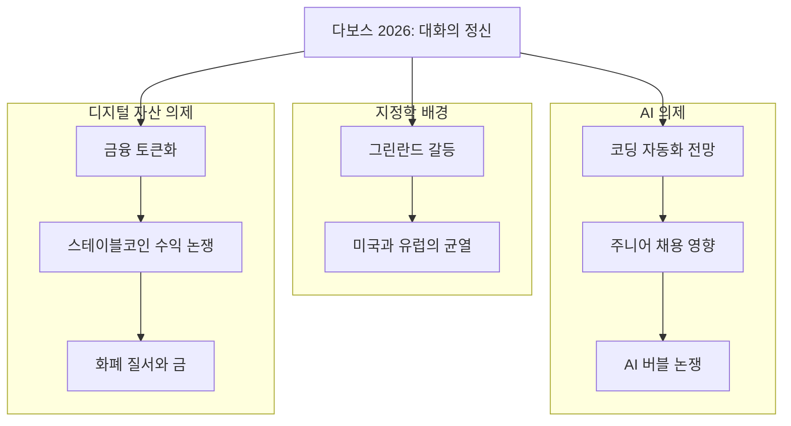
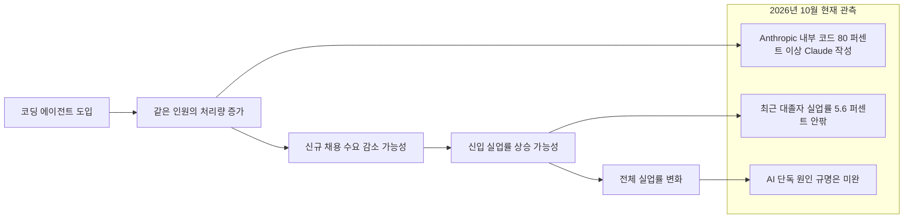
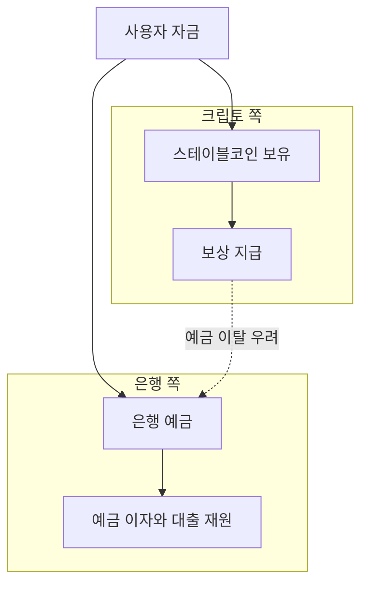
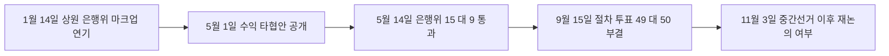

- 작성일: 2026-10-24
- 대상: Threads에 올라온 "올해 1월 다녀온 스위스 다보스포럼(WEF 2026) 돌아보기" 글 (https://www.threads.com/share/BAlGGph3Xz/)
- 목적: 글의 각 주장이 무엇을 뜻하는지 풀어 설명하고, 2026년 10월 24일 기준으로 확인 가능한 최신 자료와 대조한다.

---

## 0. 이 문서를 읽는 방법

이 문서는 원문 글에 담긴 주장 하나하나를 "당시 현장에서 실제로 무슨 말이 오갔는가"와 "9개월이 지난 지금 어떤 수치와 사건으로 나타났는가"의 두 단계로 나누어 설명합니다. 막연한 추측을 피하기 위해 모든 내용에 아래 네 가지 표지 중 하나를 붙였습니다.

| 표지 | 의미 |
|---|---|
| **확인됨** | 여러 보도나 공식 자료에서 같은 내용이 확인된 사실 |
| **기업 발표** | 해당 기업이 스스로 공개한 수치로, 외부 감사나 독립 검증은 거치지 않은 것 |
| **해석** | 글쓴이나 이 문서의 작성자가 사실을 바탕으로 덧붙인 판단 |
| **확인 못함** | 이번 조사에서 근거를 찾지 못한 내용 |

마지막 부분(10장)에는 "확인하지 못한 것"을 따로 모아 두었고, 11장에는 출처 목록이 있습니다.

---

## 1. 한눈에 보는 요약

원문의 글쓴이는 올해 1월 다보스에서 들은 AI와 디지털 자산 관련 발언들을 정리해 두고, 9개월이 지난 지금 그 전망이 얼마나 맞았는지 비교해 보고 있습니다. 글의 결론은 두 문장으로 압축됩니다. AI는 기술 발전이 제도와 조직의 변화를 앞서가고 있고, 디지털 자산은 제도와 기존 금융권의 이해관계가 기술 확산 속도를 결정하고 있다는 것입니다.

조사 결과를 먼저 요약하면, 글의 큰 줄기는 자료와 대체로 부합합니다. 다만 세 군데는 보완이 필요합니다. 첫째, 다리오 아모데이의 "6~12개월" 전망은 아직 시간 창이 끝나지 않았기 때문에 맞았다 틀렸다를 말하기에는 이릅니다. 둘째, 클레리티(CLARITY) 법안의 최종 좌초 원인은 글에 쓴 "밥그릇 싸움"(은행과 크립토의 수익 다툼)보다 윤리 조항 논란이 더 직접적이었다는 보도가 있습니다. 셋째, 스테이블코인 시가총액이 "약 2,900억 달러"라는 숫자는 집계 방식에 따라 2,700억~3,200억 달러까지 차이가 나는 범위 안에 있습니다.

---

## 2. 다보스포럼 2026은 어떤 행사였나

### 2-1. 기본 정보

**확인됨.** 세계경제포럼(WEF) 연차총회 2026은 1월 19일부터 23일까지 스위스 다보스-클로스터스에서 열린 제56회 행사였고, 공식 주제는 "A Spirit of Dialogue(대화의 정신)"였습니다. 주최 측은 약 400명의 정치 지도자와 850명에 가까운 대기업 CEO가 참석한다고 밝혔습니다. 의제는 지정학 환경, AI, 새로운 성장 동력, 인적 자본 투자, 기후와 자연의 다섯 갈래로 소개되었습니다.

### 2-2. 원문이 말한 "지정학적 갈등과 글로벌 협력의 균열"

**확인됨.** 이 표현은 당시 보도와 일치합니다. 다보스 개막 직전부터 그린란드를 둘러싼 미국과 덴마크·유럽의 갈등이 행사 전체의 분위기를 지배했고, 덴마크는 공식 대표단을 보내지 않았다고 CNBC를 인용한 보도가 전합니다. 캐나다의 마크 카니 총리는 연설에서 지금의 상황을 "세계 질서의 단절(rupture)"이라고 표현해 큰 반향을 일으켰습니다.

### 2-3. 트럼프 연설에 대한 원문의 괄호 속 평가

원문에는 "트럼프는 와서 그린란드 야욕을 드러내며 세계평화에 있어서 미국 패권의 중요성을 강조했고 대회의 정신 이런 거 없었음"이라는 평가가 있습니다. 이 평가는 부분적으로 사실과 맞고, 부분적으로는 글쓴이의 관점입니다.

**확인됨.** 트럼프 대통령은 6년 만에 처음으로 다보스에 직접 참석했고, 1월 21일 특별연설에서 그린란드에 대한 자신의 주장을 다시 밝혔습니다. 다만 같은 연설에서 그린란드를 얻기 위해 무력을 쓰지는 않겠다고 밝혔다는 보도가 폭스10, 페릴 등 여러 곳에서 나왔습니다. 또 같은 자리에서 자신이 구상한 "평화위원회(Board of Peace)"를 세계 정상들과 함께 출범시켰습니다.

**해석.** 한 싱크탱크(CEPA) 칼럼은 이후 그린란드에 대한 "프레임워크" 합의가 언급되고 유럽을 향한 무역전쟁 위협이 후퇴했다고 서술합니다. 다만 이 합의의 구체적 내용은 이번 조사에서 확인하지 못했습니다. "대화의 정신이 없었다"는 부분은 사실 판정이 아니라 글쓴이의 평가이며, 여러 해설 기사가 "트럼프 쇼"였다고 표현한 것과 결을 같이합니다.

---

## 3. AI 파트: "기술의 가능성"에서 "실제 노동의 대체"로

원문은 세 명의 발언을 소개합니다. 아래에서는 각 발언이 정확히 무엇이었는지, 글쓴이가 붙인 해석이 무엇인지, 그리고 지금 자료가 어떻게 말해 주는지를 차례로 정리합니다.

### 3-1. 다리오 아모데이(Anthropic): "6~12개월 내 소프트웨어 엔지니어 업무 대부분"

#### 당시 발언

**확인됨.** 아모데이는 다보스에서 모델이 소프트웨어 엔지니어가 하는 일의 "대부분, 어쩌면 전부"를 처음부터 끝까지(end-to-end) 수행하게 되기까지 6~12개월 정도 남았을지 모른다고 말했습니다. 원문의 "대부분을 수행할 수 있다"는 요약은 정확합니다. 그는 같은 맥락에서 Anthropic 내부 엔지니어 중에는 "이제 코드를 직접 쓰지 않는다"고 말하는 사람들이 있다고 전했습니다.

또한 그는 2025년에 했던 경고, 곧 앞으로 1~5년 안에 신입 사무직(화이트칼라) 일자리의 절반이 사라질 수 있고 실업률이 10~20%까지 오를 수 있다는 전망을 바꾸지 않았다고 밝혔습니다.

#### 시간 창을 먼저 계산해 보기

"6~12개월"은 1월을 기준으로 2026년 7월부터 2027년 1월까지의 구간입니다. 오늘(2026-10-24)은 이 구간 한가운데입니다. 따라서 이 전망이 "실현되었다/되지 않았다"고 판정하는 것은 현재로서는 정확하지 않습니다. 확인할 수 있는 것은 "방향이 어느 쪽으로 가고 있는가"입니다.

#### 9개월 뒤의 자료

**기업 발표.** Anthropic은 2026년 5월 기준으로 자사 프로덕션 코드베이스에 병합된 코드의 80% 이상을 Claude가 작성했다고 밝혔습니다(2026년 6월 4일 Anthropic Institute 보고서 "When AI builds itself"를 인용한 보도). Claude Code가 연구용 프리뷰로 나오기 전인 2025년 2월에는 이 비율이 한 자릿수 초반이었다고 합니다. 같은 보도들은 Anthropic 엔지니어 1인당 병합되는 코드량이 2024년 대비 2026년 2분기에 약 8배가 되었다고 전합니다. 이 수치들은 회사가 직접 공개한 것이며 외부 감사를 거치지 않았다는 점을 함께 기억해야 합니다. 팩트체크 사이트(Lenz)도 이 점을 지적했습니다.

**업계 전반.** 회사 밖의 흐름은 이보다 낮지만 같은 방향입니다. 한 정리 자료는 400개 이상 기업을 조사한 DX의 2026년 6월 17일 발표를 인용해, AI가 작성한 코드의 평균 비중이 1분기 27.4%에서 51.9%로 올랐다고 전합니다. 또 마이크로소프트 연구진이 2026년 7월 1일 arXiv에 올린 논문은 CLI 기반 코딩 에이전트를 도입한 엔지니어의 병합 PR이 대조 모델 대비 "약 24% 더 많다"고 보고했다고 합니다. 두 수치는 모두 2차 정리 자료(developertoolkit.ai)를 통해 확인한 것이어서 원문 대조는 하지 못했습니다.

#### 원문의 해석 평가

글쓴이는 "핵심은 개발자 전체의 대체보다 같은 인원으로 처리할 수 있는 업무량이 얼마나 늘어나는가"라고 썼습니다. 위의 자료(1인당 코드량 증가, 도입자의 PR 증가)는 이 해석과 모순되지 않습니다. 다만 이 자료들은 "생산량이 늘었다"는 것을 보여줄 뿐이고, 개발자 인력이 줄었는지 늘었는지는 보여주지 않습니다. 그 부분은 아래 3-2의 채용 자료가 간접적으로 말해 줍니다.

### 3-2. 데미스 허사비스(Google DeepMind): "2026년부터 신입·주니어 일자리에 영향"

#### 당시 발언

**확인됨.** 허사비스는 1월 20일 아모데이와의 공동 인터뷰에서 올해 AI가 주니어와 신입 수준의 일자리, 인턴십에 영향을 미치기 시작하는 것을 보게 될 수 있다고 말했습니다. 그는 자신의 조직에서도 이 수준의 채용이 느려지는 증거를 어느 정도 느낀다고 덧붙였습니다. 동시에 현재의 노동시장 데이터가 대규모 일자리 상실을 가리키는 것은 아니라고도 말했습니다. 이 후자의 단서가 중요합니다. 원문의 요약("대규모 해고보다 신규 채용 축소에서 먼저 나타날 가능성")은 이 발언과 정확히 맞습니다.

#### 9개월 뒤의 자료

2026년 9월 시점의 자료를 종합한 분석(IntuitionLabs, 2026-09-05)은 "신입 채용이 약해진 것은 사실이지만 AI는 여러 후보 원인 중 하나이며 아직 완전히 분리되지 않았다"고 결론짓습니다. 근거가 되는 수치와 연구를 나열하면 다음과 같습니다.

- **확인됨.** 뉴욕 연방준비은행 자료로 최근 대졸자(22~27세) 실업률은 2026년 1분기에 약 5.6~5.7%로, 전체 실업률 4.3%보다 높았습니다. 스탠퍼드 SIEPR의 정리에 따르면 3년 전보다 1.6%포인트 높은 수준입니다.
- **확인됨.** 뉴욕 연준 연구진은 실시간 채용공고 데이터를 분석한 뒤, 최근의 신입 채용 둔화를 AI 하나로 설명하기는 "어렵다"고 보았습니다.
- **확인됨.** 2026년 9월 IZA 토론문(DP 18945, Fairlie·Wu)은 CPS 마이크로데이터로 2026년 여름까지의 최근 대졸자 실업을 살펴보았고, 이를 소개한 기사는 AI가 이들을 노동시장에서 밀어냈다는 뚜렷한 신호는 아직 없다고 요약했습니다.
- **확인됨.** 한편 가장 재현성 있는 패턴은 "AI가 신입을 없앤다"가 아니라 채용이 경력직 쪽으로 기우는 "연차 편향"이라는 것이 위 종합 분석의 평가입니다. 미국 노동시장은 해고도 적고 채용도 적은 "저해고·저채용" 상태라는 설명도 반복해서 나옵니다.
- **확인됨.** 반대 방향의 신호도 있습니다. NACE는 2026년 졸업생 채용 계획을 초기 1.6% 증가에서 5.6% 증가로 상향했고, 한 보고서는 IBM이 소프트웨어·보안·AI 분야 신입 채용을 세 배로 늘리겠다고 밝혔다고 전합니다.

#### 원문의 해석 평가

글쓴이는 "AI의 노동시장 영향은 실업률보다 채용률에서 먼저 확인해야 할 듯"이라고 썼습니다. 이 관찰 방법은 위의 연구들이 쓰는 접근과 같습니다. 실제로 신입 실업률과 채용 둔화가 함께 나타나고 있다는 점은 확인되지만, 그 원인을 AI로 확정할 수 있는 단계는 아닙니다. "채용부터 흔들린다"는 가설이 방향상 지지되나 인과 입증은 미완이라고 정리하는 것이 정확합니다.

위 그림에서 앞쪽 사슬은 가설(해석)이고, 아래 상자는 지금까지 확인된 관측입니다. 두 쪽이 서로 어긋나지는 않지만, 가설의 가운데 고리(처리량 증가가 곧 채용 감소로 이어진다는 부분)를 직접 입증한 자료는 아직 확인하지 못했습니다.

### 3-3. 사티아 나델라(Microsoft): "빅테크 밖에서 생산성을 증명하지 못하면 버블"

#### 당시 발언

**확인됨.** 나델라는 1월 20일 블랙록의 래리 핑크와의 대담에서, AI 붐이 빅테크와 부유한 국가 밖으로 확산되지 못하면 투기적 버블이 될 수 있다고 경고했습니다. 요지는 "버블이 아니라고 하려면 이익이 훨씬 고르게 퍼져야 한다"는 것이었습니다. 원문의 "빅테크 밖의 실물경제에서 생산성을 증명하지 못하면 버블에 그칠 수 있다"는 요약은 이 발언의 취지와 맞습니다. 한편 같은 자리에서 그는 AI가 이전의 클라우드나 모바일 같은 플랫폼 전환보다 더 빠르게 퍼질 수 있다는 낙관도 함께 밝혔습니다. 즉 경고와 낙관이 한 세트였습니다.

#### 9개월 뒤의 자료: 마이크로소프트 자신의 숫자

**기업 발표.** 마이크로소프트가 2026년 7월 29일 발표한 2026 회계연도 4분기(4~6월) 실적은 다음과 같습니다.

| 항목 | 수치 |
|---|---|
| 4분기 매출 | 900억 달러 (전년 대비 +18%) |
| 4분기 순이익 | 358억 달러 (+31%, GAAP) |
| Azure 및 기타 클라우드 | +43%, 연간 매출 처음으로 1,000억 달러 돌파 |
| 연간 매출 | 3,318억 달러 |
| Microsoft 365 Copilot 유료 좌석 | 3,000만 석 이상 (1월 1,500만 → 4월 2,000만 → 7월 3,000만) |
| 상업 부문 잔여 계약 규모(RPO) | 6,780억 달러 (+84%) |
| AI 사업 연환산 매출 | 370억 달러 (+123%), 2026 회계연도 3분기 발표 시점 수치 |

2026 달력연도 설비투자 가이던스는 4월에 1,900억 달러였다가 7월 실적 발표 후 약 1,750억 달러로 제시되었는데, 보도에 따르면 감소의 일부는 데이터센터 임대가 설비투자(capex) 항목에서 운용리스로 이동한 회계상 효과입니다. 4분기 단독 capex는 410억 달러로 전년 대비 69% 늘었습니다.

#### 원문의 평가를 검증하기

글쓴이는 "앞으로 중요한 지표는 모델 성능보다 기업의 AI 투자 대비 실제 비용 절감과 매출 기여. 본인 회사에서는 이 부분 역시 숫자로 입증중"이라고 썼습니다. 마이크로소프트가 AI 관련 매출과 유료 좌석 수를 숫자로 보여주고 있다는 점은 확인됩니다.

다만 나델라가 던진 시험 문제와 이 숫자들이 정확히 같은 질문에 답하는 것은 아닙니다. 나델라의 질문은 "AI의 이익이 빅테크 밖의 산업과 국가로 고르게 퍼지는가"였습니다. 위의 숫자는 "마이크로소프트가 AI로 얼마를 벌고 있는가"를 보여주는 판매자 쪽 지표입니다. 구매자인 기업들이 AI로 얼마나 비용을 줄였는지는 이 숫자만으로는 알 수 없습니다. 실제로 마이크로소프트는 Copilot 좌석당 매출이나 일일 사용률, Azure 성장 중 AI 워크로드 비중을 공개하지 않았다고 보도되었습니다. 결국 "버블이 아니라는 증거가 늘고 있다"고 말할 수는 있지만 "나델라의 조건이 충족되었다"고 단정할 수는 없다고 보는 것이 안전합니다.

---

## 4. 디지털 자산 파트: "제도권 진입 이후의 현실"

### 4-1. 래리 핑크(BlackRock): 금융의 토큰화와 공통 블록체인

#### 당시 발언

**확인됨.** 핑크는 1월 21일 다보스 패널에서 시티델의 켄 그리핀, 유럽중앙은행의 크리스틴 라가르드와 함께 나와, 토큰화를 "하나의 공통된 블록체인" 위에서 매우 빠르게 진행해야 한다고 주장했습니다. 그는 공통 블록체인이 있으면 부패를 줄일 수 있고 투자 접근성을 넓힐 수 있다는 논리를 폈습니다. 원문의 요약("토큰화는 필수적이며 공통 블록체인이 금융의 투명성과 효율성을 높일 수 있다")과 일치합니다. 블랙록은 이후 3월에 공개한 2026년 연례 서한에서도 토큰화를 핵심 주제로 삼아, 지금의 단계를 1996년의 인터넷에 비유했습니다.

#### 토큰화 미국 국채 규모: 원문의 "약 147억 달러" 점검

원문은 토큰화된 미국 국채가 약 147억 달러라고 적었습니다. RWA.xyz 기준으로 올해 확인되는 수치를 시간순으로 놓으면 다음과 같습니다.

| 시점 | 토큰화 미국 국채 규모 | 출처 성격 |
|---|---|---|
| 2026-01-01 | 약 89억 달러 | RWA.xyz (코인텔레그래프 인용) |
| 2026-01-26 경 | 100억 달러 초과 | RWA.xyz |
| 2026-05-06 | 약 152.4억 달러 (76개 자산) | RWA.xyz |
| 2026-07-22 | 약 158.6억 달러 | RWA.xyz (비트코인닷컴 인용) |
| 2026-09-15 | 약 156.5억 달러 (101개 펀드) | RWA.xyz (Eco 인용), 최근 30일 -3.46% |

**확인 못함.** 147억 달러라는 수치와 정확히 일치하는 시점은 찾지 못했습니다. 다만 이 숫자는 올해 RWA.xyz 기준 범위(1월 말 100억 달러 초과에서 7월 약 159억 달러 사이)의 안에 있어 터무니없는 값은 아닙니다. 데이터 제공처와 집계 기준(유통 가치인지, 대표 자산 가치인지)에 따라 수치가 달라져, 2026년 중 "190억~600억 달러"까지 서로 다른 RWA 전체 규모가 돌았다는 지적도 있습니다. 전체 토큰화 실물자산(스테이블코인 제외)은 2026년 9월 15일 기준 약 388억 달러로 집계되었습니다.

이 수치가 말해 주는 것은 두 가지입니다. 하나는 올해 초 대비 분명히 커졌다는 점입니다. 다른 하나는 7월 이후 증가세가 멈추고 9월에는 오히려 30일 기준으로 줄었다는 점입니다. 전체 미국 국채 시장은 수조 달러 규모이므로 토큰화 비중은 여전히 극히 작습니다.

#### 원문의 핵심 주장: "발행 규모보다 유통시장과 담보 활용"

글쓴이는 지금까지의 성장이 기존 금융상품의 온체인 발행에 집중되어 있고, 진짜 변화는 유통시장과 담보 활용이 얼마나 확대되는가에 달려 있다고 보았습니다. 이를 뒷받침하는 단서와 반대 단서를 함께 적습니다.

- 뒷받침하는 단서: 2026년 7월의 한 분석은, 10만 달러 넘는 토큰화 자산의 56%가 조사 시점 주간에 온체인 활동이 전혀 없었고, 토큰화 실물자산 가치 중 디파이로 흘러 들어가는 비중은 약 10%에 그친다고 전합니다. 이것은 한 시점의 스냅샷이라는 한계가 있습니다.
- 진전을 보여주는 단서: 블랙록의 BUIDL 펀드가 2026년 2월 UniswapX를 통해 거래 가능해졌고, 토큰화 주식은 약 29.2억 달러로 최근 30일 동안 17.4% 늘며 가장 빠르게 성장하는 범주로 집계되었습니다(RWA.xyz, 9월 15일).

결국 글쓴이의 판단 기준(유통·담보 활용)은 타당하지만, 그 기준으로 본 성적표는 "시작 단계"에 가깝다고 정리할 수 있습니다. 글쓴이가 말한 "올해 금융사 서비스 준비 방향"은 개인적 관찰이므로 이번에 검증하지 못했습니다.

### 4-2. 브라이언 암스트롱(Coinbase): 프랑스 중앙은행 총재와의 충돌

#### 당시 상황

**확인됨.** 1월 21일 "토큰화가 미래인가?(Is Tokenization the Future?)" 패널에서 코인베이스 CEO 암스트롱과 프랑스 중앙은행 총재 프랑수아 빌루아 드 갈로(Villeroy de Galhau)가 스테이블코인 보상(이자) 지급과 "비트코인 표준"을 놓고 공개적으로 맞붙었습니다. 암스트롱은 미국 규제를 받는 스테이블코인이 보상을 지급하지 못하게 막으면 해외 경쟁자만 번성하게 된다는 취지로 주장했습니다. 빌루아는 이자를 주는 민간 토큰이 은행 시스템의 안정을 위협한다고 보았고, 디지털 유로가 이자를 줘야 하느냐는 질문에는 "아니오"라고 답했습니다. 신뢰의 근거는 민주적 위임을 받은 독립적 중앙은행이라는 입장도 밝혔습니다.

원문이 정리한 "경쟁은 기술보다 예금·결제·이자 수익을 누가 가져가느냐의 문제"라는 요약은 이 논쟁의 핵심을 정확히 짚은 것입니다.

위 그림이 이 갈등의 구조입니다. 은행은 스테이블코인이 보상을 주면 예금이 빠져나가 대출 재원이 줄어든다고 우려하고, 크립토 기업은 보상이 없으면 경쟁이 불가능하다고 맞섭니다.

#### 스테이블코인 규모: 원문의 "약 2,900억 달러" 점검

**확인됨(범위).** 스테이블코인 시가총액은 집계처마다 다릅니다. 확인되는 값은 다음과 같습니다.

- 2025년 말: 약 3,080억 달러 (DefiLlama)
- 2026년 3월: BIS의 보수적 집계로 약 2,700억 달러, 다른 집계로는 약 3,160억 달러
- 2026년 5월: 사상 최고치 약 3,224억~3,230억 달러
- 2026년 7월 31일: 약 3,038억 달러 (DefiLlama)
- 2026년 9월 15일: 약 3,052억 달러 (RWA.xyz)

원문의 "약 2,900억 달러"는 이 범위(2,700억~3,230억 달러)에 들어가므로 틀린 숫자는 아니지만, 특정 시점의 값인지 평균인지 알 수 없습니다. 중요한 관찰은 따로 있습니다. 올해 시가총액은 연초 대비 크게 늘지 않았고 5월 정점에서 오히려 약 4~5% 줄었다는 점입니다. 시가총액이 정체인 동안 거래량은 사상 최고를 기록했습니다(Visa 온체인 데이터 기준 6월 조정 거래량 1.79조 달러). 이는 아래 4-3에서 다룹니다.

#### 클레리티(CLARITY) 법안: 원문의 "밥그릇 싸움" 평가 보완

원문은 "클레리티 법안의 좌초도 복잡하게 볼 거 없이 그냥 밥그릇 싸움의 과정인듯"이라고 썼습니다. 법안의 경과를 날짜순으로 보면 이 평가는 전반부에는 정확하고 후반부에는 보완이 필요합니다.

**확인됨.**

1. **1월~5월(수익 논쟁 단계).** 암스트롱이 1월에 법안 지지를 철회하면서 상원 은행위 마크업이 연기되었습니다. 쟁점은 스테이블코인이 수익을 지급할 수 있는지였고, 은행 쪽은 예금 이탈을 이유로 금지를 요구했습니다(3,200개 이상 은행이 상원에 서한을 보냈다는 보도도 있습니다). 5월 1일 틸리스·알소브룩스 상원의원이 중재안을 내놓았는데, 은행 예금 이자와 "경제적으로 또는 기능적으로 동등한" 지급은 금지하되 실제 활동이나 거래에 대한 보상은 허용하는 방식이었습니다. 이어 5월 14일 은행위원회를 15 대 9로 통과했습니다. 이 구간은 글쓴이가 말한 은행과 크립토의 이해다툼이라는 설명이 잘 맞습니다.
2. **9월 15일(본회의 문턱).** 상원은 법안 본회의 상정 여부를 묻는 절차 투표(cloture)를 했고, 60표가 필요한 자리에서 49 대 50으로 부결되었습니다. 이 투표는 법안의 실질 내용에 대한 표결이 아니라 절차 표결이었습니다. 핀테크위클리는 이를 좌초시킨 것은 SEC와 CFTC의 관할 분담이 아니라 윤리 조항이라고 분석했고, 엘리자베스 워런 의원은 트럼프 대통령이 승인한 윤리안을 두고 "얇은 무화과 잎"이라고 비판했다고 CNBC가 전했습니다. 즉 최종 부결에는 수익 다툼이 아니라 정치적·윤리적 쟁점이 직접 작용했다고 보는 것이 맞습니다.
3. **이후.** 틸리스 의원이 재심의 동의(motion to reconsider)를 제출해 절차상 문은 열려 있고, 7명의 민주당 의원이 "차질이지만 끝은 아니다"라며 초당적 합의를 계속 추진하겠다고 밝혔습니다. 다만 하원은 11월 3일 선거 이후까지 휴회에 들어가 올해 안에 법으로 확정되기는 사실상 어렵다는 평가가 나옵니다. 한편 AMINA 은행의 분석은 SEC와 CFTC 수장이 법안과 별개로 규칙 정비를 계속 추진하겠다고 밝혔다고 전합니다. 법에 의한 지속성은 사라졌지만, 기관 차원의 정리는 진행 중이라는 뜻입니다.

정리하면 "밥그릇 싸움"은 1~5월의 핵심 동력이었지만, 9월의 결말까지 한 문장으로 설명하기에는 부족합니다. 이는 원문의 큰 결론(제도와 이해관계가 기술 확산 속도를 정한다)을 오히려 강화하는 증거이기도 합니다.

### 4-3. Circle 쪽 인사와의 만남

원문은 Circle의 CSO 단테 디스파르테와 별도로 만날 기회가 있었다고 적었습니다. 이는 글쓴이의 개인 경험이어서 외부 자료로 검증할 수 없습니다. **확인 못함.** 다만 같은 다보스에서 Circle의 제러미 알레어 CEO가 스테이블코인 수익이 은행 취약성을 일으킨다는 주장을 "전혀 터무니없다"고 반박했고, Circle의 스테이블코인은 은행이나 카드 네트워크와 경쟁하는 것이 아니라 공유 인프라라고 주장했다는 보도(코인텔레그래프)가 있어, Circle이 이 패널 의제에 적극 참여했음은 확인됩니다.

#### 글쓴이의 판단: "발행량 증가가 곧 실물 결제 확산은 아니다"

이 판단을 뒷받침하는 자료가 비교적 풍부합니다.

- **확인됨.** 맥킨지와 Artemis의 보고서(2026년 1월 보도)에 따르면 2025년 스테이블코인 전체 거래량은 약 35조 달러였지만, 송금·급여 같은 실물 결제는 약 3,900억 달러로 전체의 약 1%에 그쳤습니다. 기업간(B2B) 결제는 2,260억 달러로 전년 대비 733% 늘어 가장 빠르게 성장했습니다.
- **기업 발표.** Circle의 2026년 2분기 실적에서 Circle Payments Network의 연환산 거래량은 분기 말 147억 달러(전 분기 대비 +76%), 참여 금융기관은 175곳이었고, 임원은 7월 31일 기준 연환산 230억 달러까지 늘었다고 밝혔습니다. 같은 분기 매출 7.01억 달러 중 6.68억 달러, 약 95%가 준비금 이자 수익이었고 거래 수수료 매출은 530만 달러에 불과했다고 보도되었습니다. 즉 사용량은 빠르게 늘고 있지만 아직 수익 구조는 금리에 크게 의존합니다.
- **확인됨.** Visa 온체인 데이터에 따르면 2026년 상반기 조정 거래량의 약 70%를 USDC가 차지해 USDT(약 25%)를 앞섰고, 6월 월간 조정 거래량은 1.79조 달러로 사상 최고였습니다. 이는 결제·정산 용도의 비중이 커지고 있다는 신호로 해석됩니다.

다만 USDC의 분기 온체인 거래량 14.8조 달러와 Coin Metrics의 연간 조정 거래량 약 32조 달러처럼 측정 방식이 다른 수치들이 섞여 나오므로, "거래량"끼리 단순 비교해서는 안 됩니다. 글쓴이의 판단 기준("유통량보다 실제 결제·정산에 쓰이는 비중")은 올바른 질문이고, 현재의 답은 "비중은 커지고 있으나 아직 작다"입니다.

### 4-4. 레이 달리오: 부채와 달러 중심 통화질서

#### 당시 발언

**확인됨.** 달리오는 다보스에서 CNBC 인터뷰와 WSJ 리더십 인스티튜트 대담 등에 나와 세계 통화질서가 "무너지고 있다"고 경고했고, 중앙은행들이 법정화폐(피아트)를 다루는 방식이 달라지고 있다고 말했습니다. 한 매체는 그가 포트폴리오의 5~15%를 금으로 가져갈 것을 권했다고 전했고, 그는 "자본 전쟁(capital war)"의 위험도 언급했습니다. 미국 부채는 당시 약 38조 달러 수준이었습니다. 원문의 "미국의 부채 부담과 달러 중심 통화 질서의 불확실성 강조"라는 요약은 맞습니다. 원문이 "소규모 패널"이라고 부른 구체적 세션 형식은 이번에 확인하지 못했습니다.

#### 9개월 뒤

- **확인됨.** 의회예산처(CBO)는 2026 회계연도 연방 적자를 약 1.9조 달러, 순이자 지출을 1조 달러 이상으로 전망하는 것으로 보도되었습니다(독일 매체 인용).
- **확인됨.** 달리오는 이후에도 경고를 이어갔습니다. 5월에는 미국 부채 문제가 "심장마비"이자 더 큰 "대혼란"의 시작이라는 취지로, 6월 블룸버그 인터뷰에서는 부채가 "되돌릴 수 없는 지점"을 지났다는 취지로 말했습니다.
- **확인됨.** 금은 1월 둘째 주에 온스당 5,000달러를 넘었고 이후 한때 5,600달러 부근까지 올랐다가 큰 폭으로 조정받았다는 보도가 있습니다. 10월 현재의 정확한 시세는 이번에 확인하지 못했습니다.

#### 디지털 자산과의 연결: 글쓴이의 해석

글쓴이는 이를 "디지털 자산을 단순히 새로운 기술이나 투자상품으로만 보기 어려운 이유"로 해석했습니다. 이 해석은 글쓴이의 판단입니다. 달리오의 다보스 발언의 초점은 금이었고, 2월에는 "금이지 비트코인이 아니다"라는 취지의 보도도 있었습니다. 반대로 2025년 9월에는 부채 증가가 달러의 지위를 위협하면서 크립토가 대체재로 부상한다고 말한 적도 있습니다. 즉 달리오가 디지털 자산을 어떻게 보는지는 시기와 자리에 따라 강조점이 다르므로, "달리오의 발언을 통해 디지털 자산의 의미를 다시 본다"는 연결은 글쓴이 자신의 사고 틀로 이해하는 것이 정확합니다.

---

## 5. 원문 주장 종합 판정표

| 원문의 주장 | 판정 | 비고 |
|---|---|---|
| 주제는 "대화의 정신"이었고 지정학 갈등 속에서 열렸다 | 확인됨 | 1월 19~23일, 제56회 |
| 트럼프가 그린란드 야욕을 드러냈다 | 대체로 확인됨 | 무력 불사용도 함께 밝힘 |
| 아모데이: 6~12개월 내 SW 엔지니어 업무 대부분 | 발언 확인됨, 실현 여부는 판정 보류 | 시간 창이 2027년 1월까지 |
| 같은 인원으로 처리 가능한 업무량 증가가 핵심 | 방향 부합 | 1인당 코드량 증가는 기업 발표 |
| 허사비스: 2026년부터 주니어 채용에 영향 | 발언 확인됨, 영향은 부분 확인 | 인과는 미완 |
| 영향은 해고보다 채용에서 먼저 | 가설 부합 | 신입 실업 상승과 채용 둔화는 관측 |
| 나델라: 빅테크 밖에서 증명 못하면 버블 | 발언 확인됨 | 낙관도 병행 발언 |
| 마이크로소프트가 숫자로 입증 중 | 판매자 쪽 지표는 확인됨 | 고객 쪽 절감 효과는 미확인 |
| 핑크: 토큰화 필수, 공통 블록체인 | 확인됨 | 1월 21일 패널 |
| 토큰화 국채 약 147억 달러 | 범위 내 | 정확히 일치하는 시점은 못 찾음 |
| 암스트롱 대 프랑스 중앙은행 총재 충돌 | 확인됨 | 스테이블코인 보상 쟁점 |
| 스테이블코인 약 2,900억 달러 | 범위 내 | 집계에 따라 2,700억~3,230억 달러 |
| 클레리티 좌초는 밥그릇 싸움 | 부분 확인 | 9월 부결은 윤리 조항 논란이 직접 원인 |
| 디스파르테와의 만남 | 확인 못함 | 개인 경험 |
| 달리오: 부채와 달러 질서 불확실성 | 확인됨 | 금 권고 중심 |

---

## 6. 글의 결론 평가

### 6-1. "AI는 기술이 제도와 조직의 변화를 앞서간다"

이 판단은 앞의 자료와 잘 맞습니다. 코딩 도구를 쓰는 개발 현장의 숫자(AI 작성 코드 비중, 1인당 처리량)는 빠르게 움직이고 있는데, 노동시장 통계와 기업 조직의 대응은 그만큼 뚜렷하게 따라오지 않고 있습니다. 신입 채용의 변화가 "AI 때문인가"라는 질문 자체가 아직 통계로 정리되지 못한 상태인 것이 그 증거입니다. 다만 이것은 "기술이 앞선다"는 판단의 근거이지, 그 속도 차이가 앞으로 어떻게 좁혀질지에 대한 예측은 아닙니다.

### 6-2. "디지털 자산은 이해관계가 기술 확산 속도를 결정한다"

클레리티 법안의 경과가 이 판단을 가장 직접적으로 뒷받침합니다. 스테이블코인 기술과 시장 인프라는 이미 상당히 갖추어졌고(거래량 사상 최고, 대형 금융기관의 참여), 시가총액 정체와 법안 부결은 기술이 아니라 규제·정치·산업 이해에서 병목이 생기고 있음을 보여줍니다. 앞서 보완했듯 9월 부결의 직접 원인은 수익 다툼보다 윤리 조항이었다는 점만 다르게 기억하면 됩니다.

### 6-3. "AI 개발 경쟁은 불가능해졌고 인간의 나태함과 경쟁해야 한다"

이 문장은 글쓴이의 의견이며 사실 검증의 대상이 아닙니다. 다만 이 의견을 뒷받침할 수 있는 관측은 있습니다. 같은 도구를 쓸 수 있는 조건에서 도입 정도의 차이가 성과의 차이를 만든다는 것을 시사하는 자료(AI 도입 엔지니어의 PR이 약 24% 많다는 연구)가 이미 나왔습니다. 하지만 이 연구도 2차 자료로 확인한 것이므로, 일반 법칙처럼 받아들이기보다 하나의 참고 사례로 두는 것이 적절합니다.

---

## 7. 내년 다보스에서 "산업 구조가 달라졌는지" 확인하려면

글쓴이는 내년 다보스에서 기술 자체보다 실제 산업 구조가 얼마나 달라졌는지 보고 싶다고 했습니다. 아래는 이번 조사에서 정리한 자료를 바탕으로 한 **관찰 지표 제안**입니다(예측이 아니라 점검 항목입니다).

| 영역 | 점검할 지표 | 지금의 기준선(2026년 하반기) |
|---|---|---|
| AI와 노동 | 신입 채용률, 채용공고 수, 최근 대졸자 실업률 | 대졸자 실업률 5.6~5.7%, 원인 분리 미완 |
| AI와 개발 | 기업들의 AI 작성 코드 비중, 1인당 처리량 | 업계 평균 약 52%(DX), Anthropic 80% 이상(자사 발표) |
| AI와 수익성 | 도입 기업의 비용 절감과 매출 기여 공시 | 판매자 쪽 지표만 풍부 |
| 토큰화 | 담보·유통시장 활용, 토큰화 주식 규모 | 국채 약 157억 달러, 주식 약 29억 달러 |
| 스테이블코인 | 실물 결제 비중, 보상 규칙 | 실물 결제 약 1%(2025), 시가총액 약 3,050억 달러 |
| 제도 | 클레리티 법안의 선거 이후 행방, SEC·CFTC 규칙 | 9월 부결, 기관 규칙 정비 진행 |
| 통화질서 | 중앙은행 금 매입, 미국 이자 비용 | CBO 순이자 1조 달러 초과 전망 |

---

## 8. 쉬운 비유로 다시 정리

이 글의 흐름을 일상의 비유로 바꿔 보면 이렇습니다. AI는 새로 깔린 고속도로 위의 자동차와 같아서, 차(기술)는 이미 시속 200킬로미터로 달리는데 신호체계와 교통법규(제도, 조직)는 아직 시속 60킬로미터 기준으로 돌아가고 있습니다. 그래서 사고(고용 충격)가 났는지 확인하려면 가장 먼저 입구(신규 채용)에서 차가 줄었는지를 보아야 한다는 것이 글쓴이의 관찰입니다.

디지털 자산은 새 수도관을 놓는 일에 가깝습니다. 관(블록체인과 스테이블코인)은 이미 상당히 깔렸는데, 그 관을 통해 흐르는 물(예금과 결제, 이자)을 누가 가져가느냐를 두고 기존 수도사업자(은행)와 신규 사업자(크립토 기업)가 다투고 있어서 개통 속도가 사업자 간 합의에 달려 있다는 이야기입니다.

---

## 9. 이 글을 읽을 때 조심할 점

첫째, 원문 글은 글쓴이의 개인적 회고이므로 기억에 의존한 부분이 있을 수 있습니다. 예컨대 숫자의 기준 시점이 글에 적혀 있지 않습니다. 둘째, 이 문서가 인용한 AI 코드 비중이나 Copilot 좌석 수 같은 기업 수치는 해당 기업이 자신의 사업을 설명하기 위해 공개한 것이므로 홍보 목적이 섞여 있을 수 있습니다. 셋째, 토큰화와 스테이블코인 수치는 데이터 제공처마다 정의가 달라서, 서로 다른 출처의 숫자를 한 표에 놓고 증감을 계산하는 것은 위험합니다. 이 문서에서는 같은 제공처(RWA.xyz)의 값만 시계열로 비교했습니다.

---

## 10. 이번 조사에서 확인하지 못한 것

1. 원문의 Threads 링크 본문을 직접 열어 대조하지는 않았고, 사용자가 제공한 본문을 기준으로 삼았습니다.
2. 디스파르테와의 만남은 글쓴이의 개인 경험이라 외부 자료가 없습니다.
3. 달리오 세션이 "소규모 패널"이었는지는 확인하지 못했습니다. 그가 다보스에서 CNBC 인터뷰와 WSJ 대담 등에 출연한 것은 확인됩니다.
4. 토큰화 국채 "147억 달러"와 정확히 일치하는 시점의 수치를 찾지 못했습니다.
5. 10월 현재의 정확한 금 시세와 스테이블코인 시가총액(10월 값)은 확인하지 못했고, 가장 최근의 확인 값은 9월 15일 기준입니다.
6. DX의 51.9%, 마이크로소프트 연구의 "약 24% 더 많음", Anthropic 1인당 8배 수치는 원 자료가 아니라 2차 정리·보도를 통해 확인했습니다.
7. 그린란드 "프레임워크" 합의의 구체적 내용은 확인하지 못했습니다.
8. 클레리티 법안 이후의 11월 3일 선거 이후 일정은 이 문서 작성 시점에 아직 일어나지 않은 일이므로 서술하지 않았습니다.

---

## 11. 출처 목록

### 다보스 2026 개요·지정학
- Polskie Radio, "Greenland row looms over World Economic Forum in Davos" (2026-01-20): https://www.polskieradio.pl/395/7785/artykul/3636455,greenland-row-looms-over-world-economic-forum-in-davos
- Fox42/TNND, "Greenland tensions loom over Trump's trip to World Economic Forum": https://fox42kptm.com/news/nation-world/greenland-tensions-loom-over-trumps-trip-to-world-economic-forum-davos-switzerland
- FOX 10 Phoenix, "Watch: Trump speaks at World Economic Forum in Switzerland": https://www.fox10phoenix.com/news/trump-live-watch-world-economic-forum-switzerland
- Perfil (Buenos Aires Times), "Trump takes Davos on wild ride" (2026-01-22): https://batimes.com.ar/news/world/trump-takes-davos-on-wild-ride.phtml
- CEPA, Davos 2026 칼럼: https://cepa.org/?p=46863
- Majalla, "In Davos, a tale of two speeches": https://en.majalla.com/node/329295
- Le Relief, "Davos Forum 2026: Donald Trump's Return Under High Diplomatic Tension": https://www.lereliefhaiti.com/articles/davos-forum-2026-donald-trumps-return-under-high-diplomatic-tension

### AI·노동
- Storyboard18, "AI could take over most coding tasks within a year, Anthropic CEO warns" (2026-01-22): https://storyboard18.com/brand-makers/ai-could-take-over-most-coding-tasks-within-a-year-anthropic-ceo-warns-88093.htm
- 36Kr, 아모데이 다보스 발언 정리 (2026-01-21): https://eu.36kr.com/en/p/3648851352018565
- Business Insider 인용(AOL), "DeepMind and Anthropic CEOs: AI is already coming for junior roles": https://www.aol.com/articles/deepmind-anthropic-ceos-ai-already-141624211.html
- World Economic Forum, "Young people and AI at Davos": https://www.weforum.org/stories/artificial-intelligence/young-people-ai-davos/
- Benzinga 인용(AOL), "AI Is Not Driving Widespread Job Losses, Hassabis Says": https://www.aol.com/articles/ai-not-driving-widespread-job-223107925.html
- IntuitionLabs, "AI and Entry-Level Jobs: What Hiring Data Really Shows" (2026-09-05): https://intuitionlabs.ai/pdfs/ai-entry-level-employment-hiring-data.pdf
- IZA DP 18945, Fairlie & Wu (2026-09): https://docs.iza.org/dp18945.pdf
- TechSpot, "The AI job apocalypse hasn't hit recent college grads": https://www.techspot.com/news/113997-ai-job-apocalypse-hasnt-hit-recent-college-grads.html
- AI Weekly, "Stanford SIEPR: AI Hits New Grads, Not Aggregate Jobs Yet": https://aiweekly.co/node/8019
- The State of AI, "Anthropic 80 percent code" (2026-06): https://www.thestateofai.com/news/anthropic-80-percent-code-not-engineers
- AI Weekly, "Anthropic Reports AI Now Authors Over 80% of Its Production Code": https://aiweekly.co/alerts/anthropic-reports-ai-now-authors-over-80-of-its-production-code
- Developer Toolkit, "The State of Agentic Engineering, September 2026": https://developertoolkit.ai/en/ladder/state-of-agentic-engineering-2026/?track=cto
- Lenz, "Is a significant share of code now written by AI (2026)": https://lenz.io/c/is-a-significant-share-of-code-now-written-by-ai-2026-8ba2add5

### 마이크로소프트·나델라
- Irish Times, "AI boom could falter without wider adoption, Microsoft chief Satya Nadella warns" (2026-01-20): https://www.irishtimes.com/business/2026/01/20/ai-boom-could-falter-without-wider-adoption-microsoft-chief-satya-nadella-warns/
- Fortune, "Satya Nadella's biggest AI bubble warning yet" (2026-01-20): https://www.fortune.com/2026/01/20/is-ai-a-bubble-satya-nadella-microsoft-ceo-new-knowledge-worker-davos-fink
- Wallstreetcn 인용(Longport), 나델라 발언: https://longportapp.cn/news/273094693
- AI Weekly, "Microsoft FY26: Azure Tops $100B, Copilot Hits 30M Seats": https://aiweekly.co/alerts/microsoft-fy26-azure-tops-100b-copilot-hits-30m-seats
- AP 인용(KOB), "Microsoft beats Wall Street expectations with $90B in revenue" (2026-07-29): https://www.kob.com/?p=1112848
- Yahoo Finance, "Microsoft stock sinks as AI spending ramps to $190 billion": https://finance.yahoo.com/sectors/technology/article/microsoft-earnings-top-q3-estimates-says-ai-business-up-123-year-over-year-211358994.html
- GeekWire, Microsoft 2026 회계연도 2분기 실적: https://www.geekwire.com/2026/microsoft-beats-expectations-cloud-tops-50b-as-openai-and-anthropic-deals-reshape-its-business

### 토큰화·스테이블코인·법안
- DL News, "Why BlackRock's Larry Fink wants the entire financial system on 'one common blockchain'": https://dlnews.com/articles/people-culture/blackrock-ceo-larry-fink-wants-the-entire-financial-system-on-one-common-blockchain/
- CriptoNoticias, 핑크 다보스 발언: https://www.criptonoticias.com/comunidad/adopcion/blackrock-blockchain-tokenizacion-larry-fink/
- CoinDesk 인용(Cryptonews), Armstrong vs Villeroy (2026-01-21): https://cryptonews.net/news/legal/32315842/
- Cointelegraph Magazine, "Crypto takeaways: Davos, politics and money collide": https://cointelegraph.com/magazine/crypto-takeaways-davos-politics-money-collide
- Cointelegraph, "Tokenized US Treasurys rise by over $1B since start of 2026": https://cointelegraph.com/news/tokenized-us-treasurys-rise-1b-2026
- Bitcoin.com 인용(KuCoin), "Tokenized Treasuries Dip to $34.67 Billion" (2026-07-22): https://www.kucoin.com/news/flash/tokenized-treasuries-dip-to-34-67-billion-as-rwa-sector-expands
- Eco, "Tokenized RWA Market Size 2026" (RWA.xyz 2026-09-15 기준): https://eco.com/support/en/articles/15254020
- Blockchain Reporter 인용(Cryptonews), RWA 시장 동향 (2026-07-15): https://cryptonews.net/news/finance/33150291/
- Transak, "Stablecoin Market Cap in 2026": https://transak.com/blog/stablecoin-market-cap-2026
- Spark, "Stablecoin Market Cap Tracker" : https://www.spark.money/tools/stablecoin-market-cap-tracker
- Stablecoin Insider, "Stablecoin Market Report: July 2026": https://stablecoininsider.org/stablecoin-market-report-july-2026/
- AMBCrypto 인용(MEXC), 스테이블코인 거래량과 실물 결제 1% (2026-01-25): https://www.mexc.com/cs-CZ/news/551866
- Stablecoin Insider, Circle 2분기 결제 네트워크 동향: https://www.webull.com/news/15429657219580928
- Stablecoin Insider, "USDC Moved $32 Trillion, and Circle Earned Almost None of It": https://stablecoininsider.org/usdc-transfer-volume-circle-reserve-income/
- Crypto Briefing, "Circle reports $14 trillion-plus in USDC activity": https://cryptobriefing.com/circle-usdc-14-trillion-transaction-volume/
- Crypto Briefing, "Circle's USDC drives record stablecoin transaction volume in June 2026": https://cryptobriefing.com/usdc-record-stablecoin-volume-june-2026/
- Baker McKenzie, "The CLARITY Act's yield compromise" (2026-05-05): https://blockchain.bakermckenzie.com/2026/05/05/the-clarity-acts-yield-compromise-what-the-senate-actually-agreed-to-and-why-it-matters/
- DL News, "Clarity Act odds surge on stablecoin compromise": https://dlnews.com/articles/regulation/clarity-act-odds-surge-on-stablecoin-compromise/
- FinTech Weekly, "CLARITY Act: The Senate Vote Failed 49 to 50": https://www.fintechweekly.com/news/clarity-act-cloture-vote-fails-49-50-september-2026
- AMINA Bank, "CLARITY ACT September 2026" (2026-09-16): https://aminagroup.com/research/clarity-act-september-2026-why-the-senate-vote-failed-what-regulates-us-crypto-now/
- CNBC, "Warren to rip Clarity Act on Senate floor ahead of key preliminary vote" (2026-09-14): https://www.cnbc.com/2026/09/14/warren-clarity-act-senate-key-preliminary-vote.html

### 달리오·통화질서·금
- Cointelegraph, "Ray Dalio warns of banks shying away from fiat, praises gold surging" (2026-01-20): https://cointelegraph.com/news/ray-dalio-banks-fiat-gold-davos-wef
- Seeking Alpha, "Ray Dalio: The monetary order is breaking down" (2026-01-20): https://seekingalpha.com/news/4540556-ray-dalio-the-monetary-order-is-breaking-down-recommends-5-15-allocation-in-gold
- Fortune, 달리오 관련 기사 목록: https://www.fortune.com/tag/ray-dalio/page/1
- Fortune, "Ray Dalio: the 'heart attack' of America's debt crisis" (2026-05-08): https://dc.fortune.com/2026/05/08/ray-dalio-america-national-debt-reshape-economy-heart-attack/
- Bloomberg 인용(CEOInterviews), 달리오 인터뷰 (2026-06-03): https://ceointerviews.ai/interview/960108/
- MS Aktuell, CBO 전망 인용: https://ms-aktuell.de/?p=153966
- L'Orient-Le Jour, "JP Morgan expects gold to reach 6300 by end of year": https://today.lorientlejour.com/article/1493637/jp-morgan-expects-gold-to-reach-6300-by-end-of-year.html
- The Block, "Ray Dalio says soaring US debt threatens dollar" (2025-09): https://www.theblock.co/post/369266/ray-dalio-crypto

---

*작성 일자: 2026-10-24*
