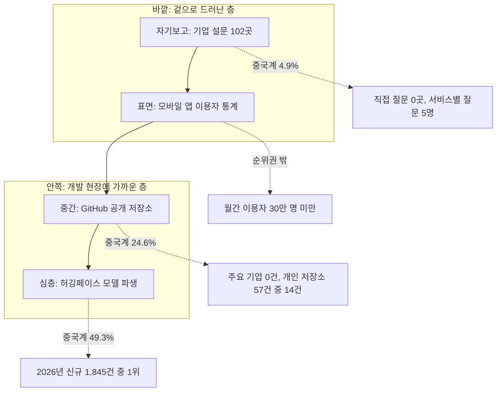
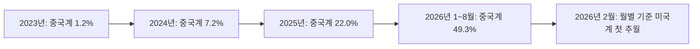
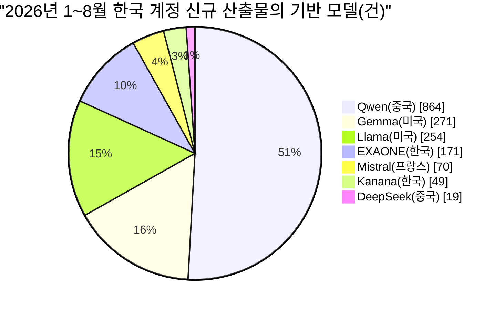
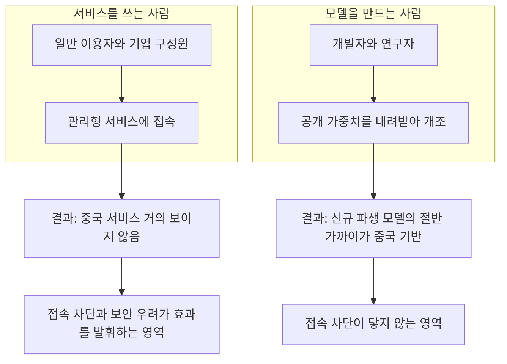

- 대상 자료: 록브리지네트워크 코리아 경제산업연구실, [「중국 인공지능은 한국에서 어떻게 쓰이고 있는가: 앱 시장, GitHub, 허깅페이스의 디지털 흔적으로 본 실태와 시사점」](https://rbnkorea.org/insight/?bmode=view&idx=175120449)(록브리지 경제 보고서 2026-03, 최성진 한양대학교 경영대학 교수 집필, 2026년 10월 16일 공개)
- 함께 다룬 자료: [GeekNews 요약 글](https://news.hada.io/topic?id=35785)(2026-10-22 게시), 그리고 같은 주제를 다룬 후속 보도와 허깅페이스 생태계 분석 보도
- 작성 기준일: 2026-10-24

---

## 0. 먼저 한 문단으로 요약하면

이 보고서의 핵심은 "겉으로 보이는 사용"과 "개발 현장의 실제 선택"이 크게 다르다는 점입니다. 한국에서는 중국 AI 앱을 쓰는 사람이 거의 없고, 설문에서 직접 물어도 중국 AI를 쓴다는 기업이 없으며, 대기업의 공개 GitHub 저장소에서도 중국 모델 언급이 한 건도 나오지 않았습니다. 그런데 한국 계정이 허깅페이스(Hugging Face)에 새로 공개한 언어모델 산출물 1,845건 중 49.3%가 중국 모델을 기반으로 만들어졌고, 그중 알리바바의 Qwen이 46.8%(864건)를 차지했습니다. 이 수치는 2026년 2월 월별 기준으로 처음 미국계 기반을 추월했습니다. 즉, 서비스 이용자 눈에는 거의 보이지 않지만 개발자가 모델을 내려받아 자기 환경에서 개조하는 영역에서는 중국 모델이 이미 가장 많이 선택되는 기반이 되었다는 것입니다.

---

## 1. 이 보고서가 던진 질문과 접근 방식

### 1.1 출발점이 된 모순

최근 중국 AI의 경쟁력이 미국과 겨룰 수 있는 수준으로 올라왔는데도, 한국은 보안과 개인정보보호 문제 때문에 중국 AI 서비스를 쓰는 소비자가 많지 않습니다. 그런데 한편에서는 한국의 많은 기업과 연구자가 로컬에 내려받아 쓸 수 있는 중국의 개방형 AI를 이용하고 있다는 주장도 있습니다. 이 두 이야기는 서로 모순처럼 보입니다. 보고서는 이 모순이 실제인지, 아니면 서로 다른 곳을 보고 있어서 생기는 착시인지를 확인하려 했습니다.

### 1.2 두 가지 핵심 질문

- 중국 인공지능 산업의 기술 수준은 어느 정도이며, 그 확산 전략은 어떤 성격을 갖는가
- 국내 기업과 이용자는 실제로 어떤 모델을 쓰고 있으며, 중국계 모델을 받아들이거나 기피하게 만드는 요인은 무엇인가

### 1.3 왜 설문만 믿지 않았는가

보고서는 설문처럼 응답자의 보고에 의존하는 방식 대신, 모델 이용자가 남긴 디지털 흔적을 중심에 두었습니다. 중국계 AI처럼 민감한 대상은 설문에서 실제보다 적게 보고되기 쉽다는 판단 때문입니다. 다만 설문과 인터뷰를 완전히 버린 것은 아니고, 공개 자료로는 보이지 않는 내부 운용과 태도를 보완하는 용도로 함께 사용했습니다.

### 1.4 사용한 다섯 가지 자료

| 자료원 | 무엇을 보여주는가 | 규모 |
| --- | --- | --- |
| 모바일 앱 이용자 통계 | 일반 이용자가 어떤 서비스에 접속하는가 | 월간 이용자 30만 명 이상 앱 |
| GitHub 공개 저장소 | 개발자와 기업이 대외적으로 무엇을 표방하는가 | 모델명 검색 6,128건 중 한국 판정 57건, 주요 기업 36곳의 저장소 약 1,900건 |
| 허깅페이스 모델 저장소 | 새로 만들어지는 모델이 어떤 기반 모델에서 나오는가 | 한국 계정 1,993개가 공개한 생성형 언어모델 산출물 7,939건 |
| 기업 설문 | 내부 운용 규모, 우려, 조건별 도입 의향 | 중소·중견기업 102곳 |
| 심층 인터뷰 | 선택과 회피의 판단 논리 | 3명 |

모든 디지털 자료는 각 플랫폼의 공식 API로만 수집했고, 지금까지 쌓인 누적 총량(stock)과 최근 새로 만들어진 신규 유량(flow)을 구분해서 집계했습니다. 이 구분이 이 보고서의 결론을 만드는 가장 중요한 장치입니다. 뒤에서 자세히 설명합니다.

### 1.5 자료를 층위로 이해하기

자료마다 관측하는 깊이가 다릅니다. 보고서의 종합 그림은 이를 바깥에서 안쪽으로 들어가는 네 개의 층으로 정리합니다. 바깥쪽일수록 눈에 잘 띄고, 안쪽일수록 개발 현장에 가깝습니다.

보고서의 종합 그림에서 중국계 비중은 설문 4.9%, GitHub 개인 저장소 24.6%(57건 중 14건), 허깅페이스 49.3%로 안쪽 층으로 갈수록 커집니다. 앱 통계는 순위권 밖이라 비중 수치가 없습니다. 여기서 주의할 점은 이 비중들이 서로 같은 분모를 가진 값이 아니라는 것입니다. 설문은 응답 수 비율, GitHub는 한국으로 판정된 저장소 비율, 허깅페이스는 신규 산출물 비율입니다. 따라서 "층이 깊어질수록 커진다"는 방향은 읽을 수 있지만, 숫자끼리 직접 비교해서 점유율을 말할 수는 없습니다.

---

## 2. 중국 AI 모델의 수준: 성능, 가격, 생태계

보고서는 국내 실태를 보기 전에 먼저 중국 모델이 어느 정도 수준인지부터 짚습니다. 사용이 늘어날 만한 기술적 이유가 있는지 확인하는 단계입니다.

### 2.1 성능: 실무 영역에서는 거의 대등

보고서에 따르면 미국과 중국 AI 모델의 성능은 거의 대등한 것으로 평가됩니다. 코딩 벤치마크에서 80% 이상을 기록한 8개 모델 가운데 4개가 중국 개발사의 모델이고, 상위 세 모델 사이의 격차는 2.8%포인트에 그쳤습니다. 중국 모델은 코딩 벤치마크 3위(93.4%)에 올라 있습니다. 다만 최고난도의 과학 추론에서는 미국의 폐쇄형 모델이 여전히 앞서 있습니다. 문서 작성, 고객 응대, 코드 작성처럼 실무에서 주로 요구되는 대중적 성능은 양국 모두 상향 평준화되고 있다는 것이 보고서의 평가입니다.

공개 가중치(open weights) 모델로 범위를 좁히면 격차가 더 큽니다. 상위 25개 개방형 모델 중 23개가 중국 모델입니다.

### 2.2 가격: 단가 차이는 크지만 총비용 차이는 훨씬 작다

동급 최상위 모델끼리 비교하면 중국 모델의 단가는 입력 기준 약 11분의 1, 출력 기준 약 34분의 1입니다. 그러나 같은 벤치마크 전체를 수행하는 데 든 총비용으로 비교하면 격차는 4배 안팎으로 줄어듭니다. 단가만 보고 "수십 배 싸다"고 말하면 과장이고, 실제 업무를 끝내는 데 필요한 총비용 기준으로는 4배 정도라는 점을 보고서가 함께 밝히고 있습니다. 이 부분은 읽을 때 놓치기 쉬워서 특히 정확히 인용할 필요가 있습니다.

### 2.3 생태계: 개방형 파생 모델의 다수가 중국 모델 기반

전 세계에서 새로 만들어지는 개방형 파생 모델의 63~70%가 중국 모델을 기반으로 하고, 모델 중개 플랫폼에서 처리되는 토큰의 약 61%가 중국 개방형 모델의 몫이라고 보고서는 정리합니다. 서구권 개방형의 대표였던 메타가 최신 개방형 모델을 비공개로 전환하면서 중국 모델의 존재감이 더 커졌다는 설명도 덧붙입니다.

| 평가 축 | 중국 AI의 위치 | 주요 근거 |
| --- | --- | --- |
| 성능 | 최상위권 진입, 실용 영역 대등, 최고난도 추론에서는 미중 격차 잔존 | 코딩 벤치마크 3위(93.4%), 80% 구간 8개 중 4개 |
| 가성비 | 뚜렷한 우위 | 동급 최상위 출력 단가 약 34분의 1 |
| 생태계 | 개방형 생태계에서 주도적 위치 | 신규 파생 모델 63~70%, OpenRouter 토큰 61% |

### 2.4 이후 나온 보조 자료로 본 Qwen의 규모

보고서 공개 이후 확인되는 허깅페이스의 자체 분석 보도도 같은 방향을 가리킵니다. 아래 수치는 허깅페이스 보고서를 인용한 2차 보도에서 확인한 것이며, 원문을 직접 열어 확인하지는 못했다는 점을 밝혀 둡니다.

- 2026년 1~8월 기간을 다룬 허깅페이스의 분석을 인용한 보도에 따르면 Hub의 Qwen 기반 파생 모델은 151,448개로, 메타 전체 규모의 2.6배, Llama 저장소만 놓고 보면 4.7배라고 합니다.
- 같은 보도들은 Qwen 파생 저장소가 하루 180~210개씩 늘었다고 전합니다.
- 이 분석은 Qwen의 확산 배경으로 꾸준한 출시 주기, 다양한 모델 크기, Apache 2.0 라이선스를 들었다고 합니다.
- 다만 같은 분석은 Hub 활동이 다운로드, 좋아요, 파생 수를 보여줄 뿐 API 사용량, 비공개 배포, 전체 시장 점유율을 뜻하지 않는다는 단서를 달았다고 전해집니다.

이 단서는 한국 보고서를 읽을 때도 그대로 적용됩니다. 허깅페이스의 파생 모델 수는 "개발자가 무엇을 기반으로 삼았는가"를 보여줄 뿐, 그 모델이 실제 서비스에서 얼마나 쓰이는지까지 말해 주지는 않습니다.

---

## 3. 국내 사용 실태: 네 가지 렌즈로 보기

### 3.1 앱 시장: 딥시크 열풍이 가라앉은 뒤의 현실

보고서가 정리한 딥시크의 국내 앱 시장 경과는 다음과 같습니다.

1. 2025년 1월 28일 국내 앱스토어 무료 앱 다운로드 1위에 올랐습니다.
2. 정부 부처, 공공기관, 기업의 접속 차단이 잇따랐고, 일간 이용자는 2주 만에 60% 줄었습니다.
3. 2월 15일 신규 다운로드가 중단되었다가, 4월 28일 개인정보보호위원회의 권고를 수용하면서 재개되었습니다.
4. 2026년 7월 기준 AI 챗봇 앱 월간 활성 이용자 상위 10위 안에 중국계 서비스는 없고, 조사기관의 집계 기준선인 월간 30만 명 아래로 떨어졌습니다.

반대로 미국계 서비스는 크게 늘었습니다. 2026년 2월과 7월 사이 Claude는 77만 명에서 344만 명으로, Gemini는 44만 명에서 947만 명으로 증가했습니다.

여기서 한 가지 구분이 필요합니다. 앱 이용 통계는 사람이 앱을 열고 접속하는 행위만 세기 때문에, 중국 모델을 내려받아 다른 서비스 안에 넣거나 자체 서버에서 돌리는 활동은 전혀 포착하지 못합니다. 앱 순위에서 사라졌다는 사실과 중국 모델이 쓰이지 않는다는 사실은 서로 다른 이야기입니다.

### 3.2 GitHub: 기업은 드러내지 않고, 개인은 직접 만진다

GitHub는 전 세계 개발자들이 소스코드와 프로젝트를 공유하고 협업하는 대표적인 오픈소스 플랫폼입니다. 보고서는 두 갈래로 조사했습니다.

첫째, 모델명을 검색어로 전 세계 저장소 6,128건을 모은 뒤, 소유자 프로필로 한국 소재를 판정했습니다. 한국으로 판정된 저장소는 57건이었고, 그중 중국계 모델 관련이 14건, 미국계가 25건, 국내 모델이 18건이었습니다.

| 모델 그룹 | 전 세계 저장소 | 한국 판정 | 한국 비중 |
| --- | --- | --- | --- |
| Anthropic(Claude) | 920 | 19 | 2.07% |
| DeepSeek | 999 | 6 | 0.60% |
| OpenAI | 909 | 6 | 0.66% |
| Qwen | 1,439 | 4 | 0.28% |
| 중국계 합계 | 4,264 | 14 | 0.33% |
| 미국계 합계 | 1,829 | 25 | 1.37% |

전 세계 저장소 수는 중국계가 미국계의 두 배가 넘는데도 한국의 참여 비중은 0.33% 대 1.37%로 4분의 1 수준입니다. 보고서는 이를 두고 응용 개발에서 한국이 중국계 모델 확산의 상대적 후발 지역이라고 해석합니다.

둘째, 국내 주요 기업 36곳의 공개 저장소 약 1,900건을 전수 조사했습니다. 결과는 국내 모델 언급 31건, 미국계 6건, 중국계 0건이었습니다. 기업이 공개적으로 내거는 기술 스택에서는 중국 모델이 보이지 않는다는 뜻입니다.

흥미로운 지점은 개인 저장소의 내용입니다. 중국계 14건 중 12건이 2026년에 만들어졌고, 내용은 대규모 모델을 서버에 띄우는 실행 환경 구축, 한국어 어휘를 추가한 모델 확장, 로컬 설치 자동화처럼 모델을 직접 다루는 작업이었습니다. 반면 미국계 25건 중 Anthropic 관련 19건은 코딩 보조 도구의 계정 전환이나 토큰 절감 같은 부속 도구가 대부분이었습니다. 같은 "언급"이라도 한쪽은 모델 자체를 만지는 작업이고, 다른 쪽은 서비스를 편하게 쓰기 위한 주변 도구라는 차이가 있습니다.

### 3.3 허깅페이스: 이 보고서의 핵심 증거

허깅페이스는 개발자와 연구자가 AI 모델, 데이터셋, 모델 산출물을 공유하는 세계 최대 규모의 플랫폼입니다. 보고서는 이용자 수 약 1,800만 명, 업로드된 모델 수 약 300만 개라고 소개합니다. GitHub가 소프트웨어의 소스코드와 개발 활동을 중심으로 한다면, 허깅페이스는 AI 모델과 그 활용 결과물이 공유된다는 점에서 다릅니다.

#### 3.3.1 분석 대상

한국어 태그와 검색어로 찾은 한국 계정 1,993개가 공개한 생성형 언어모델 산출물 7,939건을 기반 모델별로 집계했습니다. 여기서 "산출물"은 기반 모델을 추가 학습하거나 개량하는 등 허깅페이스에 공개한 모델 결과물을 뜻합니다. 국내 기업의 전체 AI 도입률이나 실제 서비스 트래픽을 집계한 수치가 아니라는 점은 GeekNews 요약에서도 별도로 강조됩니다.

#### 3.3.2 누적과 신규가 정반대를 말한다

누적 기준으로는 미국계 AI 모델 기반이 4,913건, 중국계가 1,628건, 국내 모델이 1,398건으로 미국계가 약 3배 많습니다. 만약 이 숫자만 봤다면 "한국 개발자는 여전히 미국 모델을 압도적으로 쓴다"는 결론이 나왔을 것입니다.

그러나 미국계 4,913건의 60%는 2024년 이전에 만들어진 것입니다. 만들어진 시점별로 다시 나누면 풍경이 달라집니다.

| 공개 시기 | 신규 산출물 중 중국계 기반 비중 | 같은 시기 미국계 기반 비중 |
| --- | --- | --- |
| 2023년 | 1.2% | 79.5% |
| 2024년 | 7.2% | 75.3% |
| 2025년 | 22.0% | 58.4% |
| 2026년 1~8월 | 49.3% | 35.9% |

보고서의 월별 그래프에서는 2025년 1월 약 17.9%에서 출발한 중국계 비중이 2026년 들어 가파르게 올라 월별 최고치 71.7%에 이르렀고, 마지막 월(2026년 8월)에는 57.5%로 표시됩니다. 보고서는 2026년 2월에 중국계 기반 산출물 비중이 처음으로 미국계를 추월했다고 적고 있습니다.

이것이 앞서 말한 누적(stock)과 신규(flow)의 차이입니다. 욕조에 물이 얼마나 찼는지(누적)만 보면 과거에 쌓인 미국계 물이 많지만, 지금 수도꼭지에서 어떤 물이 나오는지(신규)를 보면 중국계가 가장 많습니다. 개발자가 최근 어떤 기반 모델을 선택하는지를 알려면 누적이 아닌 신규를 봐야 합니다.

#### 3.3.3 2026년 신규 산출물 1,845건의 기반 모델

| 기반 모델 | 개발사 소재 | 산출물 | 계정 수 | 비중 |
| --- | --- | --- | --- | --- |
| Qwen | 중국 | 864건 | 167개 | 46.8% |
| Gemma | 미국 | 271건 | 81개 | 14.7% |
| Llama | 미국 | 254건 | 70개 | 13.8% |
| EXAONE | 한국 | 171건 | 23개 | 9.3% |
| Mistral | 프랑스 | 70건 | 21개 | 3.8% |
| Kanana | 한국 | 49건 | 19개 | 2.7% |
| DeepSeek | 중국 | 19건 | 9개 | 1.0% |

Qwen 기반 산출물은 2위 Gemma의 약 3.2배, Llama의 약 3.4배입니다. 한국 모델(EXAONE, Kanana 등)을 합한 비중은 14.9%로, 보고서의 종합 표에서 3위로 나타납니다. 이는 Qwen 단독 비중의 3분의 1에도 못 미치는 수준이라는 점을 영문 보도(Korea Herald)도 지적했습니다.

위 원그래프에는 상위 7개만 넣었으므로 합계가 1,845건이 되지는 않습니다. 나머지는 이 표에 나오지 않은 기타 기반 모델입니다. 표에 나온 일곱 개를 더하면 1,698건이고, 보고서는 나머지 147건의 구성을 따로 밝히지 않았습니다.

#### 3.3.4 "중국 AI = 딥시크"라는 인식과 실제의 괴리

국내 논의에서 중국 AI는 사실상 딥시크와 동의어처럼 쓰였습니다. 그런데 이번에 발견된 딥시크 기반 산출물은 19건으로 1.0%에 그쳤습니다. 기업 설문에서도 딥시크를 안다는 응답은 84.3%였지만, Qwen은 45.1%가 "처음 들어봤다"고 답했습니다. 대중적으로 알려진 중국 AI와 실제 개발에 많이 쓰이는 중국 AI가 다르다는 뜻입니다. 정책 논의가 딥시크라는 이름에 맞춰져 있다면, 실제로 일어나는 일의 중심을 비껴갈 수 있습니다.

#### 3.3.5 Qwen이 선택되는 이유

보고서는 Qwen이 단지 싸서 선택되는 것이 아니라고 설명합니다. 근거로 든 것은 세 가지입니다.

- 소형 모델부터 초대형 모델까지 크기별 선택지가 다양합니다.
- 처음부터 119개 언어를 학습해 여러 언어를 처리할 수 있습니다.
- 전 세계에서 새로 만들어지는 파생 모델의 약 70%가 Qwen 기반일 만큼 참고할 도구와 활용 사례가 많습니다.

마지막 항목은 네트워크 효과로 이해하면 쉽습니다. 이미 많은 개발자가 쓰는 기반 모델일수록 튜토리얼, 변환 도구, 파인튜닝 사례가 쌓이고, 그만큼 다음 개발자가 같은 모델을 고르기 쉬워집니다. GeekNews의 정리도 이 구조를 "이미 많은 개발자가 사용하는 기반 모델일수록 후속 개발자가 참고할 자료도 풍부해지는 구조"라고 요약합니다.

### 3.4 설문과 인터뷰: 묻는 방식에 따라 답이 달라진다

중소·중견기업 102곳을 대상으로 한 설문의 주요 결과는 다음과 같습니다.

**생성형 AI 사용의 모습**

- 90.2%가 어떤 형태로든 생성형 AI를 쓰고 있었습니다.
- 그중 46.1%는 조직 차원의 결정이 아니라 일부 직원의 개인적 선택에 따른 사용이었습니다.
- 20.6%(다섯 곳 중 한 곳)는 모델을 회사 서버나 PC에 직접 설치하거나 자사 데이터로 추가 학습하고 있었습니다.

**중국계 서비스 이용 여부는 질문 방식에 따라 달라졌습니다**

- 중국계 서비스를 업무에 쓴 적이 있는지 직접 물으면 현재 이용 중인 기업은 한 곳도 없었습니다.
- 그러나 서비스별로 따로 물으면 5명이 현재 사용한다고 답했습니다.
- 조직 내 중국 모델 이용을 실무 담당자는 더 많이, 관리자급은 더 적게 보고했습니다. 응답자의 지위에 따라 답이 달라진 것입니다.
- 어떤 서비스를 중국계로 인식하는지, 응답자가 실제 도구 선택과 사용에 얼마나 관여하는지에 따라 결과가 달라질 수 있다는 점이 GeekNews 요약에도 정리되어 있습니다.

**쓰지 않는 이유는 성능이 아니라 보안**

| 우려 사항 | 응답 비율 |
| --- | --- |
| 데이터 유출 | 80.2% |
| 개인정보 처리의 불투명성 | 67.7% |
| 성능과 품질 | 31.3% |

**도입 의향을 가르는 요인**

회귀분석 결과, 현재 중국 모델 도입 의향을 결정하는 요인은 기업 규모나 보안 우려가 아니라 "같은 업계의 다른 기업들이 사용하고 있다"는 인식이었습니다. 보고서는 이 인식이 현재 도입 의향과 관련된 요인으로 나타났다고만 밝히고 있으며, 그 이상의 인과 해석은 보고서가 제시한 바가 아닙니다.

**심층 인터뷰 3명**

세 명 모두 중국 모델을 쓰지 않았습니다. 이들은 AI 도구를 고를 때 정확도, 정보 출처의 명확성, 다른 사람들이 많이 쓰는지를 중요하게 봤고, 가격은 중국 모델이 다른 모델보다 크게 저렴할 때만 고려한다고 답했습니다.

한 가지 더, 시사점 부분에서 보고서는 설문 응답자의 절반이 개발 현장에서 가장 많이 쓰이는 모델의 개발사가 어느 나라인지 알지 못했다고 밝힙니다. 사용 주체가 자기가 쓰는 모델의 출신을 모른다면, 설문으로 "중국 AI를 쓰십니까"라고 묻는 방식에는 한계가 있을 수밖에 없습니다.

---

## 4. 종합: 왜 같은 나라에서 정반대 그림이 나오는가

네 가지 렌즈를 한 표로 모으면 다음과 같습니다.

| 관측 자료 | 중국계 | 미국계 | 국내 |
| --- | --- | --- | --- |
| 기업 설문(직접 질문) | 현재 이용 0곳 | ChatGPT 84%, Gemini 78% | 현재 이용 1곳 |
| 앱 이용자(2026년 7월) | 상위 10위권 밖 | 상위 독점 | 중위권 |
| GitHub 주요 기업 계정(36곳) | 0건 | 6건 | 31건 |
| GitHub 개인 저장소(57건) | 14건 | 25건 | 18건 |
| 허깅페이스 신규 산출물(2026년) | 49.3%(1위) | 35.9%(2위) | 14.9%(3위) |

이 표를 해석하는 핵심은 "누가, 어디서, 무엇을 하는가"입니다.

앱 시장과 설문은 서비스를 소비하는 쪽을, 허깅페이스는 모델을 만드는 쪽을 봅니다. 서비스 접속을 막으면 앞쪽은 줄어들지만, 공개된 가중치를 내려받아 자기 서버에서 돌리는 쪽에는 영향이 작습니다. 그래서 같은 한국에서 "거의 안 쓴다"와 "절반 가까이가 중국 기반이다"가 동시에 참일 수 있습니다. 이것이 보고서가 말하는 겉모습과 속사정의 차이입니다.

보고서는 이 추세가 이어질 경우 향후 중국 AI 모델의 점유율이 더 높아질 가능성도 배제할 수 없다고 적었습니다.

---

## 5. 보고서가 제시한 네 가지 시사점

### 5.1 차단과 사용은 별개다

중국 AI 서비스 접속을 차단했다고 해서 중국 AI를 쓰지 않는 것은 아닙니다. 서비스 차단은 중국 기업이 제공하는 클라우드 서비스 이용에는 영향을 줄 수 있지만, 공개된 모델을 로컬에 내려받아 직접 운영하는 개발자의 선택에는 큰 영향을 미치기 어렵습니다.

### 5.2 실제 사용을 파악하는 방법을 바꿔야 한다

서비스 이용 통계나 누적 사용량만으로는 빠르게 변하는 개발 현장의 흐름을 놓칩니다. 모델 저장소에 기록된 기반 모델 정보를 활용해 새로 만들어지는 모델의 흐름을 정기적으로 추적해야 하고, 기업 대상 조사에서는 응답자가 실제로 AI 도구를 선택하고 사용하는 위치에 있는지도 확인해야 합니다.

### 5.3 기반 모델 정보를 투명하게 공개해야 한다

어떤 모델이 어떤 기반 모델에서 만들어졌는지 알 수 없다면 기업도 정부도 적절한 판단을 내리기 어렵습니다. 보고서는 일률적으로 사용을 금지하기보다 기업이 어떤 기반 모델을 쓰는지 밝히고, 이에 맞는 내부 보안·운용 지침을 마련하도록 유도하는 것이 현실적인 접근이라고 말합니다.

### 5.4 특정 국가나 계열에 대한 의존을 줄이고 다양한 기반 모델을 확보해야 한다

한 모델에 지나치게 의존하면 라이선스 조건이 바뀌거나 후속 모델의 공개가 중단될 때 기업의 개발 환경이 영향을 받습니다. 국내 개방형 모델이 현장에서 선택받으려면 성능뿐 아니라 상업적 이용이 가능한 라이선스, 다양한 크기의 모델, 파인튜닝에 활용할 수 있는 도구와 사례를 함께 갖춰야 한다는 것이 보고서의 결론입니다.

이 네 번째 시사점과 관련해, 보고서 공개 이후의 한 2차 보도(허깅페이스 보고서를 요약한 기사)에는 최상위 모델 일부가 비상업 제한이나 수익 공유 조건을 도입하기 시작했다는 내용이 있습니다. 이 기사는 Kimi K3와 Qwen 3.8 Max를 사례로 들었습니다. 이 내용은 원문을 직접 확인하지 못한 2차 정보이므로, 실제 도입을 검토한다면 각 모델의 라이선스 원문을 직접 확인해야 합니다. 그래도 "라이선스는 바뀔 수 있다"는 보고서의 경고가 가상의 위험만은 아니라는 정황으로 참고할 만합니다.

보고서의 마지막 문장은 정책 논의의 방향을 이렇게 요약합니다. 중국 AI가 얼마나 쓰이는지를 단순히 묻는 데서 나아가, 어떤 모델이 어디에서 실제로 쓰이는지를 정확히 측정하고 이를 정책과 산업 논의에 반영해야 소버린 AI 같은 중요한 정책을 바르게 세울 수 있다는 것입니다.

---

## 6. 읽을 때 반드시 기억할 한계

보고서의 결론을 과대하게 읽지 않으려면 다음 한계를 함께 봐야 합니다. 이 항목들은 보고서와 요약 글에 명시된 내용과, 자료의 성격에서 확인되는 사실만 담았습니다.

1. **허깅페이스 산출물은 도입률이 아닙니다.** 한국 계정이 공개한 모델 산출물의 기반 모델 비중일 뿐, 국내 기업의 전체 AI 도입률이나 실제 서비스 트래픽이 아닙니다.
2. **한국 계정의 식별은 한국어 태그와 검색어에 기반합니다.** 한국어 태그를 달지 않은 한국 개발자의 산출물은 빠졌을 수 있습니다.
3. **GitHub의 한국 판정은 소유자 프로필에 의존합니다.** 한국으로 판정된 저장소는 57건으로 표본이 작습니다. 14건 대 25건 대 18건이라는 건수는 경향을 보여줄 뿐 정밀한 비율로 읽기 어렵습니다.
4. **기업 설문은 102곳의 중소·중견기업이며 인터뷰는 3명입니다.** 한국 전체 기업을 대표한다고 말하기 어렵습니다.
5. **하나의 지표로 전체를 판단하기 어렵습니다.** 공개 저장소의 언급 여부와 파생 모델의 기반 정보는 서로 다른 개발 활동을 보여줍니다.
6. **개발 현장에서 많이 쓰인다는 것과 서비스 운영에 쓰인다는 것은 다릅니다.** 파생 모델이 실험이나 연구 목적인지, 상용 서비스에 들어가는지는 이 자료만으로 알 수 없습니다.
7. **보안 우려의 실제 내용은 모델 자체의 문제와 서비스 운영 방식의 문제를 구분해서 봐야 합니다.** 보고서의 시사점은 서비스 접속과 로컬 실행을 구분하는 것에서 출발합니다. 설문에 나온 데이터 유출과 개인정보 불투명성 우려는 주로 서비스 이용 상황에 대한 인식이며, 로컬 실행에서 어떤 위험이 어떻게 달라지는지는 이 보고서가 다룬 범위가 아닙니다.

---

## 7. GeekNews 댓글에 나타난 현장 반응

GeekNews 게시글에는 다섯 개의 댓글이 달려 있었습니다(확인 시점 기준). 개별 의견이므로 일반화하지 않고 분위기만 소개합니다.

- 한 이용자는 오픈웨이트 진영은 중국이 차지했다고 보면 되겠다는 취지로 썼습니다.
- 다른 이용자는 EXAONE 비중이 생각보다 많다는 점에 놀랐다고 했습니다.
- 한 이용자는 국책 과제 제안서에서는 당연히 중국 모델을 빼지만, 서비스 PoC를 개발할 때는 Qwen을 반드시 후보군에 넣는다고 적었습니다. 이 댓글은 보고서가 말한 "공식 문서에서는 드러나지 않지만 개발 현장에서는 선택지가 된다"는 구조를 현장 경험으로 보여주는 사례로 읽을 수 있습니다. 다만 한 사람의 증언이라는 점은 구분해야 합니다.
- 나머지 두 댓글은 "처음부터 학습을 시키라는 말이냐"는 반문과, 인재 양성으로 해결하자는 농담 섞인 반응이었습니다. 자체 모델을 처음부터 만드는 일의 비용 부담을 현장이 어떻게 느끼는지를 보여주는 반응입니다.

---

## 8. 이 내용이 실무에 주는 의미

아래 내용은 보고서의 시사점을 실무 관점에서 풀어 쓴 것으로, 보고서가 직접 권고한 사항과 이를 읽고 정리한 제안을 구분해서 적습니다.

**보고서가 직접 말한 것**

- 기반 모델 정보를 투명하게 공개하고, 사용하는 모델에 맞는 내부 보안·운용 지침을 마련할 것
- 특정 국가나 계열에 대한 의존을 줄이고 다양한 기반 모델을 확보할 것
- 신규 파생 모델의 기반 정보를 정기적으로 추적할 것

**위 내용에서 이어서 생각해 볼 수 있는 점(작성자의 정리이며 보고서의 권고는 아님)**

- 조직 안에서 모델을 내려받아 쓰는 구성원이 있다면, 어떤 기반 모델이 쓰이는지 목록을 갖고 있는지 점검해 볼 수 있습니다. 보고서에서 응답 기업의 46.1%가 일부 직원의 개인 선택에 따른 사용이었다는 점이 이런 점검의 필요성을 뒷받침합니다.
- 모델을 선택할 때는 성능과 가격뿐 아니라 라이선스 조건과 변경 가능성도 함께 기록해 두는 편이 안전합니다.
- 모델 평가에는 한 계열만 쓰기보다 서로 다른 계열 모델을 후보에 함께 올려 두는 방식이 보고서의 "다양한 기반 모델 확보"와 방향이 맞습니다.

---

## 9. 용어 정리

| 용어 | 쉬운 설명 |
| --- | --- |
| 개방형(오픈웨이트) 모델 | 학습된 가중치를 공개해서 누구나 내려받아 자기 환경에서 실행하고 수정할 수 있는 모델 |
| 파생 모델 | 기존 기반 모델을 추가 학습하거나 개량해서 만든 모델 |
| 기반 모델(Base/Foundation model) | 파생 모델이 출발점으로 삼는 원본 모델 |
| 누적(stock)과 신규(flow) | 지금까지 쌓인 총량과 특정 기간에 새로 생긴 양 |
| 가중치 | 모델이 학습으로 얻은 숫자 묶음. 이것을 받으면 자기 서버에서 모델을 돌릴 수 있음 |
| 파인튜닝 | 기존 모델을 특정 목적이나 자사 데이터에 맞게 추가로 학습시키는 일 |
| 소버린 AI | 한 나라가 자체 기술과 인프라로 확보하려는 독자 AI 역량 |

---

## 10. 출처와 확인 범위

**직접 확인한 자료**

- 록브리지네트워크 코리아 경제산업연구실, 「중국 인공지능은 한국에서 어떻게 쓰이고 있는가」, 록브리지 경제 보고서 2026-03, 최성진 집필 (사용자가 제공한 보고서 본문과 요약 소개문)
- GeekNews, 「한국의 신규 AI 파생 모델 절반 가까이가 중국 Qwen 기반임」, 2026-10-22 게시, https://news.hada.io/topic?id=35785

**검색으로 확인한 2차 자료**

- Korea Herald, "Alibaba's Qwen dominates Korea-linked AI derivatives, raising questions over Seoul's sovereign AI ambitions", https://www.koreaherald.com/article/10910085
- NewKerala, "Chinese AI powers 49.3% of Korea's new models: study", https://www.newkerala.com/news/a/chinese-ai-powers-half-koreas-new-models-study-383.htm
- Constellation Research, 허깅페이스 오픈 모델 보고서 소개, https://www.constellationr.com/node/120320
- TUN, "Hugging Face's 2026 Open Model Report: Qwen Leads, Hype vs. Reality", https://www.tun.com/home/?p=39403

**확인 범위에 대한 정직한 메모**

- 록브리지 홈페이지의 보고서 상세 페이지는 접속 시 자동 접근이 차단되어 직접 열지 못했습니다. 대신 사용자가 제공한 보고서 본문과 요약 소개문, GeekNews 정리를 기준으로 작성했습니다. 세 자료의 핵심 수치(49.3%, 46.8%, 864건, 1,845건, 35.9%, 2월 추월 등)는 서로 일치했습니다.
- 2.4절과 5.4절의 허깅페이스 생태계 수치와 라이선스 관련 내용은 2차 보도에서 가져온 것이며, 허깅페이스 원문 보고서를 직접 열어 대조하지는 않았습니다.
- 보고서의 월별 그래프는 월 단위 눈금이 일부만 표시되어 있어, 특정 월의 정확한 값은 2월 추월 사실과 시작값, 최고치, 마지막 값만 인용했습니다.
- 3.3.3절 원그래프의 일곱 개 항목 합계는 1,698건이며 전체 1,845건과의 차이 147건은 보고서가 구성을 밝히지 않은 기타 항목입니다.

---

*작성일: 2026-10-24*
