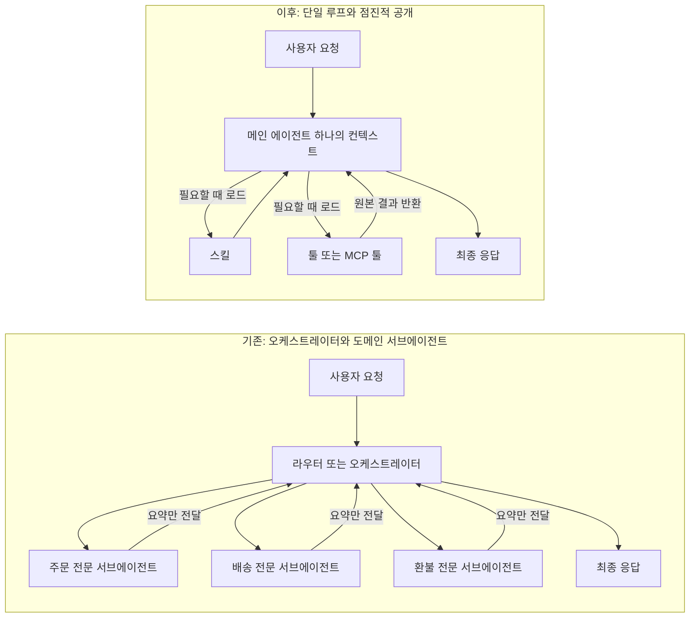
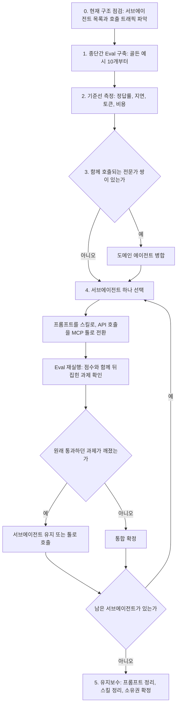
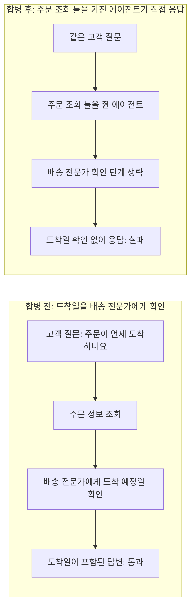
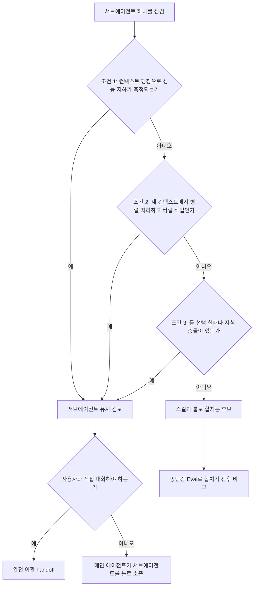

- 작성일: 2026-10-25
- 주제: Anthropic 아티클 ["Building agents: When to fold subagents into your main agent loop"](https://claude.com/resources/articles/building-agents-when-to-fold-subagents-into-your-main-agent-loop)(2026-10-22)와 이를 요약·논평한 [SNS 스레드](https://x.com/xudong07452910/status/2113800139005460534)의 내용, 근거, 실무 적용

---

## 0. 이 문서를 읽는 법

이 문서는 하나의 SNS 게시물에서 시작합니다. 게시물은 "Anthropic이 최근 기업들에게 서브에이전트를 덜 쓰라고 권하고 있고, 일부 전문가 에이전트를 메인 에이전트 루프로 다시 합치고 있다"는 내용을 담고 있습니다. 이 한 문장만 보면 "멀티 에이전트는 틀렸다"는 선언처럼 들릴 수 있지만, 원문을 직접 읽어 보면 훨씬 조심스럽고 구체적인 이야기입니다. 그래서 이 문서는 게시물이 말한 내용을 원문과 한 줄씩 대조하고, 원문이 근거로 삼은 Anthropic의 다른 공식 자료까지 함께 읽어서 "무엇이 확인된 사실이고, 무엇이 해석인지"를 구분해 정리합니다.

문서 안의 주장에는 다음과 같은 근거 등급을 붙였습니다.

| 표기 | 의미 |
|---|---|
| **[사실]** | Anthropic 원문이나 공식 문서에서 직접 확인한 내용입니다. |
| **[벤더 주장]** | Anthropic이 자사 관찰이나 내부 평가로 밝힌 내용입니다. 외부에서 독립적으로 검증된 것은 아닙니다. |
| **[커뮤니티]** | SNS 스레드에 나온 개인의 경험과 의견입니다. 근거 자료가 아니라 참고 의견입니다. |
| **[해석]** | 이 문서의 작성 과정에서 덧붙인 해석입니다. |

참고 자료의 전체 목록과 열람 일자는 문서 맨 끝의 "15. 참고 자료"에 있습니다. 본문에서는 `S1`, `S2`처럼 출처 번호로 표기합니다.

---

## 1. 한눈에 보기

Anthropic의 응용 AI(Applied AI) 팀은 Claude Platform 위에서 만들어진 여러 기업용 에이전트를 비교해 보니, 라우터·플래너·도메인별 서브에이전트를 메인 에이전트 루프 안으로 접어 넣은 쪽이 품질이 더 좋고, 비용과 지연도 낮은 경우가 많았다고 밝혔습니다 [사실, S1]. 한 고객은 멀티 에이전트 하네스를 단일 에이전트 루프와 비교했더니 단일 루프의 실행 시간이 약 2배 빨랐다고 합니다 [벤더 주장, S1].

이유는 단순합니다. 에이전트가 여러 개로 나뉘면 일을 넘길 때마다 컨텍스트를 요약해서 전달해야 하고, 이 과정에서 정보가 빠지며, 모델 호출이 늘어 지연과 비용이 커집니다. 반대로 하나의 에이전트가 하나의 컨텍스트에서 계획하고 실행하면서, 필요할 때만 스킬(업무 절차 지식)과 툴(실제 동작)을 불러오면 이런 손실이 줄어듭니다. Anthropic은 이 방식을 "점진적 공개(progressive disclosure)"라고 부릅니다 [사실, S1].

다만 원문은 "서브에이전트를 버려라"라고 말하지 않습니다. 원문의 결론은 오히려 이렇습니다. 작은 종단간 평가(Eval)를 먼저 만들고, 서브에이전트를 한 번에 하나씩 접어 넣고, 접은 결과가 더 나쁘게 나오면 서브에이전트로 남겨 두라는 것입니다 [사실, S1]. 그리고 서브에이전트가 여전히 가치 있는 상황 세 가지를 명시합니다.

가장 중요한 교훈은 사례 하나에 담겨 있습니다. 샘플 고객지원 에이전트에서 서브에이전트 하나를 다른 서브에이전트에 합쳤더니 지연은 줄었지만, 잘 통과하던 업무 절차 하나가 깨졌습니다. 메인 에이전트가 주문 조회 툴을 직접 들고 있다 보니 배송 전문가에게 도착 예정일을 확인하는 단계를 건너뛰고 스스로 답해 버린 것입니다 [사실, S1]. 그래서 합칠 때는 "최종 점수"만 보지 말고 "어떤 과제가 통과에서 실패로 뒤집혔는지"를 봐야 합니다.

---

## 2. 무슨 일이 있었나: 출처와 맥락

### 2.1 원문 아티클

원문은 Anthropic의 Claude 리소스 사이트에 2026년 10월 22일에 올라온 글입니다. 제목은 "Building agents: When to fold subagents into your main agent loop"이고, 분류는 모범 사례(Best practices)와 관점(Perspectives), 대상 제품은 Claude Platform, 저자는 Diane Sarkis, 읽는 데 약 18분이 걸리는 분량입니다 [사실, S1].

글머리의 안내문은 이 글의 성격을 잘 보여 줍니다. Claude Platform에서 여러 서브에이전트를 가진 에이전트를 만들었다면, 그중 어떤 것을 메인 루프로 접는 것이 좋을지 판단하도록 돕는 "마이그레이션 키트(migration kit)"를 쓰라는 것입니다. 키트는 GitHub의 `anthropics/single-agent-loop-kit`에 공개되어 있습니다 [사실, S1, S2]. 즉 이 글은 일반론이 아니라, "Claude Platform 위에서 서브에이전트를 이미 여러 개 운영 중인 팀"을 독자로 상정한 실무 가이드입니다.

원문이 관찰의 주체로 밝힌 것은 "Applied AI 팀"이고, 관찰 대상은 "여러 엔터프라이즈 배포"입니다 [사실, S1]. 이 점은 뒤에서 일반화의 범위를 따질 때 중요합니다.

### 2.2 게시물과 스레드

공유해 주신 게시물은 Xudong Han(@Xudong07452910)이 원문을 중국어로 요약한 글입니다. 이 게시물은 원문의 핵심 주장, 2배 빨라진 사례, 고객지원 사례의 교훈, 서브에이전트가 여전히 유효한 상황, 마이그레이션 도구 공개까지를 순서대로 짚습니다. 같은 작성자가 이어서 올린 보충 글에는 자신의 판단 기준이 나오고, 그 아래로 여러 사람이 경험담을 덧붙인 스레드가 이어집니다 [커뮤니티, S11].

참고로 이 문서를 만들 때 게시물의 원문 페이지는 자동 접근이 허용되지 않아 직접 열람하지 못했습니다. 따라서 게시물과 스레드 내용은 공유해 주신 본문을 기준으로 정리했고, 모든 사실관계는 Anthropic 원문과 공식 자료로 다시 확인했습니다.

### 2.3 게시물의 주장과 원문의 대조

게시물이 원문을 얼마나 정확히 옮겼는지, 어떤 부분을 조심해서 읽어야 하는지를 표로 정리합니다.

| 게시물의 주장 | 원문에서 확인한 내용 | 판정 |
|---|---|---|
| Anthropic이 기업에 서브에이전트를 줄이라고 권하고, 일부 전문가 에이전트를 메인 루프로 되돌리고 있다 | 원문은 "더 적은 서브에이전트와 점진적으로 공개되는 컨텍스트·툴로 품질을 높이고 비용·지연을 줄일 수 있다"고 말하고, 접는 것이 "합리적일 수 있는 것"을 가려내라고 안내합니다. 서브에이전트가 여전히 맞는 상황도 따로 명시합니다 | 방향은 정확. 단, 권고는 조건부이며 일괄 폐기가 아님 |
| 단일 에이전트와 스킬 조합이 복잡한 멀티 에이전트보다 나은 경우가 많았다 | 여러 엔터프라이즈 배포를 비교했을 때 스킬을 가진 단일 에이전트가 "한 프롬프트에 전부 넣는 설계"와 "서브에이전트 설계" 모두를 품질 면에서 자주 앞섰고, 작업당 비용과 지연도 낮은 경우가 많았다고 합니다 | 정확. 다만 품질 향상 폭 같은 수치는 원문에 없음 |
| 한 고객이 단일 루프로 바꿨더니 속도가 약 2배 빨라졌다 | 멀티 에이전트 하네스를 단일 루프와 비교한 한 고객이 약 2배 빠른 실행 시간을 봤다고 합니다 | 정확. 단, 한 고객의 사례이며 조건은 공개되지 않음 |
| 에이전트 사이에서 컨텍스트를 전달하고 요약하는 과정에서 정보가 손실되고 지연과 비용이 늘어난다 | 원문의 실패 모드(컨텍스트 관리, 지연)와 일치하고, 이전 글들에서도 같은 설명이 반복됩니다 | 정확 |
| 메인 에이전트가 계획과 실행을 맡고, 필요할 때 스킬과 툴을 동적으로 불러오며, 업무 절차와 도메인 지식은 재사용 가능한 컴포넌트에 둔다 | 원문이 제시한 단일 루프 설계와 일치합니다 | 정확 |
| 고객서비스 시스템의 서브에이전트를 합쳤더니 지연은 줄었지만, 메인 에이전트가 물류 전문가에게 도착 시간을 확인하는 단계를 빠뜨려 원래 통과하던 과제가 실패했다 | 원문은 이 사례를 "샘플 고객지원 에이전트(sample support agent)에서 테스트했을 때"의 일로 설명합니다. 실제 고객사 사례라고는 쓰지 않았습니다 | 내용은 정확. 다만 게시물의 표현은 실고객 사례처럼 읽힐 수 있어 주의 |
| 합칠 때마다 종단간 Eval로 검증하고, 특히 통과하던 과제가 갑자기 실패했는지 확인해야 한다 | 원문의 핵심 권고와 일치합니다. 점수만 보지 말고 "뒤집힌(flipped) 과제"를 보라고 합니다 | 정확 |
| 병렬 연구, 독립 검증, 컨텍스트 격리 같은 상황에서는 서브에이전트가 여전히 가치 있다 | 원문이 명시한 유지 조건 세 가지는 컨텍스트 팽창으로 인한 성능 저하, 새 컨텍스트 창에서의 병렬 작업, 툴 선택 실패나 지침 충돌입니다. 도입부에서는 서브에이전트가 검증, 병렬 작업, 모듈형 권한 분리에 효과적이라고도 언급합니다 | 대체로 일치. 세 조건의 문구와 정확히 같지는 않고 "독립 검증"은 도입부의 언급에 해당 |
| Anthropic이 마이그레이션 도구를 오픈소스로 공개했고, 기존 구조 분석, 단계적 병합, 전후 품질·비용·지연 비교를 돕는다 | 키트는 Apache-2.0 라이선스로 공개되어 있고, 감사(audit), 기준선 측정, 병합, 접기, 비교 스크립트를 포함합니다. 다만 저장소는 "참고 구현이며 유지보수나 기여를 받지 않는다"고 밝힙니다 | 정확. 유지보수가 없다는 점은 알아 둘 것 |
| 서브에이전트마다 정말 독립된 컨텍스트와 실행 루프가 필요한지 먼저 물어봐야 한다 | 이 문장은 원문에 없는 게시물 작성자의 정리입니다. 원문의 결론은 "측정하고, 한 번에 하나씩 바꾸고, 버티는 것을 남겨라"입니다 | 작성자의 해석 |

---

## 3. 먼저 알아둘 용어

이 주제는 용어가 많아서, 처음 보는 분을 위해 쉬운 말로 먼저 정리합니다.

**에이전트 루프**는 모델이 목표를 향해 "생각하고, 툴을 부르고, 결과를 보고, 다시 생각하는" 과정을 되풀이하는 구조입니다. 원문이 말하는 단일 루프는 "하나의 모델과 하나의 컨텍스트 창이 열린 툴 루프를 돌리는 것"이고, 턴 수나 비용 예산, 쓰기 작업 승인 같은 한계는 하네스(모델을 둘러싼 코드)에서 정합니다 [사실, S1].

**서브에이전트**는 자기만의 컨텍스트 창, 툴, 지침을 가지고 오케스트레이터(조율자)의 지시를 받아 일하는 에이전트입니다. 원문은 서브에이전트가 검증, 병렬 작업, 모듈형 권한 분리에 효과적이라고 인정합니다 [사실, S1].

**오케스트레이터**는 서브에이전트에게 일을 나눠 주고 결과를 모으는 에이전트입니다. 라우터(요청을 분류해 알맞은 전문가에게 보내는 장치)가 앞에 붙는 경우도 많습니다.

**핸드오프**는 일을 다른 에이전트에게 넘기는 것입니다. 원문과 관련 글은 두 가지를 구분합니다. 하나는 서브에이전트가 대화 자체를 넘겨받아 사용자와 직접 이야기하는 "완전 이관"이고, 다른 하나는 메인 에이전트가 서브에이전트를 툴처럼 불러 결과만 받는 "위임"입니다 [사실, S1, S3].

**스킬(Skill)** 은 "그 일을 어떻게 하는가"를 담은 폴더입니다. 팀이 일하는 단계, 규칙, 판단 기준처럼 전문가 서브에이전트의 프롬프트가 들고 있던 내용이 여기에 해당합니다 [사실, S1]. 공식 문서에 따르면 스킬은 세 단계로 필요할 때만 로드됩니다. 첫 단계인 메타데이터(이름과 설명)는 스킬 하나당 약 100토큰으로 항상 올라가 있고, 둘째 단계인 SKILL.md 본문은 스킬이 호출될 때 5천 토큰 미만으로 올라오며, 셋째 단계인 참고 파일과 스크립트는 필요할 때만 읽힙니다. 스크립트는 실행하면 코드가 아니라 출력만 컨텍스트에 들어옵니다 [사실, S9].

**툴(Tool)과 MCP 툴**은 에이전트가 실제로 동작하거나 외부 시스템의 데이터를 읽는 수단입니다. 원문은 "행동을 해야 할 때, 실시간 데이터를 읽어야 할 때, 정해진 형식의 결과를 돌려줘야 할 때" 툴이 맞는다고 설명합니다 [사실, S1].

**툴 검색(Tool search)과 지연 로딩**은 툴 정의를 처음부터 전부 컨텍스트에 올리지 않고, 필요할 때 검색해서 올리는 기능입니다. 공식 문서에 따르면 일반적인 멀티 서버 구성(GitHub, Slack, Sentry, Grafana, Splunk)은 일을 시작하기도 전에 정의만으로 약 5만 5천 토큰을 쓰는데, 툴 검색을 쓰면 보통 85% 넘게 줄고 요청마다 3~5개 툴만 올라옵니다. 또 사용 가능한 툴이 30~50개를 넘으면 모델의 툴 선택 정확도가 떨어지기 시작한다고 합니다 [사실, S8].

**점진적 공개(Progressive disclosure)** 는 위의 두 가지를 묶는 원칙입니다. 에이전트에게 처음에는 스킬과 툴의 짧은 설명만 보여 주고, 필요해지는 순간에 전체 내용을 불러오는 방식입니다 [사실, S1].

**종단간 Eval(End-to-end eval)** 은 에이전트가 사용자의 요청을 처음부터 끝까지 제대로 해결했는지를 채점하는 평가입니다. 중간 단계가 아니라 결과를 봅니다. 원문은 "10개의 골든 예시만 있어도 시작할 수 있다"고 말합니다 [사실, S1].

---

## 4. 왜 서브에이전트가 문제가 되는가

원문은 대기업 환경에서 흔히 보이는 "에이전트 구축 실패 모드"를 다섯 가지로 정리합니다 [사실, S1]. 이 설명은 단순히 "서브에이전트는 느리다"가 아니라, 조직 구조까지 포함한 이야기라는 점이 흥미롭습니다.

원문이 묘사하는 전형적인 경로는 이렇습니다. 회사는 여러 제품과 기능을 하나의 고객 접점으로 묶는 에이전트를 만들고 싶어 합니다. 각 기능은 서로 다른 팀이 소유하고 있으므로, 처음에는 팀마다 자기 에이전트를 만들게 하고, 그다음 중앙 플랫폼 팀이 그 위에 오케스트레이터를 얹습니다. 겉보기에는 가장 간단한 해법이지만 곧 다섯 가지 문제가 생깁니다.

첫째는 **컨텍스트 관리**입니다. 에이전트들 사이에서 어떤 컨텍스트를 주고받을지 정해야 하는데, 오가는 과정에서 세부 정보가 자주 사라집니다.

둘째는 **서브에이전트 난립**입니다. 팀마다 자기 서브에이전트를 내놓다 보면 서로 겹치는 서브에이전트가 수백 개가 되고, 표준도 담당자도 없어집니다.

셋째는 **프랭큰프롬프트(Frankenprompt)** 입니다. 팀마다 시스템 프롬프트에 문장을 하나씩 덧붙이면 규칙이 서로 충돌하고 일관된 말투도 사라집니다.

넷째는 **검증되지 않고 지나치게 국소적인 Eval**입니다. 모두가 자기 하위 과제에 맞춰 평가를 만들다 보니, 전체를 책임지고 관리하는 사람이 없고 경영진은 희석된 국소 점수로 의사결정을 하게 됩니다.

다섯째는 **지연**입니다. 아키텍처가 복잡해지면 지연이 늘고, 한 고객은 멀티 에이전트 하네스를 단일 루프와 비교했더니 단일 루프가 약 2배 빨랐다고 합니다.

원문은 이런 현상을 콘웨이의 법칙(조직 구조가 시스템 구조를 닮는다)에 빗대어 "에이전트 아키텍처가 조직도의 복사본이 되는 경우가 너무 많다"고 지적합니다 [사실, S1].

원문이 소개하는 구체 사례도 두 가지 있습니다. 하나는 고객 대면 에이전트 안에 전문가 서브에이전트가 열두 개쯤 있던 회사입니다. 이 회사는 일관된 브랜드 경험을 유지하기 어려웠고 지연이 사용자 경험을 해쳤다고 합니다. 다른 하나는 의도 분류기, 고정된 다단계 추론 파이프라인, 사용자 세그먼트 구분, 별도의 추천 분기, 그 위의 멀티 에이전트 오케스트레이터로 이어지는 설계입니다. 이런 제안에 대한 피드백은 대개 "이 구조의 상당수가 모델이 더는 대신해 줄 필요가 없는 일을 하고 있었고, 명확한 시스템 프롬프트 하나와 얇은 데이터 툴 4~5개, 단단한 출력 가드레일이면 대부분의 사용 사례가 커버된다"는 것이었다고 합니다 [벤더 주장, S1].

비용 측면의 배경은 Anthropic의 이전 글에서 확인됩니다. 2026년 1월 글은 자체 테스트에서 멀티 에이전트 구현이 동일한 작업에 단일 에이전트보다 보통 3~10배 많은 토큰을 쓴다고 밝혔습니다. 컨텍스트를 여러 에이전트에 중복해서 넣고, 조율 메시지를 주고받고, 핸드오프용 요약을 만들기 때문입니다 [벤더 주장, S4]. 같은 글은 소프트웨어 개발 역할(계획자, 구현자, 테스터, 리뷰어)로 에이전트를 나눈 한 실험에서 서브에이전트들이 실제 작업보다 조율에 더 많은 토큰을 썼다는 점도 소개하며, 이런 분할을 "전화 게임(telephone game)"에 비유합니다. 핸드오프가 일어날 때마다 정보의 충실도가 떨어진다는 뜻입니다 [벤더 주장, S4].

2026년 9월의 커머스 에이전트 글도 같은 방향입니다. 대화 하나가 여러 의도와 여러 턴에 걸친 긴밀한 세션이고 공유 컨텍스트가 많이 필요한데, 서브에이전트에 넘기는 모든 핸드오프는 "상태를 잃는 작업"이며, 한 번의 핸드오프가 토큰을 몇 배로 쓰고 몇 초의 지연을 더하기도 한다고 설명합니다 [벤더 주장, S3].

---

## 5. 대안: 단일 에이전트 루프와 점진적 공개

### 5.1 원문이 제시한 세 가지 근거

원문은 서브에이전트를 접어 넣는 접근이 말이 되는 이유를 세 가지로 설명합니다 [사실, S1].

**첫째, 공유된 컨텍스트가 더 나은 답을 만듭니다.** 오래 걸리는 작업에서는 여러 단계의 맥락이 하나의 컨텍스트 창 안에 같이 있는 편이 좋습니다. 앞 단계의 결과를 직접 본 에이전트는 단계들을 서로 연결할 수 있어서, 서브에이전트가 요약해서 돌려준 결과들의 모음보다 풍부한 결과와 통찰을 낼 수 있습니다. 컨텍스트 창이 줄고 손실이 큰 핸드오프도 줄어듭니다.

**둘째, 점진적 공개가 컨텍스트 팽창을 막습니다.** 예전에 팀들이 일을 서브에이전트로 쪼갰던 가장 큰 이유는 한 에이전트에 모든 지식을 한꺼번에 올리면 컨텍스트가 너무 커지기 때문이었습니다. 스킬과 툴 검색으로 필요할 때만 올리면 그 이유가 사라집니다. 원문은 Claude Code의 시스템 프롬프트를 더 고급 모델용으로 80% 넘게 줄였고, 그 안에 스킬과 툴을 점진적으로 공개하도록 바꾼 것도 포함된다고 설명합니다.

**셋째, 모델이 더 유능해졌습니다.** 원문은 Opus 4.5부터 모델이 한 루프에서 소화할 수 있는 양이 대부분의 팀 예상을 넘었고, Opus 5.5와 Fable 5.1에서는 사고(thinking)를 끌 수 없으며, 최근 모델은 진행 상황을 스스로 서술하고 작업을 점검하기 때문에 하네스의 일부 요소가 불필요해졌다고 설명합니다. 또 단순한 루프가 다음 모델로 옮기기도 쉽고, 고객 마이그레이션 경험에서는 경직된 멀티 에이전트 구조가 새 모델이 더 많은 일을 직접 하는 것을 막는 경우가 많았다고 합니다.

이 세 번째 근거는 Anthropic의 개발자 블로그가 2026년 7월 24일에 밝힌 내용과 맞닿아 있습니다. 이 블로그는 Claude Opus 5와 Claude Fable 5 같은 모델에서 Claude Code의 시스템 프롬프트를 80% 넘게 걷어내도 내부 코딩 평가에서 측정 가능한 손실이 없었다고 하고, 오래된 규칙 중 상당수가 이제는 모델의 판단에 맡기는 편이 낫다고 설명합니다. 같은 글은 "처음부터 전부 올리기" 대신 "점진적 공개"를 쓰라고 권하며, 검증과 코드 리뷰 지침을 시스템 프롬프트에서 빼서 필요할 때만 부르는 스킬로 옮긴 사례를 듭니다 [벤더 주장, S6]. 다만 이 블로그가 확인한 것은 Claude Code와 해당 모델들에 대한 결과이고, 다른 모델 계열이나 다른 에이전트에서도 같은 폭의 효과가 나는지는 그 글에서 확인되지 않습니다. 그래서 자신의 시스템에서는 반드시 직접 평가해 봐야 합니다.

### 5.2 단일 루프의 구체적인 설계

원문이 "지향점"으로 제시하는 단일 루프는 다음과 같이 움직입니다 [사실, S1].

하나의 모델과 하나의 컨텍스트 창이 열린 툴 루프를 돌립니다. 턴 수와 비용 예산, 쓰기 작업 승인(write gate) 같은 한계는 하네스가 정합니다. 매 턴마다 모델은 툴 호출을 한 묶음으로 내보내고, 하네스는 이를 병렬로 실행해서 원본 결과를 같은 모델에게 돌려줍니다. 모델은 다음 행동을 결정합니다. 또 다른 툴 묶음일 수도, 사용자에게 던지는 질문일 수도, 최종 답변일 수도 있습니다. 모델이 답하거나 예산에 도달하면 루프가 멈추고, 답변 뒤에 목표나 검증기 확인을 선택적으로 돌릴 수 있습니다.

핵심 변화는 계획의 소유자입니다. 모델이 첫 턴에 컨텍스트 안에 계획을 적고, 결과가 들어올 때마다 고칩니다. 오케스트레이터와 전문가 에이전트 구조에서는 계획을 세우는 쪽과 실행하는 쪽이 달랐지만, 이제는 계획을 세운 모델이 직접 실행하므로 도중에 계획을 바꿀 수 있습니다.

컨텍스트는 여전히 올라오지만, 이제 에이전트가 스스로 관리합니다. 원문은 어디로 무엇이 옮겨가는지를 이렇게 정리합니다.

- 규칙 목록을 보고 계획을 다시 쓰던 코드 단계는 필요 없어집니다. 모델이 매 단계를 결정하기 때문입니다.
- 처리 순서와 도메인 절차는 **스킬**로 옮겨갑니다.
- 검증과 승인 같은 하드 리밋, 그리고 대화 중간에 생기는 일(예: 메모리 조회)은 **툴** 안으로 옮겨갑니다.
- 값싸고 거의 항상 필요한 것(예: 개체 식별 단계)과 기계적인 부분(페이로드 구성, 스트림 파싱, 확인 질문 재개)은 여전히 코드로 처리할 수 있습니다. 다만 루프가 호출하는 툴 안에서 처리합니다.

원문은 이 설계가 "사용자의 상위 목표를 이해하고 대신 행동하는 에이전트"라는 많은 팀의 최종 목표에도 도움이 된다고 말합니다. 에이전트가 배운 모든 것이 하나의 컨텍스트에 남기 때문입니다.

도식으로 비교하면 다음과 같습니다.

위 도식의 서브에이전트 이름(주문, 배송, 환불)은 이해를 돕기 위한 예시이며, 원문이 이 구성을 그대로 제시한 것은 아닙니다 [해석].

### 5.3 점진적 공개는 공짜가 아니다

"스킬로 옮기면 컨텍스트가 줄어든다"는 말은 맞지만, 비용이 없다는 뜻은 아닙니다. 커머스 에이전트 글은 현실적인 기준을 하나 제시합니다. 스킬을 로드하는 데 모델 턴이 한 번 들기 때문에, 대부분의 턴에서 필요한 지침은 시스템 프롬프트에 두는 편이 좋다는 것입니다. 그 글이 제시하는 출발점은 "트래픽의 3분의 1 이상에 관련되는 지침은 시스템 프롬프트에, 나머지는 스킬에" 두는 것입니다. 또 하네스가 이미 가진 신호(예: 사용자가 들어온 페이지)로 어떤 스킬이 필요한지 예측할 수 있다면, 첫 모델 호출 전에 하네스가 주입해서 추가 턴을 아끼라고 권합니다. 안전과 법적 규칙, 브랜드 제약, 알레르기 같은 핵심 사용자 정보는 항상 시스템 프롬프트에 둡니다 [벤더 주장, S3].

---

## 6. 단계별 마이그레이션

원문은 이미 오케스트레이터와 전문가 에이전트가 운영 중인 팀을 위해 "단계적으로 이동하는 방법"을 제시합니다 [사실, S1]. 전체 흐름은 다음과 같습니다.

이 흐름은 원문의 서술과 키트의 단계(감사, 기준선, 병합, 접기, 툴로 호출, 유지보수)를 합쳐 이 문서에서 도식으로 정리한 것입니다 [해석, S1, S2].

### 6.1 1단계: 과제 완료 Eval부터 만든다

원문은 합치기 전에 가장 먼저 할 일로 "서브에이전트를 메인 루프에 접어도 되는지 판단하게 해 줄 Eval 세트를 만드는 것"을 꼽습니다. 효과가 입증된 구조는 두 층입니다. 중앙 팀이 소유하는 공용 종단간 세트가 하나 있고, 스킬을 맡은 팀이 스킬과 함께 내놓는 작은 Eval 세트가 따로 있는 구조입니다. 골든 예시 10개면 시작하기에 충분하다고 합니다 [사실, S1].

채점 방식도 단계에 따라 달라집니다. 최종 응답을 루브릭으로 채점하는 것이 품질 추적의 좋은 출발점입니다. 오케스트레이터가 남아 있는 동안에는 라우팅 정확도(올바른 서브에이전트를 골랐는가)도 같이 봅니다. 서브에이전트를 접고 나면 "올바른 스킬을 로드했는가, 올바른 툴을 불렀는가"를 대신 확인합니다. 장기적으로는 과제 완료 Eval로 나아가는 것이 좋은데, 아키텍처를 비교할 때 가장 중요한 지표이기 때문입니다.

내부 시스템을 다시 재생하기 어렵고 사용자 참여를 흉내 내기 어려운 환경에서는 어려울 수 있는데, 원문이 소개하는 방법은 중요한 이벤트에 타임스탬프를 기록해 두었다가 나중에 재생해서 표적 Eval로 돌리는 것입니다 [사실, S1].

이 대목은 Anthropic의 Eval 설계 글과도 이어집니다. 그 글(2026-09-28)은 좋은 Eval의 조건으로 과제가 실제 운영을 닮을 것, 더 강한 모델과 더 많은 사고에서 점수가 오를 것, 최상위 모델도 100%에 못 미치는 "여유 공간"이 있을 것, 실행 간 변동이 낮을 것을 듭니다. 그리고 평가에 과적합되는 것을 막으려고 훈련 세트와 별도의 테스트 세트를 나누라고 합니다. 점수 변화가 우연의 범위보다 큰지도 확인하라고 합니다 [벤더 주장, S7]. 합치기 전후를 비교하는 일은 바로 "작은 변화를 측정해야 하는" 일이어서 이 원칙이 그대로 적용됩니다 [해석].

### 6.2 2단계: 도메인 에이전트 병합

첫 병합 전에 작은 종단간 Eval을 먼저 만들고, 그다음에 **공유 컨텍스트를 기준으로 가장 많이 쓰이는 서브에이전트부터** 접습니다. 서로의 출력에 이어서 작업하거나, 같은 데이터를 건드리거나, 자주 함께 호출되는 전문가들을 병합하는 것이 좋습니다. 예를 들어 운영 트래픽의 상당 부분이 "전문가 A 다음에 전문가 B"라면, 그 쌍은 긴밀하게 결합된 것이므로 하나의 도메인 에이전트로 합칠 후보입니다 [사실, S1].

### 6.3 3단계: 서브에이전트를 툴로 호출한다

서브에이전트를 남기기로 했다면, 메인 에이전트가 서브에이전트를 툴처럼 호출하게 만드는 것이 효과적일 수 있습니다. 그러면 메인 에이전트가 사용자와의 대화를 계속 쥐고 있을 수 있습니다. 원문은 서브에이전트가 사용자와 직접 이야기해야 할 때에만 대화를 통째로 넘기는 완전 이관을 권하며, 그 외에는 "스킬과 툴을 가진 메인 루프"로 충분하다고 말합니다 [사실, S1].

이 방식에는 장점이 있습니다. 서브에이전트들이 공유 응답 스키마를 쓰도록 정의할 수 있고, 서브에이전트의 결론을 메인 에이전트가 실제 데이터로 확인할 수 있으며, 최종 종합 단계에 들어가는 입력을 줄일 수 있습니다. 서브에이전트를 다시 쓸 필요도 없어서 부담이 적고, 합치기 여부를 결정하기 전에 과제 완료 Eval의 **기준선**을 얻는 좋은 첫걸음이기도 합니다.

하지만 몇 가지 실패 모드는 그대로 남습니다. 전문가마다 프롬프트, 컨텍스트, 소유 팀, Eval이 따로 있고, 호출마다 손실이 있는 요약이 돌아오며, 모든 호출이 중첩된 모델 루프라서 지연을 더한다는 점입니다 [사실, S1].

### 6.4 4단계: 스킬과 툴로 접는다

서브에이전트를 한 번에 하나씩, 각각의 프롬프트를 스킬로, API 호출을 MCP 툴로 바꾸는 방식으로 메인 에이전트에 접어 넣습니다. 서브에이전트가 있을 때와 없을 때의 Eval 성능을 비교한 다음, 어떤 것을 남길지 결정합니다 [사실, S1].

원문이 여기서 강조하는 것은 두 가지입니다. 첫째, 최종 점수만 보지 말고 **어떤 과제가 뒤집혔는지** 봐야 합니다. 둘째, 변경 전에 Eval에 "운영에서 함께 실행되는 모든 에이전트 체인"과 "에이전트가 어겨서는 안 되는 모든 규칙"에 대응하는 과제가 있는지 확인하고, **각 과제를 두 번 이상** 돌려야 합니다. 다음 장의 사례처럼 문제가 두 번 중 한 번만 나타나는 경우가 있기 때문입니다.

---

## 7. 사례 분석: 지연은 줄었는데 과제가 실패한 이유

원문의 이 대목은 게시물이 특히 주목한 부분이며, 합치기 작업에서 가장 현실적인 위험을 보여 줍니다.

원문의 서술은 이렇습니다. 샘플 고객지원 에이전트에서 서브에이전트 하나를 다른 서브에이전트에 접었더니 지연은 줄었지만, 이미 통과하던 절차 하나가 깨졌습니다. 메인 에이전트가 주문 조회 툴을 쥐고 있어서 배송 전문가에게 도착 예정일을 묻지 않고 스스로 답했기 때문입니다. 그리고 이런 깨짐은 두 번 실행 중 한 번에서만 나타났습니다 [사실, S1].

이 도식은 원문이 밝힌 범위 안에서만 단순화한 것입니다. 원문은 합병된 구조의 세부(어느 서브에이전트가 어느 서브에이전트에 합쳐졌는지)를 자세히 설명하지 않습니다 [해석].

이 사례에서 얻을 수 있는 교훈은 세 가지입니다.

첫째, **지연과 비용이 개선되었다고 해서 합병이 성공한 것은 아닙니다.** 속도 지표만 좋아지고 품질이 뒤로 갔다면, 그것은 개선이 아니라 위험이 숨은 것입니다.

둘째, **서브에이전트는 눈에 보이지 않는 안전장치 역할을 하고 있을 수 있습니다.** 이 사례에서 "배송 전문가에게 반드시 묻는다"는 규칙은 구조 자체가 강제하고 있었습니다. 구조가 사라지면 규칙도 사라지므로, 그 규칙은 스킬이나 툴 안으로 명시적으로 옮겨져야 합니다. 원문이 하드 리밋과 선행 조건을 툴 안으로 옮기라고 말하는 이유이기도 합니다. 예를 들어 Y가 X의 출력을 필요로 한다면, Y의 툴이 X의 출력이 있는지 확인하고 없으면 모델이 따를 수 있는 지시를 돌려주는 식입니다 [사실, S1].

셋째, **한 번의 실행으로는 부족합니다.** 문제가 두 번 중 한 번만 나타났으므로, 각 과제를 한 번만 돌렸다면 놓쳤을 수 있습니다. 키트가 처음에는 "과제 열 개에 반복 두세 번"으로 시작하라고 권하는 것도 같은 맥락입니다 [사실, S2].

게시물 작성자는 이 위험을 한 문장으로 요약했습니다. "합병의 가장 큰 위험은, 평가에서 점수는 떨어지지 않았는데 어떤 과제가 조용히 죽어 있는 것"이라는 말입니다 [커뮤니티, S11]. 원문의 취지와 같은 방향이지만, 표현은 작성자의 것입니다.

한 가지 더 알아 둘 점이 있습니다. 원문은 이 사례를 "샘플 고객지원 에이전트"에서 테스트했다고 쓰고 있고, 키트에는 라우터와 서브에이전트 6개로 구성된 `examples/support-desk` 예제가 들어 있습니다 [사실, S1, S2]. 하지만 자료만으로는 두 가지가 같은 것인지 확인되지 않습니다. 또 이 사례는 실제 운영 고객사의 사고가 아니라 테스트에서 발견한 사례로 읽는 것이 정확합니다.

---

## 8. 그래도 서브에이전트가 필요한 경우

원문은 "서브에이전트는 여전히 제자리가 있다"고 분명히 말하고, 연구의 최전선에서도 마찬가지라고 덧붙입니다. 서브에이전트를 쓰라고 하는 경우는 세 가지입니다 [사실, S1].

1. 단일 에이전트 루프가 컨텍스트 팽창 때문에 **측정 가능한 성능 저하**를 겪을 때
2. 여러 작업을 **새 컨텍스트 창에서 병렬로** 처리해야 하고, 끝나면 그 컨텍스트를 버려도 될 때
3. 단일 에이전트가 **적절한 툴을 고르기 어려워하거나**, 시스템 프롬프트 안에 **충돌하는 지침**이 있을 때

이 세 조건을 의사결정 흐름으로 그리면 다음과 같습니다.

이 도식은 원문의 세 조건과 "완전 이관은 사용자와 직접 대화해야 할 때만"이라는 권고를 합쳐 이 문서에서 정리한 것입니다 [해석, S1].

이 세 조건이 구체적으로 어떤 모습인지는 Anthropic의 다른 글들에서 더 자세히 확인됩니다.

**컨텍스트 보호.** 2026년 1월 글은 한 가지 예를 듭니다. 고객지원 에이전트가 기술 문제를 진단하는 동안 주문 이력 조회가 컨텍스트에 수천 토큰을 쌓으면 진단 추론이 나빠질 수 있으므로, 별도 에이전트가 주문 이력을 처리하고 50~100토큰의 요약만 넘기라는 것입니다. 그 글은 이런 격리가 하위 작업이 1,000토큰을 넘는 컨텍스트를 만들지만 대부분 메인 작업과 무관하고, 무엇을 추출할지 기준이 분명한 조회·검색 작업일 때 가장 효과적이라고 설명합니다 [벤더 주장, S4].

**병렬화.** Anthropic의 멀티 에이전트 리서치 시스템 글(2025-06-13 게시, 2026-10-09 수정 표기)은 Claude Opus 4를 리드로, Claude Sonnet 4를 서브에이전트로 쓴 시스템이 단일 Claude Opus 4보다 내부 연구 평가에서 90.2% 앞섰다고 밝힙니다. 특히 서로 독립적인 여러 방향을 동시에 조사하는 "폭 우선" 질문에서 강했다고 합니다. 같은 글은 BrowseComp 평가에서 성능 변동의 95%를 설명하는 요인 세 가지 중 토큰 사용량 하나가 80%를 설명했다고 하고, 대신 에이전트는 채팅보다 토큰을 약 4배, 멀티 에이전트 시스템은 약 15배 쓴다고 합니다. 그러면서 모든 에이전트가 같은 컨텍스트를 공유해야 하거나 에이전트 사이 의존성이 많은 영역, 예를 들어 대부분의 코딩 작업은 병렬화 가능한 부분이 적어 멀티 에이전트에 잘 맞지 않는다고 밝힙니다 [벤더 주장, S10]. 이 수치들은 2025년 당시 모델 기준의 내부 평가임을 감안해야 합니다.

**전문화.** 2026년 1월 글은 툴이 많을수록 선택이 어려워지는 신호를 세 가지로 설명합니다. 툴 수가 많을 때(보통 20개 이상), 서로 무관한 영역의 툴이 섞여 영역 혼동이 생길 때, 툴을 추가하면 기존 과제 성능이 떨어질 때입니다. 다만 같은 글은 멀티 에이전트로 가기 전에 툴 검색 도구를 먼저 써 보라고 권합니다 [벤더 주장, S4]. 새 원문도 이어서 툴이 30~50개를 넘으면 선택 정확도가 떨어지는 경향이 있으므로 사용자 의도 단위로 툴을 묶고, 툴 검색과 지연 로딩을 쓰라고 합니다 [사실, S1, S8].

**검증.** 2026년 1월 글은 검증 전용 서브에이전트가 도메인을 가리지 않고 잘 작동하는 패턴이라고 소개합니다. 검증은 구현 이력을 몰라도 결과물만 블랙박스로 시험할 수 있어 컨텍스트 전달이 거의 필요 없기 때문입니다. 대신 검증자가 한두 개 테스트만 보고 통과시키는 "조기 승리 문제"가 가장 큰 실패 모드이므로, "전체 테스트 스위트를 반드시 실행하라" 같은 구체적 기준이 필요하다고 합니다. 또 더 유능한 오케스트레이터 모델은 별도의 검증 단계 없이 서브에이전트의 작업을 직접 평가할 수 있게 되어 가고 있다고도 덧붙입니다 [벤더 주장, S4].

**대화의 소유권.** 커머스 에이전트 글은 서브에이전트가 자리를 갖는 경우를 두 가지로 정리합니다. 하나는 오케스트레이터가 좁고 독립적인 작업을 툴처럼 호출하는 경우로, 딥리서치 서브에이전트가 대표적입니다. 문서를 읽고, 코드를 실행하고, 막다른 길을 헤매는 모든 일이 서브에이전트 안에서 일어나고 오케스트레이터에게는 간결한 답만 돌아옵니다. 다른 하나는 이미 자체 컴플라이언스 표면을 가진 전용 에이전트가 있는 도메인으로, 이 경우에는 그 에이전트가 사용자와 직접 대화하는 핸드오프가 맞을 수 있습니다. 그 글이 말하는 구분 기준은 "대화의 소유권"입니다 [벤더 주장, S3].

**조율 패턴의 한계.** 2026년 4월 글은 다섯 가지 조율 패턴(생성자-검증자, 오케스트레이터-서브에이전트, 에이전트 팀, 메시지 버스, 공유 상태)을 정리하면서, 대부분의 경우 가장 단순한 오케스트레이터-서브에이전트로 시작하라고 권합니다. 동시에 이 패턴에서 오케스트레이터가 정보 병목이 되는 점, 한 서브에이전트가 발견한 것이 다른 서브에이전트에게 닿으려면 오케스트레이터를 거쳐야 하고 몇 번의 중계 끝에 핵심 세부가 사라질 수 있는 점을 약점으로 지적합니다 [벤더 주장, S5]. 서브에이전트를 쓰기로 했다면 이 약점을 알고 쓰라는 뜻입니다.

한 가지 짚어 둘 점이 있습니다. 게시물 작성자는 유지 여부를 가리는 자신의 기준 두 가지를 제시했습니다. "그 서브에이전트가 깨끗한 컨텍스트를 필요로 하는가", "그 결론이 메인 에이전트와 독립적이어야 하는가"를 묻고, 둘 다 아니라면 합치는 것을 고려할 수 있다는 것입니다 [커뮤니티, S11]. 이 기준은 원문의 세 조건과 방향은 비슷하지만 원문의 공식 기준이 아니라 작성자의 경험칙입니다. 특히 두 번째 질문은 "독립 검증이 필요한가"와 가깝고, 이는 원문이 서브에이전트의 강점으로 언급하는 검증과 맞닿아 있습니다 [해석].

---

## 9. 여러 팀이 하나의 에이전트를 함께 만드는 법

서브에이전트를 접으면 "각 팀이 자기 에이전트를 소유하던 구조"가 사라집니다. 원문은 그 자리를 어떻게 채울지도 설명합니다 [사실, S1].

기본 원칙은 **작은 중앙 팀이 시스템 프롬프트와 종단간 품질을 소유**하고, 새 툴과 Eval이 나가기 전에 검토한다는 것입니다. 이 중앙 팀을 작게 유지하면 반복이 빨라지고 대규모 조직의 조율 비용이 낮아집니다. 개별 팀은 소유의 대상을 "에이전트"에서 "스킬과 툴"로 옮깁니다.

**MCP 툴.** 행동을 취하거나, 시스템에서 실시간 데이터를 읽거나, 정해진 모양의 결과를 돌려줘야 할 때 툴이 맞습니다. 원문은 API 하나당 툴 하나가 아니라 사용자 의도별로 묶은 툴을 권하고, 시스템 프롬프트에 올라간 툴 정의가 30~50개를 넘으면 툴 선택이 나빠지는 경향이 있다고 말합니다. 선행 조건 같은 하드 리밋은 툴 안으로 옮기고, 사용자별 권한도 같은 방식으로 처리합니다. 각 툴이 호출한 사용자가 볼 수 있고 할 수 있는 범위를 확인해서 모델이 읽을 수 있는 평이한 거절 메시지를 돌려주면, 권한 수준마다 별도의 에이전트를 두지 않고도 하나의 루프가 접근 권한이 다른 사용자들을 처리할 수 있습니다.

**스킬.** 팀이 일하는 방식, 즉 단계와 규칙과 판단 기준을 에이전트가 알아야 할 때 스킬이 맞습니다. 원문의 방침은 스킬 유지보수를 스킬을 쓰는 사람들에게 돌려주는 것입니다. 스킬이 다른 스킬을 만들고, 시험하고, 정리하게 하는 식입니다. 스킬 난립을 막으려면 팀마다 책임자(DRI)를 두고, 스킬이 잘 쓰였고 서로 구별되며 적절한 Eval과 함께 나가도록 책임지게 합니다. 이때 쓰는 도구가 `/skill-creator`(새 스킬을 잘 짜인 상태로 시작하게 하고, 기존 스킬을 줄이고 중복을 없애고 재구성하도록 점검)와 `/skill-doctor`(스킬 라이브러리에서 각 스킬의 비용과 실제 사용 빈도를 보고 쓸모없는 것을 지우기)입니다.

**지식 베이스.** 에이전트가 가끔만 필요로 하는 참고 자료에 맞습니다. 정책, 지표 정의, 제품 사양 같은 사실 자료는 모델이 부르는 검색·조회 툴 뒤에 두거나 스킬 안의 참고 파일로 둡니다. 코드가 컨텍스트를 검색해서 프롬프트에 붙여 넣는 방식은 피하라고 합니다.

운영 측면의 실무 지침은 커머스 에이전트 글에 더 구체적으로 나옵니다. 모든 스킬과 툴에는 단일 소유 팀이 있어야 하고, 변경은 그 팀의 Eval과 함께 나가야 하며, 매 풀 리퀘스트마다 전체 Eval을 돌리는 것은 너무 느리고 비싸므로 "가장 트래픽이 많은 핵심 과제와 모든 안전 과제, 그리고 변경이 건드린 부분의 과제"로 구성한 CI 세트를 만들라는 것입니다. 공용 프롬프트를 바꿀 때는 모든 것이 그 프롬프트를 읽으므로 전체 Eval을 돌리고, 전체 세트는 매일 밤과 매 릴리스 전에 돌립니다. 프롬프트와 스킬 변경은 카나리(일부 사용자 대상 선배포) 집단에 먼저 내보내고, 스킬 하나를 재배포 없이 끌 수 있는 스위치를 두라고 합니다 [벤더 주장, S3].

---

## 10. 마이그레이션 키트: single-agent-loop-kit

### 10.1 무엇이고 어떻게 쓰는가

키트는 GitHub의 `anthropics/single-agent-loop-kit` 저장소에 있고, Apache-2.0 라이선스입니다. README는 이 키트를 "라우터나 오케스트레이터 뒤에 전문가 서브에이전트가 있는 멀티 에이전트 시스템을, 스킬과 툴을 필요할 때 불러오는 하나의 에이전트 루프로 옮기기 위한 스타터 키트"라고 소개하고, 원문의 동반 자료라고 밝힙니다 [사실, S2].

키트가 단일 루프가 항상 이긴다고 가정하지 않는다는 점이 중요합니다. README는 "측정한다. 모든 변경은 전과 후에 같은 Eval로 채점되고, 대체물이 버틴다는 숫자가 나와야 서브에이전트가 사라진다"고 설명합니다. 방법은 세 단계입니다. 측정(가진 Eval을 찾고, 빈틈을 채우고, 현재 시스템을 채점), 결합(항상 함께 도는 서브에이전트를 병합), 접기(남은 서브에이전트를 한 번에 하나씩 스킬과 툴로 바꾸고 비교하며, 자기 컨텍스트가 필요한 것은 남겨서 툴로 호출) [사실, S2].

사용 방법은 간단합니다. 저장소의 `skill` 폴더를 자신의 에이전트 저장소의 `.claude/skills/single-agent-loop`로 복사하고, 그 저장소에서 Claude Code를 열어 "Run the single-agent-loop skill."이라고 말하면 됩니다. 스킬은 먼저 감사(audit)를 하고 서브에이전트마다 판정(접기, 병합, 툴로 호출, 유지)을 보여 주며 멈춥니다. 사용자가 잘못된 판정을 고치고 나면, 변경을 하나씩 진행하며 각 변경마다 자체 Eval 실행과 비교를 하고 유지 여부를 사용자가 결정합니다. 멈추는 지점은 항상 같습니다. 감사 후, 유료 실행 전, 기준선 후, 각 변경 후입니다. 유료 실행 전에는 토큰 추정치도 보여 줍니다. 작업 노트는 저장소의 `single-loop/` 폴더에 남깁니다 [사실, S2].

Eval이 아직 없어도 시작할 수 있습니다. 없다면 스킬이 시스템을 테스트 요청으로 안전하게 돌릴 방법과 실제 요청 몇 개를 묻고, 과제 10개 정도를 초안으로 만들어 각 과제에서 "완료"가 무엇인지 사용자가 고치도록 합니다. 다만 이를 위해서는 운영 밖에서 시스템을 테스트 요청으로 돌릴 방법과, 흔한 요청의 정답이 무엇인지 말해 줄 사람이 필요합니다. 비용은 Eval 실행이 과제, 반복, 버전마다 모델을 호출하므로, 매 유료 실행 전에 확인을 구하고 처음에는 과제 10개에 반복 2~3회로 시작하라고 권합니다 [사실, S2].

### 10.2 구성 요소

| 경로 | 역할 |
|---|---|
| `skill/SKILL.md`와 `skill/steps/00~05` | 감사, 기준선, 병합, 접기, 툴로 호출, 유지보수 단계 안내 |
| `skill/scripts/coupling_map.py` | 트레이스 내보내기에서 어떤 서브에이전트가 트래픽을 맡고 어떤 것이 함께 도는지 분석 |
| `skill/scripts/compare.py` | 두 Eval 실행을 나란히 비교: 과제 완료, 지연, 모델 호출 수, 토큰, 비용 |
| `skill/scripts/chain_coverage.py` | 운영에서 쓰이는 서브에이전트 체인마다 Eval 과제가 있는지 확인해서 누락된 핸드오프가 눈에 띄지 않게 하는 점검 |
| `skill/scripts/estimate.py` | 이미 측정된 실행을 바탕으로 다음 Eval 실행의 토큰 추정, 실행 후에는 추정과 실제를 비교 |
| `reference_loop/loop.py` | 읽고 복사할 수 있는 작은 단일 에이전트 루프: 병렬 툴 묶음, 필요할 때 로드되는 스킬, 툴 검색, 예산, 쓰기 승인, 선택적 검증기 |
| `examples/support-desk/` | 라우터와 서브에이전트 6개로 이뤄진 실행 가능한 예제(이전은 `app/`, 이후는 `single_loop/`) |

README가 소개하는 무료 점검도 있습니다. API 키가 필요 없고 비용이 들지 않으며, `examples/support-desk`에서 `KIT_MODEL=fake python3 evals/run_eval.py --variant smoke`를 실행하면 19줄이 출력되고 "19 tasks ran on the offline stand-in model, 0 harness errors. The plumbing works."로 끝납니다. 다만 이 대체 모델은 키워드 규칙을 따르는 것이어서 이 실행은 점수 평가가 아닙니다 [사실, S2].

키트는 다음 Claude Code 명령과 연결됩니다 [사실, S1, S2, S7].

| 명령 | 용도 |
|---|---|
| `/claude-api build-eval` | 종단간 첫 Eval 세트나 각 팀이 스킬과 함께 내놓는 작은 Eval 만들기 |
| `/claude-api hillclimb` | Eval에 맞춰 시스템을 한 번에 하나씩 개선. "접은 것 대 남긴 것" 비교에서 접은 쪽의 스킬과 툴 설명을 다듬어 서브에이전트와 맞먹는지 확인하는 데도 사용 |
| `/claude-api prompt-audit` | 이전 모델용으로 쓰인 지침을 프롬프트, 스킬, 툴 설명에서 찾아 diff로 수정 제안 |
| `/claude-api cost-optimize` | 호출이 어디에 쓰이는지 분석하고 프롬프트 캐싱, 불필요한 입출력 토큰 줄이기, effort, 모델 선택 같은 절감안을 한 번에 하나씩 제안 |
| `/skill-creator`, `/skill-doctor` | 스킬 작성과 점검, 스킬별 비용과 사용 빈도 확인 |

### 10.3 알아 둘 한계 (README가 직접 밝힌 내용)

키트의 한계는 README가 스스로 상당히 솔직하게 적어 두었으므로, 도입 전에 읽어 둘 가치가 있습니다 [사실, S2].

- 저장소는 **"참고 구현이며 유지보수되지 않고 기여도 받지 않는다"** 고 명시합니다. 이슈와 풀 리퀘스트는 모니터링되지 않고 "있는 그대로(AS IS)" 제공되므로, 필요하면 포크해서 자기 시스템에 맞게 고쳐 써야 합니다.
- 실제 모델에서 실행된 것은 한 사람이 한 모델로 예제를 **두 번** 돌린 것이 전부입니다. 첫 번째는 감사, 12개 과제 기준선, returns 접기이고, 두 번째는 17개 과제 기준선과 `diagnostics`를 툴로 호출한 것입니다.
- 실제 모델에서 **실행되지 않은 것**은 병합 단계와 유지보수 단계, 완성된 `single_loop/` 버전, 과제 t18과 t19, Eval이 전혀 없는 저장소에서 시작하는 경우, 예제 외의 다른 시스템에서의 사용입니다. 두 번째 실행 후 스킬 문구가 바뀌었는데 바뀐 단계를 따라가 본 세션도 아직 없다고 합니다.
- 키트가 필요 없는 경우도 README가 알려 줍니다. 서브에이전트가 아직 없다면 하나의 루프로 시작하면 되고, 서브에이전트가 자기 컨텍스트에 값어치를 하는 경우(새 컨텍스트에서 병렬 조사, 독립 검증, 메인 에이전트가 이후 필요로 하는 양보다 훨씬 많이 읽어야 하는 작업)에는 감사가 그렇게 알려 줄 것이며, 아직 점수를 매길 수 없는 시스템이라면 점수가 없는 마이그레이션은 의견의 문제가 되므로 먼저 그 문제를 해결하라고 합니다.

---

## 11. 스레드의 반응: 커뮤니티 경험담

공유해 주신 스레드에는 원문 요약에 대한 여러 사람의 경험담이 달려 있습니다. 아래는 모두 **개인의 경험과 의견**이며 원문이나 공식 자료의 근거가 아닙니다 [커뮤니티, S11]. 같은 방향의 의견이 여럿이라는 사실이 곧 증거는 아니라는 점을 염두에 두고 읽어야 합니다.

| 작성자 | 요지 (의역) | 읽는 포인트 |
|---|---|---|
| xinxuanx | 자신들의 실측도 비슷했다고 합니다. 대화 계층의 "Muse"가 이해, 분해, 검수를 맡고, 실행 계층에서는 목표, 제약, 산출물, 인수 기준이 적힌 작업 패키지를 가진 전문 에이전트를 과제마다 보낸다고 합니다. 메인 루프로 합치면 에이전트 사이에서 컨텍스트를 잃는 비용을 아끼지만, 분리의 유일한 이점은 "검수의 독립성"이며 "증거가 없으면 완료가 아니다"라는 항목은 반드시 따로 해야 한다고 말합니다. 그러지 않으면 단일 에이전트가 틀려도 막을 사람이 없기 때문입니다 | 이 의견은 원문이 "검증"을 서브에이전트가 효과적인 영역으로 인정하는 것과 같은 방향입니다. "Muse"가 무엇인지는 해당 글만으로는 확인되지 않습니다 |
| Peter Qian | 실제로 해 보니 대부분의 시나리오는 단일 에이전트로 이미 대부분의 문제가 풀리고, 대부분의 과제는 멀티 에이전트로 쪼개야 하는 임계점에 닿지 않으며, 멀티 에이전트의 비용 대비 효과가 오해받고 있다고 합니다. 게시물 작성자는 "과도하게 신화화된 멀티 에이전트를 거부한다"고 답했습니다 | 원문의 "한 에이전트로 시작하라"는 취지와 같은 방향의 경험담 |
| WEEX AI Labs | 멀티 에이전트에서 가장 추상적인 점은 과제가 시작되기도 전에 토큰의 절반이 인수인계에 타 버리는 것이라고 합니다 | 핸드오프 비용에 대한 비유적 표현. 정량 근거는 제시되지 않았습니다 |
| 越川(Rakel076) | 자신의 데이터 도구도 스킬로 만들어 Claude Code가 그 자리에서 호출하게 하며 서브에이전트로 쪼갠 적이 없다고 합니다. 게시물 작성자도 지금 하는 프로젝트가 서브에이전트 없이 메인 에이전트에 스킬과 툴을 붙인 구조라고 답했습니다 | 단일 루프와 스킬 중심 구성을 택한 개인 사례 |
| Lemomo | 단계마다 서로 다른 워크트리에서 서브에이전트가 100개 넘게 필요한 프로젝트라면 합치는 것이 좋은 생각이지만, 일상적인 소규모 개발에서는 양이 많지 않아 지금도 괜찮게 느껴진다고 합니다. 게시물 작성자는 서브에이전트를 이렇게 많이 내보내는 것이 대단해 보였지만 실제로는 느리고 소통 비용도 크다고 답했습니다 | 규모에 따라 체감이 다르다는 의견. 소규모에서는 차이가 작다는 점은 눈여겨볼 만합니다 |
| 林墨(LINMO) | 멀티 에이전트에서 가장 어려운 점은 문제가 생겼을 때 누구를 탓해야 할지 모르는 것이라고 합니다. 작성자는 보낸 서브에이전트가 몇 개인지 자신도 가끔 신경 쓰지 않는다고 농담조로 답했습니다 | 원인 귀속(어느 에이전트가 틀렸는지)의 어려움. 원문의 "Eval이 국소적이고 아무도 전체를 책임지지 않는다"는 지적과 닿아 있습니다 |
| Juan Stoppa | 이 글의 가장 좋은 부분은 서브에이전트를 여전히 쓰라고 권하는 경우라고 평가합니다 | 위 8장의 세 조건에 해당하는 대목을 가리킨 것으로 보입니다. 게시물의 나머지 부분은 일부 잘려 있어 확인되지 않습니다 |

스레드를 전체로 읽으면, 의견이 완전히 일방적이지는 않다는 점이 눈에 띕니다. xinxuanx와 Lemomo는 "검수의 독립성"과 "프로젝트 규모"라는 조건을 달았고, 이는 원문이 서브에이전트가 가치 있는 경우를 따로 적어 둔 것과 맞아떨어집니다. 반면 Peter Qian, 越川, WEEX AI Labs, 게시물 작성자는 단일 루프 쪽에 더 기울어 있으며 대부분 비용과 지연을 이유로 듭니다 [해석].

---

## 12. 정확히 읽기 위한 주의사항

이 주제는 요약되면서 과장되기 쉬우므로, 흔히 생기는 오해를 정리합니다.

**오해 1: "Anthropic이 서브에이전트를 쓰지 말라고 한다."** 아닙니다. 원문은 서브에이전트가 검증, 병렬 작업, 모듈형 권한 분리에 효과적이라고 인정하고, 자사의 많은 에이전트에서도 쓴다고 밝힙니다. 그 사례로 멀티 에이전트 리서치 시스템을 듭니다 [사실, S1]. Claude Code도 메인 에이전트가 직접 일하면서 큰 코드베이스 검색이나 독립적 조사에는 서브에이전트를 백그라운드로 보내는 오케스트레이터-서브에이전트 패턴을 쓴다고 Anthropic의 조율 패턴 글이 설명합니다 [사실, S5]. 원문의 권고는 "무조건 줄여라"가 아니라 "조직도를 따라 나눈 서브에이전트, 문제 유형별로 나눈 서브에이전트를 의심하고, 측정해서 정하라"입니다.

**오해 2: "모든 에이전트에 해당한다."** 원문의 대상은 Claude Platform에서 만든 엔터프라이즈 에이전트이고, 근거는 Applied AI 팀이 여러 엔터프라이즈 배포를 비교한 경험입니다 [사실, S1]. 연구형 작업이나 병렬 탐색이 핵심인 시스템, 다른 플랫폼과 다른 모델로 만든 시스템에 같은 결론이 나온다는 보장은 자료에서 확인되지 않습니다.

**오해 3: "2배 빠르다"는 일반적인 효과다.** 원문의 2배는 한 고객이 자기 멀티 에이전트 하네스를 단일 루프와 비교한 결과입니다. 어떤 작업과 어떤 구조였는지는 공개되지 않았습니다 [벤더 주장, S1]. 그러니 자신의 시스템에서 얼마나 빨라질지는 직접 측정해야 합니다.

**오해 4: "품질이 확실히 오른다는 정량 근거가 있다."** 제가 확인한 Anthropic 원문과 커머스 에이전트 글은 단일 에이전트가 "품질에서 자주 앞섰고 비용과 지연도 낮은 경우가 많았다"는 정성적 서술만 제공하며, 품질 향상 폭이나 비교 대상 수 같은 구체적 수치는 싣지 않았습니다 [사실, S1, S3]. 확인된 수치는 한 고객의 약 2배 속도, 멀티 에이전트가 단일 에이전트보다 3~10배 토큰을 쓴다는 2026년 1월 글의 서술 정도입니다 [벤더 주장, S1, S4].

**오해 5: "이것은 입장이 뒤집힌 것이다."** 2026년 1월 글에서 이미 Anthropic은 "가장 단순한 접근으로 시작하고, 증거가 있을 때만 복잡도를 추가하라", "멀티 에이전트 구현은 보통 토큰을 3~10배 쓴다"고 말했고, 그 글 본문에는 새 원문으로 연결되는 링크("when to fold subagents back into the main agent loop")가 들어 있습니다 [사실, S4]. 그러니 이번 원문은 이전 입장의 번복이라기보다, 모델이 좋아지면서 기준선이 이동했다는 설명의 연장선으로 읽는 편이 자료에 부합합니다 [해석]. 이전 글들도 "이 한계는 모델이 좋아지면 이동한다"고 반복해서 말합니다 [사실, S3, S4].

**오해 6: "프롬프트를 80% 줄이면 누구나 같은 결과를 얻는다."** 80% 삭감은 Claude Code와 Opus 5, Fable 5 같은 모델에 대한 결과입니다 [벤더 주장, S6]. 이 숫자를 자신의 에이전트와 모델에 곧바로 적용할 수는 없으며, 원문이 `prompt-audit`으로 "이전 모델용으로 추가된 규칙"을 찾아 diff로 고치고 Eval로 확인하라고 안내하는 이유도 이 때문입니다 [사실, S1].

**오해 7: "스킬로 옮기면 컨텍스트 문제가 사라진다."** 스킬을 부르는 데에도 모델 턴이 들고 [사실, S3], 스킬 메타데이터는 항상 컨텍스트에 올라가며 [사실, S9], 스킬이 너무 많아지면 선택과 충돌 문제가 생깁니다. 원문이 스킬 난립을 경고하고 `/skill-doctor`로 사용되지 않는 스킬을 지우라고 안내하는 이유입니다 [사실, S1].

---

## 13. 실무 적용 가이드

원문과 관련 자료를 바탕으로, 실제로 적용할 때의 순서를 정리합니다. 이 목록은 자료의 권고를 이 문서에서 재구성한 것입니다 [해석].

먼저 **서브에이전트 인벤토리**를 만듭니다. 서브에이전트가 몇 개이고 각각 누가 소유하며 운영 트래픽에서 얼마나 쓰이는지, 어떤 쌍이 항상 함께 호출되는지 확인합니다. 키트의 `coupling_map.py`가 트레이스에서 이 분석을 해 줍니다.

다음으로 **Eval을 만들고 기준선을 측정**합니다. 골든 예시 10개와 반복 두세 번으로 시작합니다. 이때 반드시 운영에서 함께 실행되는 에이전트 체인마다, 그리고 어겨서는 안 되는 규칙마다 과제를 하나씩 넣습니다. 7장의 사례처럼 구조가 강제하던 규칙은 구조가 사라지면 조용히 깨지기 때문입니다.

그다음 **긴밀하게 결합된 쌍부터 병합**합니다. 같은 데이터를 건드리거나 서로의 출력에 이어서 일하는 전문가를, 가장 많이 쓰이는 것부터 합칩니다.

**한 번에 하나씩 스킬과 툴로 접고, 접을 때마다 점수와 뒤집힌 과제를 함께 확인**합니다. 프롬프트는 스킬로, API 호출은 사용자 의도 단위의 툴로 옮기고, 선행 조건과 권한 확인은 툴 안에 넣습니다. 접은 결과가 더 나쁘면 서브에이전트로 남기되, 메인 에이전트가 툴처럼 호출하게 해서 대화의 소유권을 유지합니다.

남기는 서브에이전트에 대해서는 **남겨야 하는 이유가 세 조건 중 무엇인지** 기록해 둡니다. 컨텍스트 팽창으로 인한 측정 가능한 성능 저하인지, 새 컨텍스트에서의 병렬 처리인지, 툴 선택이나 지침 충돌인지를 적어 두면, 모델이 바뀌어 기준선이 이동했을 때 다시 점검할 근거가 됩니다.

마지막으로 **정리와 소유권 확정**입니다. `prompt-audit`으로 이전 모델용 지침을 걷어내고, `/skill-doctor`로 쓰이지 않는 스킬을 정리하며, 작은 중앙 팀이 시스템 프롬프트와 공용 Eval을, 각 팀의 책임자가 자기 스킬과 그 Eval을 소유하도록 합니다. 모델이 바뀔 때마다 이 과정을 가볍게 되풀이합니다. 원문의 맺음말도 같은 이야기입니다. 어떤 아키텍처 하나보다 그 뒤의 원칙, 즉 "측정하고, 한 번에 하나씩 바꾸고, 버티는 것을 남겨라"가 더 중요하다는 것입니다 [사실, S1].

---

## 14. 확인하지 못한 것

정직한 문서를 위해, 이번 조사에서 확인하지 못한 점을 적어 둡니다.

- 게시물과 스레드의 원문 페이지는 자동 접근이 막혀 직접 열람하지 못했습니다. 게시물과 답글의 내용은 공유해 주신 본문을 기준으로 정리했습니다.
- 게시물 작성자가 보충 글에서 인용한 이전 게시물("평가 점수는 올랐는데 에이전트는 실제로 좋아지지 않았다"는 취지)은 Anthropic의 어느 엔지니어링 블로그를 가리키는지 보이는 부분만으로는 확인되지 않았습니다.
- Juan Stoppa의 게시물은 일부만 보여서, 그가 인용한 부분이 정확히 어디인지 확인하지 못했습니다.
- 원문이 말하는 "한 고객의 2배 속도"와 "여러 엔터프라이즈 배포 비교"의 세부 조건, 품질 향상의 정량 수치는 제가 읽은 Anthropic 자료 어디에도 공개되어 있지 않았습니다.
- 원문의 샘플 고객지원 사례가 키트의 `examples/support-desk`와 같은 것인지는 확인되지 않았습니다.
- 원문 본문의 도표와 애니메이션은 텍스트로만 검토했습니다. 본문의 서술과 키트 문서가 주된 근거입니다.

---

## 15. 참고 자료

모든 자료는 2026-10-25에 열람했습니다.

| 번호 | 자료 | 게시일 | URL | 이 문서에서 근거로 쓴 부분 |
|---|---|---|---|---|
| S1 | Building agents: When to fold subagents into your main agent loop (Anthropic, Diane Sarkis) | 2026-10-22 | https://claude.com/resources/articles/building-agents-when-to-fold-subagents-into-your-main-agent-loop | 핵심 주장, 5가지 실패 모드, 단일 루프 설계, 마이그레이션 단계, 고객지원 사례, 서브에이전트 유지 조건 |
| S2 | anthropics/single-agent-loop-kit (GitHub, Apache-2.0) | 열람 시점 기준 | https://github.com/anthropics/single-agent-loop-kit | 키트의 목적, 사용법, 구성, 무료 점검, 한계 |
| S3 | A guide to the anatomy of effective commerce agents (Anthropic) | 2026-09-02 | https://claude.com/resources/articles/the-anatomy-of-effective-commerce-agents | 스킬 대 서브에이전트, 핸드오프의 비용, 시스템 프롬프트와 스킬의 배치 기준, 소유권과 CI |
| S4 | Building multi-agent systems: When and how to use them (Anthropic) | 2026-01-23 | https://claude.com/resources/articles/building-multi-agent-systems-when-and-how-to-use-them | 3~10배 토큰, 세 가지 유효 상황, 컨텍스트 중심 분해, 검증 서브에이전트 |
| S5 | Multi-agent coordination patterns: Five approaches and when to use them (Anthropic) | 2026-04-10 | https://claude.com/resources/articles/multi-agent-coordination-patterns | 다섯 가지 조율 패턴, 오케스트레이터의 병목, Claude Code의 패턴 |
| S6 | The new rules of context engineering for Claude 5 generation models (claude.dev, Thariq Shihipar) | 2026-07-24 | https://claude.dev/blog/the-new-rules-of-context-engineering-for-claude-5-generation-models/ | 시스템 프롬프트 80% 삭감, 점진적 공개, 판단 대 규칙 |
| S7 | Automating eval design and hillclimbing with Claude (claude.dev, Lance Martin) | 2026-09-28 | https://claude.dev/blog/automating-eval-design-and-hillclimbing/ | Eval 설계 원칙, build-eval과 hillclimb, 과적합 방지 |
| S8 | Tool search tool (Claude Platform Docs) | 열람 시점 기준 | https://platform.claude.com/docs/en/agents-and-tools/tool-use/tool-search-tool | 약 5만 5천 토큰, 85% 절감, 30~50개 임계, 지연 로딩 사용법 |
| S9 | Agent Skills (Claude Platform Docs) | 열람 시점 기준 | https://platform.claude.com/docs/en/agents-and-tools/agent-skills/overview | 스킬의 3단계 로딩과 토큰 비용 |
| S10 | How we built our multi-agent research system (Anthropic) | 2025-06-13 (수정 표기 2026-10-09) | https://www.anthropic.com/research/multi-agent-research-system | 90.2% 향상, 토큰 사용량과 성능 변동, 4배와 15배, 부적합 영역 |
| S11 | Xudong Han(@Xudong07452910)의 요약 게시물과 이어진 스레드 | 사용자 제공 | https://x.com/xudong07452910/status/2113800139005460534 | 게시물의 주장과 커뮤니티 반응(직접 열람은 불가, 제공된 본문 기준) |

---

작성일: 2026-10-25
