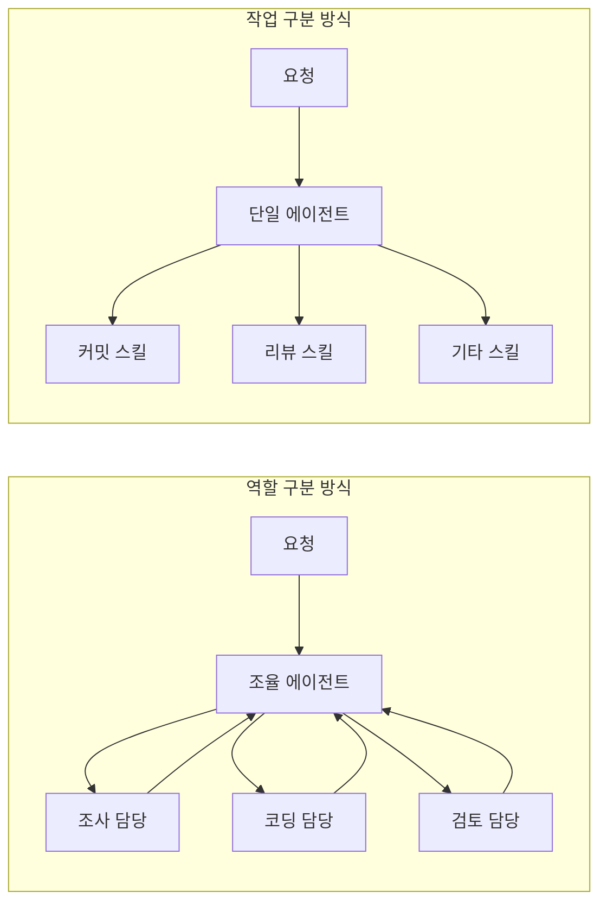
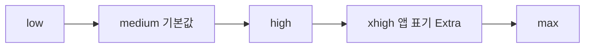
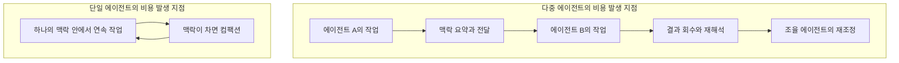
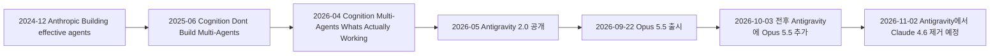
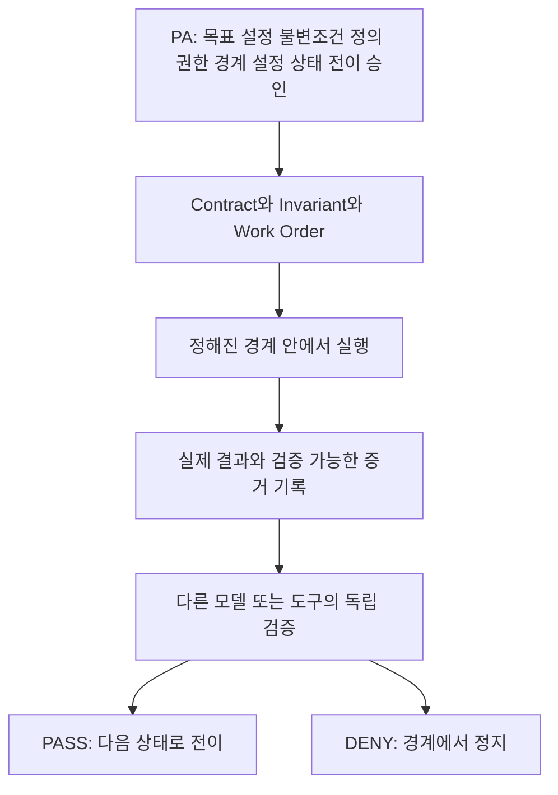

- 대상: Threads 게시글(작성자 vesperchant)과 그 아래 두 개의 댓글(reality404studio, vibepackr)
- 조사 기준일: 2026-10-25
- 문서 성격: 게시글 해설 + 최신 정보 검증 + 비판적 검토

> 
> https://www.threads.com/share/BAAc4EFxaU/
> 
> 에이전틱 구축에 숙달된 분들이 '역할 구분'으로 운용하는 사례를 흔히 본다. 내 경우 지금은 단일 역할의 '작업 구분'으로 운용하는 중이다.
> 
> 쉽게 말하면, 다른 분들은 작업 종류만큼 직원수를 확보했다면, 내 경우 직원 혼자서 모든 요청을 처리하는 개념이다.
> 
> 사실 Claude Code, Antigravity 모두 이제는 충분히 고도화 된 상태라서 이게 가능하다.
> 
> 실례로, 내 Max $200 계정 머신들(VM 포함)에서 Opus 5.5 Extra 고정이다. 얇팍한 커밋 스킬도 그 상태에서 처리한다. 
> 
> 이 방식은 1년 전이었다면 불필요한 고비용 셋업이겠지만, 지금은 그렇지 않다. 스킬과 지시에서 작업에 맞게 추론의 수행 시간과 진행 거리를 확정해주는데, 그게 실제 잘 동작하기 때문이다.
> 
> 1인 직원 체계의 장점은 역시나 프로토콜이 단순해진다는 점이다. 모든 기계는 핵심 부품이 견고할 때 부품이 적을수록 고장이 잘 안 난다. 
> 
> AI 에이전틱 환경도 그 근간에서 생장하는 것 같다.
> 

---

## 0. 먼저 읽는 요약

이 게시글의 핵심 주장은 한 문장으로 압축됩니다. **"에이전트를 직무별로 여러 명 두는 대신, 한 명의 만능 직원에게 모든 요청을 맡기고 일의 종류는 스킬과 지시로 구분한다."**

글쓴이는 이 방식을 지금 쓰고 있으며, 1년 전이었다면 불필요하게 비싼 구성이었겠지만 지금은 도구와 모델이 충분히 발전해서 성립한다고 말합니다. 근거로는 두 가지를 듭니다. 하나는 자신의 Max $200 계정을 쓰는 모든 머신(가상 머신 포함)에서 Opus 5.5를 "Extra" 수준으로 고정해 놓고, 커밋 메시지를 쓰는 얇은 스킬 같은 가벼운 일까지 그 상태로 처리한다는 점입니다. 다른 하나는 스킬과 지시문이 작업마다 "얼마나 오래 추론할지"와 "어디까지 진행할지"를 정해 주는데, 그것이 실제로 잘 동작한다는 점입니다.

장점으로는 프로토콜이 단순해진다는 것을 꼽고, 핵심 부품이 견고하다면 부품이 적을수록 기계가 덜 고장 난다는 비유로 마무리합니다.

이번 조사에서 확인한 내용을 정리하면 다음과 같습니다.

- 글에 등장하는 도구와 모델은 실제로 존재하며 시점도 맞습니다. Claude Opus 5.5는 2026년 9월 22일에 출시되었고, 추론 노력(effort) 수준은 low, medium, high, xhigh, max의 다섯 단계이며 기본값은 medium입니다. 앱 화면에서는 xhigh가 "Extra"로 표시된다고 설명하는 자료가 있습니다.
- 스킬 하나하나에 모델과 노력 수준을 따로 지정하는 기능이 Claude Code에 있다는 설명이 여러 자료에서 확인됩니다.
- "단일 에이전트가 낫다"는 주장은 업계에서 이미 오래된 논쟁의 한 갈래입니다. Cognition은 2025년 6월에 다중 에이전트를 만들지 말라는 글을 냈고, 2026년 4월에는 "쓰기 작업은 한 명이 맡고 나머지는 지능만 보태는" 좁은 형태는 실제로 작동한다고 입장을 보완했습니다. 반대편에서 Anthropic은 조사 과제에서 다중 에이전트 시스템이 단일 에이전트보다 90.2% 나은 성능을 보였다고 보고했지만, 토큰은 일반 대화의 약 15배를 쓴다고 밝혔습니다.
- 다만 이 글의 성과 주장(편하고, 비용이 적정하며, 잘 동작한다)은 **한 실무자의 경험담**이며 수치로 검증된 것이 아닙니다. 또 Anthropic의 공식 권장은 "medium에서 시작하고, xhigh와 max는 효과를 직접 측정한 작업에만 쓰라"는 쪽이어서, 글쓴이의 "Extra 고정"은 공식 권장과는 다른 선택입니다. 이 점은 8장에서 자세히 다룹니다.

---

## 1. 게시물의 구성

대화는 세 덩어리로 이루어져 있습니다.

첫째는 글쓴이(vesperchant)의 본문입니다. 에이전틱 구축에 숙달된 사람들이 흔히 "역할 구분"으로 운용한다는 관찰에서 출발해, 자신은 "단일 역할의 작업 구분"을 쓴다고 밝히는 글입니다.

둘째는 reality404studio의 댓글과 글쓴이의 답글입니다. 분야를 가리지 않고 고수들이 같은 말을 한다는 공감과, 단일 세션의 컴팩션도 아까운데 에이전트 사이의 소통 비용은 더 아깝다는 의견입니다. 글쓴이는 비용 관점이 정확하다고 답하면서, 스스로도 예전 방식이 왜 그렇게 번거로웠나 싶어 여름 무렵에 모두 걷어냈고 지금은 아주 쾌적하며 적정한 비용을 유지하고 있다고 말합니다.

셋째는 vibepackr의 댓글입니다. 자신도 같은 방식이라고 말하고, 자신은 "Cell Probe"라는 수많은 군집을 "Lane" 단위로 쓴다고 설명하며, 일반적인 역할 기반 다중 에이전트와 자신의 방식을 비교하는 도표 자료를 붙였습니다.

---

## 2. 본문 해설: 문단별로 풀어 읽기

### 2.1 "역할 구분"과 "작업 구분"은 무엇이 다른가

본문 첫 문단은 용어를 정의합니다. 이 문서에서는 두 방식을 다음처럼 이해하면 됩니다.

**역할 구분(role-based)** 은 사람의 조직을 흉내 냅니다. 조사 담당, 기획 담당, 코딩 담당, 검토 담당처럼 직무마다 별도의 에이전트를 만들고, 이들을 조율하는 관리자 에이전트를 둡니다. 에이전트들은 서로 대화하고 결과를 주고받으며 일을 진행합니다.

**작업 구분(task-based)** 은 직원은 한 명뿐이고, 일의 종류만 나눕니다. 커밋 메시지 작성, 코드 검토, 문서 정리 같은 각 작업은 스킬(해당 작업의 수행 방법을 적은 지침 묶음)과 지시문으로 정의되고, 요청이 들어오면 같은 에이전트가 해당 스킬을 불러와 처리합니다.

글쓴이의 비유가 이를 잘 보여 줍니다. 다른 사람들은 작업 종류만큼 직원 수를 확보했다면, 자신은 직원 혼자서 모든 요청을 처리하는 개념이라는 것입니다.

왼쪽 구조에서는 조율 에이전트와 담당자들 사이에 오가는 모든 화살표가 곧 "전달 비용"입니다. 오른쪽 구조에서는 이런 화살표가 존재하지 않습니다. 모든 일이 하나의 맥락 안에서 이어지기 때문입니다.

### 2.2 "Claude Code와 Antigravity가 충분히 고도화되어 가능하다"

글쓴이는 이 방식이 가능해진 이유를 도구의 성숙에서 찾습니다. 이 주장 자체는 글쓴이의 판단이지만, 도구 쪽 사실관계는 확인할 수 있습니다.

Claude Code 쪽에서는 스킬 파일의 머리말(frontmatter)에 사용할 모델과 추론 노력 수준을 지정할 수 있다는 설명이 여러 자료에서 일치합니다. 스킬 머리말에 `model`과 `effort` 항목을 두면 그 스킬이 활성화되는 동안 세션 설정을 덮어쓴다는 내용입니다. 서브에이전트(보조 에이전트)에도 같은 `effort` 항목이 있다는 설명이 있습니다. 즉, 한 명의 에이전트를 쓰더라도 "이 작업은 얕게, 저 작업은 깊게"를 스킬 단위로 정의할 수 있는 장치가 갖춰져 있습니다.

Antigravity는 Google이 2025년 말 Gemini 3와 함께 공개한 에이전트 중심 개발 환경으로, 여러 에이전트를 동시에 지휘하는 "Manager 보기"와 작업 결과를 검증 가능한 형태로 남기는 "Artifacts"가 특징입니다. 2026년 5월 I/O에서 Antigravity 2.0이 발표되었고, 9월에는 에이전트가 토큰을 더 쓰면서 깊게 추론하도록 하는 `/boost` 명령이 추가되었다고 보도되었습니다. 또 2026년 10월 2~3일경 Claude Opus 5.5와 Sonnet 5.5가 모델 선택기에 추가되었습니다(유료 비체험 Google AI Pro와 Ultra 한정).

한 가지 주의할 점이 있습니다. 글쓴이는 Antigravity에서 어떤 모델과 어떤 설정을 쓰는지 본문에서 말하지 않았습니다. "Opus 5.5 Extra 고정"은 Claude Max 계정을 쓰는 머신들에 대한 설명이므로, Antigravity 쪽 운용 방식까지 같다고 읽으면 과한 해석입니다.

### 2.3 "Max $200 계정 머신들(VM 포함)에서 Opus 5.5 Extra 고정"

이 문장에는 확인할 요소가 세 가지 들어 있습니다.

**첫째, Max $200 플랜입니다.** Claude Max는 월 $100(Pro의 5배 사용량)과 월 $200(Pro의 20배 사용량) 두 단계가 있고, 5시간 단위 세션 한도와 주간 한도가 함께 적용됩니다. 사용량은 Claude 앱, 데스크톱, Claude Code가 하나의 풀을 공유합니다. 한 가지 눈여겨볼 점은, Anthropic이 토큰이나 메시지의 절대 수치를 공표하지 않고 "다른 플랜의 몇 배"로만 설명하며, 실제 소진 속도는 대화 길이, 기능, 모델, 그리고 **추론 노력 수준**에 따라 달라진다고 밝힌다는 것입니다. 따라서 정액제라고 해서 노력 수준을 올리는 비용이 사라지는 것은 아닙니다. 비용이 달러가 아니라 한도 소진이라는 형태로 나타날 뿐입니다.

**둘째, Opus 5.5입니다.** Anthropic은 2026년 9월 22일 Opus 5.5를 공개하면서 Fable 5.1 수준의 성능을 더 낮은 비용으로 제공한다고 밝혔고, 일반적인 작업 부하에서 기본 설정 기준 Opus 5보다 40% 저렴하다고 했습니다. 같은 날 Pro, Max, Team 플랜의 5시간 사용 한도를 올린다는 안내도 있었습니다. 상향 폭은 2차 자료마다 20%, 25%로 달리 적혀 있어 정확한 수치는 확정하기 어렵습니다.

**셋째, "Extra"입니다.** 추론 노력 수준은 low, medium, high, xhigh, max의 다섯 단계이고, 앱의 슬라이더에서 xhigh가 "Extra"로 표시된다는 자료가 있습니다. 이를 근거로 글쓴이의 "Extra"는 xhigh를 뜻한다고 보는 것이 합리적입니다. 다만 글쓴이가 직접 xhigh라고 적은 것은 아니므로 해석임을 밝혀 둡니다.

Anthropic이 설명하는 노력 수준의 성격은 다음과 같습니다. Opus 5.5에서는 사고를 끌 수 없고(끄려는 요청은 오류가 납니다) 노력 수준이 사고의 깊이를 정하는 사실상 유일한 조절 장치입니다. 기본값은 medium이며, Anthropic의 평가에서 medium의 Opus 5.5는 high의 Opus 5와 같거나 더 나았다고 합니다. 그리고 Anthropic의 안내는 xhigh와 max를 "효과를 직접 측정한 작업"에만 쓰라는 쪽입니다. xhigh는 30분을 넘는 장시간 에이전트 작업 같은 경우에 적합하다고 설명됩니다.

### 2.4 "얇팍한 커밋 스킬도 그 상태에서 처리한다"

이 문장은 글쓴이의 방식에서 가장 도발적인 부분입니다. 보통은 커밋 메시지처럼 단순한 일에는 가장 작고 싼 설정을 쓰는 것이 합리적이라고 생각하기 때문입니다.

비용 측면의 수치를 보면 이 선택의 무게가 드러납니다. Anthropic의 SWE-bench Pro 부분집합 결과를 인용한 2차 자료에 따르면, Opus 5.5의 작업당 비용은 low $0.11, medium $0.21, high $0.29, xhigh $0.74였고, 해결률은 medium 92.8%, xhigh 96.7%였습니다. xhigh가 medium보다 약 3.5배 비싸고 해결률은 3.9%p 높다는 뜻입니다. 이것은 어려운 코딩 과제의 수치이므로 커밋 메시지 같은 사소한 일에 그대로 적용할 수는 없습니다. 다만 노력 수준이 높을수록 같은 일에 더 많은 자원이 든다는 방향성은 분명합니다.

그렇다면 글쓴이는 왜 이 비용을 감수할까요. 본문에서 직접 밝힌 이유는 두 가지입니다. 이 방식은 지금 시점에서 불필요한 고비용 셋업이 아니고, 스킬과 지시가 작업에 맞게 추론 시간과 진행 거리를 정해 주기 때문에 실제로 잘 동작한다는 것입니다.

여기서 "추론의 수행 시간과 진행 거리를 확정해준다"는 표현은 다음처럼 읽는 것이 자연스럽습니다. 모델을 최고 사양으로 고정해 두더라도, 스킬이 "여기까지만 생각하고 이 지점에서 멈춰라"를 지시문으로 정해 주므로 쓸데없이 길게 사고하거나 범위를 넘어 일을 벌이는 것을 막을 수 있다는 의미입니다. 이것은 제가 본문의 문장을 풀어 쓴 해석이며, 글쓴이가 구체적으로 어떤 문구로 그 한계를 지정하는지는 본문에 나와 있지 않습니다.

추가로, 설정을 하나로 고정하면 얻는 기술적 이점이 있을 수 있습니다. 여러 자료가 모델과 노력 수준이 프롬프트 캐시의 키에 포함된다고 설명하며, 대화 중에 노력 수준을 바꾸면 캐시가 깨질 수 있다고 합니다. 설정을 고정하면 이 문제를 피할 수 있습니다. 다만 이는 글쓴이가 언급한 이유가 아니므로 참고 사항으로만 적습니다.

### 2.5 "1인 직원 체계의 장점은 프로토콜이 단순해진다는 점이다"

마지막 문단은 이 글의 철학입니다. 에이전트가 여러 명이면 누가 무엇을 맡고, 어떤 형식으로 결과를 넘기고, 충돌하면 누가 결정하고, 실패하면 누가 다시 시도하는지 정하는 약속(프로토콜)이 필요합니다. 이 약속이 늘어날수록 약속 사이의 틈에서 문제가 생길 가능성도 늘어납니다. 에이전트가 한 명이면 이 약속 자체가 거의 필요 없습니다.

이 철학은 Anthropic의 공식 입장과 결이 같습니다. Anthropic이 2024년 12월에 공개한 "Building effective agents"는 가장 성공적인 구현들이 복잡한 프레임워크가 아니라 단순하고 조합 가능한 패턴을 썼다고 정리했고, 필요할 때만 복잡도를 더하라고 권합니다.

---

## 3. 왜 "전달 비용"이 문제가 되는가: 댓글 1의 해설

reality404studio는 단일 세션의 컴팩션도 아까운데 에이전트 사이의 소통 비용은 더 아깝다고 말했습니다. 두 개념을 풀어 보겠습니다.

**컴팩션(compaction)** 은 대화가 길어져 맥락 창이 차오를 때, 지금까지의 내용을 요약해 새 출발점으로 삼는 동작입니다. Anthropic의 맥락 엔지니어링 글도 장기 작업에서 컴팩션과 구조화된 진행 기록을 권합니다. 다만 요약 과정에서 세부 뉘앙스가 사라질 수 있다는 한계가 있고, 일부 자료는 컴팩션이 캐시된 토큰을 무효화해 재처리 비용을 만든다고 설명합니다. 댓글이 "아깝다"고 한 것은 이런 손실을 가리킵니다.

**에이전트 간 소통 비용**은 한 에이전트의 맥락을 다른 에이전트에게 옮길 때 드는 비용입니다. 맥락을 요약해 넘기는 순간 정보가 줄고, 받는 쪽은 그것을 다시 해석해야 하며, 결과를 돌려받아 조율하는 단계가 또 필요합니다. 한 자료는 다중 에이전트 비용이 선형으로 늘지 않고 전달, 재시도, 검증, 조율이 겹겹이 쌓이며 불어난다고 정리합니다.

수치로는 Anthropic이 자사 다중 에이전트 연구 시스템이 일반 대화의 약 15배 토큰을 쓴다고 밝혔고, 일반적인 에이전트도 대화의 약 4배를 쓴다고 했습니다. Claude Code 문서가 다중 에이전트 작업에 단일 세션의 4~7배 토큰이 든다고 적었다는 2차 설명도 있으나, 이 부분은 원문을 직접 확인하지 못했습니다.

글쓴이의 답글은 이 지적을 인정하는 내용입니다. 예전에 역할을 나눠 운용하다가 여름 무렵에 전부 걷어냈고, 지금은 편하고 비용도 적절하다고 합니다. 이는 글쓴이가 처음부터 단일 구조였던 것이 아니라 **다중 구조를 직접 겪어 본 뒤에 되돌아온 것**임을 보여 줍니다. 이 경험이 주장의 신뢰도를 높이는 부분이지만, 어떤 구조에서 어떤 문제가 있었는지 구체적 수치는 밝히지 않았습니다.

---

## 4. 업계의 큰 논쟁 속에서 이 글의 위치

글쓴이의 주장은 새로운 발견이 아니라, 1년 넘게 이어진 "단일 대 다중" 논쟁에서 한쪽의 현재 위치를 보여 주는 사례입니다.

**단일 쪽 논거.** Cognition(Devin 개발사)의 Walden Yan은 2025년 6월 "Don't Build Multi-Agents"에서, 맥락을 충분히 공유하지 못하면 여러 에이전트의 결정이 흩어져 결과가 어긋난다고 주장했습니다. 예로 든 것이 "플래피 버드 복제"인데, 한 에이전트는 마리오 같은 배경을, 다른 에이전트는 어울리지 않는 새를 만드는 식으로 하위 작업이 엇나간다는 이야기입니다. 그는 기본값으로 단일 스레드의 선형 에이전트를 권했습니다.

**입장의 진화.** 같은 저자는 2026년 4월 22일 "Multi-Agents: What's Actually Working"에서, 병렬로 쓰는 에이전트 무리는 여전히 의미 있게 채택되지 않지만, **쓰기는 한 명이 맡고 나머지 에이전트는 지능만 보태는 좁은 형태**는 실제로 작동한다고 밝혔습니다. 한 해설은 이를 "단일 작성자와 맥락을 공유하지 않는 별도 검토자"로 수렴한 구조로 요약합니다.

**다중 쪽 논거.** Anthropic의 연구 시스템은 Claude Opus 4가 총괄하고 Sonnet 4가 하위 조사를 맡는 구조로, 내부 조사 평가에서 단일 Opus 4보다 90.2% 높은 성능을 냈습니다. 하위 에이전트는 각자의 맥락 창에서 방대한 자료를 읽고 1,000~2,000 토큰 분량의 요약만 돌려주므로, 한 맥락에 다 담을 수 없는 일을 병렬로 처리할 수 있습니다. 대신 토큰은 약 15배 쓰므로 가치가 높은 과제에만 경제성이 있다는 단서가 붙습니다.

이 세 입장은 서로 모순되기보다, **일의 성격**에 따라 갈립니다. 읽기 위주이고 서로 독립적인 병렬 조사에는 다중이 유리하고, 쓰기와 결정이 서로 얽힌 개발 작업에서는 단일 작성자가 안전하다는 것이 현재의 공통된 이해에 가깝습니다. 글쓴이의 사례(커밋, 코드 작업 같은 개인 개발 흐름)는 후자에 속합니다.

---

## 5. 댓글 2 해설: vibepackr의 "같은 방식"과 도표 자료

### 5.1 댓글의 내용

vibepackr는 글쓴이와 같은 방식을 쓴다고 말하며, 아직 이렇게 하는 사람은 "선달님" 말고는 본 적이 없다고 합니다. "선달님"이 정확히 누구를 가리키는지는 문맥만으로 단정할 수 없습니다. 이어서 자신은 수많은 Cell Probe 군집을 Lane 단위로 쓴다고 설명하고, "같은 AI, 전혀 다른 접근"이라는 제목의 비교 도표를 첨부했습니다. 이 도표에는 "AI 콘텐츠"라는 표시가 붙어 있습니다.

### 5.2 도표가 말하는 것

도표는 좌우 두 접근을 대비합니다.

왼쪽은 "일반적인 역할 기반 다중 에이전트 패턴"입니다. AI로 가상의 조직을 만들어 협업하게 한다는 접근으로, 관리자 에이전트가 조사, 설계, 기획, 코딩, 검토 에이전트를 조율하고, 에이전트끼리 대화와 토론을 거쳐 합의에 이른다고 묘사합니다.

오른쪽은 작성자가 "PA의 방식(VibePackr 시스템 아키텍처)"이라고 부르는 접근입니다. 핵심 문구는 "AI를 조직화하지 않는다. AI를 시스템화한다"입니다. 도표가 설명하는 흐름은 다음과 같습니다.

도표에 따르면 AI 모델은 "교체 가능한 추론 자원"이며, 도표에는 GPT-6 Astra(범용 추론), Daybreak Blue(보안과 고위험 작업), Codex(코드와 분석), Qwen(특정 분야)이 예시로 나옵니다. 모델이 제공하는 것은 능력일 뿐이고 **권한은 모델의 바깥**에 있다는 것이 강조됩니다. 또 검증은 권한이 아니라는 원칙("Verification ≠ Authority")과, Google Cloud 쪽 인프라는 AI 모델이 아니라 명시적 인터페이스로 협업하는 독립 주체(Antigravity)가 맡는다는 구도를 제시합니다.

도표의 비교표를 요약하면 이렇습니다.

| 항목 | 일반 역할 기반 패턴 | 도표가 설명하는 PA 방식 |
|---|---|---|
| 접근 | AI로 가상 조직을 만든다 | AI를 통제된 시스템의 부품으로 쓴다 |
| 초점 | 역할과 팀 구성 | 능력과 경계 |
| 의사소통 | 에이전트끼리 대화, 토론, 합의 | 구조화된 상태와 증거의 전달 |
| 의사 결정 | 토론과 합의 | 검증과 증명 |
| 조율 | 관리자 에이전트가 조율 | 계약과 통제면(Control Plane)이 조율 |
| 기억 | 에이전트 간 공유 메모리 | 기준 상태(canonical state)를 참조 |
| 실패 처리 | 다시 토론하고 재시도 | 처음으로 갈라진 지점에서 실패 원인을 특정 |
| AI에 대한 관점 | 일하는 동료 | 교체 가능한 추론 자원 |
| 결과물의 의미 | 에이전트의 답변이 최종 결과 | 봉인된 증거가 있어야 상태 전이 |

### 5.3 이 댓글을 읽을 때 주의할 점

**확인 불가 항목.** 이번 조사에서 VibePackr, PA, Cell Probe, Lane, Daybreak Blue에 대한 독립적인 공개 자료를 찾지 못했습니다. 따라서 위 내용은 "댓글 작성자가 제시한 자료가 이렇게 주장한다"는 수준으로만 전달할 수 있고, 시스템이 실제로 어떻게 동작하는지, 도표의 주장이 사실인지는 검증하지 못했습니다. 반면 GPT-6 Astra, Codex, Qwen, Antigravity, Google Cloud는 실재하는 제품이며, GPT-6 Astra는 Opus 5.5 비교 자료에도 경쟁 모델로 등장합니다.

**"같은 방식"의 범위.** vibepackr는 글쓴이와 같은 방식이라고 했지만, 두 구조는 겹치는 부분과 다른 부분이 함께 있습니다. 겹치는 점은 "가상 조직 흉내(역할 연기)"를 버렸다는 것입니다. 다른 점은, 글쓴이는 **한 명의 에이전트와 하나의 모델**로 단순함을 추구하는 반면, 도표의 구조는 **여러 모델과 독립 검증, 권한 분리**를 갖춘 별도의 통제 체계라는 것입니다. 즉 두 접근은 "역할극 반대"라는 지점에서 만나지만 해법의 방향은 반대에 가깝습니다. 글쓴이는 부품을 줄이고, 도표는 부품 사이의 규칙을 엄격히 합니다. 이는 제 해석입니다.

흥미로운 점은 Cognition이 정리한 현재의 수렴점, 즉 "작성자는 하나, 검토자는 별도"라는 구조가 이 도표의 "실행과 독립 검증 분리"와 닮았다는 것입니다. 단일 에이전트 철학과 독립 검증은 충돌하지 않으며, 둘을 함께 쓰는 것도 가능합니다.

---

## 6. 글쓴이 주장의 기술적 근거를 정리하면

글쓴이가 명시한 것과 제가 보충한 것을 구분해 정리합니다.

**글쓴이가 직접 말한 근거**
- 도구(Claude Code, Antigravity)가 충분히 고도화되었다.
- 가벼운 스킬까지 최고 사양으로 처리해도 문제가 없다.
- 스킬과 지시가 추론의 시간과 범위를 작업에 맞게 정해 주고, 그것이 실제로 잘 동작한다.
- 에이전트가 하나이므로 프로토콜이 단순하다.
- 핵심 부품이 견고하면 부품이 적을수록 고장이 적다.

**조사로 뒷받침되는 부분**
- 스킬과 서브에이전트 단위로 모델과 노력 수준을 지정하는 기능이 존재한다는 설명이 있습니다.
- Opus 5.5가 이전 세대보다 같은 노력 수준에서 더 효율적이고(Anthropic 주장), 기본 설정에서 40% 저렴하다는 점은 "1년 전과 다르다"는 말과 방향이 맞습니다.
- 단순한 구조를 권하는 Anthropic의 공식 글과 단일 작성자를 권하는 Cognition의 글이 철학적으로 일치합니다.
- 다중 에이전트의 전달 비용이 크다는 점은 Anthropic의 토큰 수치로 확인됩니다.

**조사로 뒷받침되지 않는 부분**
- "추론 시간과 진행 거리를 확정해 주는 것이 실제로 잘 동작한다"는 것은 글쓴이의 사용 경험이며, 별도의 측정 자료는 없습니다.
- 비용이 "적정"하다는 판단도 글쓴이의 주관이며, 구체적인 사용량이나 한도 소진 비율은 제시되지 않았습니다.

---

## 7. 최신 사실 확인 요약표

| 항목 | 확인된 내용 | 출처 성격 |
|---|---|---|
| Opus 5.5 출시일 | 2026-09-22 | Anthropic 공식 게시 |
| Opus 5.5 비용 | 기본 설정 기준 Opus 5보다 약 40% 저렴 | Anthropic 공식 주장 |
| 추론 노력 수준 | low, medium(기본), high, xhigh, max의 5단계 | 다수의 2차 자료와 공식 페이지 인용 |
| xhigh의 앱 표기 | "Extra"로 표시된다는 설명 | 2차 자료 |
| Anthropic의 권장 | medium에서 시작, xhigh와 max는 측정한 작업에만 | 공식 안내를 인용한 보도 |
| 사고 비활성화 | Opus 5.5에서는 불가 | 공식 안내를 인용한 보도 |
| 스킬 머리말 | model과 effort 지정 가능 | 2차 자료와 오픈소스 문서 |
| Max 플랜 | $100(5배), $200(20배), 5시간 세션 한도와 주간 한도 | 2차 자료(2026-09-28 기준 확인본 포함) |
| 한도 상향 | Opus 5.5 출시일에 5시간 한도 상향 안내 | 공식 계정 게시(폭은 자료마다 상이) |
| Antigravity 2.0 | 2026년 5월 I/O 발표, 9월 `/boost` 추가 | 2차 보도 |
| Antigravity의 Claude 5.5 | 10월 2~3일경 추가, 유료 비체험 Pro와 Ultra 한정 | 2차 보도(공식 모델 문서 인용) |
| Antigravity의 구형 모델 | Claude 4.6과 GPT-OSS-120B는 2026-11-02 제거 예정 | 2차 보도(공식 모델 문서 인용) |
| Cognition의 글 | 2025-06 단일 선호, 2026-04-22 보완 | 원문 페이지 |
| Anthropic 연구 시스템 | 단일 대비 90.2% 향상, 토큰 약 15배 | Anthropic 보고를 인용한 자료 |

---

## 8. 비판적 검토: 이 방식이 모두에게 맞는가

이 글은 한 실무자의 운용 경험을 소개하는 글입니다. 따라서 "그대로 따라 하면 된다"로 받아들이기 전에 몇 가지를 구분해서 봐야 합니다.

**첫째, 공식 권장과의 차이입니다.** Anthropic은 Opus 5.5의 기본 노력 수준을 medium으로 낮추면서, 이전 세대의 설정을 그대로 가져오지 말고 직접 평가해 보라고 권합니다. 또 Opus 5.5는 xhigh와 max에서 턴당 더 오래 생각하는 경향이 있다고 설명됩니다. 글쓴이의 "Extra 고정"은 이 권장과 다른 선택이며, 정액 플랜의 한도 안에서 단순함과 일관성을 얻는 대신 한도를 더 빨리 쓰는 거래를 택한 것으로 볼 수 있습니다. 글쓴이가 Max 20배 플랜을 쓰고 있다는 사실이 이 선택을 가능하게 하는 조건일 가능성이 있으나, 이는 추론입니다.

**둘째, 적용 범위입니다.** 글쓴이의 사례는 개인 단위의 개발 작업(커밋, 코드 작업 등)입니다. 방대한 자료를 병렬로 조사해야 하는 일, 서로 독립적인 수십 개의 작업을 동시에 돌려야 하는 일에서는 단일 에이전트가 맥락 창과 시간의 제약에 부딪힙니다. Anthropic의 90.2% 사례가 바로 그런 경우입니다.

**셋째, 단일 맥락의 한계입니다.** 하나의 맥락에서 오래 일하면 컴팩션이 반복되고, 앞부분 정보가 흐려지는 문제(맥락 부패)가 생길 수 있습니다. 글쓴이는 이 부분을 별도로 언급하지 않았습니다. 스킬 단위로 일을 짧게 끊어 처리하는 습관이 이 문제를 완화하는지는 본문만으로는 알 수 없습니다.

**넷째, 조직과 통제의 문제입니다.** 여러 사람이 쓰는 환경이나 감사와 통제가 필요한 환경에서는 "누가 무엇을 승인했는가"를 분리해야 할 수 있습니다. 댓글 2의 도표가 권한 분리와 독립 검증을 강조하는 것이 이 지점입니다. 개인이 한 명의 에이전트로 빠르게 일하는 방식과, 조직이 통제를 위해 구조를 더하는 방식은 서로 다른 문제를 푸는 것입니다.

**다섯째, 근거의 성격입니다.** 이 게시물의 성과는 모두 자기 보고입니다. 비교 실험이나 수치가 없으므로, 효과의 크기를 일반화해서는 안 됩니다.

---

## 9. 이 사례에서 얻을 수 있는 판단 기준

따라 하라는 처방이 아니라, 자기 환경에서 판단할 때 던져 볼 질문으로 정리합니다.

1. **내 일은 읽기 위주의 병렬 작업인가, 쓰기와 결정이 얽힌 순차 작업인가.** 후자라면 단일 작성자 구조가 자연스럽습니다.
2. **내가 지금 겪는 비용은 무엇인가.** 에이전트 사이의 전달과 재해석이 병목이라면 단일 구조가 도움이 되고, 한 맥락의 길이가 병목이라면 하위 작업의 격리가 도움이 됩니다.
3. **노력 수준을 고정할 것인가, 작업별로 나눌 것인가.** 고정은 단순하고 캐시에 유리하지만 한도를 더 씁니다. 스킬 머리말로 작업별 노력 수준을 두는 방법도 있습니다.
4. **검증은 누가 하는가.** 단일 에이전트라도 검토를 별도의 새 맥락에서 하는 것은 가능하며, 업계의 현재 수렴점과도 맞습니다.
5. **한도와 비용을 어떻게 관측하는가.** 정액제는 달러 비용을 가리지만 한도 소진은 남습니다. 직접 측정하지 않으면 "적정"의 근거가 없습니다.

---

## 10. 용어 정리

- **에이전틱(agentic):** AI가 단순히 답하는 데 그치지 않고 도구를 쓰며 여러 단계를 스스로 진행하는 방식.
- **역할 구분:** 직무별로 별도의 에이전트를 두는 구조.
- **작업 구분:** 한 에이전트가 작업 종류별 스킬과 지시로 모든 일을 처리하는 구조.
- **스킬(skill):** 특정 작업의 수행 방법을 적은 지침 묶음. 머리말에 모델과 노력 수준 같은 설정을 둘 수 있습니다.
- **추론 노력 수준(effort):** 모델이 한 번의 응답에서 얼마나 깊이 생각할지 정하는 설정. Opus 5.5는 low, medium, high, xhigh, max.
- **컴팩션(compaction):** 맥락 창이 차오를 때 이전 내용을 요약해 대체하는 동작.
- **맥락 엔지니어링:** 모델에게 어떤 정보를 어떤 형태로 줄지 설계하는 일. 프롬프트 문구 설계보다 넓은 개념입니다.
- **서브에이전트:** 주 에이전트가 맡긴 일을 자기만의 맥락 창에서 처리하고 결과만 돌려주는 보조 에이전트.
- **Max 플랜:** Anthropic의 개인용 상위 구독. $100는 Pro의 5배, $200는 Pro의 20배 사용량.
- **ultracode:** Claude Code 전용 설정으로, xhigh에 다중 에이전트 워크플로를 스스로 띄울 권한을 더한 모드라는 2차 설명이 있습니다. API의 노력 수준은 아닙니다.

---

## 11. 참고 자료

출처 성격은 [공식], [원문], [2차 해설], [사용자 경험]으로 구분했습니다. 확인일은 모두 2026-10-25입니다.

**Anthropic 및 Claude 관련**
- [공식] Claude Opus 소개 페이지 — https://www.anthropic.com/claude/opus
- [공식] Claude 공식 계정의 Opus 5.5 발표 게시(2026-09-22) — https://x.com/claudeai/status/2102435511222890900
- [공식] Building effective agents(2024-12-19) — https://www.anthropic.com/engineering/building-effective-agents
- [공식] How we built our multi-agent research system — https://www.anthropic.com/engineering/multi-agent-research-system
- [2차 해설] Claude Opus 5.5 Benchmarks Explained, Vellum — https://www.vellum.ai/blog/claude-opus-5-5-benchmarks-explained
- [2차 해설] How to Use Claude Opus 5.5, ToSea — https://tosea.ai/blog/claude-opus-5-5-complete-guide
- [2차 해설] Anthropic Publishes Prompting Guidance For Claude Opus 5.5, Search Engine Journal — https://www.searchenginejournal.com/anthropic-claude-opus-5-5-prompting-guidance/591278/
- [2차 해설] Claude Effort Level: Which One to Use on Opus 5.5, GrowthCab — https://www.growthcab.com/claude-effort-level
- [2차 해설] Claude Code effort setting 해설, ITLibra — https://arte.itlibra.com/en/articles/claude-code-effort-setting
- [2차 해설] Opus 5.5 Best Practices, claudefa.st — https://claudefa.st/blog/guide/development/opus-5-5-best-practices
- [2차 해설] Claude Opus 5.5 Effort Levels Tested, TokenSave(단일 프롬프트 실측, 일화적 수치) — https://tokensave.app/blog/claude-opus-5-5-effort
- [2차 해설] Claude Pro vs Max, chudi.dev(2026-09-28 기준) — https://chudi.dev/blog/claude-pro-vs-max
- [2차 해설] Claude Max Plan 해설, Leanware — https://leanware.co/insights/claude-max-plan
- [2차 해설] Skill Frontmatter 해설 — https://developersdigest.tech/guides/skill-frontmatter
- [2차 해설] Claude Code Effort Levels Explained, mcp.directory — https://mcp.directory/blog/claude-code-effort-levels-explained-2026

**단일 대 다중 에이전트 논쟁**
- [원문] Don't Build Multi-Agents, Cognition(2025-06-12) — https://cognition.ai/blog/dont-build-multi-agents
- [원문] Multi-Agents: What's Actually Working, Cognition(2026-04-22) — https://cognition.ai/blog/multi-agents-working
- [2차 해설] How and when to build multi-agent systems, LangChain — https://blog.langchain.com/how-and-when-to-build-multi-agent-systems
- [2차 해설] Multi-Agent Cost Compounding, Augment Code(2026-05-16) — https://www.augmentcode.com/guides/multi-agent-cost-compounding
- [2차 해설] Subagents 해설, Morph — https://www.morphllm.com/subagent
- [2차 해설] Anthropic Context Engineering 정리 — https://agentic-ai.readthedocs.io/en/latest/ContextEngineering/anthropic/

**Antigravity**
- [2차 해설] Claude Opus 5.5 arrives on Antigravity, but only for Pro and Ultra — https://pasqualepillitteri.it/en/news/20300/claude-opus-5-5-arrives-on-antigravity-pro-ultra-only
- [2차 해설] Claude Opus 5.5 and Sonnet 5.5 in Google Antigravity, OrcaRouter — https://www.orcarouter.ai/blog/claude-opus-5-5-and-sonnet-5-5-in-antigravity
- [2차 해설] SmartScope 분석(공식 모델 문서 인용) — https://smartscope.blog/en/blog/antigravity-claude-55-pro-trial-model-retirement-2026/
- [공식 문서로 인용된 페이지] Antigravity 모델 문서 — https://www.antigravity.google/docs/models/
- [2차 해설] Google Antigravity 소개(Manager 보기, Artifacts), How-To Geek — https://tech.yahoo.com/ai/gemini/articles/google-just-made-own-visual-194234638.html

**대화 자체**
- [사용자 경험] vesperchant의 Threads 게시글과 댓글(작성 후 약 1시간 시점의 내용). 원문 링크는 자동 열람이 제한되어 있어, 제공된 본문과 댓글 내용을 기준으로 해설했습니다.

**확인하지 못한 항목**
- VibePackr, PA, Cell Probe, Lane, Daybreak Blue에 대한 독립적인 공개 자료는 이번 검색에서 찾지 못했습니다.
- 글쓴이가 실제로 쓰는 스킬의 구체적 구성, 사용량과 비용 수치는 공개되어 있지 않습니다.

---

작성 일자: 2026-10-25
