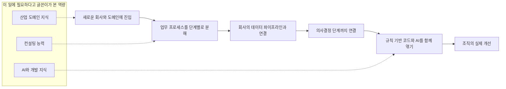
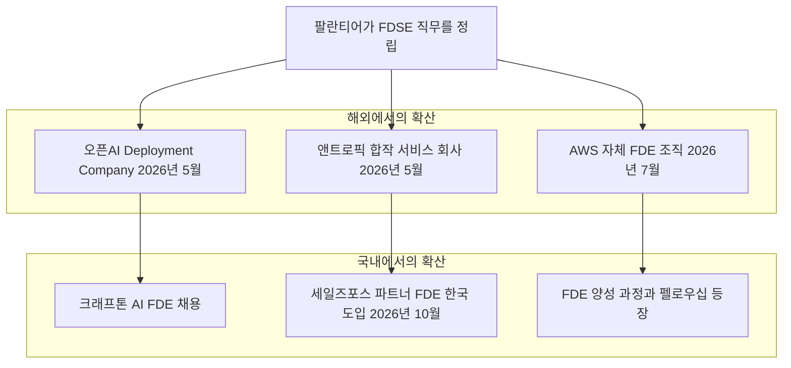
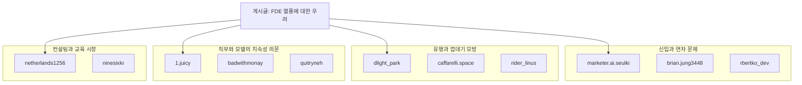

- 작성 기준일: 2026-10-26 (서버 시각 확인 기준)
- 이 문서는 전달해 주신 게시글 본문과 댓글 11개, 그리고 2026년 10월 말 시점에 검색으로 확인한 자료를 바탕으로 작성했습니다. 확인된 사실과 글쓴이·댓글 작성자의 의견은 구분해서 적었고, 확인하지 못한 부분은 확인하지 못했다고 밝혔습니다.

```
아무리 생각해도 팔란티어가 FDE로 독을 푼 게 틀림없음.

FDE는 결국 컨설팅 + AI 지식을 겸한 올라운더 아니냐고
기술적인 장벽은 AI로 레버리지한다고 쳐도, 애초에 컨설팅이라는 벽이 얼마나 높은데

새로운 회사, 새로운 도메인에 뛰어들어서
업무 프로세스를 분해하고
그걸 회사 데이터 파이프라인과 의사결정까지 연결하고
Deterministic한 기존 코드와 Probabilistic한 AI까지 엮어서
회사를 조직을 실제로 개선한다?

신입이나 기존 직원이 할 수 있는게 아니지

더 안타까운 건 FDE라는 신직업을 노리고 공부하는 신입이 늘었다는 거
부트캠프도 차례 생기는거 같음

신입 PM이 없듯 FDE도 마찬가지
컨설팅이든 개발이든 한 계단을 먼저 쌓고, 도메인 지식도 쌓아야 완성되는 직무인데.

이미 FDE 되는 사람은 억 단위로 번다는 소식에 (진짜이긴 하겠지)
신입은 연봉만 보고, 기존 직원들은 "우리도 FDE처럼 하자!"는 대표 지시에 죽어나고
아수라장이다 진짜.

https://www.threads.com/share/_jMV0q5sx/
```

---

## 0. 먼저 알려 드릴 점

게시글 맨 아래에 붙어 있던 Threads 링크는 사이트 정책상 자동 열람이 차단되어 제가 직접 열어 보지 못했습니다. 따라서 이 문서의 "게시글 내용"은 전달해 주신 본문 텍스트와 댓글 텍스트만을 근거로 합니다. 좋아요 수, 정확한 작성 시각처럼 링크에서만 알 수 있는 정보는 다루지 않았습니다.

---

## 1. 한 문단 요약

이 글은 "FDE(Forward Deployed Engineer, 전방 배치 엔지니어)"라는 직무가 AI 시대의 새로운 인기 직업으로 떠오르면서, 신입 취업 준비생들이 몰려들고 회사 대표들은 "우리도 FDE처럼 일하자"고 지시하는 현상을 우려하는 글입니다. 글쓴이의 핵심 주장은 이렇습니다. FDE는 본질적으로 "컨설팅 능력 + AI 기술 지식 + 해당 산업의 도메인 지식"을 모두 갖춘 올라운더인데, 이는 먼저 한 단계를 쌓은 경력자가 가는 길이지 신입이 곧바로 노릴 수 있는 직무가 아니라는 것입니다. 댓글은 대체로 이 문제의식에 공감하면서, 국내에서는 FDE라는 이름만 붙인 SI(시스템 통합) 채용이 많다는 점, 유행을 따라가는 흐름 자체는 늘 반복되어 왔다는 점, 그리고 FDE라는 모델이 장기적으로 유지될지에 대한 의문 등을 덧붙였습니다.

검색으로 확인해 보면, 글이 전제하는 현상 자체(FDE 채용 급증, 높은 연봉, 교육과정과 부트캠프의 등장, 국내 기업의 도입 확산)는 대부분 실제로 확인됩니다. 다만 "신입은 FDE가 될 수 없다"는 문장은 해외 현실과 완전히 일치하지는 않습니다. 이 부분은 뒤에서 자세히 설명합니다.

---

## 2. 게시글은 구체적으로 무엇을 말하고 있나

글쓴이의 논리는 크게 다섯 단계로 흘러갑니다. 각 단계를 풀어서 설명하겠습니다.

### 2.1 "팔란티어가 FDE로 독을 푼 게 틀림없다"

첫 문장은 비유적인 표현입니다. 팔란티어(Palantir)가 FDE라는 직무 모델을 대중화했고, 그 결과 다른 회사들과 구직자들이 맥락 없이 이를 따라가면서 혼란이 생겼다는 취지로 읽힙니다. (이 해석은 글의 맥락에서 제가 읽어낸 것이며, 글쓴이가 별도로 풀어서 설명한 내용은 아닙니다.)

팔란티어가 이 직무를 정립한 회사라는 점은 사실입니다. 팔란티어의 공식 채용 문구는 스스로 이 직무를 "개척했다(pioneered)"고 설명하고, 엔지니어를 고객 곁에 직접 배치해 가장 시급한 문제를 해결하게 하는 방식이라고 소개합니다. 위키피디아도 이 용어가 팔란티어 같은 회사들에 의해 대중화되었다고 정리합니다.

### 2.2 "FDE는 컨설팅 + AI 지식을 겸한 올라운더"

글쓴이는 FDE의 업무를 이렇게 풀어서 나열합니다. 새로운 회사와 새로운 도메인에 들어가서, 업무 프로세스를 분해하고, 그것을 회사의 데이터 파이프라인과 의사결정까지 연결하고, 결정적(Deterministic)인 기존 코드와 확률적(Probabilistic)인 AI를 엮어서, 조직을 실제로 개선하는 일입니다.

아래 도표는 이 흐름을 한눈에 보이도록 그린 것입니다.



여기서 "결정적"과 "확률적"이라는 용어가 낯설 수 있습니다. 전통적인 소프트웨어 코드는 같은 입력을 넣으면 항상 같은 출력이 나옵니다. 이것이 결정적(Deterministic)이라는 뜻입니다. 반면 생성형 AI는 같은 질문에도 매번 조금씩 다른 답을 낼 수 있고, 틀릴 가능성도 있습니다. 이것이 확률적(Probabilistic)이라는 뜻입니다. 글쓴이는 FDE가 이 두 가지 성질이 다른 부품을 한 시스템 안에서 안정적으로 엮어내야 한다는 점을 강조한 것입니다.

### 2.3 "기술 장벽은 AI로 레버리지해도, 컨설팅이라는 벽은 높다"

글쓴이는 코딩 같은 기술적 진입 장벽은 AI 도구로 낮출 수 있다고 봅니다. 그러나 남의 회사에 들어가 업무를 분해하고 조직의 판단 구조까지 건드리는 일은 AI가 대신해 주기 어렵다고 봅니다. 그래서 "신입이나 기존 직원이 할 수 있는 게 아니다"라고 결론을 내립니다. 이것은 근거가 정리된 통계가 아니라 글쓴이의 판단입니다. 다만 뒤에서 보듯 실제 채용 공고 통계는 이 판단과 같은 방향을 가리킵니다.

### 2.4 "신입 PM이 없듯 FDE도 마찬가지"

글쓴이는 한 계단을 먼저 쌓아야 하는 직무의 예로 PM(프로덕트 매니저)을 듭니다. 컨설팅이든 개발이든 먼저 경력을 쌓고 도메인 지식도 쌓아야 완성되는 직무라는 것입니다. 그러면서 "FDE라는 신직업을 노리고 공부하는 신입이 늘었고, 부트캠프도 차례로 생기는 것 같다"고 안타까움을 표현합니다.

### 2.5 "억 단위 연봉 소식에 신입은 연봉만 보고, 기존 직원은 대표 지시에 죽어난다"

마지막 단락은 두 집단의 혼란을 묘사합니다. 신입은 높은 연봉 소식만 보고 몰려들고, 기존 직원들은 "우리도 FDE처럼 하자"는 대표의 지시를 받아 고생한다는 것입니다. 이 장면이 "아수라장"이라는 표현으로 요약됩니다.

---

## 3. FDE란 정확히 무엇인가

### 3.1 정의

위키피디아는 FDE를 "고객 조직과 긴밀히 협력하면서 운영 환경에서 기술 솔루션을 개발·맞춤화·배포하는 엔지니어"로 설명합니다. 소프트웨어 개발에 도메인 이해와 최종 사용자와의 직접 협업이 결합된 역할이며, 요구사항 분석, 설계, 구현, 시스템 통합, 배포까지 시스템 수명 주기 전반에 관여할 수 있다고 합니다.

팔란티어는 이 직무를 공식적으로는 "Forward Deployed Software Engineer(FDSE)"라고 부릅니다. 채용 공고를 보면 업무는 고객의 가장 큰 고충을 이해하고 엔드투엔드 솔루션을 설계하는 것이며, 쓰는 기술은 Java, TypeScript, Python, 클라우드 인프라 등 일반적인 개발 스택입니다. 즉 "코딩을 못 하는 컨설턴트"가 아니라 "코딩도 하는 현장 파견 엔지니어"입니다. 공고에는 고객 현장 출장이 필요하다는 조건도 붙어 있습니다(지역과 팀에 따라 25~50% 수준의 출장을 선호한다고 명시한 공고가 있습니다).

### 3.2 비슷한 직무와 어떻게 다른가

한국 구직 플랫폼 잡코리아의 정리에 따르면, 컨설턴트는 문제 진단과 제안서가 중심이고, 솔루션 아키텍트(SA)는 구조 설계와 인계가 중심이며, 솔루션 엔지니어(SE)는 계약 전의 데모와 PoC(개념 검증)가 중심이고, FDE는 문제 정의부터 구현, 검증, 개선까지를 맡는다고 합니다. 특히 SE는 계약 전 단계에 가깝지만 FDE는 계약 이후에도 남아 실제 프로덕션 코드까지 맡는다는 점이 차이로 설명됩니다.

SI와의 차이에 대해서도 국내 매체와 업계 글이 같은 이야기를 합니다. 전통적인 SI는 고객이나 컨설팅사가 요구사항 문서(RFP)를 완성한 뒤 개발을 넘겨받습니다. FDE는 현장에 먼저 들어가 누가 어떤 데이터로 어디에서 막히는지를 본 다음 문제 정의를 직접 씁니다. 지디넷코리아는 업계가 말하는 차이를 "기존 SI 파견직이 사전에 정리된 요구사항을 수행하는 역할에 가까웠다면, FDE는 현장에서 문제를 함께 정의하고 AI 도입 방향을 설계해 실제 활용이 자리 잡을 때까지 개입하는 역할"이라고 소개하면서도, 국내 현장에서는 둘의 차이가 뚜렷하지 않다는 반응이 적지 않다고 함께 전했습니다.

삼성SDS의 인사이트 글은 팔란티어 모델의 출발이 약 22년 전 정보기관 고객과의 작업에 있었다고 설명하면서, 컨설팅사의 인력 파견은 "문제를 풀어주는 모델"이고 팔란티어의 FDE는 "문제를 함께 정의하고 함께 푸는 모델"이었다고 구분합니다.

### 3.3 이름은 같지만 업무는 회사마다 다르다

잡코리아는 같은 FDE라도 회사마다 역할 차이가 크다고 정리합니다. 시장 분석 자료에서도 직함이 분화되는 모습이 확인됩니다. 약 1,000개 FDE 공고를 분석한 Perspective AI의 보고서는 Palantir식 "Forward Deployed Engineer"와 함께 "Forward Deployed AI Engineer", "Applied AI Engineer", "Deployment Solutions Engineer" 같은 이름이 경쟁하고 있다고 말합니다. HeroHunt의 채용 가이드는 같은 일을 Sierra는 에이전트 엔지니어, Anthropic은 Applied AI, Cognition은 배포 엔지니어라고 부르고 Ramp는 일반 소프트웨어 엔지니어 계열로 분류한다고 소개합니다.

이 사실은 게시글과 댓글의 분위기를 이해하는 데 중요합니다. "FDE"라는 단어가 가리키는 범위가 넓고 흐릿하기 때문에, 한쪽에서는 최상위 올라운더를, 다른 쪽에서는 상주 개발자 정도를 떠올립니다. 글쓴이의 우려가 커지는 지점이 바로 여기입니다.

---

## 4. 왜 지금 FDE가 이렇게 뜨는가

### 4.1 채용 공고의 급증

국내 언론이 가장 많이 인용한 수치는 파이낸셜타임스와 인디드 하이어링랩의 분석입니다. 지디넷코리아가 2025년 11월에 전한 내용에 따르면 FDE 채용 공고가 2025년 1월부터 9월까지 800% 이상 늘었고, 오픈AI, 앤트로픽, 코히어 같은 AI 기업이 적극적으로 채용했습니다.

2026년 들어서도 증가세를 다룬 자료가 이어집니다. 다만 집계 방식이 업체마다 다르므로 숫자를 한 줄로 합치면 안 됩니다. 예를 들어 채용 플랫폼 Paraform은 자사 플랫폼에서 2025년 1분기에서 2026년 1분기 사이 FDE 공고가 350% 늘었다고 밝혔고, HeroHunt의 정리는 인디드 데이터에서 2026년 4월 기준 전년 대비 약 729% 증가했다고 전합니다. Perspective AI는 2026년 초까지 1,000% 이상 증가했다고 밝힙니다. 수치가 다른 이유는 측정 대상과 기간이 다르기 때문이며, 공통으로 읽을 수 있는 것은 "방향은 분명한 급증"이라는 점입니다. 또한 이 중 일부는 채용 서비스 업체가 자사 홍보를 겸해 발표한 자료라는 점도 감안해야 합니다.

### 4.2 모델 기업들의 대규모 투자

2026년 5월 이후 두 AI 기업이 FDE 모델을 회사 단위의 사업으로 만들었습니다.

오픈AI는 2026년 5월 11일 "OpenAI Deployment Company"를 출범시켰습니다. 오픈AI가 과반 지분을 가진 자회사이며, 19개 투자사·컨설팅사·SI 업체로부터 40억 달러 이상의 초기 투자를 받았다고 밝혔습니다. 함께 영국의 응용 AI 컨설팅 기업 Tomoro를 인수하기로 합의했는데, 이를 통해 약 150명의 FDE와 배포 전문가가 첫날부터 합류하는 구조입니다(인수는 규제 승인을 전제로 한다고 보도되었습니다). 오픈AI는 이 회사가 고객 조직 안에 FDE를 투입해 활용 사례를 찾고 업무 흐름을 재설계하며 운영 단계의 시스템을 만든다고 설명합니다.

앤트로픽은 2026년 5월 4일 블랙스톤, 헬먼앤프리드먼, 골드만삭스와 함께 AI 기반 기업 서비스 회사를 설립한다고 발표했습니다. 이 회사의 엔지니어는 설계, 배포, 유지보수를 맡고 앤트로픽의 연구·제품 팀과 긴밀히 협력합니다. 금융 전문지들은 약 15억 달러 규모의 합작 벤처라고 보도했고, 파이낸셜타임스를 인용한 보도에 따르면 앤트로픽, 블랙스톤, 헬먼앤프리드먼이 각각 3억 달러를, 골드만삭스와 제너럴애틀랜틱이 각각 1억 5천만 달러를 내기로 했습니다. 골드만삭스는 대형 AI 엔지니어링 팀을 자체적으로 꾸리기 어려운 중견 기업에 새로운 통로가 될 것이라고 설명했습니다. 이후 매체 MarketScale은 이 회사가 "Ode"라는 이름으로 출범해 100명의 FDE로 시작한다고 전했습니다(이 부분은 단일 매체 보도라는 점을 밝혀 둡니다).

AWS도 2026년 7월 자체 FDE 조직을 출범했는데, 오픈AI나 앤트로픽처럼 외부 투자를 받는 별도 법인이 아니라 직접 자금을 대는 방식이라고 HR Executive가 전합니다.

국내에서도 움직임이 있습니다. 세일즈포스는 10월 13일부터 15일까지 서울에서 첫 "파트너 FDE" 워크숍을 열었고(보도는 20일), 국내 11개 SI·컨설팅 파트너사에서 44명이 참석했습니다. 4개 파트너사가 한국 파트너 FDE 네트워크에 합류할 예정이며 2027년에는 100명 이상의 전문가를 양성하는 것이 목표입니다. 크래프톤은 사내 AI 전환(AX)을 이끄는 조직인 AI Transformation Dept.에서 "AI FDE" 집중 채용 공고를 내고 있습니다. 공고 소개에 따르면 이 조직은 현업 조직이 AI로 업무 생산성을 혁신하도록 전략 수립, 기술 지원, 교육, 직접 실행을 맡습니다.



위 도표는 "직무 모델이 확산되는 큰 그림"을 보여 주기 위한 것이며, 각 화살표가 직접적인 인과관계를 뜻하는 것은 아닙니다. 오픈AI가 팔란티어의 방식을 가져왔다는 점은 여러 보도가 지적하지만, AWS나 세일즈포스의 결정이 팔란티어를 직접 따라 한 것이라는 근거까지는 확인하지 못했습니다.

### 4.3 왜 이런 흐름이 생겼나

업계가 내놓는 설명은 대체로 같습니다. 모델 성능은 좋아졌는데, 실제 기업 업무에 붙여서 성과를 내는 일은 어렵다는 것입니다. 삼성SDS의 글은 AI 모델 성능이 향상되었음에도 실제 기업 환경에 적용되어 가시적인 성과를 내는 경우는 극히 드물다는 점을 이 흐름의 배경으로 짚습니다. 마키나락스의 글은 전통적인 SI 방식(요구사항 수렴, 설계, 개발, 배포)이 기술이 매주 바뀌는 속도와 불확실성을 담기 어렵다고 주장합니다. 이것은 FDE를 도입하는 회사들의 논리라는 점을 염두에 두고 읽어야 합니다.

---

## 5. 게시글의 주장을 하나씩 사실 점검해 보기

### 5.1 "신입은 FDE를 할 수 없다" → 절반은 일치, 절반은 보완이 필요

일치하는 부분이 있습니다. 잡코리아가 인용한 Bloomberry 분석에 따르면 FDE 공고 중 경력 0~2년차는 12%에 불과하고, 3~5년차가 60%로 가장 많았습니다. 채용의 주류는 경력 3년차 이상이라는 뜻입니다. 전자신문은 한국 기업의 수직적인 조직문화 때문에 연차가 낮은 FDE가 경영진에게 직접 제안하기 어려워서, 높은 직급의 조력자를 함께 배치하는 방식이 쓰이기도 한다고 전합니다. 이것은 글쓴이와 댓글이 말한 "신입에게는 어려운 직무"라는 인식을 뒷받침합니다.

보완이 필요한 부분도 있습니다. 팔란티어 자신이 "Forward Deployed Software Engineer, New Grad – Commercial" 공고를 내고 있고, 일부 지역 공고는 "1년 이상의 졸업 후 경력"을 요건으로 하며 미국 시카고 포지션의 연봉 범위를 13만 5천~20만 달러로 안내하는 공고도 있습니다. 즉 직무를 만든 회사에는 신입 입구가 존재합니다. 따라서 "FDE는 절대 신입이 못 한다"고 일반화하면 사실과 어긋납니다. 다만 이것은 팔란티어가 자체 교육과 팀 구조 안에서 키우는 방식이고, 신입이 혼자 다른 회사에 들어가 컨설팅까지 수행하는 구조와는 다르다는 점을 구분해서 봐야 합니다. 글쓴이의 문제의식은 후자, 즉 "FDE 직무 전체를 신입의 첫 직장으로 오해하는 현상"에 가깝다고 읽는 편이 정확합니다.

### 5.2 "FDE 부트캠프가 생기는 것 같다" → 확인됨

실제로 FDE 양성 프로그램이 등장했습니다. 코드프레소는 "Forward Fellowship"이라는 7주 과정의 1기를 10월 12일에 개강한다고 공지했고(지원 마감 10월 8일, 교육비 전액 무료), 해외 인턴십과 국내 인턴·채용 연계, 민간자격 CP-FDE 취득 지원을 내걸었습니다. 이 프로그램은 강의 이수보다 선발과 현장 검증에 무게를 둔다고 스스로 설명합니다. 패스트캠퍼스도 FDE를 소개하는 콘텐츠를 내고 있고, 세일즈포스는 파트너사 엔지니어를 대상으로 인증형 프로그램("에이전트포스 FDE 프랙티셔너")을 운영합니다. 이 프로그램들의 품질이나 취업 성과는 이번 조사에서 확인하지 못했습니다. 존재 자체는 확인되지만 효과에 대한 평가는 별개의 문제입니다.

### 5.3 "FDE 되는 사람은 억 단위로 번다" → 해외 공고 기준으로는 대체로 사실, 단 맥락이 필요

공개된 공고와 집계를 보면 FDE는 소프트웨어 직군 중 보상이 높은 편입니다. 2026년 9월 기준으로 정리한 Valletta Software의 분석에 따르면 미국에서 광고된 기본급은 앤트로픽 FDE가 28만~32만 달러, 오픈AI FDE가 18만 5천~30만 달러, 팔란티어 FDSE가 12만 5천~20만 달러 수준이며, 모든 곳에서 주식 보상이 별도로 붙습니다. 지분과 보너스를 합친 총보상은 AI 연구소에서 중상위 직급 기준 35만~55만 달러에 이른다는 집계도 있습니다(이 수치는 채용 서비스 업체가 발표한 자료라는 점에 유의해야 합니다).

한국 상황은 다릅니다. 잡코리아는 국내에서는 FDE가 신흥 포지션이라 공개된 연봉 범위가 제한적이고, 외국계 AI 기업의 국내 포지션은 글로벌 레벨에 가까운 반면 국내 AI 스타트업과 대기업 공고는 편차가 커서 하나의 범위로 말하기 어렵다고 설명합니다. 패스트캠퍼스는 중앙일보를 인용해 오픈AI의 미국 공고 기준 연봉이 약 2억~4억 원대로 적혀 있다고 전하지만, 이는 2차 인용이며 환율과 총보상 해석에 따라 달라집니다. 정리하면 "FDE 되는 사람은 억 단위"라는 말은 해외 AI 기업 상위 포지션에서는 맞지만, 국내 신입이 FDE라는 이름의 자리를 얻는다고 그 수준을 받는다고 볼 근거는 확인되지 않았습니다.

### 5.4 "대표들이 'FDE처럼 하자'고 지시한다" → 정황은 있으나 직접 근거는 제한적

이 문장 자체를 증명하는 통계는 찾지 못했습니다. 다만 관련 정황은 있습니다. 위시켓 요즘IT에 실린 글은 FDE를 채용한다는 국내 기업 상당수가 사실상 SI를 채용하고 있다고 비판하며, 미션과 비전이 납득되지 않는 FDE 채용은 SI 채용이라고 주장합니다. 전자신문 기사는 제품 구조와 조직 문화가 준비되지 않은 상태에서 성급하게 FDE를 도입하면 오히려 독이 될 수 있다는 업계 의견, FDE가 고객 현장에 맞춰 움직이다 보니 업무 강도가 높고 번아웃 위험이 크다는 지적, 제품이 범용화되지 않은 상태에서 FDE만 투입하면 특정 고객용 하드코딩이 남발될 수 있다는 지적을 전합니다. 이것은 "무작정 FDE를 도입하는 혼란"이라는 글쓴이의 우려와 같은 방향이지만, 대표의 지시와 직원의 고통이라는 구체적 장면을 입증하는 자료는 아닙니다.

### 5.5 "FDE는 컨설팅 벽이 높은 일이다" → 업계 설명과 일치하는 판단

잡코리아, 지디넷코리아, 패스트캠퍼스 등 여러 국내 자료가 FDE를 "엔지니어이자 컨설턴트"로 설명합니다. 지디넷코리아가 인용한 업계 관계자는 AI 코딩이 본격화되며 누구나 할 수 있는 역할로 보일 수 있지만 컨설팅부터 기업 분석, 확산 교육까지 전방위 역량이 필요하다고 말합니다. 일본 AIworker의 해설은 FDE가 고객을 대신해 업무 판단을 내리는 사람이 아니며, 업무의 정답과 예외와 우선순위를 결정할 수 있는 현업 담당자가 참여하지 않으면 구현은 진행되어도 성과로 이어지지 않는다고 지적합니다. 이는 FDE가 "혼자서 다 해결하는 영웅"이 아니라는 점에서, 글쓴이가 말하는 높은 요구 수준과 함께 읽어야 할 보완 정보입니다.

---

## 6. 댓글 11개는 무엇을 말하고 있나

댓글은 비슷한 이야기를 하는 것 같지만 관점이 조금씩 다릅니다. 아래 도표는 이를 네 갈래로 묶은 것이고, 이어지는 설명에서 각 댓글을 풀어 쓰겠습니다. 작성자 표시는 아이디 그대로 적었고, 글쓴이 계정은 buildnwrite입니다.



### 6.1 신입과 연차에 관한 이야기

marketer.ai.seulki는 "신입 FDE라니 멈춰"라며 놀라움을 유머로 표현했고, 글쓴이는 "멈춰 슬기 FDE님이 나가신다"라고 같은 톤으로 받았습니다. 이 대화는 내용보다 분위기를 보여 주는 장면입니다. 신입이 FDE를 노린다는 상황 자체가 업계 사람들에게 다소 낯설고 웃음 섞인 우려를 불러일으킨다는 뜻입니다.

brian.jung3448은 가장 단호한 의견을 냈습니다. 5년 미만의 엔지니어를 FDE로 보낸다는 것 자체가 비상식적이라는 것입니다. 5년이라는 기준은 이 댓글 작성자의 견해이고, 앞서 본 통계(3~5년차 공고가 60%)와 방향은 맞지만 5년이라는 숫자를 뒷받침하는 자료는 찾지 못했습니다.

rbertko_dev는 두 가지를 말했습니다. 첫째, 무엇이 중요한지 모른 채 유행을 따라 FDE만 하는 점이 아쉽고, 오히려 기존 PM·PD에서 FDE로 전향하거나 경력과 고객 문제의 중요성을 이해한 엔지니어가 전향하는 편이 맞지 않겠느냐는 의견입니다. 둘째, 정작 FDE를 뽑는 곳들이 이런 깊은 고민을 하는 곳이 얼마나 있는지 모르겠고, 주변 이야기를 들어 보면 그냥 SI처럼 굴리는 것처럼 보인다고 했습니다. 글쓴이는 두 번째 단락에 공감한다고 답하며, 직함만 바뀌었다면 아쉽다고 말했습니다. 이 의견은 앞서 본 요즘IT 글과 지디넷코리아 기사가 전한 국내 현장 반응과 일치합니다.

### 6.2 유행과 껍데기 모방에 관한 이야기

dlight_park은 buzzword에 놀아나면서 업무 현장을 들여다보지 않는 순간 전반적으로 많이 힘들어지는 것 같다고 했고, 글쓴이는 "일은 내 눈앞에"라고 맞장구쳤습니다. 유행어가 현장의 실제 문제를 가리는 상황에 대한 지적입니다.

caffarelli.space는 팔란티어는 팔란티어급 인재가 있기 때문에 FDE가 가능한 것인데, 역량이 안 되는 회사들도 껍데기만 따라 하는 경우가 꽤 있는 것 같다고 했습니다. 글쓴이는 해외 직무는 꼭 흐름을 타고 국내에 들어오더라고 답했습니다. 앞의 의견은 모델의 성공 조건(인재와 구조)을 빼고 이름만 가져오는 위험을 말한 것이고, 이는 전자신문이 전한 "제품 구조와 조직 문화가 준비되지 않은 FDE 도입의 위험"과 맞닿습니다.

rider_linus는 어차피 CE가 유행할 때도, SA가 유행할 때도, DevOps가 유행할 때도 다 똑같았다며 "그냥 시대의 흐름"이라고 했고, 글쓴이는 "이것이 흐름이다. 학생들 보는 입장에서 안타까워 적어봤다"고 답했습니다. 여기서 이 글을 쓴 동기가 분명히 드러납니다. 글쓴이는 업계 사람들보다는 직무를 준비하는 학생과 신입이 유행을 따라 잘못된 기대를 갖게 되는 것을 걱정해서 글을 썼다고 밝힌 셈입니다. (CE는 customer engineer, SA는 solutions architect로, 위키피디아가 FDE와 비슷한 역할로 소개하는 직함입니다.)

### 6.3 직무와 모델의 지속성에 관한 의문

1.juicy는 스스로를 "그냥 일반인"이라고 밝히며, 결국 현업자들에게 BA(비즈니스 분석가로 읽힙니다) 일을 더 하라는 것 아니냐, AI가 코더 역할을 해 주니까 그런 것이냐고 물었습니다. 글쓴이는 비슷한데 스코프가 곱절로 커져서 들어오는 것 같다고 답했습니다. 직무 정의가 모호하다는 점, 그리고 AI가 코딩을 대신하면서 사람에게 요구되는 일의 범위가 넓어진다는 인식을 보여 줍니다.

badwithmonay는 두 가지를 말했습니다. 하나는 혼자 다른 회사에 가서 북 치고 장구 치려면 매우 고인 경력직이어야 할 텐데 그게 되겠느냐는 것입니다. 다른 하나는 FDE 모델도 결국 AI 모델과 경쟁하는 구조라서, 회사에 있는 전문가가 모델을 쓰는 쪽이 이기지 않겠느냐, "해줘"라는 한마디가 다 하지 않겠느냐는 전망입니다. 두 번째 전망은 미래에 대한 예측이며, 검색 자료에서 이를 확인하거나 반박할 근거는 찾지 못했습니다. 다만 현재 시점에서 모델을 만드는 회사들이 오히려 수십억 달러를 들여 FDE 조직을 키우고 있다는 사실은 확인됩니다. 오픈AI와 앤트로픽은 배포가 병목이라고 보고 있다는 뜻이지만, 그 병목이 앞으로도 계속될지는 지금으로서는 알 수 없습니다.

quitryneh는 해당 비즈니스 모델(BM)의 도메인 지식이 있어야 FDE도 성과가 난다는 점에서 출발합니다. 도메인 지식이 있어서 고객사가 "개떡같이 말해도 찰떡같이" 알아듣는 사람이 AX 지식을 쌓는 것이 빠른지, AX 지식이 충분한 사람이 도메인 지식을 쌓는 것이 빠른지가 관건인데, 베스트는 각 1명씩 팀을 짜는 것이지만 인건비 효율이 나오는지는 시장이 막 만들어지는 단계라 애매하다고 했습니다. 글쓴이는 "아직 성숙이 필요한 단계가 맞는 것 같다"고 답했습니다. 이 의견은 흥미로운 점이 있습니다. 전자신문이 전한 2인팀 구성 사례, 즉 연차가 낮은 FDE를 지원하는 상위 직급 보조자를 함께 배치하는 방식은 이 댓글이 말한 "각 1명씩 팀"과 구조가 비슷합니다. 다만 그것이 인건비 대비 효율이 있는지는 아직 검증된 자료가 없습니다.

### 6.4 컨설팅과 교육 시장에 관한 이야기

netherlands1256은 컨설팅 벽이 높으냐고 반문하며, 컨설팅은 프레젠테이션만 잘하고 말만 유창한 일 아니었느냐, 이제 저물어 가는 해 아니냐고 했습니다. 글쓴이는 "잘하기가 어려운 것 같다"고 답했습니다. 여기서 두 사람은 "컨설팅"이라는 단어를 서로 다른 뜻으로 쓰고 있을 수 있습니다. 글쓴이가 말한 것은 보고서와 발표가 아니라 남의 조직의 업무를 분해하고 실제 시스템과 연결해서 성과를 내는 일이고, 댓글 작성자는 전통적인 자문형 컨설팅을 떠올린 것으로 보입니다. 컨설팅 산업이 저물고 있다는 주장에 대해서는 이번에 검증한 자료가 없으며, 앞서 본 것처럼 오히려 오픈AI의 배포 회사에 맥킨지가 투자자로 참여했다는 보도가 있다는 점만 사실로 확인됩니다.

ninesixkr는 컨설팅은 배운다고 되는 것이 아니라 노하우가 있어야 하는데, 이른바 "약 파는 사람들"이 문제라고 했습니다. FOMO(뒤처질까 두려워하는 심리)를 이용한 강의 판매 업자들이 유튜브를 흐리는 것 같다는 것입니다. 글쓴이는 안타깝다고 답했습니다. 이 의견은 FDE 양성 과정과 교육 콘텐츠가 늘어나는 현상과 이어집니다. 앞서 본 것처럼 프로그램들은 실제로 존재하지만, 이 댓글이 말한 "과장 마케팅"이 어느 정도인지는 이번 조사에서 평가하지 못했습니다.

---

## 7. 종합: 이 논쟁에서 확실한 것과 아직 모르는 것

확실하게 말할 수 있는 것부터 정리하겠습니다. FDE는 팔란티어가 정립한 직무이며, 2025~2026년에 채용 공고가 크게 늘었고, 오픈AI와 앤트로픽 같은 모델 기업이 이를 회사 단위 사업으로 키우고 있습니다. 해외 AI 기업의 FDE 보상은 높은 편입니다. 국내에서도 도입과 양성 프로그램이 빠르게 늘고 있습니다. FDE 공고의 주류는 경력 3년차 이상입니다. 국내에서는 FDE와 기존 SI 상주 업무의 경계가 흐리다는 문제 제기가 여러 매체와 업계 글에서 확인됩니다. 이 정도는 글쓴이의 문제의식을 뒷받침합니다.

글쓴이의 주장 중 보완해서 읽어야 할 부분도 있습니다. 팔란티어 자체가 신입 대상 FDSE 공고를 내고 있으므로 "신입은 불가"는 지나친 일반화입니다. "억 단위"는 해외 AI 기업 상위 포지션의 이야기이며 국내 신입의 현실과 곧바로 연결되지 않습니다. "대표들의 지시로 직원들이 죽어난다"는 구체적 장면은 이번 조사로 입증하지 못했습니다.

아직 아무도 모르는 것도 있습니다. FDE라는 모델이 AI 모델의 발전 이후에도 지속될지, 이미 있는 현업 전문가가 AI를 직접 쓰는 방식이 이 직무를 대체할지(badwithmonay의 질문), 그리고 도메인 전문가와 AI 전문가를 한 팀으로 묶는 방식이 비용 대비 효율적인지(quitryneh의 질문)는 지금 시장이 막 만들어지는 단계이므로 검증된 답이 없습니다. 이 부분은 누구의 주장이든 예측으로 읽어야 합니다.

마지막으로 FDE가 필요한 곳과 그렇지 않은 곳에 대한 균형 잡힌 시각도 있습니다. 포브스의 분석(위키피디아가 인용)은 FDE가 계속 변하는 AI 중심 시스템에서 가치가 크지만, 엄격한 거버넌스와 배포 절차가 있는 전통적이고 안정적인 시스템에서는 위험할 수 있다고 봅니다. CIO 코리아가 전한 시각도 비슷합니다. 특정 플랫폼에서 AI를 빠르게 구축하는 데는 FDE가 적합하고, 이를 전사 차원의 복잡한 업무로 확산하는 단계에서는 SI의 역할이 더 중요해진다는 것입니다. 즉 FDE는 만능 해법도, 허상도 아닙니다. 적합한 조건과 그렇지 않은 조건이 있는 직무 모델이라는 점이 현재까지 확인되는 가장 안전한 결론입니다.

---

## 8. 용어 풀이

FDE(Forward Deployed Engineer, 전방 배치 엔지니어)는 고객 현장에 들어가 문제를 정의하고 솔루션을 만들어 실제로 쓰이게 만드는 엔지니어입니다. 팔란티어는 공식 직함으로 FDSE(Forward Deployed Software Engineer)를 씁니다.

SI(System Integration)는 고객이 요구한 시스템을 설계하고 구축해 납품하는 사업과 그 종사자를 가리킵니다. 국내에서는 고객사에 상주하며 개발하는 파견 형태도 흔합니다.

SE(솔루션 엔지니어)는 주로 계약 전에 제품 데모와 PoC를 맡는 직무입니다. SA(솔루션 아키텍트)는 구조 설계를 맡습니다. CE(고객 엔지니어)는 OpenAI 등에서 쓰는 직함으로 FDE와 비슷한 역할이라고 위키피디아가 소개합니다.

PoC(Proof of Concept)는 본격 도입 전에 작은 규모로 기술 타당성을 확인하는 것입니다.

AX(AI Transformation)는 기업이 업무와 조직을 AI 중심으로 바꾸는 전환을 뜻하는 말로 국내에서 널리 쓰입니다.

도메인 지식은 의료, 제조, 금융처럼 특정 산업의 업무 규칙과 맥락에 대한 이해입니다.

결정적(Deterministic)과 확률적(Probabilistic)은 앞서 설명한 대로 같은 입력에 항상 같은 결과가 나오느냐, 매번 달라질 수 있느냐의 차이입니다.

---

## 9. 참고한 자료

게시글 본문과 댓글: 사용자가 전달해 준 텍스트(링크 본문은 자동 열람이 차단되어 직접 확인하지 못함)

- Palantir 공식 채용 공고(Forward Deployed Software Engineer): https://jobs.lever.co/palantir/8c38feb7-7ca8-429e-9643-efffe2fe0428
- Palantir 신입 FDSE 공고 전재본: https://praktika.ut.ee/internship_offers/forward-deployed-software-engineer-new-grad-commercial/
- Palantir FDSE 시카고 공고 안내(Taro): https://www.jointaro.com/jobs/palantir-technologies/forward-deployed-software-engineer-d6937793
- 위키피디아, Forward Deployed Engineer: https://en.wikipedia.org/wiki/Forward_Deployed_Engineer
- 지디넷코리아, AI 시대 새 주인공 현장 배치 엔지니어 채용 800% 급증: https://zdnet.co.kr/view/?no=20251103130646
- 지디넷코리아, 오픈AI·팔란티어도 쓰는 FDE, SI 파견직과 뭐가 다를까: https://zdnet.co.kr/view/?no=20260807111657
- 전자신문, FDE 도입이 AX 필승 전략? 성공 조건 따로 있다: https://www.etnews.com/20260419000008
- 잡코리아, Forward Deployed Engineer 정리: https://www.jobkorea.co.kr/goodjob/tip/view?News_No=22526
- 삼성SDS, FDE의 부상: https://www.samsungsds.com/kr/insights/the-rise-of-the-forward-deployed-engineer.html
- 마키나락스, 왜 지금 FDE인가: https://www.makinarocks.ai/blog/fde-power-rangers-for-ai-adoption/
- 요즘IT(위시켓), FDE 20명을 채용했습니다. SI와는 다릅니다: https://yozm.wishket.com/magazine/detail/3956/
- CIO 코리아, 벤더 종속 vs 빠른 구축: https://www.cio.com/article/4193102/
- AIworker 해설(note): https://note.com/ai__worker/n/n836eded4b0e8
- 브런치, FDE와 SI의 차이는 요구사항을 누가 쓰느냐: https://brunch.co.kr/@9eec7057ec5d4d4/156
- 아이뉴스24, 세일즈포스 파트너 FDE 국내 첫 도입: https://m.inews24.com/v/2016809
- 디지털인사이트, 세일즈포스 한국 AI 에이전트 전문 인력 육성: https://ditoday.com/
- 테크42, 세일즈포스 국내 전문 엔지니어 양성: https://www.tech42.co.kr/
- 코드프레소, Forward Fellowship 1기 모집: https://blog.codepresso.io/fde-training-forward-fellowship/
- 패스트캠퍼스, FDE 직무 소개: https://fastcampus.co.kr/story_article_fde
- 크래프톤 AI FDE 채용 공고: https://job-boards.greenhouse.io/krafton/jobs/8464196002
- OpenAI Deployment Company 관련 보도(Decrypt, VKTR, Gigazine 등): https://decrypt.co/367403/openai-launched-consulting-arm-help-companies-deploy-ai , https://vktr.com/ai-news/openai-launches-4b-deployment-unit/ , https://www.gigazine.net/gsc_news/en/20260512-openai-deployment-company/
- 앤트로픽 합작 서비스 회사(골드만삭스 보도자료, 2026-05-04): https://am.gs.com/en-us/institutions/news/press-release/2026/anthropic-partners-with-blackstone-hf-and-goldman-sachs-ai-services
- 앤트로픽 합작 회사 자금 구성 보도(Private Banker International): https://www.privatebankerinternational.com/news/blackstone-goldman-anthropic-joint-venture/
- Ode 출범 보도(MarketScale): https://www.marketscale.com/industries/software-and-technology/topic/blackstone
- AWS FDE 조직 출범(HR Executive, 2026-07-22): https://hrexecutive.com/aws-joins-openai-and-anthropic-in-race-to-embed-engineers-inside-enterprises/
- FDE 공고 증가와 직함 분화(Perspective AI, HeroHunt, Paraform): https://getperspective.ai/blog/2026-fde-hiring-trends-what-1000-job-posts-reveal , https://www.herohunt.ai/blog/recruiting-forward-deployed-engineers-2026/ , https://www.paraform.com/insights/how-to-hire-a-forward-deployed-engineer
- FDE 광고 기본급 비교(Valletta Software, 2026-09 기준): https://vallettasoftware.com/blog/post/forward-deployed-engineer-salary

---

작성 일자: 2026-10-26
