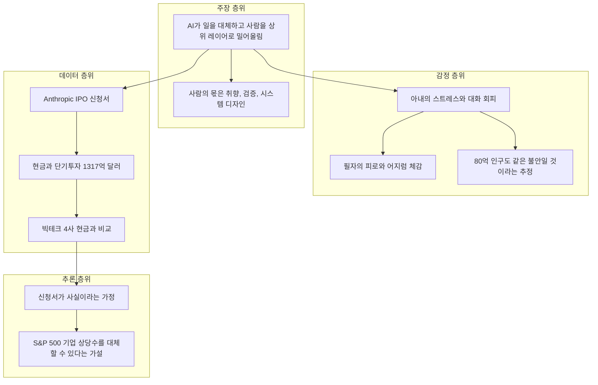
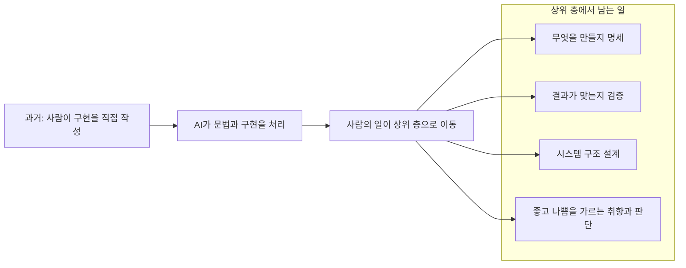
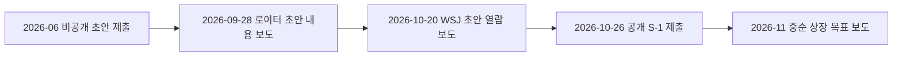
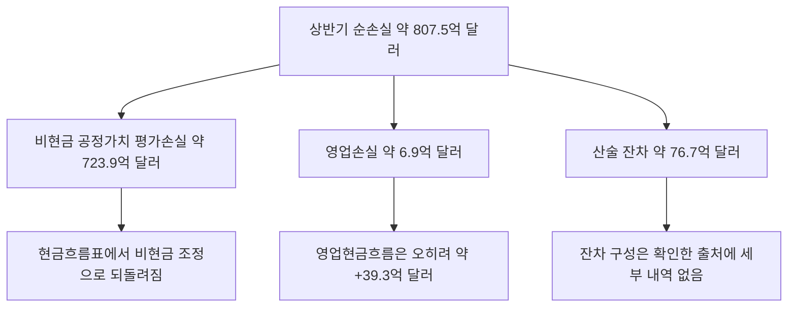
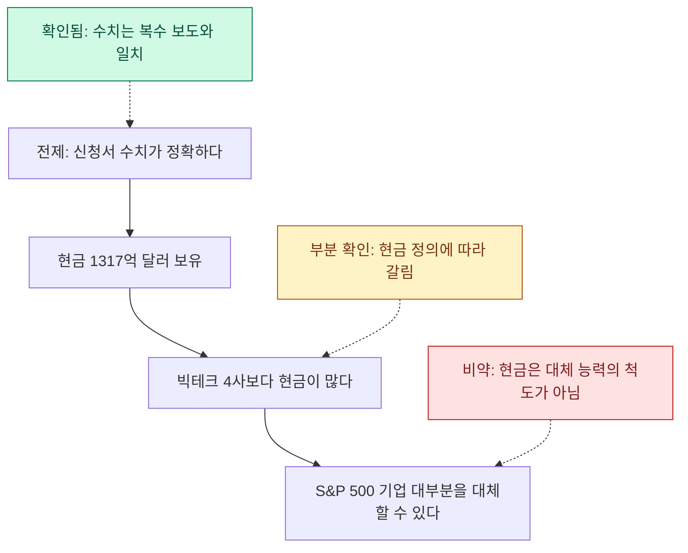

- 작성 일자: 2026-10-27
- 대상: 2026-10-26에 올라온 Threads 게시글(AI는 인간이 하던 일을 대체하고 사람을 더 높은 층으로 밀어올린다는 주장, Anthropic IPO 신청서의 현금 수치, "S&P 500 기업을 거의 다 대체할 수도 있다"는 추론)과 그 안에 인용된 X(구 트위터) 글, Grok 요약, Meta AI 답변
- 검증 방식: 2026-10-27 기준으로 웹 검색을 수행해 Anthropic S-1 관련 보도와 해설, Apple·Microsoft·Meta·Nvidia의 최신 SEC 공시, 노동시장과 여론조사 자료를 교차 확인했습니다.
- 중요한 한계: Anthropic S-1 원문(EDGAR)을 직접 열람하지는 못했습니다. S-1 수치는 S-1을 직접 인용한 복수의 보도와 해설이 서로 일치하는지를 기준으로 확인했고, 일치하지 않거나 한 곳에서만 나온 수치는 그렇다고 표시했습니다. 빅테크 4사의 수치는 각 사의 SEC 공시(1차 자료)를 기준으로 했습니다.
- 출처 표기: **[공시]** 기업이 SEC에 낸 문서, **[보도]** 언론 보도, **[해설]** S-1을 풀이한 분석글, **[의견]** 개인 또는 AI의 해석과 예측

> 
> AI는 인간이 하던 일을 대체하고 지금보다 상위에 있는 레이어로 밀어부친다. 취향, 검증, 시스템 디자인을 사람이 해야하는 일로 빠르게 밀어부치고 있다.
> 
> 아내는 이런 이야기를 나한테 들을 때 마다 너무나 스트레스를 받는다고 한다. 그래서 이제는 이런 이야기를 하지 않으려고 한다. 80억 인구가 지금 아내와 같은 불안한 감정을 느끼고 있을 거라 생각한다. 나도 decision fatigue 와 vertigo 를 저녁 5시만 돼도 구역질이 날 정도로 혈당이 떨어진다. 
> 
> 10월 26일 2026년. 
> 
> 2025년 12월 기준 Anthropic IPO filing 자료를 보니 (6/30/2026) cash equivalent 가 $132B 이란다. Apple, Microsoft , Meta, NVIDIA 가 가진 현금보다 더 많다. 
> 
> 아모데이가 IPO filing 에서 구라를 친 게 아니라고 가정하면, S&P 500 에 등록된 기업들을 거의 다 대체할 수도 있다는 논리가 가능하다.
> 
> https://www.threads.com/share/BASfCu6_tN
> 

---

## 1. 먼저 결론부터

이 글은 세 겹으로 이루어져 있습니다. 맨 위에는 "AI가 사람이 하던 일을 가져가고, 사람은 취향·검증·시스템 디자인처럼 더 높은 층의 일로 밀려 올라간다"는 큰 주장이 있습니다. 그 아래에는 이 주장이 가정과 몸에 미치는 영향, 즉 아내의 스트레스와 글쓴이 본인의 피로감이라는 개인적 층이 있습니다. 맨 아래에는 Anthropic이 공개한 IPO 신청서(S-1)의 숫자를 근거로 "그렇다면 S&P 500 기업을 거의 다 대체할 수도 있다"는 추론이 놓여 있습니다.

검증 결과를 먼저 요약하면 이렇습니다. 숫자 부분은 대체로 맞습니다. Anthropic은 2026년 10월 26일 S-1을 제출했고, 2026년 상반기 매출은 약 163억 달러, 순손실은 약 807억 달러, 6월 30일 기준 현금과 단기투자는 약 1,317억 달러입니다. 다만 글에 "cash equivalent가 $132B"라고 적힌 것은 정확한 표현이 아닙니다. 현금및현금성자산은 1,124억 달러이고, 단기투자 193억 달러를 더해야 1,317억 달러가 됩니다. 또 "Apple, Microsoft, Meta, NVIDIA가 가진 현금보다 많다"는 비교는 어떤 항목을 현금으로 치느냐에 따라 맞기도 하고 틀리기도 합니다. Apple이 비유동 유가증권까지 합쳐 보유한 약 1,465억 달러는 Anthropic의 1,317억 달러보다 큽니다.

가장 큰 문제는 마지막 추론입니다. 현금 1,317억 달러는 S&P 500 전체 시가총액(약 68조 달러대)의 0.2% 수준이고, 그 돈의 대부분은 영업으로 번 것이 아니라 투자 유치로 들어온 돈이며, 앞으로 갚거나 지불해야 할 컴퓨팅 약정은 수천억 달러 규모로 보도되고 있습니다. 그래서 "신청서가 거짓이 아니라면 S&P 500을 대체할 수 있다"는 문장은 숫자에서 자연스럽게 따라 나오는 결론이 아니라, 글쓴이의 가설입니다. 반면 "AI가 초급 업무를 먼저 압박하고 있다"는 큰 방향성은 노동시장 자료에서 상당 부분 뒷받침되지만, 그 원인이 AI 하나라고 확정할 수 있는 단계는 아닙니다.

---

## 2. 글의 구조: 네 개의 층위

글은 한 덩어리처럼 읽히지만, 실제로는 성격이 다른 네 부분이 이어 붙어 있습니다. 어느 부분이 사실이고 어느 부분이 추론인지 구분하면 이해가 훨씬 쉬워집니다.

주장 층위는 미래에 대한 예측이라 맞고 틀림을 지금 확정할 수 없습니다. 감정 층위는 개인의 체험이라 사실 검증의 대상이 아닙니다. 데이터 층위는 검증이 가능하고, 이 문서의 4장과 5장에서 하나씩 확인합니다. 추론 층위는 데이터에서 주장으로 건너가는 다리인데, 가장 약한 부분이 여기라서 6장에서 따로 다룹니다.

---

## 3. 첫 번째 층위: "AI가 사람을 한 층 위로 밀어올린다"

### 3.1 무슨 뜻인가

이 문장을 쉽게 풀면 이렇습니다. 예전에는 사람이 코드를 직접 한 줄씩 썼습니다. 이제 AI가 코드 작성이라는 아래층 일을 대신하면, 사람에게 남는 일은 "무엇을 만들어야 하는지 정하는 일", "AI가 만든 결과가 맞는지 확인하는 일", "전체 구조를 설계하는 일", "무엇이 좋은 결과인지 판단하는 취향"입니다. 계산기가 나오자 회계사의 일이 암산에서 모델링과 판단으로 옮겨 간 것과 비슷한 구조라고 이해하시면 됩니다. 이 비유는 이해를 돕기 위한 제 설명이며, 글에 있던 표현은 아닙니다.

글 아래쪽에 함께 붙은 Meta AI와의 대화가 이 생각의 직접적인 출처로 보입니다. 글쓴이가 "앞으로 18개월에 대한 가장 좋은 예측을 제1원리로 말해 달라"고 묻자, Meta AI는 프로그래머가 사라지지는 않고 일이 한 층 위로 이동한다고 답했습니다. 구문을 쓰는 비용은 사실상 공짜가 되었지만 "무엇이 존재해야 하는지 명세하는 일"은 공짜가 되지 않았기 때문에, 희소해지는 능력이 취향, 검증, 시스템 설계라는 설명입니다. 구체적 예측은 세 가지였습니다. 티켓을 받아 처리하는 주니어는 강하게 압박받고, 제품·아키텍처·보안·평가(evals)를 함께 책임질 수 있는 시니어는 레버리지가 크게 늘며, 사이버보안과 AI 인프라는 성장하지만 가장 큰 신규 직무는 비결정적 시스템을 디버깅하고 실제 운영에서 작동함을 증명하는 "AI wrangler"라는 것입니다.

여기서 짚어야 할 점이 있습니다. 이것은 AI 챗봇이 내놓은 의견이지 조사 결과가 아닙니다. 글쓴이의 첫 문단은 이 답변과 거의 같은 구조를 가지고 있으므로, 독립적인 증거라기보다 같은 가설이 두 번 반복된 것으로 보는 편이 정확합니다. **[의견]**

### 3.2 이 방향성을 뒷받침하는 자료와 한계

노동시장 자료를 찾아보면, "초급이 먼저 눌린다"는 방향은 여러 곳에서 보이지만 원인을 AI로만 돌리기는 이르다는 단서가 함께 붙습니다.

- 2026년 9월 시점의 채용 데이터를 정리한 한 해설은 가장 재현성 높은 패턴이 "AI가 초급 일자리를 없앤다"가 아니라 "경력자 쪽으로 채용이 기우는 것"이라고 요약합니다. 초급 채용은 약해졌지만 AI는 아직 완전히 분리되지 않은 여러 원인 중 하나라는 결론입니다. **[해설]**
- 소프트웨어 개발 공고의 반등 가운데 상당 부분이 시니어 직급에서 나왔다는 집계가 있습니다(2025년 5월부터 2026년 5월까지 반등분의 71%). 다만 이 수치는 데이터 집계 사이트의 정리이며 원자료 확인은 거치지 못했습니다. **[해설]**
- Stanford의 Brynjolfsson 연구진(Bharat Chandar 발표)은 ADP 월간 급여 기록을 2026년 4월분까지 모아 AI 노출이 큰 직군의 초급 노동시장 변화를 추적하고 있고, 이를 소개한 글은 22~25세 소프트웨어 개발자 고용이 2022년 말 정점에서 20% 가까이 줄었다고 전합니다. 연구 발표 자료(2026-07-15)는 초안 상태입니다. **[해설]**
- PwC의 2026 AI 일자리 보고서를 소개한 글은 기업들이 초급 일자리를 없애기보다 재설계하는 중이라고 정리합니다. **[해설]**
- Anthropic 자체의 2026년 3월 노동시장 논문이 AI 노출이 큰 근로자 전반에서 실업이 체계적으로 늘지는 않았다고 밝혔다는 2차 보도가 있습니다. 원문은 확인하지 못했습니다. **[해설]**

종합하면 "초급이 눌리고 시니어에게 쏠린다"는 이야기는 근거가 있지만, "AI 때문에"라는 인과는 아직 분리되지 않았습니다. Anthropic CEO Dario Amodei가 2025년 5월 이후 반복해서 말해 온 "1~5년 안에 초급 화이트칼라 일자리의 최대 절반이 사라지고 실업률이 10~20%까지 오를 수 있다"는 경고는 측정값이 아니라 예측입니다. **[보도]**

---

## 4. 두 번째 층위: 감정과 몸의 이야기

글쓴이의 아내가 이런 이야기를 들을 때마다 스트레스를 받아 이제는 말하지 않으려 한다는 대목은, 사실 검증의 대상이 아니라 이 주제가 가정 안에서 어떤 무게를 갖는지를 보여 주는 개인적 기록입니다. 그래서 여기서는 "비슷한 불안이 실제로 얼마나 퍼져 있는가"만 자료로 확인했습니다.

Pew Research Center가 2026년 6월 22~28일 미국 성인 3,488명을 조사한 결과, 일상에서 AI 사용이 늘어나는 데 대해 "기대보다 우려가 크다"는 응답이 52%로 2021년의 37%보다 올랐습니다. AI가 앞으로 20년 동안 미국의 일자리를 줄일 것이라고 본 응답은 71%(2024년 64%)였고, 30세 미만에서는 73%(2024년 61%)로 더 가파르게 늘었습니다. 같은 기관의 국제 조사(2026년 2월 8일~5월 13일, 37개국 42,151명)에서는 34개 나라에서 AI가 일자리를 만들기보다 없앨 것이라는 응답이 더 많았습니다. Gallup 조사에서는 Gen Z 가운데 AI에 "설렌다"고 답한 비율이 1년 새 36%에서 22%로 떨어졌다고 보도되었습니다. **[보도]**

"80억 인구가 지금 아내와 같은 불안을 느끼고 있을 것"이라는 문장은 감정적으로 이해되지만, 전 인류를 대상으로 측정한 자료는 없습니다. 확인되는 것은 조사된 나라 대부분에서 일자리 감소를 걱정하는 쪽이 더 많다는 정도입니다. 즉 불안이 넓게 퍼져 있다는 방향은 자료와 맞고, "80억 전체"라는 규모는 수사적 표현입니다.

글쓴이 본인이 적은 의사결정 피로와 어지럼, 오후 5시쯤 구역질이 날 정도로 혈당이 떨어진다는 서술도 개인 체감이라 이 문서에서 판정하지 않습니다. 다만 어지럼과 저혈당 같은 증상이 반복된다면 AI 이야기와 별개로 의료진에게 한 번 확인받아 보시기를 권합니다.

---

## 5. 세 번째 층위: Anthropic S-1이 실제로 말하는 것

### 5.1 어떤 문서인가

Anthropic, PBC는 2026년 10월 26일(월) 미국 SEC에 Form S-1을 제출했고, Nasdaq에 티커 ANT로 상장할 계획입니다. 주식 수와 공모가 범위는 아직 비어 있습니다. 비공개 초안은 2026년 6월에 제출된 것으로 확인되며, 9월 28일 로이터가 초안 내용을 보도했고 10월 20일에는 WSJ가 초안을 열람한 내용을 보도했습니다. 상장 시점은 11월 중순(11월 16일 주간)을 목표로 한다고 보도되었지만, 신청서에 확정된 날짜로 적힌 것은 아닙니다. 기업가치 1.5조~2조 달러와 최대 1,000억 달러 이상의 조달 규모도 WSJ 등의 보도이지 신청서에 적힌 수치가 아닙니다. **[공시·보도]**

### 5.2 핵심 수치와 확인 상태

| 항목 | 수치 | 확인 상태 |
|---|---|---|
| 2026년 상반기 매출 | 162.86억 달러(전년 동기 11.63억 달러) | 복수의 S-1 인용 보도·해설이 일치 |
| 2025년 연간 매출 | 45.85억 달러 | 복수 출처 일치 |
| 2026년 2분기 매출 | 115.6억 달러, 영업이익 9.74억 달러 | 해설 복수 일치 |
| 2026년 상반기 영업손실 | 6.93억 달러 | 해설 복수 일치 |
| 2026년 상반기 순손실 | 807.5억 달러 | 보도·해설 일치 |
| 순손실 중 비현금 평가손실 | 723.9억 달러(전환사채·파생부채·SAFE의 공정가치 변동) | S-1 23쪽을 인용한 해설 |
| 2026년 상반기 영업현금흐름 | +39.3억 달러(전년 동기 -15.1억 달러) | 해설 복수 일치 |
| 현금및현금성자산 | 1,124억 달러 | 해설 복수 일치 |
| 단기투자 | 193억 달러 | 해설 복수 일치 |
| 현금과 단기투자 합계 | 1,317억 달러(별도로 사용 제한 현금 약 25억 달러) | 복수 일치 |
| 2025년 순손실 | 약 419.7억 달러 | 해설 일치(보도는 약 420억 달러로 표기) |

글에서 말한 "2025년 12월 기준"은 정확하지 않아 보입니다. 1,317억 달러는 2026년 6월 30일 기준 잔액입니다. 글에도 괄호 안에 6/30/2026이 적혀 있어 단순한 표기 혼선으로 보입니다.

### 5.3 807억 달러 손실은 무엇인가

처음 보면 "매출 163억 달러에 손실 807억 달러"는 회사가 돈을 태워 없앤 것처럼 읽힙니다. 그러나 이 손실의 대부분은 현금이 나간 것이 아니라 회계상의 평가손실입니다. 회사가 과거에 투자 유치를 위해 발행한 전환사채, SAFE(미래 지분 전환 계약) 같은 금융상품은, 회사 가치가 오를수록 장부상 가치가 올라 회계 규칙상 그만큼 손실로 잡힙니다. 이런 비현금 평가손실이 723.9억 달러였고, 현금흐름표의 조정 항목으로 보면 금융상품 관련 비현금 조정이 약 811억 달러로 순손실을 거의 그대로 되돌려 놓습니다. 반대로 말하면 회사 가치가 높아질수록 이 손실은 커집니다. 한 해설은 이 평가 손실이 IPO에서 전환이 이루어지는 증권에 대해서는 이후 멈출 수 있다고 설명합니다(전환 상한 등 조건에 따라 다름).

위 그림의 "산술 잔차"는 순손실에서 비현금 평가손실과 영업손실을 뺀 제 계산(807.48 - 723.88 - 6.93 = 약 76.7억 달러)이며, 그 구성 항목은 제가 확인한 출처에서 알 수 없었습니다.

회사가 실제로 어떻게 돈을 벌고 쓰는지는 영업 쪽 숫자를 봐야 합니다. 2분기에 처음으로 영업이익 9.74억 달러가 났고, 상반기 전체로는 영업손실 6.93억 달러였습니다. 조정 영업이익(주식보상비와 소송 합의금 등을 제외)은 약 +16억 달러입니다. 영업현금흐름은 +39.3억 달러이고, 설비 구매를 뺀 잉여현금흐름은 약 +34.5억 달러입니다. 한편 컴퓨팅·인프라 비용은 상반기에 약 89.5억 달러로 매출의 약 55%였습니다. 일부 보도에 따르면 회사는 3분기 매출이 168억 달러로 2분기 대비 45% 늘었다고 투자자에게 밝혔는데, 이는 신청서에 포함된 기간이 아니라 별도 보도입니다. **[공시·해설·보도]**

### 5.4 1,317억 달러는 어디서 왔나

여기가 글의 논리에서 중요한 대목입니다. 이 현금은 영업으로 번 돈이 아니라 대부분 투자 유치로 들어온 돈입니다. S-1을 인용한 보도에 따르면 회사는 2026년 6월 30일까지 누적 약 1,411억 달러를 조달했고, 2026년 상반기에만 약 1,108억 달러가 재무활동으로 들어왔으며 그 안에 Series H 652억 달러가 있습니다. 같은 기간 영업현금흐름은 39억 달러 수준입니다. 대차대조표에는 누적 결손금 약 1,329억 달러, 총 주주결손 약 1,276억 달러, 상환가능 전환우선주 약 1,575억 달러가 올라 있다는 해설이 있습니다. 즉 현금이 많다는 사실과 재무구조가 튼튼하다는 사실은 같은 말이 아닙니다.

---

## 6. 빅테크 4사 현금과의 비교 검증

글은 "Apple, Microsoft, Meta, NVIDIA가 가진 현금보다 더 많다"고 말합니다. 각 회사의 최신 공시로 확인해 보면, 이 문장은 현금을 어떻게 정의하느냐에 따라 결과가 달라집니다. 회계 기준일이 다르다는 점(Apple 6월 27일, Microsoft·Meta 6월 30일, Nvidia 7월 26일)도 감안해야 합니다.

| 회사 | 기준일 | 현금및현금성자산 | 현금+단기·유동 유가증권 | 그 밖의 보유 자산 |
|---|---|---|---|---|
| Anthropic | 2026-06-30 | 1,124억 달러 | 1,317억 달러 | 사용 제한 현금 약 25억 달러 |
| Apple | 2026-06-27 | 395.4억 달러 | 624.0억 달러(현금 395.4 + 유동 유가증권 228.6) | 비유동 유가증권 841.2억 달러를 더하면 총 1,465억 달러 |
| Microsoft | 2026-06-30 | 209.4억 달러 | 768억 달러 | 지분 및 기타 투자 363억 달러 |
| Meta | 2026-06-30 | 154.6억 달러 | 902.6억 달러 | 그중 약 108억 달러는 이후 사용 제한 현금성으로 재분류 |
| Nvidia | 2026-07-26 | 224억 달러(2차 출처) | 566억 달러(현금, 현금성자산, 시장성 채무증권) | 시장성 지분증권 428억 달러를 더하면 약 994억 달러 |

여기서 읽을 수 있는 것은 세 가지입니다. 첫째, 현금및현금성자산만 놓고 보면 Anthropic의 1,124억 달러가 네 회사 각각보다 크고, 네 회사의 합계(약 983억 달러, 제 계산)보다도 큽니다. 둘째, 단기 유가증권까지 넣은 기준으로 비교해도 Microsoft, Meta, Nvidia보다는 큽니다. 셋째, Apple은 비유동 유가증권 841억 달러를 포함하면 1,465억 달러(10-Q 기준)라서 Anthropic을 앞섭니다. 따라서 "네 회사보다 많다"는 문장은 현금성자산과 유동 자산 기준에서는 맞고, Apple의 전체 현금·유가증권 기준에서는 맞지 않습니다. 또 글의 "cash equivalent $132B"라는 표현은 현금성자산이 1,124억 달러, 단기투자까지 합쳐야 1,317억 달러이므로 정확하지 않습니다. 한 보도는 Anthropic의 보유 현금이 Alphabet의 2,420억 달러 다음이라고 전하지만, Alphabet 수치는 제가 공시로 직접 확인하지 못했습니다.

현금의 질도 다릅니다. Microsoft는 2026 회계연도에 영업현금흐름이 1,829억 달러였고, Meta는 2026년 상반기 영업현금흐름이 640.9억 달러, Nvidia는 회계연도 2027 2분기(2026년 7월 26일 종료) 영업현금흐름이 약 241억 달러(2차 출처)였습니다. 이들의 현금은 대부분 사업에서 벌어들인 것입니다. Anthropic은 같은 기간 영업현금흐름이 39억 달러이고 현금 대부분이 투자 유치로 채워졌습니다. 같은 1,000억 달러라도, 매년 벌어서 쌓은 돈과 한 번에 조달해 둔 돈은 의미가 다릅니다.

---

## 7. 추론 층위: "S&P 500 기업을 거의 다 대체할 수 있다"

### 7.1 글쓴이의 논리를 단계로 나누면

글의 추론은 다음 사슬로 정리됩니다. 신청서의 숫자가 사실이다. 그러면 Anthropic은 거대한 현금을 가졌다. 그 현금은 대표적 빅테크 몇 곳보다 많다. 따라서 이 회사는 막대한 자원으로 AI를 계속 키울 수 있다. 그러므로 S&P 500 기업 대부분을 대체할 수도 있다는 논리가 가능하다.

### 7.2 규모를 맞대어 보면

아래는 제가 공개된 수치로 직접 계산한 비교입니다. S&P 500의 최근 12개월 합산 매출은 2026년 3월 기준 약 18.3조 달러로 집계되었고, 2026년 3분기 말 S&P 500 시가총액은 약 68.45조 달러로 보도되었습니다.

- Anthropic 현금과 단기투자 1,317억 달러는 S&P 500 시가총액의 약 0.19%입니다.
- 2분기 매출을 연환산한 약 460억 달러는 S&P 500 합산 매출의 약 0.25%이고, 2026년 7월 연환산 런레이트로 보도된 650억 달러 이상을 쓰더라도 약 0.36%입니다.
- 보도된 IPO 기업가치 1.5~2조 달러가 실현되더라도 S&P 500 시가총액의 약 2.2~2.9%입니다.

매출이 14배로 뛴 성장 속도는 분명 이례적입니다. 그러나 현재 규모로 S&P 500 전체를 대체한다는 이야기를 하려면, 지금의 수백 배를 넘는 격차를 설명해야 합니다.

### 7.3 신청서 자체가 말하는 제약

숫자만 크게 보이지만, 신청서와 이를 다룬 보도는 같은 문서에서 다른 방향의 사실도 알려 줍니다.

- 컴퓨팅 약정: 로이터가 입수한 비공개 초안은 약 10년에 걸쳐 최소 약 5,180억 달러(대부분 해지 불가)를 보도했습니다. 공개된 S-1을 풀이한 해설들은 Amazon과 Google에 대한 최소 약정만 2,245억 달러 이상, Microsoft를 더하면 2,694억 달러라고 정리했고, 또 다른 해설은 파트너 전체를 합쳐 7,800억~8,100억 달러 수준으로 추산합니다. 숫자가 출처마다 다른 것은 집계 범위와 계약 조건 정의가 달라서로 보이며, S-1 원문을 보지 못한 상태에서는 하나로 확정할 수 없었습니다. 한 해설은 연도별 지급 시기가 S-1에 공란이라고 지적합니다.
- 컴퓨팅 공급: 회사는 대형 클라우드 파트너가 요청한 컴퓨팅 전부를 공급해 주지는 않을 것이라고 밝혔다고 보도되었습니다. 즉 수요가 주로 컴퓨팅 가용성에 의해 제한된다고 회사 스스로 설명한 것으로 보도되었습니다.
- 고객 집중: 2026년 상반기 매출의 약 5분의 1이 두 고객에서 나왔고(WSJ), 2025년 매출의 약 47%는 Amazon과 Google 마켓플레이스를 거쳤다는 분석이 있습니다.
- 지배구조: 공동창업자 7명으로 구성된 Founder LLC가 Class F 주식 1주로 의결권의 50.1%를 갖습니다. 신청서는 이 구조가 투자자 이익과 충돌하는 결정으로 이어질 수 있다고 위험 요인에 적었다고 보도되었습니다.
- 위험 요인 분량: 261쪽 중 약 80쪽이 위험 요인이라고 보도되었습니다.

종합하면 신청서가 보여 주는 회사는 "압도적으로 성장하고 영업현금흐름이 플러스로 돌아선" 동시에 "고정비 성격의 장기 약정이 매우 크고 공급 병목과 고객 집중 위험을 안고 있는" 회사입니다. 이 두 얼굴을 모두 봐야 하는데, 글의 추론은 앞의 한 얼굴만 가져다 씁니다.

### 7.4 그리고 "대체"라는 말의 층위

더 근본적으로는, "대체한다"의 의미가 일을 맡는다는 뜻인지 기업이라는 조직을 대신한다는 뜻인지부터 나뉩니다. AI가 지식노동의 일부 작업을 대신할 수 있다는 것과, S&P 500 기업이 하는 일(물건 제조, 물류, 규제 준수, 책임 소재, 고객 신뢰, 현물 자산 운영 등) 전체를 AI 기업 하나가 대신할 수 있다는 것은 전혀 다른 명제입니다. 이 문서는 이 부분을 사실 검증이 아니라 논리 구조의 문제로만 지적합니다.

물론 글의 방향성에 타당한 부분도 있습니다. 매출이 14배 늘었다는 사실, 회사 CEO 자신이 초급 화이트칼라 일자리 충격을 경고해 왔다는 사실, 초급 채용이 약해지고 경력자 쪽으로 기우는 흐름이 여러 자료에서 확인된다는 사실은 모두 글쓴이의 문제의식과 겹칩니다. 다만 그 사이를 이어 주는 "그러므로 S&P 500을 대체한다"는 다리는 증거로 놓인 것이 아니라 상상으로 놓인 것입니다. **[의견]**

---

## 8. 글에 인용된 X 글과 Grok 요약 점검

글에는 투자 계정(Melvin)의 "Anthropic이 IPO를 신청했고 숫자가 말도 안 된다"는 취지의 글과, 글쓴이가 Grok에게 "친절한 금자씨 말투로 핵심만 요약"을 요청해 받은 답이 함께 인용되어 있습니다. Grok의 요약을 항목별로 점검하면 다음과 같습니다.

| Grok 요약 내용 | 판정 | 설명 |
|---|---|---|
| 2026 상반기 매출 163억 달러, 작년보다 훨씬 늘었다 | 확인됨 | 162.86억 달러, 전년 동기 11.63억 달러로 약 14배 |
| 손실 807억 달러는 대부분 비현금 회계 항목 | 확인됨 | 723.9억 달러가 전환사채·파생부채·SAFE의 공정가치 변동 |
| 현금 1,317억 달러 보유 | 확인됨(표현 주의) | 현금과 단기투자의 합계. 현금성자산만은 1,124억 달러 |
| 영업현금흐름과 이익도 흑자로 돌아섰다 | 부분 확인 | 영업현금흐름은 +39.3억 달러. 이익은 2분기 영업이익(9.74억 달러)만 흑자이고 상반기 영업손실과 순손실은 그대로임 |
| 인프라 지출은 엄청나지만 스스로 버는 돈으로 버틸 힘이 생겼다 | 해석 | 숫자 하나로 확정할 수 없음. 장기 약정 규모와 지급 일정이 핵심인데 일정은 공란으로 보도됨 |

Melvin이 별도로 올린 글에는 1,317억 달러가 "당장 마음대로 쓸 수 있는 돈은 아니며 인프라 약정이 크고 부채와 전환우선주도 있다"는 단서가 이미 붙어 있습니다. 이런 단서는 요약과 재인용 과정에서 빠지기 쉬우므로, 핵심 수치를 옮길 때 함께 적어 두는 편이 안전합니다.

---

## 9. 정리: 이 글에서 건질 것과 조심할 것

건질 것은 세 가지입니다. 첫째, "AI 때문에 사람의 일이 상위 층으로 옮겨 간다"는 문제의식은 노동시장 자료와 방향이 같습니다. 초급 업무가 먼저 압박받고, 검증과 설계처럼 책임이 따르는 역할의 비중이 커진다는 점은 여러 조사에서 일관됩니다. 둘째, Anthropic의 숫자는 실제로 인상적입니다. 14배의 매출 성장과 영업현금흐름의 플러스 전환, 그리고 손실의 대부분이 비현금이라는 점은 확인되었습니다. 셋째, 불안을 느끼는 사람이 많다는 것은 여론조사로도 뒷받침됩니다.

조심할 것도 세 가지입니다. 첫째, 현금 비교는 항목 정의를 맞춰야 하고, 번 돈과 조달한 돈을 구분해야 합니다. 둘째, 현금 잔액은 "대체할 능력"의 척도가 아니며, 같은 문서에 들어 있는 대규모 장기 약정과 공급 제약을 함께 읽어야 합니다. 셋째, "AI가 초급 일자리를 줄이고 있다"는 방향과 "그 원인이 AI뿐이다"라는 단정은 다릅니다. 현재 자료는 앞의 것은 뒷받침하지만 뒤의 것까지는 아닙니다.

아직 확정되지 않은 것도 분명히 해 둡니다. IPO 가격 범위와 주식 수는 신청서에 공란이고, 기업가치와 조달액은 보도일 뿐이며, 상장 일정도 목표입니다. 제가 S-1 원문을 직접 읽지 못했으므로, 이 문서의 S-1 세부 수치는 원문 대조 없이 복수 출처의 일치 여부로 확인한 것입니다. 중요한 의사결정에 쓰실 때는 EDGAR의 S-1 원문에서 해당 쪽(예: 순손실 구성은 23쪽 인근)을 직접 확인하시기 바랍니다. 이 문서는 투자 조언이 아닙니다.

---

## 10. 근거 구분 요약

| 구분 | 내용 |
|---|---|
| 확인된 사실(공시) | Apple 10-Q(2026-06-27), Microsoft 10-K(FY2026), Meta 10-Q(2026-06-30), Nvidia 10-Q(2026-07-26)의 현금성 자산 수치 |
| 복수 보도·해설이 일치 | Anthropic S-1 제출일, 상반기 매출·순손실, 현금 1,317억 달러 구성, 영업현금흐름 |
| 단일 또는 2차 출처 | 연도별 컴퓨팅 약정 총액(출처별 상이), Alphabet 현금 2,420억 달러, Nvidia 현금성자산 224억 달러, 소프트웨어 직군 고용 감소율, Anthropic 노동시장 논문 요약 |
| 보도이지만 신청서 미기재 | 기업가치 1.5~2조 달러, 조달 규모 1,000억 달러 이상, 상장 목표 시점, 3분기 매출 168억 달러 |
| 의견·예측 | Meta AI의 18개월 예측, Amodei의 일자리 경고, 글쓴이의 "S&P 500 대체" 가설 |
| 이 문서의 계산 | 현금 대비 시가총액 0.19%, 연환산 매출 대비 S&P 500 매출 비율, 네 회사 현금성자산 합계 983억 달러, 순손실의 산술 잔차 76.7억 달러 |

---

## 참고 출처 (모두 2026-10-27에 확인)

**Anthropic S-1 관련 보도·해설**
- Investing.com, WSJ 인용 보도(2026-10-20): https://www.investing.com/news/stock-market-news/anthropic-revenue-hits-163-billion-as-preliminary-s1-outlines-ipo-risks--wsj-4960928
- CoinDesk, Anthropic IPO 신청(2026-10-26): https://www.coindesk.com/business/2026/10/26/ai-giant-anthropic-files-for-blockbuster-ipo
- TechPowerUp, 나스닥 상장 신청: https://www.techpowerup.com/354157/anthropic-files-to-go-public-on-nasdaq-reveals-usd-16-3-billion-in-first-half-revenue
- The VC Corner, S-1 줄 단위 분석: https://www.thevccorner.com/p/anthropic-s1-ipo-filing
- Kepler, S-1 분석(영업이익·현금흐름 표): https://kepler.ai/research/financial/s1-anthropic/
- Decode the Future, S-1 설명: https://decodethefuture.org/en/anthropic-s1-ipo-filing-explained/
- Cellcog, S-1 정리(현금·부채): https://cellcog.ai/blog/anthropic-s1-filing/
- Asymmetrical Bets, 첫 신청서 분석: https://asymmetricalbets.substack.com/p/anthropics-first-filing
- Peter Gostev, S-1 시각 가이드(현금흐름): https://ant-s1.surge.sh/
- ZeroHedge, S-1 분석(대차대조표·약정): https://www.zerohedge.com/ai/anthropics-s-1-out-974-million-operating-profit-800-billion-compute-bill-and-elon-musk-landlord
- StockTitan, S-1 가이드(컴퓨팅 최소 약정): https://www.stocktitan.net/articles/anthropic-ipo-s1-2026-guide
- Forbes, S-1이 드러내는 위험(2026-10-26): https://www.forbes.com/sites/ronschmelzer/2026/10/26/anthropic-ipo-ai-boom-valuation-risks/
- Implicator, 로이터 인용 초안 보도(5,180억 달러 약정): https://www.implicator.ai/anthropic-ipo-prospectus-518-billion-compute-commitments/
- Morningstar, 유출된 재무 분석: https://www.morningstar.com.au/stocks/anthropics-leaked-financials-reflect-fast-growth-not-2-trillion-valuation
- VKTR, 컴퓨팅 공급 제약과 고객 집중(2026-10-21): https://www.vktr.com/ai-market/anthropics-s1-shows-163b-in-revenue-and-compute-squeeze/
- Dealroom, 초안 요약: https://dealroom.co/news/164610-anthropics-draft-s-1-reveals-16-3b-revenue-80-7b-loss-and-up-to-750b-com/
- KuCoin 뉴스(현금 비교 보도): https://www.kucoin.com/news/flash/anthropic-cash-holdings-surpass-amazon-meta-and-microsoft-but-face-massive-spending

**빅테크 현금 수치(공시)**
- Apple 10-Q(2026-06-27): https://www.sec.gov/Archives/edgar/data/0000320193/000032019326000020/aapl-20260627.htm
- Microsoft 10-K(FY2026): https://www.sec.gov/Archives/edgar/data/0000789019/000119312526323660/msft-20260630.htm
- Meta 10-Q(2026-06-30): https://www.sec.gov/Archives/edgar/data/0001326801/000162828026050705/meta-20260630.htm
- Meta 8-K 재무제표(2026-06-30): https://www.sec.gov/Archives/edgar/data/0001326801/000162828026050596/meta-06302026xexhibit991.htm
- Nvidia 10-Q(2026-07-26): https://www.sec.gov/Archives/edgar/data/0001045810/000104581026000075/nvda-20260726.htm
- Nvidia 2분기 실적 해설(현금성자산 224억 달러, 2차 출처): https://www.xtb.com/ae-en/market-analysis/news-and-research/nvidia-shares-react-to-solid-earnings-report-and-stonger-guidance-what-s-next-for-the-ai-giant

**S&P 500 규모**
- S&P 500 합산 매출(2026-03 기준): https://fatfire.com/sp-500-revenue/
- S&P 500 시가총액(2026년 3분기 말): https://pluang.com/en/news-feed/snapshot-kapitalisasi-pasar-sp-500-fall-2026

**노동시장과 여론**
- Pew Research Center, 젊은 성인의 AI 우려(2026-08-18): https://www.pewresearch.org/short-reads/2026/08/18/young-adults-in-the-us-are-increasingly-wary-of-ai/
- Pew 국제 조사 보도(The Verge 인용): https://letsdatascience.com/news/pew-survey-finds-global-ai-job-loss-fears-4fa4f193
- Gallup Gen Z 조사 보도: https://abcnews4.com/news/nation-world/fact-check-team-ai-is-booming-but-americans-remain-skeptical-tension-national-surveys-investing-artificial-intelligence
- IntuitionLabs, 초급 채용 데이터 정리(2026-09-05): https://intuitionlabs.ai/pdfs/ai-entry-level-employment-hiring-data.pdf
- Stanford Chandar 발표 자료(2026-07-15, 초안): https://sd13.senate.ca.gov/sites/sd13.senate.ca.gov/files/DrChandar.pdf
- SBAM, 초급 일자리 재설계와 PwC 보고서(2026-08-14): https://www.sbam.org/ai-may-eliminate-entry-level-tasks-but-employers-still-need-entry-level-talent/
- 소프트웨어 채용의 시니어 편중 집계: https://uvik.net/blog/ai-job-displacement-statistics/
- Dario Amodei 초급 화이트칼라 경고 보도(Axios 인용): https://finance.yahoo.com/sectors/technology/articles/anthropic-ceo-makes-shocking-admission-183300424.html

작성 일자: 2026-10-27
