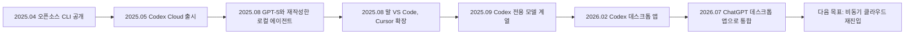
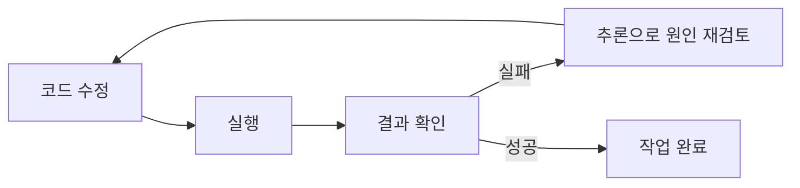
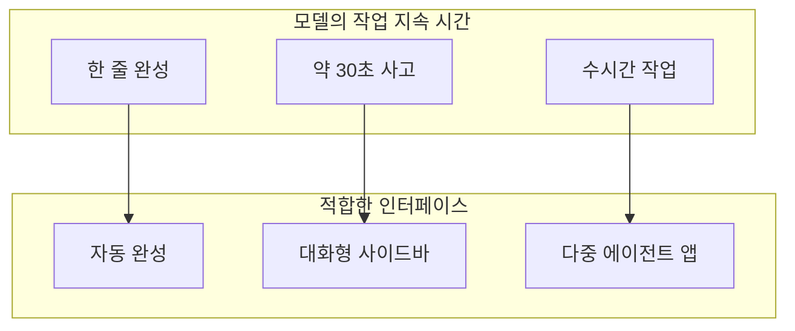
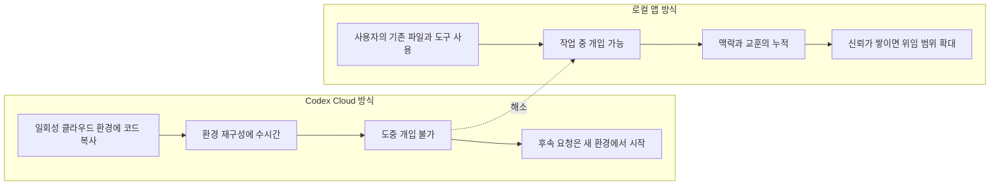
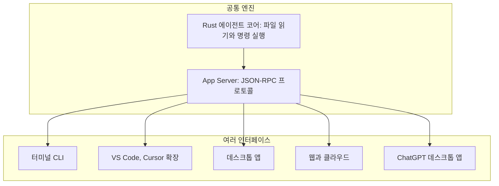
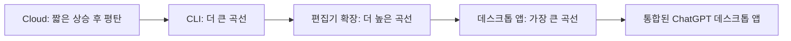

- 기준일: 2026-10-27
- 대상 글: Dan Shipper(Every 공동창업자·CEO), [「How Codex Happened」](https://every.to/p/how-codex-happened) (2026년 10월 중순 공개) 및 이를 한국어로 요약한 [GeekNews 글](https://news.hada.io/topic?id=36004)
- 작성 방식: 두 글의 내용을 풀어 설명하고, 웹 검색으로 날짜·수치·사건을 교차 검증했습니다.

---

## 0. 이 문서를 읽는 방법

이 문서는 원문을 번역하거나 문단 순서대로 따라가지 않고, 독자가 이해하기 쉬운 질문의 순서로 다시 구성했습니다. 사실관계는 아래 네 가지 표지로 구분합니다.

| 표지 | 의미 |
|---|---|
| **[기사]** | 원문 필자나 인터뷰이(OpenAI 관계자)의 서술. 독립 검증을 하지 않은 내용 |
| **[검증]** | 웹 검색으로 공식 발표나 복수의 독립 보도에서 확인한 내용 |
| **[2차]** | 집계 사이트나 2차 보도가 OpenAI 발표를 재인용한 내용. 방향은 믿을 만하나 정확한 날짜·수치는 출처마다 다를 수 있음 |
| **[해석]** | 해설자의 해석. 사실로 단정하지 않음 |

이 글의 수치 대부분은 OpenAI가 스스로 밝힌 숫자입니다. 외부 기관이 감사한 숫자가 아니라는 점을 끝까지 염두에 두고 읽어 주세요.

---

## 1. 한눈에 보기

이 글이 다루는 이야기는 한 문장으로 요약됩니다. **OpenAI의 코딩 에이전트 Codex는 2025년 5월 클라우드 제품으로 출시되었으나 시장에서 자리를 잡지 못했고, 팀이 로컬 실행 방식으로 방향을 틀어 CLI, 편집기 확장, 전용 모델, 편집기 없는 데스크톱 앱으로 형태를 바꿔 가며 성장했으며, 2026년 7월에는 ChatGPT 데스크톱 앱 자체의 기반이 되었다**는 것입니다.

원문이 던지는 질문은 "왜 한 번 실패한 팀이, 잘 되던 제품에 안주하지 않고 계속 다음 형태로 넘어갈 수 있었는가"입니다. 필자 Shipper는 이를 모델의 빠른 발전과 조직 구조(병렬 실험, 독립된 모델·제품 개발 공간, Codex로 Codex를 만드는 방식)로 설명합니다.

### 제품 형태의 변천

위 흐름에서 날짜가 확인된 항목은 다음과 같습니다. CLI 공개(2025년 4월 16일), Cloud 출시(2025년 5월 16일), 데스크톱 앱 출시(2026년 2월 2일), ChatGPT 데스크톱 앱 통합(2026년 7월 9일)은 [검증]입니다. 다음 목표가 클라우드 재진입이라는 대목은 Embiricos의 6월 인터뷰 발언을 옮긴 [기사]입니다.

---

## 2. 글의 배경과 필자의 위치

### 2.1 필자는 관찰자이면서 당사자다

Dan Shipper가 이끄는 Every는 새 AI 모델이 나오기 전에 먼저 접근권을 받아 실제 업무에 써 보고, 출시 당일 "Vibe Check"라는 평가를 내는 매체입니다. OpenAI는 GPT-5 출시 약 한 달 전부터 Every에 접근권을 주었습니다 [기사]. GPT-5의 공식 출시일은 2025년 8월 7일입니다 [검증].

글의 도입 장면은 이 출시 전날 밤, 샌프란시스코 Mission Bay에 있는 OpenAI 사무실입니다. Shipper는 Codex 제품 책임자 Alexander Embiricos에게 Every의 새로운 일하는 방식을 설명합니다. 사람이 단계마다 함께하는 것이 아니라 AI에게 작업 전체를 맡기고 결과를 기다리는 방식입니다 [기사].

### 2.2 이 글이 만들어진 방식

Shipper는 수개월에 걸쳐 여섯 명을 인터뷰했습니다. OpenAI 사장 Greg Brockman, Codex 책임자 Thibault "Tibo" Sottiaux, 전 Codex 제품 책임자 Alexander Embiricos, 연구자 Mia Glaese, 디자이너 겸 엔지니어 Andrew Ambrosino, 디자이너 Ed Bayes입니다 [검증: 중국 매체 보도 및 Every 뉴스레터].

또한 Every는 이 기사를 쓰는 과정에서 Codex를 활용해 내용을 구조화했다고 밝혔습니다 [검증: Every 뉴스레터]. 필자가 "Codex가 어떻게 만들어졌는가"를 Codex로 취재·집필했다는 점은 글의 아이러니이자 중요한 맥락입니다. 동시에 필자가 Claude 사용자에서 Codex 사용자로 바뀐 당사자라는 점에서, 글에는 필자의 관점이 깊게 배어 있습니다 [해석].

---

## 3. 출발점: 왜 "Thinking"이 모든 것의 전제인가

원문은 Codex 이야기를 시작하기 전에 한 가지 기술적 전제를 설명합니다. 오늘날 AI에서 보이는 "생각 중" 표시가 단순한 대기 표시가 아니라 **계산 방식의 변화**를 뜻한다는 것입니다.

### 3.1 초기 언어 모델: 즉흥 연기

초기 대규모 언어 모델은 답을 한 단어씩 생성하며 풀었습니다. 미리 계획하거나, 끝낸 답을 뒤에서 고칠 기회가 없었습니다. 그래서 "strawberry"에 r이 두 개라고 답하고, 철자를 나열해 보인 뒤에도 틀린 것을 알아차리지 못하는 식의 실수가 났습니다 [기사].

### 3.2 사고 사슬과 추론 모델

사용자들은 곧 "답하기 전에 단계별로 풀어 써 보라"고 요청하면 더 나은 답이 나온다는 점을 발견했습니다. 이것이 사고 사슬 프롬프팅입니다. OpenAI는 이 행동을 사용자의 요청 없이도 모델이 스스로 하도록 학습시켰고, 그 결과가 추론 모델입니다.

추론 모델은 답하기 전에 일종의 메모장(추론 기록)에서 여러 접근법을 시험하고, 막다른 길이면 돌아 나와 가장 유망한 경로를 고른 뒤에야 응답합니다. OpenAI는 2024년 9월 첫 추론 모델 o1의 프리뷰를 공개했고 [기사], 이는 "같은 모델이라도 더 오래 생각하면 어려운 문제에서 더 나은 답을 낸다"는 점을 보여 준 사건이었습니다.

### 3.3 왜 프로그래밍이 가장 큰 수혜 분야인가

프로그래밍에는 **닫힌 피드백 루프**가 있습니다. 코드를 고치고, 실행하고, 몇 초 안에 성공 여부를 확인할 수 있습니다. 사람이 매번 확인해 주지 않아도 모델이 스스로 검증하고 다시 고칠 수 있다는 뜻입니다.

원문의 논리는 이렇습니다. 충분히 오래 생각할 수 있는 추론 모델이 이 루프를 돌 수 있다면, 이론적으로 프로그래밍 작업 전체를 스스로 수행할 가능성이 열립니다. Codex의 출발점이 이 전제입니다.

---

## 4. 여러 개의 시작점과 하나로의 수렴

### 4.1 "Codex"라는 이름의 여러 시작

OpenAI에서 AI 프로그래머를 만드는 일은 오래된 목표였고, 그래서 Codex에는 시작점이 여럿 있습니다. 최초의 Codex는 2021년에 공개 코드로 미세 조정한 GPT-3로, 초기 GitHub Copilot을 구동했습니다. 2024년 말, o1 프리뷰가 가능성을 보여 준 뒤 경영진의 요청으로 여러 팀이 서로 다른 방향에서 AI 프로그래머를 다시 탐색하기 시작했습니다 [기사].

### 4.2 Embiricos의 출발점: 터미널과 "느림"의 재해석

Embiricos는 프로그래머용 화면 공유 도구 Multi를 공동 창업했고, 이 회사가 인수되면서 2024년 OpenAI에 합류했습니다. 그는 처음에 ChatGPT 데스크톱 앱과 AI 브라우저 Atlas에서 사람과 에이전트가 같은 앱을 함께 쓰는 방식을 추진했지만, 당시 모델은 화면을 읽는 속도와 정확도가 부족해 실용적이지 않았습니다 [기사].

전환점은 추론 모델이 터미널에 연결된 장면을 본 것입니다. 터미널에서는 화면을 해석할 필요 없이 텍스트와 코드로 직접 파일을 읽고 명령을 실행하며 오류를 풀 수 있었습니다.

여기에 더해 그는 속도 문제를 거꾸로 보았습니다. Copilot의 자동 완성이나 Cursor·Windsurf의 대화 기능은 빠른 응답에 의존했습니다. 반면 초기 추론 모델은 느리지만 오래 생각할수록 유리했습니다. 그는 사용자가 30초에서 길어도 1분마다 진행 상황을 볼 수 있어야 한다고 보면서, 이 느림을 장점으로 바꿀 제품 형태를 찾기 시작했습니다 [기사].

### 4.3 Sottiaux의 출발점: 연구자를 위한 코딩 에이전트

Sottiaux는 2024년 12월 무렵 코딩 에이전트에 관여하기 시작했습니다. 목적은 일반 사용자 제품이 아니라 **연구 인프라를 쓰고 연구 속도를 높이는 것**이었습니다. 연구 인프라는 AI 연구자들이 실험을 실행·평가·재현·배포할 때 쓰는 공통 코드입니다. 실험 시간을 줄이면 더 많은 실험을 돌릴 수 있고, 더 빨리 더 나은 모델이 나옵니다.

그의 팀은 OpenAI의 모노레포(회사 전체 코드가 한 저장소에 있는 구조)로 내부용 코딩 에이전트를 학습시켰고, 연구자들이 필요한 Python 코드를 쓰게 했습니다 [기사].

필자가 가장 궁금해한 부분은 "언제 Codex 전용 모델 계열을 분리하기로 결정했는가"였는데, 답은 의외였습니다. **분리하자는 결정은 없었습니다.** 출발점은 내부 연구 속도를 높이기 위한 실험이었고, 학습 기법이 일반 공개 모델의 방식과 달라 한동안 통합하기도 어려웠다는 것입니다 [기사].

### 4.4 첫 번째 개선 루프: 부트스트래핑

연구자들이 매일 이 에이전트를 쓰며 피드백을 주었고, 모델이 좋아졌고, 좋아진 모델로 다음 모델을 만드는 순환이 형성되었습니다. 이를 부트스트래핑이라고 부릅니다 [기사].

### 4.5 병렬 실험과 합병

코딩이 회사 차원의 우선순위가 되자 터미널, 편집기, 클라우드 등 여러 형태가 동시에 탐색되었습니다. Brockman의 표현으로는 핵심 질문이 "어떤 폼 팩터(제품 형태)가 맞는가"였습니다. Sam Altman은 2025년 인터뷰에서 OpenAI를 "내부 스타트업들에 투자하는 구조"에 비유했습니다 [기사].

내부에서는 중복 실험이 혼란스럽고 낭비처럼 느껴진다는 반응도 있었습니다 [기사]. 그러나 필자는 모델 수준의 빠른 지속적 혁신이 계속 새로운 제품 형태를 가능하게 하는 시기에는 이런 병렬 탐색이 필요하다고 봅니다. 한 줄을 완성하는 모델에는 자동 완성이, 30초를 생각하는 모델에는 대화형 사이드바가, 한 시간 일하는 모델에는 전혀 다른 인터페이스가 맞기 때문에, 이전 제품의 성공만으로는 다음 형태를 알 수 없다는 논리입니다.

2025년 초 Sottiaux의 연구용 에이전트와 Scientist Assistant가 합쳐지며 Embiricos와 같은 팀이 되었고, 다른 내부 코딩 프로젝트도 차례로 통합되었습니다 [기사]. 이렇게 제품 사고를 하는 사람(Embiricos), 인프라·엔지니어링(Sottiaux), 연구자(Mia Glaese 등)가 한 팀이 되었습니다. Glaese는 DeepMind에서 Gemini와 모델 정렬을 연구했고, OpenAI에서는 학습과 정렬에 쓰는 데이터를 담당합니다.

### 4.6 두 번째 개선 루프: 제품과 연구의 순환

제품·디자인·엔지니어링·연구가 가까이 일하자 두 번째 순환이 생겼습니다. 제품팀이 원하는 기능과 실제 사용 문제를 전달하면 연구자가 모델 행동으로 구현합니다. 필자는 이것이 연구자가 중심이고 보상 격차가 큰 AI 업계의 전형적 구조와 다르다고 지적합니다 [기사].

---

## 5. Codex Cloud: 왜 내부에서는 성공하고 외부에서는 실패했나

### 5.1 경쟁 환경: Claude Code의 등장

Anthropic은 2025년 2월 24일 Claude 3.7 Sonnet과 함께 Claude Code를 제한적 연구 프리뷰로 공개했습니다 [검증]. 터미널에서 실행되고 사용자 컴퓨터의 기존 파일을 직접 다루는 도구였습니다. 원문이 강조하는 장점은 세 가지입니다. 사용자가 이미 쓰는 파일과 설치된 도구, 작업 맥락 위에서 일하고, 작업 중간에 개입할 수 있으며, 한 세션의 교훈을 다음 세션으로 가져가 개선을 누적할 수 있다는 것입니다. Every의 Edmar Ferreira는 2025년 3월 평가에서 자신이 써 본 에이전트 중 가장 좋다고 썼습니다 [기사].

### 5.2 OpenAI의 선택: 클라우드 비동기 에이전트

같은 시기 Codex 팀은 약 7주를 들여 클라우드 에이전트를 만들었습니다 [기사]. 구상은 이랬습니다. 에이전트가 자기 컴퓨터를 클라우드에 갖고, 사용자는 컴퓨터나 휴대전화에서 작업을 위임하고, 노트북을 닫아도 에이전트는 계속 일한다는 것입니다. Codex Cloud는 2025년 5월 16일 연구 프리뷰로 출시되었고, o3 추론 모델을 소프트웨어 엔지니어링용으로 최적화한 codex-1이 구동했으며, 초기에는 ChatGPT Pro·Team·Enterprise 사용자에게 먼저 제공되었습니다 [검증].

작업 방식은 이렇습니다. ChatGPT 사이드바에서 과제를 입력하면 코드베이스를 격리된 클라우드 환경에 복사하고, 파일을 수정하고 테스트와 린터를 돌려, 요약과 변경 내역, 풀 리퀘스트 생성 버튼을 돌려줍니다 [기사].

### 5.3 실패의 세 가지 원인

원문과 인터뷰가 꼽는 이유는 다음과 같습니다.

**첫째, 환경 재구성 부담.** 외부 사용자는 자기 노트북의 소프트웨어, 권한, 설정, 인증 정보를 클라우드에 다시 만들어야 했고, 몇 시간이 걸릴 수 있었습니다.

**둘째, 개입과 연속성의 부재.** 일단 설정을 마치면 명확히 정의된 작업은 해냈지만, 도중에 방향을 고칠 수 없었고, 후속 요청도 새 클라우드 컴퓨터에서 처음부터 시작했습니다. 그래서 새 제품을 처음부터 만드는 용도로는 한계가 있었고, 기존 코드의 기능 추가나 버그 수정에 적합하다는 평가가 나왔습니다. 필자의 출시일 평가도 같은 취지였습니다.

**셋째, 모델이 아직 충분히 똑똑하지 않았음.** Embiricos는 "너무 일렀고 모델이 충분히 똑똑하지 않았다"고 회고합니다. 같은 시기 기본 CLI 모델은 코딩 에이전트용으로 설계되지 않은 o4-mini였습니다 [기사, 부분 검증: 5월 16일에 o4-mini 기반 codex-mini-latest가 CLI 기본 모델이 됨].

### 5.4 내부 착시

가장 교훈적인 대목은 **내부에서는 잘 돌아갔다**는 점입니다. OpenAI 내부는 표준화된 개발 환경 덕에 설정이 자동화되어 있었고, 연구자들의 과제도 비교적 명확했습니다. 이 환경이 외부 사용자에게 얼마나 큰 마찰이 되는지를 가렸다는 것이 필자의 분석입니다 [기사]. Glaese도 "사람들이 있는 곳으로 가자는 접근이 아니라 미래의 비전에 맞춘 접근이었다"고 인정합니다.

### 5.5 왜 터미널을 건너뛰었나

필자가 묻자 Sottiaux는 건너뛴 것이 아니라고 답합니다. 내부 터미널 시제품을 만들었다가 한 달 만에 버리고 클라우드에 집중했다는 것입니다. 이유는 "설정에 큰 투자를 한다면 내부에서 가장 도움이 될 형태"를 골랐기 때문이었습니다. 배경에는 노트북을 닫아도 일하는 클라우드 에이전트가 장기적으로 올바른 형태라는 믿음이 있었습니다. Brockman도 같은 취지로 말했습니다. 그리고 당시의 느리고 오래 생각하는 모델 특성이 비동기 클라우드 형태와 맞았다는 설명이 덧붙습니다 [기사].

### 5.6 같은 시기의 암울한 신호

출시 뒤 엔지니어링 매니저가 당시 기업가치 90억 달러였던 Cursor로 이직했습니다 [기사; Cursor 90억 달러 평가는 2025년 5월 보도로 확인]. OpenAI가 Windsurf를 약 30억 달러에 인수하기로 한 합의도 있었으나, 2025년 7월 11일 독점 협상 기간이 만료되며 무산되었고, Google이 Windsurf의 CEO 등을 영입하는 계약을 맺었습니다 [검증]. Embiricos는 "무엇을 해야 할지 모르던 시기가 가장 힘들었다"고 회고합니다 [기사].

---

## 6. 방향 전환: 로컬로, 그리고 에이전트 재작성

### 6.1 "로컬로 피벗"

2025년 늦봄에서 여름, 팀은 이른바 OpenAI의 변방에 있었습니다. Ed Bayes의 표현으로는 "멋진 디자이너라면 ChatGPT에서 일했다"는 분위기였습니다 [기사]. 이때 Sottiaux가 엔지니어링 매니저를 맡아 방향을 로컬로 바꿨습니다. 로컬이란 클라우드가 아니라 개발자 자신의 컴퓨터에서 에이전트가 돌아가는 방식입니다. 출발점은 두 사람이 사이드 프로젝트로 만든 오픈소스 Codex CLI였으며, 이 CLI는 2025년 4월 16일 공개되었습니다 [검증].

### 6.2 기능을 덧붙이지 않고 엔진을 다시 짓다

Sottiaux는 기존 CLI에 기능을 빠르게 붙여 눈에 띄는 성과를 내는 길을 택하지 않았습니다. 대신 파일을 읽고 명령을 실행하는 에이전트 자체를 다시 만들기로 했습니다. 팀은 이 공통 에이전트를 Rust로 재구축하고 터미널 인터페이스와 분리했습니다 [기사]. 그 결과 초기 CLI 기능 개발은 늦어졌지만, 같은 엔진을 편집기, 데스크톱, 모바일, 클라우드, ChatGPT에 쓸 수 있는 토대가 생겼습니다.

보충하면, OpenAI는 별도의 기술 글에서 Codex의 에이전트 코어를 JSON-RPC 기반 "App Server"로 노출한다고 설명했고, 2026년 2월 기준으로 CLI, VS Code 확장, 웹 앱, macOS 데스크톱 앱, JetBrains·Xcode 같은 서드파티 IDE 연동이 이 구조를 공유한다고 알려져 있습니다 [검증: OpenAI 공식 글 및 위키백과]. 원문의 "공통 엔진과 인터페이스의 분리"라는 서술과 방향이 일치합니다.

### 6.3 모델 쪽의 짝: 실제 개발을 겪어 본 GPT-5

엔진을 다시 지어도 그것을 구동할 모델이 필요했습니다. GPT-4.1 연구를 이끌었던 Michelle Pokrass는 GPT-5 후속 학습에서 실제 개발과 대화형 코딩 능력을 높이는 데 집중했습니다. 코딩 대회 성적이 뛰어난 모델이 복잡하게 얽힌 코드베이스나 개발자의 중간 개입을 접해 본 적 없는 문제를 풀기 위해, 팀은 프로그래머가 일하는 모습을 직접 관찰하고 모델이 실패한 상황을 반복 가능한 학습 과제로 바꿨습니다 [기사].

결과로 나온 GPT-5는 코드베이스 구조를 파악하고, 계획을 설명하고, 버그를 조사하고, 권한이 필요할 때 멈춰 묻는 **신중한 협업자**였습니다. 필자가 출시 전날 밤 느낀 "소심함"이 바로 이것이었고, 그것은 우연이 아니라 설계된 성격이었다는 것이 필자의 뒤늦은 이해입니다.

### 6.4 필자의 오판과 시장의 응답

필자의 우려는 이랬습니다. 클라우드 실패에 데인 OpenAI가 편집기 안에서 사람과 단계별로 일하는 방식으로 후퇴하고 있는데, 정작 Claude Code 쪽은 작업 전체를 맡기고 떠나는 방식으로 가고 있다는 것입니다. 즉 "죽어 가는 워크플로를 위한 완벽한 도구"를 만드는 것이 아닌가 하는 걱정이었습니다.

그러나 당시 대다수 개발자는 완전한 위임보다 협업을 원했습니다. 원문은 Ruby on Rails 창시자 David Heinemeier Hansson의 GPT-5 무렵 발언을 인용합니다. 코드를 직접 치는 즐거움이 프로그래머의 기쁨이고, 에이전트가 운전하면 손끝에서 역량이 빠져나가는 것 같다는 취지입니다 [기사]. GeekNews 요약에 따르면 그는 이후 2026년 1월에는 에이전트가 실제 코드베이스에 프로덕션 수준으로 기여할 수 있다고 썼고, 9월 Rails World에서는 손으로 코드를 쓰는 시대의 끝을 선언했다고 합니다 [기사 요약, 독립 검증 안 함].

GPT-5 이후 2025년 8월 말 공개된 VS Code·Cursor용 확장은 빠르게 성장했고, 원문에 따르면 2025년 10월까지 Codex 사용량이 10배 이상 늘었고 편집기 확장이 가장 많이 쓰이는 인터페이스가 되었습니다 [기사].

여기서 가장 흥미로운 점은, 이 성공이 오히려 함정이 될 수 있었다는 것입니다. 사용자와 기능 요청이 모두 "단계별 협업을 더 강화하라"는 쪽으로 끌었기 때문입니다. 그러나 Embiricos에게 같은 출시는 다른 의미였습니다. 다시 지은 에이전트를 구동할 모델을 드디어 확보했다는 뜻이었습니다. 그는 이제 "싸울 수 있다"고 느꼈다고 합니다 [기사].

---

## 7. 데스크톱 앱에 건 도박

### 7.1 성공한 편집기 대신 새 형태를

팀은 CLI는 유지하되, 다음의 가장 큰 투자를 네이티브 데스크톱 앱에 하기로 합니다 [기사]. 이유는 세 가지로 정리됩니다.

1. 모델이 더 긴 작업을 하고 코드 밖의 정보를 다루기 시작했고, 음성과 시각 정보 같은 다양한 매체도 곧 들어올 예정이었습니다. 1970년대에 만들어진 텍스트 전용 창에서 여러 에이전트와 여러 매체를 하루 종일 다루는 것은 적합하지 않다고 판단했습니다.
2. 로컬 앱에서는 사용자가 에이전트를 가까이서 지도하다가 믿고 맡길 작업을 점차 늘려 갈 수 있습니다. 새 팀원을 온보딩하는 것과 비슷한 과정입니다.
3. 클라우드의 약점이었던 작업 도중 개입 불가를 피하면서, 터미널을 쓰지 않는 사용자에게도 확장할 수 있습니다.

### 7.2 가장 큰 결정: 코드 편집기를 넣지 않는다

디자이너 겸 프로그래머 Andrew Ambrosino가 합류했을 때 정해진 목표는 IDE보다 가볍고 팀이 매일 주력 도구로 쓸 앱이었습니다. 참고점은 여러 코딩 에이전트를 관리하는 Mac 앱 Conductor와 ChatGPT의 대화 목록 구조였습니다. 작업마다 에이전트와의 대화를 두고, 프로젝트별로 묶은 사이드바 옆에 선택한 대화를 표시하는 구조입니다 [기사].

가장 위험한 결정은 **앱 안에 코드 편집기를 두지 않는 것**이었습니다. 코드를 고치려면 에이전트에게 요청해야 합니다. 편집기를 넣으면 사용자는 실행 취소, 검색, 단축키 같은 기존 편집기의 모든 기능을 기대하게 되는데, 4명 규모 팀이 이를 충족하기는 어렵다는 계산이었습니다. 부족한 편집기를 만드느니, 편집기가 없어도 될 만큼 에이전트 경험을 좋게 만드는 쪽에 집중하기로 했습니다 [기사].

### 7.3 내부의 의심

초기에는 개발팀조차 이 앱을 주력 도구로 쓰지 않았습니다. 문장 하나를 바꾸려고 프롬프트를 써야 하는 것이 번거롭다는 불만이 나왔고, Ambrosino 본인도 11월까지 파일 편집 기능을 뺀 출시 범위가 가장 회의적이라고 팀에 썼습니다 [기사]. 설상가상으로 Google이 2025년 11월 VS Code 기반의 Antigravity를 내놓자, 자신들도 VS Code를 포크했어야 하는 게 아닌가 하는 고민이 커졌습니다 [기사, 독립 검증 안 함].

### 7.4 전환점: 모델이 따라와 준 것

이 시점에 모델의 질이 앱 설계의 실용성을 결정했습니다. Codex 전용 모델 계열은 2025년 9월에 출시되었지만, 11월까지도 데스크톱 앱을 공개하기에는 부족했습니다. Ambrosino는 당시 모델 품질로는 앱이 "출시 불가능"했을 것이라고 말합니다 [기사].

이어서 두 번의 모델 개선이 있었습니다. GPT-5.1-Codex-Max는 2025년 11월 19일에 나와 몇 시간씩 이어지는 코딩 작업을 지원했고, GPT-5.2-Codex는 12월 18일에 나와 큰 코드베이스 전반의 변경 능력을 개선했습니다 [검증].

Glaese와 제품팀은 인기 벤치마크 점수보다 실제 사용자의 작업 흐름 개선을 우선했습니다. 또한 Codex 모델 계열이 ChatGPT 본선 모델과 분리되어 있었기 때문에 ChatGPT 사용자 약 8억 명에게 미칠 영향을 걱정하지 않고 빠르게 변경할 수 있었다고 합니다 [기사]. 우연히 시작된 모델 계열 분리가 여기서 실질적 이점이 된 셈입니다 [해석].

12월에는 팀 안에서 직접 코드를 고치지 않는 작업 방식이 자리 잡기 시작했습니다. Dominik Kundel은 처음에는 편집기가 그리웠으나 인라인 댓글만으로 변경을 빠르게 처리하게 되었다고 썼고, Glaese는 GPT-5.2가 자신의 업무에 큰 가능성을 느낀 전환점이라고 말했습니다 [기사]. 업계 전체로도 연말 휴가 동안 Opus 4.5와 GPT-5.2로 코드를 직접 만지지 않고 앱 전체를 만드는 경험이 확산되었습니다.

### 7.5 내부 검증

2026년 1월 초에는 앱 개발팀 전체가, 2월에는 엔지니어링·연구 조직 전반이 이 앱을 쓰게 되었습니다. 연구자 Noam Brown은 완전히 갈아탔고, 터미널과 Emacs 애호가였던 Brockman도 옛 워크플로로 돌아가면 과거로 돌아가는 느낌이라고 했으며, Altman은 이후 사내에서 가장 사랑받은 제품이라고 평가했습니다 [기사].

하지만 원문은 여기서 의도적으로 한 걸음 물러섭니다. **Cloud도 내부에서는 인기였고 외부에서 실패했다**는 사실을 상기시킵니다. 내부 인기만으로는 성공이 입증되지 않는다는 뜻입니다.

---

## 8. 공개 이후: 앱, 모델, 그리고 지식 노동

### 8.1 데스크톱 앱 출시

Codex macOS 앱은 2026년 2월 2일 공개되었습니다 [검증]. OpenAI는 이 앱을 여러 에이전트를 관리하는 "지휘 센터"로 소개했습니다 [검증]. 사이드바에서 현재·과거 작업을 고르면 에이전트가 한 일을 보고 추가 지시를 줄 수 있습니다. 버그 수정과 기능 개발을 서로 다른 에이전트에게 맡겨도 각 에이전트가 별도의 코드 복사본에서 일하므로 서로의 변경을 덮어쓰지 않습니다 [기사].

원문은 다중 에이전트 자체가 새로운 것은 아니었다고 인정합니다. 차별점은 **처음부터 일관된 에이전트 중심 구성**이었다는 점입니다. 필자는 Claude 데스크톱 앱이 Chat, Code, Cowork를 차례로 덧붙이며 탭별 권한과 기능이 혼란스러워졌다고 평가하고, 후발주자 Codex는 이미 검증된 확장 경로를 참고할 수 있었다고 분석합니다 [기사/필자 평가]. 에디터를 뺀 설계 덕에 에이전트가 앱 안에서 사용자가 하는 거의 모든 일을 할 수 있었고, 도구 연결도 설정 메뉴를 찾는 대신 요청으로 처리할 수 있었다고 합니다.

### 8.2 모델이 코딩 밖으로 넓어지다

며칠 뒤 나온 GPT-5.3 Codex부터 전용 모델 학습이 프로그래밍 밖으로 확장되기 시작했습니다. Glaese는 모든 분야에서 더 낫다는 뜻은 아니며, 지식 노동 전반에 유용하려면 무엇을 더 알아야 하는지 탐색하기 시작한 단계라고 선을 긋습니다 [기사]. 2026년 3월 5일에는 GPT-5.4가 Codex에 도입되었습니다 [검증]. 이 시기 필자는 Claude 중심에서 Codex 중심으로 작업 방식을 옮겼다고 밝힙니다 [기사].

4월에는 앱 안의 브라우저로 검색과 실제 웹페이지 검증을 하고 다른 Mac 앱에서도 작업할 수 있게 되었으며, 문서·슬라이드·스프레드시트 미리보기가 추가되어 비개발자도 발표 자료나 예산 보고서를 요청하고 앱 안에서 결과를 볼 수 있게 되었습니다 [기사].

### 8.3 사용자 수의 추이

아래 수치는 모두 **OpenAI 또는 OpenAI 관계자의 자기 보고**이며, 외부 감사를 받은 숫자가 아닙니다.

| 시점 | 수치 | 출처 등급 |
|---|---|---|
| 2026년 1월 | 주간 약 60만 | [2차] |
| 2월 2일 직전 한 달 | 개발자 100만 명 이상 사용 | [검증] OpenAI 발표를 Simon Willison이 인용 |
| 3월 초 | 주간 약 160만 | [2차] Fortune 보도 인용 |
| 3월 중 | 주간 200만 초과 (원문은 3월 19일 발표로 서술) | [검증] 위키백과 및 [기사] |
| 4월 9일 | 주간 300만 | [2차] |
| 5월 중순 | 주간 약 400만 | [2차] |
| 6월 2일 | 주간 500만 초과, 지식 노동자 약 20% | [검증] OpenAI 발표 보도 |
| 7월 중순 | 700만에서 800만으로 보도 (출처별 날짜 차이 있음) | [2차] |
| 7월 21일 무렵 | Codex와 ChatGPT Work 합산 약 1,000만 | [2차] |
| 10월 7일 | Codex와 ChatGPT Work 합산 4,000만 | [2차] Sottiaux의 게시물을 인용한 보도 |

마지막 4,000만 수치에 주의가 필요합니다. 원문은 이를 "주간 활성 사용자 합계"로 서술하지만, 이 수치를 전한 2차 보도는 측정 기간을 명시하지 않았다고 지적합니다. 또한 Codex만의 수치가 아니라 ChatGPT Work(7월에 함께 출시된 지식 노동자용 에이전트 모드)와의 합산이므로, 6월의 500만과 직접 비교할 수 없습니다 [2차].

### 8.4 ChatGPT 데스크톱 앱이 된 Codex

2026년 7월 9일, OpenAI는 Codex 데스크톱 앱에 채팅 기능을 넣어 새 ChatGPT 데스크톱 앱으로 전환했습니다 [검증]. 같은 날 GPT-5.6과 ChatGPT Work도 함께 나왔다고 보도되었습니다 [2차]. 그에 앞서 3월 19일경에는 ChatGPT 앱, Codex, Atlas 브라우저를 하나의 데스크톱 "슈퍼 앱"으로 합치겠다는 계획이 보도되었습니다 [검증: Reuters 보도를 인용한 위키백과].

원문이 짚는 상징적 디테일은, 새 ChatGPT 데스크톱 앱이 Mac에 등록한 내부 식별자가 여전히 com.openai.codex라는 점입니다 [기사; 중국 매체들도 같은 대목을 인용]. 한때 ChatGPT 안의 한 탭이었던 Codex가 이제 ChatGPT를 구동하는 기반이 된 것입니다. Sottiaux는 ChatGPT, Codex, API를 포함한 핵심 제품과 플랫폼 전체를 이끄는 역할로 올라갔습니다 [기사].

---

## 9. 왜 이 팀은 성공한 제품에 갇히지 않았나

### 9.1 화이트보드의 곡선들

원문의 마지막 장면은 2026년 6월 뉴욕 사무실에서 Embiricos가 화이트보드에 그린 성장 곡선입니다. Cloud는 짧게 올랐다가 평탄해졌고, 이어서 GPT-5 이후의 CLI, 편집기 확장, 5.3 Codex와 데스크톱 앱이 각각 더 크고 높은 곡선을 그렸습니다. 이 곡선은 Embiricos가 손으로 그린 스케치이며, 측정된 데이터가 아닙니다 [기사].

### 9.2 Christensen의 틀

필자는 이를 Clayton Christensen의 『혁신가의 딜레마』에 빗댑니다. 하드웨어의 발전이 메인프레임에서 미니컴퓨터, PC, 노트북, 휴대전화로 이어지며 더 단순한 형태로 더 넓고 비전문적인 시장을 열었듯, 모델의 발전이 기존 인터페이스를 계속 넘어섰다는 것입니다. 반세기에 걸쳐 여러 회사에서 일어난 변화가 Codex에서는 약 10개월 동안 소수 팀 안에서 압축적으로 일어났다는 서술입니다 [기사]. 다만 이것은 필자의 비유이므로, 엄밀한 경영학적 분석이라기보다 **서사적 설명 틀**로 보는 편이 안전합니다 [해석].

Christensen의 책에서는 보통 승리 중인 곡선 위의 팀이 다음 곡선을 타지 못합니다. 원문이 이 팀이 그 운명을 피한 이유로 드는 것은 세 가지입니다.

1. **병렬 투자 구조.** OpenAI 경영진은 스타트업 경험으로 이 함정을 알고 있었고, 회사를 병렬 베팅의 포트폴리오처럼 운영했습니다.
2. **독립된 공간.** Codex 팀은 거대한 ChatGPT 사용자 기반의 제약에서 떨어져 자신만의 제품과 모델 계열로 실험할 수 있었습니다.
3. **Codex로 Codex를 만드는 방식.** 기존 조직에서는 예산과 인력을 확보하려고 수개월의 논의가 필요하지만, 소수 인원이 몇 주 안에 새 인터페이스를 만들어 보여줄 수 있었습니다. Sottiaux는 설득에 필요한 말이 예전보다 훨씬 줄었다고 말합니다.

### 9.3 다음 곡선: 다시 클라우드로

Embiricos가 마지막으로 그린 것은 비동기 작업으로의 이동입니다. 수백만 명이 자기 컴퓨터에서 에이전트를 신뢰하게 된 뒤, 사용자가 자리를 비워도 계속 일하는 초기의 비전을 다시 추진하겠다는 것입니다. 그는 이를 위해 다시 클라우드로 옮겨야 한다고 말합니다 [기사]. 참고로 이와 관련해 6월 25일 Codex Remote가 정식 제공되어 휴대전화에서 호스트 컴퓨터와 짝을 지어 검토·승인을 할 수 있게 되었다는 보도가 있습니다 [2차]. 다만 이것이 Embiricos가 말한 클라우드 재진입과 어떤 관계인지는 확인된 바 없습니다.

---

## 10. 사실 검증 결과 요약

| 항목 | 원문 주장 | 검증 결과 |
|---|---|---|
| Codex CLI 공개일 | 4월 16일 | 일치 (2025-04-16) |
| Codex Cloud 출시일 | 5월 16일 | 일치 (2025-05-16, codex-1, Pro/Team/Enterprise 우선) |
| Claude Code 공개 | 2025년 2월 24일 | 일치 (Claude 3.7 Sonnet과 함께 제한적 연구 프리뷰) |
| GPT-5 출시 | 2025년 여름, 출시 전날 방문 | 출시일 2025-08-07로 일치 |
| Windsurf 30억 달러 인수 무산 | 7월 무산 | 일치 (2025-07-11 독점 협상 기간 만료, Google이 CEO 등 영입) |
| Cursor 기업가치 90억 달러 | 이직 시점 기준 | 2025년 5월 90억 달러 평가로 확인 |
| GPT-5.1-Codex-Max | 11월 19일 | 일치 |
| GPT-5.2-Codex | 12월 18일 | 일치 |
| Codex macOS 앱 | 2026년 2월 2일 | 일치 |
| 주간 500만 사용자 | 2026년 6월 | 일치 (2026-06-02 발표로 보도, 자기 보고) |
| ChatGPT 데스크톱 앱 전환 | 7월 9일 | 일치 |
| Codex와 ChatGPT Work 합계 4,000만 | "주간 활성 사용자" | 수치는 보도됨. 단 기간 명시 여부는 보도마다 다름 |
| App Server 등 공통 엔진 구조 | Rust 공통 엔진 | 방향 일치 (OpenAI 공식 글, 위키백과) |
| Antigravity 출시, DHH의 이후 발언, 내부 슬랙 인용 등 | 원문 서술 | 이번 검색에서는 독립 확인하지 못함 |

**한 가지 표기 차이.** 원문의 인터뷰 안내 상자에는 연구자 이름이 Amelia Glaese로, 본문에는 Mia Glaese로 나옵니다. 본 문서는 본문 표기를 따랐습니다.

---

## 11. 읽을 때 주의할 점

**첫째, 인터뷰이는 모두 당사자입니다.** 여섯 명 모두 Codex를 만든 사람이거나 OpenAI 경영진이어서, 자기 팀의 결정을 서사적으로 정리하는 경향(사후적 합리화)이 있을 수 있습니다 [해석]. 예컨대 "모델 계열을 분리하자는 결정은 없었다"는 솔직한 대목과 "모든 것이 연결된 흐름이었다"는 서사가 한 글 안에 공존합니다.

**둘째, 필자는 이해관계가 있는 관찰자입니다.** Every는 AI 도구를 평가하는 매체이고, 필자는 Claude 중심에서 Codex 중심으로 전환한 사용자입니다. 이 글 자체가 Codex로 취재·구조화되었다는 점도 고려해야 합니다.

**셋째, 사용자 수는 자기 보고입니다.** 지표의 정의(주간 활성 사용자의 기준, 합산 대상)가 시기마다 달라졌고, 독립 기관의 검증은 없습니다.

**넷째, 경쟁 구도에 대한 서술은 한쪽 시선입니다.** 예를 들어 Claude 데스크톱 앱의 인터페이스가 혼란스럽다는 평가는 필자의 주관적 평가입니다. 반대편의 시각은 이 글에 없습니다.

---

## 12. 이 이야기에서 얻을 수 있는 시사점 (해석)

아래는 원문의 주장이 아니라 해설자의 정리입니다.

**1. 제품 형태는 모델 능력에 종속된다.** 같은 "AI가 코드를 쓴다"는 목표도 모델이 한 줄, 30초, 몇 시간을 감당하는지에 따라 자동 완성, 사이드바, 에이전트 앱으로 달라졌습니다. 따라서 모델이 바뀌면 이전 제품의 성공 경험은 다음 설계의 근거가 되기 어렵습니다.

**2. 내부 사용자는 가장 위험한 검증 집단이다.** Cloud의 실패는 환경이 표준화된 내부 사용자에게는 마찰이 보이지 않는다는 점을 드러냈습니다. 데스크톱 앱 때는 같은 위험을 의식해 "내부 인기만으로는 아직 모른다"고 선을 그었습니다.

**3. 빼는 결정의 힘.** 편집기를 넣지 않겠다는 결정은 기능을 더하는 대신 에이전트 품질로 승부하겠다는 제약이었습니다. 그 제약이 에이전트 중심 설계를 강제했고, 이후 비개발자 확장에도 유리하게 작용했습니다.

**4. 위임은 신뢰의 문제이고 신뢰는 로컬에서 쌓인다.** 팀이 클라우드로 곧바로 갔다가 실패하고, 로컬에서 신뢰를 쌓은 뒤 다시 클라우드로 향하겠다는 순서는 에이전트 도입의 일반적 경로에 대한 시사점이 있습니다. 조직 도입에서도 가까이서 지도하다가 점차 위임 범위를 넓히는 경로가 안전합니다.

**5. 모델과 하네스는 함께 설계된다.** GPT-5의 신중한 성격과 권한 요청 기능, 재작성한 Rust 에이전트, 이후 전용 모델 계열이 서로를 전제로 맞물렸습니다. 모델만 또는 도구만 바꿔서는 같은 효과가 나오지 않았을 것입니다.

---

## 13. 용어 해설

| 용어 | 쉬운 설명 |
|---|---|
| 추론 모델 | 답하기 전에 내부에서 여러 접근을 시험하고 막힌 길에서 되돌아오는 모델 |
| 추론 기록(reasoning trace) | 추론 모델의 메모장. 답을 정하기 전 시도와 수정이 담긴 작업 과정 |
| 사고 사슬 프롬프팅 | 답하기 전에 단계별로 풀게 하는 요청 기법. 추론 모델은 이를 학습으로 내재화 |
| 샌드박스 | 에이전트가 건드릴 수 있는 범위를 제한한 격리 실행 환경 |
| 폼 팩터 | 제품이 사용자에게 제공되는 형태(터미널, 편집기, 클라우드, 앱 등) |
| 모노레포 | 회사 전체 코드를 한 저장소에서 관리하는 구조 |
| 부트스트래핑 | 만든 도구를 이용해 더 나은 다음 도구를 만드는 순환 |
| 포스트트레이닝 | 사전 학습을 마친 모델의 행동을 실제 작업에 맞게 다듬는 후속 학습 |
| 제품-시장 적합성(PMF) | 제품이 시장의 실제 수요와 맞아 지속적 사용이 일어나는 상태 |
| 비동기 에이전트 | 사용자가 지켜보지 않아도 따로 작업을 수행하고 결과를 돌려주는 에이전트 |

---

## 14. 참고 자료

원문과 요약
- Dan Shipper, How Codex Happened, Every: https://every.to/p/how-codex-happened
- GeekNews 요약: https://news.hada.io/topic?id=36004
- Every 뉴스레터(취재 과정 설명): https://every.to/context-window/codex-s-comeback-up-close
- 기사 해설(중국어, 2026-10-17): https://eu.36kr.com/en/p/4029486628327811

날짜·사건 검증
- OpenAI, Introducing Codex (2025-05-16): https://openai.com/index/introducing-codex/
- 위키백과, OpenAI Codex (AI agent): https://en.wikipedia.org/wiki/OpenAI_Codex_(AI_agent)
- Anthropic, Claude 3.7 Sonnet and Claude Code (2025-02-24): https://anthropic.com/news/claude-3-7-sonnet
- Fortune, Windsurf 인수 무산 (2025-07-11): https://www.fortune.com/2025/07/11/the-exclusivity-on-openais-3-billion-acquisition-for-coding-startup-windsfurf-has-expired
- OpenAI, GPT-5.1-Codex-Max (2025-11-19): https://openai.com/index/gpt-5-1-codex-max/
- OpenAI, GPT-5.2-Codex (2025-12-18): https://openai.com/blog/gpt-5-2-codex
- Simon Willison, Introducing the Codex app (2026-02-02): https://simonwillison.net/2026/Feb/2/introducing-the-codex-app/
- SiliconANGLE, Codex macOS 앱 출시 (2026-02-02): https://siliconangle.com/2026/02/02/openai-launches-codex-app-macos-speed-software-projects/
- 위키백과, GPT-5: https://en.wikipedia.org/wiki/GPT-5
- OpenAI, Unlocking the Codex harness (App Server): https://openai.com/ja-JP/index/unlocking-the-codex-harness/

사용자 수 관련(자기 보고 수치를 재인용한 2차 출처)
- Tech Insider, 주간 500만: https://tech-insider.org/ie/openai-codex-5-million-users-2026/
- TechJack Solutions, 500만과 5월 400만: https://techjacksolutions.com/ai-brief/openai-codex-passes-5-million-weekly-users-and-1-in-5-arent/
- Panto, Codex 통계: https://www.getpanto.ai/blog/codex-ai-statistics
- FourWeekMBA, 2026년 주간 사용자 추이: https://fourweekmba.com/ai-ai-openai-codex-7-million-weekly-users-harness-war/
- AI Weekly, 합산 1,000만: https://aiweekly.co/alerts/openais-codex-and-chatgpt-work-agents-reach-10m-users
- Runtime Wire, 합산 4,000만: https://runtimewire.com/article/openai-codex-chatgpt-work-40-million-users

---

작성 일자: 2026-10-27
