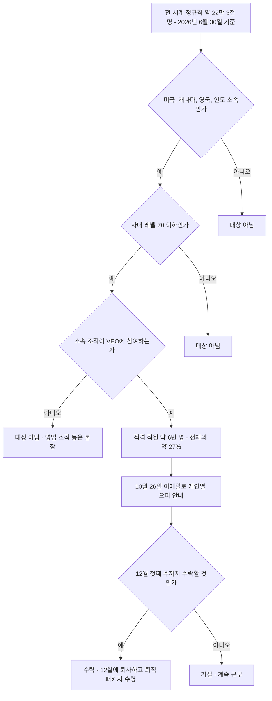
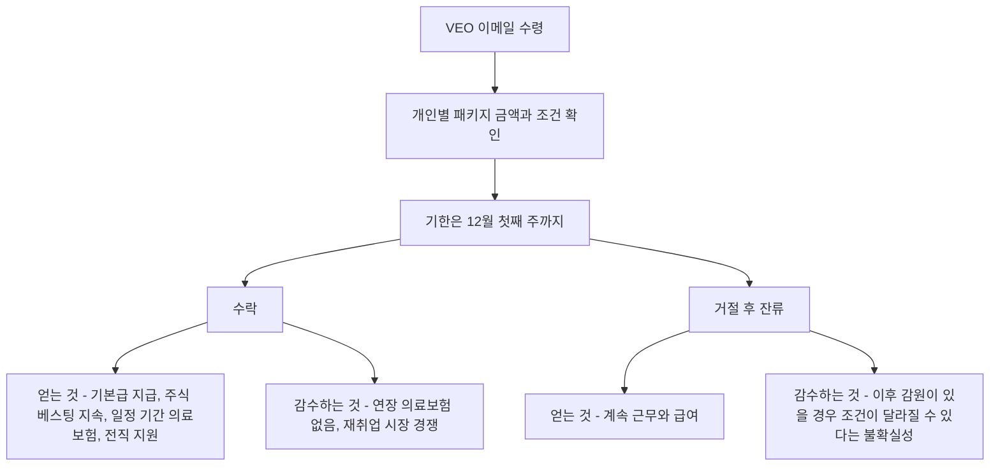

- 기준일: 2026-10-27 (한국 시간)
- 대상 소식: Microsoft가 2026년 10월 26일(미국 시간) 약 6만 명에게 자발적 퇴직 제안(VEO)을 공지한 건
- 작성 원칙: 여러 매체의 보도 [#](https://news.hada.io/topic?id=36051) [#](https://www.seattletimes.com/business/microsoft/microsoft-offers-mass-buyouts-for-roughly-a-quarter-of-its-workforce/) 에서 교차 확인된 내용만 사실로 서술하고, 확인되지 않은 부분과 해석은 그렇다고 명시했습니다.

---

## 1. 한눈에 보는 핵심

이번 소식을 한 문단으로 요약하면 다음과 같습니다. Microsoft는 2026년 10월 26일 사내 메모를 통해 **Voluntary Exit Offer(VEO, 자발적 퇴직 제안)** 라는 새 제도를 발표했습니다. 미국, 캐나다, 영국, 인도의 "참여 조직"에 속한 직원 가운데 사내 직급 기준 레벨 70 이하인 사람이 대상이며, 그 규모는 약 6만 명으로 전 세계 정규직 약 22만 3천 명의 약 27%에 해당합니다. 중요한 점은 **6만 명을 내보내겠다는 계획이 아니라, 6만 명에게 "떠날 수 있는 선택지"를 준다는 것**입니다. 실제로 몇 명이 신청할지는 정해지지 않았고, 회사는 신청 비율이 이전 희망퇴직 때보다 훨씬 낮을 것으로 예상한다고 밝혔습니다.

핵심 숫자와 사실을 표로 먼저 정리합니다.

| 항목 | 내용 | 확인된 출처 |
|---|---|---|
| 발표일 | 2026년 10월 26일(월, 미국 시간) | GeekWire, CBS News, CNBC |
| 제도 이름 | Voluntary Exit Offer (VEO) | GeekWire, Windows Central |
| 대상 규모 | 약 6만 명 (전체 약 22만 3천 명의 약 27%) | GeekWire, CNBC, CTV News |
| 대상 국가 | 미국, 캐나다, 영국, 인도 | GeekWire, CBS News, KIRO 7 |
| 대상 직급 | 사내 레벨 70 이하 (General Manager 및 일부 VP 직함 포함, Corporate Vice President는 제외) | GeekWire |
| 나이·근속 요건 | 없음. 성과도 기준이 아님 | GeekWire |
| 지원 내용 | 회사의 표준 퇴직 패키지와 같은 수준 (직급·근속에 따른 기본급, 주식 베스팅 지속, 일정 기간 의료보험, 전직 지원) | GeekWire |
| 결정 기한 | 12월 첫째 주까지 | GeekWire, CNBC(12월 초) |
| 예상 신청률 | 회사는 수치를 공개하지 않았고, 이전 프로그램(약 30%)보다 훨씬 낮을 것으로 예상 | GeekWire |
| 이번 주 일정 | 수요일(10월 28일) 오후 분기 실적 발표 예정 | GeekWire |

---

## 2. 무슨 일이 있었나: 발표의 구체적인 내용

### 2.1 사내 메모와 공식 입장

발표는 최고인사책임자(Chief People Officer)인 Amy Coleman 수석 부사장이 직원들에게 보낸 메모를 통해 이루어졌습니다. 보도된 메모의 취지는 이렇습니다. 이 제안은 회사 밖의 미래를 고민하던 적격 직원에게 지원을 받으며 지금 그 전환을 할 수 있는 새로운 선택지를 주고, 동시에 참여 조직에는 변화하는 수요에 맞춰 인력을 조정할 또 하나의 수단을 준다는 것입니다. 메모에는 "모든 팀과 모든 직원에게 맞는 단 하나의 방식은 없다"는 취지의 문장도 있었고, 조직별 참여 여부는 각 사업의 우선순위, 고객과의 약속, 인력 수요에 따라 달라진다고 설명했습니다. 또한 "VEO는 우리에게 새로운 제도이며, 이를 통해 배우겠다"는 취지로 덧붙였다고 Kotaku가 Business Insider를 인용해 전했습니다.

적격 직원은 **발표 당일(월요일) 이메일로 개인별 오퍼 상세 링크를 받았습니다.** 즉 개인별 금액이나 조건은 공개 자료가 아니라 각자에게 가는 이메일에 담겨 있고, 그래서 언론 보도에서도 개별 금액은 나오지 않았습니다.

### 2.2 누가 대상인가

대상 범위를 정확히 이해하려면 세 개의 필터를 순서대로 통과해야 한다고 생각하면 쉽습니다.

첫째는 **국가 필터**입니다. 미국, 캐나다, 영국, 인도에서 일하는 직원만 해당됩니다. 한국을 포함한 그 밖의 지역 직원은 이번 제안의 대상이 아닌 것으로 보도되었습니다.

둘째는 **직급 필터**입니다. 사내 레벨 70 이하여야 합니다. GeekWire에 따르면 레벨 70에는 General Manager와 일부 Vice President 직함을 가진 직원이 포함되지만 Corporate Vice President는 포함되지 않습니다. 그래서 GeekWire는 "일부 임원급도 포함된다"고 표현했습니다. 이 직급 체계를 참고하면, 올해 4월의 희망퇴직 프로그램은 레벨 67(Senior Director) 이하로 한정되었으므로 이번에는 대상 직급이 더 위쪽으로 넓어진 셈입니다.

셋째는 **조직 필터**입니다. 모든 조직이 참여하는 것이 아니라 각 사업 리더가 참여 여부를 결정합니다. GeekWire는 영업 조직이 참여하지 않고, 일부 엔지니어링 조직과 일부 지원 기능 조직도 참여하지 않는다고 전했습니다. CTV News가 전한 보도에서는 데이터센터 관련 인력, 영업, 마케팅의 일부가 제외된다고 되어 있습니다. 다만 보도마다 제외 조직의 표현이 조금씩 다르고, 회사가 전체 참여 조직 목록을 공개하지는 않았기 때문에 **"어느 부서가 정확히 포함되는가"는 외부에서 확정할 수 없습니다.**

또 하나 중요한 점은 이번 제안에 **나이나 근속연수 요건이 없고 성과 평가도 기준이 아니라는 것**입니다. 4월 프로그램은 나이와 근속연수의 합이 70 이상인 미국 직원이 대상이라 사실상 장기 근속자 중심이었습니다. 이번에는 입사 1~2년 차 직원도 참여 조직에 속해 있고 레벨 조건만 맞으면 대상이 될 수 있습니다.

### 2.3 어떤 조건이 제공되나

GeekWire에 따르면 회사는 이 패키지가 **회사의 표준 퇴직 패키지와 같은 수준**이라고 설명했습니다. 구체적으로는 직급과 근속에 따른 기본급 지급, 주식 베스팅의 지속, 정해진 기간의 의료보험, 전직 지원 서비스로 구성됩니다. 그리고 **4월 프로그램에서 큰 매력이었던 장기(최대 5년) 의료보험 연장은 포함되지 않습니다.**

여기서 독자가 오해하기 쉬운 부분이 있어 분명히 해 둡니다. 개별 금액(몇 주치 급여인지 등)은 이번 VEO에 대해 공개된 바가 없습니다. 참고로 올해 7월 감원 때 보도된 Microsoft의 퇴직 패키지는 이런 구조였습니다. 미국 직원은 통보 후 최소 60일간 급여를 받으며 재직하고, 레벨과 근속에 따라 최대 39주까지의 기본급이 지급되며, 6개월간의 회사 부담 건강보험과 COBRA를 통한 최대 12개월 추가 연장 옵션이 있었습니다. VEO가 "표준 퇴직 패키지와 같은 수준"이라는 회사 설명을 근거로 이와 비슷할 것이라고 추정할 수는 있지만, **VEO의 실제 수치가 7월 패키지와 동일하다고 확인된 것은 아닙니다.** 이 문서에서 7월 수치는 어디까지나 참고 자료로만 씁니다.

### 2.4 일정

직원들은 **12월 첫째 주까지** 수락 여부를 결정해야 합니다. CNBC는 참여자들이 12월 중 특정 날짜에 퇴사한다고 보도했지만, 제가 열람할 수 있었던 CNBC 본문 발췌에서는 정확한 퇴사일이 잘려 있어 이 문서에서는 날짜를 확정하지 않습니다. 이번 주 수요일(10월 28일) 오후에는 Microsoft의 분기 실적 발표가 있고, GeekWire는 이 자리에서 이번 제안의 비용에 대한 전망이 나올 수 있다고 전했습니다. 참고로 4월 프로그램 때는 실적 발표에서 약 9억 달러의 비용 계상이 공개된 바 있습니다.

---

## 3. 전체 구조 이해하기

아래 다이어그램은 "6만 명"이라는 숫자가 어떤 필터를 거쳐 나왔고, 그 뒤에 직원과 회사에 어떤 갈림길이 있는지 보여 줍니다.

이 구조에서 가장 흔한 오해는 "22만 3천 명 중 6만 명이 나간다"는 것입니다. 그림에서 보듯 6만 명은 **적격자의 수**이고, 수락 단계는 맨 마지막에 있습니다. 실제로 떠나는 인원은 마지막 갈림길에서 개인이 선택한 결과로 정해집니다.

---

## 4. 왜 지금, 왜 이런 방식인가: 배경

### 4.1 올해 Microsoft의 인력 조정 흐름

이번 발표를 이해하려면 올해 있었던 일련의 사건을 시간순으로 보는 것이 가장 쉽습니다.

각 단계를 풀어서 설명하면 다음과 같습니다.

**2025년**에는 Microsoft가 1만 5천 명 이상의 일자리를 줄였습니다. 5월에 약 6천 명, 7월에 약 9천 명 규모의 감원이 있었다고 여러 매체가 전했습니다.

**2026년 4월 23일**, Microsoft는 창사 이래 처음으로 자발적 은퇴 프로그램(Voluntary Retirement Program)을 발표했습니다. 대상은 미국 직원 중 시니어 디렉터(레벨 67) 이하이면서 나이와 근속연수의 합이 70 이상인 사람으로, 미국 직원의 약 7%인 8,750명 정도였습니다. 해당 프로그램의 조건은 기본급 8주~39주분의 일시금, 최대 5년의 의료보험 연장 등으로 보도되었고, 모든 참여자의 마지막 근무일은 2026년 7월 1일이었습니다. 이 프로그램에서는 대상자의 약 30%가 참여했고, GeekWire에 따르면 Coleman은 7월에 그 결과가 이후 감원 규모를 줄이는 데 영향을 주었다고 말했습니다.

**2026년 7월**에는 약 4,800명, 전 세계 인력의 약 2%에 해당하는 감원이 있었고, 9월에도 수백 명 규모의 추가 감원이 이어졌습니다.

그리고 **10월 26일**에 이번 VEO가 발표되었습니다. 즉 올해만 보더라도 "은퇴 프로그램 → 감원 → 추가 감원 → 더 넓은 자발적 퇴직"의 순서로 이어졌고, 이번 제안은 그 연장선에 있습니다.

### 4.2 인력 숫자와 재무 상황

회사 정기 보고서에 따르면 Microsoft의 정규직 직원 수는 2026년 6월 30일 기준 약 22만 3천 명으로, 1년 전 22만 8천 명보다 5천 명 줄었습니다. 이는 약 10년 만에 처음 보이는 연간 감소로 보도되었습니다. 내역은 미국 약 12만 1천 명, 해외 약 10만 2천 명입니다. 그리고 이 숫자는 7월의 4,800명 감원보다 앞선 시점의 값이라서, 현재 실제 인원은 이보다 더 적을 것으로 보는 것이 합리적입니다.

한편 회사의 회계연도 2026 매출은 18% 늘어 약 3,318억 달러였고, 6월 분기에만 설비투자(capex)가 약 410억 달러였다고 TweakTown이 GeekWire를 인용해 전했습니다. 인력은 줄고 매출과 투자는 느는 그림입니다. 여러 매체는 이를 AI 데이터센터 투자 부담 속에서 운영비를 억제해야 하는 압박과 연결해 설명했고, GeekWire도 Microsoft가 Wall Street의 비용 억제 압력을 받고 있다고 썼습니다.

다만 Microsoft는 일관되게 **감원의 원인이 AI로 인한 직무 대체라고는 말하지 않았다**는 점을 기억해야 합니다. 보도에 따르면 Coleman은 사라진 직무가 AI로 직접 대체되는 것이 아니라고 밝혀 왔고, 이번에도 회사 대변인은 이 제안이 "인력이 덜 필요하다는 신호"는 아니라고 설명했습니다. 즉 "AI 투자 때문에 비용을 조절한다"는 해석은 언론의 분석이고, "AI가 사람을 대체했다"는 것은 회사가 인정한 내용이 아닙니다.

### 4.3 왜 해고가 아니라 "자발적" 방식인가

이 질문에 대해 회사가 공식적으로 밝힌 이유는 앞서 본 두 가지입니다. 직원에게 지원을 받으며 이동할 선택지를 준다는 것, 그리고 참여 조직에 인력 조정의 수단을 준다는 것입니다. 거기에 더해 외부 분석가들의 해석이 있습니다. 예를 들어 HR Executive는 올해 4월 은퇴 프로그램으로 먼저 신청 규모를 가늠한 뒤 남은 인력 조정 필요를 계산해 감원 규모를 정했다는 해석을 소개했습니다. 이 해석은 어디까지나 분석이며, 회사가 그렇게 설계했다고 확인한 것은 아닙니다.

---

## 5. 이번 VEO와 4월 은퇴 프로그램은 어떻게 다른가

두 제도는 이름만 비슷할 뿐 설계 철학이 꽤 다릅니다. 핵심 차이를 정리합니다.

| 구분 | 4월 자발적 은퇴 프로그램 (VRP) | 10월 자발적 퇴직 제안 (VEO) |
|---|---|---|
| 발표 시점 | 2026년 4월 23일 | 2026년 10월 26일 |
| 대상 지역 | 미국만 | 미국, 캐나다, 영국, 인도 |
| 대상 직급 | 레벨 67(시니어 디렉터) 이하 | 레벨 70 이하(GM, 일부 VP 포함) |
| 나이·근속 요건 | 나이 + 근속 합계 70 이상 | 요건 없음 |
| 대상 규모 | 약 8,750명 (미국 직원의 약 7%) | 약 6만 명 (전체의 약 27%) |
| 지원 내용 | 일시금, 최대 5년 의료보험 연장, 주식 베스팅 가속 등 | 회사 표준 퇴직 패키지 수준, 의료보험 연장 없음 |
| 회사 성격 설명 | 일회성 이니셔티브 | 새 제도, 향후 정기·상시화 가능성을 검토 중이라고 Coleman이 7월에 언급 |
| 실제 참여율 | 대상자의 약 30% | 미공개, 훨씬 낮을 것으로 회사 예상 |

표에서 눈여겨볼 대목은 **참여율 예상**입니다. 4월 프로그램은 장기 근속자에게 매우 유리한 조건이라 약 30%가 선택했지만, 이번에는 조건이 표준 퇴직 패키지 수준이고 연령·근속 제한이 없어 "떠나고 싶은 사람 위주"로만 참여할 것이라는 계산이 깔려 있는 것으로 보입니다. Yahoo Finance가 전한 지역 방송 보도에서는 회사 대변인이 비슷한 제도를 운영한 다른 기업에서는 대체로 5~6% 정도가 떠났다고 설명했고, 이번에는 4월처럼 높은 비율이 나오리라 기대하지 않는다고 말했다고 합니다. 같은 보도에서 이 대변인은 이번 제안을 "인센티브가 붙은 buyout"이 아니라 표준 퇴직 제안으로 부르는 것을 선호한다는 취지로 선을 그었습니다.

단순 산수로 감을 잡아 보겠습니다. 이것은 전망이 아니라 **계산 예시**입니다. 적격자 6만 명 중 5~6%가 신청하면 약 3,000~3,600명, 20~25%가 신청하면 약 1만 2,000~1만 5,000명입니다. 어느 쪽이든 6만 명 전원이 떠나는 시나리오와는 거리가 멉니다. 참고로 지역 대학 교수가 인터뷰에서 20~25%가 신청하더라도 2021년 수준보다는 인력이 여전히 많다고 말한 보도도 있었습니다.

---

## 6. 이것은 감원(layoff)의 대체인가

결론부터 말하면 **회사가 직접 "대체가 아니다"라고 밝혔습니다.** GeekWire에 따르면 회사는 이번 제안이 감원을 대신하는 것이 아니며 사업 여건에 따라 감원은 앞으로도 회사의 인력 운영 방식의 일부로 남을 것이라고 말했습니다. 동시에 회사는 이번 제안이 인력이 더 적게 필요하다는 신호는 아니고 변화하는 사업 수요에 맞추는 여러 방법 중 하나라고 설명했습니다.

두 문장은 얼핏 모순처럼 보이지만 이렇게 읽을 수 있습니다. "이번 제안은 자발적 이동 수단일 뿐이며, 필요하면 감원도 별도로 한다. 그렇다고 지금 전체 인력이 과잉이라는 선언은 아니다." 다만 이 문장들은 회사의 공식 입장이고, 장기적으로 어떤 선택이 이어질지는 이후 실제 신청 결과와 분기 실적 발표 내용을 봐야 알 수 있습니다. 일부 매체(Windows Central)는 "이런 제안이 감원의 전조일 수 있다"는 분석을 냈지만, 이것 역시 해석이지 확인된 사실은 아닙니다.

---

## 7. 직원의 입장에서 본 의사결정 구조

실제 수락 여부는 개인이 판단하지만, 판단에 영향을 주는 구조를 보도 내용을 토대로 정리해 보겠습니다. 이 부분은 투자나 법률 조언이 아니라 일반적인 구조 설명입니다.

이 그림에서 "이후 감원이 있을 경우 조건이 달라질 수 있다는 불확실성"은 제가 확인한 공식 정보가 아니라 일반론입니다. 다만 회사가 VEO를 "표준 퇴직 패키지와 같은 수준"이라고 설명했고, 7월 감원 때 보도된 패키지(최대 39주 기본급, 6개월 건강보험 등)도 회사의 표준 퇴직 조건에 해당하므로, 두 조건이 크게 다르지 않을 수 있다는 추정이 가능합니다. 다만 이는 추정일 뿐이며, 실제 차이는 개인별 이메일에 적힌 조건을 봐야 판단할 수 있습니다.

GeekNews 댓글란(Hacker News 의견을 요약한 글)에는 이 상황을 두고 다양한 경험담이 올라와 있습니다. 예를 들어 "자원 퇴직 제안을 거절했다가 몇 달 뒤 더 나쁜 조건으로 해고된 사례", "가장 뛰어나고 재취업이 쉬운 사람부터 떠나는 현상(사해 효과)", "6만 명 전원이 수락하는 것은 아니라는 점" 등이 거론됩니다. 이들은 **개인 경험과 의견**이며 Microsoft의 이번 제도에 그대로 적용된다는 근거는 아닙니다. 참고용으로만 읽으시기 바랍니다.

---

## 8. 불확실한 부분과 이 문서의 한계

정직하게 밝혀야 할 한계가 몇 가지 있습니다.

첫째, **개인별 보상 금액은 공개되지 않았습니다.** 이메일로만 안내되었기 때문에, 이 문서의 어떤 숫자도 VEO의 개별 금액으로 읽어서는 안 됩니다.

둘째, **참여 조직의 전체 목록은 공개되지 않았습니다.** 영업 조직이 불참한다는 점과 일부 엔지니어링·지원 조직이 빠진다는 점까지만 확인됩니다. 특정 부서가 대상인지는 회사 내부 공지로만 알 수 있습니다.

셋째, **GeekNews 요약문에 등장하는 일부 세부 표현**(예: 회사가 CRN에 규모를 확인했다는 문장)은 제가 CRN 원문을 직접 열람하지 못해 독립적으로 확인하지 못했습니다. 6만 명이라는 규모 자체는 GeekWire, CNBC, CBS News, CTV News 등 여러 매체에서 교차 확인되었습니다.

넷째, **Seattle Times 원문 본문은 접근이 제한되어 직접 열람하지 못했습니다.** 제공해 주신 발췌문에는 회사가 6만 명 중 일부만 수락하리라 예상한다는 취지가 담겨 있고, 이 내용은 GeekWire 및 지역 방송 보도와 방향이 일치합니다.

다섯째, **CNBC 본문 일부는 열람이 차단되어** 검색 결과에 노출된 발췌만 참고했습니다. 그래서 퇴사 확정일 같은 세부 날짜는 단정하지 않았습니다.

여섯째, 실적 발표(10월 28일)에서 VEO 관련 비용이나 전망이 나오면 위 내용이 갱신될 수 있습니다. 이 문서는 10월 27일 시점의 정보입니다.

---

## 9. 정리: 이 소식을 어떻게 읽어야 하나

이 소식을 정확하게 읽는 방법을 세 문장으로 줄이면 이렇습니다. 첫째, "6만 명 감원"이 아니라 **"6만 명에게 선택권을 준 것"** 입니다. 둘째, 올해 4월 은퇴 프로그램과 7월 감원에 이어지는 **일련의 인력 조정의 새 단계**이며, 대상이 더 넓고 조건은 더 표준적입니다. 셋째, 회사는 이것이 감원의 대체가 아니고 인력 과잉의 선언도 아니라고 말하지만, 실제 참여 인원과 비용, 그리고 이후의 추가 조치는 **12월 결정 기한과 분기 실적 발표 이후에야** 윤곽이 드러납니다.

---

## 출처

- GeekWire, "Microsoft makes new 'voluntary exit' offer to about a quarter of its workforce, including some execs" (2026-10-26) — https://www.geekwire.com/2026/microsoft-makes-new-voluntary-exit-offer-to-more-than-a-quarter-of-its-workforce-including-some-execs/
- CNBC, "Microsoft offers voluntary buyouts to 60,000 employees as AI leads to efficiency push" (2026-10-26) — https://www.cnbc.com/2026/10/26/microsoft-msft-voluntary-buyouts.html
- CBS News, "Microsoft offers buyouts to 60,000 workers as it pours money into AI" (2026-10-26) — https://www.cbsnews.com/news/microsoft-buyouts-60000-workers-artificial-intelligence-layoffs/
- CTV News, "Microsoft offers voluntary exit packages to 60,000 staff" — https://www.ctvnews.ca/world/article/microsoft-offers-voluntary-exit-packages-to-60000-staff/
- Yahoo Finance(지역 방송 보도), "Microsoft offers nearly 60,000 employees 'voluntary exit' offers" — https://finance.yahoo.com/markets/stocks/articles/microsoft-offers-nearly-60-000-010959438.html
- KIRO 7, "Microsoft offers buyouts to roughly 60,000 employees" — https://www.kiro7.com/news/local/microsoft-offers-mass-buyouts-thousands-employees/K2A2ZZD4DJCHDCKRRAISG7VJCE/
- Windows Central, "Microsoft extends voluntary exit program to 60,000 employees — are layoffs around the corner?" — https://www.windowscentral.com/microsoft/microsoft-extends-voluntary-exit-program-to-60-000-employees-are-layoffs-around-the-corner
- Kotaku, "Microsoft Gives 'Voluntary Exit Offer' To 60,000 Employees..." — https://kotaku.com/microsoft-gives-voluntary-exit-offer-to-60000-employees-roughly-a-25-percent-of-its-total-workforce-2000749790
- TweakTown, "Microsoft employee headcount confirmed reduced by 5,000 for the first time in 10 years" — https://www.tweaktown.com/news/114221/microsoft-employee-headcount-confirmed-reduced-by-5000-for-the-first-time-in-10-years/index.html
- TechRepublic, "Microsoft's Voluntary Retirement Offer: New Details Reveal Who Qualifies" (2026-05-11) — https://www.techrepublic.com/article/news-microsoft-voluntary-retirement-program-details-emerge/
- Quartz, "Microsoft voluntary retirement buyout package details" (2026-05) — https://qz.com/microsoft-voluntary-retirement-buyout-package-details-050826
- HR Executive, "Microsoft's workforce reduction strategy: Buyouts first, layoffs second" (2026-07-07) — https://hrexecutive.com/microsofts-workforce-reduction-strategy-buyouts-first-layoffs-second/
- People Matters, "Microsoft offers 39 weeks' salary, stock benefits and healthcare to laid-off employees" — https://www.peoplematters.in/news/strategic-hr/microsoft-offers-39-weeks-salary-stock-benefits-and-healthcare-to-laid-off-employees-50759
- GeekNews, "Microsoft, 전체 직원 약 4분의 1에 대규모 희망퇴직 제안" (2026-10-27) — https://news.hada.io/topic?id=36051
- Seattle Times, "Microsoft offers buyouts to 60K employees, but expects low uptake" (2026-10-26) — 본문 직접 열람 불가, 사용자 제공 발췌문 기준

---

작성 일자: 2026-10-27
