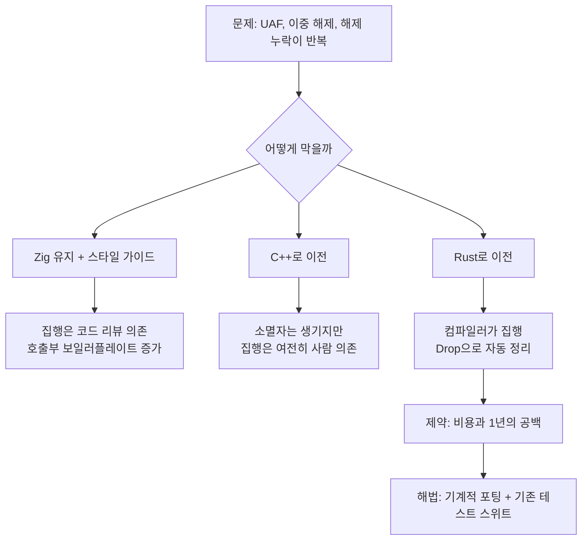
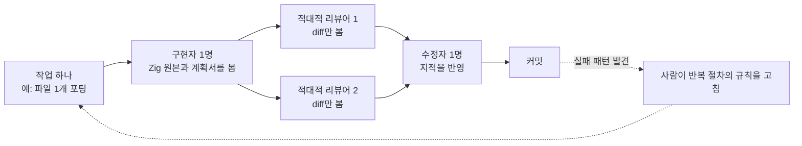
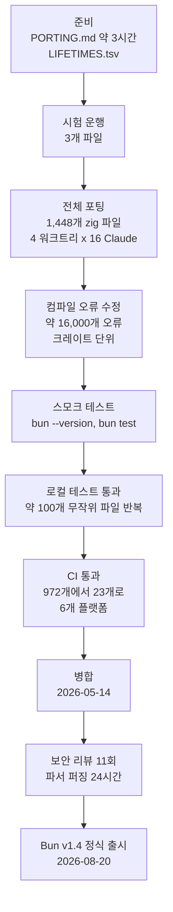

- 대상 글: Jarred Sumner, 「Rewriting Bun in Rust」 (2026-07-08, https://bun.com/blog/bun-in-rust)
- 이 문서는 원문과 이후 공개된 공식 릴리스 노트, 언론 보도, Zig 진영의 반응을 조사해 정리한 것입니다. 원문에 있는 사실과 제3자 보도, 그리고 이 문서의 해석을 구분해서 적었습니다.

---

## 0. 한눈에 보는 요약

Bun은 JavaScript와 TypeScript를 실행하고, 번들링하고, 패키지를 설치하고, 테스트까지 돌려 주는 올인원 도구입니다. 처음부터 Zig라는 저수준 언어로 만들어졌고, 주석을 뺀 Zig 코드만 535,496줄에 이르렀습니다. 2026년 5월, 창립자 Jarred Sumner는 이 코드베이스 전체를 Rust로 옮겼습니다. 사람 한 명이 Claude Code를 운영하면서 약 11일 만에 끝냈고, 기존 테스트 스위트가 모든 플랫폼에서 통과한 뒤 병합했습니다. 이 결과물은 2026년 8월 20일 Bun v1.4로 정식 출시되었습니다.

이 글이 흥미로운 이유는 세 가지입니다.

첫째, 이유가 "유행"이 아니라 구체적인 버그 부류였습니다. 해제 후 사용(use-after-free), 이중 해제(double-free), 오류 경로에서 해제를 빠뜨리는 메모리 누수가 반복되었고, 이런 문제는 Rust에서 대부분 컴파일 오류나 자동 정리로 바뀝니다.

둘째, 방법이 "AI에게 알아서 해 달라고 맡기기"가 아니었습니다. 규칙 문서를 먼저 만들고, 구현자와 적대적 리뷰어를 분리하고, 컴파일 오류 목록을 작업 큐로 삼았으며, 문제가 생기면 코드를 손으로 고치는 대신 코드를 만들어 내는 절차를 고쳤습니다.

셋째, 결과가 숫자로 공개되었습니다. 비용은 API 가격 기준 약 165,000달러, 테스트 통과 기준은 "삭제하거나 건너뛴 테스트 0건"이었고, 이식 과정에서 생긴 알려진 회귀는 19건이었습니다. 한편 Zig 창립자 Andrew Kelley가 공개적으로 반박하는 등 논쟁도 컸습니다. 이 문서 후반부에서 양쪽을 모두 다룹니다.

---

## 1. 배경: Bun이라는 프로젝트의 크기

### 1.1 Zig로 시작한 이유

Sumner에 따르면 Bun은 esbuild의 JavaScript·TypeScript 변환기를 Go에서 Zig로 한 줄씩 옮기는 작업에서 출발했습니다. 그가 처음 Zig 코드를 쓴 날은 2021년 4월 16일입니다. 한 페이지짜리 언어 레퍼런스를 보고 저수준 제어와 성능에 대한 세심함에 끌렸다고 합니다.

시작부터 범위가 넓었습니다. JavaScript, TypeScript, CSS의 변환기·압축기·번들러, npm 호환 패키지 매니저, Jest 같은 테스트 러너, Node.js와 TypeScript 호환 모듈 해석, HTTP/1.1과 WebSocket 클라이언트, 그리고 `fs`, `net`, `tls` 같은 수십 개의 Node.js API 구현까지 한 프로젝트에 들어 있었습니다. Sumner는 첫 버전을 오클랜드의 좁은 아파트에서 LLM 없이 1년 만에 혼자 썼다고 회고하며, Zig가 아니었다면 그 범위를 1년에 만들지 못했을 것이라고 말합니다. 원문은 Zig에 대한 감사의 표현을 반복합니다.

지금의 Bun은 CLI 월간 다운로드가 2,200만 회를 넘고, Claude Code와 OpenCode 같은 도구가 런타임으로 채택했으며, Vercel, Railway, DigitalOcean 등이 공식 지원합니다. 글머리에는 Bun이 2025년 12월 Anthropic에 인수되었고, 저자와 팀원 일부가 Anthropic 소속이며, 재작성에 Claude Fable 5의 사전 공개 버전을 썼다는 이해관계 공개가 붙어 있습니다.

### 1.2 범위가 안정성의 부담이 되었다

원문은 v1.3.14에서 고친 버그 중 일부를 나열합니다. 이를 성격별로 읽으면 문제의 모양이 보입니다.

**해제 후 사용 계열.** zlib, Brotli, Zstd 스트림에서 비동기 쓰기가 진행 중인데 `.reset()`을 호출하면 터지는 문제, http2에서 JS 콜백이 해시맵 재배치를 일으켜 내부 스트림 포인터가 무효가 되는 문제, UDPSocket에서 `valueOf()`나 `toString()` 콜백이 ArrayBuffer를 분리해 버리는 문제가 있었습니다. 공통점은 사용자의 JavaScript 코드가 네이티브 코드 실행 중간에 끼어들어 상태를 바꿀 수 있다는 점입니다.

**메모리 누수 계열.** `crypto.scrypt`에서 출력 버퍼 할당 실패 시 버퍼가 해제되지 않았고, `tlsSocket.setSession()`은 호출 때마다 약 6.5KB를 잃었으며, `fs.watch()` 감시자는 참조 카운트 언더플로 때문에 `.close()` 후에도 GC 루트로 고정되었습니다.

**이중 해제와 경합 계열.** CSS 파서가 벤더 접두사와 다중 배경이 겹칠 때 두 번 해제했고, `MessageEvent`에서는 GC 마커 스레드가 동시 접근 중 찢어진 상태를 관찰하는 경합이 있었습니다.

Sumner는 이런 버그를 하나씩 고치는 일을 영원히 계속할 수도 있지만, 사용자에게 더 나은 답을 줘야 한다고 판단했습니다. 그리고 "잠들기 전에 크래시가 걱정되는 상태"를 끝내고 싶었다고 말합니다. 그는 Zig를 탓하지 않는다고 분명히 적었습니다. 다른 Zig 사용자는 이런 버그가 없었고, 가비지 컬렉션 언어의 객체와 수동 관리 메모리를 한 프로그램에서 섞는 일이 너무 드물어 어떤 언어도 이를 위해 설계되지 않았다는 설명입니다.

### 1.3 이미 하고 있던 방어책

원문은 이전에도 가볍지 않은 대응을 했다고 밝힙니다. Zig 컴파일러에 Address Sanitizer 지원을 붙여 커밋마다 테스트를 ASAN으로 돌렸고, Windows에서는 안전 검사가 켜진 ReleaseSafe 빌드를 배포했으며, V8과 JavaScriptCore가 쓰는 Fuzzilli로 런타임 API를 24시간 퍼징했고, 끝단 메모리 누수 테스트도 많았습니다. 그래도 문제가 반복되었다는 것이 출발점입니다.

여기서 원문이 강조하는 원칙이 하나 있습니다. 안정성 문제는 일찍 알수록 좋다는 것입니다. 퍼징은 병합 이후, CI는 푸시 이후, 런타임 검사와 ASAN은 실행할 때 작동합니다. 컴파일러는 이 중 가장 이른 시점에 작동하는 도구입니다.

---

## 2. 왜 Rust였나: 대안 비교

### 2.1 세 가지 길

원문은 "정리(cleanup) 코드가 정확히 한 번 실행되게 하는 방법"을 중심으로 대안을 비교합니다.

| 선택지 | 정리 방식 | 원문이 지적한 한계 |
|---|---|---|
| Zig 유지 | `defer`, `errdefer`를 호출부마다 직접 작성 | 같은 포인터가 여러 함수로 전달될 때 소유권이 코드에 드러나지 않음 |
| Zig + 엄격한 스타일 가이드 | 참조 카운트 스마트 포인터 등을 규약으로 강제 | 연산자 오버로딩이 없어 호출부마다 `get()`과 `deref()`가 늘어나고, 강제는 결국 코드 리뷰에 의존 |
| C++로 이전 | 소멸자와 이동 의미론 | 스타일 가이드와 리뷰 의존은 그대로이고, ASAN을 써도 메모리 손상과 누수는 남음 |
| Rust로 이전 | `Drop` 자동 호출, 소유권과 대여 검사 | 외부 C/C++ 라이브러리 경계에는 여전히 `unsafe` 필요 |

Bun의 기존 방식은 세 가지를 섞은 것이었습니다. 범위가 분명한 곳에서는 아레나 수명(예: 파서 상태와 AST 노드), 나머지는 참조 카운트, 그리고 "정말 신경 써서 읽기"였습니다. 원문은 TigerBeetle의 TigerStyle이나 Google의 31,000단어짜리 C++ 스타일 가이드를 예로 들며, 스타일 가이드의 진짜 어려움은 규칙이 아니라 **집행**이라고 말합니다. 역사적으로 집행은 코드 리뷰가 맡았고, 린터와 정적 분석기가 보조했을 뿐입니다.

C++는 합리적인 선택지로 인정받습니다. Bun의 코드 약 20%가 이미 C++이고, JavaScriptCore(Safari의 JS 엔진), uWebSockets와 usockets, lshpack과 lsquic, BoringSSL, SQLite 같은 C/C++ 라이브러리를 품고 있기 때문입니다. C++로 가면 생성자와 소멸자가 생기고 `extern "C"` 래퍼 코드도 많이 지울 수 있습니다. 그러나 집행을 사람의 주의에 맡기는 구조는 바뀌지 않습니다.

### 2.2 Rust를 고른 논리

핵심 문장은 이것입니다. 버그 목록의 큰 비율이 해제 후 사용, 이중 해제, 오류 경로의 해제 누락인데, 안전한 Rust에서는 앞의 둘이 컴파일 오류이고 마지막은 `Drop`이 자동 정리로 막아 준다는 것입니다. 컴파일러 오류는 스타일 가이드보다 빠르고 정확한 피드백 고리입니다.

그런데 재작성은 역사적으로 나쁜 선택으로 여겨집니다. 원문의 추산으로 535,496줄 Zig를 다른 언어로 옮기려면 소규모 엔지니어 팀이 1년 걸리고, 그동안 버그 수정, 보안 수정, 기능 개발이 멈춥니다. 1년간 사용자에게 아무 변화가 없는 길은 현실적이지 않았습니다. 그래서 Sumner는 스마트 포인터를 도입하는 스타일 가이드 방향을 계획했지만, 그는 그 길을 선호하지 않았다고 솔직히 적습니다. 직접 만든 스마트 포인터는 Rust보다 쓰기 불편하면서 보장은 없기 때문입니다.

그러다 "Anthropic의 새 모델이 Bun을 Rust로 다시 쓸 수 있는지 일주일만 시험해 보면 어떨까"라는 생각을 했습니다. 처음에는 될 거라 기대하지 않았지만, 며칠 뒤 테스트 상당수가 통과하기 시작했고 새 Rust 코드가 원래 Zig 코드와 구조상 잘 대응하는 것을 보고 "시도해 볼 만하다"에서 "병합하겠다"로 마음이 바뀌었다고 합니다.

이 결정에 중요한 전제가 하나 있었습니다. Bun의 테스트 스위트는 TypeScript로 쓰여 있어 **런타임의 구현 언어와 무관**합니다. 같은 테스트로 Zig 판과 Rust 판을 똑같이 검증할 수 있었다는 뜻입니다.

---

## 3. 전략: 한 번에, 그리고 번역처럼

### 3.1 두 가지 큰 질문

원문에 따르면 큰 질문은 두 개뿐이고 나머지는 전술입니다.

첫째는 점진적으로 옮길지, 한 번에 옮길지입니다. Sumner는 Go에서 Zig로 esbuild를 옮겼던 경험상 한 번에 옮기는 쪽이 낫다고 봅니다. 점진적 재작성은 언젠가 지워지길 바라는 임시 코드를 늘리고, 단기와 중기에 고통스럽기 때문입니다.

둘째는 어떻게 하느냐입니다. 같은 아키텍처, 같은 성능, 같은 기능을 유지하면서 Rust의 대여 검사기 같은 장점을 얻고, 재작성 후에도 팀이 유지보수할 수 있어야 합니다. 그의 답은 "Zig 코드를 Rust로 **번역한 것처럼 보이는** 재작성"입니다. 관용적인 Rust로의 정리는 v1.4가 나온 뒤에 서서히 하겠다는 계획입니다.

### 3.2 코드를 쓰고 검토하는 반복 구조

원문은 소프트웨어 엔지니어링의 일상을 반복문으로 단순화합니다. 할 일 하나에는 맥락(Jira 티켓이나 GitHub 이슈)이 붙고, 결과물은 그 일을 해결한 코드이며, 리뷰어가 회귀와 정확성을 검토한 뒤 피드백을 반영합니다. 이 구조를 Claude Code의 동적 워크플로(dynamic workflow)로 만들어 11일 동안 약 50개를 연속으로 돌렸습니다.

워크플로는 용도별로 나뉘었습니다. 포팅 가이드 생성, 모든 `.zig` 파일의 기계적 포팅, 크레이트별 컴파일 오류 수정, `bun test`와 `bun build` 같은 하위 명령 동작시키기, 전체 테스트 통과시키기, 그리고 대규모 리팩터링과 정리 패스가 그 예입니다. Sumner는 대부분의 시간 동안 출력물을 직접 읽으며 문제를 점검하고, 필요하면 Claude에게 반복 절차를 고치라고 지시하는 감독자 역할을 했습니다.

그러면 100만 줄이 추가되는 PR을 어떻게 검토하느냐는 질문이 남습니다. 원문의 답은 세 가지입니다. 백만 개 단언이 있는 언어 독립 테스트 스위트, 적대적 리뷰, 그리고 문제가 생기면 코드를 손으로 고치는 대신 **코드를 만들어 내는 절차를 고치는 것**입니다.

### 3.3 적대적 리뷰와 분리된 컨텍스트

적대적 리뷰는 별도의 컨텍스트 창을 가진 Claude에게 "이 변경이 왜 버그를 만들거나 동작하지 않는지 철저히 찾아라"고 시키는 것입니다. 사람 조직에서 작성자와 리뷰어를 분리하는 이유와 같습니다. 작성자는 병합되기를 원하므로 서둘러 내보내려는 편향이 생기고, 모델도 마찬가지라는 것이 저자의 관찰입니다.

구성은 구현자 1명에 적대적 리뷰어 2명 이상입니다. 리뷰어의 일은 버그와 동작하지 않을 이유를 찾는 것뿐이고, 구현자는 리뷰하지 않으며, 리뷰어는 구현하지 않습니다. 리뷰어는 구현자의 추론 과정을 보지 못하고 변경분(diff)만 받으며, 코드가 틀렸다고 가정하라는 지시를 받습니다.

원문은 이 방식이 실제로 잡아낸 버그 세 가지를 보여 줍니다. 세 가지 모두 컴파일은 되었고 그럴듯해 보였습니다.

1. **비동기 close의 해제 후 사용.** libuv의 `uv_close`는 비동기여서 다음 루프 틱까지 핸들 포인터를 쥐고 있다가 콜백에서 메모리를 해제합니다. 그런데 구현자의 코드는 `Box`로 감싼 파이프를 `match` 분기가 끝나는 순간 드롭시켰습니다. libuv는 이미 해제된 메모리를 쥐게 되고, 콜백이 다시 한 번 해제해 해제 후 사용에 이어 이중 해제가 일어납니다. 수정은 `Box::leak`으로 소유권을 일부러 libuv에 넘기는 것이었습니다.
2. **음수 타임스탬프.** 소수점 있는 초 단위 시간을 초와 나노초로 나눌 때 `trunc`는 0 방향으로 자르므로, 1970년 이전 파일 시각 -1.5초가 초=-1, 나노초=-500,000,000이 됩니다. 음수 나노초는 유효하지 않은 `timespec`입니다. `floor`로 바꿔 나노초가 0 이상 10억 미만에 들게 했습니다.
3. **즉시 평가되는 `unwrap_or`.** CSS `color-mix()`에서 한쪽 퍼센트만 생략된 경우, `unwrap_or`의 인자는 즉시 평가되기 때문에 사용되지 않아도 `unwrap()`이 실행되어 패닉이 납니다. 지연 평가되는 `unwrap_or_else`로 고쳤습니다.

세 사례의 공통점은 "문법적으로는 맞고 컴파일러도 통과하지만 의미가 어긋나는" 오류라는 점입니다. 컴파일러가 못 잡는 종류를 리뷰어가 잡는 구조입니다.

---

## 4. 실제 진행 과정: 단계별 해설

### 4.1 준비: 규칙 문서와 수명 표

코드를 쓰기 전에 Sumner는 약 3시간 동안 Claude와 Zig 패턴을 Rust 패턴으로 어떻게 대응시킬지 논의했고, Claude가 그 논의를 `PORTING.md`로 정리했습니다. 이 문서는 Hacker News에도 올라갔습니다.

다음 문제는 수동으로 메모리를 관리하던 코드에 Rust 수명(lifetime)을 어떻게 붙이느냐였습니다. 이를 위해 모든 구조체 필드를 읽고 제어 흐름을 추적해, 수명 표현이 복잡한 필드를 찾고, 수명을 제안하고, 적대적 리뷰어 2명이 검토하고, 피드백을 반영해 `LIFETIMES.tsv`로 직렬화하는 워크플로를 돌렸습니다. 이후 `PORTING.md`와 `LIFETIMES.tsv`를 함께 적대적 리뷰해 서로 충돌하는 제안을 정리했고, 저자도 직접 읽었습니다. 이 두 문서가 이후 모든 Claude가 참조하는 "법전" 역할을 했습니다.

### 4.2 시험 운행과 첫 실패

전체 1,448개 `.zig` 파일을 돌리기 전에 3개 파일로 먼저 시험했습니다. 구현자 1명이 `.rs`를 쓰고, 리뷰어 2명이 Zig 원본과 동작이 같은지, 그리고 두 문서를 따랐는지 확인하고, 수정자가 반영하는 구조였습니다.

전체로 확대하자 약 2분 만에 문제가 터졌습니다. 어떤 Claude가 커밋 전에 `git stash`를 실행했고, 다른 Claude가 `git stash pop`을, 또 다른 쪽이 `git reset HEAD --hard`를 실행했습니다. 서로의 작업을 지워 버린 것입니다. Claude마다 별도 워크트리를 주면 Bun 저장소가 커서 디스크가 부족해질 터였고, 결국 변경은 한곳에서 함께 컴파일되어야 했습니다.

해법은 규칙이었습니다. 특정 파일을 커밋하는 것 외의 모든 `git` 명령을 금지하고, `cargo`도 금지하며, 느린 명령은 일절 쓰지 않게 했습니다. 속도가 느려서 워크플로를 4개 샤드로 쪼개 각각 자기 워크트리를 주고, 샤드마다 Claude 16명이 커밋하고 푸시하게 했습니다. 이것이 "동시에 약 64명의 Claude"의 출처입니다.

### 4.3 코드를 쓰다: 피크에 분당 약 1,300줄

병렬화와 사전 준비 덕분에 피크에는 분당 약 1,300줄이 작성되었고, 모든 줄이 두 명의 적대적 리뷰어를 거치고 수정 라운드를 통과한 뒤 커밋되었습니다. 그런데 이 시점에서 **아무것도 동작하지 않았습니다.** 원문이 일부러 강조하는 문장입니다.

참고로 원문의 통계에 따르면 포트 브랜치에는 병합 커밋을 제외하고 6,502개 커밋이 있었고, 한 시간 최다 커밋은 695개(5월 6일 오전 PDT), 한 분 최다는 58개였습니다. 중간에 속도가 불규칙한 구간이 있는데, 저자 설명으로는 EC2 인스턴스의 기본 IOPS를 올려 두지 않아서였고 느린 `grep` 한 번이 디스크 읽기와 쓰기를 몇 분씩 멈추게 했다고 합니다.

### 4.4 컴파일 오류를 작업 큐로

코드가 모이자 약 16,000개의 컴파일 오류가 나왔습니다. 이 숫자에는 사연이 있습니다. Zig 코드는 하나의 컴파일 단위(사실상 크레이트 하나)였는데, 컴파일 속도를 위해 Rust 쪽은 약 100개 크레이트로 쪼개고 싶었습니다. 순환 의존성이 생기지 않으면서 Zig 구현과의 차이를 최소화해야 했고, 재작성 직전에 만든 분리 PR은 충분하지 않았습니다. 그래서 순환 의존 코드를 어디에 둘지 분류해 기록하는 워크플로와, 그에 따라 리팩터링하는 워크플로를 따로 돌렸습니다. 그 과정에서 약 16,000개 오류가 드러났다는 설명입니다. 한 사람에게는 엄청난 숫자이지만 64명의 Claude에게는 그렇지 않다는 것이 원문의 표현입니다.

구조는 이렇습니다. 크레이트마다 `cargo check`를 한 번 돌려 오류를 파일별로 묶어 저장하고, 그 크레이트의 오류를 고치고, 적대적 리뷰어 2명이 검토하고, 수정자 1명이 반영합니다. Claude끼리 서로 방해하지 않도록 `cargo check`는 맨 처음에만, 그리고 `git`은 마지막에만 사용했습니다. 5월 6일 하루에만 1,610개의 수정 커밋이 쌓였고, 커밋이 들어간 크레이트 분포는 `bun_runtime` 1,162개, `bun_bundler` 252개, `bun_sql` 67개, `bun_js_parser` 40개, `bun_css` 10개 순이었습니다. 런타임 크레이트에 압도적으로 몰린 것을 볼 수 있습니다.

여기서도 헛발질이 있었습니다. Claude는 "모든 크레이트가 컴파일되게 하자"를 "오류가 나는 함수를 비워 두자"로 해석했습니다. 또 우회책을 정당화하는 길고 수상한 주석을 달기 시작했습니다. 그래서 리뷰어가 반려해야 할 규칙을 추가했습니다. 요지는 "우회가 괜찮은 이유를 한 문단 길이의 주석으로 설명해야 한다면 그 코드가 틀린 것이니 코드를 고쳐라"입니다. 프롬프트 한 줄을 고치고 몇 시간이 지나자 이런 행동은 멈췄습니다.

### 4.4.1 그 뒤의 단계들

컴파일이 통과한 뒤에는 `bun --version`이 돌아야 했습니다. 처음에는 링커 오류가 났고, 그다음에는 시작하자마자 패닉이 났습니다. 다음 목표는 `bun test <파일>`이 도는 것이었고, 이후 CLI 하위 명령별로 반복했습니다. 실패한 스택 트레이스를 하위 명령별로 저장하고, 하나씩 구현자가 고치고, 리뷰어 2명이 보고, 수정자가 반영하는 같은 구조입니다. 원문은 모델이 "스모크 테스트"라는 말을 좋아한다는 농담도 덧붙입니다.

이어서 테스트 파일을 단위로 반복했습니다. 무작위로 약 100개의 테스트 파일을 골라 폴더별로 4개의 워크트리에 나눠 돌렸습니다. 다만 Bun의 테스트 스위트는 만만하지 않습니다. 1분 넘게 걸리는 통합 테스트(예: `next dev`가 100번의 변경을 핫 리로드로 감지하는지 확인)가 있고, TCP 소켓을 고갈시키는 스트레스 테스트, 기가바이트 단위로 디스크를 읽고 쓰는 테스트, 약 1만 개의 프로세스를 띄우는 테스트도 있었습니다. "부탁하는 수준"을 넘는 격리가 필요해 `systemd-run`(cgroups)으로 메모리와 CPU를 제한하고 PID 네임스페이스를 격리했지만, 그래도 디스크가 가득 차 머신이 여러 번 멈췄습니다.

CI로 넘어간 뒤에는 첫 CI 실행에서 이틀 만에 실패 테스트 파일이 972개에서 23개로 줄었고, 하루 반 뒤 Linux가 완전히 초록이 되면서 "이게 정말 되겠구나"라는 감이 처음 왔다고 합니다. 원문 통계로는 테스트를 실제로 돌린 CI 빌드가 135개(BuildKite에서 420개를 수집)였고, 6개 플랫폼(macOS x64와 arm64, Linux x64와 arm64, Windows x64와 arm64) 모두가 통과한 마지막 빌드는 #54202(5월 14일 오전 12시 23분 PDT)였습니다. Windows가 마지막으로 풀 스위트를 통과했고, Linux는 Windows보다 거의 하루 먼저였습니다. 남은 기간에는 Windows 정리, 코드 중복 제거, `unsafe` 줄이기 같은 워크플로를 돌렸습니다.

### 4.5 병합 기준

병합 조건은 하나였습니다. Bun의 테스트 스위트가 모든 플랫폼에서 100% 통과하는 것입니다. 저자는 테스트가 건너뛰어지고 있지 않은지도 직접 확인했고, 로컬에서 여러 명령을 시험해 본 뒤 병합 버튼을 눌렀습니다. 이 병합은 버전 릴리스가 아니라 `main`에 합친 것일 뿐이고, 재작성을 이어 가기로 확신했지만 아직 출시할 확신은 아니었다고 구분합니다.

원문 통계는 아래와 같습니다. 5월 3일부터 14일 병합까지 11일, 6,778개 커밋이 쌓였고, 삭제하거나 건너뛴 테스트는 0건입니다. 병합된 최종 diff는 +1,009,272줄이며, 중간의 재작성까지 센 누적 작성량은 그보다 훨씬 많다고 원문이 설명합니다.

| 플랫폼 | `expect()` 호출 수 | 테스트 수 | 파일 수 |
|---|---|---|---|
| Debian 13 x64 | 1,386,826 | 60,624 | 4,174 |
| macOS 14 arm64 | 1,259,953 | 58,850 | 4,175 |
| Windows 2019 x64 | 1,007,544 | 57,337 | 4,173 |

### 4.6 비용과 규모

병합 전까지 비캐시 입력 토큰 59억 개, 출력 토큰 6억 9천만 개, 캐시된 입력 토큰 읽기 720억 개를 썼고, API 가격으로 환산하면 약 165,000달러입니다. 저자는 같은 일을 사람이 하면 코드베이스를 잘 아는 엔지니어 3명이 약 1년 걸렸을 것이고, 그동안 Node.js 호환성 개선, 버그와 보안 수정, 기능 개발이 멈췄을 것이므로 현실적인 대안은 "아무것도 하지 않고 상단의 버그를 영원히 고치는 것"이었다고 말합니다. 또한 이것이 "현재 가능한 것의 최전선"이고, Mythos급 모델인 Claude Fable 5 사전 공개 버전과 64명의 Claude를 11일간 유지시킨 동적 워크플로가 필요했다고 덧붙입니다.

---

## 5. 병합 이후: 안전망 강화와 이식 실수

### 5.1 보안 리뷰와 퍼징

병합 후 Claude Code Security의 보안 리뷰를 11라운드 진행해 지적 사항을 처리했습니다. 또 JavaScript, TypeScript, JSX, CSS, JSON5, JSONC, TOML, YAML, Markdown, INI, Bun Shell 스크립트, semver 범위, `.patch` 파일, CSS 색상까지 모든 파서에 24시간 커버리지 유도 퍼징을 붙였습니다. 퍼저가 찾은 버그는 자동으로 Claude에게 넘어가 재현과 수정 PR을 만들고, 사람이 그 PR을 검토합니다. 원문 작성 시점까지 파서가 1,000억 번 실행되었고 약 15개의 PR이 나왔습니다.

### 5.2 `unsafe`는 얼마나 남았나

원문 시점 Rust 코드의 약 4%가 `unsafe` 블록 안에 있습니다. `unsafe` 키워드는 약 13,000개이고, 약 780,000줄 중 약 27,000줄에 걸쳐 있으며, 그중 78%는 한 줄짜리 블록입니다. 대부분 C++에서 넘어온 포인터이거나 C 라이브러리 호출 한 번이라는 설명입니다. 충실한 Zig 포팅이었기에 처음에는 `unsafe` 키워드로 검색되지 않던 Zig 시절의 위험이 이제 눈에 보이게 된 셈이고, 이 수치는 앞으로 관용적 Rust로 리팩터링하며 줄어들 것으로 기대한다고 합니다. 다만 JavaScriptCore 같은 C와 C++ 라이브러리를 계속 쓰므로 순수 Rust 프로젝트보다 항상 `unsafe`가 많을 것이라고 스스로 못 박습니다.

### 5.3 이식 과정에서 생긴 실수 (알려진 회귀 19건)

원문은 이 재작성이 알려진 회귀 19건을 만들었고 모두 수정되었다고 밝힙니다. 대부분은 "두 언어에서 문법은 같지만 의미가 다른 코드"에서 나왔습니다. 대표 사례 네 가지입니다.

**① `debug_assert!` 안의 부수 효과.** Zig의 `assert`는 함수라서 모든 빌드에서 인자가 실행됩니다. Rust의 `debug_assert!`는 매크로라서 릴리스 빌드에서는 식 전체가 지워집니다. 포팅된 코드가 `insert_stale`이라는 호출을 이 안에 넣고 있었고, 릴리스 빌드에서 그 호출이 사라져 특정 조건(HTML 라우트와 React를 쓰는 프로젝트에서 핫 리로드된 파일이 무효화될 때)에서 HMR이 깨졌습니다. 디버그 빌드에서는 정상이라 찾기 어려웠습니다(이슈 #30678).

**② 길이가 홀수인 슬라이스.** Zig 도우미는 끝에 남은 홀수 바이트를 무시했는데 `bytemuck::cast_slice`는 패닉을 냅니다. UTF-16 BOM 뒤에 홀수 바이트가 오는 `Blob.text()`가 문자열을 돌려주는 대신 프로세스를 패닉시켰고, 홀수 바이트를 무시하는 이전 동작으로 되돌렸습니다(#31188).

**③ 경계 검사.** macOS와 Linux의 Zig 빌드는 경계 검사를 제거하는 `ReleaseFast`였지만 Rust 릴리스 빌드는 경계 검사를 유지합니다. 모듈 리졸버가 긴 파일명을 모아 두는 오버플로 블록 크기가 포팅 중 자리표시자 값 64로 남아, 상한이 840만 개 파일명에서 270,272개로 줄었고 실제 프로젝트가 그 한계에 닿았습니다. Zig에서 물려받은 오프바이원 버그도 도달 가능해졌습니다. Rust는 범위를 넘어 쓰는 대신 패닉을 냈습니다(#31503). 저자는 Zig도 `ReleaseSafe`였다면 같은 곳에서 패닉했을 것이라고 덧붙입니다(Windows에서만 그렇게 배포했습니다).

**④ `comptime` 포맷 문자열.** `Output.pretty`는 `<r>`, `<d>` 같은 색상 표식을 ANSI 이스케이프로 바꿉니다. Zig에서는 포맷 문자열이 `comptime`이라 인자가 들어가기 전에 표식이 먼저 처리됩니다. Rust 함수에는 `comptime` 매개변수가 없어서 완성된 문자열만 보게 되었고 인자 속의 표식까지 건드렸습니다. 그 결과 `bun update -i`가 OSC 8 하이퍼링크의 종료 문자(`ESC \`) 뒤 백슬래시를 표식 파서가 삼켜, 패키지 이름 `oxfmt`가 `oxfmtr`로 출력되었습니다. Rust에서는 이것을 매크로(`bun_core::pretty!`)로 만들어야 했습니다(#30693).

이 네 가지는 "기계적 번역"의 본질적인 위험을 보여 줍니다. 구문이 같아도 평가 시점, 검사 여부, 컴파일 시점 계산의 존재 여부가 다르면 결과가 달라집니다. 테스트 스위트가 통과해도 릴리스 빌드에서만 드러나는 문제는 따로 있을 수 있다는 점도 주의할 만합니다.

---

## 6. 원문이 주장하는 개선 효과

### 6.1 메모리 사용과 누수

`Drop`은 값이 범위를 벗어나는 순간 자동으로 정리 함수를 호출합니다. Zig의 `defer`는 정리가 필요할 수 있는 호출부마다 써 줘야 해서, 잊으면 누수가 되고 드물게 도는 오류 경로에서 두 번 돌리면 이중 해제가 됩니다. 원문은 이것을 "숨은 제어 흐름이 없다"는 Zig의 장점을 "흔한 함정 방지"와 맞바꾼 것으로 표현합니다. 파일 경로 관련 오류 처리 코드에서 여러 누수가 `Drop`으로 고쳐졌습니다.

또 LeakSanitizer 연동을 개선해 네이티브 코드의 모든 메모리 할당을 추적하게 했고, 측정 가능한 누수는 모두 고쳤다고 합니다. 대표 사례는 같은 프로세스에서 `Bun.build()`를 반복할 때 빌드마다 약 3MB가 영구히 샜던 문제입니다. 60개 모듈 프로젝트를 한 프로세스에서 반복 번들링한 결과는 아래와 같습니다.

| 반복 횟수 | Bun v1.3.14 | Bun v1.4.0 |
|---|---|---|
| 500 | 1,914 MB | 526 MB |
| 1,000 | 3,506 MB | 586 MB |
| 1,500 | 5,097 MB | 608 MB |
| 2,000 | 6,745 MB | 609 MB |

v1.3.14는 선형으로 계속 늘고 v1.4.0은 일정 수준에서 평탄해집니다. 원문은 Zig에서 이를 고치려던 이전 시도가 있었지만, `Drop`에 해당하는 장치가 없어서 병합할 확신을 갖기 어려워 보류되었다고 설명합니다. 전체적으로 v1.4.0은 v1.3.14에서 재현되던 버그 128개를 고쳤다고 합니다(메모리 누수, 크래시, 도움말 색상 오류까지 포함).

### 6.2 바이너리 크기

초기 재작성만으로 Windows 3.8MB, macOS 5.5MB, Linux 6.8MB가 줄었다고 합니다. 원문은 Zig 시절에 `comptime`을 너무 많이 써서 그랬다고 설명합니다. 이후 링커 최적화(동일 코드 병합, ICF), ICU의 미사용 데이터 제거, libicu 일부를 zstd 사전으로 필요할 때 압축 해제하는 방식을 더해 Linux와 Windows에서 약 20%가 줄었습니다.

| 버전 | 플랫폼 | 크기 |
|---|---|---|
| Bun v1.3.14 | Windows | 94 MB |
| Bun v1.4.0 (canary) | Windows | 76 MB |
| Bun v1.3.14 | Linux | 88 MB |
| Bun v1.4.0 (canary) | Linux | 70 MB |

### 6.3 스택 사용량

재귀 하강 파서(TOML, JSON, YAML, JavaScript, TypeScript 등)의 스택 사용이 줄었습니다. 이 때문에 병합 전 이상한 테스트 실패가 있었는데, 25,000단계로 중첩된 TOML 인라인 테이블이 `RangeError`를 던져야 하는 테스트가 오히려 에러 없이 통과해 버린 것입니다. Rust가 LLVM에 스택 변수의 수명 시작과 끝 표식(`llvm.lifetime.start`, `llvm.lifetime.end`)을 내보내므로 LLVM이 스택 슬롯을 재사용할 수 있고, 중첩 범위가 많은 큰 함수가 훨씬 적은 스택을 쓰게 되어서입니다. 이전에는 Zig의 미해결 이슈 때문에 큰 함수를 여러 작은 함수로 쪼개는 우회책을 써야 했습니다.

### 6.4 성능

Rust가 C/C++와 Rust 사이의 교차 언어 링크 타임 최적화를 지원해 언어 경계를 넘는 인라이닝이 가능하다는 것이 원문의 설명입니다. Linux x64(EC2, Xeon Platinum 8488C)에서 v1.3.14와 v1.4.0을 비교한 결과는 다음과 같습니다. HTTP 처리량은 `oha`로, 앱 작업은 `hyperfine`으로 측정했습니다.

| 서버 | v1.3.14 | v1.4.0 | 차이 |
|---|---|---|---|
| Bun.serve | 169.6k req/s | 177.7k | +4.8% |
| node:http | 103.8k | 108.5k | +4.5% |
| Elysia | 158.9k | 163.3k | +2.8% |
| express | 64.5k | 66.6k | +3.2% |
| fastify | 91.5k | 95.9k | +4.8% |

| 작업 | v1.3.14 | v1.4.0 | 개선 |
|---|---|---|---|
| `next build` | 13.62 s | 13.03 s | +4.5% |
| `vite build` (tsc + vite) | 1.69 s | 1.65 s | +2.2% |
| `tsc -b --force` | 0.94 s | 0.89 s | +4.7% |

원문의 결론은 "2~5% 빨라졌다"입니다. 큰 폭은 아니지만 Rust로 옮기면서 속도가 떨어지지 않았다는 점이 더 중요한 메시지로 읽힙니다.

### 6.5 실제 운영 사례

Prisma는 Bun의 Rust 재작성 위에서 Prisma Compute 공개 베타를 출시했습니다. 원문에 인용된 Prisma 엔지니어 Alexey Orlenko의 말을 요약하면, VM이 일시 정지됐다 재개된 뒤 연결 풀이 회복되지 않는 문제와 메모리 누수를 겪었는데, Rust 재작성본으로 같은 실패 시나리오를 시험하니 문제없이 처리했다는 것입니다.

Claude Code v2.1.181(6월 17일 출시) 이후는 Rust판 Bun을 씁니다. Linux p50 시작 시간이 517ms(v2.1.179)에서 464ms로 약 10% 줄었고, 그 외에는 거의 아무도 변화를 눈치채지 못했다고 합니다. 저자는 "지루한 것이 좋은 것"이라고 평합니다.

### 6.6 유지보수성

저자는 새 Rust 코드베이스가 옛 Zig 코드와 매우 비슷하게 느껴진다고 말합니다. 예를 들어 `comptime is_typescript_enabled` 매개변수가 Rust에서는 `const IS_TYPESCRIPT_ENABLED: bool` 제네릭이 되었고, 주석과 분기 구조가 거의 그대로입니다. 그의 리뷰 방식은 적대적 리뷰 에이전트가 Zig와 Rust 사이의 불일치를 제대로 잡아내는지, 포팅 가이드와 수명 가이드를 따르는지를 확인하고, 나란히 놓고 상당 부분을 직접 읽는 것이었습니다.

---

## 7. 병합 이후의 최신 상황 (2026-10-28 기준 조사)

원문은 7월 8일자이므로, 이후 공개된 사실을 따로 모았습니다.

**Bun v1.4 정식 출시(2026-08-20).** Bun 공식 블로그 목록은 이 릴리스를 Rust 재작성, 내장 헤드리스 브라우저 자동화 `Bun.WebView`, `Bun.Image`, `Bun.markdown`, JSON5와 JSONL, Terminal과 cron API, Node.js 26.3.0 호환(새로 통과하는 테스트 1,517개), 테스트와 스크립트의 병렬 실행, Windows ARM64, 설치 속도를 최대 7배까지 올리는 옵트인 글로벌 가상 스토어 등으로 소개합니다. 일본어 기술 매체 gihyo.jp는 이 릴리스가 2,900건이 넘는 이슈를 고쳤다고 보도했고, Vercel의 지원 안내도 같은 규모(2,900건 이상 수정, 1,500개 이상의 Node.js 호환성 테스트 추가 통과)를 언급합니다. 다만 이 수치들은 공식 릴리스 노트의 원문을 제가 직접 열어 확인한 것이 아니라 2차 보도와 블로그 목록에서 확인한 것입니다.

**이후 패치 릴리스.** Bun 블로그 목록에 따르면 v1.4.1(9월 4일)은 202개 이슈를 수정했고 릴리스 바이너리가 약 1MB 더 작아졌습니다. v1.4.2(9월 5일)는 Elysia와 AsyncLocalStorage에 영향을 준 회귀 두 건 등을 고쳤습니다. v1.4.3(10월 10일)은 166개 이슈를 수정하고 TypeScript 타입 검사기 `bun check`(`tsc 7`보다 3배에서 6.4배 빠르다고 안내)와 유휴 CPU 67~89% 감소 등을 담았습니다. 제가 원문 페이지를 열었을 때 상단 설치 버튼은 v1.4.4를 안내하고 있었으므로, 조사 시점에 더 최신 패치가 있을 수 있습니다.

**2차 보도에 나온 성능 수치.** 일본어 기술 매체의 v1.4 요약은 HTTP 서버 앱에서 메모리가 v1.3 대비 13~48% 줄었고(예: fastify 233MB에서 120MB, Express 169MB에서 92MB), Claude Code의 운영 CPU 사용률이 p50 5.8%에서 2.5%, p99 24%에서 10%로 줄었다고 전합니다. Appwrite의 안내는 Linux 시작이 50% 빠르고 HTTP 서버 메모리가 최대 35% 적다고 적었는데, 측정 조건과 비교 대상에 따라 숫자가 다르므로 정확한 조건은 공식 릴리스 노트에서 확인하는 것이 좋습니다.

**업그레이드 시 주의점.** Appwrite와 Vercel의 안내에 따르면 v1.4에서는 TLS 인증서 검증이 더 엄격해졌고, `Bun.YAML`이 YAML 1.2를 따르며, `node`로 호출될 때 `.env` 파일을 자동 로드하지 않습니다. Vercel은 호환성이 깨질 수 있어 Bun 1.4를 선택(옵트인)으로 제공합니다. 프로덕션 도입 전에 업그레이드 노트를 읽어 보는 것이 안전합니다.

**주의: 오래되었거나 부정확한 2차 글.** 검색 결과 중에는 재작성을 "여전히 실험적"이라 하거나 "99.8% 테스트 호환"이라고 적은 글, "점진적으로 마이그레이션한다"고 적은 글이 있었습니다. 원문과 공식 릴리스 기록(v1.4.0이 Rust로 출시됨)에 비추어 이런 글은 시점이 오래되었거나 부정확하다고 판단해 이 문서에서 근거로 쓰지 않았습니다.

---

## 8. 논쟁: 반응과 비판

### 8.1 Zig 창립자 Andrew Kelley의 반박

Zig의 창립자 Andrew Kelley는 7월 9일 「My Thoughts on the Bun Rust Rewrite」라는 글을 올렸습니다. 기술 쟁점에 한정해 요지를 정리하면 다음과 같습니다.

첫째, 원문이 "스타일 가이드냐 언어 기능이냐"라는 이분법을 제시하지만, 버그를 줄이는 가장 큰 요인은 그 일에 엔지니어링 자원을 투입하는 것이라고 봅니다. 그는 TigerBeetle이 시간을 들여 버그를 잡는 사례로 들었습니다.

둘째, 100만 줄의 검토되지 않은 코드를 "테스트 스위트가 충분히 잡아 준다"는 근거로 병합했는데, 그렇다면 왜 Zig 코드에는 그 많은 버그가 남았느냐고 묻습니다.

셋째, 성능 향상을 LTO 덕으로 설명하는데 LTO는 Zig에도 오래전부터 있었다고 주장합니다.

넷째, 원문이 Zig 시절에도 열심히 퍼징했던 것처럼 읽히지만 Zig 팀과의 통화에서 Bun 팀은 퍼징을 하지 않는다고 말했다고 주장합니다.

다섯째, 바이너리 크기 축소 작업은 재작성과 무관하게 Zig 코드에서도 할 수 있던 일이고, 컴파일 속도 비교가 빠져 있다고 지적합니다. 그는 Zig 컴파일러 자체(약 60만 줄)가 깨끗한 캐시에서 16초, 증분 컴파일 시 편집당 90ms라고 기준을 제시하며 재작성 후 Bun의 수치를 묻습니다.

이 글은 같은 지점에서 Bun과 Zig 재단의 관계 악화, 코드 품질에 대한 평가 등 훨씬 넓은 이야기도 담고 있고, 개인에 대한 강한 주장도 포함합니다. 그런 개인적 주장은 제가 독립적으로 검증할 수 없으므로 이 문서에서는 다루지 않습니다. 또한 The Register와 DEVCLASS는 이 글을 "검토되지 않은 슬롭"이라는 표현을 앞세워 보도했는데, 이는 Kelley 쪽의 표현을 전한 헤드라인입니다.

### 8.2 신뢰의 문제 제기

다른 블로거들은 "코드 생성은 싸졌지만 신뢰는 싸지지 않았다"는 취지로, 50만 줄 규모를 AI가 옮긴 결과를 얼마나 믿을 수 있는지 물었습니다. 또 다른 글은 Bun이 재작성의 1단계(기계적 번역)만 끝냈고, 이후 관용적인 Rust로 정리하는 단계가 남았다고 지적했습니다. 이 지적은 원문의 계획과도 일치합니다. 원문 자체가 "충실한 Zig 포팅"이며 관용적 Rust로의 리팩터링은 v1.4 이후라고 밝혔기 때문입니다.

### 8.3 Zig 커뮤니티의 후속 움직임

보도에 따르면 Bun의 마지막 Zig 커밋을 이어받아 별도 프로젝트로 이어 가려는 Zig 커뮤니티 포크(Buz)가 등장했습니다. 다만 제가 확인한 기사는 v1.4 정식 출시 이전에 쓰인 것이라 현재 상태는 확인하지 못했습니다.

### 8.4 이 논쟁을 읽는 방법

공정하게 정리하면 이렇습니다. 원문은 저자가 Anthropic 소속이고 사용한 모델과 도구도 Anthropic 제품이라는 이해관계를 처음에 밝혔지만, 결과 수치(성능, 버그 수, 비용)는 대부분 Bun 팀의 자체 측정입니다. 독립된 제3자 검증은 제가 찾은 범위에서는 Prisma의 운영 후기와 Claude Code의 텔레메트리 정도였고, 그마저도 모두 Anthropic 계열이거나 Bun 팀이 인용한 것입니다. 반면 Kelley의 주장 중에도 팀 내부 대화에 관한 부분은 당사자만 검증할 수 있습니다. 기술적으로는 "LTO가 Zig에도 있었다"는 지적과 "컴파일 시간 비교가 없다"는 지적이 의미 있는 질문이고, 이에 대한 Bun 쪽의 구체적 답변을 제가 확인하지는 못했습니다.

---

## 9. 이 사례에서 얻을 수 있는 교훈

원문과 이후 정황에서 읽히는 교훈을 제 해석으로 정리합니다. 여기서부터는 사실이 아니라 해석입니다.

**검증 수단이 먼저입니다.** 재작성이 가능했던 가장 큰 조건은 구현 언어와 무관한 방대한 테스트 스위트(수만 개 테스트, 백만 개가 넘는 단언)였습니다. 이런 기준이 없는 프로젝트에서는 같은 접근이 훨씬 위험합니다.

**규칙 문서가 사람의 시간을 가장 많이 번 곳입니다.** 사람이 직접 쓴 시간은 약 3시간짜리 포팅 가이드와 수명 표 정도였고, 나머지 11일은 감독과 규칙 추가였습니다. 사고가 날 때마다 규칙이 늘었습니다(커밋 외에는 git 금지, 변명 주석이 길면 코드가 틀린 것).

**구현자와 검토자를 분리하면 서로 다른 종류의 오류가 잡힙니다.** 컴파일러는 소유권 오류를, 적대적 리뷰어는 의미 오류를, 테스트는 행동 차이를 잡습니다. 세 겹의 그물이 서로 보완하는 구조입니다.

**기계적 번역에도 한계가 있습니다.** 평가 시점, 릴리스 빌드에서의 검사 유무, 컴파일 시간 계산 같은 언어 간 의미 차이는 테스트를 통과한 뒤에도 회귀로 남았고, 19건의 알려진 회귀가 그 증거입니다.

**비용의 감각이 바뀝니다.** 165,000달러는 작은 금액이 아니지만, "엔지니어 3명 1년"과 "그동안 동결되는 모든 개발"과 비교하면 선택의 틀이 달라집니다. 원문의 마지막 문장은 "한 명의 엔지니어가 1년 전보다 훨씬 많은 일을 할 수 있다"입니다.

---

## 10. 용어 해설

- **해제 후 사용(use-after-free):** 이미 반납한 메모리를 계속 쓰는 버그. 크래시나 보안 취약점의 흔한 원인입니다.
- **이중 해제(double-free):** 같은 메모리를 두 번 반납하는 버그.
- **RAII와 `Drop`:** 자원의 수명을 객체의 수명에 묶고, 객체가 범위를 벗어날 때 정리 함수를 자동 호출하는 방식. Rust에서는 `Drop`이 이 역할을 합니다.
- **대여 검사기(borrow checker):** Rust 컴파일러에서 소유권과 참조의 유효 범위를 검사해, 해제 후 사용 같은 오류를 컴파일 단계에서 막는 장치.
- **`unsafe`:** Rust 컴파일러의 안전 검사를 개발자가 책임지고 건너뛰겠다고 표시한 블록. 외부 C/C++ 코드와의 경계에서 불가피합니다.
- **`comptime`:** Zig에서 컴파일 시점에 코드를 실행하는 기능. 편리하지만 남용하면 바이너리와 컴파일 시간이 커질 수 있습니다.
- **ASAN, LeakSanitizer:** 메모리 오류와 누수를 실행 중에 탐지하는 도구.
- **퍼징(fuzzing):** 무작위로 만든 입력을 대량으로 넣어 크래시나 이상 동작을 찾는 테스트 기법.
- **워크트리(worktree):** 같은 Git 저장소를 여러 작업 디렉터리에서 동시에 다루게 해 주는 기능.
- **동적 워크플로(dynamic workflow):** 원문에서 Claude Code가 여러 Claude를 반복 구조로 엮어 장시간 돌리는 방식을 가리키는 표현.
- **적대적 리뷰(adversarial review):** 변경이 틀렸다고 가정하고 반증을 찾도록 별도 컨텍스트의 모델에게 시키는 검토 방식.
- **LTO(링크 타임 최적화):** 링크 단계에서 전체 프로그램을 보고 하는 최적화. 원문은 C/C++와 Rust 사이의 교차 언어 LTO를 성능 향상의 한 요인으로 설명합니다.

---

## 11. 출처

- Jarred Sumner, 「Rewriting Bun in Rust」, 2026-07-08 — https://bun.com/blog/bun-in-rust
- Bun 공식 블로그 목록(v1.4, v1.4.1, v1.4.2, v1.4.3 요약) — https://bun.com/blog
- Bun v1.4.1 릴리스 노트 — https://bun.com/blog/bun-v1.4.1
- Bun GitHub 릴리스 목록 — https://github.com/oven-sh/bun/releases
- Andrew Kelley, 「My Thoughts on the Bun Rust Rewrite」, 2026-07-09 — https://andrewkelley.me/post/my-thoughts-bun-rust-rewrite.html
- The Register, 「Anthropic's Bun Rust rewrite merged at speed of AI」 — https://www.theregister.com/devops/2026/05/14/anthropics-bun-rust-rewrite-merged-at-speed-of-ai/5240381
- The Register, 「Zig creator calls Bun's Claude Rust rewrite 'unreviewed slop'」 — https://www.theregister.com/a/5270743
- DEVCLASS, 동일 주제 보도 — https://www.devclass.com/ai-ml/2026/07/15/zig-creator-calls-buns-claude-rust-rewrite-unreviewed-slop/5271749
- gihyo.jp, 「Bunバージョン1.4をリリース」 — https://gihyo.jp/article/2026/08/bun-1.4
- 한국어 해설, daleseo.com 「Bun 1.4 출시」 — https://daleseo.com/bun-v14/
- Appwrite, 「Announcing Bun 1.4 runtime」 — https://appwrite.io/blog/post/announcing-bun-1-4-runtime.md
- Vercel Bun 1.4 지원 소식 — https://www.createwith.com/tool/vercel/updates/vercel-adds-bun-14-support-to-serverless-functions
- 一創(issoh.co.jp), 「Bun 1.4とは?」 — https://www.issoh.co.jp/tech/details/16888/
- runtimewire, 「bun rust rewrite jarred sumner claude」 — https://runtimewire.com/article/bun-rust-rewrite-jarred-sumner-claude

---

작성 일자: 2026-10-28
