- 작성 기준일: 2026-10-28
- 대상: Windows에서 Claude Code를 쓰는 Claude Pro 요금제 사용자. 모든 내용은 Anthropic 공식 문서(code.claude.com), 공식 도움말(support.claude.com), 공식 가격 페이지와 블로그를 같은 날 확인해 반영했고, 확인하지 못한 항목은 추측하지 않고 각 부의 "확인하지 못한 항목" 절에 따로 적었습니다.

---

## 통합본 안내

이 문서는 따로 작성했던 네 편(데스크톱 앱 가이드, CLI 환경 구성 별첨, 요금제와 사용량 별첨, 클라우드 세션 별첨)을 **내용을 줄이지 않고 하나로 합친 것**입니다. 네 편이 서로를 "앞선 별첨", "다른 문서"로 부르던 표현은 모두 "제N부"로 바꾸었고, 문서 사이를 가리키던 절 번호도 "제N부 M절" 형식으로 고쳤습니다. 각 부 안의 절 번호와 "N절" 참조는 그 부 안에서의 번호이며, 다른 부를 가리킬 때만 "제N부"를 앞에 붙였습니다. 이름 같은 개인 식별 표현은 모두 중립적인 표현으로 바꾸었고, 합치는 과정에서 발견한 오류도 바로잡았습니다(문서 맨 끝 "통합 과정에서 바로잡은 내용" 참조).

권장 읽는 순서는 다음과 같습니다. 화면에서 무엇을 고르는지 익히려면 제1부, 터미널에서 같은 일을 하려면 제2부, 비용과 한도가 궁금하면 제3부, 클라우드 세션이 왜 갑자기 등장했고 안쪽이 어떻게 생겼는지는 제4부를 읽습니다. 각 부는 독립적으로도 읽을 수 있습니다.

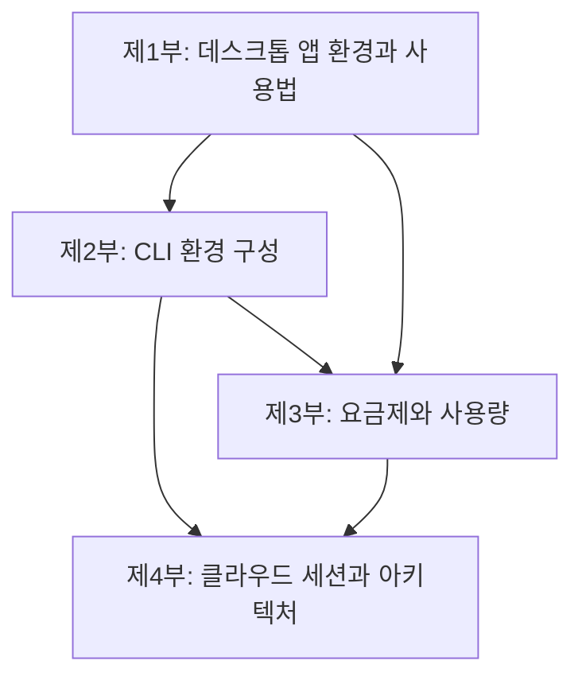

## 전체 목차

### 제1부. Claude Code 데스크톱 앱 개편 후 사용 가이드 — 환경(Environment)·워크트리·권한 모드·클라우드 크레딧

- 0. 이 문서를 읽는 법
- 1. 이번 개편에서 무엇이 바뀌었나
- 2. 전체 개념 지도
- 3. 보여 주신 화면의 항목을 하나씩 읽기
- 4. 환경(Environment)이란 무엇인가
- 5. 로컬 환경 상세 ("이 컴퓨터")
- 6. 워크트리(Worktree)
- 7. 권한 모드 — "자동"을 포함해서
- 8. 클라우드 환경 상세
- 9. WSL 환경 (Windows)
- 10. SSH 환경
- 11. 세션을 다루는 방법
- 12. 작업 공간 패널들
- 13. 확장 기능: 커넥터, 스킬, 플러그인, 컴퓨터 사용
- 14. 사용량, 크레딧, 한도 — 설정 화면 읽기
- 15. 상황별 선택 가이드와 실습 순서
- 16. 흔한 문제와 점검 목록
- 17. 단축키 (Windows 기준)
- 18. 확인하지 못한 것과 한계
- 19. 출처 (제1부)

### 제2부. Claude Code CLI 환경 구성 가이드

- 0. 먼저 알아두면 좋은 것
- 1. CLI 환경 구성의 큰 그림
- 2. 1층 — 설치
- 3. 2층 — 로그인과 인증
- 4. 3층 — 설정 파일과 우선순위
- 5. 환경변수
- 6. 4층 — CLAUDE.md와 rules (프로젝트 맥락)
- 7. 권한 — 데스크톱의 권한 모드를 CLI로
- 8. MCP 서버 등록
- 9. 5층 — 세션을 시작할 때 쓰는 옵션
- 10. 클라우드와 원격 — 데스크톱 앱의 Cloud 환경을 CLI에서
- 11. 데스크톱 앱 ↔ CLI 대응표
- 12. 따라하기 — Windows + Pro 요금제 첫 세팅 순서
- 13. 문제 해결
- 14. 확인하지 못한 항목 (추측하지 않고 남겨 둠)
- 15. 출처 (제2부)

### 제3부. Claude 요금제와 Claude Code 사용 방식, 그리고 "사용량" 화면 읽는 법

- 0. 먼저 결론부터
- 1. Claude 요금제 전체 지도
- 2. 구독 플랜의 한도 구조
- 3. Claude Code를 쓰는 방법 — 돈이 나가는 곳 기준으로 구분하기
- 4. 사용량 화면 항목별 해설 (독자의 실제 수치 기준)
- 5. API 종량제 가격 (Claude Console 및 사용 크레딧 기준)
- 6. Claude Code 사용량을 확인하는 방법
- 7. 한도를 아끼는 실용 습관
- 8. 상황별 선택 가이드
- 9. 자주 하는 오해 정리
- 10. 다른 부와의 연결
- 11. 확인하지 못한 항목 (추측하지 않고 남겨 둠)
- 12. 출처 (제3부)

### 제4부. Claude Code 클라우드 · 클라우드 세션 · `claude --cloud` 완전 해설 — 등장 배경과 아키텍처 포함

- 0. 한눈에 보는 요약
- 1. 배경 — 왜 갑자기 "클라우드"가 튀어나왔나
- 2. 용어 정리 — 헷갈리는 이름들을 먼저 분리하기
- 3. 클라우드 세션이 하는 일 — 한 번의 작업 흐름
- 4. 시작하기 — 준비물과 표면별 시작 방법
- 5. `claude --cloud` 상세
- 6. 클라우드 환경(Environment) 상세
- 7. 세션 운영
- 8. 비용, 한도, 보너스 크레딧 (공식 도움말 확인)
- 9. 아키텍처 — Claude Code는 어떻게 구성되어 있나
- 10. 상황별 선택 가이드
- 11. 실전 체크리스트 (Windows, Pro, 마감 11월 5일)
- 12. 문제 해결 요약
- 13. 확인하지 못한 항목 (추측하지 않고 남겨 둠)
- 14. 출처

---

# 제1부. Claude Code 데스크톱 앱 개편 후 사용 가이드 — 환경(Environment)·워크트리·권한 모드·클라우드 크레딧

- 작성 기준일: 2026-10-28 (공식 문서 code.claude.com, support.claude.com 및 관련 보도를 같은 날 조회해 반영)
- 대상: Windows에서 Claude 데스크톱 앱의 **Code 탭**을 쓰는 사용자 (Pro 플랜 기준 설명 포함)

---

## 0. 이 문서를 읽는 법

이 부는 "새로 바뀐 Claude Code 화면에서 환경 선택, 워크트리, 자동, 클라우드 같은 항목이 각각 무엇이고 어떻게 써야 하는가"에 답하기 위해 만들었습니다. 모든 설명은 공식 문서에서 확인된 내용만 사용했고, 문서로 확인하지 못한 부분은 본문 곳곳과 마지막 "확인하지 못한 것" 절에 따로 적었습니다. 서술 위주로 쓰되 비교가 필요한 곳에만 표를, 흐름이 필요한 곳에만 Mermaid 다이어그램을 넣었습니다.

먼저 결론부터 짧게 정리하면 다음과 같습니다.

Claude Code는 이제 "어디서 실행되는가"를 세션을 시작하기 전에 **환경 선택기**로 먼저 고르는 구조입니다. 환경은 로컬(내 컴퓨터), 클라우드(Anthropic이 관리하는 가상 머신), WSL(내 PC 안의 Linux), SSH(원격 서버) 네 종류이고, 자주 쓰는 설정은 **저장된 환경**으로 묶어 두었다가 한 번의 클릭으로 다시 열 수 있습니다. 환경을 고른 다음에는 같은 줄에서 **워크트리**(작업 복사본 분리), **권한 모드**(Claude가 얼마나 스스로 움직일지), **모델**을 정하고 작업을 입력하면 됩니다. 여러 세션을 동시에 돌리는 것이 이번 개편의 중심 아이디어입니다.

---

## 1. 이번 개편에서 무엇이 바뀌었나

### 1.1 한 문장 요약

Claude Code 데스크톱 앱은 "병렬 에이전트"를 쉽게 돌리도록 다시 설계되었습니다. Anthropic의 개편 발표문은 더 많은 Claude Code 작업을 동시에 실행하도록 돕는 재설계라고 소개하고, 플러그인이 터미널(CLI)과 같은 방식으로 데스크톱 앱에서도 동작하며, SSH 지원이 Linux뿐 아니라 Mac까지 넓어졌다고 설명합니다.

### 1.2 최근 더해진 두 가지 변화

공식 데스크톱 문서에는 현재 레이아웃(문서 용어로 "current layout")과 이전 레이아웃("earlier layout")이 구분되어 있습니다.

현재 레이아웃의 특징은 세 가지입니다. 첫째, 환경 선택기가 프롬프트 입력창 **아래** 줄의 첫 번째 컨트롤로 있습니다. 이전 레이아웃에서는 선택기가 입력창 위에 있었습니다. 둘째, **세션 세부 정보 패널**(채팅 옆에 카드 형태로 세션이 어디서 실행되는지, 무엇을 바꿨는지, 무엇을 돌리고 있는지, 컨텍스트가 얼마나 찼는지를 보여 주는 패널)이 생겼습니다. 셋째, 로컬과 SSH 환경을 **저장된 환경**으로 만들어 둘 수 있습니다. 이전 레이아웃에는 이 두 가지(세부 정보 패널, 저장된 로컬/SSH 환경)가 없습니다.

또 하나, 문서에는 세션이 다른 세션을 시작하는 기능이 있습니다. Claude가 지금 작업 밖에서 고칠 만한 것을 발견하면 "작업 제안" 카드를 띄우고, **Start**를 누르면 별도 세션이 시작되며 사이드바에서 현재 세션 아래에 나란히 표시됩니다. 이 기능은 현재 레이아웃의 로컬·SSH 세션에서 카드 형태로 제공된다고 문서에 적혀 있습니다. 이 "중첩 세션"과 저장된 환경이 최근 데스크톱에 도입되었다는 외부 보도도 있습니다. 다만 보도 날짜와 세부 롤아웃 시점은 공식 문서에서 확인하지 못했으므로, 기능 자체는 공식 문서 기준으로만 설명합니다.

### 1.3 클라우드 세션도 함께 정식화

2026년 9월 말에 Claude Code 클라우드 세션이 정식 기능으로 공개되었다는 보도가 여러 매체에서 나왔고, Anthropic 고객센터 문서에는 Pro와 Max 구독자를 위한 **클라우드 세션 보너스 크레딧**(Pro 100달러, Max 250달러) 프로모션이 안내되어 있습니다. 이 크레딧은 14절에서 자세히 다룹니다.

---

## 2. 전체 개념 지도

아래 다이어그램은 용어 사이의 관계를 한 장으로 보여 줍니다. 세션 하나가 환경, 폴더, 모드, 모델이라는 네 가지 선택으로 시작되고, 환경은 실행 위치를 결정한다는 점이 핵심입니다.

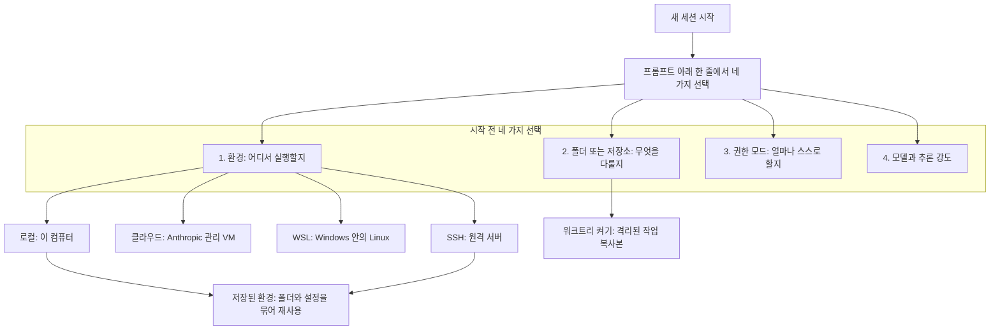

---

## 3. 보여 주신 화면의 항목을 하나씩 읽기

사용 중인 화면의 항목들이 문서의 어떤 개념에 해당하는지 대응시켜 보겠습니다.

**왼쪽 사이드바**의 "새로 만들기", "검색", "아티팩트", "사용자 지정", "더 보기"는 세션 목록 위의 메뉴입니다. 문서에 따르면 "사용자 지정"(Customize)은 커넥터, 스킬, 플러그인을 한곳에서 관리하는 입구입니다. 그 아래의 폴더 이름들(예: 프로젝트 폴더 이름)은 세션을 폴더별로 묶어 보여 주는 목록입니다. 문서는 목록 제목에 마우스를 올리면 나타나는 **Group and sort** 아이콘으로 묶는 방식과 정렬을 바꿀 수 있다고 설명합니다.

**중앙 상단의 "새 세션"** 화면에서 열린 목록이 환경 선택기입니다. 목록은 **로컬** 아래에 "이 컴퓨터"와 저장된 환경 하나("프로젝트 이름의 저장된 환경"), 그다음 **클라우드**와 **WSL**(둘 다 하위 목록이 있는 항목), 맨 아래 **새 환경**으로 구성되어 있습니다. 문서의 설명과 정확히 일치합니다. "이 컴퓨터"는 문서에서 말하는 "Local 항목 중 첫 번째, 내 컴퓨터 자신"이고, 그 항목에 마우스를 올렸을 때 톱니바퀴가 나타나면 "로컬 환경 편집기"를 열 수 있다고 되어 있습니다.

**입력창 아래 줄**에는 환경 이름, "워크트리", "자동", 오른쪽에 "Opus 5.5 중간"이 보입니다. 문서가 설명하는 "프롬프트 아래 한 줄"의 구성(환경 → 폴더 → 권한 모드 → 모델)과 맞습니다. 여기서 "워크트리"는 워크트리 토글 버튼이고, "자동"은 권한 모드 중 **Auto**의 한국어 표시입니다. 모델 선택기 쪽에 표시된 "Opus 5.5"와 "중간"은 문서상 모델 선택기에서 고르는 모델과 Effort(추론 강도) 단계에 해당하는 것으로 보이며, 이 둘은 세션 도중에도 바꿀 수 있다고 문서에 적혀 있습니다. (저장된 환경을 고르면 그 환경이 폴더를 이미 갖고 있기 때문에 별도의 프로젝트 폴더 컨트롤이 줄에 나타나지 않는다고 문서에 적혀 있습니다. 보여 주신 줄에서 폴더 컨트롤이 따로 없는 것도 같은 이유로 해석됩니다.)

**설정 화면**에는 "사용량" 메뉴에서 "클라우드 세션 크레딧", "사용 크레딧", "월간 지출 한도", "이번 주 제품별 사용량" 항목이 보이고, 왼쪽 "이 컴퓨터" 아래에는 "시스템", "확장 프로그램", "개발자"가 있습니다. 이 항목들은 각각 14절(크레딧)과 13절(컴퓨터 사용 설정)에서 다룹니다.

---

## 4. 환경(Environment)이란 무엇인가

문서의 정의는 이렇습니다. 세션을 시작할 때 고르는 환경이 Claude가 **어디서 실행되고 어떻게 연결되는지**를 결정합니다.

로컬 환경은 내 컴퓨터에서 실행되며 내 파일에 직접 접근합니다. 클라우드 환경은 기본적으로 Anthropic이 관리하는 인프라에서 실행되며, 앱을 닫아도 세션이 계속됩니다. SSH 환경은 SSH로 연결한 원격 컴퓨터(자체 서버, 클라우드 VM, 개발 컨테이너 등)에서 실행됩니다. WSL 환경은 Windows에서 WSL 2 리눅스 배포판 안에서 실행되어 그 배포판의 도구와 리눅스 경로를 씁니다.

### 4.1 "저장된 환경"은 무엇이고 왜 쓰는가

저장된 환경은 환경 선택기에 한 줄로 등록되어, "어디서 실행할지"와 (로컬·SSH의 경우) "어떤 폴더에서 일할지"를 함께 기억하는 항목입니다. 다음 세션부터는 그 줄을 클릭하는 것만으로 같은 설정으로 시작합니다. 로컬·SSH 환경은 폴더를 함께 들고 있으므로, 환경을 고르면 프롬프트 아래 줄에 프로젝트 폴더 컨트롤이 따로 나타나지 않습니다. 폴더를 바꾸려면 환경을 **편집**합니다.

만드는 순서는 문서에 다음과 같이 나와 있습니다. 환경 선택기를 열고 맨 아래 **새 환경(New environment)** 을 선택합니다. 대화상자에서 **Local**, **SSH**, **Cloud** 탭 중 하나를 고르고 양식을 채웁니다. SSH 탭에서는 연결과 원격 폴더를 고릅니다. 마지막으로 **환경 만들기(Create environment)** 를 누르고, 클라우드 탭에서는 **환경 추가(Add environment)** 를 누릅니다.

처음 현재 레이아웃의 Code 탭을 열면 Desktop이 **최대 8개의 환경을 자동으로 만들어 줍니다.** 최근 한 달 동안 가장 많이 쓴 로컬·SSH 폴더를 기준으로 합니다. 그래서 직접 만들지 않은 환경이 목록에 보인다면 이 자동 생성 때문입니다. 보여 주신 "프로젝트 이름의 저장된 환경"가 자동 생성인지 직접 만든 것인지는 화면만으로 확인할 수 없습니다. 어느 쪽이든 편집과 삭제가 가능합니다.

편집과 삭제는 목록에서 해당 항목에 마우스를 올리면 나타나는 톱니바퀴 아이콘으로 합니다. 로컬·SSH 환경은 **Edit environment** 안의 **Delete environment**로 지우고, 클라우드 환경은 삭제가 아니라 **보관(Archive)** 만 가능합니다.

### 4.2 단축키

현재 레이아웃에서는 새 세션 화면에서 환경 선택기 단축키가 있습니다. 문서는 macOS 기준 `Cmd+Option+1~9`로 환경 선택, `Cmd+Option+0`으로 **새 환경** 대화상자를 연다고 하고, Windows에서는 `Cmd+Option`을 `Alt`로 바꿔 읽으라고 안내합니다. 즉 Windows에서는 `Alt+1`~`Alt+9`, `Alt+0`입니다.

### 4.3 관리형 PC에서

회사 PC처럼 조직이 관리하는 기기에서는 관리자가 로컬 세션을 끌 수 있습니다. 그러면 "이 컴퓨터" 항목이 회색으로 표시되고 "Disabled by your organization"이라는 안내가 뜹니다. 이때 저장된 로컬 환경을 선택하면 "Local 환경을 더 이상 사용할 수 없다"는 오류가 나며, SSH나 클라우드 환경을 쓰라고 안내합니다. WSL 항목의 사용 가능 여부는 별도로 관리됩니다.

---

## 5. 로컬 환경 상세 ("이 컴퓨터")

### 5.1 언제 쓰는가

내 PC의 파일을 직접 읽고 쓰는 일반적인 개발 작업에 씁니다. 내 컴퓨터의 설정, 도구, 개인 스킬(`~/.claude/skills/`)이 모두 적용됩니다. 클라우드와의 가장 큰 차이점입니다.

### 5.2 시작하는 방법

새 세션에서 환경으로 "이 컴퓨터" 또는 저장된 로컬 환경을 고르고, "이 컴퓨터"라면 프로젝트 폴더를 고릅니다. 권한 모드와 모델을 확인한 뒤 작업을 입력하고 **Enter**를 누릅니다. 각 세션은 자기만의 컨텍스트와 변경 내역을 갖고 서로 독립적으로 움직입니다.

작업 중 방향을 바꾸고 싶을 때는 정지 버튼으로 즉시 중단할 수도 있고, 중단 없이 입력해 보내면 Claude가 현재 동작을 끝낸 직후에 읽고 다음 단계부터 반영합니다.

### 5.3 폴더 추가

세션이 시작되기 전에는 저장된 환경을 만들거나 편집할 때 **Folders**에 폴더를 추가합니다. 세션 진행 중(로컬·SSH)에는 입력창 옆 **+** 를 누르고 **Add folder**를 고르면 됩니다. 이렇게 추가한 폴더에서는 워크트리 없이 그 폴더 자체에서 작업합니다.

### 5.4 환경 변수

로컬 세션에 환경 변수를 주려면 저장된 로컬 환경의 폼에서 **Environment variables**를 선택하고, 한 줄에 `KEY=value` 하나씩 입력한 뒤 **Done**을 누르고 저장합니다. 그 환경에서 시작한 세션에만 적용됩니다. 모든 로컬 세션에 적용하려면 `~/.claude/settings.json`의 `env` 키에 넣는 방법이 있습니다.

주의할 점이 몇 가지 있습니다. `PATH`는 Windows에서 Desktop이 PowerShell 프로필을 읽지 않으므로 사용자 또는 시스템 환경 변수에 설정한 뒤 Desktop을 완전히 종료했다가 다시 열어야 합니다. 또 Desktop이 스스로 정하는 값이 있는데, 예를 들어 로컬 세션의 `API_TIMEOUT_MS`는 900000(15분)으로 고정되어 사용자가 설정해도 바뀌지 않습니다. 개발 서버(미리보기)는 저장된 환경이나 `settings.json`의 변수를 받지 않으며, 비밀 값이 필요하면 셸 프로필(Windows는 사용자 환경 변수)에 넣고 Desktop을 재시작하라고 문서가 안내합니다.

### 5.5 Windows에서 알아 둘 것

문서에 따르면 Windows에서 Code 탭을 처음 열 때 **Git for Windows**가 설치되어 있어야 하고, 설치 후에는 앱을 재시작해야 합니다. 워크트리 같은 세션 격리도 Git이 필요합니다.

---

## 6. 워크트리(Worktree)

### 6.1 개념

Git 워크트리는 같은 저장소의 기록과 원격을 공유하면서도 **별도의 작업 폴더와 별도의 브랜치**를 갖는 복사본입니다. 세션마다 워크트리를 따로 주면 한 세션의 편집이 다른 세션의 파일을 건드리지 않으므로, 한 세션이 기능을 만드는 동안 다른 세션이 버그를 고치는 식의 병렬 작업이 안전해집니다.

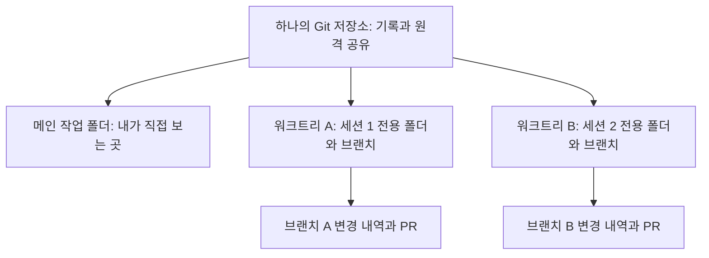

### 6.2 데스크톱 앱에서 켜는 법

Git 저장소인 프로젝트에서 세션을 시작하기 **전에** 입력창 아래 줄의 **Worktree** 버튼을 켭니다. 기본값은 꺼짐이며, 꺼져 있으면 Claude는 프로젝트 폴더 자체에서 작업합니다. 저장된 로컬·SSH 환경에서는 환경을 만들거나 편집할 때 **Worktree**를 켜 두면 그 환경에서 시작하는 세션의 기본값이 됩니다.

### 6.3 어디에 만들어지나, 어떻게 정리되나

기본 위치는 `<프로젝트 루트>/.claude/worktrees/` 입니다. 로컬 세션에서는 **Settings > Claude Code**의 **Worktree location**으로, SSH 세션에서는 연결 설정의 **Worktree folder**로 위치를 바꿀 수 있습니다. 같은 설정 화면의 **Branch prefix**를 정해 두면 Desktop이 모든 워크트리 브랜치 이름 앞에 그 접두어를 붙여, Claude가 만든 브랜치를 알아보기 쉽습니다. 워크트리 디렉터리를 `.gitignore`에 넣어 두면 메인 작업 폴더에서 "추적되지 않는 파일"로 보이지 않습니다(워크트리 문서의 권장 팁).

워크트리는 새로 체크아웃한 폴더이므로 `.env` 같은 gitignore 대상 파일은 들어 있지 않습니다. 프로젝트 루트에 **`.worktreeinclude`** 파일을 만들어 복사할 파일 패턴(예: `.env`, `.env.local`)을 `.gitignore` 문법으로 적어 두면, 새 워크트리를 만들 때 해당 파일이 자동으로 복사됩니다. 이 규칙은 데스크톱 앱의 병렬 세션에도 적용된다고 문서에 명시되어 있습니다. 또한 워크트리는 새로 만든 폴더이므로 의존성 설치 같은 초기화는 직접 하거나 Claude에게 시켜야 합니다.

문서에는 기본적으로 새 워크트리가 저장소의 기본 브랜치(보통 `main`)에서 갈라진다고 되어 있습니다. 현재 작업 중인 로컬 `HEAD`에서 갈라지게 하려면 설정 키 `worktree.baseRef`를 `"head"`로 두면 됩니다(워크트리 문서의 설정 설명).

### 6.4 보관(Archive)할 때 주의

세션을 보관하면 그 워크트리의 **커밋하지 않은 변경**이 사라질 수 있다고 문서가 경고합니다. Desktop이 변경 사항 때문에 물어보면 **Archive anyway**는 변경을 버리는 선택입니다. 추적되지 않는 파일만 있는 경우, Claude가 연 PR이 머지될 때 Desktop이 묻지 않고 지울 수도 있으니 남기고 싶은 파일은 먼저 커밋해야 합니다. 그 외 경우 워크트리는 디스크에 남고, 로컬 세션이라면 보관 또는 마지막으로 열람한 시점 중 더 늦은 때로부터 약 30일 뒤 Desktop이 워크트리와 변경을 정리합니다. 되돌리려면 **Archived** 탭에서 해당 세션을 열어 **Unarchive**하면 됩니다.

### 6.5 언제 켜고 언제 끄나

문서가 정리한 사실만 놓고 보면, 동시에 여러 세션이 같은 저장소를 건드리거나 실험적 변경을 메인과 분리하고 싶을 때 켜는 것이 맞고, 단일 세션으로 작은 수정을 할 때는 꺼 둔 기본값이 단순합니다. 이는 문서의 설명에서 도출한 사용 지침이며 문서가 "이럴 때 켜라"고 문장으로 규정한 것은 아닙니다.

---

## 7. 권한 모드 — "자동"을 포함해서

### 7.1 모드 한눈에 보기

권한 모드는 Claude가 파일을 수정하거나 명령을 실행하기 전에 **얼마나 자주 물어볼지**를 정합니다. 입력창 아래 줄의 모드 선택기에서 언제든 바꿀 수 있습니다. 이전 버전의 이름(Ask permissions, Auto accept edits, Plan mode)이 현재는 아래와 같이 바뀌었습니다.

| 모드 | 설정 키 | 동작 |
| --- | --- | --- |
| **Manual** (수동) | `default` | 파일 수정과 명령 실행 전에 매번 묻습니다. 변경 diff를 보고 수락 또는 거절합니다. |
| **Accept edits** (편집 자동 수락) | `acceptEdits` | 파일 편집과 `mkdir`, `touch`, `mv` 같은 흔한 파일시스템 명령은 자동 수락하고, 그 밖의 터미널 명령은 묻습니다. |
| **Plan** (계획) | `plan` | 파일을 읽고 탐색 명령을 실행해 계획을 제안하지만 소스 코드는 수정하지 않습니다. |
| **Auto** (자동) | `auto` | 일상적인 확인 없이 진행합니다. 셸 명령이나 네트워크 요청 같은 행동이 실행되기 전에 백그라운드 분류기가 요청과 부합하는지 검사합니다. |
| **Bypass permissions** (권한 우회) | `bypassPermissions` | 권한 확인 없이 진행합니다. CLI의 `--dangerously-skip-permissions`와 같고, 샌드박스 컨테이너나 VM에서만 쓰라고 문서가 경고합니다. |

### 7.2 "자동(Auto)"에 대해 확인된 사실

보여 주신 화면의 "자동"은 Auto 모드입니다. 문서가 정리한 조건은 다음과 같습니다. Auto는 모든 요금제에서 쓸 수 있고(Team·Enterprise는 기본 제공), 모델 조건이 있습니다. Anthropic API에서는 Claude Opus 4.6 이상, Sonnet 4.6 이상, Haiku 5.5 또는 Fable 계열이 필요하고, Amazon Bedrock·Google Cloud·Microsoft Foundry 같은 제3자 제공자에서는 Sonnet 5 이상, Opus 4.7 이상, Haiku 5.5, Fable 계열만 지원됩니다. 현재 선택된 Opus 5.5는 이 조건에 부합합니다. 조직 관리자는 `permissions.disableAutoMode`를 `"disable"`로 두는 관리 설정으로 Auto를 끌 수 있고, 그러면 Auto 모드로 시작하도록 지정해도 Manual로 시작합니다. 참고로 터미널과 VS Code 확장에서는 Claude Code v2.1.283 이상부터 Auto가 모든 요금제·제공자에서 기본 시작 모드입니다(이전 버전에서는 Pro·Max·Team에서만). 데스크톱에서는 Auto를 켜는 **별도의 설정 토글이 없고**, 사용 가능하면 선택기에 나타납니다.

Auto에서 Claude가 계속 막힌 행동을 시도하면 결국 사용자에게 권한 확인 창이 다시 뜹니다(Auto 모드 발표문). Auto는 "자동으로 다 해 주는 모드"가 아니라 분류기의 감시 아래 허가 결정을 대신해 주는 모드입니다. 또 외부 사이트에서 Claude가 클릭·입력 같은 쓰기 동작을 할 때는 **모든 모드에서** 동일한 안전 분류기가 검토하고, 걸리면 모드와 상관없이 확인 창이 뜹니다.

### 7.3 모드 설정이 기억되는 방식

모드 선택기에서 고른 값은 **폴더별로 기억**되며, 설정 파일의 `permissions.defaultMode`보다 우선합니다. 단 **Plan은 현재 세션에만** 적용됩니다. 데스크톱 앱은 CLI와 같은 설정 파일을 읽습니다. 데스크톱에서는 CLI와 달리 `Shift+Tab`으로 모드가 순환하지 않으며, 모드 메뉴는 macOS `Cmd+Shift+M` 기준으로 열리므로 Windows에서는 `Ctrl+Shift+M`입니다(문서의 Cmd→Ctrl 변환 규칙).

### 7.4 Bypass의 조건

Pro·Max 플랜에서는 **Settings > Claude Code**의 "Allow bypass permissions mode"를 켜야 선택기에 나타납니다. Team·Enterprise에는 토글이 없고 조직 정책이 결정합니다. 이 모드에서도 어떤 모드도 자동 승인하지 않는 행동 목록은 여전히 적용됩니다.

### 7.5 환경별로 쓸 수 있는 모드가 다르다

클라우드 세션은 Accept edits, Plan, Auto를 지원합니다. 클라우드에서는 파일 편집이 미리 승인되어 있으므로 선택기에 Manual 대신 Accept edits가 표시되며, **Bypass permissions는 클라우드에서 쓸 수 없습니다**(이미 샌드박스 환경이기 때문).

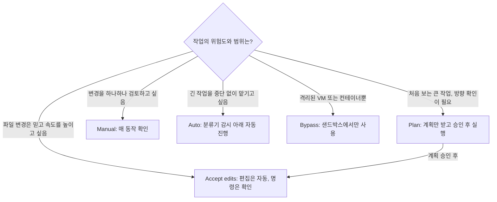

이 흐름도의 첫 가지(큰 작업은 Plan으로 시작해 승인 후 Accept edits나 Manual로 실행)는 공식 데스크톱 문서의 팁을 그대로 도식화한 것입니다. 나머지 분기는 각 모드의 정의에서 도출한 선택 기준입니다.

---

## 8. 클라우드 환경 상세

### 8.1 무엇이고 언제 쓰는가

클라우드 세션은 내 컴퓨터가 아니라 **Anthropic이 관리하는 가상 머신**에서 Claude Code를 실행합니다. 문서는 이렇게 설명합니다. 환경 선택기의 **Cloud** 아래 환경을 고르고 세션을 시작하면, 앱을 닫거나 컴퓨터를 꺼도 세션이 계속됩니다. claude.ai/code 또는 모바일 앱에서도 진행 상황을 보고 방향을 바꿀 수 있습니다. 클라우드 세션은 큰 리팩터링, 테스트 스위트, 마이그레이션처럼 오래 걸리는 작업과, 병렬로 여러 작업을 돌리고 싶을 때, 로컬에 체크아웃하지 않은 저장소를 다룰 때, 자주 개입할 필요가 없는 명확한 작업에 어울린다고 문서는 설명합니다. 반대로 로컬 설정·도구·환경이 필요한 작업은 로컬 세션이나 Remote Control이 더 적합하다고 합니다.

### 8.2 시작 전 준비: GitHub 연결

클라우드 세션은 기본적으로 **GitHub 저장소**가 필요합니다(GitHub가 없는 저장소는 `--cloud` 옵션으로 로컬 저장소를 묶어 올리는 방법이 있다고 문서 비교표에 적혀 있습니다). 연결은 한 번만 하면 됩니다. claude.ai/code에서 로그인한 뒤 GitHub 인증을 승인합니다. 공개 저장소는 이 연결만으로 복제할 수 있지만, **비공개 저장소는 해당 계정이나 조직에 Claude GitHub App이 설치되어 있어야** 작업할 수 있습니다. 이미 GitHub CLI(`gh`)를 쓰고 있다면 Claude Code CLI에서 `/web-setup`을 실행해 로컬 `gh` 토큰을 계정에 연결하는 방법도 있습니다. 이 경우 `gh` 토큰이 접근할 수 있는 모든 저장소에 세션이 접근하며, 첫 클라우드 환경이 없으면 신뢰(Trusted) 네트워크 접근과 설정 스크립트 없음 조건으로 기본 환경을 만들어 줍니다.

Pro·Max에서는 온보딩 때 **Default**라는 환경이 자동 생성됩니다. Team·Enterprise는 "첫 클라우드 환경 만들기" 폼에서 기본값 그대로 **Create & finish**를 눌러 같은 Default 환경을 만듭니다(소유자가 Quick setup을 켰다면 자동 생성). Zero Data Retention이 켜진 조직과 HIPAA 구성 조직은 클라우드 세션을 쓸 수 없습니다.

### 8.3 세션이 실행되는 흐름

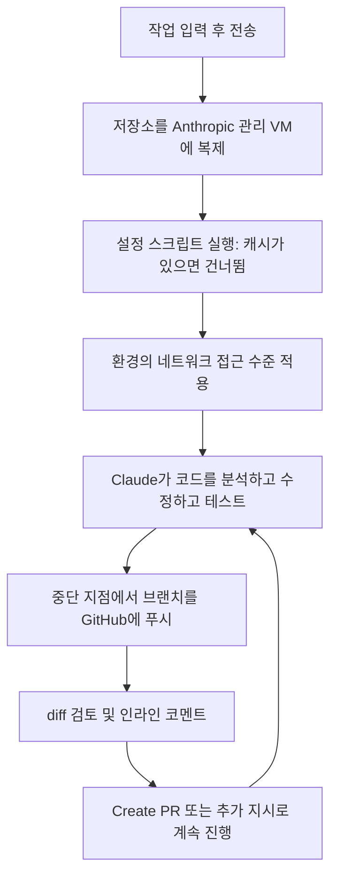

푸시 뒤에도 세션은 닫히지 않고 같은 대화 안에서 PR 생성과 추가 수정이 이어집니다. 각 작업은 자기 세션과 자기 브랜치를 갖기 때문에 하나가 끝나기를 기다리지 않고 다른 작업을 시작할 수 있습니다. 데스크톱에서는 한 세션에서 **여러 저장소**를 선택해 함께 다룰 수도 있습니다(클라우드 환경을 고르면 입력창 아래 줄에서 저장소를 고름). 클라우드 세션에서는 `@` 파일 목록이 첫 메시지를 보낸 뒤에야 나타납니다.

### 8.4 클라우드 환경을 설정하는 방법

환경 선택기에서 **새 환경 > Cloud 탭**에서 만들거나, 기존 환경에 마우스를 올려 톱니바퀴로 편집합니다. 설정 항목은 네 가지입니다.

**네트워크 접근**은 네 단계입니다.

| 수준 | 외부 연결 |
| --- | --- |
| **None** | 세션의 네트워크를 통한 외부 연결 없음 |
| **Trusted** (기본) | 허용 목록 도메인만: 패키지 레지스트리, GitHub, 클라우드 SDK 등 |
| **Full** | 모든 도메인 |
| **Custom** | 직접 만든 허용 목록(기본 목록 포함 여부 선택) |

어떤 수준이든 GitHub(별도 프록시 경유), 사용자가 켠 MCP 커넥터(Anthropic 서버 경유), 네트워크 시크릿에 등록한 호스트, Claude Code 자체가 쓰는 Anthropic API는 접근할 수 있습니다. 네트워크 접근을 바꾸면 이미 실행 중인 세션도 약 1분 안에 새 설정을 따릅니다.

**환경 변수**는 `.env` 형식(한 줄에 `KEY=value`)으로 입력합니다. 중요한 경고가 있는데, **그 환경을 쓰는 누구나 값을 읽을 수 있으므로** 비밀 값을 넣지 말라는 것입니다. API 키처럼 에이전트 프록시가 요청에 붙여 줄 수 있는 값은 **네트워크 시크릿**으로 저장하라고 문서가 안내합니다. 이렇게 하면 키가 VM 밖에 남고 Claude는 키 값을 보지 못한 채 해당 API를 호출합니다. 환경 변수를 고쳐도 이미 실행 중인 세션은 VM이 복원되거나 재구성될 때까지 이전 값을 유지합니다.

**설정 스크립트**는 Claude Code가 시작되기 **전에** 새 세션에서 실행되는 Bash 스크립트로, Ubuntu 24.04에서 root로 실행되므로 `apt install` 등이 됩니다. 규칙은 네 가지입니다. 비정상 종료(0이 아닌 종료 코드)하면 세션이 시작되지 않으므로 중요하지 않은 명령 뒤에는 `|| true`를 붙입니다. 전체 실행 시간은 **약 5분 이내**여야 캐시가 만들어집니다. 패키지 설치에는 네트워크가 필요하므로 None에서는 실패합니다. 스크립트가 실행되는 시점에는 환경 변수가 아직 세팅되지 않았습니다.

설정이 5분 안에 끝나면 파일시스템 스냅샷이 캐시되어 이후 세션이 설치된 도구와 Docker로 받아 둔 컨테이너 데이터를 그대로 갖고 시작합니다. 캐시는 파일만 저장하므로 실행 중이던 프로세스(데이터베이스, `docker compose up`)는 유지되지 않습니다. 설정 스크립트나 허용 호스트를 바꾸면 다시 만들어지고, 그렇지 않아도 약 7일 후 만료됩니다.

**기본 설치 도구**에는 Python(pip, poetry, uv, pytest, ruff 등), Node.js 20·21·22(기본 22, npm, yarn, pnpm), Ruby, PHP, Java 21(Maven, Gradle), Go, Rust, C/C++ 도구, Docker, PostgreSQL 16, Redis 7, git, gh, jq, ripgrep 등이 있습니다. .NET SDK 같은 목록 밖 도구는 설정 스크립트로 설치해야 합니다. PostgreSQL과 Redis는 설치만 되어 있고 자동으로 켜져 있지 않으므로 Claude에게 시작하라고 하면 됩니다.

### 8.5 클라우드 세션에서 내 설정은 어디까지 따라오나

클라우드 세션은 저장소의 **새 복제본**에서 시작합니다. 저장소에 커밋된 것은 모두 가져옵니다. 저장소의 `CLAUDE.md`, `.claude/rules/`, `.claude/skills/`, `.claude/agents/`, `.claude/commands/`와, 저장소가 하나일 때의 `.claude/settings.json` 훅·권한 규칙과 `.mcp.json`이 여기에 해당합니다. 반면 내 PC에만 있는 것은 따라오지 않습니다. `~/.claude/CLAUDE.md`, `~/.claude/skills/`, 사용자 범위로 설치한 플러그인, 데스크톱 앱에서 설치한 플러그인, `claude mcp add`를 기본(로컬) 범위나 사용자 범위로 추가한 MCP 서버, AWS SSO 같은 브라우저 로그인 인증이 그렇습니다. 개인 선호는 저장소에 올리고 싶지 않다면 설정 스크립트로 `~/.claude/CLAUDE.md`를 만들어 주는 방법이 문서에 예시로 나와 있습니다. 단, 클라우드 세션은 claude.ai 계정에서 켠 스킬은 자동으로 불러옵니다.

### 8.6 실행 한계

Anthropic 관리 환경의 리소스는 대략 4 vCPU, 16GB RAM, 30GB 디스크이며 시간이 지나며 바뀔 수 있다고 합니다. 이 한도를 넘는 작업은 VM이 중단시킬 수 있으므로 Remote Control이나 자체 호스팅 환경을 쓰라고 안내합니다. 명령어 실행 시간은 별도 환경 타임아웃이 없고 Bash 도구 기본값(포그라운드 기본 2분, 최대 10분)이 적용되며, 타임아웃된 명령은 중단되지 않고 백그라운드로 넘어가 30분까지 더 돌 수 있습니다. 몇 분간 활동이 없으면 VM이 파일을 보존한 채 일시 정지되고, 다음 메시지에서 같은 VM이 복원되며, 일시 정지된 VM이 회수되면 세션을 다시 열 때 새 VM이 만들어집니다.

### 8.7 GitHub 프록시와 푸시 제약

Anthropic 관리 환경에서 모든 GitHub 작업은 전용 프록시를 거쳐 실제 GitHub 자격 증명이 VM 밖에 남습니다. 프록시는 브랜치 삭제와 브랜치가 아닌 대상(태그 등)의 푸시를 거부하고, 세션에 붙인 저장소만 API 요청을 허용하며, GraphQL 엔드포인트 요청을 거부합니다(그래서 `gh pr`, `gh issue` 같은 GraphQL 기반 하위 명령은 실패하고 REST 기반 `gh api`는 됩니다).

### 8.8 로컬 세션을 클라우드로 옮기기

세션 제목 옆 화살표 또는 사이드바 해당 줄의 메뉴에서 **Open in > Cloud**를 고르면, 대화가 **요약 형태로** 클라우드 세션에 이어집니다. 확인 대화상자가 파일이 함께 옮겨지는지, 클라우드 세션 준비 후 원래 세션이 보관되는지를 알려 줍니다. SSH 또는 WSL에서 실행 중인 세션은 이 방법으로 옮길 수 없습니다. 반대로 클라우드 세션을 로컬로 가져오는 방법은 공식 클라우드 문서에 `claude --teleport`(또는 세션 안의 `/teleport`, `/tasks` 목록에서 `t`)로 안내되어 있습니다. 조건은 작업 트리가 깨끗한 git 상태일 것, 같은 저장소에서 실행할 것, 해당 브랜치가 원격에 푸시되어 있을 것, 같은 Claude 계정으로 로그인했을 것입니다. 자세한 내용은 제4부(클라우드)와 제2부 10절을 참고하세요.

---

## 9. WSL 환경 (Windows)

### 9.1 무엇이고 언제 쓰는가

Windows에서 Code 탭이 **WSL 2 배포판 안에서** 세션을 실행하게 하는 방식입니다. 세션의 Claude Code 프로세스, 도구, git이 모두 배포판 안에서 실행되고 리눅스 도구와 리눅스 경로를 씁니다. 문서는 저장소가 배포판의 파일시스템 안에 있을 때 WSL 세션을 쓰라고 합니다. Windows에서 그 파일을 네트워크 파일시스템으로 접근하면 느리고 파일 감시가 깨지기 때문입니다.

### 9.2 요구 사항

Windows 10 또는 11과 **WSL 2**(WSL 1은 미지원), 설치된 배포판 하나 이상(예: Ubuntu), 그리고 배포판 안에 설치된 `git`이 필요합니다.

### 9.3 시작하는 순서

새 세션에서 환경 선택기를 열고 **WSL** 섹션에서 설치된 WSL 2 배포판을 고릅니다. 세션은 배포판의 홈 디렉터리에서 시작하며, 폴더 선택기에서 `/home/you/project` 같은 리눅스 경로로 프로젝트를 고릅니다. 첫 세션에서는 작업 폴더 신뢰 대화상자가 나오는데, 신뢰는 **배포판과 폴더 조합별**로 부여되며 다른 배포판이나 Windows 쪽 같은 경로에는 적용되지 않습니다. 배포판에서 처음 시작할 때는 Claude가 내부를 준비하느라 조금 더 걸립니다. 일반 폴더 선택기에서 `\\wsl.localhost\...` 폴더를 열면 해당 배포판 안에서 다시 열립니다.

### 9.4 되는 것과 안 되는 것

병렬 세션, 사이드 채팅, 시각적 diff 검토, 브랜치·PR 상태, 워크트리는 동작합니다. "에디터에서 열기"는 VS Code Remote - WSL로 연결해 엽니다. 반면 **통합 터미널, 커넥터와 플러그인, 세션 포크, 파일 브라우저 패널, 입력창에서 `@`를 쳤을 때의 파일 제안은 WSL 세션에서 아직 지원되지 않습니다.** 파일 첨부는 `+` 메뉴가 그림 파일 첨부 전용 항목(영문 Add image)으로 보이면 그림 파일만 첨부할 수 있고, 다른 파일은 `@`로 언급하라고 데스크톱 문서가 안내합니다(WSL 세션에서 `@` 제안이 제한된다는 WSL 문서와 함께 읽으면 상황에 따라 동작이 다를 수 있으므로 직접 확인해 보시기를 권합니다). PR 자동 머지(Merge when ready)도 WSL과 SSH 세션에서는 비활성화되어 GitHub에서 직접 설정해야 합니다.

### 9.5 상황별 판단

프로젝트 파일이 `C:\` 아래 Windows 쪽에 있고 PowerShell/Windows 도구로 작업한다면 **로컬**이 맞고, 프로젝트가 WSL 배포판의 `/home/...` 아래에 있고 리눅스 빌드 도구를 쓴다면 **WSL**이 맞습니다. 두 방식을 섞는 것보다 파일이 어느 파일시스템에 있는지를 기준으로 정하라는 것이 문서의 핵심 설명입니다.

---

## 10. SSH 환경

### 10.1 무엇이고 언제 쓰는가

Claude Code를 **원격 컴퓨터에서 실행**하고 데스크톱 앱은 화면(인터페이스)으로만 씁니다. 클라우드 VM, 개발 컨테이너, 특정 하드웨어나 의존성이 있는 서버에 코드가 있을 때 유용합니다. 원격 컴퓨터는 Linux, macOS, Windows가 될 수 있고, 처음 연결할 때 Desktop이 원격 컴퓨터에 Claude Code를 자동 설치합니다. 연결된 SSH 세션은 권한 모드, 커넥터, 플러그인, MCP 서버를 지원합니다.

### 10.2 연결 추가하는 순서

환경 선택기 **새 환경 > SSH 탭**에서 **Host** 목록의 **Add SSH connection…** 을 고르고 다음을 채웁니다.

| 필드 | 설명 |
| --- | --- |
| **Name** | 알아보기 쉬운 이름 |
| **SSH host** | `user@hostname` 또는 `~/.ssh/config`에 정의된 호스트 이름 |
| **SSH port** | 비우면 22, 또는 SSH 설정의 포트 |
| **SSH key (선택)** | `~/.ssh/id_ed25519` 같은 개인키 경로. 비우면 SSH 설정이나 SSH 에이전트 사용 |
| **Worktree folder** | 원격의 워크트리 저장 폴더(예: `~/worktrees`). 비우면 원격 기본값 |

저장 후 원격 폴더를 고르고 **환경 만들기**를 누르면 저장된 환경이 됩니다.

### 10.3 원격 컴퓨터 요건과 자주 걸리는 점

x86_64 또는 arm64 프로세서, SFTP 서브시스템을 제공하는 SSH 서버, `noexec`로 마운트되지 않은 홈 디렉터리(설치가 `~/.claude/remote/` 아래에 되며 사용자당 약 1GB 여유 권장), 명령을 받을 수 있는 셸(Bash, Zsh, sh), 그리고 원격 컴퓨터 자체의 네트워크 접근이 필요합니다. Claude Code의 네트워크 요청은 원격 컴퓨터에서 나가기 때문입니다. PR 생성을 쓰려면 원격 컴퓨터에 `git`과 `gh`를 직접 설치하고 로그인해야 하며, Desktop은 SSH 세션에서 `gh` 설치를 안내하지 않습니다.

Windows에서 SSH 설정 파일(`%USERPROFILE%\.ssh\config`)을 쓰려면 Claude Desktop v2.2553.0 이상, Microsoft OpenSSH 9.4 이상, 그리고 안내 페이지의 다운로드 버튼으로 설치한 Desktop(Microsoft Store 버전은 OpenSSH 클라이언트로 연결하지 않음)이 필요합니다. 이 조건이 안 되면 앱 내장 SSH 클라이언트로 연결되며, 이때는 `ProxyJump`(점프 호스트)와 `CertificateFile`이 동작하지 않습니다.

### 10.4 알아 둘 제약

SSH 세션에서는 파일 패널이 **보기 전용**이라 수정은 Claude에게 시켜야 합니다. Claude가 브라우저 패널에서 앱을 열 수도 없으므로, 원격 서버의 포트를 보려면 직접 포트 포워딩(`ssh -N -L 3000:localhost:3000 호스트`)을 한 뒤 내 컴퓨터 브라우저에서 `http://localhost:3000`을 열어야 합니다. 개인 스킬은 내 PC가 아니라 **원격 호스트의 홈**(`~/.claude/skills/`)에서 읽습니다. 통합 터미널은 로컬과 SSH 세션에서 쓸 수 있지만 Windows 원격 컴퓨터에서 Windows 경로(예: `C:/projects/app`)로 연 세션은 터미널이 열리지 않는 등 제약이 있습니다. Windows 원격 컴퓨터는 Linux만큼 시험되지 않았다고 문서가 직접 밝힙니다.

### 10.5 데스크톱 연결이 끊겨도 작업이 계속되나

문서에 따르면 노트북이 절전 상태가 되거나 네트워크가 끊기거나 Desktop을 종료해도, 작업은 완료되거나 사용자 입력이 필요하거나 한계에 도달할 때까지 원격에서 계속됩니다. 단, **Claude 계정으로 로그인한 경우 밤새 돌리는 작업을 기대하지 말라**고 경고합니다. Desktop이 실행 중이고 연결되어 있을 때만 세션의 로그인 토큰이 갱신되므로, 연결이 끊긴 뒤 토큰이 만료되면 작업이 멈출 수 있고 남은 시간은 몇 분일 수도 있습니다. 컴퓨터가 꺼져 있거나 절전 중이어도 돌아야 하는 작업은 **클라우드 세션**을 쓰라는 것이 문서의 권고입니다. 그 밖의 한계로, 원격 컴퓨터가 재시작되거나 SSH 연결 종료 시 프로세스를 정리하는 설정(systemd-logind `KillUserProcesses`)이 있으면 작업이 끝나고, 30일간 Desktop이 연결하지 않으면 헬퍼가 멈추면서 그 아래 프로세스도 종료됩니다.

---

## 11. 세션을 다루는 방법

### 11.1 병렬 세션과 분할 보기

사이드바의 **+ New** 또는 `Ctrl+N`으로 새 세션을 열어 여러 작업을 병렬로 돌리고, `Ctrl+Tab`과 `Ctrl+Shift+Tab`으로 전환합니다. 두 세션을 나란히 보려면 `Alt`를 누른 채 사이드바의 세션을 클릭하거나 세션을 오른쪽 클릭해 **Open in > Split view**를 고르고, 별도 창은 `Ctrl`을 누른 채 클릭하거나 **Open in > New window**를 고릅니다. 분할 보기에서 포커스를 가진 쪽이 마지막으로 연 쪽이며, `Ctrl+Alt+W`로 포커스된 세션을 분할에서 빼냅니다.

### 11.2 Claude가 제안하는 작업 — 중첩 세션

Claude가 현재 작업 밖에서 고칠 만한 것을 발견하면 제안 카드를 띄웁니다. 현재 레이아웃의 로컬·SSH 세션에서 카드의 버튼은 다음과 같습니다. **Start**는 다른 세션에서 작업을 시작합니다(기본은 현재 세션의 환경이며 사이드바에서 현재 세션 아래에 표시됩니다). **Do it here**는 현재 세션에 메시지로 보냅니다. **Options**는 시작 전에 환경, 모델, 워크트리, 권한 같은 설정을 확인하거나 바꾸게 합니다. 카드에 작업이 여러 개면 **Start all**로 각각 별도 세션에서 한꺼번에 시작합니다. 클라우드 세션과 이전 레이아웃에서는 **Suggested task** 카드가 대신 나오며 **Send to cloud**, **Start with worktree** 같은 버튼이 붙습니다.

### 11.3 세션 간 작업

Claude에게 일반 말투로 "인증 리팩터링을 건드린 세션이 어느 거지?", "결제 세션에 스키마가 바뀌었다고 알려 줘"처럼 요청하면 Claude가 데스크톱의 다른 세션 목록을 보고, 읽고, 메시지를 보낼 수 있습니다. 이 방식으로 Claude가 볼 수 있는 것은 **데스크톱 앱이 직접 실행하는 로컬·SSH·WSL 세션**뿐이고, 클라우드 세션과 터미널 CLI·VS Code 확장에서 시작한 세션은 보이지 않습니다. 기본으로 최근 활동한 20개 세션만 보며 보관된 세션은 요청해야 포함됩니다. 세션 보관은 Manual 모드에서는 승인 카드가 뜨지만 Auto와 Bypass에서는 승인 없이 가능하다는 점도 문서에 있습니다.

### 11.4 보관, 이름 바꾸기, 알림

세션 보관은 사이드바에서 항목에 마우스를 올려 메뉴의 **Archive**로 합니다. **Settings > Claude Code**의 **Auto-archive after PR merge or close**를 켜면 PR이 머지·종료될 때 세션이 자동 보관되지만 클라우드 세션과 실행 중인 세션은 자동 보관되지 않습니다. 세션 이름은 제목을 클릭해 바꿉니다. 지금 보고 있지 않은 세션이 작업을 마치면 OS 알림이 옵니다.

### 11.5 사이드 채팅(`/btw`)

본 대화를 어지럽히지 않고 현재 세션 컨텍스트를 바탕으로 질문하고 싶을 때 `Ctrl+;`을 누르거나 입력창에 `/btw`를 입력합니다. 사이드 채팅은 그 시점까지의 메인 대화를 모두 읽을 수 있고, 닫으면 메인 세션이 그대로 이어집니다. 로컬·SSH·WSL 세션에서 쓸 수 있고, 데스크톱 앱이 사이드 채팅을 디스크에 저장하지 않으므로 앱을 닫으면 돌아갈 수 없습니다.

### 11.6 다른 기기에서 보기: Remote Control

로컬 세션은 **Remote Control**이 연결되어야 claude.ai/code와 다른 기기의 Claude 앱에 나타납니다. 세션별 **Remote Control** 스위치(세션 세부 정보 패널의 Environment 카드에 있음)나 `/remote-control` 입력으로 켜고, **Settings > Claude Code**의 **Connect new sessions to Remote Control**이 켜져 있으면 새 세션이 시작될 때 자동으로 연결됩니다. 다른 기기에 세션을 노출하고 싶지 않다면 이 설정을 확인해 두는 것이 좋습니다. 끄는 방법은 세션별, 이 컴퓨터의 새 세션 전체, CLI까지 포함한 모든 세션(`disableRemoteControl` 설정) 세 단계가 있습니다.

### 11.7 컨텍스트 관리

컨텍스트 창이 가득 차면 Claude가 대화를 자동으로 요약해 이어가며, `/compact`로 먼저 요약할 수도 있습니다. 세션 세부 정보 패널의 **Context** 카드에서 사용 비율과 카테고리별 내역을 보고, `/context`를 입력하면 대화창에 상세 내역이 출력됩니다.

---

## 12. 작업 공간 패널들

현재 Code 탭은 채팅, diff, 브라우저, 터미널, 파일, 계획, 작업, 서브에이전트 패널을 원하는 배치로 끌어다 놓을 수 있습니다. 패널은 헤더를 끌어 옮기고 가장자리를 끌어 크기를 바꾸며, `Ctrl+\`로 포커스된 패널을 닫습니다. 제목 표시줄의 아이콘으로 패널을 열고, 창이 좁으면 `⋮` 메뉴로 들어가며, diff나 터미널은 별도 창으로 떼어 낼 수도 있습니다. 이 패널 레이아웃과 터미널, 파일 편집기는 Claude Desktop v1.2581.0 이상이 필요합니다.

**Diff 보기**는 **Changes** 카드의 `+12 -1` 같은 줄 수를 클릭하거나 `Ctrl+Shift+D`로 엽니다. 줄 번호 옆 **+** 를 눌러 줄에 코멘트를 달고 `Ctrl+Enter`로 한꺼번에 제출하면 Claude가 읽고 변경합니다. 입력창에서 `/code-review`를 쓰면 커밋 전에 변경 사항을 Claude가 리뷰하며, 로컬·SSH·WSL 세션에서는 파일별로 묶인 **Code review** 카드로 결과가 나오고 **Walk through in diff**와 **Apply fixes**로 후속 조치를 합니다.

**PR 모니터링**은 PR을 열면 Changes 카드에 CI 상태가 나타나고, `⋮` 메뉴에서 **Auto-fix**(CI 실패와 리뷰 코멘트에 Claude가 대응)와 **Merge when ready**(GitHub 자동 병합, 로컬에서는 큐가 없으면 스쿼시 병합 요청)를 켭니다. 이 기능은 `gh`(GitHub CLI)가 설치되고 인증되어 있어야 하며 설치되어 있지 않으면 처음 PR을 만들 때 Desktop이 설치를 안내합니다. 저장소가 자동 머지를 허용하지 않으면 **Merge when ready**가 켜지지 않으므로 GitHub 저장소 설정에서 먼저 허용해야 합니다.

**터미널**은 `Ctrl+\``로 열며 세션의 작업 디렉터리에서 Claude와 같은 환경을 공유하므로 `npm test`나 `git status`가 Claude가 편집하는 파일과 같은 파일을 봅니다.

**파일 패널**은 로컬 세션에서 작업 디렉터리 안 파일을 직접 편집할 수 있으나(`.mcp.json`, `.claude/settings.json` 등 일부는 보기 전용), 클라우드·SSH·WSL 세션에서는 보기 전용입니다. 기본으로 자동 저장되며 패널의 `⋮` 메뉴에서 **Auto save**를 해제하면 **Save**/**Cancel** 버튼이 생깁니다.

**브라우저 패널과 미리보기**는 Claude가 개발 서버를 띄우고 변경 사항을 스스로 확인하게 합니다. 서버 설정은 프로젝트의 `.claude/launch.json`에 저장되며, 명령(`runtimeExecutable`, `runtimeArgs`), 포트(`port`, 기본 3000), 작업 디렉터리(`cwd`), 환경 변수(`env`), 포트 충돌 처리(`autoPort`) 등을 지정합니다. 변경 후 Claude가 실행 중인 앱의 상태를 직접 확인하는 **자동 검증**은 기본으로 켜져 있고 `"autoVerify": false` 또는 브라우저 패널 메뉴에서 끌 수 있습니다. 브라우저 패널은 내 개인 브라우저와 분리된 깨끗한 프로필을 쓰며 저장된 로그인이 없습니다. 내 로그인 상태로 Claude가 일하게 하려면 Claude in Chrome 확장을 쓰라고 문서가 구분합니다. 외부 사이트에서 Claude가 처음 동작할 때는 **Allow once / Always allow / Deny** 카드가 나타납니다.

**대화 보기 모드**는 세션 메뉴의 **Transcript view** 또는 `Ctrl+O`로 Normal, Thinking, Verbose를 순환합니다. Verbose는 모든 도구 호출과 중간 단계를 보여 주므로 Claude가 왜 그런 행동을 했는지 디버깅할 때 유용합니다.

---

## 13. 확장 기능: 커넥터, 스킬, 플러그인, 컴퓨터 사용

사이드바의 **Customize(사용자 지정)** 에서 커넥터, 스킬, 플러그인을 한곳에서 관리합니다. 입력창 옆 **+** 에서도 파일 첨부, 스킬, 커넥터, 플러그인에 접근할 수 있습니다.

**커넥터**는 MCP 서버를 그래픽 설정 흐름으로 연결하는 것입니다. 로컬 또는 SSH 세션에서 **+ > Add connectors**로 디렉터리를 열어 연결하고, 관리와 해제는 **Settings > Connectors**에서 합니다. 목록에 없는 서비스는 설정 파일로 MCP 서버를 직접 추가하거나 사용자 지정 커넥터를 만듭니다.

**스킬**은 `/`를 입력하거나 **+ > Slash commands**로 목록을 열어 선택하고, 선택하면 입력창에 강조 표시된 뒤 작업을 이어 쓰고 보냅니다. 로컬 세션은 `~/.claude/skills/`의 개인 스킬과 계정에서 켠 스킬을 불러옵니다.

**플러그인**은 로컬 또는 SSH 세션에서 **+ > Add plugins**로 브라우저를 열어 설치합니다. 사용자 범위, 프로젝트 범위, 로컬 전용 중 하나로 범위를 지정할 수 있습니다. 플러그인 브라우저는 클라우드 세션에서 쓸 수 없고, 데스크톱 앱에서 설치한 플러그인은 클라우드 세션에서 쓸 수 없으며, WSL 세션에서는 플러그인이 지원되지 않습니다.

**컴퓨터 사용(Computer use)** 은 Claude가 내 앱을 열고 화면을 제어하는 기능으로, macOS와 Windows의 Pro·Max 플랜에서 **연구 프리뷰**로 제공되고 Team·Enterprise에서는 쓸 수 없습니다. 기본으로 꺼져 있으며 **Settings > This computer > System**의 **Enable computer use**에서 켭니다(Windows는 토글을 켜면 바로 적용). 문서는 Claude가 정밀한 도구부터 시도한다고 설명합니다. 커넥터가 있으면 커넥터, 셸 명령은 Bash, 브라우저 작업은 Claude in Chrome, iOS 앱은 iOS 시뮬레이터 패널을 쓰고, 어디에도 해당하지 않을 때만 화면 제어를 씁니다. 앱별 접근 단계는 고정되어 브라우저와 거래 플랫폼은 보기 전용, 터미널과 IDE는 클릭 전용, 나머지는 전체 제어입니다. 실제 데스크톱에서 동작하므로 샌드박스된 Bash 도구와 신뢰 경계가 다르다는 경고가 문서에 있습니다.

---

## 14. 사용량, 크레딧, 한도 — 설정 화면 읽기

### 14.1 구독 한도와 세 종류의 "크레딧"

Claude Code 사용량은 구독 플랜의 5시간 롤링 세션 한도와 주간 한도를 다른 Claude 사용과 공유합니다. 클라우드 세션도 별도의 컴퓨팅 요금 없이 같은 한도를 씁니다. 헷갈리기 쉬운 크레딧은 세 가지입니다.

**① 클라우드 세션 크레딧(프로모션)**: 클라우드 세션에서만 쓰는 일회성 보너스입니다. Pro 100달러, Max 250달러이며, 계정당 하나이고, 다른 혜택과 합칠 수 없습니다. 크레딧이 남아 있는 동안 클라우드 세션 사용량은 크레딧으로 결제되며 **플랜 사용량 한도에 포함되지 않습니다.** 소진 후에는 로컬 세션과 같은 방식으로 플랜 한도에 포함됩니다. 이 크레딧은 **Projects와 Routines, Remote Control 세션(로컬 실행이므로), Chat과 Cowork 세션, 클라우드 세션 밖의 모든 Claude 사용에는 쓸 수 없습니다.** 사용하려면 GitHub를 연결하고 저장소를 골라 클라우드 세션을 시작하면 자동으로 적용되며, 웹·데스크톱·CLI·모바일의 클라우드 세션 어디서든 쓸 수 있고 남은 잔액은 사용량 메뉴에서 확인합니다. 사용 크레딧을 켜지 않아도 쓸 수 있습니다.

**② 사용 크레딧(Usage credits)**: 내 돈으로 충전하는 종량제입니다. 플랜 포함 한도를 다 쓴 뒤에도 표준 API 요금으로 계속 쓰게 해 주며, Settings > Usage에서 언제든 끌 수 있습니다. 끄면 플랜 포함 사용량만 쓸 수 있습니다. 한도가 리셋되는 시점(5시간)에는 영향을 주지 않습니다.

**③ 월간 지출 한도**: 사용 크레딧으로 쓸 수 있는 월 상한입니다.

### 14.2 보여 주신 설정 화면에서 읽히는 내용

보여 주신 사용량 화면에는 다음이 표시되어 있었습니다. **클라우드 세션 크레딧**은 "US$100 중 US$100 남음"이고 만료는 11월 5일 오후 4:59 (GMT+9)입니다. 고객센터 문서의 "11월 4일 오후 11:59 PT에 만료" 안내를 한국 시간으로 바꾸면 11월 5일 오후 4시 59분이므로 일치합니다. 오늘이 2026년 10월 28일이므로 만료까지 일주일 정도 남았고, 크레딧 청구(claim) 마감인 10월 7일은 이미 지났지만 크레딧이 이미 계정에 들어와 있으므로 사용에는 문제가 없습니다. 아직 한 번도 쓰지 않은 상태로 보이므로(100달러 중 100달러 남음), 클라우드 세션을 써 볼 계획이 있다면 **만료일 전**에 쓰는 것이 유리합니다.

**사용 크레딧**은 US$0이고 "플랜 한도에 도달해도 Claude를 계속 사용하려면 사용 크레딧을 켜세요" 토글이 꺼져 있습니다. **월간 지출 한도**는 이번 달 US$200 중 US$0.00 사용, 자동 충전 꺼짐으로 표시되어 있습니다. 그리고 **이번 주 제품별 사용량**에는 Claude Code가 1%, 채팅이 66%로 표시되어 있었습니다. 이는 보여 주신 시점의 값이며 표시 의미는 화면 문구 그대로 읽으면 됩니다.

### 14.3 Pro 플랜에서 한 가지 예외

Pro에서는 Fable 모델이 **종량제 사용 크레딧으로만** 제공됩니다. 클라우드 세션 크레딧은 Fable 사용에도 적용되지만 소진되면 Fable 사용은 즉시 종량제 사용 크레딧에서 차감됩니다. Opus 5.5를 쓰는 현재 선택에는 해당하지 않지만 모델을 바꿀 때 알아 둘 점입니다.

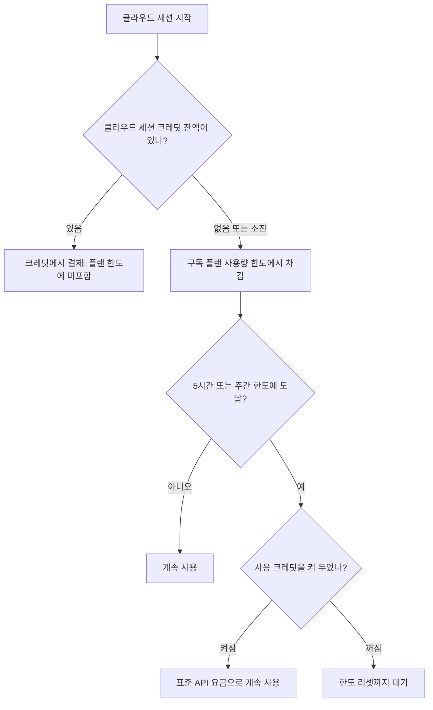

---

## 15. 상황별 선택 가이드와 실습 순서

### 15.1 어떤 환경을 고를까

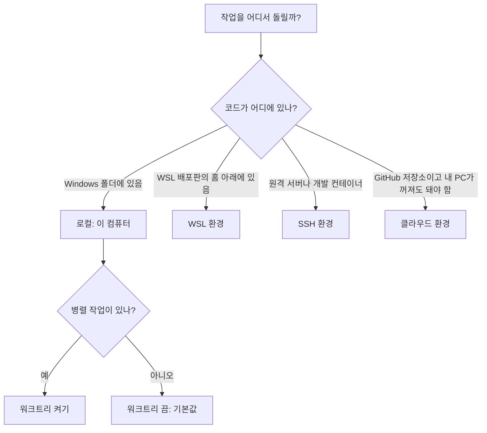

이 선택 기준은 앞에서 설명한 각 환경의 정의와 제약에서 정리한 것입니다.

### 15.2 처음 15분 따라 하기 (로컬 환경)

1. `Ctrl+N`으로 새 세션을 엽니다. 환경 선택기에서 "이 컴퓨터"나 이미 만들어 둔 저장된 환경을 고릅니다.
2. "이 컴퓨터"라면 프로젝트 폴더를 고릅니다. Git 저장소이고 병렬 작업을 할 예정이면 **워크트리**를 켭니다.
3. 큰 작업이면 권한 모드를 **Plan**으로 두고 시작해 계획을 검토합니다. 승인한 뒤 **Accept edits**나 **Manual**로 바꿔 실행합니다(문서 팁).
4. 작업이 끝나면 **Changes** 카드로 diff를 확인하고, 마음에 안 드는 줄에 코멘트를 남긴 뒤 `Ctrl+Enter`로 한꺼번에 제출합니다.
5. 커밋 전에 `/code-review`를 실행합니다. PR을 만든 뒤에는 `⋮` 메뉴에서 **Auto-fix**를 켤 수 있습니다.
6. 작업 중 궁금한 점이 생기면 `/btw`(사이드 채팅)로 본 흐름을 깨지 않고 물어봅니다.

### 15.3 처음 클라우드 세션을 시도하는 순서

1. claude.ai/code에서 로그인하고 GitHub를 연결합니다. 비공개 저장소라면 Claude GitHub App이 설치되어 있어야 합니다. `gh`를 쓰고 있다면 CLI의 `/web-setup`도 방법입니다.
2. Default 환경이 만들어졌는지 확인합니다. 패키지 설치만 필요하다면 기본값(Trusted)으로 충분합니다.
3. 데스크톱의 환경 선택기에서 **Cloud** 아래 환경을 고르고, 입력창 아래 줄에서 저장소(와 브랜치)를 고릅니다.
4. 구체적으로 작업을 적습니다. 문서의 권고는 파일이나 함수 이름을 명시하고, 에러 출력을 붙여 넣고, 증상뿐 아니라 기대 동작을 설명하라는 것입니다.
5. 권한 모드는 클라우드에서 선택 가능한 **Accept edits, Plan, Auto** 중에서 정합니다.
6. 작업이 끝나면 diff를 검토하고 **Create PR**로 PR을 만들거나 같은 세션에서 추가 지시를 이어 갑니다.

### 15.4 클라우드 환경을 처음 커스터마이즈할 때

의존성 설치가 필요하면 설정 스크립트에 넣고, **5분 안에 끝나는지** 확인합니다. 비밀 키는 환경 변수가 아니라 네트워크 시크릿에 넣습니다. 도메인이 막히는 문제가 생기면 **Custom** 접근에 필요한 도메인을 추가합니다. 설정 스크립트에 큰 다운로드가 있다면 SessionStart 훅으로 옮겨 백그라운드로 받게 하는 방법이 문서에 안내되어 있습니다.

---

## 16. 흔한 문제와 점검 목록

**환경 선택기가 입력창 아래에 없다.** 이전 레이아웃을 쓰고 있을 가능성이 큽니다. 이전 레이아웃에서는 선택기가 입력창 위에 있고 저장된 로컬·SSH 환경이 없습니다. 앱을 최신 버전으로 업데이트합니다(Windows는 **Help > Check for Updates…**).

**목록에 내가 만들지 않은 환경이 있다.** 현재 레이아웃을 처음 열 때 Desktop이 최근 한 달간 자주 쓴 폴더를 기준으로 최대 8개를 자동 생성한 것입니다. 톱니바퀴로 편집하거나 삭제하면 됩니다.

**"이 컴퓨터"가 회색이다.** 조직이 로컬 세션을 끈 경우입니다. 관리자에게 문의하거나 SSH·클라우드를 사용합니다.

**Windows에서 시작이 안 된다.** Git for Windows가 설치되어 있는지 확인하고 앱을 재시작합니다.

**PATH의 프로그램을 못 찾는다.** Windows에서는 Desktop이 PowerShell 프로필을 읽지 않으므로 사용자/시스템 환경 변수로 설정하고 Desktop을 완전히 종료한 뒤 다시 엽니다.

**클라우드 세션이 시작되지 않는다.** 설정 스크립트가 0이 아닌 코드로 끝나면 세션이 시작되지 않습니다(`set -x`로 어느 명령인지 확인, 중요하지 않은 명령 뒤에 `|| true`). 패키지 설치가 막히면 네트워크 접근 수준이 None은 아닌지 확인합니다. 설정이 5분을 넘기면 세션이 멈추거나 일반 컨테이너 오류가 날 수 있습니다.

**클라우드 목록에 저장소가 안 보인다.** 브라우저로 GitHub를 연결했다면 비공개 저장소는 Claude GitHub App이 설치된 계정·조직에서만 보입니다. 조직이라면 조직 소유자의 승인이 필요할 수 있습니다.

**Claude Code가 "계정에서 사용할 수 없다"고 한다.** 선택한 조직의 좌석에 Claude Code가 포함되지 않은 것입니다. 다른 조직에 속해 있다면 **Switch organization**을 쓰고, 그렇지 않으면 소유자에게 좌석 배정을 요청합니다.

**WSL 세션에서 터미널이나 커넥터가 안 보인다.** 현재 WSL 세션에서 지원되지 않는 기능입니다(9.4절).

**PR의 Merge when ready가 안 켜진다.** `gh` 설치와 인증, 저장소의 자동 머지 허용 설정을 확인합니다. SSH·WSL 세션에서는 비활성이므로 GitHub에서 직접 자동 머지를 켭니다.

**세션을 보관했더니 작업이 사라졌다.** 워크트리의 커밋되지 않은 변경은 보관 시 사라질 수 있습니다. 보관 전에 커밋합니다.

---

## 17. 단축키 (Windows 기준)

문서는 macOS 키를 기본으로 적고, Windows·Linux에서는 `Cmd`→`Ctrl`, `Cmd+Option`→`Alt`, `Cmd+Ctrl`→`Ctrl+Alt`로 바꿔 읽으라고 안내합니다. `Ctrl`로 시작하는 단축키는 모든 플랫폼에서 같습니다. `Ctrl+/`를 누르면 앱 안에서 전체 목록을 볼 수 있습니다.

| 동작 | Windows 키 |
| --- | --- |
| 새 세션 | `Ctrl+N` |
| 세션 전환 | `Ctrl+Tab` / `Ctrl+Shift+Tab` |
| 다음/이전 세션 | `Ctrl+Shift+]` / `Ctrl+Shift+[` |
| 새 세션 화면에서 환경 선택 | `Alt+1`~`Alt+9` |
| 새 환경 대화상자 | `Alt+0` |
| Claude 응답 중지 | `Esc` |
| diff 패널 토글 | `Ctrl+Shift+D` |
| 브라우저 패널 토글 | `Ctrl+Shift+B` |
| 터미널 패널 토글 | `Ctrl+\`` |
| 포커스된 패널 닫기 | `Ctrl+\` |
| 사이드 채팅 열기 | `Ctrl+;` |
| 대화 보기 모드 순환 | `Ctrl+O` |
| 권한 모드 메뉴 | `Ctrl+Shift+M` |
| 모델 메뉴 | `Ctrl+Shift+I` |
| 추론 강도(Effort) 메뉴 | `Ctrl+Shift+E` |
| 분할 보기에서 세션 빼기 | `Ctrl+Alt+W` |
| 제안된 프롬프트 수락 | `Tab` 또는 `→` (입력창이 비었을 때) |

---

## 18. 확인하지 못한 것과 한계

문서화되지 않았거나 이 조사에서 확인하지 못한 부분을 정직하게 밝혀 둡니다.

사이드바 폴더 이름 옆의 구름 모양 아이콘과 화살표가 정확히 무엇을 뜻하는지는 공식 문서에서 찾지 못했습니다. 보여 주신 화면의 "프로젝트 이름의 저장된 환경" 환경이 자동 생성인지 직접 생성인지도 화면만으로는 알 수 없습니다. "중간"이 Effort 단계라는 해석은 위치와 문서 설명에 근거한 것이며, 모델 선택기를 열면 바로 확인할 수 있습니다. 저장된 환경·중첩 세션이 도입된 정확한 날짜는 공식 문서에 날짜가 없어 확인하지 못했습니다(외부 보도에서 최근 도입으로 다뤄졌을 뿐입니다). 데스크톱 문서 전체는 매우 길어 일부 하단 섹션(예: 이전 레이아웃 확인 방법의 세부 절차, 관리 설정 세부 사항, 예약 작업 페이지)은 이 가이드에서 다루지 않았습니다. 이 서비스는 빠르게 바뀌고 있어 UI 문구와 단계는 앱 버전에 따라 다를 수 있습니다. 구체적인 버전 의존 조건(예: SSH의 OpenSSH 연결에 필요한 앱 버전)은 문서에 적힌 최소 버전을 그대로 옮겼으므로, 문제가 생기면 앱 업데이트부터 해 보세요.

---

## 19. 출처 (제1부)

- Desktop application (Claude Code Docs): https://code.claude.com/docs/en/desktop
- Claude Code Desktop in WSL: https://code.claude.com/docs/en/desktop-wsl.md
- Configure cloud environments: https://code.claude.com/docs/en/cloud-environments
- Get started with Claude Code in the cloud: https://code.claude.com/docs/en/web-quickstart
- Run parallel sessions with worktrees: https://code.claude.com/docs/en/worktrees.md
- Choose a permission mode: https://code.claude.com/docs/en/permission-modes
- Redesigning Claude Code on desktop for parallel agents (Anthropic): https://claude.com/blog/claude-code-desktop-redesign
- Auto mode for Claude Code (Anthropic): https://claude.com/blog/auto-mode
- Cloud sessions bonus credit promotion (Claude Help Center): https://support.claude.com/en/articles/17152539-cloud-sessions-bonus-credit-promotion
- Manage usage credits for paid Claude plans (Claude Help Center): https://support.claude.com/en/articles/12429409
- 클라우드 세션 정식화 및 크레딧 관련 보도: https://pasqualepillitteri.it/en/news/17933/claude-code-cloud-sessions-credit-250-dollars
- 저장된 환경·중첩 세션 관련 보도(검색 요약 기준, 본문 직접 열람은 차단됨): https://pasqualepillitteri.it/en/news/24032/claude-code-desktop-nested-sessions-environments

---

# 제2부. Claude Code CLI 환경 구성 가이드

- 이 부는 제1부(데스크톱 앱 환경 구성 가이드)에 이어, 데스크톱 앱의 Code 탭에서 고르던 환경(Local, Cloud, SSH, WSL)과 권한 모드, 워크트리 같은 개념이 **터미널의 `claude` 명령에서는 어떤 명령어, 옵션, 설정 파일로 대응되는지**를 설명합니다.
- 기준일은 2026-10-28이며, 모든 내용은 Anthropic 공식 문서(code.claude.com)를 이날 직접 확인한 것입니다. 확인하지 못한 항목은 이 부의 14절에 따로 모았습니다.

---

## 0. 먼저 알아두면 좋은 것

CLI(Command Line Interface)는 터미널에서 `claude`라고 입력해서 쓰는 Claude Code입니다. 데스크톱 앱과 CLI는 **같은 엔진**이며, 공식 설정 문서도 "터미널, VS Code, JetBrains 확장, 데스크톱 앱이 모두 같은 설정 파일을 읽는다"고 밝힙니다. 그래서 CLI에서 한 번 만들어 둔 설정(`~/.claude/settings.json`, `CLAUDE.md`, MCP 서버 등록)은 데스크톱 앱에서도 그대로 적용되고, 반대도 마찬가지입니다.

다만 한 가지 차이가 있습니다. 데스크톱 앱은 환경을 **화면의 선택 상자**로 고르게 해 주지만, CLI는 **명령어 옵션과 설정 파일**로 같은 일을 합니다. 이 문서는 그 번역표라고 생각하시면 됩니다.

이 부는 Windows와 Claude Pro 요금제 환경을 기준으로 예시를 들었고, macOS나 Linux에서 다른 점은 그때그때 짚었습니다.

---

## 1. CLI 환경 구성의 큰 그림

CLI에서 "환경을 구성한다"는 말은 결국 아래 다섯 층을 차례로 갖추는 일입니다. 위에서 아래로 갈수록 "한 번 해 두면 거의 건드리지 않는 것"이고, 아래에서 위로 갈수록 "세션마다 바꾸는 것"입니다.

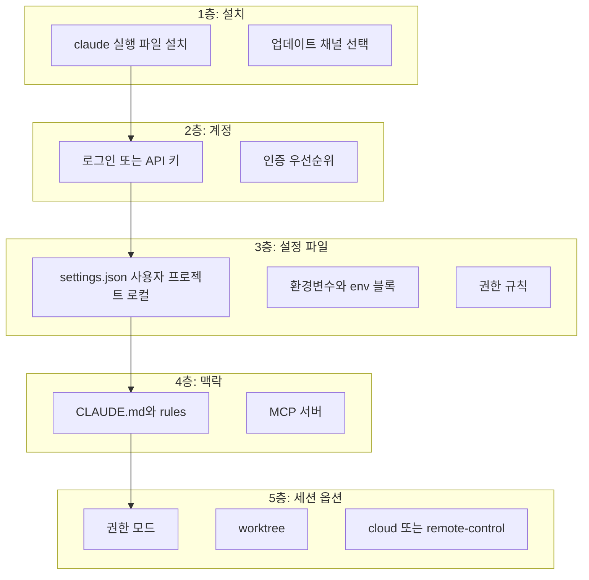

다음 절부터 이 순서대로 설명합니다.

---

## 2. 1층 — 설치

### 2.1 시스템 요구사항

공식 문서가 밝힌 요구사항은 다음과 같습니다.

- 운영체제: macOS 13.0 이상, Windows 10 1809 이상(또는 Windows Server 2019 이상), Ubuntu 20.04 이상, Debian 10 이상, Alpine Linux 3.19 이상
- 하드웨어: RAM 4GB 이상, x64 또는 ARM64 프로세서
- 네트워크: 인터넷 연결 필수
- 셸: Bash, Zsh, PowerShell, CMD 중 하나

### 2.2 권장 방법인 네이티브 설치

운영체제와 쓰는 셸에 따라 명령이 다릅니다. **지금 열어 둔 터미널이 무엇인지**가 가장 흔한 실수 지점이어서, 먼저 그것부터 구분해야 합니다. Windows에서 프롬프트가 `PS C:\`로 시작하면 PowerShell이고, `PS` 없이 `C:\`로 시작하면 CMD입니다.

| 환경 | 설치 명령 |
| --- | --- |
| macOS, Linux, WSL | `curl -fsSL https://claude.ai/install.sh \| bash` |
| Windows PowerShell | `irm https://claude.ai/install.ps1 \| iex` |
| Windows CMD | `curl -fsSL https://claude.ai/install.cmd -o install.cmd && install.cmd && del install.cmd` |

설치 명령은 내려받는 동안 진행 상황을 보여 주지 않으니 조용해도 기다리시면 됩니다. 끝나면 **새 터미널 창을 열고** 다음을 실행합니다.

```bash
claude --version
```

`2.1.211 (Claude Code)`처럼 버전 번호가 나오면 성공입니다. "claude를 찾을 수 없다"는 메시지가 나오면 설치 폴더가 PATH에 아직 올라가지 않은 것입니다.

공식 문서가 알려 주는 오류 구분법도 알아 두면 유용합니다. PowerShell에서 CMD용 명령을 붙이면 `The token '&&' is not a valid statement separator`가 나오고, CMD에서 PowerShell용 명령을 붙이면 `'irm' is not recognized as an internal or external command`가 나옵니다. 둘 다 "셸을 잘못 골랐다"는 뜻입니다.

네이티브 설치는 **백그라운드에서 자동 업데이트**됩니다. 업데이트는 내려받은 뒤 다음에 `claude`를 시작할 때 적용됩니다.

### 2.3 그 밖의 설치 방법

- Homebrew(macOS): `brew install --cask claude-code`는 stable 채널, `brew install --cask claude-code@latest`는 latest 채널입니다.
- WinGet(Windows): `winget install Anthropic.ClaudeCode`
- Linux 패키지 매니저: apt, dnf, apk 저장소가 공식 제공됩니다.
- npm: `npm install -g @anthropic-ai/claude-code` (Node.js 22 이상 필요, `sudo`는 쓰지 말라고 경고합니다).

Homebrew와 WinGet, apt, dnf, apk로 설치하면 **자동 업데이트가 되지 않습니다.** 직접 `brew upgrade claude-code`(또는 `claude-code@latest`), `winget upgrade Anthropic.ClaudeCode`를 실행해야 합니다. 환경변수 `CLAUDE_CODE_PACKAGE_MANAGER_AUTO_UPDATE=1`을 주면 Homebrew와 WinGet에서는 Claude Code가 대신 업그레이드 명령을 실행해 줍니다.

### 2.4 Windows에서 네이티브와 WSL 중 무엇을 쓸까

공식 문서의 비교표를 풀어 쓰면 이렇습니다.

| 선택 | 필요한 것 | 샌드박싱 | 언제 적합한가 |
| --- | --- | --- | --- |
| 네이티브 Windows | 없음(Git for Windows는 선택) | 지원 안 됨 | Windows용 프로젝트와 도구를 다룰 때 |
| WSL 2 | WSL 2 활성화 | 지원됨 | 리눅스 도구 체인이나 샌드박스 실행이 필요할 때 |
| WSL 1 | WSL 1 활성화 | 지원 안 됨 | WSL 2를 못 쓸 때 |

네이티브 Windows에서는 관리자 권한이 필요 없습니다. **Git for Windows**를 설치하면 Git Bash가 생기고, Claude Code의 Bash 도구가 이를 씁니다. 설치하지 않으면 셸 도구로 PowerShell을 대신 씁니다. Claude Code가 Git Bash를 못 찾으면 설정 파일에 경로를 직접 적어 줍니다.

```json
{
  "env": {
    "CLAUDE_CODE_GIT_BASH_PATH": "C:\\Program Files\\Git\\bin\\bash.exe"
  }
}
```

WSL을 쓸 때는 **WSL 터미널 안에서** 리눅스용 설치 명령을 실행하고, `claude`도 WSL 터미널에서 실행합니다. PowerShell이나 CMD에서 실행하는 것이 아닙니다. 데스크톱 앱의 WSL 환경 선택지가 결국 이 구성을 앱 안에서 대신 열어 주는 것입니다.

### 2.5 업데이트 채널과 버전 관리

네이티브 설치의 업데이트 채널은 `autoUpdatesChannel` 설정으로 정합니다.

- `"latest"`(기본값): 새 기능이 나오는 대로 받습니다.
- `"stable"`: 대체로 1주일 정도 지난 버전을 받고, 큰 문제가 있던 릴리스는 건너뜁니다.

`/config` 메뉴의 **Auto-update channel**에서 바꾸거나 `settings.json`에 직접 적습니다.

```json
{
  "autoUpdatesChannel": "stable",
  "minimumVersion": "2.1.100"
}
```

`minimumVersion`은 "이 버전 아래로는 내려가지 않는다"는 바닥선입니다. latest에서 stable로 바꿀 때 다운그레이드가 되지 않도록 막는 용도입니다. 새로 나온 모델이 stable 채널이 제공하는 버전보다 더 새 Claude Code를 요구할 수 있다고 공식 문서가 경고하므로, 새 모델이 안 보이면 latest 채널로 옮기면 됩니다.

특정 버전이나 채널을 지정해서 설치하는 방법도 있습니다.

```bash
# macOS, Linux, WSL: stable 채널 / 특정 버전
curl -fsSL https://claude.ai/install.sh | bash -s stable
curl -fsSL https://claude.ai/install.sh | bash -s 2.1.89
```

```powershell
# Windows PowerShell: stable 채널 / 특정 버전
& ([scriptblock]::Create((irm https://claude.ai/install.ps1))) stable
& ([scriptblock]::Create((irm https://claude.ai/install.ps1))) 2.1.89
```

자동 업데이트를 끄려면 `settings.json`의 `env`에 `DISABLE_AUTOUPDATER`를 `"1"`로 둡니다. 이 값은 백그라운드 확인만 막을 뿐 `claude update`와 `claude install`은 여전히 동작합니다. **수동 업데이트까지 모두 막으려면 `DISABLE_UPDATES`를 씁니다.** 확인은 `claude doctor`에서 `Auto-updates` 줄을 보면 됩니다.

지금 바로 업데이트하려면 `claude update`를 실행합니다.

### 2.6 삭제

네이티브 설치는 실행 파일과 버전 폴더를 지우면 됩니다. macOS, Linux, WSL에서는 `~/.local/bin/claude`와 `~/.local/share/claude`이고, Windows PowerShell에서는 `%USERPROFILE%\.local\bin\claude.exe`와 `%USERPROFILE%\.local\share\claude`입니다. 설정까지 지우려면 `~/.claude` 폴더와 `~/.claude.json`을 삭제하는데, **설정, 허용한 도구, MCP 서버 구성, 세션 기록이 모두 사라지므로** 주의해야 합니다. 또 VS Code 확장, JetBrains 플러그인, 데스크톱 앱도 같은 `~/.claude/`를 쓰기 때문에 설치되어 있으면 이 폴더가 다시 만들어집니다.

---

## 3. 2층 — 로그인과 인증

### 3.1 처음 로그인

프로젝트 폴더로 이동해서 `claude`만 입력하면 브라우저가 열리면서 로그인이 시작됩니다.

```bash
cd my-project
claude
```

사용할 수 있는 계정은 Claude Pro, Max, Team, Enterprise 구독, Claude Console 계정, 그리고 Amazon Bedrock, Google Cloud, Microsoft Foundry 같은 제3자 클라우드입니다. **무료 claude.ai 요금제에는 Claude Code가 포함되지 않습니다.** Pro 요금제 사용자라면 첫 번째 경로를 따르면 됩니다.

세션 안에서는 `/login`과 `/logout`을 쓰고, 셸에서는 다음 명령을 씁니다.

```bash
claude auth login            # 로그인 (옵션: --email, --sso, --console)
claude auth status           # 현재 인증 상태 (--text 로 사람이 읽기 쉬운 형태)
claude auth logout
```

브라우저가 같은 기기에서 열리지 않는 환경(WSL2, SSH, 컨테이너 등)에서는 화면에 코드가 표시되는데, 그 코드를 터미널 프롬프트에 붙여 넣으면 됩니다.

### 3.2 자격 증명은 어디에 저장되나

- macOS: 키체인(실패하면 `~/.claude/.credentials.json`, 권한 0600)
- Linux: `~/.claude/.credentials.json`
- Windows: `%USERPROFILE%\.claude\.credentials.json`

### 3.3 인증 우선순위 — 가장 헷갈리는 부분

여러 인증 수단이 동시에 있으면 아래 순서로 먼저 걸리는 것이 쓰입니다.

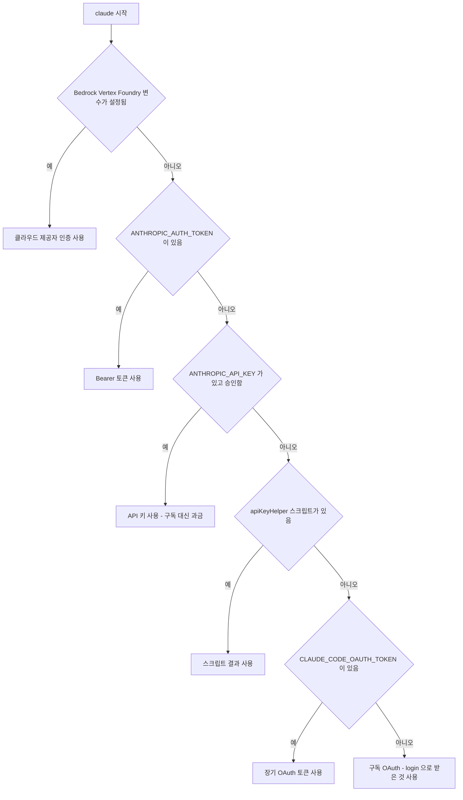

(공식 문서에는 5번과 6번 사이에 Anthropic 프로필/연합 자격 증명 항목도 있습니다. 개인 사용자는 거의 해당되지 않아 도식에서는 생략했습니다.)

**Pro 사용자가 가장 조심할 점**은 세 번째 줄입니다. 셸에 `ANTHROPIC_API_KEY`가 남아 있고 Claude Code가 처음 물었을 때 승인했다면, 로그인한 구독 대신 **API 키로 과금**됩니다. 의도하지 않았다면 `unset ANTHROPIC_API_KEY`(PowerShell에서는 `Remove-Item Env:ANTHROPIC_API_KEY`)로 지우고, 세션 안에서 `/status`로 어떤 인증이 쓰이는지 확인하세요.

`claude setup-token`은 CI 같은 자동화용 **1년짜리 토큰**을 만들어 `CLAUDE_CODE_OAUTH_TOKEN`으로 쓰게 하는 기능입니다. 구독이 필요하고, 이 토큰으로는 Remote Control 세션을 만들거나 claude.ai 커넥터를 가져올 수 없습니다.

### 3.4 계정을 여러 개 쓰고 싶을 때

`CLAUDE_CONFIG_DIR` 환경변수는 설정, 기록, 로그인이 저장되는 폴더를 바꿉니다. 폴더마다 완전히 별개의 로그인과 설정이 되므로 개인용과 회사용 계정을 나눌 수 있습니다. 공식 문서의 예시는 다음과 같습니다.

```bash
alias claude-work='CLAUDE_CONFIG_DIR=~/.claude-work claude'
```

`settings.json`의 `env` 블록에서 이 값을 줄 때는 `~`나 `$HOME`이 전개되지 않으니 절대 경로로 적어야 합니다.

---

## 4. 3층 — 설정 파일과 우선순위

### 4.1 설정 파일 네 종류

| 범위 | 파일 | 누구에게 적용 | 용도 |
| --- | --- | --- | --- |
| 사용자 | `~/.claude/settings.json` | 이 컴퓨터의 나, 모든 프로젝트 | 테마, 기본 모델, 개인 권한 규칙 |
| 공유 프로젝트 | `.claude/settings.json` | 그 폴더를 쓰는 모든 사람(git 커밋 시) | 팀 권한, 훅, 플러그인, 프로젝트 환경변수 |
| 프로젝트 로컬 | `.claude/settings.local.json` | 이 프로젝트의 나 | 개인 오버라이드, 공유 전 시험 |
| 관리형 | `managed-settings.json` 등 | 조직 전체 | 보안 정책 |

Windows에서 `~/.claude`는 `%USERPROFILE%\.claude`입니다. 설치만으로 설정 파일이 자동 생성되지는 않으며, `/config`에서 값을 바꾸거나 권한 프롬프트에서 "Yes, and don't ask again"을 고르면 처음으로 만들어집니다. 별도로 Claude Code가 스스로 관리하는 `~/.claude.json`이 있는데, 계정 정보, MCP 서버 구성, 프로젝트별 신뢰 결정이 들어 있으므로 직접 편집할 필요는 없습니다.

설정 파일은 엄격한 JSON입니다. **주석(`//`)이나 마지막 쉼표가 있으면 오류**가 납니다. 편집기 자동 완성을 원하면 맨 위에 `"$schema": "https://json.schemastore.org/claude-code-settings.json"`을 넣습니다.

### 4.2 우선순위

같은 키가 여러 곳에 있으면 위에 있는 것이 이깁니다.

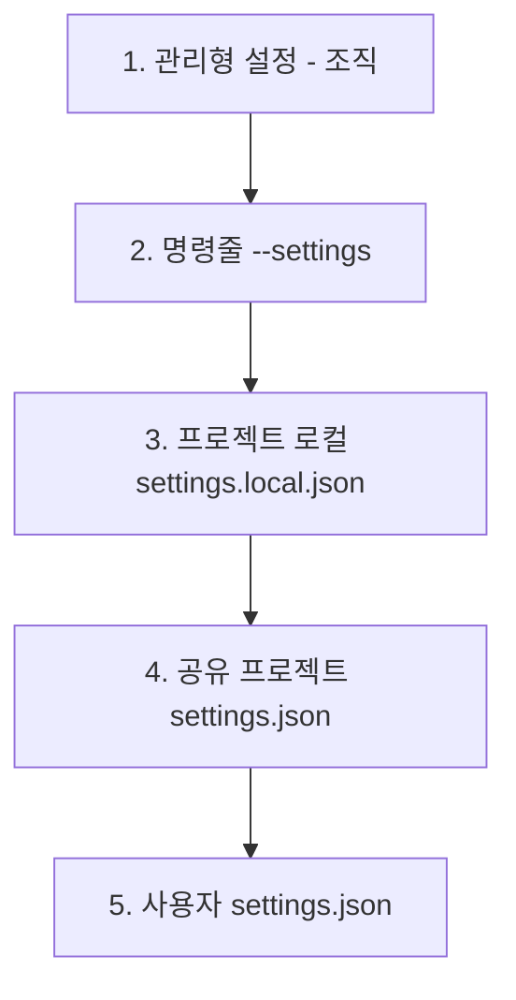

화살표는 "앞의 것이 뒤의 것을 덮어쓴다"는 뜻입니다. 몇 가지 알아둘 규칙이 있습니다.

- **목록 값은 합쳐집니다.** `permissions.allow` 같은 목록은 파일들이 서로 덮어쓰지 않고 병합됩니다.
- **환경변수는 이 서열의 일부가 아닙니다.** 키마다 짝이 되는 변수가 있고, 어느 쪽이 이길지는 키마다 다릅니다. 예를 들어 셸에서 내보낸 `ANTHROPIC_MODEL`은 어느 파일의 `model`보다 우선하고, `--model` 플래그는 둘 다 이깁니다.
- **일부 보안 키는 안전한 쪽 값이 이깁니다.** 예를 들어 `disableClaudeAiConnectors`를 어느 범위에서든 `true`로 하면 관리형이 `false`여도 `true`가 유지됩니다.
- **`permissions.defaultMode`의 `auto`와 `bypassPermissions`는 프로젝트/로컬 파일에서는 효력이 없습니다.** 사용자 또는 관리형 설정에 쓰거나, 한 세션만 `--permission-mode`로 지정해야 합니다.

### 4.3 설정을 바꾸는 세 가지 방법

1. **`/config` 메뉴**: 세션 안에서 `/config`를 열면 테마, 편집기 모드 같은 개인 옵션을 바꿀 수 있고, `/config verbose=true`처럼 한 줄로도 바꿉니다. (데스크톱 앱과 VS Code 채팅 패널에서는 열리지 않습니다.)
2. **파일 직접 편집**: 저장하면 실행 중인 세션에 대부분 바로 반영됩니다(권한, 훅, 자격 증명 도우미 포함). `model` 같은 일부 키는 `/model`, `/effort`로 바꿉니다.
3. **한 세션만 바꾸기**: 저장하지 않고 이번 실행에만 적용됩니다.

```bash
claude --settings '{"model": "claude-opus-5-5"}'
```

### 4.4 무엇이 읽혔는지 확인하기

- 세션 안: `/status`의 `Setting sources` 줄이 읽은 설정 파일을 보여 줍니다. 어느 파일이 어느 키를 줬는지까지는 알려 주지 않습니다.
- 셸: `claude doctor`는 설치 상태, 설정 파일 검증 오류, 경고를 출력합니다. 설정이 먹히지 않을 때 가장 먼저 해 볼 일입니다.

### 4.5 예시: 개인 기본 설정 한 벌

```json
{
  "$schema": "https://json.schemastore.org/claude-code-settings.json",
  "autoUpdatesChannel": "latest",
  "permissions": {
    "allow": [
      "Bash(npm run lint)",
      "Bash(npm run test *)"
    ],
    "deny": [
      "Read(./.env)",
      "Read(./.env.*)"
    ]
  },
  "env": {
    "API_TIMEOUT_MS": "1200000"
  }
}
```

---

## 5. 환경변수

환경변수는 두 가지 방법으로 줍니다. 셸에서 내보내거나(그 터미널 세션 동안 유효), `settings.json`의 `env` 블록에 적습니다(`claude`가 어떻게 실행되든 항상 적용).

```bash
# macOS / Linux / WSL
export API_TIMEOUT_MS="1200000"
claude
```

```powershell
# Windows PowerShell
$env:API_TIMEOUT_MS = "1200000"
claude
```

`env` 블록에는 규칙이 몇 가지 있습니다. `~`와 `$HOME`이 전개되지 않으므로 절대 경로를 써야 하고, 변수를 "해제"할 수는 없으며 비워 둔 문자열(`"CLAUDE_CODE_USE_VERTEX": ""`)로 덮어쓰는 방식만 가능합니다. 저장하면 실행 중인 세션에도 반영됩니다.

자주 쓰는 변수를 용도별로 정리하면 다음과 같습니다.

| 분류 | 변수 | 의미 |
| --- | --- | --- |
| 인증 | `ANTHROPIC_API_KEY` | API 키. 설정되면 구독 대신 쓰임 |
| 인증 | `ANTHROPIC_AUTH_TOKEN` | `Authorization: Bearer` 헤더 값 |
| 인증 | `CLAUDE_CODE_OAUTH_TOKEN` | 자동화용 OAuth 토큰 |
| 모델 | `ANTHROPIC_MODEL` | 사용할 모델. `--model`, `/model`이 우선 |
| 모델 | `ANTHROPIC_DEFAULT_SONNET_MODEL` 등 | `sonnet`, `opus`, `haiku` 별칭이 가리킬 모델 ID |
| 모델 | `CLAUDE_CODE_EFFORT_LEVEL` | 추론 강도. `--effort`, `/effort`보다 우선 |
| 설정 위치 | `CLAUDE_CONFIG_DIR` | 설정과 기록 폴더 변경 |
| 타임아웃 | `API_TIMEOUT_MS` | API 요청 제한(기본 600000, 10분) |
| 타임아웃 | `BASH_DEFAULT_TIMEOUT_MS` | 쉘 명령 기본 제한(기본 120000, 2분) |
| 타임아웃 | `BASH_MAX_TIMEOUT_MS` | 모델이 요청할 수 있는 최대 제한(기본 600000) |
| 네트워크 | `ANTHROPIC_BASE_URL` | 프록시나 게이트웨이 경유 |
| 텔레메트리 | `DISABLE_TELEMETRY` | 텔레메트리 거부 |
| 업데이트 | `DISABLE_AUTOUPDATER` / `DISABLE_UPDATES` | 자동 업데이트 끔 / 모든 업데이트 경로 차단 |
| 업데이트 | `CLAUDE_CODE_DISABLE_NONESSENTIAL_TRAFFIC` | 업데이트, 텔레메트리 등 비필수 통신 끔 (값이 `0`이어도 비어 있지 않으면 켜짐에 주의) |
| Windows | `CLAUDE_CODE_GIT_BASH_PATH` | Git Bash 경로 지정 |
| Windows | `CLAUDE_CODE_USE_POWERSHELL_TOOL` | PowerShell 도구 사용 여부 |

데스크톱 앱 가이드에서 언급했듯, 데스크톱 앱은 `API_TIMEOUT_MS=900000` 같은 일부 값을 스스로 설정합니다. CLI에서 쓸 때는 기본값 600000을 기준으로 생각하시면 됩니다.

---

## 6. 4층 — CLAUDE.md와 rules (프로젝트 맥락)

`CLAUDE.md`는 Claude가 매 세션 시작 때 읽는 **지침 문서**입니다. 데스크톱 앱 가이드의 "환경" 개념에는 없던 요소이지만, CLI에서는 프로젝트마다 가장 먼저 만드는 파일입니다.

### 6.1 어디에 두는가

| 범위 | 위치 |
| --- | --- |
| 관리형 정책 | macOS `/Library/Application Support/ClaudeCode/CLAUDE.md`, Linux/WSL `/etc/claude-code/CLAUDE.md`, Windows `C:\Program Files\ClaudeCode\CLAUDE.md` |
| 사용자(모든 프로젝트) | `~/.claude/CLAUDE.md` |
| 프로젝트(팀 공유) | `./CLAUDE.md` 또는 `./.claude/CLAUDE.md` |
| 로컬(개인) | `./CLAUDE.local.md` — git에 올리지 않도록 `.gitignore`에 추가 |

현재 작업 디렉터리와 그 위의 모든 디렉터리의 파일이 읽히고, 하위 디렉터리의 파일은 Claude가 그 폴더 파일을 다룰 때 필요에 따라 읽습니다. `AGENTS.md`는 CLAUDE.md가 없을 때 읽습니다(v2.1.277 이상).

### 6.2 만드는 법과 쓰는 법

- `/init`: 코드베이스를 분석해 CLAUDE.md 초안을 만들어 줍니다. `CLAUDE_CODE_NEW_INIT=1`을 주면 여러 단계로 묻는 대화형 방식이 됩니다.
- `@경로`로 다른 파일을 가져올 수 있습니다(중첩 깊이 최대 4).
- `.claude/rules/*.md` 파일에 `paths:` 머리말을 달면 특정 경로 작업 때만 적용되는 규칙을 만들 수 있고, `~/.claude/rules/`는 사용자 전체 규칙입니다.
- 파일 하나는 **200줄 이내**를 권장합니다. 길면 지침이 덜 지켜집니다.
- 블록 단위 HTML 주석은 Claude에게 전달되기 전에 제거됩니다.
- `/context`로 어떤 메모리 파일이 읽혔는지 볼 수 있습니다.

**중요한 한계**: CLAUDE.md는 "지침"이지 "강제"가 아닙니다. 반드시 막아야 하는 것은 `permissions.deny` 규칙이나 훅(PreToolUse)으로 걸어야 합니다.

---

## 7. 권한 — 데스크톱의 권한 모드를 CLI로

### 7.1 권한 모드

데스크톱 앱의 Manual, Accept edits, Plan, Auto, Bypass는 CLI에서 다음 값에 대응됩니다.

| 데스크톱 이름 | CLI 값 | 의미 |
| --- | --- | --- |
| Manual | `default` (별칭 `manual`) | 파일 수정, 명령 실행마다 물어봄 |
| Accept edits | `acceptEdits` | 파일 편집은 자동 승인 |
| Plan | `plan` | 읽기만 하고 계획을 먼저 제시 |
| Auto | `auto` | 분류기가 안전하다고 판단하는 것은 자동 진행 |
| (해당 UI 없음) | `dontAsk` | CLI 전용 값. 세부 동작은 permission-modes 문서에서 확인하지 못함 |
| Bypass | `bypassPermissions` | 권한 확인 생략 |

사용 방법은 세 가지입니다.

```bash
claude --permission-mode plan          # 이번 실행만
# 세션 중에는 Shift+Tab 으로 모드를 순환
```

기본값을 영구로 바꾸려면 `permissions.defaultMode`를 설정합니다(단, `auto`, `bypassPermissions`는 사용자 또는 관리형 설정에서만 효력). `--dangerously-skip-permissions`는 모든 확인을 건너뛰는 옵션이므로 **격리된 환경에서만** 쓰시기 바랍니다.

### 7.2 규칙 만들기: allow, ask, deny

`settings.json`의 `permissions` 아래에 `allow`(묻지 않고 허용), `ask`(항상 질문), `deny`(항상 거부)를 적습니다. 핵심 규칙은 다음과 같습니다.

- **deny가 allow보다 강합니다.** `Bash(aws *)`를 deny하면 `Bash(aws s3 ls)`를 allow해도 막힙니다. ask도 allow보다 강합니다.
- 도구 이름만 적으면 그 도구 전체(`Bash`는 `Bash(*)`와 동일), 괄호 안에 지정자를 쓰면 세부 지정입니다.
- 자주 쓰는 형태:
  - `Bash(npm run build)` — 정확히 그 명령
  - `Bash(npm run *)` — 와일드카드. 끝의 ` *`(공백 포함)는 인수 없는 명령도 포함하고, `Bash(ls*)`처럼 공백 없이 쓰면 `lsof`도 맞음에 주의
  - `Read(./.env)` — 해당 파일 읽기
  - `WebFetch(domain:example.com)` — 해당 도메인 가져오기
- 파일 규칙 경로 표기: `//절대경로`(파일시스템 루트 기준), `~/경로`(홈 기준), `경로` 또는 `./경로`(현재 디렉터리 기준). 사용자 설정에서 `Read(/secrets/**)`처럼 한 개의 `/`로 시작하면 파일시스템 루트가 아니라 설정 폴더 기준으로 해석되므로 조심해야 합니다.
- Bash 규칙은 `&&`, `||`, `;`, `|`, `&`, 줄바꿈으로 이어진 명령을 **하위 명령별로 각각** 검사합니다. 따라서 `Bash(safe-cmd *)`를 허용해도 `safe-cmd && other-cmd`는 통과하지 못합니다.
- 비밀 파일을 막으려면 `Read` deny 규칙을 씁니다. `.claudeignore` 파일은 효과가 없다고 공식 문서가 명시합니다.
- 인수를 제한하려는 Bash 패턴(`Bash(curl http://github.com/ *)` 등)은 우회가 쉬워 약합니다. 네트워크 도구는 deny하고 `WebFetch(domain:...)`로 허용 도메인만 여는 편이 낫습니다.
- 프로젝트 파일(`.claude/settings.json`)의 `allow` 규칙과 추가 디렉터리는 **각 팀원이 폴더를 신뢰(trust)한 뒤에야** 적용됩니다. `deny`, `ask`는 즉시 적용됩니다.

추가로 작업 폴더 밖 디렉터리를 쓰려면 `--add-dir <경로>` 또는 `permissions.additionalDirectories`를 사용합니다.

---

## 8. MCP 서버 등록

MCP 서버는 Claude에게 외부 도구(이슈 트래커, 데이터베이스 등)를 연결하는 장치입니다. CLI에서는 `claude mcp add`로 등록합니다.

```bash
# 원격 HTTP 서버
claude mcp add --transport http notion https://mcp.notion.com/mcp

# 로컬 프로세스(stdio): 이름 뒤 -- 다음이 실제 실행 명령
claude mcp add --transport stdio --env API_KEY=xxxx myserver -- npx -y some-mcp-server

# 관리
claude mcp list
claude mcp get myserver
claude mcp remove myserver
```

(위 서버 주소와 패키지 이름은 형식을 보여 드리기 위한 예시이며, 실제 사용 전에 각 서비스의 공식 안내로 확인하세요.)

옵션 순서에서 이름, 주소 앞에 `--transport`, `--scope`, `--env`, `--header` 같은 플래그가 먼저 와야 하고, stdio는 `--` 뒤에 실행 명령을 둡니다.

### 8.1 범위(scope)

| `--scope` | 저장 위치 | 공유 |
| --- | --- | --- |
| `local` (기본) | `~/.claude.json` 안의 해당 프로젝트 항목 | 나만, 그 프로젝트에서만 |
| `project` | 프로젝트 루트의 `.mcp.json` | 버전 관리로 팀 공유. 처음 쓸 때 승인 프롬프트 |
| `user` | `~/.claude.json` | 나만, 모든 프로젝트 |

같은 이름이 여러 범위에 있으면 local, project, user, 플러그인, claude.ai 커넥터 순으로 우선합니다. `.mcp.json`에서는 `${VAR}`와 `${VAR:-기본값}` 변수 확장을 쓸 수 있습니다.

인증이 필요한 서버는 세션 안의 `/mcp` 또는 `claude mcp login <이름>`으로 OAuth 로그인합니다. 브라우저를 열 수 없는 환경이면 `--no-browser` 옵션이 있습니다. 세션 안에서는 `/mcp`로 상태를 확인합니다.

---

## 9. 5층 — 세션을 시작할 때 쓰는 옵션

### 9.1 워크트리: `--worktree`

데스크톱 앱의 워크트리 토글에 해당합니다. 같은 저장소에서 여러 세션이 서로의 파일을 건드리지 않도록 별도 작업 폴더를 만듭니다.

```bash
claude --worktree feature-login        # 이름 지정
claude -w "#1234"                      # PR 번호로 시작
claude -w feature-login --tmux         # tmux 와 함께 (--worktree 필요)
```

데스크톱 앱 가이드에서 설명했듯 기본 경로는 `<저장소>/.claude/worktrees/<이름>`이고 브랜치는 `worktree-<이름>`입니다.

### 9.2 세션 이어하기

```bash
claude -c                # 현재 폴더의 가장 최근 대화 이어서
claude -r "세션 이름"     # 이름이나 ID로 골라 이어서
claude -n "작업명"        # 새 세션에 이름 붙이기
```

세션 안에서는 `/resume`, `/clear`, `/exit`을 씁니다.

### 9.3 모델과 추론 강도

`--model`로 모델을, `--effort`로 추론 강도를 정합니다(`low`, `medium`, `high`, `xhigh`, `max`, `ultracode`). 계속 쓰는 값은 세션 안의 `/model`, `/effort`로 저장할 수 있고, `/model` 선택기에서 `s`를 누르면 저장 없이 이번 세션만 바꿉니다.

### 9.4 한 번만 실행하고 끝내는 출력 모드

`claude -p "질문"`은 대화형 화면 없이 결과를 출력하고 종료합니다. 스크립트에 넣을 때 `--output-format`, `--max-turns`, `--max-budget-usd` 등을 함께 씁니다.

### 9.5 자주 쓰는 설정 관련 옵션

`--settings`(세션 한정 설정 JSON 또는 파일), `--setting-sources user,project,local`(어떤 설정 범위를 읽을지), `--mcp-config`와 `--strict-mcp-config`(MCP 구성 지정), `--append-system-prompt`(시스템 프롬프트에 지침 덧붙임), `--add-dir`(추가 작업 폴더), `--bare`(최소 모드, 세부 동작은 확인하지 못함)가 있습니다.

---

## 10. 클라우드와 원격 — 데스크톱 앱의 Cloud 환경을 CLI에서

데스크톱 앱에서 환경 선택 상자에 "Cloud"를 고르던 일은 CLI에서 다음과 같이 합니다.

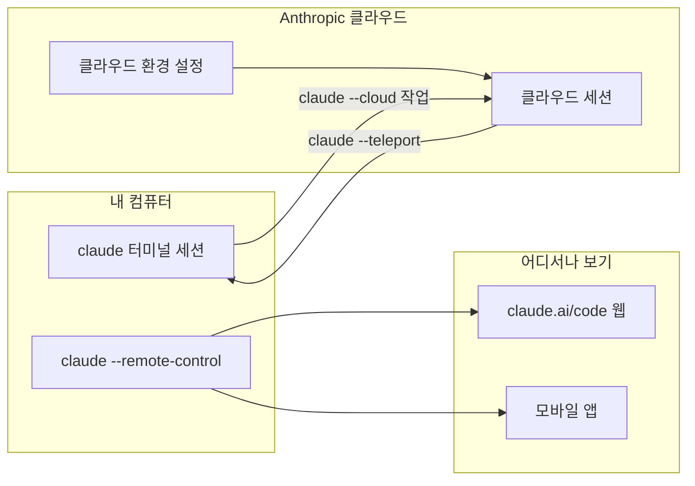

- **`claude --cloud "작업 내용"`**: 클라우드 세션을 새로 만듭니다. 세션이 Anthropic 쪽 컴퓨터에서 돌아가므로 내 컴퓨터를 꺼도 계속됩니다. (`--remote`는 더는 쓰지 않는 옛 이름입니다.)
- **`/remote-env`**: 세션 안에서 기본 클라우드 환경을 고릅니다. 선택은 사용자 설정의 `remote.defaultEnvironmentId`에 저장됩니다.
- **`/web-setup`**: 로컬 `gh` 토큰을 동기화하고 Default 환경(네트워크는 Trusted, 설정 스크립트 없음)을 만들어 줍니다. Team/Enterprise에서는 소유자가 빠른 설정을 켜지 않으면 보이지 않고, ZDR/HIPAA 조직에서는 쓸 수 없습니다.
- **`/schedule`**: 클라우드에서 도는 예약 작업을 만듭니다.
- **`claude --teleport`**: 클라우드 세션을 내 컴퓨터 터미널로 가져와 이어갑니다.
- **`--environment <ccpool_...>`**: 자체 호스팅 환경을 지정합니다(v2.1.224 이상).

CLI가 어떤 클라우드 환경을 쓸지는 `/remote-env`로 고른 값 → Anthropic이 호스팅하는 환경 → 브리지가 아닌 첫 번째 환경 순으로 정해집니다. 클라우드 환경 자체의 네트워크 수준(None, Trusted, Full, Custom), 환경변수, 설정 스크립트는 데스크톱 가이드의 클라우드 절과 같은 개념입니다. 환경변수는 `.env` 형식으로 넣고, **그 환경을 쓰는 사람이면 누구나 값을 볼 수 있다**는 점을 기억하세요.

**클라우드 세션에서는 일부 설정만 읽힙니다.** `~/.claude/settings.json`과 `.claude/settings.local.json`은 내 컴퓨터에만 있으므로 클라우드로 가지 않고, 저장소에 커밋된 `.claude/settings.json`은 (저장소 하나짜리 세션에서) 복제본에 포함되어 읽힙니다. 클라우드 세션은 항상 구독 자격 증명을 씁니다.

### 10.1 Remote Control — 내 컴퓨터에서 돌리면서 다른 기기로 보기

클라우드와 달리 **세션은 내 컴퓨터에서 계속 실행**되고, 휴대폰이나 웹 브라우저(claude.ai/code)에서 같은 세션을 보고 조작하는 기능입니다.

```bash
claude remote-control --name "내 작업"     # 서버 모드로 시작
claude --remote-control                    # 일반 세션을 시작하면서 켜기 (--rc 로 줄여 씀)
# 세션 안에서는 /remote-control
```

Remote Control은 claude.ai 구독 로그인이 필요합니다. API 키 인증이나 `setup-token`으로 만든 토큰으로는 쓸 수 없고(`full-scope` 로그인 토큰 필요), 조직 정책으로 꺼져 있으면 쓸 수 없습니다. 이 기능이 막힐 때 나오는 오류 메시지는 공식 문서의 문제 해결 절에 하나씩 정리되어 있습니다.

---

## 11. 데스크톱 앱 ↔ CLI 대응표

| 데스크톱 앱에서 하던 일 | CLI에서는 |
| --- | --- |
| 환경: Local | 그냥 `claude` 실행 |
| 환경: Cloud | `claude --cloud "작업"`, `/remote-env`, `/web-setup` |
| 환경: WSL | WSL 터미널 안에서 설치하고 실행 |
| 환경: SSH | SSH로 접속한 원격 머신에서 설치하고 실행 (또는 원격 머신에서 Remote Control) |
| 폴더 선택 | 그 폴더에서 `cd` 후 `claude`, 추가는 `--add-dir` |
| 워크트리 토글 | `--worktree` (`-w`) |
| 권한 모드 선택 | `--permission-mode`, 세션 중 `Shift+Tab`, 기본값은 `permissions.defaultMode` |
| 모델 선택 | `--model`, `/model` |
| 세션 목록에서 이어가기 | `claude -c`, `claude -r`, `/resume` |
| 클라우드 세션 가져오기 | `claude --teleport` |
| 앱 설정 화면 | `/config`, `settings.json` 직접 편집 |
| 사용량 확인 | 세션 안의 `/status` 등 (앱의 사용량 화면은 제1부 14절 참고) |
| 앱으로 전환 | `claude --desktop` (현재 디렉터리를 데스크톱 앱에서 엶, v2.1.285 이상) |

한 줄 요약: **앱의 선택 상자는 CLI에서 "옵션 한 개 또는 설정 키 한 개"입니다.** 그리고 둘이 같은 설정 파일을 공유하므로 어느 쪽에서 바꿔도 다른 쪽에 반영됩니다.

---

## 12. 따라하기 — Windows + Pro 요금제 첫 세팅 순서

아래 순서로 한 번만 해 두면 이후에는 `claude`만 입력하면 됩니다.

1. **Git for Windows 설치(권장).** 설치하면 Bash 도구가 Git Bash로 동작합니다. 리눅스 도구 체인이나 샌드박스가 필요하면 대신 WSL 2를 켜고 그 안에서 3~6단계를 진행합니다.
2. **PowerShell을 열어** `irm https://claude.ai/install.ps1 | iex` 를 실행합니다.
3. **새 터미널을 열고** `claude --version`으로 확인합니다. 안 나오면 PATH 문제입니다.
4. **`claude doctor`** 로 설치 상태를 한 번 점검합니다.
5. **프로젝트 폴더로 이동해 `claude`를 실행**하고 브라우저 로그인을 완료합니다. 세션에서 `/status`로 구독 인증이 쓰이는지 봅니다.
6. **`/init`** 으로 CLAUDE.md 초안을 만들고, 200줄 안팎으로 다듬습니다.
7. **`~/.claude/settings.json`** 에 4.5절 같은 기본 권한 규칙(자주 쓰는 안전한 명령 허용, `.env` 읽기 거부)을 넣습니다.
8. 필요한 MCP 서버를 `claude mcp add`로 등록하고 `/mcp`로 연결을 확인합니다.
9. 위험한 작업은 `--permission-mode plan`으로 먼저 계획을 받아 보고, 병렬 작업이 필요하면 `--worktree`를 씁니다.
10. 오래 걸리는 작업은 `claude --cloud`로 보내거나, 자리를 비울 때는 `--remote-control`로 휴대폰에서 이어서 봅니다.

---

## 13. 문제 해결

| 증상 | 확인할 것 |
| --- | --- |
| `claude`를 찾을 수 없음 | 새 터미널을 열었는지, 설치 폴더가 PATH에 있는지. 다른 셸용 명령을 붙였는지 |
| 설치 명령이 `403`이나 `syntax error near unexpected token '<'` | 공식 설치 문제 해결 문서의 오류 대응표 참조 |
| 구독인데 과금이 API로 됨 | `ANTHROPIC_API_KEY`가 설정되어 있는지 `/status`로 확인하고 해제 |
| 설정 값이 무시됨 | `/status`로 읽힌 파일 확인 → 더 높은 범위(관리형, `--settings`, 로컬)가 같은 키를 쓰는지 → JSON 문법 → `claude doctor` |
| 설정에 `auto`나 `bypassPermissions`를 넣었는데 효과 없음 | 프로젝트/로컬 파일에서는 무시됨. 사용자 설정 또는 `--permission-mode` 사용 |
| 팀원에게 커밋한 허용 규칙이 안 먹음 | 팀원이 폴더 신뢰(trust)를 했는지 확인 |
| Git Bash를 못 찾음 | `CLAUDE_CODE_GIT_BASH_PATH` 지정 |
| 자동 업데이트가 안 됨 | Homebrew/WinGet/패키지 매니저 설치는 수동. `claude doctor`에서 마지막 업데이트 시도 결과 확인 |
| 설정 파일이 깨졌다는 대화창 | 안내에 따라 수정. `~/.claude.json`이 깨졌다면 `~/.claude/backups/`의 최근 백업 5개 중에서 복구 |

---

## 14. 확인하지 못한 항목 (추측하지 않고 남겨 둠)

- **설정 키 전체 목록**: 개별 키의 기본값, 예시는 `settings-reference` 문서에 있으나 이번에 모두 읽지는 않았습니다.
- **훅(hooks), 샌드박스(sandboxing), 모델 설정(model-config) 세부**: 이름과 존재만 확인했고 설정 방법은 다루지 않았습니다. 필요하면 별도로 정리해 드리겠습니다.
- **환경변수 문서의 마지막 약 7,000자**: 길이 제한으로 읽지 못했습니다. 위 표는 읽은 범위 안의 것만 담았습니다. 표준 `HTTP_PROXY`, `HTTPS_PROXY` 처리 방식은 네트워크 구성 문서에서 따로 확인해야 합니다.
- **Windows의 관리형 설정 파일 위치**: CLAUDE.md의 관리형 경로(`C:\Program Files\ClaudeCode\CLAUDE.md`)는 확인했으나 `managed-settings.json`의 경로는 확인하지 못했습니다.
- **Remote Control 세부**: 요구사항과 대표 오류의 존재까지만 확인했습니다. 모바일 푸시, Trusted Devices(조직용) 등은 다루지 않았습니다.
- **가격과 사용량 한도**: 이 부에서는 다루지 않았습니다(제3부에서 자세히 다룹니다). 제1부 14절과 제3부(요금제)를 참고하세요.
- 위 8절의 MCP 서버 주소, 패키지 이름은 명령 형식을 보여 주려는 예시입니다.

---

## 15. 출처 (제2부)

- Claude Code 문서 — 고급 설치(Advanced setup): https://code.claude.com/docs/en/setup
- Claude Code 문서 — 빠른 시작(Quickstart): https://code.claude.com/docs/en/quickstart
- Claude Code 문서 — 인증(Authentication): https://code.claude.com/docs/en/authentication
- Claude Code 문서 — CLI 레퍼런스: https://code.claude.com/docs/en/cli-reference
- Claude Code 문서 — 설정 파일과 우선순위(Settings): https://code.claude.com/docs/en/settings
- Claude Code 문서 — 환경변수: https://code.claude.com/docs/en/env-vars
- Claude Code 문서 — 권한 설정(Permissions): https://code.claude.com/docs/en/permissions
- Claude Code 문서 — 메모리와 CLAUDE.md: https://code.claude.com/docs/en/memory
- Claude Code 문서 — MCP: https://code.claude.com/docs/en/mcp
- Claude Code 문서 — Remote Control: https://code.claude.com/docs/en/remote-control

---

# 제3부. Claude 요금제와 Claude Code 사용 방식, 그리고 "사용량" 화면 읽는 법

- 이 부는 제1부(데스크톱)와 제2부(CLI)에 이어, 요금제와 비용을 다룹니다. 세 가지를 설명합니다.
- 첫째, Claude의 요금제가 어떻게 나뉘는지. 둘째, Claude Code를 **구독으로 쓰는 방법, 구독에 종량 과금을 덧붙이는 방법, API(종량제)로 쓰는 방법**이 각각 무엇이고 어떻게 다른지. 셋째, 사용자가 확인한 설정 > 사용량 화면의 항목이 요금제와 어떻게 이어지는지.
- 기준일은 2026-10-28이며, Anthropic 공식 가격 페이지, 공식 도움말, 공식 개발자 문서를 이날 직접 확인했습니다. 확인하지 못했거나 출처가 공식이 아닌 내용은 반드시 그렇다고 표시했고, 이 부의 11절에 따로 모았습니다. 가격과 정책은 Anthropic이 언제든 바꿀 수 있다고 공식 페이지가 명시하므로, 결제 전에는 가격 페이지를 다시 확인하시기 바랍니다.

---

## 0. 먼저 결론부터

복잡해 보이지만 뼈대는 단순합니다.

1. Claude에는 **서로 다른 두 개의 "계산대"** 가 있습니다. 하나는 **구독**(claude.ai 계정의 Pro, Max, Team, Enterprise)이고, 다른 하나는 **API 종량제**(Claude Console 계정, 쓴 토큰만큼 과금)입니다. 둘은 계정도, 청구서도, 한도 방식도 다릅니다.
2. **구독**은 월 정액을 내고 "기간별 사용 한도"(5시간 세션 한도, 주간 한도) 안에서 마음껏 쓰는 방식입니다. 채팅, Claude Code, Cowork가 **같은 한도를 나눠 씁니다.**
3. 한도를 다 쓰면 선택지가 갈립니다. 기다리거나, 더 높은 플랜으로 올리거나, **사용 크레딧**(구독 한도를 넘는 부분만 표준 API 요금으로 따로 결제)을 켜거나, 아예 **API 종량제**로 갈아탈 수 있습니다.
4. 독자의 현재 화면은 **Pro 플랜, 사용 크레딧 꺼짐(US$0), 클라우드 세션 크레딧 US$100 보유(11월 5일 오후 4:59까지)** 상태입니다. 즉 지금은 한도를 다 쓰면 **추가 과금 없이 멈추는** 안전한 구성이고, 클라우드 세션 크레딧은 곧 만료되므로 쓸 계획이 있다면 서두르시는 편이 좋습니다.
5. 한 가지 흔한 오해를 미리 바로잡습니다. **Max와 Team에 포함된 "월간 API 크레딧"은 Claude Code에 쓸 수 없습니다.** 공식 문서가 Claude Code는 "Doesn't cover(적용되지 않음)"로 명시합니다.

---

## 1. Claude 요금제 전체 지도

### 1.1 개인용과 팀·기업용, 그리고 API

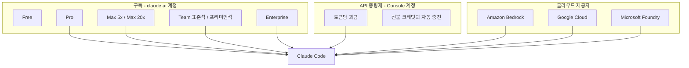

Claude Code는 이 여러 계산대 중 **어느 쪽으로 로그인했는가**에 따라 돈이 나가는 곳이 달라집니다. 이 부의 3절이 바로 그 이야기입니다.

### 1.2 플랜별 가격과 포함 내용 (2026-10-28 확인, claude.com/pricing)

| 플랜 | 월 요금 | 연간 결제 시 | 핵심 내용 |
| --- | --- | --- | --- |
| Free | $0 | 해당 없음 | 채팅, 웹 검색, 파일 생성, 코드 실행, Artifacts 등. **Claude Code 없음**, Opus 없음 |
| Pro | $20 | 월 $17 상당(선불 $200) | Free보다 많은 사용량, **Claude Code 포함**, Opus 포함, Claude in Chrome. Fable은 사용 크레딧으로만 |
| Max 5x | $100부터 | 제공 안 함 | Pro의 **5배** 사용량, 높은 출력 한도, 혼잡 시 우선 접근, **월 $100 API 크레딧**, Fable은 주간 한도의 50%까지 |
| Max 20x | 이번에 확인한 가격 페이지에는 월 요금이 따로 명시되어 있지 않음 | 제공 안 함 | Pro의 **20배** 사용량, **월 $200 API 크레딧**, Fable은 주간 한도의 50%까지 |
| Team 표준석 | $25 | 월 $20 | 2~150명 팀, Pro보다 많은 사용량, Claude Code 포함 |
| Team 프리미엄석 | $125 | 월 $100 | 표준석의 5배 사용량, Fable은 주간 한도의 50%까지 |
| Enterprise | 가격 페이지에 정액 월 요금 없음 | 좌석당 월 $20(연간 결제, 최소 20석) + **사용량은 API 요금으로 별도** | Team의 모든 것 + 지출 한도, 역할 기반 접근, SCIM, 감사 로그 등 |

표를 읽을 때 몇 가지를 짚어 둡니다.

- **"5x, 20x"는 Pro 대비 배수**입니다. 절대 사용량(토큰 수, 메시지 수)은 공식 문서에서 공개하지 않습니다. 인터넷의 "Pro는 5시간에 약 N개 메시지" 같은 숫자는 대부분 비공식 추정이므로 이 문서에서는 쓰지 않았습니다.
- Team에는 풀링(합산)되는 **월 API 크레딧**이 있고 최대 $500입니다(5절 참조).
- 결제 수단이 모바일 앱 구독이면 일부 설정을 웹에서 해야 합니다. 예를 들어 사용 크레딧은 웹에서만 켜고 구매할 수 있습니다.

### 1.3 모델별 접근 권한 — 특히 Fable

2026-10-28 기준 최신 공개 모델은 Fable 5.1, Opus 5.5, Sonnet 5.5, Haiku 5.5입니다. 이 중 상위 모델인 **Fable**의 플랜별 접근은 공식 도움말에 다음과 같이 정리되어 있습니다.

| 플랜 | Fable이 플랜 한도에 포함되는가 | 비고 |
| --- | --- | --- |
| Max | 예, 주간 한도의 **최대 50%** 까지 | 50% "추가"가 아니라 전체 주간 한도 중 Fable에 쓸 수 있는 상한입니다. 다른 모델도 같은 주간 한도에서 차감됩니다 |
| Team 프리미엄석, Enterprise 프리미엄석 | 예, Max와 동일 | |
| **Pro**, Team 표준석 | **아니요** | **처음부터 사용 크레딧으로만** 사용 가능 |
| Enterprise 표준석 | 아니요 | 사용 크레딧 필요, 조직이 사용 크레딧을 켜야 함 |

그래서 **Pro 요금제에서 Fable을 고르면, 사용 크레딧이 꺼져 있는 한 쓸 수 없고, 켜져 있다면 구독 한도가 아닌 크레딧(표준 API 요금)에서 차감**됩니다. Claude Code에서 Fable을 쓰려면 버전 2.1.170 이상이 필요하다고 공식 도움말이 안내합니다.

---

## 2. 구독 플랜의 한도 구조

### 2.1 두 겹의 시계 — 세션 한도와 주간 한도

개인 구독(Pro, Max)에는 시간 단위가 다른 두 개의 한도가 겹쳐 있습니다.

- **세션 한도**: **5시간**마다 초기화됩니다. 짧은 시간에 몰아서 쓰는 것을 막는 한도입니다.
- **주간 한도**: 일주일에 한 번 초기화됩니다. 길게 보아 총량을 제한하는 한도입니다.
- **Fable 주간 한도**(Max 전용): 주간 한도와 별개로 존재하며 마찬가지로 일주일 주기로 초기화됩니다.

어느 한쪽이라도 다 쓰면 그 시점에 제한이 걸립니다. **채팅(Claude 웹·앱), Claude Code, IDE 사용이 모두 같은 한도에서 차감**된다고 공식 도움말이 밝힙니다. 이 점이 독자의 사용량 화면 읽기와 직결되므로 4절에서 다시 다룹니다.

### 2.2 한도에 걸렸을 때 일어나는 일

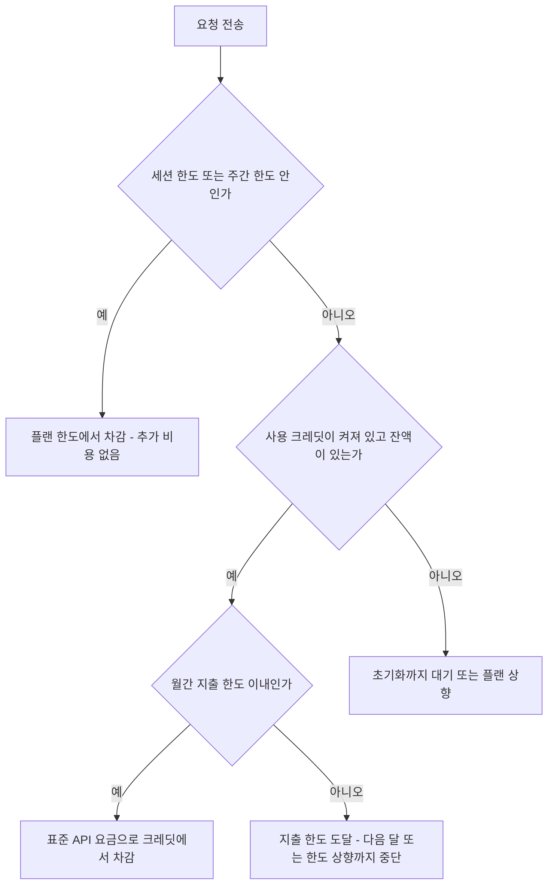

- 사용 크레딧이 **꺼져 있으면** 한도에 걸린 뒤에는 "초기화될 때까지 기다리기"가 기본 동작입니다. 과금이 생기지 않습니다.
- 사용 크레딧이 **켜져 있고 잔액이 있으면** 요청이 멈추지 않고 이어지며, 초과분만 **표준 API 요금**으로 차감됩니다. 사용 크레딧은 한도의 초기화 시각을 바꾸지 않습니다.
- 한도 확인은 요청 **전**에, 토큰 계산은 요청 **후**에 이뤄지므로 월간 지출 한도를 **약간 넘길 수 있고**, 그 다음 요청부터 막힌다고 공식 도움말이 설명합니다.
- Claude Code는 5시간 한도에 걸린 순간 이미 진행 중이던 응답이면 **마무리 허용량**("Usage limit reached · wrapping up")을 줄 수 있습니다. 작은 용량이고 주간 한도에 포함되며, 새 메시지에는 적용되지 않습니다. Pro는 주간 기간당 한 번, Max는 5시간 한도에 걸릴 때마다 적용될 수 있다고 하며, 점진적으로 배포 중이라고 합니다.

### 2.3 한도에 걸렸을 때 선택지 (공식 안내 요약)

- **Pro**: Max 5x로 올리기 / 사용 크레딧 켜기 / Console 계정으로 바꿔 API 크레딧 구매하기 / 초기화 기다리기
- **Max**: 5x에서 20x로 올리기 / 사용 크레딧 켜기 / Console 계정으로 바꾸기 / 기다리기

---

## 3. Claude Code를 쓰는 방법 — 돈이 나가는 곳 기준으로 구분하기

공식 비용 문서는 첫 줄에서 "Claude Code는 **API 토큰 소비량**을 기준으로 과금된다"고 말합니다. 구독 플랜에서는 그 토큰 비용이 월정액 안에 포함되어 한도로 표현될 뿐이고, 구독이 아닌 경로에서는 토큰만큼 실제 청구됩니다. 아래 여섯 가지가 Claude Code가 돈을 쓰는 경로입니다.

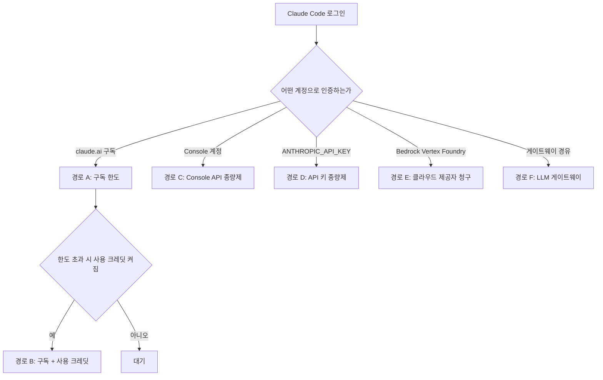

### 3.1 경로 A — 구독 한도 안에서 쓰기 (독자의 현재 방식)

`claude`를 실행해 브라우저로 로그인하면 이 경로입니다. Pro라면 월 $20 안에서 5시간 세션 한도와 주간 한도가 적용됩니다. 데스크톱 앱의 Code 탭, CLI, VS Code 확장이 모두 같은 구독 한도를 씁니다.

한 가지 알아둘 점은 CLI의 `/usage` 명령입니다. 이 명령 위쪽의 **Session 블록은 API 토큰 기준으로 계산한 금액**을 보여 주는데, 공식 문서는 Pro와 Max 사용자에게는 "구독에 포함되어 있으므로 **이 비용 수치는 청구와 무관하다**"고 설명합니다. 구독자는 같은 화면의 플랜 사용량 막대와 활동 통계, 사용 내역 분석을 봐야 합니다. 이 금액은 정가 기준의 **추정치**일 뿐 청구서가 아닙니다.

### 3.2 경로 B — 구독 + 사용 크레딧 (한도 초과분만 종량 과금)

사용 크레딧은 "구독을 유지한 채, 한도를 넘는 부분만 종량으로 이어서 쓰는" 장치입니다. 공식 도움말의 핵심은 다음과 같습니다.

- 대상: Pro, Max 5x, Max 20x 개인 구독자(Team, Enterprise는 조직 설정).
- 과금 기준: **표준 API 요금**. 구독료와 **별도 청구**되어 추가 요금으로 나타납니다.
- 켜는 곳: **설정 > 사용량 > 사용 크레딧 > 활성화** → 결제 수단 등록 → 월간 지출 한도 설정(또는 무제한) → **자금 추가**(구독 한도를 넘는 사용에는 **선불 잔액이 필요**) → 필요하면 **자동 충전** 켜기.
- 월간 지출 한도: 한 달에 크레딧으로 쓸 최대 금액입니다. "한도 조정"에서 정하거나 "무제한"으로 둘 수 있고, 한도에 가까워지면 알림이 갑니다.
- 자동 충전: 잔액이 임계값 아래로 내려가면 자동 구매합니다. 꺼 두면 잔액이 바닥나거나 월 지출 한도에 닿을 때까지만 이어집니다.
- 만료: 대부분 만료되지 않습니다(일본은 구매 후 6개월 후 만료, 2026-09-10부터). 만료 7일 전에 메일이 갑니다.
- 적용 제품: 채팅, **Claude Code**, 리서치 모드, 프로젝트·파일(토큰으로 계산되므로). 제3부가 읽은 도움말 문서에서는 Cowork가 사용 크레딧을 차감하는지는 명시적으로 확인되지 않았습니다.
- 구독 앱에서 켜는 대신, **Claude Code 안에서 `/usage-credits`** 를 실행하면 설정 > 사용량 페이지가 브라우저로 열립니다(claude.ai 구독으로 `/login` 했을 때만, API 키 인증에서는 사용 불가). Pro와 Max에서는 지출 한도에 닿았을 때 CLI 안에서 한도를 올리거나 없애도록 안내하기도 합니다.

**Pro 요금제에서 Fable을 쓰려면** 이 경로가 사실상 필수입니다(1.3절).

### 3.3 경로 C — Claude Console 계정으로 API 종량제

Console(platform.claude.com) 계정으로 Claude Code에 로그인하면 구독이 아니라 **토큰 사용량만큼 청구**됩니다. 공식 비용 문서의 안내는 이렇습니다.

- 처음 인증하면 Console에 **"Claude Code"라는 전용 워크스페이스**가 자동으로 만들어집니다. 이 워크스페이스에서는 API 키를 따로 만들 수 없고, Claude Code 인증과 사용량 집계 전용입니다.
- 비용 확인: Console 사용량 페이지. 상한 설정: **워크스페이스 지출 한도**.
- 한도 도달 시: 구독 로그인 상태였다면 Claude Code가 API 크레딧으로 이어갈지 물어볼 수 있고, Console 계정의 **자동 충전**이 켜져 있으면 크레딧이 자동으로 추가됩니다(관리는 Console 결제 설정에서, Claude Code가 아님).
- 구독으로 돌아오기: Claude Code에서 `/login` 후 Pro 또는 Max 계정으로 로그인.

### 3.4 경로 D — 환경변수 `ANTHROPIC_API_KEY`로 API 키 직접 사용

제2부에서 설명한 인증 우선순위의 3순위입니다. 이 변수가 설정되어 있고 처음 물었을 때 승인하면 **로그인한 구독보다 API 키가 우선**하여 API 요금이 청구됩니다. 구독 한도를 쓰고 싶다면 변수를 해제해야 하고, `/status`로 현재 인증을 확인할 수 있습니다. 공식 도움말도 "API 키가 설정되어 있으면 구독 대신 API 키를 쓰며, 플랜 사용량이 아닌 API 사용량으로 청구된다"고 분명히 말합니다.

### 3.5 경로 E — Amazon Bedrock, Google Cloud, Microsoft Foundry

기업이 이미 쓰는 클라우드 계정으로 Claude를 호출하는 방식입니다. **토큰당 클라우드 계정으로 청구**되고, 지출 통제는 해당 클라우드의 결제 콘솔과 예산 기능으로 합니다. Claude Code는 이 경우 지표를 Anthropic으로 보내지 않으므로 Anthropic의 분석 대시보드에는 잡히지 않고, 사용자별 비용 집계는 OpenTelemetry나 게이트웨이로 해야 합니다. **`--cloud`, `--teleport` 같은 클라우드 세션 기능은 이 경로에서는 쓸 수 없습니다**(Anthropic 계정 필요).

### 3.6 경로 F — LLM 게이트웨이, Claude apps gateway

회사가 프록시를 두고 모든 Claude Code 트래픽을 통과시켜 **키 단위로 비용을 집계·제한**하는 방식입니다. 공식 비용 문서는 오픈소스 LiteLLM 사례를 언급하면서, 이 프로젝트가 Anthropic과 무관하고 보안 감사를 받지 않았다고 주의를 줍니다. 자체 호스팅하는 Claude apps gateway는 사용자별 사용량 귀속과 사용자별 지출 한도를 제공한다고 합니다. 개인 사용자에게는 보통 해당되지 않습니다.

### 3.7 클라우드 세션은 별도 요금이 아니다

`claude --cloud`나 데스크톱 앱의 Cloud 환경에서 돌리는 클라우드 세션은 **구독 한도에 합산**되고 "클라우드 VM에 대한 별도 요금은 없다"고 공식 문서가 밝힙니다. 병렬로 여러 세션을 돌리면 그만큼 한도가 빨리 소모됩니다. Pro, Max, Team 플랜(그리고 일부 Enterprise 좌석)에서 쓸 수 있습니다. 독자 화면의 **"클라우드 세션 크레딧"** 은 이 클라우드 세션에 한해 먼저 차감되는 별도 크레딧인데, 4.5절에서 따로 설명합니다.

### 3.8 반드시 알아야 할 함정 — 월간 API 크레딧은 Claude Code에 쓸 수 없다

Max와 Team에는 "월간 API 크레딧"이 포함되어 있습니다(Max 5x $100, Max 20x $200, Team은 표준석 $20·프리미엄석 $100을 합산해 최대 $500). 하지만 이 크레딧은 **Claude API, Managed Agents, Agent SDK, Console 플레이그라운드**에서만 쓸 수 있고, **Claude Code와 Claude 앱의 사용 크레딧에는 쓸 수 없다**고 공식 개발자 문서가 표로 명시합니다. 또 청구 주기 말에 소멸하고 이월되지 않습니다. 이 크레딧이 필요한 사람은 자기 서비스를 API로 만드는 개발자이지, Claude Code만 쓰는 사람이 아닙니다. (독자는 Pro라서 애초에 이 크레딧 대상이 아닙니다.)

### 3.9 여섯 경로 한눈에 비교

| 경로 | 로그인·설정 | 돈이 나가는 곳 | 한도 방식 | 한도 초과 시 |
| --- | --- | --- | --- | --- |
| A 구독 | claude.ai 계정 | 월 구독료 | 5시간 + 주간 한도 | 대기 또는 업그레이드 |
| B 구독+사용 크레딧 | A + 설정에서 크레딧 켜기 | 구독료 + 크레딧(API 요금) | A와 동일, 초과분만 크레딧 | 월 지출 한도까지 이어짐 |
| C Console | Console 계정 | 선불 크레딧 | 워크스페이스 지출 한도 | 잔액·한도 도달 시 중단 |
| D API 키 | `ANTHROPIC_API_KEY` | API 계정 | API 계정 한도 | 계정 설정에 따름 |
| E 클라우드 제공자 | `CLAUDE_CODE_USE_BEDROCK` 등 | 클라우드 청구서 | 클라우드 예산 | 클라우드 설정에 따름 |
| F 게이트웨이 | 프록시 경유 | 게이트웨이 정책 | 키별 지출 제한 | 게이트웨이 정책 |

---

## 4. 사용량 화면 항목별 해설 (독자의 실제 수치 기준)

설정 > 사용량 화면을 위에서 아래로 한 항목씩 풉니다. 아래 수치는 2026-10-28 오전에 확인한 사용자 화면의 값입니다.

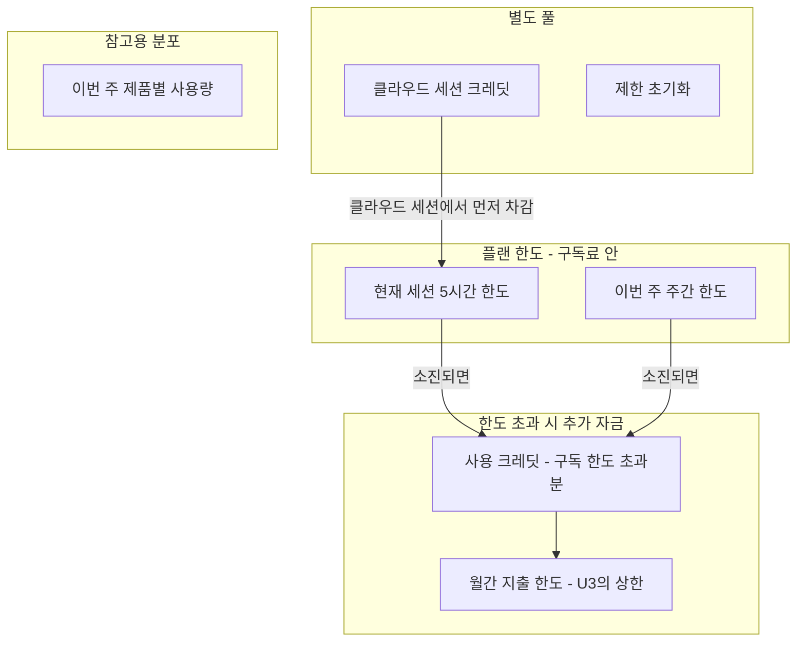

### 4.1 상단 문구와 "Pro" 배지

"순조롭습니다. 금요일에 초기화될 때까지 여유 있게 사용하실 수 있을 것으로 보입니다."는 현재 소진 속도를 보고 이번 주 한도 안에서 끝낼 것 같다는 **예상 메시지**입니다. 배지의 **Pro**는 독자가 **월 $20 Pro 구독자**임을 뜻하고, 아래 모든 항목은 이 플랜의 규칙을 따릅니다.

### 4.2 현재 세션 — 13% 사용됨, 오후 1:20에 초기화

2.1절의 **5시간 세션 한도**입니다. 13%를 썼고 오늘 오후 1:20에 새로 채워집니다. 세션 한도는 "5시간짜리 창"이므로, 이 시각이 지나면 막대가 비워집니다. 짧은 시간에 Claude Code나 Cowork를 크게 돌리면 이 막대가 먼저 차오릅니다.

### 4.3 이번 주 — 46% 사용됨, 금요일 오후 12:00에 초기화

2.1절의 **주간 한도**입니다. 일주일 누적 46%를 썼고 금요일 정오에 초기화됩니다. 오늘이 수요일(10월 28일)이므로 이틀 남짓에 나머지 54%가 남아 있는 셈입니다. 주간 한도는 세션 한도와 **별개로 먼저 소진될 수 있고**, 어느 쪽이든 먼저 다 쓰면 제한이 걸립니다.

### 4.4 제한 초기화 — "현재 초기화 없음"

화면 문구는 "받으시면 만료일과 함께 여기에 표시됩니다."입니다. 즉 **한도를 되돌려 주는 보상 같은 항목이 부여되면 이 자리에 나타나는 공간**으로 읽힙니다. 다만 이 항목의 정의를 설명한 공식 문서는 이번 조사에서 찾지 못했습니다. 지금은 "받은 것이 없다"는 상태이고, 제가 아는 한 그 이상의 의미를 단정할 수는 없습니다(11절 참조).

### 4.5 클라우드 세션 크레딧 — US$100 중 US$100 남음, 11월 5일 오후 4:59(GMT+9) 만료

화면 설명은 "클라우드 세션에 자동으로 적용됩니다. 모두 사용했거나 만료된 후에는 플랜의 일반 사용량이 적용됩니다."입니다. 이를 풀어 쓰면 다음과 같습니다.

- **어디에 쓰이나**: Claude Code의 **클라우드 세션**(`claude --cloud`, 데스크톱 앱의 Cloud 환경, claude.ai/code)에서 **자동으로 먼저** 차감됩니다. 로컬 세션이나 채팅에는 적용되지 않습니다(화면 문구 기준).
- **다 쓰거나 만료되면**: 클라우드 세션도 일반 구독 한도(4.2, 4.3의 막대)에서 차감됩니다. 추가 청구가 생기는 것이 아닙니다.
- **현재 상태**: 한 번도 쓰지 않아 $100이 그대로 있습니다. 만료까지 약 **8일**(2026-10-28 → 2026-11-05 오후 4:59 KST) 남았습니다.
- **이 크레딧의 출처**: 이후 확인한 공식 도움말(「Cloud sessions bonus credit promotion」, support.claude.com/en/articles/17152539)에 조건이 명시되어 있습니다. 개인 Pro $100, Max $250, 2026-09-23 시작, 신청 마감 2026-10-07(PT), **만료 2026-11-04 오후 11:59 PT**, **크레딧이 남아 있는 동안 클라우드 세션 사용량은 플랜 한도에 합산되지 않음**, 소진·만료 후에는 일반 플랜 한도 적용, 프로젝트·예약 작업·Remote Control·채팅·Cowork에는 적용되지 않음. 자세한 내용은 제4부 8절을 참고하세요.

활용 팁: 이 크레딧은 **소멸하는 공짜 자원**입니다. 구독 한도(주간 46% 소진)를 아끼면서 시험해 볼 만한 작업(저장소 하나를 대상으로 한 리팩터링, 테스트 보강, 문서 정리 같은 자율 작업)이 있다면 11월 5일 전에 `claude --cloud "작업 설명"`으로 보내는 것이 이득입니다. 구체적인 방법은 제2부 10절에 있습니다.

### 4.6 사용 크레딧 — US$0, 토글 꺼짐

3.2절의 **사용 크레딧**입니다. 지금 **꺼져 있고 잔액이 0**입니다. 화면 설명대로 "모든 작업에 사용할 수 있습니다. 프로모션 크레딧이 구매한 크레딧보다 먼저 사용됩니다." 그리고 토글 문구는 "플랜 한도에 도달해도 Claude를 계속 사용하려면 사용 크레딧을 켜세요."입니다.

**지금 구성의 의미**는 분명합니다. 한도(4.2, 4.3)를 다 쓰면 **추가 청구 없이 멈추고 초기화를 기다립니다.** 비용 사고가 날 수 없는 보수적인 구성입니다. 반면 이 상태에서는 Pro로 **Fable을 쓸 수 없습니다**(1.3절). 한도를 넘어도 작업을 끊기고 싶지 않거나 Fable이 필요하면 토글을 켜고 선불 잔액을 넣어야 합니다. "사용 크레딧 구매 · 최대 30% 할인" 버튼은 그 잔액을 사는 곳인데, 할인 조건의 세부 내용은 확인하지 못했습니다.

### 4.7 월간 지출 한도 — 이번 달 US$200 중 US$0.00, 자동 충전 꺼짐

3.2절의 **월간 지출 한도**입니다. 사용 크레딧으로 한 달에 쓸 수 있는 **상한이 US$200**으로 설정되어 있고 지금까지 US$0.00을 썼으며, 자동 충전은 꺼져 있습니다. 화면 설명은 "플랜 한도를 초과하면 이 한도까지 크레딧이 자동으로 차감됩니다."입니다.

여기서 주의할 점이 있습니다. **이 US$200은 "자동으로 청구되는 금액"이 아니라 "쓸 수 있는 최대 금액"** 입니다. 구독 한도를 넘는 사용은 **선불 잔액이 있어야** 크레딧에서 차감되고(공식 도움말), 지금 잔액이 US$0이며 토글이 꺼져 있으므로 실제로는 아무 일도 일어나지 않습니다. 나중에 토글을 켠다면 이 상한을 본인 예산에 맞게 낮추는 것을 권합니다. "관리" 링크에서 바꿉니다.

### 4.8 이번 주 제품별 사용량 — Claude Code 1%, 채팅 65%, Cowork 34%, 기타 0%

네 값을 더하면 정확히 100%입니다. 따라서 이 막대들은 "각 제품이 자기 한도의 몇 %를 썼는지"가 아니라 **이번 주 사용분 중 각 제품이 차지한 비중**으로 읽는 것이 자연스럽습니다. (이 해석은 숫자의 합이 100이라는 사실에서 추론한 것이고, 이 화면 항목 자체를 설명한 공식 문서는 찾지 못했습니다. 11절 참조.)

이 비중을 2.1절과 이으면 가장 중요한 해석이 나옵니다. **채팅, Claude Code, Cowork는 하나의 주간 한도를 나눠 씁니다.** 현재 주간 한도의 46%가 소진되었는데, 그중 대부분(65%+34%)이 채팅과 Cowork에서 나왔고 Claude Code는 1%뿐입니다. 즉 독자의 한도를 사실상 소모시키는 주범은 Claude Code가 아니라 **채팅과 Cowork**입니다. Claude Code를 본격적으로 쓸 계획이라면 같은 한도를 채팅·Cowork와 나눠 쓴다는 점을 고려해야 합니다.

"마지막 업데이트: 방금 전"은 이 수치가 방금 갱신되었다는 뜻이고, 새로 고침 아이콘으로 다시 불러올 수 있습니다.

---

## 5. API 종량제 가격 (Claude Console 및 사용 크레딧 기준)

경로 B~D에서 청구되는 **표준 API 요금**입니다(공식 가격 문서, 2026-10-28 확인, 100만 토큰당 USD).

| 모델 | 입력 | 출력 | 캐시 쓰기(5분) | 캐시 쓰기(1시간) | 캐시 읽기(히트) |
| --- | --- | --- | --- | --- | --- |
| Claude Fable 5.1 | $10 | $50 | $12.50 | $20 | $0.25 |
| Claude Opus 5.5 | $4 | $20 | $5 | $8 | $0.20 |
| Claude Sonnet 5.5 | $2 | $10 | $2.50 | $4 | $0.10 |
| Claude Haiku 5.5 (프롬프트 10만 토큰 이하) | $0.10 | $0.50 | $0.125 | $0.20 | $0.01 |
| Claude Haiku 5.5 (프롬프트 10만 토큰 초과) | $0.50 | $2.50 | $0.625 | $1 | $0.05 |

가격 문서에는 이전 세대 모델(Opus 5·4.x, Sonnet 5·4.x, Haiku 4.5 등)도 따로 나와 있는데, 최신 모델과 가격이 다르므로 이전 모델을 쓸 때는 해당 행을 확인해야 합니다. 예를 들어 Opus 4.1은 입력 $15, 출력 $75로 훨씬 비쌉니다.

### 5.1 가격에 곱해지는 규칙들

- **프롬프트 캐싱**: 같은 맥락을 반복해서 보낼 때 **캐시 읽기는 기본 입력가의 훨씬 낮은 배율**(Fable 5.1은 0.025배, Opus 5.5와 Sonnet 5.5는 0.05배, 그 외 일반 규칙은 0.1배)입니다. 5분 캐시 쓰기는 1.25배, 1시간 캐시 쓰기는 2배입니다. Claude Code는 자동으로 캐싱을 최적화합니다.
- **Batch API**: 입출력 모두 **50% 할인**. 즉시 응답이 필요 없는 작업용이고, Claude Code 대화에는 해당 없습니다.
- **데이터 거주(미국 내 추론 지정)**: 모든 토큰 가격에 **1.1배**(Claude 4.6 이후 모델).
- **빠른 모드(fast mode)**: Opus 5.5 기준 입력 $8, 출력 $40으로 일반 가격의 두 배입니다. Batch와는 함께 쓸 수 없습니다.
- **긴 컨텍스트**: Haiku 5.5를 제외한 Claude 4.6 이후 모델은 100만 토큰 전체가 표준 요금입니다(요청 길이에 따른 할증 없음). Haiku 5.5만 프롬프트 길이에 따라 위 표의 두 가격 중 하나가 적용됩니다.
- **웹 검색 도구**: 1,000회당 $10 + 토큰 비용.

### 5.2 감 잡기: 계산 예시

입력 100만 토큰, 출력 20만 토큰을 쓰는 작업을 **캐시 없이** 처리한다고 가정하면(단순 예시):

| 모델 | 입력 비용 | 출력 비용 | 합계 |
| --- | --- | --- | --- |
| Fable 5.1 | 1 × $10 = $10 | 0.2 × $50 = $10 | **$20** |
| Opus 5.5 | 1 × $4 = $4 | 0.2 × $20 = $4 | **$8** |
| Sonnet 5.5 | 1 × $2 = $2 | 0.2 × $10 = $2 | **$4** |
| Haiku 5.5 | 1 × $0.10 = $0.10 | 0.2 × $0.50 = $0.10 | **$0.20** |

같은 작업이라도 모델에 따라 **100배**까지 차이가 납니다. 실제 Claude Code는 대화 맥락을 매 요청마다 다시 보내고 대부분이 캐시 읽기로 처리되므로 위 숫자와 똑같지는 않습니다. 이는 "모델 선택이 비용에 미치는 규모"를 보여 주기 위한 단순 계산입니다.

### 5.3 실제 사용 비용의 공식 참고치

공식 비용 문서는 **기업 배포 전체의 평균**이 "개발자 1인당 활성일당 약 $13, 월 $150~250"이고, 90%의 사용자는 활성일당 $30 미만이라고 밝힙니다. 사용 패턴(병렬 인스턴스, 자동화 등)에 따라 편차가 크다고 하며, 소규모 시범 운영으로 기준선을 잡으라고 권합니다. 이는 **기업 평균**이므로 개인 Pro 사용량과는 직접 비교할 수 없습니다.

---

## 6. Claude Code 사용량을 확인하는 방법

| 확인할 것 | 방법 |
| --- | --- |
| 구독 한도 막대, 사용 내역 분석 | CLI `/usage` (플랜 사용량 막대, 스킬·서브에이전트·플러그인·MCP별 귀속, 개선 제안) |
| 현재 인증이 구독인지 API 키인지 | `/status`, 셸에서 `claude auth status` |
| 사용 크레딧 켜기·잔액·지출 | `/usage-credits` (구독 로그인 시), 또는 설정 > 사용량 |
| 세션 토큰 비용 추정(API 사용자용) | `/usage` 상단 Session 블록, 상태 표시줄의 비용 필드 |
| 사용 패턴 분석 | `/insights` (HTML 리포트, 토큰은 플랜 또는 API 사용량으로 차감) |
| 실제 API 청구 | Claude Console 사용량 페이지(권위 있는 기준) |

`/usage`가 보여 주는 값은 **이 컴퓨터의 로컬 세션 기록 기반의 근사치**이고, 다른 기기나 claude.ai(채팅)에서의 사용은 포함되지 않는다고 공식 문서가 명시합니다. 정확한 한도 소진율은 설정 > 사용량 화면(4절)이 기준입니다.

### 6.1 API로 쓸 때 안전장치

비대화형(`-p`) 실행에는 `--max-budget-usd <금액>`처럼 **한 번 실행에 쓸 최대 금액**을 지정하는 옵션이 있고(제2부 참조), 이 값은 상태 표시줄의 비용 계산에도 반영됩니다. Console의 워크스페이스 지출 한도, 자동 충전 설정을 함께 쓰면 예상치 못한 청구를 막을 수 있습니다.

---

## 7. 한도를 아끼는 실용 습관

공식 비용 문서가 권하는 방법을 독자 상황(채팅·Cowork 비중이 큰 Pro)에 맞춰 정리합니다.

1. **작업이 바뀌면 `/clear`** 로 대화를 초기화합니다. 이전 맥락이 매 요청마다 다시 전송되어 한도를 소모합니다.
2. **모델을 작업에 맞춥니다.** 대부분의 코딩은 Sonnet급으로 충분하고, Opus는 복잡한 설계나 다단계 추론에 아껴 쓰라고 공식 문서가 권합니다. 하위 에이전트에는 Haiku를 지정할 수 있습니다.
3. **추론 강도(`/effort`)를 낮춥니다.** 확장 사고의 토큰은 출력 토큰으로 과금되므로, 단순 작업에서는 강도를 낮추면 절약됩니다.
4. **긴 세션을 방치하지 않습니다.** 오래 열린 세션은 한 줄 질문에도 전체 대화를 다시 읽으므로 한도를 많이 씁니다. 휴식 후 첫 메시지는 캐시 수명이 지나 전체 맥락을 다시 처리할 수도 있습니다.
5. **불필요한 MCP 서버를 끕니다**(`/mcp`). `/context`로 무엇이 공간을 차지하는지 봅니다.
6. **계획 모드로 방향을 먼저 확인합니다.** 잘못된 방향의 재작업이 가장 비쌉니다.
7. **서브에이전트와 에이전트 팀은 신중하게 씁니다.** 각 인스턴스가 자기 컨텍스트로 토큰을 씁니다. 공식 문서는 플랜 모드의 에이전트 팀이 표준 세션보다 약 7배의 토큰을 쓴다고 밝힙니다.
8. **`/usage`의 개선 제안을 봅니다.** 최근 사용분의 10% 이상을 차지하는 습관(긴 컨텍스트, 캐시 미스 등)을 추천 항목으로 알려 줍니다.

---

## 8. 상황별 선택 가이드

| 상황 | 추천 경로 | 이유 |
| --- | --- | --- |
| 비용 예측 가능성이 최우선, 개인 학습·블로그 작업 | **A 구독만**(현재 구성 유지) | 초과해도 청구 없음 |
| 가끔 한도에 걸려 작업이 끊기는 게 불편 | **B 사용 크레딧 ON + 월 지출 한도를 낮게** | 초과분만 과금, 상한으로 통제 |
| 구독 한도를 자주 넘고 Claude Code 비중이 큼 | **Max 5x 검토** 또는 B | 월 정액으로 5배 한도 |
| Fable이 꼭 필요 | **Pro: 사용 크레딧 필수**, Max: 주간 한도의 50%까지 | 1.3절 |
| 자동화·CI·스크립트로 대량 실행 | **C/D API 종량제**(+`--max-budget-usd`) | 구독 한도와 분리, 정확한 청구 |
| 회사가 이미 클라우드 계약 보유 | **E Bedrock/Vertex/Foundry** | 기존 청구·거버넌스 활용 |
| 클라우드 세션을 시험해 보고 싶다 | **11월 5일 전에 `--cloud`로** | 소멸 예정 크레딧 소진 |

---

## 9. 자주 하는 오해 정리

1. **"Pro인데 API 키가 있으면 더 좋다?"** 아닙니다. `ANTHROPIC_API_KEY`가 있으면 **구독을 쓰지 않고 API 요금이 청구**됩니다(3.4절).
2. **"Max의 월 API 크레딧으로 Claude Code를 돌린다?"** 안 됩니다(3.8절).
3. **"사용 크레딧을 켜면 구독료가 올라간다?"** 아닙니다. 구독료는 그대로이고, 한도를 넘은 분량만 **별도 청구**됩니다(3.2절).
4. **"월간 지출 한도 US$200은 매달 나가는 돈?"** 아닙니다. **쓸 수 있는 최대치**일 뿐이고, 선불 잔액이 있어야 실제로 차감됩니다(4.7절).
5. **"`/usage`의 Session 금액이 청구액?"** 구독자에게는 아닙니다. 정가 기준 추정치이고 청구와 무관합니다(3.1절).
6. **"클라우드 세션에는 VM 요금이 따로 붙는다?"** 공식 문서상 **별도 요금 없음**, 구독 한도에 합산됩니다(3.7절).
7. **"Claude Code가 한도를 다 먹는다?"** 독자의 이번 주 화면에서는 Claude Code가 1%이고, 채팅과 Cowork가 대부분입니다(4.8절). 같은 한도를 나눠 쓴다는 점이 핵심입니다.

---

## 10. 다른 부와의 연결

- 제1부 **14절(사용량, 크레딧, 한도)** 에서 다룬 클라우드 세션 크레딧과 사용 크레딧의 개념이, 이 부의 3~4절에서 요금제 관점으로 확장되었습니다.
- 제2부의 **3.3절(인증 우선순위)** 은 이 부 3절의 경로 A, C, D, E를 가르는 규칙입니다. 특히 `ANTHROPIC_API_KEY`가 구독을 덮어쓰는 문제는 두 부에서 모두 중요합니다.
- 제2부의 **10절(`--cloud`, `/remote-env`)** 은 4.5절의 클라우드 세션 크레딧을 실제로 소진하는 방법입니다.

---

## 11. 확인하지 못한 항목 (추측하지 않고 남겨 둠)

- **절대 사용량**: Pro, Max의 5시간·주간 한도를 토큰·메시지 수로 환산한 값은 공식 자료에 없습니다. 이 문서에는 배수(5x, 20x)만 적었습니다.
- **Max 20x의 월 요금**: 이번에 읽은 가격 페이지에는 Max의 "$100부터"와 Max 20x의 API 크레딧($200)만 나오고 20x 단독 월 요금은 명시되지 않았습니다. 결제 화면에서 확인하세요.
- **"제한 초기화" 항목의 정의**: 화면 문구("받으시면 만료일과 함께 여기에 표시됩니다")만 있고, 어떤 경우에 부여되는지 설명하는 공식 문서는 찾지 못했습니다.
- **"이번 주 제품별 사용량"의 정의**: 합이 100%가 되는 점에서 비중으로 해석했지만, 이 막대를 설명한 공식 문서는 찾지 못했습니다.
- **클라우드 세션 크레딧의 공식 출처**: (정정) 처음 작성 시에는 찾지 못했으나 이후 공식 도움말에서 확인했습니다(위 4.5절 참조). 크레딧이 몇 시간·몇 건의 작업에 해당하는지는 여전히 공식 자료에 없습니다.
- **프로모션 크레딧과 구매 크레딧의 차감 순서**: 사용량 화면 문구("프로모션 크레딧이 구매한 크레딧보다 먼저 사용됩니다")는 있으나, 사용 크레딧 도움말 문서에는 이에 대한 설명이 없었습니다.
- **Cowork의 사용 크레딧 차감 여부**: 사용 크레딧 도움말에서 명시적으로 확인되지 않았습니다.
- **"사용 크레딧 구매 · 최대 30% 할인"의 조건**: 확인하지 못했습니다.
- **Team·Enterprise의 세부(좌석별 한도 수치, 조직 지출 한도 운영)**: 개요만 다뤘습니다.
- **한도 초과 시 안내 문구의 정확한 형태**: 버전에 따라 달라질 수 있으며 롤아웃 중인 기능("wrapping up" 허용량)이 있습니다.

---

## 12. 출처 (제3부)

- Claude 요금제 페이지: https://claude.com/pricing
- Claude API 가격 문서: https://platform.claude.com/docs/en/about-claude/pricing
- Claude Code 비용 관리 문서: https://code.claude.com/docs/en/costs
- Claude Code 클라우드 세션 문서: https://code.claude.com/docs/en/claude-code-on-the-web
- 도움말: 유료 Claude 플랜의 사용 크레딧: https://support.claude.com/en/articles/12429409-usage-credits-in-claude-paid-plans
- 도움말: Claude Code 사용량과 권한(Pro·Max): https://support.claude.com/en/articles/11145838-claude-code-usage-and-permissions
- 도움말: Fable 5와 내 플랜: https://support.claude.com/en/articles/15424964-claude-fable-5-on-your-plan
- 개발자 문서: Max·Team 플랜의 API 크레딧: https://platform.claude.com/docs/en/about-claude/api-credits-for-subscribers
- 도움말: 사용 크레딧·지출 한도(조직): https://support.claude.com/en/articles/12005970
- 도움말: 클라우드 세션 보너스 크레딧 프로모션: https://support.claude.com/en/articles/17152539
- 비공식 참고(초기 보도): https://neomanex.com/news/claude-code-cloud-sessions-promo-credits-pro-max , https://smartscope.blog/en/blog/claude-code-cloud-credit-max-upgrade-2026/

---

# 제4부. Claude Code 클라우드 · 클라우드 세션 · `claude --cloud` 완전 해설 — 등장 배경과 아키텍처 포함

- 앞선 부들(제1부 데스크톱, 제2부 CLI, 제3부 요금제와 사용량)에서 "클라우드 세션", "Cloud 환경", `claude --cloud`가 계속 등장했습니다. 이 부는 그것을 한 편으로 모아 **무엇인지, 왜 갑자기 눈에 띄게 되었는지, 어떻게 시작하고 설정하는지, 안쪽은 어떤 구조로 되어 있는지**를 설명합니다.
- 기준일은 2026-10-28이며, Anthropic 공식 문서(code.claude.com), 공식 도움말(support.claude.com), 공식 블로그(claude.com)를 이날 직접 확인했습니다. 공식 문서가 공개하지 않은 내부 구현(어떤 가상화 기술을 쓰는지 등)은 추측하지 않고 "공개되지 않음"으로 적었습니다. 이 부의 13절에 확인하지 못한 항목을 모았습니다.
- 클라우드 세션 크레딧은 처음 작성할 때 공식 출처를 찾지 못했으나, 이후 **공식 도움말 문서를 찾아 확인**했습니다. 그 내용을 이 부의 8절에 반영했고, 제3부 4.5절도 같은 내용으로 바로잡았습니다.

---

## 0. 한눈에 보는 요약

1. **클라우드 세션(cloud session)** 은 Claude Code를 **내 컴퓨터가 아니라 클라우드 서버에서** 돌리는 것입니다. 기본값은 Anthropic이 관리하는 가상 머신(VM)이며, 노트북을 닫아도 계속 일합니다. 내 코드는 GitHub 저장소에서 새로 복제(clone)되어 가상 머신에 올라가고, 작업이 끝나면 **브랜치로 푸시**됩니다.
2. **`claude --cloud "작업 설명"`** 은 터미널에서 그 클라우드 세션을 **새로 만들어 보내는 명령**입니다. 이름이 비슷한 `--remote-control`(내 컴퓨터 세션을 다른 기기에서 조작)과는 **전혀 다른 기능**입니다.
3. 클라우드 세션은 **구독 한도에 합산**되고 VM에 대한 별도 요금은 없습니다. 다만 2026-09-23부터 개인 Pro·Max 구독자에게 **클라우드 세션 전용 보너스 크레딧**(Pro $100, Max $250)이 지급되었고, 그것이 독자 사용량 화면의 "클라우드 세션 크레딧"입니다. **11월 4일 오후 11:59(미국 태평양시), 한국 시간으로는 11월 5일 오후 4:59에 만료**됩니다.
4. 구조적으로 Claude Code는 **"같은 엔진(에이전트 루프 + 도구)에 여러 표면(surface)과 여러 실행 장소가 붙는 구조"** 입니다. 실행 장소는 크게 로컬, 클라우드(Anthropic 관리 또는 자체 호스팅), Remote Control 셋입니다.

---

## 1. 배경 — 왜 갑자기 "클라우드"가 튀어나왔나

### 1.1 독자 입장에서 본 직접적인 이유

최근 며칠 사이 Claude 앱에서 다음 두 가지를 보셨을 것입니다.

- 새 세션을 만들 때 환경 선택에 **Cloud**가 보인다는 것(데스크톱 앱 가이드에서 다룬 부분)
- 설정 > 사용량에 **"클라우드 세션 크레딧: US$100 중 US$100 남음"** 이 생긴 것

이 두 가지는 **같은 사건의 두 얼굴**입니다. 공식 도움말 문서(「Cloud sessions bonus credit promotion」)에 따르면, **2026-09-23 오후 2:00(미국 태평양 여름시간)에 시작된 프로모션**으로, 그 시점에 활성 구독이 있던 **개인 Pro·Max 구독자**에게 일회성 보너스 크레딧을 줍니다(Pro $100, Max $250). 일부 계정은 자동으로 지급되고, 일부는 데스크톱 앱·IDE 배너, CLI의 `/claim-credit`, claude.ai의 신청 페이지로 직접 받아야 했다고 합니다. 독자 화면에 이미 US$100이 보이는 것은 이 크레딧이 계정에 지급되어 있다는 뜻입니다(자동 지급이었는지 신청하셨는지는 화면만으로는 알 수 없습니다).

### 1.2 더 큰 흐름 — "내 컴퓨터 앞에 앉아서 하는 도구"에서 "맡겨 두는 에이전트"로

제품 흐름을 시간순으로 놓으면 클라우드가 왜 전면에 나왔는지 보입니다. 아래는 이번에 확인한 날짜만 담은 것입니다.

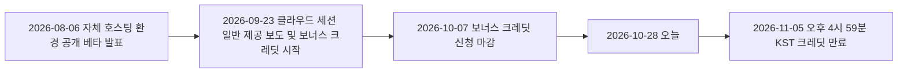

- **2026-08-06**: Anthropic이 공식 블로그에서 "자체 인프라에서 Claude Code 세션을 실행"하는 **자체 호스팅 환경(self-hosted environments)** 을 Team·Enterprise 대상 공개 베타로 발표했습니다. 기업이 "클라우드 세션"을 자기 네트워크 안에서 돌릴 수 있게 한 것입니다.
- **2026-09-23**: 보너스 크레딧 프로모션이 시작되었습니다(위 1.1). 같은 날 클라우드 세션이 "연구 미리보기(research preview)에서 일반 제공(GA)으로 전환되었다"는 내용은 **개인 개발자 블로그와 SNS 게시글**에서만 확인했고, 제가 읽은 공식 문서 페이지에는 전환 사실을 명시한 문구가 없었습니다. 크레딧 시작일이 같다는 점에서 사실일 가능성이 높지만, 이 부분은 **공식 확인이 안 된 보도**입니다.
- **2026-10-07 / 2026-11-04**: 신청 마감, 사용 만료(미국 태평양시 기준, 각각 오후 11:59).

### 1.3 왜 Anthropic은 클라우드를 밀고 있나 (공식 문서가 밝히는 이유와 제 해석 구분)

**공식 문서가 밝히는 사용 이유** (웹 퀵스타트 문서):
- 독립적인 작업을 **병렬로** 여러 개 맡기기(각각 별도 세션, 별도 브랜치)
- **내 컴퓨터에 없는 저장소** 작업(세션마다 새로 복제)
- **자주 개입할 필요가 없는 작업** 맡겨 두고 나중에 결과 확인
- 코드 질문과 탐색(로컬 체크아웃 없이)

**제 해석(공식 문서에 명시된 것이 아님)**: 에이전트가 한 번에 몇 시간씩 자율적으로 일하게 되면, 개발자의 노트북 전원과 연결 상태에 의존하는 로컬 실행 모델이 병목이 됩니다. 클라우드 세션의 "닫아도 계속 실행", "여러 기기에서 이어서 보기" 같은 특징은 그 병목을 푸는 방향이고, 보너스 크레딧은 사용자가 이 새 방식을 **써 보게 하는 유인책**으로 보입니다. 이는 제품 전략에 대한 해석이므로 Anthropic의 공식 입장으로 읽지 마시기 바랍니다.

---

## 2. 용어 정리 — 헷갈리는 이름들을 먼저 분리하기

| 용어 | 정확한 뜻 | 흔한 오해 |
| --- | --- | --- |
| **클라우드 세션(cloud session)** | 개발자 컴퓨터가 아닌 곳에서 실행되는 Claude Code 세션. 기본은 Anthropic 관리 VM, 조직이 설정하면 자체 호스팅 환경 | "Claude 채팅"과 같은 것이 아님 |
| **클라우드 환경(cloud environment)** | 클라우드 세션의 **저장된 설정 묶음**: 네트워크 접근 수준, 환경변수, 설정 스크립트 | "서버 한 대"가 아님. 설정 템플릿에 가까움 |
| **`claude --cloud`** | 터미널에서 새 클라우드 세션을 만드는 CLI 옵션 | `--remote-control`과 다름 |
| **`--remote`** | `--cloud`의 구 이름(사용 중단 예정 별칭) | |
| **`claude --teleport`** | 클라우드 세션을 **내 터미널로 가져와** 이어가기 | 반대 방향(터미널→클라우드)은 CLI에서 불가 |
| **Claude Code on the web** | claude.ai/code에서 쓰는 클라우드 세션 화면. 같은 기능의 다른 이름 | 별도 제품이 아님 |
| **Remote Control** | **내 컴퓨터**에서 도는 세션을 휴대폰·브라우저에서 보고 조작 | 클라우드가 아님(코드는 내 PC에서 실행) |
| **자체 호스팅 환경** | 클라우드 세션을 **조직이 운영하는 서버**에서 실행 | Team·Enterprise 공개 베타 |
| **클라우드 예약 작업(scheduled task)** | 예약·API·GitHub 이벤트로 클라우드 세션을 자동 실행 (구 이름 routines) | 연구 미리보기 단계 |
| **프로젝트(Projects)** | Claude가 클라우드 세션 여러 개를 **스레드로 조율**하는 하나의 대화 (Claude Code의 기능) | claude.ai에서 쓰는 "프로젝트(Projects)"와 **이름만 같은 별개 기능**이 될 수 있음. 공개 베타, Pro·Max 대상, 점진적 배포 |

마지막 행은 특히 주의하세요. 문서에 나온 Claude Code의 Projects는 "병렬 클라우드 세션을 조율하는 대화"이고, 지금 보고 계신 "블로그" 프로젝트(지식·지침 컨테이너)와 설명이 다릅니다. 같은 기능인지는 이번에 확인하지 못했습니다.

---

## 3. 클라우드 세션이 하는 일 — 한 번의 작업 흐름

공식 퀵스타트 문서가 설명하는 흐름은 네 단계입니다(Anthropic 관리 환경 기준).

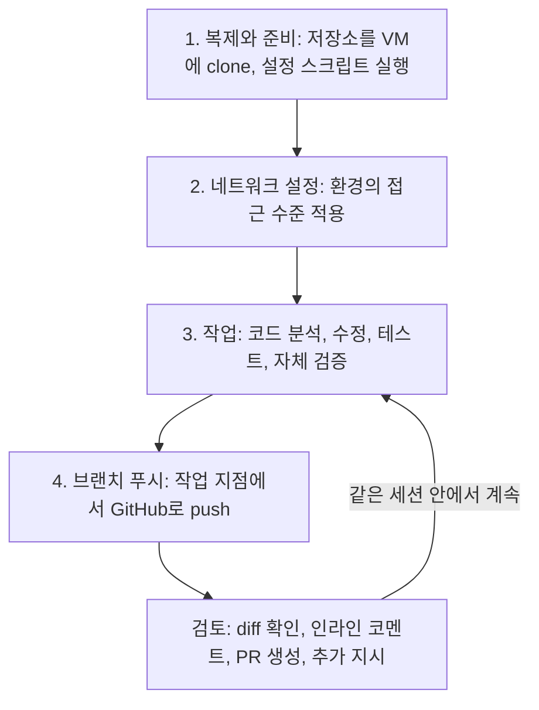

핵심 특징을 풀어 쓰면 다음과 같습니다.

- 세션은 **브랜치를 푸시해도 닫히지 않습니다.** PR 생성과 추가 수정이 같은 대화 안에서 이어집니다.
- 브라우저 탭을 닫아도 세션은 계속 실행됩니다. 현재 작업이 끝나면 유휴 상태가 됩니다.
- **VM에 직접 접속하는 셸은 제공되지 않습니다.** 모든 명령은 Claude가 대신 실행하므로, "테스트를 돌려 줘", "서비스를 시작해 줘"처럼 **프롬프트로 요청**해야 합니다.
- 클라우드 세션의 실행 환경은 **Ubuntu 24.04, x86_64** VM이며, 내 PC가 Windows든 Mac이든 상관없습니다. 따라서 미리 컴파일된 의존성(네이티브 확장이 있는 Ruby gem, 미리 빌드된 Python wheel 등)은 **x86_64 리눅스용**이 맞아야 합니다.

### 3.1 세 가지 실행 방식 비교

| | 클라우드 세션 | 로컬 세션 | 로컬 + Remote Control |
| --- | --- | --- | --- |
| 코드가 실행되는 곳 | 클라우드 VM (기본 Anthropic 관리) | 내 컴퓨터 | 내 컴퓨터 |
| 시작하는 곳 | claude.ai/code, 모바일 앱, 데스크톱 앱(Cloud 선택), `claude --cloud` | 터미널, IDE, 데스크톱 앱(Local) | 터미널, VS Code, 데스크톱 앱 |
| 대화하는 곳 | claude.ai, 모바일, 데스크톱 | 시작한 곳 | claude.ai·모바일 + 시작한 곳 |
| 내 로컬 설정 사용 | **아니요**(저장소 내용만) | 예 | 예 |
| GitHub 필요 | 예(또는 로컬 저장소를 번들로 업로드) | 아니요 | 아니요 |
| 연결을 끊어도 계속 실행 | **예** | 아니요 | 내 컴퓨터에서 세션이 열려 있는 동안만 |
| 권한 모드 | Accept edits, Plan, Auto | 터미널에서 전 모드 | Manual, Accept edits, Plan, Auto |
| 네트워크 | 환경별 설정 | 내 컴퓨터 네트워크 | 내 컴퓨터 네트워크 |

공식 문서의 권고를 그대로 옮기면, **로컬 설정·도구·환경이 필요한 작업은 로컬 세션이나 Remote Control이 더 맞고**, 클라우드는 "설정 없이 맡겨 두는 작업"에 맞습니다.

### 3.2 어떤 작업을 클라우드로 보내면 좋은가

| 잘 맞는 작업 | 잘 맞지 않는 작업 |
| --- | --- |
| 범위가 분명한 버그 수정, 테스트 보강 | 내 PC에만 있는 도구·DB·사내망 리소스가 필요한 작업 |
| 서로 독립적인 여러 작업의 병렬 실행 | 계속 대화하며 방향을 조정해야 하는 탐색적 작업 |
| 로컬에 복제하지 않은 저장소의 조사·수정 | 메모리나 디스크를 크게 쓰는 빌드(4 vCPU, 16GB RAM, 30GB 디스크 상한) |
| 문서·리팩터링·마이그레이션 같은 자율 작업 | AWS SSO처럼 브라우저 로그인이 필요한 인증(클라우드 세션에서 불가) |

---

## 4. 시작하기 — 준비물과 표면별 시작 방법

### 4.1 준비물

- **요금제**: Pro, Max, Team, 또는 프리미엄 좌석·Chat + Claude Code 좌석의 Enterprise 사용자. Free는 해당 없음.
- **인증**: **claude.ai 구독 로그인**이어야 합니다. API 키, Console 계정, Bedrock·Vertex 같은 제3자 제공자로는 `--cloud`, `--teleport`, `/web-setup`을 쓸 수 없습니다(제3부의 경로 A/B만 해당).
- **GitHub 저장소**: 저장소를 복제하고 브랜치를 푸시하기 위해 필요합니다. GitHub 이외의 호스트(GitLab, Bitbucket 등)는 로컬 번들 업로드로 보낼 수는 있지만 **결과를 해당 원격에 푸시할 수 없습니다.**
- **조직 정책**: Team·Enterprise에서는 조직의 `allow_remote_sessions` 정책이 켜져 있어야 하고, 제로 데이터 보존(ZDR)·HIPAA 구성·고객 관리 암호화 키(CMEK) 조직에서는 클라우드 세션을 쓸 수 없습니다.

### 4.2 GitHub 연결 방법 두 가지

| 방법 | 연결 방식 | 접근 가능한 저장소 | 적합한 경우 |
| --- | --- | --- | --- |
| **GitHub 앱** | 웹 온보딩에서 Claude GitHub 앱 승인 | 모든 공개 저장소 + 앱이 설치된 비공개 저장소 | 브라우저로 시작, Auto-fix가 필요할 때 |
| **`/web-setup`** | CLI에서 실행하면 로컬 `gh` 토큰을 Anthropic으로 전송(암호화 저장) | **`gh` 토큰이 접근 가능한 모든 저장소**(앱 설치 불필요) | 이미 `gh`를 쓰는 개인 개발자 |

`/web-setup`은 `gh auth token`이 출력하는 토큰을 읽고, **확인을 받은 뒤** Anthropic에 전송합니다. 전송된 토큰은 claude.ai 계정에 암호화되어 저장되며 클라우드 세션의 GitHub 접근에 쓰입니다. 성공하면 `Connected as <GitHub 아이디>`가 출력되고, Default 환경이 없으면 **Trusted 네트워크, 설정 스크립트 없음**으로 하나 만들어 줍니다. 제거하려면 claude.ai의 커넥터 설정에서 GitHub를 해제하세요. 로컬 `gh` 로그인은 유지되고 토큰 자체를 무효화하려면 GitHub에서 따로 취소해야 합니다.

주의점 두 가지입니다. 첫째, `gh` 토큰에 `workflow` 범위가 없으면 GitHub Actions 워크플로 파일을 바꾸는 푸시가 거부될 수 있고, `gh auth refresh -s workflow`로 보완합니다. 둘째, **Team·Enterprise에서는 `/web-setup` 명령이 기본적으로 숨겨져 있고**, 소유자(Owner)가 조직 설정에서 **Quick setup**을 켜야 보입니다.

### 4.3 표면별 시작 방법

| 표면 | 방법 |
| --- | --- |
| 브라우저 | claude.ai/code에서 저장소·브랜치·권한 모드를 고르고 작업을 입력 |
| 모바일 앱 | Claude 앱의 **Code** 탭 |
| 데스크톱 앱 | 새 세션의 환경 선택에서 **Cloud** 항목 선택 (데스크톱 가이드 참조) |
| 터미널 | `claude --cloud "작업 설명"` |
| 예약·이벤트 | 클라우드 예약 작업(`/schedule`), 각 실행이 클라우드 세션 |
| Slack | `@Claude` 멘션(Pro·Max, 클라우드 세션 기능 필요) |

URL 쿼리로 새 세션을 미리 채울 수도 있습니다. `https://claude.ai/code?prompt=...&repositories=owner/repo&environment=이름` 형태이며, 이슈 트래커에 "Claude로 열기" 버튼을 만드는 용도입니다.

### 4.4 Windows 네이티브 환경에서 특별히 주의할 점

`claude --cloud`가 GitHub 앱이 설치되지 않은 저장소나 원격이 없는 저장소에서 **로컬 저장소를 번들로 업로드**할 때, macOS·Linux·WSL은 자격 증명이나 키 파일처럼 보이는 파일(`.env`, `*.tfvars`, `id_rsa`, `*.pem` 등)의 **미커밋 변경을 업로드에서 제외**합니다. 그런데 **네이티브 Windows에서는 추적 중인 파일의 미커밋 변경이 파일 이름과 무관하게 그대로 업로드**된다고 공식 문서가 명시합니다. 업로드하기 싫은 수정이 있다면 `git stash`나 되돌리기를 먼저 하세요. 독자는 Windows 사용자이므로 가장 실질적인 주의사항입니다.

---

## 5. `claude --cloud` 상세

### 5.1 기본 형태

```bash
claude --cloud "src/auth/login.ts 의 인증 버그를 고쳐 줘"
```

- **새 클라우드 세션**이 만들어지고, 클라우드 VM이 **현재 디렉터리의 GitHub 원격**을 **현재 브랜치 기준으로 복제**합니다. 내 로컬 체크아웃을 복제하는 것이 아니므로 **로컬에만 있는 커밋은 포함되지 않습니다. 먼저 push 하세요.**
- 한 번에 **저장소 하나**만 지원합니다.
- VM이 준비되는 동안 CLI가 설정 단계(저장소 복제, 설정 스크립트 실행 등)의 체크리스트를 보여 주고, 그 사이 입력한 메시지는 대기열에 쌓였다가 준비가 끝나면 전송됩니다.
- 시작 뒤에는 **claude.ai 또는 모바일 앱에서** 진행을 보고 조작합니다. 로컬 터미널은 자유로워집니다.
- `Branch <이름> is not on GitHub`가 출력되면 세션은 시작되지만 **내 브랜치가 아닌** 푸시된 커밋 또는 기본 브랜치에서 시작합니다. 필요한 변경이 거기에 없으면 푸시 후 새 세션을 시작하세요.

### 5.2 활용 패턴

**계획은 로컬에서, 실행은 클라우드에서** (공식 팁):

```bash
claude --permission-mode plan          # 로컬에서 계획 모드로 방향 합의
# 계획을 저장소에 저장하고 commit, push
claude --cloud "docs/migration-plan.md 의 마이그레이션 계획을 실행해 줘"
```

**병렬 실행**: 명령 하나가 세션 하나이므로 여러 번 실행하면 동시에 돕니다.

```bash
claude --cloud "auth.spec.ts 의 불안정한 테스트를 고쳐 줘"
claude --cloud "API 문서를 갱신해 줘"
claude --cloud "로거를 구조화 출력으로 리팩터링해 줘"
```

병렬 세션은 **같은 구독 한도를 나눠 쓰므로 한도 소모도 그만큼 빨라집니다**(8절).

### 5.3 원격이 없거나 GitHub 앱이 없을 때 — 로컬 저장소 번들 업로드

`--cloud`를 원격이 없는 저장소나 Claude GitHub 앱이 설치되지 않은 github.com 저장소에서 실행하면, Claude Code가 로컬 저장소를 **번들**로 묶어 직접 업로드합니다(`/web-setup`으로 연결했어도 마찬가지). 조건은 다음과 같습니다.

- 커밋이 하나 이상 있는 git 저장소여야 합니다.
- 번들은 **100MB 미만**이어야 합니다. 더 크면 현재 브랜치만, 그것도 크면 작업 트리 단일 스냅샷으로 줄이고, 그래도 크면 실패합니다.
- 추적되지 않는 파일(untracked)은 포함되지 않습니다. 필요하면 `git add` 하세요.
- macOS·Linux·WSL에서는 git 2.31 이상과 지원되는 체크아웃 구조가 필요하고, 서브모듈 안, `--separate-git-dir`·`--shared`·`--reference` 복제본, `core.worktree` 설정, reftable 참조 형식, 스파스 체크아웃 워크트리는 업로드가 거부될 수 있습니다. 이 경우 `Not uploading this working tree:`로 시작하는 오류와 원인이 출력됩니다.
- `CCR_FORCE_BUNDLE=1`을 주면 원격에서 복제할 수 있는 경우에도 번들 업로드를 강제합니다.
- 번들로 만든 세션은 **GitHub 연결에 푸시 권한이 있을 때만** GitHub 원격으로 푸시할 수 있습니다.

GitHub 저장소라면 **브랜치를 푸시하고 Claude GitHub 앱을 설치한 뒤 시작**하는 편이 업로드 조건을 피하는 가장 간단한 방법입니다.

### 5.4 이미 실행 중인 세션에 후속 메시지 보내기

```bash
claude -p "후속 지시 내용" --cloud <세션ID>
echo "후속 지시 내용" | claude -p --cloud <세션ID>
```

메시지를 대기열에 넣고 **응답을 기다리지 않고 종료**합니다. 세션 ID(`session_...` 또는 `cse_...`) 또는 `claude.ai/code/<id>` URL을 줍니다. 성공하면 `Sent to cloud session.`과 세션 ID, 보기 링크를 출력하고, `--output-format json`을 주면 `{ok, session_id, url}` 형태로 받을 수 있습니다(`stream-json`은 지원하지 않음). CI 스크립트에서 장기 세션을 조종하는 용도입니다. `-p` 없이 ID만 주면 "Attaching to an existing cloud session is not enabled for your account."가 나올 수 있습니다.

### 5.5 클라우드 세션을 내 터미널로 가져오기 — `--teleport`

| 방법 | 설명 |
| --- | --- |
| `claude --teleport` | 세션 선택기 표시. ID를 주면 바로 재개 |
| `/teleport` 또는 `/tp` | 실행 중인 CLI 안에서 같은 선택기 열기 |
| `/tasks` → `t` | 백그라운드 세션 목록에서 텔레포트 |
| claude.ai/code → Open in → Terminal | 붙여넣을 명령을 복사 |

텔레포트 요건은 네 가지입니다. ① **커밋되지 않은 변경이 없어야** 합니다(있으면 stash 안내). ② **같은 저장소**의 체크아웃이어야 합니다(포크 불가). ③ 세션의 **브랜치가 원격에 푸시**되어 있어야 합니다. ④ **같은 claude.ai 계정**으로 로그인해야 합니다. 텔레포트하면 터미널이 **세션의 복사본**을 얻고, 이후의 로컬 작업은 클라우드 세션에 반영되지 않습니다. 휴대폰으로 계속 조종하려면 로컬에서 `/remote-control`을 켜세요. 또 `--teleport`는 **`--resume`과 다릅니다.** `--resume`은 이 컴퓨터의 로컬 기록만 다시 엽니다.

방향성에도 주의하세요. **CLI에서는 클라우드 → 터미널만 가능**하고, 이미 시작한 터미널 세션을 클라우드로 올릴 수는 없습니다. 데스크톱 앱은 Code 탭의 **Open in** 메뉴로 로컬 세션을 클라우드로 보낼 수 있다고 합니다.

### 5.6 `--cloud`와 관련된 슬래시 명령

| 명령 | 역할 |
| --- | --- |
| `/remote-env` | 기본 클라우드 환경 선택(`remote.defaultEnvironmentId`로 사용자 설정에 저장). 환경을 새로 만들거나 편집하지는 못함 |
| `/web-setup` | GitHub 연결과 Default 환경 생성 |
| `/schedule` | 클라우드 예약 작업 만들기·관리 |
| `/autofix-pr` | 현재 브랜치의 PR을 감시하는 클라우드 세션 생성, Auto-fix 켜기 |
| `/claim-credit` | 보너스 크레딧 신청 |
| `/mobile` | 모바일 앱 설치용 QR 표시 |
| `/usage` | 사용량 확인(크레딧 잔액은 설정 > 사용량 화면) |

CLI가 환경을 고르는 순서는 **① `/remote-env`로 고른 것 → ② Anthropic 호스팅 환경 → ③ 목록의 첫 번째 환경(Remote Control용 "브리지" 항목 제외)** 입니다. 자체 호스팅 환경은 `--environment <ccpool_...>`로 지정합니다(v2.1.224 이상, Anthropic 호스팅 환경의 `env_` ID는 이 플래그로 지정할 수 없음).

### 5.7 자주 만나는 오류

| 메시지 | 원인과 조치 |
| --- | --- |
| `Unable to get organization UUID` / "Cloud sessions need a claude.ai sign-in" | API 키 인증이거나 계정 정보가 낡음. `claude auth login` 또는 `/login` |
| `Cloud sessions aren't available with <제공자>` | Bedrock 등 제3자 제공자 설정. 관련 환경변수 해제 후 Anthropic 계정으로 로그인 |
| `Cloud sessions are disabled by your organization's policy` | 조직의 `allow_remote_sessions` 꺼짐. 관리자 문의 |
| `Could not create a cloud environment` / `No cloud environment available` | 자동 생성 실패 또는 구버전. `/web-setup` 실행 또는 claude.ai/code에서 환경 추가 |
| `Session not found` / `archived` | ID 오류 또는 보관된 세션. 새 세션 시작 |
| `/web-setup`이 `Unknown command` | 구독 로그인이 아니거나, Team·Enterprise에서 Quick setup이 꺼짐, 조직이 클라우드 세션을 끔, ZDR·HIPAA |
| `Not signed in to Claude` | `/login` 후 재시도 |

---

## 6. 클라우드 환경(Environment) 상세

환경은 **"클라우드 세션을 시작할 때 적용되는 설정 묶음"** 입니다. 제1부 8절의 환경 설명을 여기서 한 단계 더 깊게 다룹니다.

### 6.1 Default 환경

환경이 없으면 온보딩이 **Default**를 만들어 줍니다(CLI `/web-setup`, Pro·Max 웹 온보딩). Team·Enterprise 웹 온보딩은 "Create your first cloud environment" 양식이 뜨고, **Create & finish**를 누르면 같은 Default가 만들어집니다(Quick setup이 켜져 있으면 자동). Default는 **Trusted 네트워크 접근 + 환경변수 없음 + 설정 스크립트 없음**입니다. 환경이 하나뿐이면 모든 세션이 그 환경에서 실행됩니다.

### 6.2 네트워크 접근 수준 네 가지

| 수준 | 나가는 연결 |
| --- | --- |
| **None** | 세션 네트워크를 통한 외부 연결 없음 |
| **Trusted** | 허용 목록 도메인만(패키지 레지스트리, GitHub, 클라우드 SDK 등) |
| **Full** | 모든 도메인 |
| **Custom** | 직접 만든 허용 목록(기본 목록 포함 선택 가능) |

어느 수준이든 **허용 목록을 거치지 않는 경로**가 있어서 다음은 항상 접근됩니다. ① GitHub(전용 프록시 경유), ② 켜 둔 MCP 커넥터(트래픽이 Anthropic 서버를 경유), ③ 네트워크 시크릿에 등록한 호스트, ④ Anthropic API(Claude Code 자체 요청, None에서도). Custom은 도메인을 한 줄에 하나씩 쓰고 `*.example.com`처럼 앞의 `*.`로 모든 하위 도메인을 허용합니다. 환경별로 목록이 따로이고 **조직 전체에 강제하는 허용 목록 설정은 없습니다.** 팀 표준은 조직 공유 환경으로 만듭니다. 접근 수준을 바꾸면 기존 세션에도 약 1분 안에 반영됩니다.

### 6.3 환경변수

- `.env` 형식(한 줄에 `KEY=value`)이며, `#` 포함 값이나 여러 줄 값은 따옴표로 감쌉니다.
- 세션 안의 모든 명령이 읽을 수 있는 일반 환경변수가 됩니다(`OTEL_*`는 제외).
- **그 환경을 쓰는 사람이면 누구나 값을 읽을 수 있습니다.** 비밀 값은 넣지 마세요.
- 수정하면 이미 실행 중인 세션은 **VM이 다음에 복원 또는 재생성될 때** 새 값을 읽습니다. 바로 쓰려면 명령에 직접 붙이거나(`LOG_LEVEL=trace npm test`) 새 세션을 시작하세요.

### 6.4 네트워크 시크릿 — 비밀 키를 VM에 노출하지 않고 쓰기

API 키를 환경에 저장하면 **Anthropic의 에이전트 프록시가 VM 밖에서 요청에 키를 붙여 줍니다.** 키가 VM 안(환경변수, 파일)에 나타나지 않으므로 Claude가 값을 보지 못합니다. 등록은 환경 편집 대화상자의 **Network secrets**에서 하며, 이름, 허용 호스트, 헤더(기본 `Authorization: Bearer`)를 지정합니다. 한 번 저장하면 **수정할 수 없고** 삭제 후 재등록해야 합니다. 이 기능은 GitHub와 `api.anthropic.com`, 주요 패키지 레지스트리(npm, jsr, PyPI, crates.io, Go proxy)에는 적용되지 않습니다. 자체 호스팅 환경에는 없는 기능입니다.

### 6.5 설정 스크립트와 환경 캐시

- 새 세션이 시작될 때 **Claude Code가 실행되기 전에** 루트 권한 Bash로 실행됩니다(Ubuntu 24.04, `apt install` 가능). 사전 설치되지 않은 도구를 깔 때 씁니다.
- **0으로 종료**해야 합니다. 실패하면 세션이 시작되지 않으므로 중요하지 않은 명령은 `|| true`를 붙이세요.
- **약 5분 안에 끝나야** 환경이 캐시됩니다. 끝나면 파일시스템 스냅샷이 만들어져 이후 세션은 설정 스크립트를 건너뛰고 빠르게 시작합니다. 캐시는 **디스크에 쓴 것만** 보존하고 실행 중인 프로세스(켜 둔 DB, `docker compose up`)는 보존하지 않습니다.
- 스크립트나 허용 호스트를 바꾸면 캐시가 다시 만들어지고, 캐시는 약 7일 후 만료됩니다.
- 독립적인 설치는 `&`와 `wait`로 병렬화하고, 큰 다운로드는 **SessionStart 훅**으로 옮겨 백그라운드로 실행하라는 것이 공식 권고입니다.

설정 스크립트와 SessionStart 훅의 구분은 이렇습니다. **설정 스크립트는 VM 자체를 준비**(툴체인, CLI 도구)하며 클라우드에서만, 캐시가 있으면 건너뛰고 실행됩니다. **SessionStart 훅은 프로젝트 준비**(`npm install` 등)이며 저장소의 `.claude/settings.json`에 두어 로컬과 클라우드 모두에서, 재개된 세션을 포함해 매번 실행됩니다.

### 6.6 사전 설치된 도구와 자원

| 분류 | 포함 |
| --- | --- |
| Python | Python 3.x, pip, poetry, uv, black, mypy, pytest, ruff |
| Node.js | 20, 21, 22 (npm, yarn, pnpm, bun, eslint, prettier, chromedriver) |
| Ruby / PHP / Java | Ruby 3.1~3.3, PHP 8.3 + Composer, OpenJDK 21 + Maven·Gradle |
| Go / Rust / C·C++ | Go, rustc·cargo, GCC·Clang·cmake·ninja·conan |
| Docker / DB | docker, dockerd, docker compose / PostgreSQL 16, Redis 7.0 |
| 유틸리티 | git, gh, jq, yq, ripgrep, tmux, vim, nano |

- PostgreSQL과 Redis는 설치만 되어 있고 **기본 실행 상태가 아닙니다.** Claude에게 시작을 요청해야 합니다.
- .NET SDK처럼 목록에 없는 툴체인은 설정 스크립트로 설치합니다.
- **자원 상한(대략, 변동 가능)**: 4 vCPU, 16GB RAM, 30GB 디스크. 이보다 큰 작업은 VM이 중단시킬 수 있습니다.

### 6.7 시간 제한과 세션 수명

- 환경 자체의 명령 타임아웃은 없고 Bash 도구 기본값이 적용됩니다. **포그라운드 명령은 기본 2분 대기, 최대 10분까지 요청 가능**하며, 시간이 지나면 중단하지 않고 **백그라운드로 옮겨** 최대 30분 더 실행합니다. `BASH_DEFAULT_TIMEOUT_MS`, `BASH_MAX_TIMEOUT_MS`를 환경변수로 줘서 늘릴 수 있습니다.
- SessionStart 훅은 기본 600초 후 취소됩니다.
- **유휴 상태가 몇 분 지속되면 VM이 일시정지(파일은 보존)** 되고, 다음 메시지가 오면 같은 VM이 복원됩니다. 일시정지 후 오랜 시간이 지나면 VM이 **회수(reclaim)** 될 수 있고, 그때는 세션을 다시 열면 **새 VM이 만들어집니다.**
- 회수 후 다시 열어도 **대화 기록은 복원**되지만, **실행 중이던 셸 명령, 서브에이전트, 세션 한정 예약 작업과 `/loop`는 복원되지 않습니다.** Claude가 어떤 것이 멈췄는지 알려 주므로 필요한 것을 다시 요청하세요.

### 6.8 내 로컬 설정은 무엇이 따라가고 무엇이 안 따라가나

클라우드 세션은 **저장소의 새 복제본에서 시작**하므로 **저장소에 커밋된 것만** 가용합니다.

| 항목 | 클라우드에서 |
| --- | --- |
| 저장소의 `CLAUDE.md`, `.claude/rules/`, `.claude/skills/`, `agents/`, `commands/` | 예 |
| 저장소의 `.claude/settings.json` 훅·권한 규칙 | 예(저장소 하나짜리 세션에서) |
| 저장소의 `.mcp.json` MCP 서버 | 예(저장소 하나짜리 세션에서) |
| 조직의 서버 관리형 설정 | 예(Claude Tag 세션 제외). MDM·로컬 관리형 파일은 **적용 안 됨** |
| 내 `~/.claude/CLAUDE.md`, `~/.claude/skills|agents|commands/` | **아니요** |
| 사용자 설정에만 켠 플러그인, `claude mcp add`(local·user 범위) MCP | **아니요** |
| 저장소 설정이 선언한 플러그인·마켓플레이스 | **아니요** |
| 내 서비스용 API 키 | 네트워크 시크릿으로 등록 |
| AWS SSO 같은 대화형 인증 | **불가** |

그래서 **내 개인 설정을 클라우드에서도 쓰려면 저장소의 `.claude/`에 커밋**하라고 공식 문서가 안내합니다. MCP는 `claude mcp add --scope project`로 `.mcp.json`에 기록해 커밋합니다. 개인 취향만 커밋하기 싫다면 **설정 스크립트가 `~/.claude/CLAUDE.md`를 쓰게** 하는 방법이 있으나, 공유 환경이 아니라 **자기 환경**에 두세요. 한편 claude.ai에서 켜 둔 스킬은 클라우드 세션이 자동으로 불러옵니다.

---

## 7. 세션 운영

### 7.1 권한 모드

클라우드 세션은 **Accept edits, Plan, Auto** 세 가지만 제공합니다. **Manual과 Bypass는 없습니다.** Auto는 별도 분류 모델이 행동을 검토해 위험한 것만 막는 방식이며, 조직이 허용하고 선택한 모델이 지원할 때만 나타납니다. 제1부 7절의 모드 설명을 그대로 적용하되, 이 두 모드가 없다는 점만 기억하세요.

### 7.2 변경 검토와 PR

세션 패널의 **Changes** 카드에 `+42 -18`처럼 변경 줄 수가 표시되고, 눌러서 diff 화면을 엽니다. 기본은 세션의 기준 브랜치와 비교하고 **Compare against**로 다른 브랜치와도 비교합니다. 줄에 **인라인 코멘트**를 남기면 다음 메시지에 묶여 Claude에게 전달됩니다. 좋으면 **Create PR**로 정식 PR, 초안 PR, GitHub 작성 화면 중 하나를 고릅니다. PR 뒤에도 세션이 살아 있어 CI 실패나 리뷰 의견을 붙여 넣고 계속 수정시킬 수 있습니다. 푸시 전에 Claude가 실행한 포매터의 변경은 diff 목록에 안 보일 수 있으니 필요하면 "커밋하고 푸시해 줘"라고 요청하세요.

Claude가 만든 커밋에는 `Claude-Session: <URL>` git 트레일러가, PR 본문에는 세션 URL이 들어갑니다. 끄려면 `attribution.sessionUrl`을 `false`로 합니다.

### 7.3 Auto-fix

Claude GitHub 앱이 설치된 저장소의 PR에서 **CI 실패와 리뷰 코멘트에 자동 대응**합니다. 확신이 서는 수정은 직접 푸시하고, 해석이 갈리거나 구조적으로 중요한 코멘트는 사용자에게 묻습니다. 켜는 방법은 세션의 Changes 카드의 PR 메뉴(⋮), CLI의 `/autofix-pr`, 모바일 앱에서 말로 요청, PR URL을 세션에 붙여넣기입니다. 두 가지 주의가 있습니다. **기본 브랜치가 앞서 나가 생긴 머지 충돌은 GitHub가 웹훅을 보내지 않아 자동 대응이 안 되므로** 리베이스를 직접 시켜야 하고, Atlantis나 `issue_comment`로 동작하는 자동화가 있는 저장소에서는 **Claude의 답글이 그 자동화를 촉발**할 수 있으니 켜기 전에 점검하세요. 답글은 내 GitHub 계정 이름으로 올라가지만 Claude Code가 쓴 것임이 표시됩니다.

### 7.4 공유, 보관, 삭제

- **공유**: Pro·Max는 **Private/Public**입니다. **Public은 claude.ai에 로그인한 누구에게나 보입니다.** 세션에 비공개 저장소의 코드나 자격 증명이 들어 있을 수 있으므로 공유 전에 반드시 확인하세요. 저장소 접근 검증은 기본으로 꺼져 있습니다. Team·Enterprise는 Private/Team 중 선택합니다.
- **보관(archive)**: 사이드바에서 숨김. claude.ai/code/sessions의 Archived 탭에서 복원.
- **삭제**: 세션과 데이터를 **영구 삭제**(되돌릴 수 없음).

### 7.5 컨텍스트 관리와 서브에이전트

`/compact`, `/context`, `/clear`가 클라우드에서도 동작하고, `/model`, `/effort`, `/color`, `/rename`은 선택기 대신 **인수로** 줍니다(`/model sonnet`). 클라우드 세션은 자동 압축 비율 변수(`CLAUDE_AUTOCOMPACT_PCT_OVERRIDE`)를 스스로 설정하므로 환경변수에 넣어도 무시됩니다. 서브에이전트는 로컬과 똑같이 동작하고 저장소의 `.claude/agents/`가 자동으로 로드됩니다. 에이전트 팀은 기본 비활성이며 `CLAUDE_CODE_EXPERIMENTAL_AGENT_TEAMS=1`로 켭니다.

### 7.6 플랫폼 제한

- **GitHub 전용**: 저장소 복제와 PR 생성은 GitHub가 필요합니다(GitHub Enterprise Server는 Team·Enterprise에서 지원).
- **조직 IP 허용 목록**: 조직이 IP 허용 목록을 켜 두면 **Anthropic 호스팅 클라우드 세션이 인증 오류로 실패**합니다(세션이 Anthropic 관리 인프라에서 API를 호출하므로). 예외를 받으려면 Anthropic 지원에 문의해야 합니다.
- **GitHub GraphQL 불가**: GitHub 프록시가 GraphQL을 거부하므로 `gh pr`, `gh issue` 같은 GraphQL 기반 하위 명령과 Projects v2 같은 GraphQL 전용 API는 쓸 수 없습니다. REST 기반 `gh api repos/{owner}/{repo}/...`로 대체합니다.

---

## 8. 비용, 한도, 보너스 크레딧 (공식 도움말 확인)

### 8.1 기본 원칙

- 클라우드 세션은 **구독 한도에 합산**됩니다(채팅·Claude Code·Cowork 등과 같은 한도).
- **클라우드 VM에 대한 별도 요금은 없습니다.**
- 병렬로 여러 작업을 돌리면 한도가 그만큼 빨리 소모됩니다.

### 8.2 보너스 크레딧 공식 조건 (Help Center, 2026-10-28 확인)

| 항목 | 내용 |
| --- | --- |
| 금액 | Pro **$100**, Max **$250** (1계정 1회, 다른 혜택과 병용 불가) |
| 대상 | 2026-09-23 오후 2:00 PDT에 활성 구독이던 **개인 Pro·Max**. claude.ai 로그인 필요 |
| 대상 아님 | Team·Enterprise, 무료 체험, 결제 연체 계정, Bedrock·Vertex·API 키 인증 |
| 받는 법 | 일부 계정은 자동 지급. 그 외 데스크톱 앱·IDE 배너, CLI `/claim-credit`, claude.ai 신청 페이지 |
| 신청 마감 | 10월 7일 오후 11:59 PT |
| **만료** | **11월 4일 오후 11:59 PT** (한국 시간 11월 5일 오후 4:59) |
| 사용 방법 | GitHub 연결 → 저장소 선택 → 클라우드 세션 시작. 웹·데스크톱·CLI·모바일에서 **자동 적용**. 잔액은 사용량 메뉴에서 확인 |
| 크레딧이 남아 있는 동안 | 클라우드 세션 사용량이 **플랜 한도에 합산되지 않음** |
| 소진 또는 만료 후 | 클라우드 세션이 **일반 플랜 한도**에 합산. 사용 크레딧은 사용자가 켰고 한도를 넘었을 때만 청구 |
| 적용되지 않는 곳 | 프로젝트, 예약 작업(Routines), Remote Control(로컬 실행), 채팅, Cowork, 클라우드 세션 이외 사용 |
| Pro의 Fable | Fable은 사용 크레딧이 켜져 있고 잔액이 있어야 함. 보너스 → 사용 크레딧 순으로 차감 |
| 플랜 변경 | 금액은 현재 플랜을 따르며, 이미 쓴 금액은 인정. 업그레이드해도 추가 지급 없음. Max→Pro 다운그레이드는 크레딧 유지 |

독자 화면(US$100 중 US$100 남음, 11월 5일 오후 4:59 GMT+9)은 이 조건과 정확히 일치합니다. **중요한 실익**은 두 번째 줄에서 나옵니다. 이 크레딧이 남아 있는 동안은 클라우드 세션 사용량이 **주간 한도(현재 46%)를 소모하지 않습니다.** 즉 마감 전에 클라우드 세션으로 작업을 돌리면 구독 한도를 아끼면서 쓸 수 있습니다. 한국 시간 11월 5일 오후 4:59까지이므로 오늘(10월 28일)부터 **약 8일**이 남았습니다.

### 8.3 크레딧을 쓰기 위한 점검표

1. GitHub 계정과 저장소가 있고, 비공개 저장소라면 Claude GitHub 앱이 설치되었거나 `/web-setup`을 마쳤는가
2. claude.ai 구독 로그인 상태인가(`/status`에서 Login method 확인, API 키 환경변수 해제)
3. 푸시할 브랜치가 원격에 있는가(`--cloud`는 원격에서 복제)
4. 작업이 **다른 도구나 로컬 설정에 의존하지 않는가**(6.8절)
5. 소진 속도를 볼 수 있게 설정 > 사용량의 크레딧 잔액을 작업 전후로 확인

---

## 9. 아키텍처 — Claude Code는 어떻게 구성되어 있나

여기서부터는 "구성 요소가 어떻게 맞물리는가"를 설명합니다. **공식 문서가 공개한 것만** 그림으로 그렸고, 공개되지 않은 내부 구현은 의도적으로 비워 두었습니다.

### 9.1 중심: 에이전트 루프와 하네스

공식 문서의 정의로 시작합니다. Claude Code는 **모델(추론)과 도구(행동)** 두 구성 요소가 만드는 **에이전트 루프** 위에서 움직입니다. 루프는 **① 맥락 수집 → ② 행동 → ③ 결과 검증**을 반복하며(세 단계는 자연스럽게 섞임), 사용자는 언제든 끼어들어 방향을 바꿀 수 있습니다. 공식 문서는 Claude Code를 **"모델 주위에서 도구를 제공하고 모델이 보는 맥락을 관리하는 층(에이전트 하네스)"** 이라고 부릅니다.

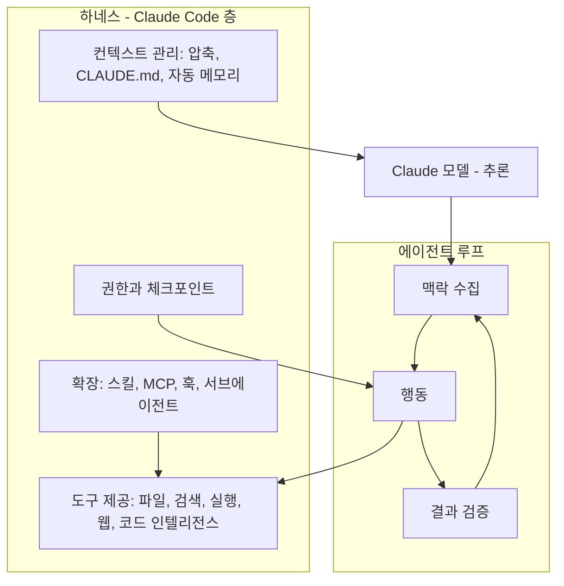

내장 도구는 다섯 범주(파일 작업, 검색, 실행, 웹, 코드 인텔리전스)이고, 서브에이전트 생성과 사용자에게 질문하기 같은 오케스트레이션 도구도 있습니다. **이 엔진은 어디서 쓰든 동일**합니다. 달라지는 것은 코드가 어디서 실행되는가입니다.

### 9.2 한 엔진, 여러 표면(surface)

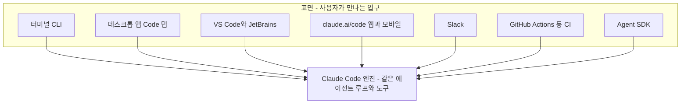

공식 문서가 "각 표면은 같은 엔진에 연결되므로 저장소의 CLAUDE.md, 설정, MCP 서버가 모든 표면에서 작동한다"고 설명합니다. 이것이 제2부에서 "데스크톱과 CLI는 같은 설정 파일을 읽는다"고 한 이유입니다.

### 9.3 실행 장소 세 가지(와 그 변형)

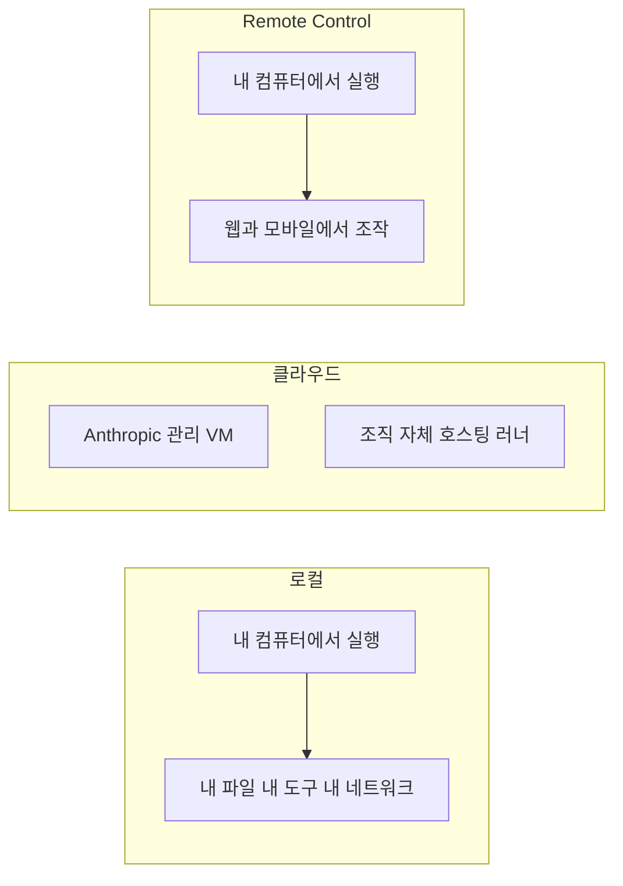

| 실행 장소 | 코드가 도는 곳 | 시작하면 | 끊어도 계속? |
| --- | --- | --- | --- |
| 로컬 | 내 컴퓨터 | 내 파일·도구 전부 접근 | 아니요 |
| 클라우드(Anthropic 관리) | Anthropic 관리 VM | 저장소 복제본 + 환경 설정만 | 예 |
| 클라우드(자체 호스팅) | 조직의 러너 호스트 | 조직 네트워크 안에서 실행 | 예 |
| Remote Control | 내 컴퓨터 | 웹·모바일은 **원격 조종 화면** | 내 PC에서 세션이 열려 있는 동안 |

### 9.4 Anthropic 관리 클라우드 세션의 구성 요소 (공개된 범위)

```mermaid
flowchart TD
    USER["사용자: 웹 모바일 데스크톱 CLI"] --> CP["Anthropic 제어 영역: 세션 조율 대기열 대화 기록 저장 claude.ai 화면"]
    CP --> V1
    subgraph VM["세션 VM - Ubuntu 24.04 x86_64, 약 4 vCPU 16GB 30GB"]
        V1["저장소 복제본"]
        V2["Claude Code 프로세스"]
        V3["설정 스크립트 결과: 환경 캐시"]
    end
    V2 -->|"모델 추론 요청"| API["Anthropic API"]
    V2 -->|"모든 외부 트래픽"| SP["보안 프록시: 악성 요청 차단과 속도 제한"]
    SP --> NET["허용된 외부 도메인 - 환경의 접근 수준"]
    V2 -->|"GitHub 작업"| GP["GitHub 프록시: 실제 토큰은 VM 밖에서 치환"]
    GP --> GH["GitHub"]
    SEC["네트워크 시크릿"] --> AP["에이전트 프록시: VM 밖에서 요청에 키 첨부"]
    SP --> AP
    CP -->|"MCP 커넥터 트래픽은 Anthropic 서버 경유"| MCP["MCP 서버"]
```

공식 문서에서 확인되는 구성 요소를 정리하면 다음과 같습니다.

- **제어 영역(control plane)**: "세션 오케스트레이션, 대기열, claude.ai 인터페이스는 Anthropic 호스팅"이라고 문서가 밝힙니다. 세션 기록(transcript)도 Anthropic이 저장해 다른 표면에서 이어갈 수 있게 합니다.
- **세션 VM**: 세션마다 **새 VM**, Ubuntu 24.04 x86_64, 대략 4 vCPU·16GB RAM·30GB 디스크(변동 가능). 유휴 시 일시정지(파일 보존), 이후 회수 가능.
- **보안 프록시**: 외부로 나가는 **모든 인터넷 트래픽**이 HTTP/HTTPS 프록시를 거치며 악성 요청 방어와 속도 제한, 남용 방지를 담당합니다.
- **GitHub 프록시**: 실제 GitHub 자격 증명을 **VM 밖에 두고**, VM 안의 git은 **범위가 제한된 자격 증명**을 쓰며 프록시가 검증 후 진짜 토큰으로 바꿔 줍니다. **브랜치 삭제와 브랜치 이외(예: 태그) 푸시를 거부**하고(어느 브랜치를 갱신할지는 제한하지 않으므로 보호 규칙은 GitHub에서 설정), 세션에 붙은 저장소의 API만 제공하며, GraphQL은 거부합니다.
- **에이전트 프록시**: 네트워크 시크릿을 요청에 붙여 주는 구성 요소로, 키가 VM 안에 들어가지 않습니다.
- **MCP 커넥터 경로**: 커넥터 트래픽은 세션 네트워크가 아니라 **Anthropic 서버를 경유**하므로 허용 도메인에 호스트를 추가하지 않아도 됩니다.
- **감사와 정리**: 클라우드 세션의 모든 작업이 **감사 로그**로 기록되고, 비활성 VM은 자동 회수됩니다.

**공개되지 않은 것**: VM의 가상화 기술, 스케줄링 방식, 세션 기록의 저장 구조, 제어 영역 내부 서비스 구성은 확인하지 못했습니다. 인터넷에 도는 상세 구조 도식은 대부분 추정이므로 이 문서에는 싣지 않았습니다.

### 9.5 자체 호스팅 환경의 구조 (공식 공개 범위가 가장 상세)

```mermaid
flowchart LR
    subgraph ANTH["Anthropic 호스팅"]
        A1["제어 영역: 대기열, 세션 스트림"]
        A2["모델 추론 api.anthropic.com"]
    end
    subgraph ORG["조직 네트워크 경계 안"]
        R1["러너 - 대기열을 폴링"]
        R2["세션 프로세스 1"]
        R3["세션 프로세스 2"]
        G1["조직 Git 호스트"]
        I1["사내 서비스와 DB"]
    end
    R1 -->|"아웃바운드 HTTPS 폴링"| A1
    R2 -->|"이벤트 스트림과 추론"| A2
    R3 -->|"이벤트 스트림과 추론"| A2
    R1 --> G1
    R2 --> I1
```

핵심 용어는 세 가지입니다.

| 용어 | 설명 |
| --- | --- |
| **환경(environment)** | 관리자가 claude.ai 설정에서 만든 **러너의 이름 있는 묶음**. 세션은 개별 러너가 아니라 환경으로 보내짐 |
| **러너(runner)** | 조직 호스트에서 도는 장기 실행 프로그램. 자체 호스팅 CI 러너와 같은 개념. 환경에 등록하고 세션을 **폴링**하며 가져감 |
| **세션** | 개발자가 시작한 Claude Code 작업 하나. 러너가 **자식 Claude Code 프로세스**로 실행 |

동작 방식은 이렇습니다. 개발자가 세션을 시작하며 환경을 고르면 **Anthropic 제어 영역이 그 환경의 대기열에 세션을 올립니다.** 여유 있는 러너가 세션을 가져가 **임대(lease)** 를 쥐고, 저장소를 복제한 뒤 자식 프로세스를 띄웁니다. 자식은 HTTPS로 이벤트를 스트리밍하고, 러너의 폴링이 **임대 갱신이자 하트비트**를 겸합니다. 러너가 폴링을 멈추면 **약 60초 후 임대가 만료**되어 세션이 다른 러너로 재대기열됩니다(폴링 요청 제한 시간 10초).

**보안상 가장 중요한 성질**: 모든 연결이 **조직 → Anthropic 방향의 아웃바운드 HTTPS**이고, **Anthropic이 조직 네트워크로 들어오는 인바운드 연결은 없습니다.** 저장소 체크아웃, 빌드 산출물, 비밀 값, 세션이 만든 파일은 조직 인프라에 남지만, **대화 내용(프롬프트, 응답, 도구 결과)은 `api.anthropic.com`으로 가고** 기록도 Anthropic이 저장합니다. 러너가 Bedrock이나 Google Cloud 에이전트 플랫폼으로 추론을 보내도록 구성할 수 있지만, 그 경우에도 대화는 세션 이벤트 스트림으로 Anthropic에 전달됩니다. 러너는 **한 번에 한 소유자(owner)** 에게만 서빙하고, 처음 가져간 세션의 소유자에 잠겨 다른 소유자의 코드가 섞이지 않게 합니다. 필요하면 요청이 쌓일 때 러너를 띄우는 **오토스케일링 오케스트레이터**(직접 호스팅)를 둘 수 있습니다.

제약: Team·Enterprise 공개 베타이고 기본 꺼짐(소유자가 켬), ZDR·HIPAA 조직 불가, GitHub 저장소 기준, Claude Security와 Code Review 세션은 아직 라우팅되지 않음, 자체 호스팅 환경에는 네트워크 시크릿이 없음.

### 9.6 Remote Control의 구조

Remote Control은 클라우드가 아니라 **내 컴퓨터의 Claude Code 프로세스를 웹·모바일에서 조종하는 구조**입니다.

```mermaid
flowchart LR
    PCX["내 컴퓨터: Claude Code 프로세스 - 코드 실행과 파일 접근은 여기"] -->|"아웃바운드 HTTPS 등록과 폴링"| API2["Anthropic API - 메시지 중계"]
    WEBX["claude.ai/code 또는 모바일 앱"] -->|"TLS"| API2
```

- 로컬 세션은 **아웃바운드 HTTPS만** 사용하고 **인바운드 포트를 열지 않습니다.** 시작하면 Anthropic API에 등록하고 작업을 폴링하며, 다른 기기가 연결되면 서버가 웹·모바일과 로컬 세션 사이의 메시지를 **스트리밍 연결로 중계**합니다.
- **짧은 수명의 여러 자격 증명**을 쓰고 각각 단일 목적으로 범위가 제한되어 독립적으로 만료됩니다.
- 연결 중에는 세션 기록이 **Anthropic 서버에 저장**되어 기기 간 동기화와 재연결을 돕습니다. 실행과 파일 접근은 내 컴퓨터에 남습니다.
- 클라우드 VM이나 샌드박스는 관여하지 않습니다.

### 9.7 로컬 측 구성 요소

- **세션 기록**: 모든 메시지, 도구 사용, 결과가 `~/.claude/projects/` 아래 **일반 텍스트 JSONL 파일**로 저장됩니다. 이것이 되감기, 재개, 분기를 가능하게 합니다.
- **체크포인트**: 파일을 고치기 전에 **원본 스냅샷**을 떠 두며, `Esc`를 두 번 눌러 되돌립니다. git과 별개이고 **파일 변경만** 대상이며 DB·API·배포 같은 원격 시스템 변경은 되돌릴 수 없습니다.
- **컨텍스트 창**: 대화, 파일 내용, 명령 출력, CLAUDE.md, 자동 메모리, 스킬, 시스템 지침이 모두 들어갑니다. 가득 차면 오래된 도구 출력을 먼저 지우고 필요하면 대화를 요약합니다.
- **설정 계층**: 관리형 > 명령줄 > 로컬 > 공유 프로젝트 > 사용자(제2부 4절).
- **권한 시스템과 샌드박스**: Manual에서는 읽기 전용으로 시작해 편집·실행마다 묻고, 작업 폴더 밖 쓰기는 명시적 허가가 필요합니다. 샌드박스된 Bash 도구가 파일시스템·네트워크를 격리합니다(Windows 네이티브는 샌드박스 미지원, 제2부 2.4절).

### 9.8 "무엇이 어디에 남는가" 한눈에 보기

| 항목 | 로컬 | 클라우드(Anthropic 관리) | 자체 호스팅 | Remote Control |
| --- | --- | --- | --- | --- |
| 코드 파일·빌드 산출물 | 내 PC | Anthropic VM | **조직 호스트** | 내 PC |
| 코드 실행 | 내 PC | Anthropic VM | **조직 호스트** | 내 PC |
| 모델 추론 | Anthropic API | Anthropic | Anthropic API(또는 설정 시 Bedrock·에이전트 플랫폼) | Anthropic API |
| 대화 기록 | 내 PC의 JSONL | Anthropic 저장 | Anthropic 저장 | 내 PC + 연결 중 Anthropic 저장 |
| 비밀 값 | 내 PC | 환경변수(누구나 읽음) 또는 네트워크 시크릿(VM 밖) | 조직이 관리 | 내 PC |
| 로컬 설정(`~/.claude`) | 사용 | **사용 안 함** | 러너 호스트의 설정 | 사용 |

### 9.9 보안 계층 요약 (공식 보안 문서)

| 계층 | 내용 |
| --- | --- |
| 권한 기반 | Manual은 읽기 전용에서 시작, 변경은 승인. Auto는 분류 모델이 검토 |
| 내장 보호 | 샌드박스 Bash, 작업 폴더 경계, 허용 목록 |
| 프롬프트 주입 대응 | 권한 시스템, 맥락 인식 분석, 입력 정제, 네트워크 명령(`curl`, `wget`) 자동 승인 금지, 웹 가져오기는 **별도 컨텍스트 창**에서 처리 |
| 신뢰 검증 | 처음 여는 코드베이스와 새 MCP 서버는 신뢰 확인(`-p` 비대화형에서는 비활성) |
| 클라우드 실행 | 격리된 VM, 기본 제한된 네트워크, 자격 증명 프록시, **푸시는 현재 작업 브랜치로 제한**, 감사 로그, 자동 정리 |
| 한계 | "어떤 시스템도 모든 공격에서 자유롭지 않다"고 문서가 명시. 신뢰할 수 없는 콘텐츠는 직접 파이프하지 말고 VM 등에서 실행 |

주의: GitHub 프록시 절의 "현재 작업 브랜치로 제한"(보안 문서)과 "어느 브랜치를 갱신할지는 제한하지 않는다"(환경 문서)는 표현이 달라 보입니다. 환경 문서는 **프록시가 브랜치 삭제와 비브랜치 푸시를 거부할 뿐 갱신 가능한 브랜치를 제한하지는 않는다**고 하므로, 중요한 브랜치는 GitHub의 브랜치 보호 규칙으로 직접 막으시기 바랍니다. 두 문서의 차이가 어떻게 해소되는지는 확인하지 못했습니다.

### 9.10 주변 제품과의 관계

- **클라우드 예약 작업(scheduled tasks, 구 routines)**: 프롬프트, 저장소, 커넥터를 묶어 저장해 두고 **예약(시간별·야간·주간·1회), API 호출(전용 엔드포인트에 Bearer 토큰으로 POST), GitHub 이벤트(PR, 릴리스 등)** 로 실행합니다. 각 실행이 클라우드 세션이며 Pro·Max·Team·Enterprise에서 쓸 수 있습니다. 연구 미리보기이므로 동작과 한도가 바뀔 수 있습니다. claude.ai/code/routines 또는 `/schedule`.
- **프로젝트(Projects)**: Claude가 작업마다 스레드(대개 클라우드 세션)를 띄워 **병렬로 조율**합니다. 공개 베타, Pro·Max, 점진적 배포. 필요하면 스레드를 Remote Control로 내 컴퓨터에서 실행합니다.
- **Claude Tag**: Slack에서 조직 공용 `@Claude`로 같은 클라우드 인프라를 씁니다.
- **Dispatch**: 모바일에서 작업을 보내면 **내 데스크톱**의 세션으로 실행됩니다(클라우드 아님).
- **데스크톱 예약 작업**: 내 컴퓨터에서 실행. 클라우드 예약 작업과 구분.

---

## 10. 상황별 선택 가이드

```mermaid
flowchart TD
    Q0["작업을 맡기려 한다"] --> Q1{"내 PC의 로컬 설정이나 도구가 필요한가"}
    Q1 -->|"예"| Q2{"자리를 비워도 이어가야 하는가"}
    Q2 -->|"예"| RCG["Remote Control 로 로컬 세션을 원격 조종"]
    Q2 -->|"아니오"| LOCG["로컬 세션"]
    Q1 -->|"아니오"| Q3{"코드가 GitHub에 있는가"}
    Q3 -->|"예"| Q4{"조직 네트워크 안에서만 실행해야 하는가"}
    Q4 -->|"예"| SHG["자체 호스팅 환경 - Team Enterprise"]
    Q4 -->|"아니오"| CLG["Anthropic 관리 클라우드 세션 claude --cloud"]
    Q3 -->|"아니오"| BUN["로컬 번들 업로드 또는 로컬 세션 - 푸시 불가"]
```

---

## 11. 실전 체크리스트 (Windows, Pro, 마감 11월 5일)

1. **먼저 대상 작업을 고릅니다.** 서로 독립적이고 범위가 분명하며 GitHub에 있는 저장소 작업(테스트 보강, 문서 정리, 소규모 리팩터링 등)이 적합합니다. 사내망이나 로컬 도구에 의존하는 작업은 부적합합니다.
2. **인증을 점검합니다.** CLI에서 `/status`로 Login method가 claude.ai 계정인지 확인하고, `ANTHROPIC_API_KEY`가 설정되어 있다면 해제합니다(제3부 3.4절).
3. **GitHub를 연결합니다.** `gh auth login` → `claude`에서 `/web-setup` (Pro는 웹 온보딩으로 GitHub 앱 방식도 가능).
4. **브랜치를 푸시하고, 푸시하지 않을 수정은 stash합니다.** Windows 네이티브는 번들 업로드 시 미커밋 변경이 그대로 올라갈 수 있습니다(4.4절).
5. **`claude --cloud "구체적인 작업"`을 실행합니다.** 프롬프트에 파일명, 기대 동작, 에러 출력을 넣으세요.
6. **claude.ai/code 또는 모바일 앱에서 진행을 확인하고** diff에 인라인 코멘트를 남긴 뒤 PR을 만듭니다.
7. **필요하면 `claude --teleport`로 로컬로 가져와 마무리합니다.** 커밋하지 않은 변경은 먼저 stash하고, 같은 계정·같은 저장소여야 합니다.
8. **공유 설정은 Private로 두세요.** Pro의 Public은 로그인한 모든 사용자에게 보입니다.
9. 설정 > 사용량에서 크레딧 잔액이 줄고 **주간 한도 막대는 그대로**인지 확인합니다.
10. **11월 5일 오후 4:59(한국 시간) 이후**에는 클라우드 세션이 일반 한도를 쓴다는 점을 잊지 마세요.

---

## 12. 문제 해결 요약

| 증상 | 확인 |
| --- | --- |
| `Session creation failed` 또는 프로비저닝에서 멈춤 | status.claude.com 확인, 1분 뒤 재시도, GitHub 연결 확인 |
| 설정 스크립트 실패 | 레지스트리가 네트워크 수준에 허용되는지, 파일 경로, `set -x`로 디버깅, 비핵심 명령에 `|| true` |
| 새 세션이 설정 단계에서 멈춤 | 스크립트가 5분을 넘음. 병렬화하고 큰 다운로드는 SessionStart 훅으로 |
| 비공개 저장소가 안 보임 | Claude GitHub 앱 설치와 저장소 접근 포함 여부, 또는 `/web-setup`의 `gh` 접근 확인(`gh repo view OWNER/REPO`) |
| 환경이 만료됨 | claude.ai/code에서 세션을 다시 열면 새 VM. 기록은 복원, 백그라운드 작업은 복원 안 됨 |
| 탭을 닫았는데 계속 도는지 걱정 | 설계상 정상. 현재 작업이 끝날 때까지 계속 실행 |
| 푸시 거부 | `workflow` 범위 부족(`gh auth refresh -s workflow`), 또는 브랜치 보호 규칙 |
| `Claude Code isn't available on your account` | 좌석에 Claude Code가 없음. 조직 전환 또는 소유자에게 좌석 요청 |

---

## 13. 확인하지 못한 항목 (추측하지 않고 남겨 둠)

- **클라우드 세션의 일반 제공 전환 사실과 날짜**: 개인 블로그·SNS 보도로만 확인했고 공식 문서에는 명시된 문구를 찾지 못했습니다.
- **프로모션 크레딧이 자동 지급이었는지 신청했는지**: 독자 화면만으로는 구분할 수 없습니다.
- **VM 가상화 기술, 스케줄링, 기록 저장 구조 등 Anthropic 관리 클라우드의 내부 구현**: 공식 문서에 없어 다루지 않았습니다.
- **GitHub 프록시의 푸시 제한 표현 차이**: 보안 문서의 "푸시는 현재 작업 브랜치로 제한"과 환경 문서의 "갱신 가능한 브랜치를 제한하지 않음"이 달라 보이는데 해소 방법을 확인하지 못했습니다. 안전하게는 GitHub 브랜치 보호를 쓰세요.
- **Claude Code의 Projects와 claude.ai의 "프로젝트(블로그)"가 같은 기능인지**: 문서 설명이 서로 달라 단정하지 않았습니다.
- **클라우드 세션 크레딧이 구체적으로 몇 시간 또는 몇 건의 작업에 해당하는지**: 공식 자료에 없습니다.
- **Claude Tag, Code Review, Ultrareview 세부**: 존재와 관계만 언급했고 설정은 다루지 않았습니다.
- **자체 호스팅 환경의 배포 세부(Kubernetes, 보안 강화, 오케스트레이터 플래그)**: 개요만 다뤘습니다.

---

## 14. 출처

- Claude Code 문서 — Use Claude Code in the cloud: https://code.claude.com/docs/en/claude-code-on-the-web
- Claude Code 문서 — Get started with Claude Code in the cloud: https://code.claude.com/docs/en/web-quickstart
- Claude Code 문서 — Configure cloud environments: https://code.claude.com/docs/en/cloud-environments
- Claude Code 문서 — Self-hosted environments: https://code.claude.com/docs/en/self-hosted-environments
- Claude Code 문서 — How Claude Code works: https://code.claude.com/docs/en/how-claude-code-works
- Claude Code 문서 — Security: https://code.claude.com/docs/en/security
- Claude Code 문서 — Remote Control: https://code.claude.com/docs/en/remote-control
- Claude Code 문서 — Scheduled tasks(routines): https://code.claude.com/docs/en/routines
- Claude Code 문서 — Projects: https://code.claude.com/docs/en/claude-projects
- Claude Code 문서 — Overview: https://code.claude.com/docs/en/overview
- 도움말 — Cloud sessions bonus credit promotion: https://support.claude.com/en/articles/17152539
- Anthropic 블로그 — Run Claude Code sessions on your own compute(2026-08-06): https://claude.com/blog/run-claude-code-sessions-on-your-own-compute
- 비공식 참고(일반 제공 전환 보도, 공식 확인 불가): https://dev.to/uehara/claude-code-cloud-sessions-come-with-up-to-250-in-free-credit-claim-by-october-7-1159-pm-pt-29p6

---

## 통합 과정에서 바로잡은 내용

- **개인 식별 표현 제거**: 특정 이름으로 사용자를 부르던 모든 표현을 "독자", "사용자" 같은 중립적 표현으로 바꾸었습니다. 화면에서 읽히던 저장된 환경 이름도 "프로젝트 이름의 저장된 환경"으로 바꾸었습니다.
- **Auto 모드 요건(제1부 7.2절)**: 처음에는 "Anthropic API 사용자에게 제공"된다고 적었으나, 공식 권한 모드 문서는 요금제 조건이 "모든 요금제"이고 모델·제공자 조건만 따로 둔다고 설명합니다. 이에 맞게 고쳤고, 터미널과 VS Code에서는 v2.1.283 이상부터 Auto가 기본 시작 모드라는 점을 덧붙였습니다.
- **`claude --teleport`(제1부 8.8절)**: 처음에는 "해설 글에 근거해 확인되지 않았다"고 적었으나, 공식 클라우드 문서에 사용법과 조건(깨끗한 git 상태, 같은 저장소, 푸시된 브랜치, 같은 계정)이 있어 정정했습니다.
- **금지 표현 정리**: 본문의 해당 표현을 같은 뜻의 다른 표현으로 바꾸었습니다(Docker 관련 문장, 첨부 메뉴 문구).
- **문서 간 참조 정리**: "데스크톱 가이드 14절", "CLI 별첨 10절", "요금제 별첨 3.4절", "클라우드 별첨 8절" 같은 참조를 "제1부 14절", "제2부 10절", "제3부 3.4절", "제4부 8절"로 일괄 수정했고, "이 문서", "이번 별첨" 같은 표현도 각 부에 맞게 고쳤습니다.
- **중복 마무리 정리**: 네 문서가 각각 끝에 달고 있던 작성 일자 줄은 하나로 합쳤습니다. 각 부의 "확인하지 못한 항목"과 "출처"는 줄이지 않고 부별로 그대로 두었습니다.

---

작성 일자: 2026-10-28
