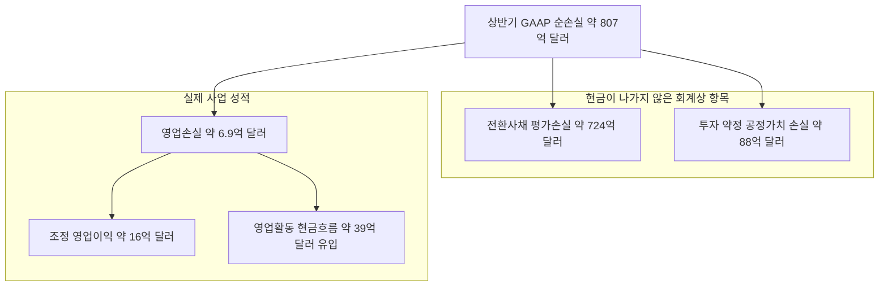

- 작성 기준일: 2026-10-29 (서버 시각 기준)
- 검토 대상: Threads에 올라온 ["Anthropic 적자가 엄청난데 어떻게 유지하는가?"](https://www.threads.com/share/BAbK1QK_Td/)라는 질문과, 그에 달린 "추론 마진 85~90%, 인프라 투자 때문에 적자, 현금 1,317억 달러" 답변
- 근거 자료: 2026년 10월 26일 공개된 Anthropic의 S-1(IPO 투자설명서)과 그에 대한 10월 26~29일 보도·분석, OpenAI 관련 최신 보도

---

## 0. 먼저 결론부터

질문자는 "적자가 엄청난데 어떻게 유지하느냐, 투자금으로 버티는 것이냐, 내가 모르는 무언가가 있느냐"를 물었습니다. 자료를 확인해 보면 답은 세 갈래로 나뉩니다.

**첫째, "엄청난 적자"의 정체가 생각과 다릅니다.** S-1에 나오는 상반기(2026년 1~6월) 순손실 약 807억 달러는 대부분 현금이 나가지 않은 회계상 평가손실입니다. 전환사채와 투자 약정의 가치가 기업가치 상승에 따라 장부에서 크게 올라가면서 생긴 "종이 위의 손실"이 약 724억 달러 규모입니다(여기에 약 88억 달러의 비슷한 성격의 평가손실이 더해집니다). 실제 영업 성적을 보면 상반기 영업손실은 약 6.9억 달러에 그쳤고, 2분기 한 분기만 놓고 보면 약 9.7억 달러의 영업이익을 냈습니다. 현금흐름도 상반기에 영업활동에서 약 39억 달러가 들어왔습니다.

**둘째, 답변 글의 핵심 논리는 방향은 맞지만 숫자는 손봐야 합니다.** "서비스를 팔아서 남기는 비율(총마진)이 높다", "매출이 컴퓨트 비용보다 빨리 늘고 있다", "현금이 1,317억 달러다"는 모두 공시 자료로 확인됩니다. 다만 "85~90%"라는 범위 중 90%는 제가 확인한 자료에서 찾지 못했고, 85%도 "모든 비용을 반영한 마진"은 아닙니다. 또한 "적자의 이유는 인프라 투자"라는 설명은 헤드라인 순손실에는 해당하지 않고, 앞으로 닥칠 비용 압박에는 해당합니다.

**셋째, "내가 모르는 무언가"는 분명히 있습니다.** 그것은 Anthropic은 OpenAI와 달리 "투자금만으로 버티는 회사"에서 "영업 단계에서 거의 손익분기에 도달한 회사"로 넘어가는 중이라는 점입니다. 동시에 정반대편의 리스크, 즉 취소할 수 없는 수천억 달러 규모의 컴퓨트 약정이라는 "숨은 청구서"도 함께 존재합니다. 이 글은 이 두 가지를 숫자로 풀어 설명합니다.

---

## 1. 이 글이 다루는 시점과 자료의 성격

Anthropic은 2026년 10월 26일(월) 아침, 나스닥 상장(티커 ANT)을 위한 투자설명서(Form S-1)를 SEC에 공개했습니다. 400쪽이 넘는 문서이고, 회사의 재무 구조가 처음으로 공식 공개된 자리입니다. 상장 일정은 11월 9일 주간에 로드쇼(투자자 대상 마케팅)를 시작해 미국 추수감사절(11월 26일) 전에 거래를 시작하는 시나리오가 보도되어 있지만, 일정은 시장 상황에 따라 바뀔 수 있다고 전해집니다. 공모가 범위와 주식 수는 아직 공란입니다.

자료를 읽을 때 구분해야 할 점이 있습니다.

- **S-1에 직접 나온 숫자**: 2026년 상반기(6월 30일까지)의 매출, 비용, 현금, 약정 등. 가장 신뢰도가 높습니다.
- **회사가 투자자 설명회에서 말한 숫자**: 3분기 매출 168억 달러 등. 10월 14일 투자자 행사에서 공유된 내용이 언론을 통해 전해진 것이며, S-1에는 3분기 결과가 포함되어 있지 않습니다.
- **분석가가 추정한 숫자**: "실질 총마진은 60%대", "공시 약정 합계" 같은 계산. 정의와 가정에 따라 값이 달라지므로 출처를 붙여 구분해서 읽어야 합니다.

저는 SEC 원문 전체를 직접 정독한 것이 아니라, 원문의 일부 발췌와 이를 상세히 분석한 여러 매체(CNBC, Fortune, Morningstar, Bloomberg 인용 기사, 재무 분석 뉴스레터 등)를 교차 대조했습니다. 매체마다 숫자가 다른 곳은 본문에서 그 차이를 명시했습니다.

---

## 2. 핵심 수치 한눈에 보기

| 항목 | 수치 | 비고 |
|---|---|---|
| 2026년 상반기 매출 | 약 162.9억 달러 | 2025년 상반기 약 11.6억 달러 대비 약 14배 |
| 2분기 단독 매출 | 약 115.6억 달러 | 전년 동기 대비 +1,368%, 직전 분기 대비 +144% |
| 3분기 매출(회사가 투자자에게 전달) | 약 168억 달러 | 직전 분기 대비 +45%, S-1에는 미포함 |
| 상반기 순손실(GAAP) | 약 807억 달러 | 대부분 비현금 평가손실 |
| 상반기 영업손실(GAAP) | 약 6.9억 달러 (매출의 4%) | 전년 상반기 약 21억 달러 손실에서 축소 |
| 2분기 영업이익(GAAP) | 약 9.7억 달러 (마진 8%) | 공시된 분기 중 유일한 영업 흑자 |
| 상반기 조정 영업이익 | 약 16억 달러 (마진 10%) | 주식보상 등을 제외한 회사 정의 지표 |
| 컴퓨트·인프라 비용(상반기) | 약 89.5억 달러 | 매출의 약 55%, 1년 전에는 매출의 약 200% |
| 영업활동 현금흐름(상반기) | 약 +39.3억 달러 | 전년 상반기는 약 -15억 달러 |
| 설비투자(상반기) | 약 4.8억 달러 | 컴퓨트를 주로 클라우드 사업자에게 빌려 씀 |
| 현금 및 단기투자(6월 30일) | 약 1,317억 달러 | 현금성 자산 1,124억 + 단기투자 193억 |
| 누적 조달액 | 약 1,411억 달러 | 직전 라운드(Series H)는 650억 달러, 기업가치 9,650억 달러 |
| 직원 수 | 약 5,300명 | 직원 1인당 최근 12개월 매출 약 660만 달러 |

---

## 3. "적자가 엄청나다"는 말의 정체: 순손실 807억 달러는 무엇인가

### 3-1. 숫자의 뜻

S-1의 손익계산서를 그대로 읽으면 상반기 순손실이 약 807억 달러입니다. 어떤 회사의 연간 매출보다 큰 이 숫자를 보고 "도대체 어떻게 버티나" 싶은 것이 자연스러운 반응입니다. 그런데 이 손실의 구성을 뜯어보면 이야기가 달라집니다.

분석 자료들이 공통으로 짚는 구성은 이렇습니다. 약 724억 달러는 전환사채를 장부에 평가한 가치 변동에서 나왔고, 약 88억 달러는 투자 약정(note purchase agreements) 관련 공정가치 평가 손실입니다. 이 둘은 회사가 현금을 실제로 지출한 것이 아닙니다.

왜 이런 일이 생기는지 비유로 설명해 보겠습니다. 어떤 사람이 친구에게서 "나중에 주식으로 바꿀 수 있는 조건"으로 돈을 빌렸다고 합시다. 그런데 그 회사의 가치가 폭등하면, 빌려준 사람이 나중에 받게 될 주식의 가치도 폭등합니다. 회계 규정상 이 "빌려준 사람이 받을 권리의 가치 상승분"은 회사 입장에서는 비용(손실)으로 잡힙니다. 회사가 잘나가서 기업가치가 오를수록 장부상 손실이 커지는 역설입니다. 실제 지갑에서 현금이 빠져나간 것이 아닌데 말이죠. 분석가들은 IPO 때 이 전환사채가 주식으로 바뀌면 이런 평가 손실이 사라지거나 줄어들 것이라고 설명합니다.

### 3-2. 현금과 영업 성적으로 보면

그래서 현금과 영업 성적을 따로 보는 것이 중요합니다.

- 영업손실(상반기): 약 6.9억 달러. 매출 대비 4%에 불과합니다.
- 분기별로 쪼개면 1분기는 약 17억 달러 영업손실, 2분기는 약 9.7억 달러 영업이익으로 반전했습니다.
- 영업활동 현금흐름은 상반기에 약 +39.3억 달러였고, 설비투자가 4.8억 달러로 작아서 잉여현금흐름은 약 +34.5억 달러였습니다.
- Anthropic이 지금까지 약 1,411억 달러를 조달했고 현금과 단기투자가 1,317억 달러 남아 있으니, 지금까지 실제로 소진한 현금은 대략 90억 달러 안팎이라는 계산이 나옵니다(Morningstar 인용 분석가 발언).

다만 공정하게 짚어야 할 점이 있습니다. 2025년에는 정말로 대규모 적자를 냈습니다. 2025년 매출은 약 45.9억 달러였는데 영업손실이 약 80.6억 달러였고, 순손실은 약 420억 달러로 보도되었습니다. 즉 "적자가 엄청났다"는 인상은 1년 전에는 현실이었고, 2026년 들어 매출이 폭증하면서 영업 단계에서 뒤집혔습니다. 또 2분기의 영업이익이 일회성 요인으로만 난 것은 아니지만, 영업활동 현금흐름 개선 일부는 공급업체 대금 지급 시점 같은 운전자본 효과라고 S-1이 밝힌 만큼 지속 가능한 수준으로 단정하기는 어렵습니다.

아래 다이어그램은 순손실이 어떻게 구성되는지를 한눈에 보여 줍니다.

---

## 4. "추론 마진 85~90%"는 사실일까

### 4-1. 확인되는 부분

답변 글은 "현재 출시된 모델들의 추론 마진이 85~90%에 달한다"고 말합니다. S-1에서 이 숫자와 가장 가까운 것은 "매출원가(cost of revenue)"를 기준으로 계산한 총마진입니다.

Anthropic은 2025년에 손익계산서 표시 방식을 바꿔서, 지금은 비용을 컴퓨트, 인력, 영업·마케팅 같은 "성격별"로 묶어 보여 줍니다. 그래서 전통적인 매출총이익은 손익계산서 본문에 나오지 않습니다. 그러나 주석에는 매출원가가 따로 나옵니다. 상반기 매출원가는 약 23.8억 달러, 매출은 약 162.9억 달러입니다.

계산하면 (162.86 − 23.80) ÷ 162.86 = 약 85.4%입니다. 즉 매출 100원당 서비스 제공 원가로 분류된 비용은 약 14.6원입니다. 이는 전년 같은 기간에 약 12%로 계산되던 수준(CNBC 계산)에서 올라온 숫자입니다. 연간 기준으로는 2025년 약 40%, 2024년 마이너스 약 95%였다고 분석 자료는 정리합니다. 회사는 3분기에도 투자자들에게 85% 수준의 총마진을 말했다고 전해집니다.

### 4-2. 짚어야 할 부분

이 85%에는 세 가지 단서가 붙습니다.

**하나, "추론 마진"이라는 이름의 지표가 S-1에 따로 있는 것은 아닙니다.** 85.4%는 회사 전체를 합산해 매출원가 주석으로 거꾸로 계산한 값입니다. 특정 모델(예: Claude Code)의 마진이나 토큰 한 개의 수익성을 보여 주는 숫자가 아니라는 점은 분석 자료들도 분명히 합니다.

**둘, 무료 이용자를 위한 컴퓨트와 클라우드 파트너 수수료는 매출원가 밖에 있습니다.** 이 항목들은 영업·마케팅 비용으로 분류됩니다. 영업·마케팅·파트너십 비용은 상반기 약 32억 달러로 매출의 19%인데, 대부분이 채널 파트너에게 주는 수수료입니다. 한 재무 분석가는 이것까지 반영하면 실질 마진이 60%대 초반으로 내려간다고 추정했고, 다른 분석팀은 컴퓨트와 채널 비용을 빼고 나면 매출 1달러 중 남는 것이 약 28.5센트라고 계산했습니다. 두 숫자 모두 회사가 아닌 분석가의 계산이므로 "참고치"로 보셔야 합니다.

**셋, 매출 자체가 "총액(gross)" 기준으로 잡혀 있습니다.** 상반기 매출의 48%가 클라우드 마켓플레이스(AWS, Google Cloud, Azure)를 통해 발생했고, Anthropic은 이 매출을 클라우드 사업자 몫을 떼기 전의 총액으로 인식합니다. 그래서 순액 기준으로 환산하면 매출은 더 작아지고 마진 비율의 의미도 달라집니다.

정리하면 "85% 안팎"은 공시에서 확인되는 값이지만 "90%"는 제가 찾은 자료에서 근거를 확인하지 못했고, "서비스를 팔 때 남는 돈이 크다"는 큰 방향은 맞지만 모든 비용을 반영한 값은 아닙니다.

---

## 5. 답변 글의 비유(1억 벌고, 천만원 쓰고, 10억 투자)는 얼마나 맞을까

답변 글은 "클로드 모델이 1억을 벌면 비용은 천만원, 거기서 다음 모델 학습을 위한 인프라에 10억을 투입한다"고 설명합니다. 이는 이해를 돕기 위한 비유로 읽는 것이 맞고, 공시된 비율을 그대로 옮긴 것은 아닙니다. 실제 공시 숫자와 맞춰 보면 다음과 같습니다.

- 서비스 제공 원가(매출원가)는 매출의 약 15%라는 점은 비유와 비슷합니다.
- 그러나 컴퓨트·인프라 비용 전체는 상반기 약 89.5억 달러로 매출 약 162.9억 달러의 55%입니다. 즉 "번 돈의 10배를 인프라에 쓴다"는 식의 실적이 이미 장부에 찍혀 있는 것은 아닙니다. 이미 지출로 인식된 부분은 매출의 절반 남짓입니다.
- 비유가 가리키는 "미래의 10배"에 해당하는 것은 장부에 아직 없는 **계약상 약정**입니다. 이 부분이 이 글 7장에서 다룰 진짜 쟁점입니다.

그리고 "매출 증가 속도가 컴퓨트 비용 증가 속도보다 훨씬 빠르다"는 주장은 숫자로 확인됩니다. 2분기 매출은 전년 동기 대비 1,368% 늘었는데 컴퓨트·인프라 비용은 약 300% 늘었습니다. 컴퓨트 비용 1달러당 매출로 환산하면 2025년 1분기 0.40달러에서 2026년 2분기 2.08달러로 올라갔습니다.

| 분기 | 매출 (백만 달러) | 컴퓨트·인프라 (백만 달러) | 컴퓨트 1달러당 매출 |
|---|---|---|---|
| 2025년 1분기 | 376 | 944 | 약 0.40 |
| 2026년 1분기 | 4,731 | 3,387 | 약 1.40 |
| 2026년 2분기 | 11,555 | 5,558 | 약 2.08 |
| 2026년 3분기 | 약 16,800 (회사 전달) | 비공개 | 약 1.70 (보도) |

위 표의 앞 세 줄은 S-1 분기 손익 수치에서 제가 나눈 값이고, 3분기 1.70은 회사가 투자자에게 말한 내용으로 보도된 것입니다. 눈여겨볼 점은 3분기에 이 비율이 2.08에서 1.70으로 내려갔다는 것입니다. 한 분석가는 2분기 효율을 "고점(high-water mark)"으로 봐야 한다고 말합니다. 이유는 다음 장에서 설명합니다.

---

## 6. 매출은 빨라도 비용은 "계단식"으로 온다: 컴퓨트 선구매 구조

이 구조의 핵심은 시간차입니다. S-1과 분석 자료에 따르면 Anthropic은 컴퓨트를 사용 12~18개월 전에 미리 계약하고, 그 용량이 실제로 가동되는 시점에 비용이 손익계산서에 잡힙니다. 비용은 거대한 덩어리로 한꺼번에 들어오는 반면, 매출은 고객의 사용량(토큰 소비)에 따라 매달 오르내립니다.

그 결과 두 가지 효과가 번갈아 나타납니다.

- **매출이 먼저 치고 나갈 때**: 이미 확보해 둔 컴퓨트 위에서 매출이 폭증하면 효율 지표가 크게 좋아집니다. 올해 2분기가 이런 구간이었습니다. 분석가들은 "과거에 계약해 둔 용량을 매출이 앞질렀기 때문"이라고 설명합니다.
- **비용이 계단을 올라설 때**: 대규모 용량이 새로 가동되면 매출이 따라오기 전에 비용이 먼저 늘어 마진이 눌립니다. S-1 스스로도 영업마진과 조정 영업마진이 "상당한 추가 컴퓨트가 공급되고 관련 비용이 발생하는 시기에 변동(압축)될 수 있다"고 적고 있습니다.

예를 들어 PitchBook 분석가의 추정에 따르면 SpaceXAI와의 컴퓨트 계약 하나만으로 12월부터 분기당 약 93억 달러의 비용이 들어가는데, 이는 2분기 전체 컴퓨트 비용 약 56억 달러보다 큽니다. 이 숫자는 개별 분석가의 추정이라는 점을 감안해야 하지만, "비용 계단"이 얼마나 가파를지 가늠하게 해 줍니다.

---

## 7. 진짜 쟁점: 장부 밖의 "취소 불가" 컴퓨트 약정

### 7-1. 약정 규모는 얼마인가

"내가 모르는 무언가"를 찾는다면 가장 큰 후보가 여기입니다. S-1은 컴퓨트·인프라 약정의 총합 자리를 공란("more than $____")으로 남겨 두고, 2045년까지 이어지는 지급 일정이라고만 적었습니다. 그래서 총액은 매체와 분석가마다 계산이 다릅니다.

| 출처 | 수치 | 성격 |
|---|---|---|
| 로이터(S-1 초안 인용) | 향후 10년간 최소 약 5,180억 달러, 이 중 약 80%가 취소 불가이거나 사용 여부와 무관하게 지급 | 6개 파트너 대상 |
| Fortune | 인프라 서비스·장비 리스 약정 합계 약 6,570억 달러, 이 중 약 4,980억 달러(76%)가 취소 불가 | 8~9건의 계약 합산 |
| Exponential View 인용 | 약 5,870억 달러, 고객이 확정한 매출은 약 100~110억 달러(약 12주치) | 분석가 계산 |
| 파이낸셜타임스(Atranica 인용) | 8,000억 달러 이상, 2045년까지 | Broadcom 리스 약 1,612억 달러 등 포함 집계 |
| S-1 개별 항목(Atranica 정리) | 6월 말 기준 고정·최소 컴퓨트 약정 약 2,656억 달러, 분기 이후 신규 최소 약정 약 2,450억 달러 | 리스 개시 전 계약(약 3,214억 달러)은 별도 |

숫자가 이렇게 다른 이유는 포함 범위가 다르기 때문입니다. Broadcom 관련 장비 리스 약 1,612억 달러를 총액 안에 넣느냐, 6월 말 이후 신규 약정을 넣느냐, 취소 가능한 xAI 쪽 계약을 어떻게 다루느냐에 따라 달라집니다. 분석가 한 명은 이 숫자들을 단순 합산하면 중복이 생길 수 있다고 경고합니다. 따라서 "약정이 최소 5,000억 달러 이상, 보도에 따라 8,000억 달러를 넘는다"는 정도로만 이해하는 것이 정직합니다.

### 7-2. 왜 부담이 되는가

Fortune의 계산으로는 취소 불가 약정 약 4,980억 달러 대부분이 7년 이내 계약이므로 연평균 약 700억 달러가 지급되어야 합니다. 이 돈은 2분기 매출을 4배 한 약 460억 달러보다 크고, 3분기 매출을 4배 한 약 670억 달러와 비슷한 규모입니다. 그래서 Anthropic의 IPO를 두고 분석가들이 던지는 질문은 "지금 얼마나 버나"가 아니라 "이 약정이 만기가 될 때까지 매출이 충분히 자라 주나"입니다.

또 하나의 구조적 부담은 계약 기간의 불일치입니다. 컴퓨트 계약은 길게는 20년까지 이어지는데, S-1은 고객 계약의 상당수가 사용량을 줄이거나 떠날 수 있게 되어 있다고 밝힙니다. 한쪽은 고정이고 다른 쪽은 변동입니다. 한 분석가는 이 구조에서 한 계약의 문제가 신용 한도 등 다른 부채의 연쇄 부도로 번질 수 있다고 지적합니다.

### 7-3. 회사의 방어선

물론 약정에는 이유가 있습니다. Anthropic은 투자자들에게 향후 수요가 "주로 컴퓨트 확보 가능 여부에 의해 제한될 것"이라고 설명합니다. 그리고 현금 1,317억 달러에 IPO 자금이 더해지면 이 청구서의 초기 구간을 감당할 여력은 충분하다는 것이 시장의 대체적 시각입니다. 회사는 또 자체 부지용 첨단 칩 구매를 수요가 더 분명해질 때까지 미루고, 용량이 남으면 재판매하겠다는 계획도 밝혔습니다. 다만 업계 전체가 침체일 때 재판매가 얼마나 현실적인지에는 의문이 제기됩니다.

---

## 8. "현금 1,317억 달러, IPO까지 하면 수백조"는 어디까지 맞나

### 8-1. 현금

S-1에 따르면 2026년 6월 30일 기준 현금 및 현금성 자산 1,124억 달러와 단기투자 193억 달러를 합쳐 1,317억 달러입니다. 5월 말 약 650억 달러 규모의 Series H 라운드가 들어온 직후의 숫자입니다. 이 현금에서 2분기 이자수익만 약 7.6억 달러가 발생했고, 상반기 이자수익은 약 11억 달러입니다.

원화로 환산하면 한국 언론이 사용한 "1,000억 달러 ≈ 약 139조 원"이라는 환산 비율을 적용했을 때 약 183조 원입니다. 환율에 따라 달라지는 값이므로 "약 180조 원 안팎"으로 이해하시면 됩니다. 한 가지 시점의 문제도 있습니다. 이 숫자는 6월 말 기준이고, 그 이후 분기의 현금 소진이나 약정금 지급은 반영되어 있지 않습니다.

### 8-2. IPO

IPO 목표는 보도에 따르면 최대 1,000억 달러 이상을 조달하고 기업가치 약 2조 달러를 인정받는 것입니다. 1,000억 달러는 한국 언론 환산으로 약 139조 원이므로, 현금과 합치면 "수백조 원"이라는 표현은 규모 감각으로는 틀리지 않습니다. 다만 아직 가격 범위와 주식 수가 공란이고, 일정과 규모는 확정되지 않았습니다. 투자자 설명회 이후 시장의 기대치는 2조 달러에서 1.4~1.5조 달러 수준으로 조정되고 있고 약 1.75조 달러가 달성 가능한 수준이라는 보도도 있습니다. 그러니 "IPO로 수백조를 땡길 수 있다"는 말은 가능성이지 확정 사실이 아닙니다.

### 8-3. 상장 후 구조도 알아둘 만합니다

- 이 회사는 다섯 종류의 보통주를 두고, 공동창업자 7명이 소유한 Class F 주식 1주가 의결권의 50.1%를 가집니다. 일반 투자자가 사는 Class A 주식의 의결권 총합은 최대 49.9%로 제한됩니다.
- 장기이익신탁(Long-Term Benefit Trust)이 이사회 과반을 선임합니다.
- 공익기금(Public Benefit Fund)에 완전 희석 지분의 5%를 배정했고, 주가가 직전 기준 대비 50% 오를 때마다 최대 2%를 추가할 수 있어 희석 요인이 됩니다.

즉 "주주가 경영에 영향을 주기 어려운 구조"라는 점이 공시에 명시되어 있습니다.

---

## 9. 그렇다면 OpenAI도 "투자금으로 버티는" 걸까

질문자가 함께 궁금해한 OpenAI는 구조가 꽤 다릅니다. 보도된 숫자를 모으면 다음과 같습니다(OpenAI는 아직 공개 S-1이 없고, 아래 숫자는 유출·보도에 기반한 것이며 출처별로 정의가 다릅니다).

- **2025년**: 매출 약 130.7억 달러, 영업손실 약 209억 달러, 순손실 약 385억 달러로 보도되었습니다. 순손실에는 구조 개편과 관련된 큰 비현금 항목이 포함되어 있습니다.
- **2026년 1분기**: 매출 약 57억 달러, 현금 소진 약 37억 달러, 영업손실 약 93억 달러, 순손실 210억 달러 이상(이 중 약 124억 달러는 비현금 회계 항목)으로 보도되었습니다.
- **2026년 2분기**: 매출 약 67억 달러, 영업손실 약 123억 달러로 보도되었습니다. 즉 매출은 18% 늘었는데 영업손실은 더 빠르게 커졌습니다.
- **연환산 매출**: 투자자 설명에서 9월 말 약 500억 달러(CNBC 확인)라고 했고, 앞서 퍼졌던 680억 달러는 파트너의 총액 매출을 포함한 숫자라고 설명되었습니다.
- **자금**: 3월에 1,220억 달러 규모 라운드를 기업가치 8,520억 달러로 마쳤고 엔비디아와 소프트뱅크가 10월 1일 마지막 분할금을 납입한 것으로 보도되었습니다. 1분기 말 현금과 유가증권은 약 730억 달러였습니다. 3분기 현금 잔액은 검증된 공개 자료가 없습니다.
- **컴퓨트**: 2030년까지 컴퓨트·인프라 지출 계획이 보도마다 6,000억~8,560억 달러로 다르고, 구매 약정은 약 6,650억 달러로 보도되었습니다. 투자자 설명에 따르면 2026~2030년 누적 잉여현금흐름은 약 -2,780억 달러입니다.

이를 Anthropic과 비교하면 이렇게 정리할 수 있습니다.

| 구분 | Anthropic | OpenAI(보도 기준) |
|---|---|---|
| 영업 손익 | 2분기 영업 흑자, 상반기 소폭 영업 적자 | 2분기 영업손실 약 123억 달러 |
| 영업현금흐름 | 상반기 약 +39억 달러 | 1분기 현금 소진 약 37억 달러 |
| 매출 성장 | 3분기 직전 분기 대비 +45% | 2분기 직전 분기 대비 +18% |
| 기반 자금 | 현금·단기투자 1,317억 달러(6월 말) | 3월 라운드 1,220억 달러, 1분기 말 약 730억 달러 |
| 공개 여부 | S-1 공개(10월 26일) | 비공개 S-1 제출(6월), 타이밍 미정 |

여기에는 주의점이 있습니다. 두 회사는 클라우드 파트너 매출을 총액으로 잡느냐 순액으로 잡느냐가 달라 매출을 정확히 맞비교하기 어렵습니다. 한 분석 매체는 "2분기 Anthropic 매출이 OpenAI를 앞섰다"고 평가하지만 같은 글에서 "정의가 달라 격차가 정확하지는 않다"고 단서를 붙입니다. 그럼에도 방향은 분명합니다. **OpenAI 쪽이 "조달한 자금으로 손실을 메우는" 모습에 더 가깝고, Anthropic은 영업 단계에서는 손익분기를 넘나드는 단계**라는 점입니다.

---

## 10. 게시글 주장 항목별 검증

| 게시글의 주장 | 확인 결과 | 판정 |
|---|---|---|
| 추론 마진이 85~90% | S-1 주석 기준 상반기 매출원가 기반 총마진 약 85.4%. 90%는 확인하지 못함. 무료 이용 컴퓨트·채널 수수료는 제외된 값 | 부분 확인 |
| 100원 벌면 비용 10원 | 실제 약 14.6원. 전부 반영하면 더 큼 | 방향은 맞음, 수치는 과소 |
| 적자는 더 큰 AI를 만들기 위한 인프라 비용 때문 | 헤드라인 순손실은 대부분 비현금 평가손실. 영업손실은 매출의 4%. 인프라 비용 증가는 사실이며 앞으로 더 커질 요인 | 부분 확인 |
| 컴퓨트 비용보다 매출 증가 속도가 훨씬 빠름 | 2분기 매출 +1,368% vs 컴퓨트 +300%. 단 3분기 효율은 2.08에서 1.70으로 하락 | 확인(단서 있음) |
| 현금성 자산 약 1,317억 달러 | 6월 30일 기준 1,317억 달러(현금 1,124억 + 단기투자 193억) | 확인 |
| IPO까지 하면 수백조 | 1,000억 달러 이상 조달 목표 보도. 가격·규모 미확정, 시장 기대치는 하향 조정 중 | 가능성 수준 |
| 똑똑한 지능에 대한 수요는 계속된다 | 연 10만 달러 이상 고객이 1년 새 약 950곳에서 1만 1,900곳 이상으로 증가. 그러나 S-1 자체가 성장률 둔화 가능성을 경고하고, 시장 가격은 빠르게 하락 중 | 근거는 있으나 전망의 영역 |

---

## 11. 아직 해소되지 않은 위험 요소

공정하게 하려면 낙관 쪽 근거만 나열해서는 안 됩니다. 분석 자료들이 공통으로 지적하는 위험은 다음과 같습니다.

1. **성장률 둔화**: 2분기 직전 분기 대비 +144%였던 성장이 3분기 +45%로 낮아졌고, 일부 투자자 기대에는 못 미쳤다고 보도되었습니다. 여름에는 연말 연환산 매출이 1,000억 달러를 크게 웃돌 것이라는 투자자 전망이 있었는데, 10월 투자자 행사 이후 월스트리트저널은 약 1,100억 달러 기대로 전했습니다.
2. **가격 하락**: Ramp AI Index에서 Anthropic의 평균 가격이 2025년 초 백만 토큰당 약 2.50달러에서 최근 약 0.73달러로 내려왔습니다. 사용량이 가격 하락보다 더 빨리 늘어야 매출이 유지됩니다. 중국계 오픈웨이트 모델과의 경쟁도 거세졌습니다.
3. **신모델 의존**: 최근 6개월 내 출시된 모델이 3분기 매출의 80% 이상을 만들었습니다. 신모델을 계속 내놓으려면 학습 투자도 계속해야 합니다.
4. **에이전트 컴퓨트 증가**: S-1은 에이전트 작업이 늘면 서비스 컴퓨트 수요가 매출보다 더 빠르게 늘 수 있다고 경고합니다.
5. **상대방 집중**: 매출의 48%가 3대 클라우드 마켓플레이스를 거치고 미수금의 58%도 여기에 몰려 있습니다. 이 사업자들은 투자자, 공급자, 경쟁자이기도 합니다.
6. **회계 해석의 이견**: 조정 영업이익이 주식보상을 제외한다는 점에 대한 비판이 있고, 한 분석팀은 3분기 GAAP 기준으로는 영업손실로 돌아갔을 수 있다고 추정했습니다(S-1에 3분기 결과는 없어 추정입니다). IPO와 함께 약 237억 달러의 주식보상 비용이 향후 약 2년에 걸쳐 인식될 예정이라는 점도 GAAP 이익에 부담입니다.
7. **정책·법적 변수**: 올해 6월 수출통제 지침으로 일부 모델 접근이 일시 중단되었다가 복원된 일, 국방부의 공급망 위험 지정과 소송, 저작권 소송 등이 위험 요인으로 나열되어 있습니다.

---

## 12. 쉬운 말로 다시 정리하면

Anthropic의 구조는 "대형 식당 체인"에 비유할 수 있습니다. 매장에서 음식을 팔 때 재료비는 낮습니다(총마진이 높음). 그런데 이 체인은 앞으로 몇 년간 쓸 주방과 건물 임대 계약을 미리, 그것도 중도 해지가 거의 안 되는 조건으로 수천억 달러어치 맺었습니다. 지금까지는 손님이 계약한 공간보다 훨씬 빨리 몰려서 매장이 꽉 찼고, 그 덕에 이익이 났습니다. 손에 쥔 현금도 많습니다. 하지만 임대료가 본격적으로 나가기 시작할 때까지 손님이 계속 같은 속도로 늘지는 알 수 없습니다. 이것이 시장이 지금 따지고 있는 질문입니다.

그래서 질문에 대한 가장 정확한 답은 다음과 같습니다.

- "투자금으로만 버티는가?" → 과거에는 그랬고, 지금은 영업 단계에서 스스로 현금을 만들기 시작했습니다. 그래도 거대한 현금 보유가 안전판 역할을 하는 것은 맞습니다.
- "내가 모르는 무언가가 있는가?" → 있습니다. 순손실의 대부분이 비현금 평가손실이라는 점, 그리고 반대로 장부에 아직 없는 거대한 취소 불가 약정이라는 두 가지입니다.
- "그래서 안전한가?" → 공시만으로 판단할 수 없습니다. 이 글은 투자 조언이 아니며, 매출 성장이 약정 규모를 따라잡을 수 있느냐는 앞으로 몇 분기의 실적이 답해 줄 문제입니다.

---

## 13. 이 문서의 한계

- SEC 원문(S-1)을 전부 직접 정독하지 않고, 발췌본과 다수 매체의 분석을 교차 대조했습니다. 매체 간 수치가 다른 부분(약정 총액, 실질 마진 등)은 본문에 범위로 표기했습니다.
- 3분기 숫자는 회사가 투자자에게 전달한 내용이 보도된 것이며 감사받은 공시가 아닙니다.
- OpenAI 숫자는 유출·보도에 기반하고 있어, 공개 S-1이 나오면 바뀔 수 있습니다.
- 상장 일정과 공모 규모, 가격은 확정되지 않았습니다.
- 환율은 한국 언론 환산 비율(1,000억 달러 ≈ 139조 원)을 그대로 적용한 근사치입니다.
- 이 문서는 투자 권유가 아닙니다.

---

## Sources

- [Anthropic IPO live updates: AI lab's S-1 filing — CNBC](https://www.cnbc.com/2026/10/26/anthropic-ipo-live-updates-ai-s-1-filing.html)
- [Anthropic, PBC — Form S-1 — SEC EDGAR](https://www.sec.gov/Archives/edgar/data/0002130357/000162828026067168/anthropicpbc-sx1.htm)
- [Anthropic's S-1, by the numbers: A thriving business—with a $498 billion asterisk — Fortune](https://fortune.com/2026/10/27/anthropic-s1-ipo-filing-financials-profits/)
- [Anthropic IPO: S1 Breakdown — Mostly Metrics](https://www.mostlymetrics.com/p/anthropic-ipo-s1-breakdown)
- [Anthropic opens its books: rapid growth, giant bills and little say for shareholders — Atranica Capital](https://atranicapital.substack.com/p/anthropic-opens-its-books-rapid-growth)
- [3 Charts on Anthropic's Historic IPO Filing — Morningstar](https://www.morningstar.com/stocks/3-charts-anthropics-historic-ipo-filing)
- [Anthropic reveals $131.7 billion cash pile in IPO filing — Crypto Briefing](https://cryptobriefing.com/anthropic-131-billion-cash-ipo-filing/)
- [Inside Anthropic's NASDAQ IPO as Revenue Soars and Compute Bills Stretch to 2045 — Entrepreneur APAC](https://apac.entrepreneur.com/business-news/inside-anthropics-nasdaq-ipo-as-revenue-soars-and-compute-bills-stretch-to-2045)
- [Anthropic's third-quarter revenue is said to hit $16.8 billion ahead of IPO — CNBC](https://www.cnbc.com/2026/10/15/anthropics-third-quarter-revenue-hits-16point8-billion-ipo.html)
- [엔트로픽, 3분기 매출 45%↑ 또 흑자 — SBS Biz](https://biz.sbs.co.kr/amp/article/20000340067)
- [앤트로픽, 11월 중순 상장 추진…기업가치 최대 2천717조원 — SBS Biz](https://biz.sbs.co.kr/amp/article/20000338009)
- [“몸값 2780조원”…앤트로픽, 스페이스X 넘는 ‘역대급 IPO’ 노린다 — 이코노미스트](https://economist.co.kr/article/view/ecn202608220013)
- [Anthropic Commits to $518 Billion in Computing Power Ahead of Its IPO — Sovereign Magazine](https://www.sovereignmagazine.com/article/anthropic-ipo-518-billion-compute-commitments)
- [Anthropic's S-1 Shows $16.3B in Revenue and a Compute Squeeze From Its Own Partners — VKTR](https://www.vktr.com/ai-market/anthropics-s1-shows-163b-in-revenue-and-compute-squeeze/)
- [Nvidia, Oracle, CoreWeave and other AI stocks sink on OpenAI revenue report — CNBC](https://www.cnbc.com/2026/10/08/open-ai-revenue-nvidia-oracle-coreweave.html)
- [Can OpenAI actually afford all this compute? — New Market Pitch](https://newmarketpitch.com/blogs/news/frontier-ai-labs-openai-compute-costs)
- [Can OpenAI ever become profitable? — New Market Pitch](https://newmarketpitch.com/blogs/news/frontier-ai-labs-openai-profitability)
- [OpenAI plans massive losses and spending between 2026 and 2030 — BPDATA](https://news.bpdata.com/article/openai-plans-massive-losses-and-spending-between-2026-and-66bd0d47)
- [OpenAI revenue, losses and cash burn: what has been reported — Safeguard](https://safeguard.sh/resources/blog/openai-revenue-losses-and-cash-burn-what-has-been-reported)

---

작성 일자: 2026-10-29
