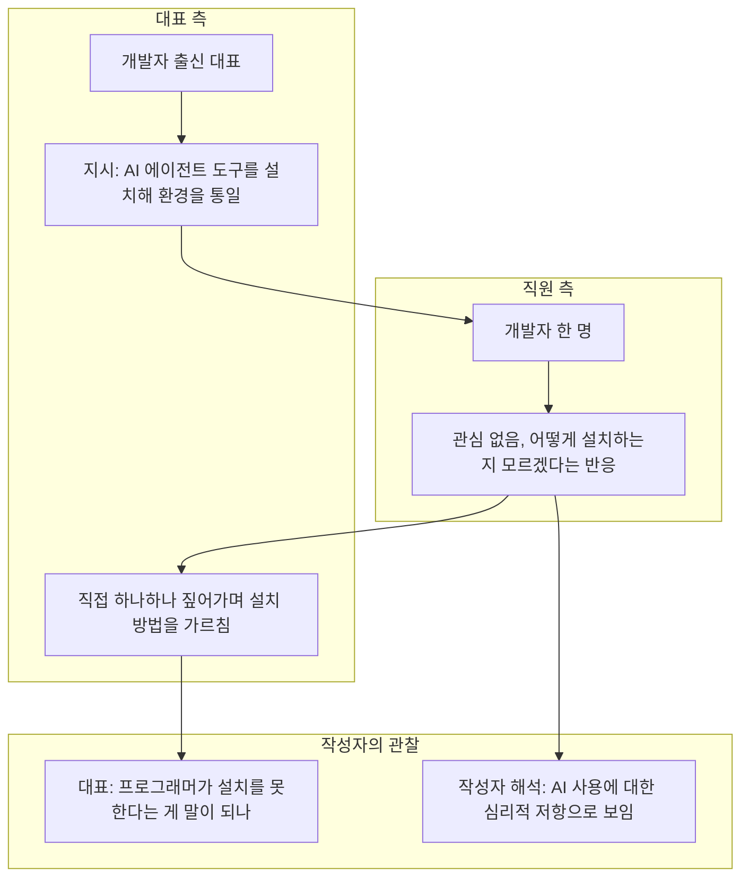
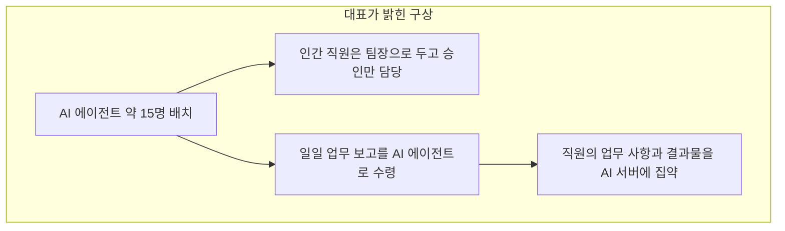
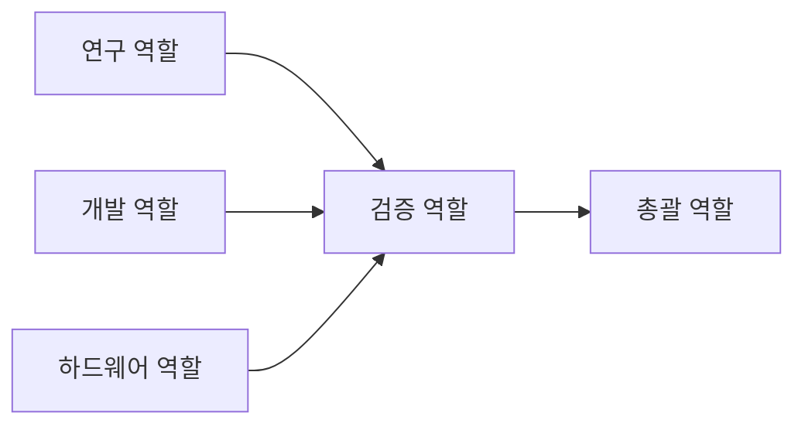
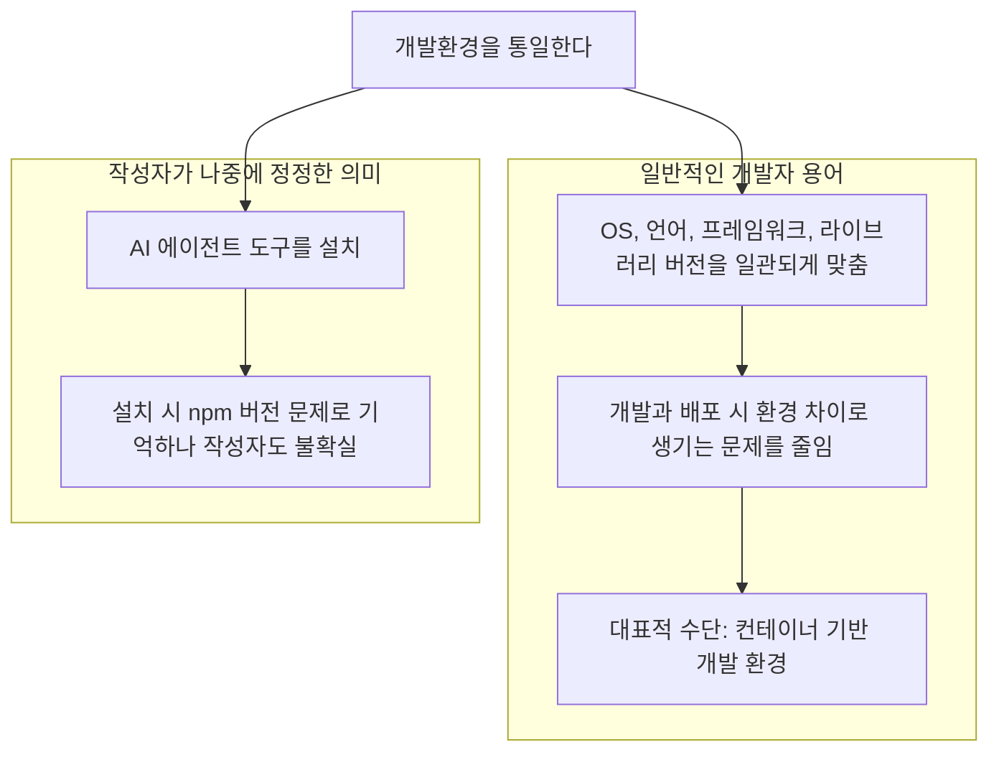
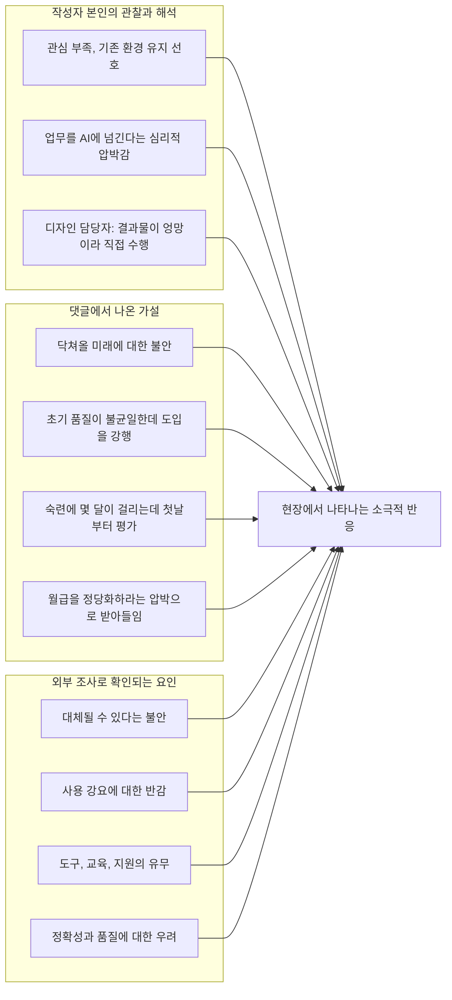

- 작성 기준일: 2026-10-29
- 대상: Threads 사용자 horakhti의 게시글 "사내 개발팀에서 큰 언쟁이 있었다"와 그 아래 댓글 토론
- 방법: 공유해 주신 게시글·댓글 내용을 먼저 정리하고, 글에 나온 용어와 주장을 2026년 10월 기준 공개 자료로 검증했습니다. 원문 링크(threads.com)는 자동 접근이 막혀 있어 직접 열어보지 못했고, 공유해 주신 내용만을 근거로 삼았습니다.

```
사내 개발팀에서 큰 언쟁에 있었다
대표는 직원들에게 ai agent 툴을 설치해서
개발환경을 통일하라고 지시하였으나 
직원한명은 그닥 관심도 없고 
어떻게 설치하는지 모르겠다는 식으로
덤볐다
프로그래머가 개발툴 설치할줄모르는다는게
이해가 안갔다
개발자 출신 대표는 노발대발 그게 말이되냐며
하나하나 짚어주며 가르치는데
어리버리 뭐하는지 모르는듯 반응한것
옆에서 논쟁을 지켜보며 ai agent 사용에 심리적 저항을
하는것으로 보이는데
일단 그닥 관심이 없고 원래하던 환경을 바꾸고 싶지도 않고 
왜 ai에게 내 업무를 인수인계해야하는지
약간 심리적 압박감이 내눈에 보였다
얼마전 디자인 담당자는 ai agent 쓰라는 대표지시에 따라 쓰는데 하는말이 
결과가 넘 엉망이라 자기가 직접했다며. 
답답한 얘기만 늘어놓음
소기업이라 중구난방이긴하지만 이런 광경이 타회사에도 일어나고 있지않을까 대표나 임원들이 
ai 부르짖지 사원들은 반발이 좀 있어보이는데

난 챗gpt3.5부터 쓰기시작했는데
대표에게 챗gpt 꼭써야한다고 말한땐 쥐똥으로 안들음
개발자보다 못하다고 
회사내에서 그런 얘기 함부로 하지말라 직원사기 떨어진다며 눈치챙겨야한다고 했지
왠걸 올해초부터 대표가 사내 분위기 흐리는중
무조건 ai agent를통해서 일일업무보고를 받겠다며
모든 직원 업무사항과 결과물을 ai 서버에 흡수하겠다고
뭔가 ai 거대조직을 만들겠다며 설레발 치는중
전략을 들어보면 대충 트랜드에 맞는방향 
인간직원보다 ai agent로 조직하는게 소기업에게는 
현실적인 방향
대표는 대략 15명 정도 ai agent를 배치할 계획
인간직원은 팀장으로 두고 승인만 하게 조직개편을 단행하겠다는데.
내가 보기론 agi 나오면 그 승인도 ai agent가 할것 같은데 생각이 듬 
이게 왜 확실하냐면 내가 그렇게 쓰거든
Chatgpt 6 아스트라로 총괄, 검증, 연구요원 개발요원 하드웨어 요원나눠서 쓰는데 
각자 업무결과를 검증요원에게 전달하고 업무최종을 총괄에게 전달하게.

https://www.threads.com/share/BAyKCy2FPD/

```


## 이 문서를 읽는 법

글 안의 내용은 네 종류로 나뉩니다. 이 구분을 문서 전체에서 유지합니다.

- **원문 내용**: 게시글과 댓글에 실제로 적혀 있는 것
- **작성자의 해석**: 작성자가 직접 보고 느낀 것이거나 추측한 것 (사실이 아니라 관찰자의 견해)
- **외부 자료로 확인된 것**: 공개된 보도, 조사, 공식 문서로 뒷받침되는 것
- **확인 불가**: 원문이나 외부 자료로는 판단할 수 없는 것

---

## 1. 한눈에 보기

게시글의 핵심은 이렇습니다. 직원 수가 많지 않은 한 회사에서 개발자 출신 대표가 직원들에게 "AI 에이전트 도구를 설치해서 개발환경을 통일하라"고 지시했습니다. 그런데 직원 한 명이 관심이 없다는 듯 "어떻게 설치하는지 모르겠다"는 식으로 반응했고, 대표는 개발자가 개발 도구 설치를 못한다는 것이 말이 되느냐며 화를 냈습니다. 글을 쓴 사람은 같은 사무실에서 이 장면을 지켜본 다른 부서 직원인데, 이것을 "AI 사용에 대한 심리적 저항"으로 해석했습니다.

흥미로운 점은 댓글에서 이 사건의 전제 자체가 흔들린다는 것입니다. 한 댓글은 "개발환경 통일"이라는 말은 보통 OS, 언어, 프레임워크, 라이브러리 버전을 맞추는 일을 가리키지, AI 에이전트를 통일하는 일이 아니라고 지적했습니다. 작성자도 나중에 "개발툴이 아니라 파이 에이전트를 설치하는데 npm 버전이 구버전이었던 것 같고, 그것을 통일시키는 것이었던 것 같다. 옆에서 들은 것이라 나도 모른다"고 정정했습니다. 즉 언쟁의 발단이 된 지시의 정확한 내용부터가 불확실합니다.

그럼에도 이 글이 많은 반응을 얻은 이유는, 이야기의 큰 줄기가 많은 직장인이 겪는 상황과 닮았기 때문입니다. 경영진은 AI 도입을 서두르고, 현업은 이유를 납득하지 못하거나 결과물에 만족하지 못하거나 자기 일이 넘어가는 것에 불안해합니다. 2026년에 공개된 여러 조사도 이 간극이 실제로 넓다는 점을 보여줍니다. 다만 한 직원의 반응 하나만 보고 "저항"이라고 단정하는 것은 근거가 부족하다는 점도 이 문서에서 함께 짚겠습니다.

---

## 2. 게시글이 말하는 것

### 2.1 사건의 줄거리

작성자가 묘사한 상황은 다음 순서로 전개됩니다.

대표가 직원들에게 AI 에이전트 도구를 설치해 개발환경을 통일하라고 지시했습니다. 직원 한 명이 그다지 관심을 보이지 않으며 어떻게 설치하는지 모르겠다는 식으로 대응했고, 작성자의 표현으로는 "덤볐다"고 합니다. 작성자는 프로그래머가 개발 도구를 설치할 줄 모른다는 것이 이해가 가지 않았다고 적었습니다. 개발자 출신인 대표 역시 노발대발하면서 "그게 말이 되느냐"고 하며 하나하나 짚어가며 가르쳤는데, 그 직원은 무엇을 하는지 모르는 듯 어리버리하게 반응했다는 것입니다.



### 2.2 작성자의 해석

작성자는 논쟁을 옆에서 지켜보며 이것이 AI 에이전트 사용에 대한 심리적 저항으로 보인다고 판단했습니다. 그 이유로 든 것은 세 가지입니다. 우선 그다지 관심이 없다는 점, 원래 하던 환경을 바꾸고 싶어 하지 않는 점, 그리고 왜 AI에게 자기 업무를 인수인계해야 하느냐는 약간의 심리적 압박감이 눈에 보였다는 점입니다. 여기서 "눈에 보였다"는 표현이 중요합니다. 직원 본인이 한 말은 "설치 방법을 모르겠다"가 전부이고, 나머지는 작성자의 읽기입니다. 이것은 **작성자의 해석**이지 확인된 사실이 아닙니다.

작성자는 비슷한 사례를 하나 더 들었습니다. 얼마 전 디자인 담당자가 대표의 지시에 따라 AI 에이전트를 써 보았는데, 결과가 너무 엉망이라 결국 자기가 직접 했다며 답답한 이야기를 늘어놓았다고 합니다. 이 사례는 저항이라기보다 결과물 품질에 대한 불만에 가깝습니다. 설치 문제와 품질 문제는 서로 다른 원인에서 나온 것인데, 작성자는 이 둘을 한 덩어리로 묶어 "사원들의 반발"이라는 큰 그림으로 보았습니다.

작성자는 이 장면이 다른 회사에서도 일어나고 있지 않을까 하는 물음으로 글을 열었습니다. 소기업이라 중구난방이긴 해도, 대표나 임원들은 AI를 부르짖는데 사원들은 반발이 있어 보인다는 인상이 그 배경입니다.

### 2.3 대표라는 인물과 조직 개편 구상

작성자는 챗GPT 3.5 시절부터 AI를 써 왔다고 합니다. 그 시절 대표에게 챗GPT를 꼭 써야 한다고 말했을 때 대표는 전혀 귀담아듣지 않았고, 개발자보다 못하다고 했으며, 회사 안에서 그런 이야기를 함부로 하면 직원 사기가 떨어지니 눈치를 챙기라고까지 했다고 합니다. 그런데 올해 초부터는 상황이 뒤집혀 대표가 오히려 사내 분위기를 어수선하게 만들고 있다고 작성자는 표현합니다.

대표가 밝힌 구상은 이렇습니다.

- 무조건 AI 에이전트를 통해 일일 업무 보고를 받겠다.
- 모든 직원의 업무 사항과 결과물을 AI 서버에 흡수하겠다.
- 일종의 거대한 AI 조직을 만들겠다.
- AI 에이전트를 대략 15명 정도 배치하고, 인간 직원은 팀장으로 두어 승인만 하도록 조직을 개편하겠다.

작성자는 이 전략이 대략 최근 트렌드에 맞는 방향이고, 인간 직원 중심보다 AI 에이전트 중심으로 조직하는 것이 소기업에게는 현실적인 방향이라고 평가했습니다. 동시에 "범용 인공지능(AGI)이 나오면 그 승인조차 AI 에이전트가 하게 될 것 같다"는 예측도 덧붙였습니다. 이 예측은 작성자의 전망이며 검증할 수 있는 사실이 아닙니다. 또 AGI라는 말 자체가 합의된 정의가 없으므로, 이 문장은 방향에 대한 의견으로만 읽어야 합니다.



### 2.4 작성자 본인의 AI 활용 방식

작성자는 자신이 이미 이런 방식으로 쓰고 있다고 밝혔습니다. 모델은 "챗GPT 6 아스트라"이며, 하나의 모델을 총괄, 검증, 연구, 개발, 하드웨어 담당이라는 역할로 나누어 사용합니다. 각 역할이 낸 결과물을 검증 담당에게 전달하고, 최종 업무는 총괄에게 전달하도록 구성했다고 합니다.

글에 적힌 것은 "연구, 개발, 하드웨어의 결과물이 검증을 거쳐 총괄로 간다"는 흐름입니다. 총괄이 일을 나누어 주는 방향이 있는지는 적혀 있지 않으므로 아래 그림에는 적힌 흐름만 그렸습니다.



---

## 3. 댓글 토론의 내용

댓글은 크게 다섯 가지 흐름으로 나뉩니다. 각 흐름을 주장자의 아이디와 함께 정리합니다.

### 3.1 "개발환경 통일"이라는 말의 혼선

가장 먼저 눈에 띄는 것은 용어 지적입니다. park_trasche는 개발환경은 AI 에이전트를 통일시킨다고 되는 것이 아니며, 개발자가 말하는 개발환경은 보통 OS나 개발 언어, 프레임워크와 라이브러리의 버전 등을 일관되게 맞춰서 개발과 배포 때 문제가 안 생기게 하는 것이라고 설명했습니다. 환경을 맞추려면 도커를 써야 한다는 조언도 덧붙였습니다. 작성자는 개발팀이 그렇게 하고 있는 것으로 안다고 답하면서, 자신은 비전문가이고 부서도 달라(회사 수익을 내는 부서가 아니라서) 발언권이 없다고 했습니다.

baress87도 같은 지점에서 의문을 제기했습니다. 자신의 회사는 AI 초창기부터 도입해 모든 직원이 높은 자동화 단계(L5)를 향해 달리고 있고, 지금은 전원이 Claude Code를 쓰며 거의 1년 가까이 여러 도구를 써 봤는데도, 이 글은 무슨 말인지 모르겠다는 것입니다. AI로 개발환경을 통일하라는 것이 무슨 말인지, 뜬금없이 개발툴이 왜 나오는지도 모르겠다고 했습니다. 이에 작성자는 자신이 잘못 쓴 것 같다며, 개발툴이 아니라 파이 에이전트를 설치하는 데 npm 버전이 구버전이었던 것 같은데 그것을 통일시키는 것이었던 것으로 옆에서 들은 것이라 자신도 모르겠다고 정정했습니다. 대표가 한 달 전부터 AI 에이전트를 시험해 보고 있고, 자신은 챗GPT만 쓰고 있어 복잡하게 써 본 적이 없다는 말도 덧붙였습니다.

이 대목이 전체 논쟁에서 가장 중요합니다. 언쟁의 원인이 된 지시가 "AI 에이전트 도구를 설치하고 실행 환경(특히 Node.js와 npm 버전)을 맞추라"는 것이었다면, 이것은 전통적인 의미의 개발환경 통일과는 다른 층위의 일입니다. 그리고 이 설명조차 작성자가 옆에서 들은 것을 기억해 전달한 것이라 확정할 수 없습니다.



### 3.2 저항의 이유에 대한 여러 가설

작성자의 "심리적 저항" 해석에 대해 댓글 작성자들은 각자 다른 이유를 제시했습니다.

quiet_advice__는 당장 자기 밥그릇이 날아갈까 걱정되는 것이라고 보았습니다. 작성자는 대표와 그 개발자가 선후배 사이라 해고하는 일은 없겠지만, 후배는 앱 개발자라 왠지 현타가 오는 것 같기도 하다고 답했습니다. 또 대표가 오후에 소스코드 버전업 업무를 AI에게 맡겨 몇 시간 만에 결과를 얻고 매우 신기해했는데, 직원들의 표정은 매우 불쾌한 표정이었다고 전했습니다. 대표는 "그건 작년에 했어야 하는 일이고, 며칠 걸리던 대작업을 한두 시간 만에 해결했다, 직원들을 갈아 넣는 작업이었는데 LLM으로 간단하게 해결했다"는 취지였다고 합니다.

_cinnamong_은 곧 닥쳐올 미래가 걱정되니 미리 심리적 저항감을 표현하는 것 아니냐고 해석했습니다. 작성자는 옆에서 직원들을 관찰해 보니 AI에 그다지 관심이 없고, 막내 개발자만 열심히 쓴다고 답했습니다. 그 막내는 집에 있는 게임용 컴퓨터에 LLM을 설치해 원격 제어로 쓰고 있고, 대표는 사내에 LLM 전용 컴퓨터를 조립하면 그때 사내 컴퓨터를 이용하라며 독려한다고 합니다. 나머지는 그다지 공부를 안 한다고 하고, 작성자는 IT 최전선에 있는 사람들이 오히려 크게 바꾸고 싶지 않아 하는 것 같다며, 말로는 AI가 중요해지겠다고 하면서 행동은 쓰고 싶지 않은 듯하다고 평가했습니다.

luke78511은 결과물 품질이 들쭉날쭉한 초기 단계에서 도입을 강행하면 저항이 더 커질 것이라며, 도구 자체보다 프롬프트와 워크플로를 어떻게 설계해 결과를 안정시키느냐가 관건 아니냐고 물었습니다. 작성자는 마침 회의 주제가 그것이었다고 답했습니다. 즉 MD 파일을 철저하게 검증해 작성하자, 모든 업무 산출물은 기록에 남기도록 AI에게 시켜라, AI 환경은 통일한다 등이 지시사항이며, 이 작업을 대표가 직접 설계해 배포하는 중이라고 합니다. 회사가 곧 이사를 가는데 중앙 서버를 통일해 회사 조직으로 내재화한다고 하더라며, 소기업이라 대표가 직접 세팅할 것이고 조만간 진행된다고도 했습니다.

threads.wolf는 AI도 최고 요금제로 몇 달 이상 써 봐야 감이 오는데, 첫날부터 몰아붙이면 안 되고 엉망이라고 색안경을 끼고 본다며 천천히 진행해야 한다고 조언했습니다. 작성자는 동의하며, 말로는 AI가 대단하다고 하지만 다들 떨떠름한 분위기라 이해가 안 간다고 했습니다. 대표와 논의한 것은 직원을 붙잡는다고 능사가 아니니 독립할 수 있게 기회를 줘야 한다는 것이었고, 대표는 바로 수긍했지만 다만 협력사로 강하게 묶어 함께 일하면 좋겠다고 했다는 것입니다. 작성자 본인도 독립을 준비해야 한다는 말을 덧붙였습니다.

jhkim5772는 자기 회사도 같다며, 대표는 AI로 생산성을 올려 달라고 하는데 직원들은 관심이 없고, "너희 월급을 줄 이유를 증명하라"는 압박으로 받아들이는 것 같다고 했습니다. 작성자는 이해하지 못하는 것이 당연하다고 하면서, 그냥 월급 받고 늘 하던 일을 루틴하게 돌리면 그만이라고 볼 수 있다고 했습니다. 다만 그런 루틴한 업무도 Hermes 계열 에이전트로 구축하면 될 것 같은데, 문제가 생기면 금전적 손해가 나니 함부로 움직이지 못하는 듯하다고 덧붙였습니다.

nugunga_life는 AI를 쓴다고 다 같은 결과물이 나오지 않는데, 쓰기 싫으면서 억지로 "이거 해줘, 저거 해줘" 하고는 결과물이 이상하니 안 쓰겠다고 한다고 지적했습니다. 이런 사람을 어떻게 끌고 갈지가 대표의 리더십 시험대라는 의견이었습니다. 이 댓글은 "도구가 나쁜 것이 아니라 사용 방식이 결과를 좌우한다"는 입장이면서, 동시에 작성자의 디자인 담당자 사례를 다른 각도에서 설명해 줍니다.

duck9ooo와 sangyeonmoon은 사회성이나 회사 사정 같은 곁가지 이야기를 나눴는데, 작성자는 이들이 경력이 좋은 사람들이고 회사가 영세해 언제 망할지 모른다고 답했습니다. 토론의 핵심과는 거리가 있어 이 문서에서는 자세히 다루지 않습니다.

### 3.3 다른 현장의 경험

ndoor_art는 자기 디자인 팀은 AI로 프로세스를 전환한 지 오래이고 생산성이 폭발적으로 올랐지만 결국 사람 손길이 필요하다고 했습니다. 이번에 구조를 다시 바꿔 테스트 중인데 효율이 더 높아질 것 같다며, 부정해 봐야 좋을 것이 없지만 평생 깎아 온 것이 부질없어지는 현타는 이해된다고 덧붙였습니다. 작성자는 하루가 지나고 직원이 에이전트에게 일을 시켜 보더니 입이 떡 벌어졌다고 전하며, 컴퓨터를 켜 놓고 일을 시켜도 되겠다 싶은 모양이라고 했습니다. 디자인 담당자도 똑같이 "어떻게 디자인을 자동화하느냐"고 묻더라고 합니다. leekyoungnam76은 27년 차 디자이너인데 Claude를 사용하며 혁신을 체감하고 있다고 짧게 적었습니다.

이 두 댓글은 같은 직무인 디자인에서도 AI 경험이 갈린다는 점을 보여 줍니다. 작성자 회사의 디자인 담당자는 결과가 엉망이라 했고, 다른 디자이너들은 혁신을 체감한다고 말합니다. 어느 쪽이 맞는지가 아니라 **무엇을 어떻게 시켰는지**에 따라 경험이 달라질 수 있다는 점이 눈에 띕니다. 다만 이것은 댓글 몇 개로 일반화할 수 있는 이야기는 아닙니다.

### 3.4 더 넓은 사회적 맥락에 대한 언급

__heraism은 미국은 이미 진행 중이고 이제야 한국에서 진행 중이며, "AI는 표절"이라는 말도 작년에 미국에서 나왔던 이야기가 요즘 한국에서 나온다면서, 어차피 세상은 변화하고 있고 우리가 바꿀 수 없으니 순응해야 한다고 썼습니다. 작성자는 이에 대해 자신도 코딩을 가끔 하는데 이것을 과연 내 작품이라고 당당하게 말할 수 있나 싶다고 답했습니다. 직접 공부해 손으로 코딩해도 2년 넘게 걸릴 것 같고, 코딩량이 많아서가 아니라 깨달음까지 가는 데 걸리는 시간이 2년 넘을 것 같은 지식이라 "이게 내 기술입니다"라고 당당히 말하기 어렵다는 것입니다. 이 대목은 이 글에서 가장 솔직한 부분 중 하나로, AI를 잘 쓰는 사람조차 결과물에 대한 주인의식에 혼란을 느낀다는 점을 보여 줍니다.

1992dst는 지금 AI를 쓰지 않는 것은 굉장히 뒤처지는 일이며, 리누스 토발즈 본인도 현재는 허용할 정도이고, 해외에서는 이미 AI 작업물의 책임 소재를 두고 토론 중이지만 한국은 많이 뒤처져 있다고 보았습니다. 이 주장의 사실 여부는 4장에서 따로 확인합니다.

easyhantrip은 추구하는 방향이 결국 싼값에 개발 인력을 AI로 대체하려는 것 같다고 했고, 작성자는 사실 그것도 포함이긴 하지만 잘 모르겠다고 답했습니다. 이 짧은 문답에서 작성자가 대표의 구상에 인력 대체 요소가 있음을 부정하지 않았다는 점은 주목할 만합니다. 다만 대표가 실제로 그런 의도를 말했는지는 원문에 없으므로 **확인 불가**입니다.

### 3.5 작성자 답글에서 새로 드러난 사실

cowboy76은 직원과 대표가 서로 반대편인 줄 알았는데 직원들이 AI에게 저항하고 있었다니 하며 놀랐고, 작성자는 이 회사는 대표가 현직 실무자이며 같이 코딩 작업을 한다고 답했습니다. 정리하면 원문에서 직접 확인되는 사실은 다음과 같습니다.

- 회사는 영세한 소기업이며, 작성자는 개발이나 수익 부서가 아닌 다른 부서의 비전문가입니다.
- 대표는 개발자 출신이고 지금도 직원과 같이 코딩하는 현직 실무자입니다.
- 언쟁의 당사자는 대표와 선후배 사이인 앱 개발자입니다.
- 대표가 한 달 전부터 AI 에이전트를 시험해 보기 시작했습니다.
- 대표는 중앙 서버 통일과 AI 에이전트 조직을 추진하고 있습니다.

---

## 4. 글에 나온 용어와 주장의 사실 확인

### 4.1 "챗GPT 6 아스트라"

실존하는 모델입니다. 다만 공식 이름은 **GPT-6 Astra**이고 "ChatGPT 6"은 검색이나 일상 대화에서 쓰이는 비공식 표현입니다. OpenAI는 2026년 9월 3일 GPT-6 Astra를 공개했고, 처음에는 제한된 조직에 먼저 제공한 뒤 ChatGPT Plus, Pro, Business, Enterprise 이용자와 API, Microsoft Azure, AWS Bedrock으로 확대한다고 밝혔습니다. 신화통신은 컨텍스트 창이 약 105만 토큰이고 API 가격이 입력 100만 토큰당 10달러, 출력 100만 토큰당 50달러라고 전했습니다. 또 OpenAI가 이 모델을 사이버 보안 능력에서 "Critical" 등급을 받은 첫 모델로 분류했다고 합니다.

접근 방식에는 보도마다 차이가 있어 주의가 필요합니다. 한 해설 자료는 Plus 요금제에서는 처음에 ChatGPT Work와 Codex에서만 쓸 수 있었고 일반 채팅의 모델 선택기에는 보이지 않는 이용자가 있었다고 전합니다. 따라서 작성자가 어떤 요금제와 환경에서 쓰는지는 원문만으로 알 수 없습니다.

### 4.2 "에르메스 에이전트"

작성자가 한글로만 적었기 때문에 확정은 아니지만, 문맥상 Nous Research가 만든 오픈소스 AI 에이전트 **Hermes Agent**를 가리키는 것으로 보입니다. 공개 자료로 확인되는 내용은 다음과 같습니다.

- 2026년 2월 MIT 라이선스로 공개되었습니다.
- 세션이 끝나도 기억을 유지하는 지속 메모리를 내세우며, "쓸수록 똑똑해진다"는 경험 학습을 핵심 차별점으로 소개합니다.
- Linux, macOS, WSL2를 지원하고 명령 한 줄로 설치됩니다.
- v0.20.0에서 음성, 에이전트 간 연결, 서명된 웹훅이 추가되었고, 기본 도구 반복 한도가 90회에서 500회로 올랐습니다.
- Nous Research는 이 에이전트를 기업용으로 확장하기 위해 9,000만 달러를 조달했고 기업가치는 15억 달러로 보도되었습니다. 출시 이후 2,400만 회 넘게 복제되었다는 것이 회사 측 주장입니다.
- 운영자가 에이전트의 하네스를 통제하고 보안과 유지보수는 배포하는 쪽이 책임진다는 점을 회사가 강조합니다.

마지막 항목은 jhkim5772 댓글에 대한 작성자의 답변, 즉 "루틴 업무도 에이전트로 구축하면 될 것 같지만 문제가 생기면 금전적 손해라 함부로 움직이지 못하는 것 같다"는 말과 맞닿아 있습니다. 에이전트가 오작동했을 때의 책임이 도입한 조직에 남는다는 점이 현업의 신중함을 설명해 주는 한 요소일 수 있습니다. 이것은 일반론이며, 해당 회사 직원들이 그런 이유로 신중한지는 확인할 수 없습니다.

### 4.3 "파이 에이전트와 npm 버전"

작성자가 말한 "파이 에이전트"는 **pi**라는 터미널용 오픈소스 코딩 에이전트로 보입니다. 확인되는 내용은 다음과 같습니다.

- Mario Zechner가 만들었고 MIT 라이선스입니다. 2026년 4월 그가 Earendil로 옮기면서 코드 저장소 위치도 바뀌었습니다.
- 모델이 read, write, edit, bash라는 네 가지 도구로 프로젝트 작업을 수행하는 최소 구성이 특징입니다.
- Node.js 프로그램이라 최신 Node.js와 npm이 필요하고, 설치는 npm으로 합니다.
- 2026년 5월 이전에 설치한 사람은 옛 패키지 이름(@mariozechner/pi-coding-agent)을 갖고 있는데, 이 이름은 더 이상 새 버전을 받지 못하며 새 이름(@earendil-works/pi-coding-agent)으로 바꿔 설치해야 합니다.

이 사실은 "npm이나 패키지 버전이 구버전이었던 것 같다"는 작성자의 기억과 **양립 가능**하다는 정도로만 의미가 있습니다. 해당 회사에서 실제로 이런 문제가 있었는지, 그것이 언쟁의 원인이었는지는 확인할 수 없습니다.

### 4.4 "L5"

baress87이 말한 L5가 무엇을 가리키는지는 댓글에 정의되어 있지 않습니다. AI 코딩의 자동화 정도를 단계로 나누는 틀은 여러 가지가 공개되어 있습니다.

- TRM 엔지니어링 팀은 자율주행의 L1~L5 비유를 가져와 AI 코딩 도구를 다섯 단계로 나눴습니다. 여기서 L5는 상위 수준의 비즈니스 문제를 주면 AI가 코딩, 테스트, 배포, 자가 모니터링까지 수행하는 단계이며, 2025년 5월 글에서 일반적인 소프트웨어 개발에는 아직 이상에 가깝다고 평가했습니다.
- MindStudio는 L1 자동완성부터 L5 "다크 팩토리"(사람 없이 개발 수명주기 전체를 자율 수행)까지 다섯 단계를 제시하며, 2026년 대부분의 현업 팀에게 현실적인 구간은 L3~L4이고 L5는 좁게만 적용된다고 봅니다.
- 학술지 Applied Sciences(MDPI)에는 L0~L5의 여섯 단계로 자동 코드 생성 수준을 분류하는 분류 체계(LACG)가 제안되어 있습니다.

따라서 "L5를 향해 달린다"는 말은 어느 틀을 쓰는지에 따라 의미가 달라집니다. 이 문서는 댓글이 어떤 틀을 썼는지 단정하지 않습니다.

### 4.5 Claude Code, 서브에이전트, MD 지시 파일

작성자 회사의 회의 주제는 "MD 파일을 철저히 검증해 작성하자"였습니다. 에이전트용 지시 파일은 실제로 널리 쓰이는 방식입니다. Anthropic의 Claude Code 안내에 따르면 전문 역할(코드 리뷰어, 보안 검토자 등)은 `.claude/agents/` 아래 마크다운 파일로 정의하고, 이들을 언제 어떻게 쓸지에 대한 규칙은 `CLAUDE.md`에 둡니다. Hugging Face 강의 자료에는 연구자, 구현자, 보안 검토자, 성능 검토자를 나누는 다중 에이전트 흐름이 예시로 나옵니다. Claude Code는 `CLAUDE.md`, Codex는 `AGENTS.md`, Pi는 `.pi/agents/*.md` 같은 형태를 쓴다고 정리되어 있습니다.

작성자가 쓰는 "연구, 개발, 검증, 총괄" 분업은 구조적으로 이런 다중 에이전트 패턴과 닮아 있습니다. 다만 작성자 회사가 어떤 도구에서 어떤 파일 형식을 쓰는지는 원문에 없으므로 확인할 수 없습니다.

### 4.6 리누스 토발즈 관련 주장

1992dst는 "리누스 토발즈 본인도 현재는 허용할 정도"라고 말했습니다. 공개 보도로 확인되는 내용은 다음과 같습니다.

- 2025년 11월 서울에서 열린 Linux Foundation Open Source Summit 인터뷰에서 토발즈는 바이브 코딩에 대해 "꽤 긍정적"이라고 했지만, 입문자가 컴퓨터를 접하는 방법으로서이지 커널 개발 같은 중요한 코드에는 부적절하다는 입장이었습니다. 당시 본인이 AI 코딩 도구를 쓰거나 만져 보고 있지는 않다고도 말했습니다.
- 2026년 1월에는 본인의 취미 프로젝트 AudioNoise의 파이썬 시각화 도구를 Google의 Antigravity로 바이브 코딩했다고 밝혔습니다. 핵심 시뮬레이션 로직은 C로 직접 작성했고, 파이썬이 자신의 익숙한 영역 밖이었다는 이유를 들었습니다.
- The Register는 이에 대해 사소한 프로젝트에서는 괜찮지만 진지한 작업에서는 다르다는 취지의 비판적 칼럼을 실었습니다.

따라서 "허용할 정도"라는 말은 절반만 맞습니다. 취미 프로젝트와 학습용으로는 긍정적이었으나, 커널 같은 핵심 코드에는 권하지 않는다는 선을 분명히 그었습니다. "해외에서는 AI 작업물의 책임 소재를 이미 토론 중이다"라는 주장은 이 문서에서 별도로 검증하지 못했습니다. 다만 관련 근거로, 2026년 글로벌 인력 보고서에서 임원의 61%가 AI로 민감 문서를 만들 때 법적 정확성을 확신하지 못해 도덕적 불편을 느낀다고 답했다는 조사가 있습니다.

### 4.7 확인 결과 요약

| 글의 표현 | 확인 결과 | 상태 |
|---|---|---|
| 챗GPT 6 아스트라 | GPT-6 Astra, 2026-09-03 공개, "ChatGPT 6"은 비공식 표현 | 확인됨 |
| 에르메스 에이전트 | 문맥상 Hermes Agent(Nous Research, 2026-02 공개)로 보임 | 대상은 추정, 내용은 확인됨 |
| 파이 에이전트와 npm | pi 코딩 에이전트, npm으로 설치, 패키지 이름 변경 사실 있음 | 대상은 추정, 사건과의 관계는 확인 불가 |
| L5 | 여러 분류 틀이 있어 어느 것인지 불명확 | 정의 불명 |
| 리누스도 허용 | 학습, 취미 프로젝트에는 긍정, 커널에는 부정적 | 부분적으로 맞음 |
| AGI가 오면 승인도 AI가 한다 | 작성자의 전망 | 확인 불가 |
| 해외는 책임 소재를 토론 중 | 별도 검증 못함 | 확인 불가 |

---

## 5. 최신 자료로 보는 현장의 배경

### 5.1 직원들의 AI 반응에 대한 2026년 조사

이 글이 묘사한 간극은 개별 회사만의 일이 아닙니다. 2026년에 공개된 여러 조사가 비슷한 그림을 그립니다. 다만 조사마다 표본과 방법이 다르고 일부는 업체가 직접 한 조사이므로 수치를 절대적 진실로 받아들이기보다 경향을 보는 용도로 읽는 것이 좋습니다.

미국 근로자를 대상으로 2026년 6월에 한 Software Finder 조사는 근로자의 50%가 업무에서 AI 도구에 저항하고 있고, 13%는 실제로는 수작업으로 하면서 AI를 쓴 것처럼 보이게 한 적이 있으며, 45%는 대체될 수 있다는 두려움 때문에 AI 사용 의욕이 떨어졌다고 답했다고 전합니다. 또 응답자의 33%는 자기 회사가 도입한 AI 도구를 직원들이 결국 대부분 쓰지 않게 된 적이 있다고 했고, 관리자가 직원의 실제 사용 빈도를 정확히 아는 경우는 6%에 불과했습니다. 응답자의 84%는 회사의 AI 도입 이유를 유행이나 경쟁 때문이라고 보았고, 의미 있는 사업 가치 때문이라고 본 경우는 16%였습니다.

Writer와 Workplace Intelligence가 유럽과 북미의 지식 노동자 2,400명을 조사한 2026년 보고서는, 직원들이 AI 도구를 피하거나 새 절차를 무시하거나 쓰는 척만 하는 경우가 있다고 전합니다. 겉으로는 지시에 따르면서 기존 방식을 유지하기 때문에 AI 투자 효과가 제한된다는 것입니다. 보고서는 기술 자체보다 조직 문화와 변화 관리가 성패를 가르며, 명확한 소통과 교육, 직원 참여가 필요하다고 지적합니다.

Glassdoor의 2026년 8월 보고서는 기업 리뷰에서 AI 언급이 1년 사이 240% 늘었고, AI 관련 리뷰 중 긍정 비율이 2019년 81%에서 2026년 43%로 떨어졌다고 분석합니다. 비판적인 글에서 가장 많이 언급된 이유는 대체 불안(약 20%)이었고, AI 사용 강요(14%)와 AI가 핵심 업무를 방해한다는 우려(13%)가 뒤를 이었습니다. 반대로 긍정적인 글은 회사가 AI로 실제 이익을 얻고 있다고 느끼거나(44%), 회사가 진짜 도구와 교육, 지원을 제공한다(41%)고 느끼는 경우가 많았습니다.

PwC의 2026년 글로벌 직장인 설문(약 5만 명)은 근로자의 약 3분의 2가 이미 AI를 쓰고 있고 일상적 사용은 1년 새 50% 넘게 늘었다고 전합니다. 눈에 띄는 대목은 매일 생성형 AI를 쓰는 응답자의 31%가 활용의 가장 큰 장애로 "정확성과 품질에 대한 우려"를 꼽았다는 점입니다. 이는 전체 평균보다 6%포인트 높은 수치로, AI를 가장 많이 쓰는 사람일수록 한계를 가장 잘 안다는 해석이 가능합니다. 작성자 회사의 디자인 담당자가 "결과가 엉망"이라고 말한 것을 단순한 거부감으로만 볼 수 없는 이유입니다.



### 5.2 생산성 논쟁과 인식의 간극

대표는 며칠 걸릴 일을 한두 시간에 끝냈다고 기뻐했고, 직원들은 그 장면에서 불쾌한 표정을 지었다고 작성자는 전했습니다. 이 장면은 "AI가 실제로 얼마나 빠른가"라는 질문과 "그 속도를 누구의 이익으로 해석하는가"라는 질문이 섞여 있습니다. 앞의 질문에 대해 가장 많이 인용되는 증거는 METR의 연구입니다.

METR은 2025년 7월, 자신이 오래 기여해 온 오픈소스 저장소에서 일하는 숙련 개발자 16명이 246개 작업을 수행한 무작위 대조 실험에서 AI 도구를 허용한 경우 작업 시간이 19% 늘었다고 발표했습니다. 개발자들은 사전에 24% 빨라질 것으로 예상했고 사후에도 약 20% 빨라졌다고 믿었습니다. 실제 측정과 체감의 큰 차이가 핵심 발견이었습니다. 연구진은 이 결과가 당시 도구, 해당 개발자, 해당 저장소라는 조건에서의 추정이며 "AI가 개발자를 느리게 한다"고 일반화하지 말라고 당부했습니다.

이후 상황은 달라졌습니다. 2026년 2월에 낸 후속 업데이트에서는 다시 참여한 원 개발자 10명의 추정 효과가 약 18% 속도 향상으로 뒤집혔으나, 신뢰구간이 넓어 38% 향상부터 9% 저하까지를 모두 포함했습니다. METR은 개발자들이 AI 없는 조건에 무작위로 배정되는 것을 꺼리거나 AI의 도움을 받고 싶은 작업을 연구에 제출하지 않는 선택 편향이 생겨 중심 추정치를 신뢰하기 어렵다고 밝혔고, 2026년 3월에는 실험 설계를 바꾸겠다고 발표했습니다.

이 논쟁은 이 글의 몇 대목과 직접 연결됩니다. 첫째, 작성자 회사 대표가 보는 "몇 시간 만에 해결"과 직원이 보는 "결과가 엉망"은 서로 다른 작업과 서로 다른 검증 수준에서 나온 이야기일 수 있습니다. 둘째, luke78511이 말한 것처럼 도구 자체보다 프롬프트와 워크플로 설계, 그리고 결과를 검증하는 절차가 성패를 가릅니다. 셋째, 체감과 실제 사이에 간극이 있을 수 있으므로 도입 효과는 가정하지 말고 측정해야 한다는 시사점이 있습니다. 다만 이 연구들은 오픈소스 숙련 개발자 같은 특정 집단을 다룬 것이라, 작성자 회사에 그대로 적용할 수는 없습니다.

### 5.3 "인간은 승인, AI가 실행"이라는 조직 모델

대표의 구상, 즉 AI 에이전트 약 15명을 두고 인간은 팀장으로서 승인만 한다는 것은 낯선 아이디어가 아닙니다. Microsoft는 2025년 4월 Work Trend Index에서 "Frontier Firm"이라는 조직 모델을 제시했습니다. 31개국 3만 1천 명을 조사한 이 보고서는 온디맨드 지능, 인간과 에이전트의 혼합 팀, 그리고 모든 직원이 에이전트를 만들고 위임하고 관리하는 "에이전트 상사(agent boss)"가 되는 새 역할을 핵심으로 꼽습니다. 인간과 에이전트의 적정 비율을 뜻하는 "human-agent ratio"를 새 지표로 제안했고, 가장 진전된 단계에서는 사람이 방향을 정하고 에이전트가 업무 프로세스 전체를 운영하며 필요할 때만 사람과 협의한다고 설명합니다. 앞으로 2~5년 안에 모든 조직이 이 방향으로 전환을 시작할 것이라고 전망했습니다.

다만 이것은 AI 제품을 파는 기업이 내놓은 전망이라는 점에 유의해야 합니다. 같은 보고서가 비율은 역할과 업무에 따라 달라야 하며 책임이 필요한 판단에는 사람이 필요하다고 말한다는 점도 중요합니다. 이 글의 대표는 이 구상을 소기업에서 직접 실행하려는 사례로 읽을 수 있고, 작성자가 "소기업에게는 현실적인 방향"이라고 본 것과 맞물립니다. 그러나 이 구상이 해당 회사에서 실제로 어떤 결과를 낼지는 아직 알 수 없습니다.

### 5.4 지시를 따르지 않는 직원과 "몰래 쓰는" 직원

흥미로운 대비도 있습니다. 파수 AI가 2026년 10월 28일 발표한 조사는 국내 주요 기업·기관의 AI, IT, 보안 담당자 151명을 대상으로 했습니다. 생성형 AI 사용을 원칙적으로 금지하는 조직(14.6%)에서도 77.3%가 승인되지 않은 AI를 쓰고 있었고, 전체 응답자의 88.7%가 업무에 개인 계정 생성형 AI를 쓴다고 했습니다. 직원의 개인 계정 AI 사용 현황을 파악하고 관리하는 조직은 19.2%에 그쳤습니다. 몰래 쓰는 이유로는 구체적인 사용 규정과 지침 부족(28.5%), 회사 시스템에 이용 기록이 남는 것을 피하려는 목적(25.3%), 사내 AI 성능 부족(19.9%)이 상위에 올랐습니다.

이 조사의 응답자는 직원이 아니라 담당자들이라는 점, 그리고 작성자 회사와 같은 소기업이 아니라 "주요 기업·기관"이라는 점에서 직접 비교는 어렵습니다. 그럼에도 시사점은 있습니다. 직원들의 AI 활용 태도는 "쓴다 대 안 쓴다"로 갈리는 것이 아니라, 어떤 도구를 어떤 규칙 아래 쓰게 하느냐에 따라 크게 달라진다는 점입니다. 작성자가 전한 막내 개발자의 사례, 즉 집에 있는 컴퓨터에 LLM을 설치해 원격으로 쓴다는 이야기도 개인이 자발적으로 환경을 꾸려 쓰는 모습이라는 점에서 이 맥락과 겹칩니다. 다만 그것이 규정 위반인지는 원문에서 알 수 없습니다. 대표가 사내 LLM 전용 컴퓨터를 조립하면 그때 사내 컴퓨터를 쓰라고 독려하고 있다고 하므로, 오히려 공식 경로를 마련하려는 중으로 보입니다.

---

## 6. 종합 해석

지금까지의 내용을 바탕으로, 이 글이 보여 주는 것과 보여 주지 못하는 것을 정리합니다. 여기서부터는 앞의 사실들에 기댄 **해석**이며, 결론을 확정하는 것이 아니라 독자가 생각을 정리하도록 돕는 것을 목적으로 합니다.

**첫째, 언쟁의 원인은 한 가지로 정해지지 않습니다.** 원문만으로는 직원이 설치를 못한 것이 지식 문제인지, 지시 내용이 불명확했기 때문인지, 의욕 문제인지, 혹은 대표와의 소통 방식 때문인지 구분할 수 없습니다. 작성자 스스로도 지시의 정확한 내용을 정정했고, 자신이 비전문가이며 옆에서 들은 것이라고 말했습니다. 그렇다면 "프로그래머가 설치를 못한다는 것이 이해가 안 간다"는 대표와 작성자의 반응은, 설치 대상이 무엇이었는지에 따라 타당할 수도 아닐 수도 있습니다.

**둘째, 저항이 있다 해도 그 원인은 단일하지 않을 가능성이 큽니다.** 작성자의 글과 댓글에는 대체 불안, 기존 방식 유지, 일을 넘기는 데서 오는 압박, 결과물 품질에 대한 불만, 초기 단계의 강행에 대한 반감, 보상과의 연결에 대한 불만이 섞여 있습니다. 외부 조사도 이 가운데 상당수가 현장에서 실제로 보고되는 요인임을 보여 줍니다. 다만 이 회사의 특정 직원이 어떤 이유 때문인지는 본인에게 물어보지 않고는 알 수 없습니다.

**셋째, 같은 AI에 대한 평가가 사람마다 다른 이유는 기술 자체보다 "무엇을, 어떤 구조로 시켰는가"에 가깝습니다.** 같은 디자인 직군에서도 "결과가 엉망"이라는 평가와 "혁신을 체감한다"는 평가가 함께 나왔고, 작성자는 에이전트를 역할별로 나누고 검증 단계를 두어 쓴다고 합니다. 이는 METR 연구가 말하는 체감과 실측의 간극, 그리고 PwC 조사가 보여 준 "많이 쓰는 사람일수록 품질 우려가 크다"는 점과 함께 읽어야 합니다. 도구의 성능이 아니라 검증 방식과 업무 설계가 결과를 좌우한다는 의견은 현재 가장 널리 공유되는 관점입니다.

**넷째, 대표의 방식은 의도와 별개로 "압박"으로 받아들여지기 쉬운 구조를 갖고 있습니다.** 모든 업무 사항과 결과물을 AI 서버에 집약하고 일일 보고를 에이전트로 받으며, 인간은 승인만 한다는 구상은 효율의 관점에서는 일관되지만, 직원 입장에서는 자기 업무가 대체되거나 감시되는 방향으로 읽힐 수 있습니다. Glassdoor 조사에서 부정적 의견의 이유로 "사용 강요"와 "대체 불안"이 나온 것, 그리고 긍정적 의견이 "도구와 교육, 지원을 받는다"는 조건과 이어진 것은 이런 구조의 영향을 시사합니다. 물론 이 회사에서 대표가 교육과 지원을 어떻게 하고 있는지는 원문에 거의 없습니다. 대표가 직접 가르치려 했다는 것은 있지만, 그 방식이 효과적이었는지는 알 수 없습니다.

**다섯째, 이 글에서 가장 눈여겨볼 만한 대목은 작성자가 자신의 AI 활용에 대해 느끼는 주인의식의 혼란입니다.** "이것을 내 작품이라고 당당하게 말할 수 있나"라는 물음은 AI를 가장 적극적으로 쓰는 사람도 정체성의 불안을 겪을 수 있음을 보여 줍니다. 이 물음에 정해진 답은 없지만, 직원들이 느끼는 "왜 내 업무를 AI에게 인수인계해야 하나"라는 감정도 이와 같은 뿌리를 공유할 수 있습니다. 이 역시 해석입니다.

---

## 7. 시사점 (제안)

아래는 이 글과 조사들을 바탕으로 한 제안이며, 정답이 아니라 검토할 만한 방향입니다.

AI 도입을 이끄는 쪽이라면, 먼저 지시의 용어와 범위를 분명히 하는 것이 도움이 됩니다. 이 사례에서 "개발환경 통일"이 어떤 의미였는지부터 사람마다 달랐고, 그 혼선이 감정 싸움으로 번졌을 가능성이 있습니다. 환경 설정은 사람마다 따로 설치하게 하기보다, 설정 자체를 코드로 관리하는 방식(예: 개발 컨테이너 설정 파일을 저장소에서 함께 버전 관리하는 방식)이 "위키대로 했는데 안 된다"는 상황을 줄여 준다고 개발자 커뮤니티에서 널리 소개됩니다. 이것이 해당 회사에 맞는지는 별개의 검토가 필요합니다.

둘째, 효과는 가정하지 말고 측정하는 편이 좋습니다. 대표가 든 "며칠 걸리는 버전업 작업을 한두 시간에" 같은 사례는 설득력이 있지만, 결과를 누가 어떻게 검증했는지가 함께 공유되어야 직원들이 신뢰할 수 있습니다. 또 METR의 사례처럼 체감과 실측이 다를 수 있으므로, 작은 범위에서 먼저 적용해 보고 숫자로 확인하는 것이 안전합니다.

셋째, 직원이 안심하고 쓸 수 있는 공식 경로와 지침이 필요합니다. 파수 AI 조사에서 가장 많이 꼽힌 대응책이 "직원들이 안심하고 쓸 수 있는 사내 AI 서비스 제공"과 "사용 현황의 가시성 확보", "구체적인 정책과 지침"이었습니다. 이 글의 대표가 사내 LLM 전용 컴퓨터를 준비하려는 것은 그 방향과 맞습니다.

넷째, 역할과 책임의 재설계를 함께 이야기하는 것이 좋습니다. PwC 조사는 기술 도입만으로는 성과를 기대하기 어렵고 역할, 업무 프로세스, 성과 보상 체계를 함께 재설계해야 한다고 정리합니다. "인간은 승인만 한다"는 구상이라면, 승인자의 책임 범위와 평가 방식이 무엇인지 직원이 이해할 수 있어야 저항이 줄어들 가능성이 큽니다.

---

## 8. 이 문서의 한계

이 문서가 확인하지 못한 것을 분명히 적습니다.

- 원문 링크에는 접근하지 못해, 공유해 주신 게시글과 댓글 내용만 근거로 삼았습니다. 대댓글이나 보이지 않는 추가 댓글이 있다면 반영되지 않았습니다.
- 사건의 당사자들(대표, 직원)의 직접 발언은 없고 모두 작성자를 거친 전언입니다.
- "파이 에이전트", "에르메스 에이전트"가 각각 pi와 Hermes Agent를 가리킨다는 판단은 문맥에 근거한 추정입니다.
- 인용한 조사들은 표본, 지역, 방법이 서로 다르며 일부는 업체가 직접 수행했습니다. 한국의 소기업 개발팀에 그대로 적용할 수 있는 수치가 아닙니다.
- 외부 보도 중에는 수치가 매체마다 다른 경우가 있습니다(예: Nous Research의 투자 규모는 초기 보도에서 7,500만 달러 이상이라고 했다가 이후 9,000만 달러로 보도되었습니다). 이 문서는 이후 보도를 따랐습니다.
- AGI에 관한 전망, 해외의 책임 소재 논의 등 일부 주장은 검증하지 못했습니다.

---

## 9. 출처

공개 자료 중 이 문서에 직접 쓴 것들입니다.

**직원 반응과 조직 조사**
- [Software Finder, 직장 내 AI 도입 조사 (2026년 6월 조사)](https://softwarefinder.com/resources/workplace-ai-adoption)
- [Workplace Insight, Writer 2026 기업 AI 도입 보고서 소개](https://workplaceinsight.net/workers-sabotage-ai-rollout-as-mistrust-in-the-tech-grows-survey-finds/)
- [HCAmag, Glassdoor AI 직원 정서 보고서 소개](https://www.hcamag.com/ca/specialization/employee-engagement/employee-attitudes-toward-ai-turn-sharply-negative-report/587862)
- [PwC 코리아, 2026 글로벌 직장인 설문조사](https://www.pwc.com/kr/ko/insights/global-trends/hopes-and-fears-2026.html)
- [G-P, 2026 직장에서의 인공지능(AI) 보고서](https://www.globalization-partners.com/kr/blog/ai-in-hr-2026-trends/)
- [서울경제TV, 파수 AI 섀도우 AI 조사](https://sentv.co.kr/article/view/sentv202610280057)
- [파이낸셜뉴스, 파수 AI 섀도우 AI 조사](https://www.fnnews.com/news/202610281410459347)

**생산성 연구**
- [ScienceBlog, METR 연구 해설](https://scienceblog.com/?p=582102)
- [Codercops, METR 2026 후속 결과 정리](https://blog.codercops.com/blog/ai-coding-productivity-2x-not-10x-metr-2026)

**에이전트 조직 모델**
- [Microsoft, 2025 Work Trend Index](https://blogs.microsoft.com/blog/2025/04/23/the-2025-annual-work-trend-index-the-frontier-firm-is-born/)
- [Virtualization Review, 2025 Work Trend Index 요약](https://virtualizationreview.com/Articles/2025/04/23/2025-Work-Index-All-Employees-Will-Be-Agent-Bosses.aspx)

**도구와 모델**
- [신화망, OpenAI GPT-6 Astra 공개 (2026-09-04)](https://www.news.cn/tech/20260904/52716c2faaa64d228cc311a10acc4a6a/c.html)
- [Constellation Research, OpenAI GPT-6 Astra 출시](https://www.constellationr.com/insights/news/openai-launches-gpt-6-astra)
- [Forklog, GPT-6 Astra 제한 공개](https://forklog.com/en/openai-opens-limited-access-to-gpt-6-astra/?hl=-1)
- [Hermes Agent 소개 (한국어)](https://hermes-agent.org/ko/about/)
- [TNW, Nous Research 9,000만 달러 조달](https://thenextweb.com/news/nous-research-90m-1-5bn-hermes-agent-wsj)
- [Runtimewire, Hermes Agent v0.20.0](https://runtimewire.com/article/nous-research-hermes-agent-v0200-voice-a2a)
- [Flavio Copes, Pi 심층 소개](https://flaviocopes.com/pi/)
- [Claude, 서브에이전트를 쓰는 방법과 시기](https://claude.com/blog/how-and-when-to-use-subagents-in-claude-code)
- [Hugging Face, 서브에이전트와 다중 에이전트 실습](https://huggingface.co/learn/context-course/unit4/using-subagents)

**AI 코딩 자동화 단계**
- [TRM Labs, 바이브 엔지니어링과 자율성 5단계](https://www.trmlabs.com/trm-tech-blog/vibe-engineering-in-the-age-of-vibe-coding)
- [MindStudio, AI 코딩 자율성 5단계](https://www.mindstudio.ai/blog/agentic-coding-levels-explained)
- [MDPI, 자동 코드 생성 수준 분류(LACG) 소개](https://metrics.blogg.gu.se/?p=1038)

**리누스 토발즈**
- [The Register, 2025-11-18 인터뷰 기사](https://www.theregister.com/2025/11/18/linus_torvalds_vibe_coding)
- [TechRadar, 토발즈의 AudioNoise 바이브 코딩](https://www.techradar.com/pro/even-ai-skeptic-linus-torvalds-is-getting-involved-in-vibe-coding-so-could-this-herald-a-new-dawn-for-linux-probably-not)
- [The Register, 비판적 칼럼 (2026-01-16)](https://www.theregister.com/2026/01/16/linus_torvalds_vibe_coding/)

**개발 환경 통일**
- [daleseo, Dev Container로 개발 환경 한 번에 세팅하기](https://daleseo.com/dev-container/)

---

작성 일자: 2026-10-29
