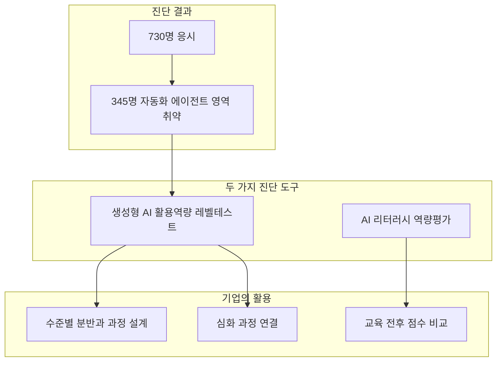
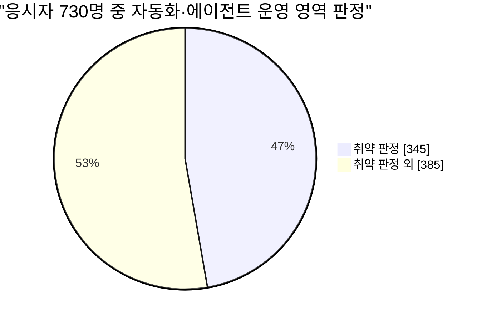
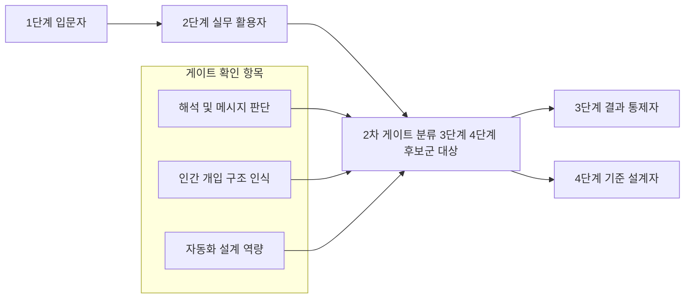
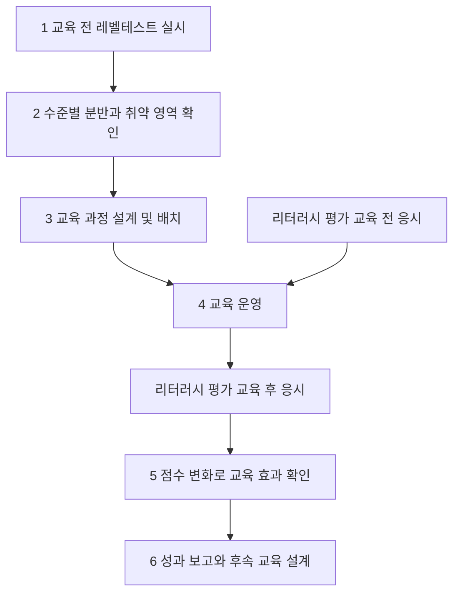
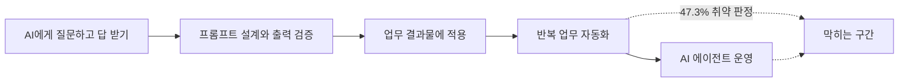

- **대상 기사**: 플래텀, [「AI는 쓰는데 자동화는 막혀, 기업 임직원 AI 역량 진단 결과」](https://platum.kr/archives/297323) (2026.10.29)
- **작성 일자**: 2026-10-29
- **작성 원칙**: 기사 본문과 교차 확인이 가능한 공개 보도에 나온 내용만 사실로 적었고, 확인되지 않는 부분은 "확인되지 않았다"고 명시했습니다. 필자의 해석은 별도로 "해석"이라고 표시했습니다.

---

## 1. 먼저 한 문단으로 요약하면

기업 AI 교육 전문 업체 에이블런이 기업 9곳과 기관 1곳의 임직원 730명에게 '생성형 AI 활용역량 레벨테스트'를 실시한 결과, 응시자의 47.3%에 해당하는 345명이 '자동화·에이전트 운영' 영역에서 취약하다는 판정을 받았습니다. 생성형 AI를 업무에 쓰는 사람은 늘었지만, 반복 업무를 자동화하거나 AI 에이전트를 직접 운영하는 단계에서는 상당수가 막힌다는 것이 기사의 핵심 메시지입니다. 기사는 여기에 더해 에이블런이 운영하는 또 하나의 진단 도구인 'AI 리터러시 역량평가'를 소개합니다. 이 도구는 교육 전후에 두 번 시험을 치러 교육 효과를 수치로 보여 주는 용도이며, 두 진단은 목적과 시점이 서로 다르기 때문에 기업이 골라 쓰거나 함께 쓸 수 있다는 설명이 이어집니다.

---

## 2. 이 기사는 무슨 이야기를 하고 있나

기사의 줄거리는 세 갈래로 나눌 수 있습니다.

첫째는 **진단 결과 자체**입니다. 레벨테스트 응시자 730명 가운데 345명이 자동화·에이전트 운영 영역에서 취약으로 분류되었다는 내용입니다. 기사 제목이 말하는 "AI는 쓰는데 자동화는 막혔다"는 문장은 바로 이 수치를 한 줄로 압축한 것입니다.

둘째는 **진단 도구의 설명**입니다. 에이블런은 기업 교육을 시작하기 전에 임직원의 AI 활용 수준을 파악하는 시험으로 레벨테스트를 쓰고, 교육이 끝난 뒤 효과를 재는 용도로 AI 리터러시 역량평가를 씁니다. 기사는 두 시험의 문항 수, 설계 근거, 응시 규모를 차례로 소개합니다.

셋째는 **활용 방식과 회사의 입장**입니다. 교육 담당자는 레벨테스트 결과로 수준별 반을 나누고 취약한 영역 중심으로 교육 과정을 짭니다. 자동화 역량이 부족한 직원은 자연어로 코딩하는 '바이브 코딩'이나 AI 에이전트 구축 같은 심화 과정으로 연결됩니다. 박진아 대표는 현업 직원이 외부 개발에 맡기지 않고 직접 업무를 자동화할 수 있도록 부족한 역량부터 채우겠다는 취지로 말했습니다.

이 이야기를 하나의 흐름도로 그리면 다음과 같습니다.

---

## 3. 핵심 수치를 하나씩 풀어 읽기

| 항목 | 수치 | 의미 |
|---|---|---|
| 레벨테스트 응시자 | 730명 | 기업 9곳과 기관 1곳 소속 임직원 |
| 자동화·에이전트 운영 영역 취약 | 345명 (47.3%) | 응시자의 거의 절반 |
| 레벨테스트 문항 수 | 25개 | 실무 환경을 반영한 문항 |
| 레벨테스트 단계 | 4단계 | 활용 수준을 네 단계로 분류 |
| 문항 검증용 시범 테스트 | 268명 | 대기업·중견기업 재직자 |
| 리터러시 역량평가 문항 수 | 31개 | 작동 원리·한계·윤리·보안·저작권 등 |
| 리터러시 평가 누적 응시자 | 3,212명 | 지금까지의 총 응시 인원 |
| 교육 전후 모두 응시한 인원 | 276명 (6개 과정) | 전후 비교가 가능한 집단 |
| 평균 점수 변화 | 2.26점 → 3.43점 (5점 만점) | 교육 후 점수 상승 |

**47.3%라는 숫자.** 345를 730으로 나누면 약 47.26%이므로 기사의 47.3%는 정확한 반올림입니다. 취약 판정을 받지 않은 응시자는 나머지 385명입니다(730−345, 필자 계산). 즉 열 명 중 약 다섯 명이 이 영역에서 막혔다는 뜻이고, 이 결과는 전체 AI 활용 능력이 낮다는 뜻이 아니라 **특정 영역(자동화·에이전트 운영)에서의 판정**이라는 점이 중요합니다.

**2.26점에서 3.43점으로.** 차이는 1.17점이고, 비율로는 약 1.5배입니다(필자 계산). 다만 이 수치는 교육 전후 두 번 응시한 6개 과정 276명의 평균이라는 점을 기억해야 합니다. 3,212명 전체의 평균이 아닙니다. 또한 시험 문항이 전후에 동일했는지, 점수 상승에서 교육 외 요인이 분리되었는지는 제가 확인한 기사 본문에는 나와 있지 않습니다.

---

## 4. 에이블런은 어떤 회사이고, 'AX 역량진단평가'는 무엇인가

에이블런은 기업 맞춤형 AI 교육을 하는 회사입니다. 유니콘팩토리 보도에 따르면 2019년 7월 '씽킹랩'이라는 이름으로 시작했고, 2021년 4월에 지금의 사명으로 바꿨습니다. 박진아 대표가 이끌고 있습니다. 레벨테스트 공개를 다룬 테크42 보도에서는 삼성화재, 롯데중앙연구소 같은 대기업과 공공기관을 포함해 910개 파트너사를 확보했고 누적 교육생이 21만 명이라고 소개했습니다. 이 수치는 해당 보도 시점 기준입니다.

이번 결과를 다룬 베타뉴스 보도에 따르면 **'AX 역량진단평가'** 는 에이블런의 기업 AI 교육 진단 서비스 이름이고, 그 안에 두 가지 진단이 들어 있습니다. 하나가 '생성형 AI 활용역량 레벨테스트'이고, 다른 하나가 'AI 리터러시 역량평가'입니다. 여기서 AX는 AI 전환(AI Transformation)을 뜻하는 말로, 보도에서도 같은 맥락으로 쓰입니다.

---

## 5. 생성형 AI 활용역량 레벨테스트 자세히 보기

### 5.1 무엇을 위한 시험인가

레벨테스트는 **교육을 시작하기 전에** 임직원이 지금 AI를 업무에서 어디까지 쓸 수 있는지를 확인하는 사전 진단입니다. 이 시험이 던지는 핵심 질문은 "누구에게 어느 수준의 AI 교육이 필요한가"입니다. 성적을 매기는 것이 목적이 아니라 **교육 배치**가 목적이라는 점이 특징입니다.

### 5.2 문항과 단계

25개 문항으로 구성되며 결과에 따라 활용 수준을 4단계로 나눕니다. 테크42의 공개 보도에 따르면 네 단계의 이름은 다음과 같습니다.

1. 입문자
2. 실무 활용자
3. 결과 통제자
4. 기준 설계자

이 4단계 기준은 유네스코 AI 역량 프레임워크와 글로벌 연구를 토대로 하고, 기업별 현장 데이터를 반영해 조직 상황에 맞게 적용할 수 있게 만들었다고 에이블런이 설명했습니다.

### 5.3 3단계와 4단계에 붙는 '2차 게이트'

테크42 보도에 따르면 3단계와 4단계 후보군은 총점만으로 판정을 끝내지 않습니다. 별도의 '2차 게이트 분류'를 거쳐 다음 항목의 충족 여부를 추가로 확인합니다.

- 해석 및 메시지 판단 역량
- 인간 개입 구조 인식
- 자동화 설계 역량

즉 높은 점수를 받았더라도 이 세 가지 핵심 항목을 충족하지 못하면 높은 단계로 분류되지 않을 수 있도록 설계되었다는 뜻입니다.

### 5.4 측정하는 영역 — 보도마다 표현이 다릅니다

측정 영역은 보도에 따라 표현이 조금 다릅니다. 두 가지를 모두 적어 둡니다.

- **이번 비교 설명 자료의 표기**: 프롬프트 설계, 출력 검증, 업무 적용, 메시지 판단, 자동화·에이전트 운영
- **테크42 공개 보도의 표기**: AI 개념·기능 이해, 프롬프트 설계, 출력 검증·편향·환각 평가, 업무 적용 및 해석 판단, 윤리·보안·저작권 수준 측정

두 표기는 겹치는 영역(프롬프트 설계, 출력 검증, 업무 적용)이 있지만 전체 구성이 일치하지 않습니다. 이 차이가 시험 개편 때문인지 요약 방식의 차이 때문인지는 확인하지 못했습니다. 이번 기사의 핵심인 '자동화·에이전트 운영' 영역은 이번 비교 설명 자료와 결과 보도에 명시되어 있습니다.

### 5.5 결과는 어디로 연결되나

테크42 보도에 따르면 진단 결과는 교육 설계 솔루션 '에이블런 네비게이터'와 연결됩니다. 임직원의 역량과 업무 목적을 분석해 다음 5개 트랙 가운데 적합한 프로젝트 기반 커리큘럼을 자동으로 매칭하는 방식입니다.

- AI 리터러시
- 데이터 및 분석
- 업무 자동화
- 도메인 및 비즈니스
- 개발·플랫폼

이번 기사에서는 결과 활용을 더 구체적으로 설명합니다. 수준별 분반, 직무별 교육 배치, 바이브 코딩·에이전트 과정 추천, AI 챔피언 선발에 쓰인다는 것입니다.

### 5.6 문항은 믿을 만한가 — 시범 테스트

에이블런은 대기업·중견기업 재직자 268명을 대상으로 시범 테스트를 진행해 문항의 신뢰도와 타당성을 검증했다고 설명합니다. 다만 이는 회사의 설명이며, 구체적인 통계 지표(신뢰도 계수 등)는 제가 확인한 보도에는 나와 있지 않습니다.

---

## 6. AI 리터러시 역량평가 자세히 보기

### 6.1 무엇을 위한 시험인가

이 평가는 AI를 이해하고 응용하며 성찰할 수 있는지를 확인합니다. 핵심 질문은 "교육 후 AI 기본 역량이 향상되었는가"입니다. 그래서 성과 측정 도구의 성격이 강합니다. 기사는 교육 전후에 두 번 치러 점수 변화를 본다고 설명합니다.

### 6.2 언제, 어떻게 만들어졌나

디지털데일리 2025년 7월 14일자 보도에 따르면 에이블런은 개인이 AI 이해 수준을 스스로 확인하고 학습 방향을 가늠할 수 있는 이 도구를 공개했고, 회사는 이것이 국내 최초라고 밝혔습니다("국내 최초"는 회사 측 주장입니다). 같은 보도에서 문항 설계의 근거로 다음 두 가지가 언급됩니다.

- 유네스코가 제시한 AI 역량 기준
- 독일 본 대학교병원 의학교육연구소의 연구 (AI 교육 분야 글로벌 전문가 53명이 다단계 검토와 델파이 연구로 문항을 체계화한 사례)

에이블런은 실제 연구를 진행한 해외 박사 연구진의 자문을 바탕으로 국내 환경에 맞는 문항 구조와 해석 체계를 새롭게 설계했고, 국내 대학 교수와 AI 교육 실무진도 개발에 참여했다고 설명했습니다.

### 6.3 무엇을 묻는가

이번 기사 기준으로 31개 문항이 AI의 작동 원리와 한계, 윤리, 기업 데이터 보안, 저작권 등 AI를 안전하게 쓰는 데 필요한 지식을 평가합니다. 2025년 공개 당시 보도에서는 이 평가가 기술적 숙련도보다 AI를 받아들이는 **태도와 활용 방식**에 초점을 맞췄고, 일상이나 업무에서 AI를 어떻게 바라보고 판단하는지 묻는 방식이라 비전문가도 무리 없이 참여할 수 있다고 소개되었습니다.

### 6.4 이번에 공개된 성과 수치

지금까지 3,212명이 응시했고, 교육 전후로 두 번 평가를 받은 6개 과정 276명의 평균 점수는 5점 만점에 2.26점에서 3.43점으로 올랐습니다. 이 평가는 교육 담당자가 교육 뒤 역량 변화를 수치로 보여 주기 어려워 성과 보고와 후속 예산 확보에 애를 먹는다는 점을 겨냥했다고 기사는 설명합니다.

---

## 7. 두 진단을 나란히 비교하기

| 구분 | AI 리터러시 역량평가 | 생성형 AI 활용역량 레벨테스트 |
|---|---|---|
| 핵심 목적 | AI 기본 이해도와 교육 성과 측정 | 생성형 AI 실무 활용 수준 진단 및 교육 배치 |
| 개요 | AI를 이해하고 응용·성찰할 수 있는지 확인하는 평가 | AI를 업무에서 어떤 단계까지 사용할 수 있는지 확인하는 사전 진단 |
| 주요 질문 | 교육 후 AI 기본 역량이 향상되었는가? | 누구에게 어느 수준의 AI 교육이 필요할까? |
| 활용 시점 | AI 교육 후, 성과 측정 시 (기사는 교육 전후 2회 응시로 설명) | 생성형 AI 실무 교육 전 |
| 측정 내용 | AI 개념, 작동 원리, 한계, 활용 가능성, 윤리·보안·저작권 성찰 | 프롬프트 설계, 출력 검증, 업무 적용, 메시지 판단, 자동화·에이전트 운영 |
| 결과 해석 | 영역별 점수 변화로 교육 효과와 보완 영역 확인 | 레벨별 교육 난이도 설정, 분반 기준, 심화 과정 대상자 판단 |
| 주요 활용 | 교육 효과 리포트, 전사 AI 기본기 진단, 보충 교육 설계 | 수준별 분반, 직무별 교육 배치, 바이브 코딩·에이전트 과정 추천, AI 챔피언 선발 |
| 활용 방안 | 성과 측정 도구 | 교육 매칭 도구 |
| 문항 수 | 31개 | 25개 |

한 줄로 구분하면 **리터러시 평가는 "교육이 효과가 있었는가"를 재는 자(尺)** 이고, **레벨테스트는 "누구를 어디로 보낼까"를 정하는 나침반**입니다. 기사 표현으로는 전자가 성과 측정 도구, 후자가 교육 매칭 도구입니다.

### 7.1 두 도구를 함께 쓰는 순서

기사가 설명하는 기본 방식은 과정을 설계할 때 레벨테스트로 직원 수준을 파악하고, 교육 효과를 확인할 때 리터러시 평가를 교육 전후에 치르는 것입니다. 그래서 위 그림에서도 레벨테스트는 설계 단계에, 리터러시 평가는 교육의 앞뒤에 놓았습니다.

---

## 8. '유네스코 AI 역량 프레임워크'는 무엇인가

에이블런의 두 진단 모두 설계 근거로 유네스코 프레임워크를 언급합니다. 이 프레임워크가 무엇인지 따로 확인했습니다.

유네스코는 2024년에 **학생용**과 **교사용** AI 역량 프레임워크 두 가지를 발표했고, 이는 2024년 디지털 러닝 위크(Digital Learning Week)를 계기로 공개되었습니다. 두 프레임워크는 AI의 잠재력과 위험을 이해하고 AI를 안전하고 윤리적이며 책임 있게 다루도록 교육 체계를 안내하는 것이 목적입니다.

| 구분 | 학생용 | 교사용 |
|---|---|---|
| 역량 영역 | 4개: 인간 중심 마인드셋, AI 윤리, AI 기술과 응용, AI 시스템 설계 | 5개: 인간 중심 마인드셋, AI 윤리, AI 기초와 응용, AI 교수법, 전문성 개발을 위한 AI |
| 역량 수 | 12개 | 15개 |
| 진행 수준 | 이해(Understand) → 적용(Apply) → 창조(Create) | 습득(Acquire) → 심화(Deepen) → 창조(Create) |

여기서 한 가지 짚어 둘 점이 있습니다. 유네스코 프레임워크는 **학교 교육 맥락의 학생과 교사**를 대상으로 만들어진 것입니다. 에이블런은 이를 바탕으로 국내 기업 환경에 맞게 설계했다고 설명하고 있으므로, 에이블런의 진단 문항은 유네스코가 만든 기업용 도구가 아니라 **유네스코 프레임워크를 참고해 에이블런이 기업용으로 재설계한 것**입니다. 유네스코가 에이블런의 진단을 인증하거나 보증했다는 내용은 제가 확인한 보도에서 발견되지 않았습니다.

---

## 9. 현장에서는 어떻게 쓰이나

이번 기사만으로는 개별 기업의 사례가 드러나지 않지만, 같은 시기 ZDNet Korea 보도(2026년 10월 19일자)에 에이블런의 진단 기반 교육 운영 사례가 나옵니다. 자동화 설비를 생산하는 한 제조기업이 10여 개 부서 임직원 180여 명을 대상으로 **사전 역량 진단**을 거친 뒤, 입문부터 직무 연계, 문제 해결, 자동화·심화까지 단계별로 교육을 진행하고 있습니다. 이 기업은 앞으로 자동화, AI 에이전트, 개념 검증(PoC) 과정으로 교육을 확대할 계획입니다. 해당 보도가 이 사전 진단이 레벨테스트라고 명시하지는 않았으므로, 같은 구조의 진단 기반 교육 사례로만 참고하시기 바랍니다.

같은 보도에서 중소기업중앙회 조사를 인용해 중소기업의 AI 도입 애로 요인으로 초기 비용 부담(44.2%)과 전문 인력 부족(20.5%)이 꼽혔다고 전합니다. 이는 에이블런이 말하는 "현업 직원이 직접 자동화할 수 있도록 역량을 채운다"는 방향이 왜 중요한 과제로 거론되는지 배경을 이해하는 데 참고가 됩니다.

또 다른 맥락으로, 2025년 9월 보도된 에이블런 웨비나 소개에서는 국내 기업의 약 40%가 AI를 활용하고 있지만 교육 이후 성과를 체감한 비율은 절반 수준에 그친다는 회사 조사 결과가 언급되었습니다. 교육 뒤의 변화를 측정할 수단이 필요하다는 문제의식이 이번 리터러시 평가 활용으로 이어진 배경으로 볼 수 있습니다. (이 연결은 필자의 해석입니다.)

---

## 10. '자동화·에이전트 운영'에서 막힌다는 말의 의미

기사에 따르면 이 영역은 반복 업무를 자동화하고 AI 에이전트를 업무에 활용하는 단계를 말합니다. 박진아 대표는 임직원 대부분이 AI 활용에는 빠르게 익숙해지지만 이 단계에서 막히는 경우가 많다고 설명했습니다. 이를 계단으로 그려 보면 다음과 같습니다.

위 그림의 단계 구분은 레벨테스트의 측정 영역을 이해하기 쉽게 배열한 필자의 도식입니다. 기사가 확인해 주는 사실은 (1) 자동화·에이전트 운영이 측정 영역 중 하나라는 점, (2) 해당 영역에서 47.3%가 취약 판정을 받았다는 점, (3) 이 영역이 취약한 직원을 바이브 코딩이나 AI 에이전트 구축 같은 심화 과정으로 연결한다는 점입니다.

**기사에서 확인되지 않는 것**은 왜 이 영역에서 많이 막히는가에 대한 원인 분석입니다. 도구 접근성 때문인지, 학습 경험의 부족 때문인지, 조직의 보안·권한 문제 때문인지에 대한 분석은 제가 확인한 보도에 없습니다. 원인을 단정하는 것은 이 문서의 범위를 벗어납니다.

---

## 11. 결과를 해석할 때 유의할 점

기사와 관련 보도에서 확인되지 않는 정보를 정리하면 다음과 같습니다. 이는 결과를 폄하하려는 것이 아니라 **수치를 어디까지 일반화할 수 있는지** 판단하는 데 필요한 정보입니다.

1. **표본의 범위.** 730명은 기업 9곳과 기관 1곳의 임직원입니다. 국내 직장인 전체를 대표하도록 추출한 표본이라는 설명은 보도에 없습니다.
2. **'취약 판정'의 기준.** 몇 점 이하를 취약으로 분류했는지, 영역별 문항이 몇 개인지는 확인한 보도에 나와 있지 않습니다.
3. **응시 기업의 구성.** 9개 기업과 1개 기관이 어떤 업종과 규모인지는 보도에서 공개되지 않았습니다.
4. **자체 분석이라는 점.** 이 결과는 진단 도구를 운영하는 에이블런이 자사 시험 결과를 분석해 발표한 것입니다. 에이블런은 교육 사업을 하는 회사이기도 하므로, 제3자 검증을 거친 조사는 아니라는 점을 고려해 읽을 필요가 있습니다.
5. **점수 상승의 해석.** 276명의 평균 점수가 2.26점에서 3.43점으로 오른 것은 사실로 보도되었으나, 비교 집단(교육을 받지 않은 집단)이나 문항 동일 여부는 확인되지 않았습니다.
6. **공개 시점 표기 차이.** 리터러시 평가도구의 최초 공개 시점은 보도마다 표기가 다릅니다. 디지털데일리는 2025년 7월 14일자로 공개를 보도했고, 테크42는 레벨테스트 공개 기사에서 "지난해 5월 선보인"이라고 적었습니다. 어느 쪽이 정확한지는 확인하지 못했습니다.
7. **원문 접근.** 플래텀 원문 페이지는 자동 접속이 차단되어, 이 문서는 사용자께서 공유하신 본문과 같은 날짜의 다른 매체 보도(베타뉴스, 테크42, 스타트업레시피 등)를 대조해 작성했습니다. 위 매체들의 수치(730명, 47.3%, 345명, 25문항, 268명)는 서로 일치했습니다.

---

## 12. 용어 풀이

- **AX(AI Transformation, AI 전환)**: 기업이 업무와 조직 운영 전반에 AI를 도입해 일하는 방식을 바꾸는 것.
- **생성형 AI**: 글, 이미지, 코드 등을 새로 만들어 내는 AI.
- **프롬프트 설계**: AI에게 원하는 결과를 얻기 위해 지시문을 구성하는 일.
- **출력 검증**: AI가 내놓은 결과의 사실 여부, 편향, 오류(환각)를 점검하는 일.
- **환각(hallucination)**: AI가 사실이 아닌 내용을 그럴듯하게 만들어 내는 현상.
- **바이브 코딩**: 기사 설명대로 자연어로 지시해 코딩하는 방식.
- **AI 에이전트**: 사람의 매 단계 지시 없이 여러 작업 단계를 스스로 이어서 수행하도록 구성한 AI 시스템. 이 문서에서는 기사가 쓰는 "에이전트 운영"을 이 의미로 이해했습니다.
- **델파이 연구**: 전문가 패널에게 여러 차례 의견을 묻고 수렴해 합의를 도출하는 연구 방법. 본 대학교병원 연구에서 문항을 체계화하는 데 쓰였다고 보도되었습니다.
- **파일럿(시범) 테스트**: 본 시험 전에 소규모 집단으로 문항의 신뢰도와 타당성을 점검하는 절차.

---

## 13. 출처

- 플래텀, 「AI는 쓰는데 자동화는 막혀, 기업 임직원 AI 역량 진단 결과」, 2026.10.29 — https://platum.kr/archives/297323
- 베타뉴스, 「에이블런, AX 역량진단평가 분석 결과 공개」 — https://www.betanews.net/article/view/beta202610290034
- 테크42, 「'AI 잘 쓰는 조직 따로 있다'…실무 중심 역량 평가 시장 본격화」 — https://www.tech42.co.kr/ai-잘-쓰는-조직-따로-있다실무-중심-역량-평가-시/
- 테크42, 「스타트업 안테나」 (에이블런 730명 결과 관련 항목) — https://www.tech42.co.kr/
- 스타트업레시피, 「AI서머리」 (에이블런 임직원 47% 자동화 역량 취약) — https://startuprecipe.co.kr/archives/5839494
- 디지털데일리, 「에이블런, 국내 첫 'AI 리터러시 역량 평가도구' 공개」, 2025.07.14 — https://www.ddaily.co.kr/page/view/2025071410303059803
- 유니콘팩토리, 에이블런 기업 정보 — https://www.unicornfactory.co.kr/datalab/startup/company/에이블런/110111-7167285
- ZDNet Korea, 「에이블런, 2026 중소기업 인재키움 프리미엄 훈련 상담 450건 달성」 — https://zdnet.co.kr/view/?no=20261019154745
- 벤처스퀘어, 에이블런 웨비나 소개 (2025년 9월) — https://www.venturesquare.net/?p=1003001
- UNESCO AI competency Framework for Students and Teachers (UNESCO 뉴질랜드 국가위원회 소개 페이지) — https://unesco.org.nz/knowledge-hub/unesco-ai-competency-framework-for-students-and-teachers
- UNESCO AI Competency Framework for Teachers (GCED Clearinghouse 서지 정보) — https://gcedclearinghouse.org/en/node/146447

---

**작성 일자: 2026-10-29**
