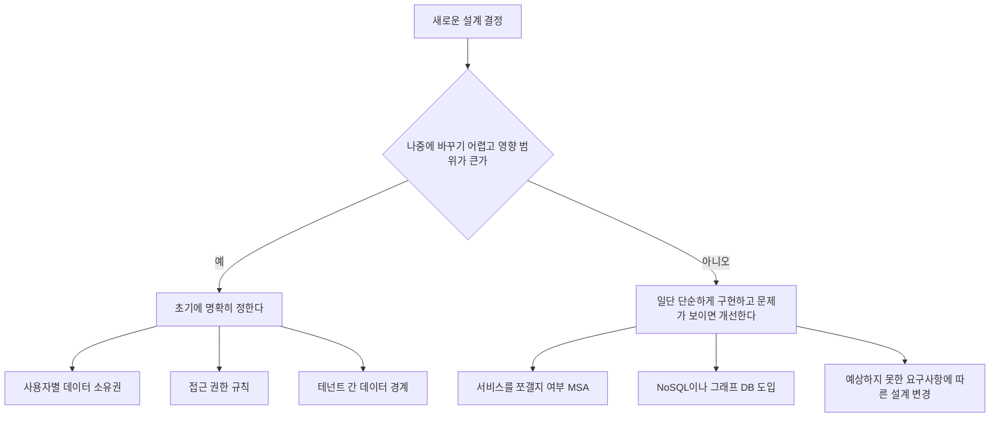
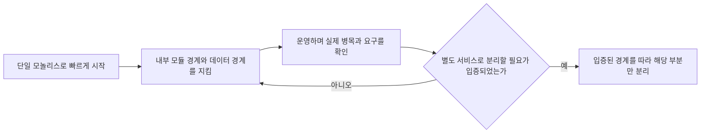
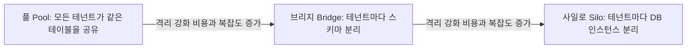
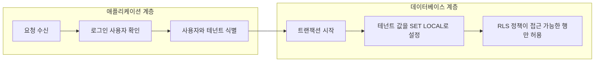

- 작성 기준일: 2026-10-30
- 주제: [숙소 운영자용 관리 서비스를 직접 만드는 개발자의 질문](https://www.threads.com/share/BBud7BicEb/)과, 그에 달린 답글의 내용 해설
- 문서 성격: 글의 내용을 풀어 설명하고, 그 조언이 업계 자료와 얼마나 맞아떨어지는지 검증한 해설서

---

## 0. 먼저 밝히는 확인 범위

이 문서에서 "글의 내용"이라고 부르는 부분은 사용자께서 공유해 주신 Threads 게시물에 실제로 적혀 있던 문장입니다. 공유 링크(threads.com/share/...)는 해당 사이트가 자동화된 접근을 허용하지 않아 열어 보지 못했습니다. 따라서 원글과 답글 한 개의 내용은 공유해 주신 게시물에 보이던 문장을 기준으로 했고, 그 밖의 댓글(원글에는 댓글이 16개 달려 있다고 표시되어 있었습니다)은 읽지 못했으므로 다루지 않습니다.

글 바깥의 설명, 즉 모놀리스 우선 전략이나 멀티테넌시, PostgreSQL의 행 단위 보안 같은 내용은 2026년 10월 30일에 직접 검색해서 확인한 자료만 사용했습니다. 자료에서 확인하지 못한 부분은 확인하지 못했다고 그대로 적었습니다. 글에 나오지 않은 사실을 글쓴이의 사정으로 짐작해서 적은 부분은 없습니다. 이해를 돕기 위한 가상의 예시는 "예시"라고 분명히 표시했습니다.

---

## 1. 한 문단 요약

원글 작성자는 숙소 운영자를 위한 관리 서비스를 직접 만들고 있는 사람입니다. 기능을 하나씩 구현하는 중이고, 앞으로 사용자가 늘어나는 상황에 대비해 데이터베이스 구조와 사용자별 데이터 접근 권한 같은 백엔드 설계 방향에 대해 SaaS 백엔드를 개발하고 운영해 본 분들의 조언을 구했습니다. 이에 답글을 단 사람은 세 가지를 말합니다. 첫째, 초기에는 처음부터 MSA(마이크로서비스 아키텍처)로 가지 말고 모놀리식으로 밀고 가도 된다. 둘째, 데이터베이스는 우선 관계형 DB(RDB)로 구현하고 실제로 필요가 생긴 영역에서 NoSQL이나 그래프 DB를 고려해도 충분하다. 셋째, 다만 사용자별 데이터 소유권, 접근 권한, 테넌트(고객 단위) 사이의 데이터 경계만큼은 초기에 분명히 정해 두는 편이 좋은데, 나중에 바꾸려면 영향 범위가 꽤 커지기 때문이다. 나머지는 서비스를 운영하다 보면 예상하지 못한 요구사항 때문에 어차피 계속 바뀌므로, 문제가 실제로 생길 때 해결해 나가라는 것이 답글의 결론입니다.

이 조언은 "모든 것을 미리 완벽하게 설계하라"와 "아무것도 미리 생각하지 말라"의 중간에서, 나중에 바꾸기 어려운 것과 쉬운 것을 구분하라고 말하는 셈입니다. 이 구분 방식은 소프트웨어 아키텍처 분야에서 널리 알려진 모놀리스 우선 접근과 잘 맞고, 멀티테넌시 설계 자료들이 강조하는 점과도 겹칩니다.

---

## 2. 글의 구성과 맥락

### 2.1 원글: 무엇을 묻고 있나

원글은 "SaaS 백엔드 개발·운영 경험이 있으신 분 계실까요?"라는 질문으로 시작합니다. 이어서 현재 상황을 설명합니다.

- 숙소 운영자를 위한 관리 서비스를 직접 만들고 있다.
- 기능을 하나씩 구현하고 있다.
- 앞으로 사용자가 늘어날 때를 대비해 DB 구조, 사용자별 데이터 접근 권한 등 백엔드 설계 방향에 대해 조언을 구하고 싶다.

마지막으로 관련 경험이 있는 분과 이야기를 나눠 보고 싶으니 댓글이나 DM을 부탁한다는 말로 끝납니다. 표시된 반응은 좋아요 27, 댓글 16, 리포스트 2, 공유 1이고, 게시 후 약 13시간이 지난 상태로 표시되어 있었습니다.

여기서 눈여겨볼 점은 질문의 구체성입니다. "어떤 기술을 써야 하나요?"가 아니라 "사용자가 늘어날 때를 대비한 DB 구조와 사용자별 접근 권한"이라는 두 가지 축을 짚었습니다. 이 두 가지가 바로 답글이 가장 힘주어 답한 부분입니다.

### 2.2 답글: 무엇이라고 답했나

답글은 여섯 개의 짧은 문단으로 되어 있고, 흐름을 풀면 다음과 같습니다.

1. 처음부터 설계를 다 잡고 MSA로 가는 것도 좋지만, 초기에는 모놀리식으로 일단 쭉 밀고 가도 된다.
2. DB도 우선 RDB로 구현하고, 실제 필요가 생기는 영역에서 NoSQL이나 그래프 DB 등을 고려해도 충분하다.
3. 다만 사용자별 데이터 소유권과 접근 권한, 테넌트 간 데이터 경계 정도는 초기에 명확하게 잡아 두기를 추천한다. 나중에 바꾸려면 영향 범위가 꽤 커진다.
4. 아직 문제가 가시화되지 않은 단계라면 너무 완벽한 설계를 고집하지 않아도 된다. 서비스를 운영하다 보면 예상하지 못한 요구사항 때문에 설계는 어차피 계속 바뀐다.
5. 초기에는 나중에 바꾸기 어려운 경계만 잘 잡아 두고, 나머지는 실제 문제가 생길 때 해결해 나가는 쪽이 좋다고 본다.

답글에는 좋아요가 1개 표시되어 있었고, 원글 작성자가 이 답글에 하트를 눌렀다는 표시가 보였습니다. 이는 글쓴이가 답글에 호응했다는 뜻으로 읽을 수 있지만, 그 이상의 의미는 글만으로 알 수 없습니다.

---

## 3. 답글의 논리를 한 줄씩 풀어 읽기

### 3.1 "처음부터 MSA도 좋지만, 모놀리식으로 쭉 밀고 가도 된다"

답글은 MSA를 나쁘다고 하지 않습니다. "좋지만"이라고 인정한 뒤 "초기에는" 다른 선택지가 있다고 말합니다. 즉 MSA 자체를 부정하는 것이 아니라 시점의 문제로 접근합니다.

모놀리식이란 서비스의 모든 기능이 하나의 프로그램, 하나의 배포 단위로 묶여 있는 구조입니다. MSA는 기능을 작은 독립 서비스로 쪼개고 각각 따로 배포하고 운영하는 구조입니다. 쪼개면 서비스별로 독립적으로 확장하고 배포할 수 있다는 장점이 있지만, 서비스끼리 네트워크로 통신해야 하고 배포, 모니터링, 장애 추적, 데이터 일관성 같은 운영 부담이 함께 늘어납니다. 혼자 또는 소수가 막 시작한 서비스에서는 이 부담이 이득보다 클 수 있다는 것이 "일단 모놀리식으로"라는 말의 배경입니다.

### 3.2 "DB도 우선 RDB로, 필요한 영역에서 NoSQL이나 그래프 DB"

RDB는 표(테이블) 형태로 데이터를 저장하고 테이블 사이의 관계를 SQL로 다루는 데이터베이스입니다. NoSQL은 문서, 키-값 같은 다른 모델의 데이터베이스를 통칭하고, 그래프 DB는 데이터 사이의 연결(관계) 자체를 중심으로 저장하는 데이터베이스입니다. 답글은 하나의 DB 종류로 시작하되 정말 필요한 영역이 드러나면 그 부분에만 다른 종류를 더하라는 순서를 제안합니다. 처음부터 여러 종류의 DB를 섞어 두면 관리 대상이 늘어나는데, 필요가 확인되지 않은 상태에서 그 비용을 치를 이유가 약하다는 논리입니다.

### 3.3 "사용자별 데이터 소유권, 접근 권한, 테넌트 간 데이터 경계는 초기에"

이 문단이 답글의 핵심입니다. 세 가지 용어를 풀어 보겠습니다.

- **데이터 소유권**: 어떤 데이터가 누구의 것인가. 예를 들어 어떤 기록이 한 사용자에게 속하는지, 한 조직에 속하는지를 데이터 구조에서 분명히 하는 일입니다.
- **접근 권한**: 누가 어떤 데이터를 보고 고칠 수 있는가.
- **테넌트 간 데이터 경계**: 테넌트는 SaaS를 쓰는 고객 단위(한 회사, 한 사업자 같은 단위)를 말합니다. 한 서비스를 여러 고객이 함께 쓰므로, 고객 A의 데이터가 고객 B에게 보이지 않도록 선을 긋는 것이 테넌트 경계입니다.

답글은 이 세 가지를 "나중에 바꾸려면 영향 범위가 꽤 커진다"고 말합니다. 이유는 쉽게 짐작할 수 있습니다. 데이터 소유 구조는 거의 모든 테이블과 모든 조회 코드에 스며들기 때문에, 서비스가 커진 뒤에 바꾸려면 기존 데이터의 이전과 모든 기능의 수정이 함께 필요해집니다. 반면 서비스를 쪼갤지 말지, 어떤 DB를 추가할지는 특정 영역에 국한된 결정이라 영향 범위가 상대적으로 좁습니다.

> 예시(원글에 나온 내용이 아니라 이해를 돕기 위한 가상의 예입니다): 한 사업자가 여러 개의 시설을 운영하고, 그 밑에 직원 계정이 여러 개 있다고 해 보겠습니다. 이때 "직원은 어느 시설의 데이터까지 볼 수 있는가"를 나중에 정하기로 하고 모든 데이터를 사업자 구분 없이 한 곳에 쌓아 두면, 나중에 이 규칙을 넣을 때 이미 쌓인 모든 데이터에 소속 정보를 채워 넣고 모든 조회 코드를 고쳐야 합니다.

### 3.4 "문제가 가시화되지 않았다면 완벽한 설계를 고집하지 않아도 된다"

이 문단은 답글의 태도를 보여 줍니다. 요구사항은 서비스를 운영하면서 예상 밖으로 나오기 때문에, 미리 완벽하게 만든 설계도 어차피 바뀝니다. 그렇다면 확신이 없는 부분까지 미리 굳히는 것보다 바뀔 것을 전제로 단순하게 가는 편이 낫다는 뜻입니다.

### 3.5 "나중에 바꾸기 어려운 경계만 잘 잡고, 나머지는 문제가 생길 때"

결론 문단은 앞의 내용을 한 문장의 원칙으로 압축합니다. 바꾸기 어려운 결정은 일찍, 바꾸기 쉬운 결정은 늦게. 아래 흐름도는 이 원칙을 도식으로 옮긴 것입니다.

위 도식의 판단 기준은 답글의 논리를 제가 정리한 것이고, 각 항목은 답글에 실제로 등장한 내용입니다.

---

## 4. 용어 쉽게 풀기

| 용어 | 쉬운 설명 |
|---|---|
| SaaS | 소프트웨어를 설치하지 않고 인터넷으로 구독해서 쓰는 서비스 형태 |
| 백엔드 | 화면 뒤에서 데이터 저장, 계산, 권한 확인을 맡는 서버 쪽 프로그램 |
| 모놀리식 | 모든 기능을 하나의 프로그램으로 묶어 함께 배포하는 구조 |
| MSA | 기능별로 작은 독립 서비스를 만들어 따로 배포하고 운영하는 구조 |
| RDB | 표와 관계로 데이터를 다루는 관계형 데이터베이스 |
| NoSQL | 표 형태가 아닌 다른 모델을 쓰는 데이터베이스의 통칭 |
| 그래프 DB | 데이터 사이의 연결을 중심으로 저장하는 데이터베이스 |
| 테넌트 | SaaS를 쓰는 고객 단위 |
| 멀티테넌시 | 여러 테넌트가 하나의 서비스를 함께 쓰되 데이터는 서로 분리되는 방식 |

---

## 5. 근거 확인: 이 조언은 얼마나 뒷받침되는가

### 5.1 "모놀리식 먼저"의 대표적 근거: 마틴 파울러의 글

소프트웨어 설계 분야의 저명한 저술가인 마틴 파울러는 2015년 6월 3일자 글 "Monolith First"에서 이 전략을 설명했습니다. 그가 관찰한 패턴은, 성공한 마이크로서비스 사례의 거의 대부분이 너무 커져 버린 모놀리스를 쪼개면서 시작되었다는 것입니다. 그래서 마이크로서비스가 나중에 유리할 것 같더라도 새 애플리케이션은 우선 모놀리스로 만들라고 주장합니다. 초기에는 피드백을 받는 속도가 중요한데 마이크로서비스의 추가 비용은 그 속도를 늦춘다는 이유입니다. 또 모놀리스로 먼저 만들면 올바른 경계가 어디인지 알아낼 수 있고, 세분화된 서비스에 필요한 선행 조건들을 갖출 시간도 생긴다고 설명합니다. ([Martin Fowler, Monolith First](https://www.martinfowler.com/bliki/MonolithFirst.html))

여기서 파울러가 함께 한 말이 중요합니다. 그는 모놀리스를 설계할 때 API 경계와 데이터 저장 방식 양쪽에서 모듈성을 신경 써야 한다고 했습니다. 모놀리스 먼저가 "구조를 막 짜도 된다"는 뜻이 아니라는 것입니다. 이는 답글이 "데이터 소유권과 테넌트 경계는 초기에 잡으라"고 한 것과 방향이 같습니다. 또 파울러 본인도 이 글에서 자신에게는 이 전략의 적용 기준을 확정할 만큼의 사례가 아직 충분하지 않다고 적었고, 주변 의견이 만장일치도 아니라고 밝혔습니다. 처음부터 마이크로서비스로 시작해야 그 개발 방식에 익숙해진다는 반대 논거가 있다는 점도 소개했습니다.

### 5.2 반대 의견도 있다

이 주제에 반론이 없는 것은 아닙니다. 컨설팅 회사 innoQ의 공동 창업자 슈테판 틸코프는 "Don't start with a monolith"라는 글에서, 마이크로서비스 아키텍처로 가는 유일한 길이 모놀리스에서 출발하는 것이라는 주장에 문제를 제기합니다. 그는 잘 구조화된 모놀리스를 실제로 만들 수 있다면 애초에 마이크로서비스가 필요 없을 수도 있다고 짚었습니다. ([Stefan Tilkov, Don't start with a monolith](https://www.martinfowler.com/articles/dont-start-monolith.html)) 이 반론은 "모놀리스로 시작하는 것"이 틀렸다는 뜻이라기보다, 목표 구조를 정해 놓고 모놀리스를 거쳐 가는 것이 정답이라고 단정하지 말라는 쪽에 가깝습니다. 답글도 MSA를 부정하지 않고 "초기에는"이라는 단서를 붙였으므로 이 반론과 크게 충돌하지 않습니다.

### 5.3 실제 사례: Prime Video와 Segment

모놀리스로 돌아간 유명한 사례가 두 가지 있습니다.

- **Amazon Prime Video**: 2023년 3월, 영상 품질 분석 팀의 마르신 콜니가 자신들의 모니터링 도구를 마이크로서비스와 서버리스 구조에서 단일 프로세스 구조로 바꾼 경험을 공개했습니다. 영상 프레임을 구성 요소 사이에서 주고받는 과정이 병목이었고, 임시 저장에 쓰던 S3로의 호출이 많아 비용 문제도 있었습니다. 그 결과 인프라 비용이 90% 넘게 줄었다고 합니다. 다만 보고서 스스로 결론에서, 마이크로서비스나 서버리스를 쓸지 모놀리스를 쓸지는 사안별로 판단해야 한다고 적었습니다. 이 사례의 교훈이 적용되는 범위는 좁을 수 있다는 평가도 함께 보도되었습니다. ([DevClass](https://devclass.com/?p=5603), [Nordic APIs](https://nordicapis.com/back-to-the-monolith-why-did-amazon-dump-microservices/))
- **Segment**: 고객 데이터 플랫폼인 Segment는 2013년 모놀리스로 시작했고, 격리가 부족한 문제를 풀기 위해 연동 대상마다 워커 서비스를 두는 마이크로서비스로 옮겼습니다. 그러나 연동 대상이 빠르게 늘면서 운영 부담이 커졌고, 2017년에 다시 모놀리스로 돌아가기로 했습니다. 이 결정은 모듈성, 환경 격리, 가시성 같은 장점을 일부 잃는 대가를 알고 내린 것이었다고 QCon London 발표를 다룬 기사가 전합니다. ([InfoQ](https://www.infoq.com/news/2020/04/microservices-back-again/))

두 사례는 "마이크로서비스는 나쁘다"를 증명하는 것이 아니라, 필요를 확인하기 전에 쪼갰을 때 비용이 컸다는 것을 보여 줍니다. 특히 Segment의 경우 마이크로서비스를 택한 이유가 분명한 문제(격리)였고, 그 문제의 해법이 운영 부담이라는 새로운 문제를 낳았다는 점에서, 어떤 선택이든 비용이 따른다는 점을 알려 줍니다.

### 5.4 2026년의 흐름

2026년 들어 나온 여러 글은 마이크로서비스를 기본값으로 삼던 분위기가 달라졌다고 말합니다. 여러 매체가 CNCF(클라우드 네이티브 컴퓨팅 재단)의 2025년 조사를 인용해, 마이크로서비스를 도입한 조직의 42%가 서비스를 더 큰 배포 단위로 합치고 있다고 전합니다. ([SoftwareSeni, 2026-01-23](https://www.softwareseni.com/the-great-microservices-consolidation-what-the-cncf-2025-survey-reveals-about-industry-trends), [Cloudmagazin, 2026-03-31](https://www.cloudmagazin.com/en/2026/03/31/microservices-vs-monolith-2026-when-refactoring-really-pays-off/)) 다만 저는 CNCF의 원 조사 문서를 직접 열어 확인하지는 못했고, 2차 매체의 인용을 통해 확인했다는 점을 밝혀 둡니다. 이 매체들은 합치는 방향이 과거의 거대한 모놀리스로의 복귀가 아니라, 경계가 잘 정리된 더 큰 단위로의 통합이라고 설명합니다.

또 다른 2026년 글은 많은 팀이 절충안을 택한다고 정리합니다. 핵심 비즈니스 로직은 모듈형 모놀리스에 두고, 확장이나 보안, 기술 요구가 실제로 다른 소수의 워크로드만 별도 서비스로 분리한다는 것입니다. ([DevX](https://www.devx.com/development/microservices-backlash-monoliths-comeback-2026/)) 한 매체는 개발자가 10명 미만이면 전통적 모놀리스, 100명 미만이면 모듈형 모놀리스, 100명 이상이고 확장 요구가 서로 독립적이면 마이크로서비스라는 경험칙을 소개했는데, 이는 해당 글의 의견이지 업계 표준이 아닙니다.

### 5.5 "모듈형 모놀리스"가 중요한 이유

모듈형 모놀리스는 배포 단위는 하나이지만 내부가 명확한 논리적 경계로 나뉜 구조를 말합니다. ([SoftwareSeni](https://www.softwareseni.com/understanding-modern-software-architecture-from-microservices-consolidation-to-modular-monoliths/)) 밀런 요바노비치는 2026년 7월의 글에서, 모듈이 서로의 데이터베이스 테이블에 직접 접근한다면 그것은 모듈형 모놀리스가 아니라 그냥 모놀리스라고 지적합니다. 또 가장 좋은 마이크로서비스는 잘 구조화된 모듈형 모놀리스를 입증된 모듈 경계를 따라 쪼갠 결과라고 설명합니다. ([Milan Jovanović](https://milanjovanovic.tech/blog/modular-monolith-vs-microservices.md))

이것이 "모놀리식으로 밀고 가도 된다"는 조언의 숨은 전제입니다. 모놀리식이면 구조를 마음대로 해도 된다는 뜻이 아니라, 내부 경계를 지키며 하나로 배포한다는 뜻입니다. 나중에 쪼갤 때 이 경계가 그대로 절단선이 됩니다.

### 5.6 "RDB 먼저, 필요하면 NoSQL이나 그래프 DB"에 대한 근거

이 부분은 솔직하게 말씀드리면, 이번 검색에서 "처음에는 RDB로 시작하라"는 주장을 직접 뒷받침하는 신뢰할 만한 단일 근거를 찾지 못했습니다. 따라서 이 문단은 답글 작성자의 실무적 견해로 소개하는 데 그치고, 검증된 사실이라고 단정하지 않겠습니다. 다만 다음 5.7, 5.8에서 다룰 테넌트 격리와 행 단위 보안이 모두 PostgreSQL 같은 RDB를 전제로 한 설명이라는 점에서, 접근 권한과 테넌트 경계를 데이터베이스 수준에서 다루려면 RDB 쪽이 도구가 잘 갖춰져 있다는 사실 정도는 확인됩니다.

### 5.7 테넌트 경계: 격리 모델 세 가지

AWS의 SaaS 문서는 테넌트 격리를 SaaS 설계의 기본 요소로 다루며, 데이터베이스 수준에서 세 가지 모델을 소개합니다. 사일로(Silo)는 테넌트마다 별도의 데이터베이스 인스턴스를 두고, 브리지(Bridge)는 테넌트마다 별도의 스키마를 두며, 풀(Pool)은 모든 테넌트가 같은 테이블을 공유하는 방식입니다. 사일로는 격리가 가장 강하지만 비용과 복잡도가 가장 크고, 풀은 격리가 상대적으로 약하지만 비용이 가장 낮다고 설명합니다. ([AWS Solutions Library](https://aws.amazon.com/solutions/guidance/multi-tenant-architectures-on-aws/), [AWS APN Blog](https://aws.amazon.com/blogs/apn/explore-saas-tenant-isolation-strategies-in-new-saas-whitepaper)) 풀 모델의 이점은 모든 테넌트를 하나의 관리 경험으로 운영할 수 있다는 점이고, 단점으로는 테넌트별 비용 추적이 어렵고 장애의 영향 범위(blast radius)가 넓어질 수 있다는 점이 꼽힙니다. ([AWS 풀 격리 문서](https://docs.aws.amazon.com/ja_jp/whitepapers/latest/saas-tenant-isolation-strategies/pool-isolation.html)) 고객에 따라 요구가 다르면 트래픽이 큰 고객만 사일로로 분리하고 나머지는 브리지나 풀에 두는 혼합 구성도 가능하다고 합니다. 참고로 AWS의 이 백서들 일부에는 역사적 참고용이며 일부 내용이 낡았을 수 있다는 안내가 붙어 있습니다.

이 모델 중 무엇을 고르느냐가 곧 답글이 말한 "테넌트 간 데이터 경계"를 어떻게 긋느냐의 구체적인 형태입니다. 답글이 "나중에 바꾸려면 영향 범위가 크다"고 한 말은, 이 모델을 중간에 바꾸는 일(예: 모든 고객이 한 테이블을 쓰다가 고객별로 분리하는 일)이 실제로 큰 작업이라는 점에서 자연스럽습니다.

### 5.8 공유 테이블에서 데이터를 가르는 방법: PostgreSQL의 행 단위 보안(RLS)

풀 모델(공유 테이블)에서는 보통 모든 테이블에 테넌트를 구분하는 컬럼을 두고, 쿼리마다 "내 테넌트의 행만"이라는 조건을 붙입니다. 문제는 이 조건을 어느 한 곳에서 빠뜨리면 다른 고객의 데이터가 노출될 수 있다는 점입니다. 이를 데이터베이스가 대신 지켜 주는 기능이 PostgreSQL의 행 단위 보안(Row-Level Security, RLS)입니다. 한 개발자 글은 테넌트 격리가 필터를 빠뜨리거나 새 API를 추가하거나 급히 코드를 고칠 때도 유지되어야 한다고 설명하며, RLS가 권한 경계를 데이터에 더 가까이 옮겨 준다고 합니다. 다만 테넌트 모델, 정책, 권한이 높은 경로, 테스트를 함께 설계해야 효과가 있다고 덧붙입니다. ([DEV Community](https://dev.to/endurance-softwares/postgresql-row-level-security-for-multi-tenant-saas-3gc1)) AWS의 규범적 가이드는 PostgreSQL의 풀 모델에서 테넌트 데이터 격리를 유지하려면 RLS가 필요하며, 애플리케이션은 쿼리할 때 테넌트별 컨텍스트를 런타임에 설정하는 책임을 진다고 설명합니다. ([AWS Prescriptive Guidance](https://docs.aws.amazon.com/prescriptive-guidance/latest/saas-multitenant-managed-postgresql/rls.html))

RLS의 동작에 대해 PostgreSQL 문서(제가 열람한 것은 9.5 버전 문서 사본이고, 같은 동작이 2026년 소스 코드 주석과 2026년 글들에서도 확인됩니다)가 밝힌 사실은 다음과 같습니다.

- 테이블에서 RLS를 켜면 모든 일반 접근은 정책이 허용해야 하며, 정책이 하나도 없으면 기본적으로 아무 행도 보이지 않고 수정할 수도 없습니다.
- 슈퍼유저와 BYPASSRLS 속성을 가진 역할은 항상 RLS를 우회합니다. 테이블 소유자도 보통 우회하지만, `FORCE ROW LEVEL SECURITY`를 설정하면 소유자에게도 정책이 적용됩니다.
- 유일 키나 외래 키 같은 참조 무결성 검사는 항상 RLS를 우회하므로, 이 경로를 통한 정보 누출(은닉 채널)에 주의하라고 문서가 경고합니다.
- RLS 설정과 정책 추가는 테이블 소유자만 할 수 있습니다.

(출처: [PostgreSQL 9.5 문서 사본](https://access.crunchydata.com/documentation/postgresql95/9.5.18/ddl-rowsecurity.html), [PostgreSQL 소스 코드 주석](https://doxygen.postgresql.org/rowsecurity_8c_source.html))

실무에서 특히 조심할 점이 하나 더 있습니다. 보통 웹 서비스는 연결 풀을 두고 하나의 DB 계정을 모든 요청이 공유하므로, 현재 사용자가 누구인지 DB가 알려면 요청마다 세션 변수로 테넌트 값을 넘기는 방식을 씁니다. ([Chat2DB, 2026-08-17](https://chat2db.ai/resources/blog/postgres-row-level-security-guide)) 그런데 PgBouncer 같은 풀러를 트랜잭션 모드로 쓰면 연결이 트랜잭션이 끝날 때마다 풀로 돌아가므로, 세션 수준 설정은 다음 요청으로 이어지지 않거나 반대로 남아서 다른 사용자에게 넘어갈 수 있습니다. 여러 자료가 공통으로 권하는 해법은 트랜잭션 안에서 `SET LOCAL`로 값을 설정해 트랜잭션이 끝나면 함께 사라지게 하는 것입니다. ([Neon 참조 아키텍처](https://databrickslabs.github.io/partner-architecture/built-on/neon/reference-architecture/connectivity), [GitHub 이슈 사례](https://github.com/metaobjectsdev/metaobjects/issues/200)) 이 내용은 개발 커뮤니티와 공급사 문서에서 반복되는 주의사항이지만, 어떤 설정이 안전한지는 사용하는 풀러와 드라이버의 버전과 설정에 따라 달라질 수 있으니 실제 환경에서 시험해 확인해야 합니다.

---

## 6. 이 조언을 실제 작업에 옮기면 어떤 모습일까

아래 내용은 원글 작성자의 서비스가 어떤 모습인지 알고 쓴 것이 아니라, 위에서 확인한 자료와 답글의 원칙을 일반적인 SaaS 개발 순서로 옮겨 본 정리입니다.

**처음에 정해 두면 좋은 것(바꾸기 어려운 것)**

- 데이터가 누구에게 속하는지를 데이터 구조에 명시합니다. 사용자 소유인지, 조직(테넌트) 소유인지를 각 테이블에서 분명히 합니다.
- 테넌트 격리 모델(풀, 브리지, 사일로)을 정합니다. 고객 수가 적고 초기라면 공유 테이블(풀)이 단순하고 저렴하다는 점이 AWS 자료에서도 확인되지만, 어떤 모델이 맞는지는 고객 요구와 규제, 위험 허용도에 달려 있으므로 이 문서가 하나를 권하지는 않습니다.
- 접근 권한 규칙을 말로 먼저 적어 봅니다. 누가 무엇을 볼 수 있고 고칠 수 있는지를 문장으로 정리해 두면, 구조와 코드가 이를 따라가기 쉽습니다.
- 애플리케이션 코드 안에서 모듈 경계를 지킵니다. 다른 모듈의 테이블을 직접 읽지 않도록 규칙을 정합니다.

**나중으로 미뤄도 되는 것(바꾸기 쉬운 것)**

- 서비스를 쪼갤지 여부
- 다른 종류의 DB 추가
- 실제 병목이 확인되기 전의 성능 최적화
- 운영 중에 드러나는 새로운 요구사항에 따른 설계 변경

**공유 테이블을 택한다면 점검할 것(5.8절 근거)**

- 모든 테넌트 소유 테이블에 테넌트 식별 컬럼이 있는가
- 애플리케이션의 조건 필터에만 의존하지 않고 DB 수준의 보호(RLS)를 둘지 검토했는가
- 마이그레이션을 실행하는 계정과 서비스가 사용하는 계정이 같아서 소유자 우회로 정책이 무력화되지는 않는가
- 연결 풀러를 쓴다면 테넌트 값을 트랜잭션 단위로 설정하고 있는가
- 한 테넌트의 데이터가 다른 테넌트에게 보이지 않는다는 것을 자동화된 테스트로 확인하는가

---

## 7. 한계와 주의할 점

첫째, 이 답글은 한 사람의 실무 경험에서 나온 짧은 조언입니다. 맞는 방향이지만 모든 서비스에 그대로 적용된다고 볼 수는 없습니다. 규제가 엄격한 데이터를 다루거나 특정 고객이 완전한 격리를 요구하는 경우에는 초기부터 더 강한 격리 모델이 필요할 수 있습니다.

둘째, "초기에는 단순하게"라는 말이 "대충 만들어도 된다"는 뜻은 아닙니다. 파울러도 모놀리스를 모듈성 있게 설계하라고 했고, 요바노비치도 모듈 경계를 지키지 않은 모놀리스는 나중에 쪼갤 수 없다고 경고했습니다.

셋째, 2026년의 모놀리스 회귀 흐름은 아직 해석의 여지가 있는 동향입니다. 42%라는 수치는 2차 매체를 통해 확인했고, 비용 절감이나 응답 시간 개선을 주장하는 사례들 중에는 개별 회사의 경험담이 많아 일반화하기 어렵습니다. 반대로 마이크로서비스가 맞는 상황(독립적으로 확장해야 하는 대규모 조직 등)도 분명히 존재합니다.

넷째, 검색에서 만난 자료 중에는 개인 블로그, 회원 전용 글, 업체 마케팅 성격의 글이 섞여 있습니다. 이 문서는 가능한 한 원 저자의 글(파울러, 틸코프), 클라우드 사업자의 공식 문서(AWS), 데이터베이스의 공식 문서(PostgreSQL)를 중심으로 근거를 삼았고, 나머지 자료는 동향이나 사례를 보여 주는 보조 자료로만 썼습니다.

---

## 8. 참고 출처

- Martin Fowler, [Monolith First](https://www.martinfowler.com/bliki/MonolithFirst.html) (2015-06-03)
- Stefan Tilkov, [Don't start with a monolith](https://www.martinfowler.com/articles/dont-start-monolith.html)
- InfoQ, [To Microservices and Back Again - Why Segment Went Back to a Monolith](https://www.infoq.com/news/2020/04/microservices-back-again/)
- DevClass, [Amazon Prime Video 사례 보도](https://devclass.com/?p=5603)
- Nordic APIs, [Back to the Monolith: Why Did Amazon Dump Microservices?](https://nordicapis.com/back-to-the-monolith-why-did-amazon-dump-microservices/)
- SoftwareSeni, [The Great Microservices Consolidation](https://www.softwareseni.com/the-great-microservices-consolidation-what-the-cncf-2025-survey-reveals-about-industry-trends) (2026-01-23)
- SoftwareSeni, [Understanding Modern Software Architecture](https://www.softwareseni.com/understanding-modern-software-architecture-from-microservices-consolidation-to-modular-monoliths/) (2026-01-23)
- Cloudmagazin, [Microservices vs. Monolith 2026](https://www.cloudmagazin.com/en/2026/03/31/microservices-vs-monolith-2026-when-refactoring-really-pays-off/) (2026-03-31)
- DevX, [The Microservices Backlash: When Monoliths Make a Comeback](https://www.devx.com/development/microservices-backlash-monoliths-comeback-2026/)
- Milan Jovanović, [Modular Monolith vs Microservices: How to Choose](https://milanjovanovic.tech/blog/modular-monolith-vs-microservices.md) (2026-07-04)
- AWS Solutions Library, [Guidance for Multi-Tenant Architectures on AWS](https://aws.amazon.com/solutions/guidance/multi-tenant-architectures-on-aws/)
- AWS APN Blog, [Explore SaaS Tenant Isolation Strategies](https://aws.amazon.com/blogs/apn/explore-saas-tenant-isolation-strategies-in-new-saas-whitepaper)
- AWS, [Pool isolation](https://docs.aws.amazon.com/ja_jp/whitepapers/latest/saas-tenant-isolation-strategies/pool-isolation.html)
- AWS Prescriptive Guidance, [Row-level security recommendations](https://docs.aws.amazon.com/prescriptive-guidance/latest/saas-multitenant-managed-postgresql/rls.html)
- PostgreSQL 문서 사본(9.5), [Row Security Policies](https://access.crunchydata.com/documentation/postgresql95/9.5.18/ddl-rowsecurity.html)
- PostgreSQL 소스 코드, [rowsecurity.c](https://doxygen.postgresql.org/rowsecurity_8c_source.html)
- DEV Community, [PostgreSQL Row-Level Security for Multi-Tenant SaaS](https://dev.to/endurance-softwares/postgresql-row-level-security-for-multi-tenant-saas-3gc1)
- Chat2DB, [PostgreSQL Row-Level Security: A Practical Guide](https://chat2db.ai/resources/blog/postgres-row-level-security-guide) (2026-08-17)
- Neon 참조 아키텍처, [Connectivity & Data Access](https://databrickslabs.github.io/partner-architecture/built-on/neon/reference-architecture/connectivity)
- GitHub, [RLS 정책 생성에 관한 이슈 논의](https://github.com/metaobjectsdev/metaobjects/issues/200)

---

작성 일자: 2026-10-30
