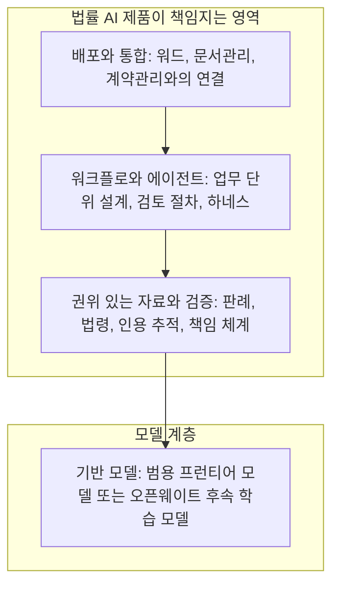
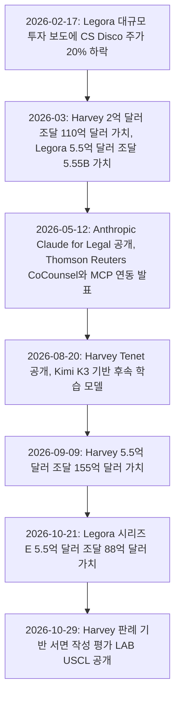
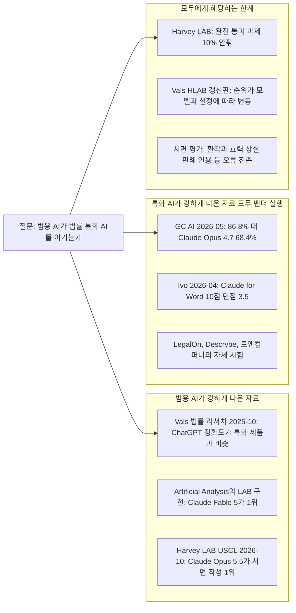
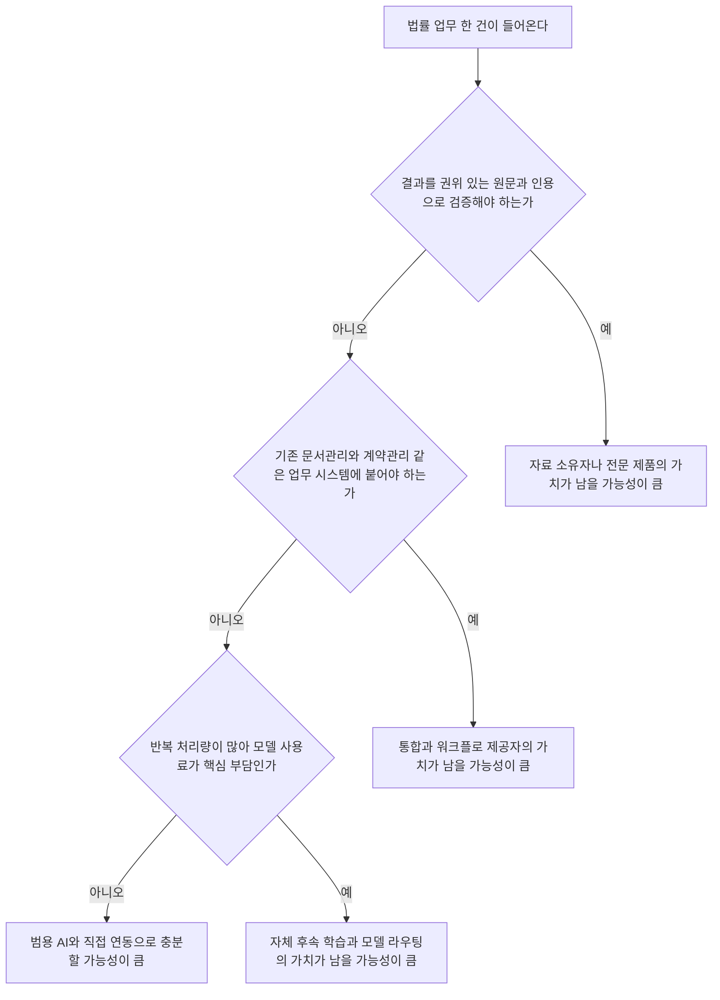

- 작성일: 2026-10-30
- 대상: 스레드에 올라온 "미국 Legal AI 업계가 엄청나게 뜨겁다" 게시글과 그 아래 댓글 두 개
- 작성 방식: 게시글의 주장을 하나씩 떼어 최신 자료로 확인하고, 확인된 것과 확인되지 않은 것, 해석에 해당하는 것을 구분해서 적었습니다.

```
미국 Legal AI 업계가 엄청나게 뜨겁다.

변호사들을 대거 고용해 법률 엔진을 만들고,
변호사들이 변호사들의 밥줄을 끊고 있는 셈이다.
이미 제품을 출시되서 현장에서 쓰이고 있다.

그런데 수천억, 수조 원을 투자받은
이 법률 전문 AI 기업들이 마주한 의외의 고민이 있다.

과연 범용 AI인 Claude를 이길 수 있느냐는 것.

막대한 비용을 들여 법률에 특화된 엔진을 만들었는데,
상당수 작업에서 여전히 범용 AI인 Claude가
더 나은 결과를 보여주는 상황이 벌어지고 있다.
구독료의 차이를 생각하면 사실 말이 안되는 결과들이다.

전문 지식을 학습시켜 만든다는 것만으로
경쟁력이 보장되는 시대는 끝나가고 있다.
전문 AI가 범용 AI를 이기지 못한다면,
전문 AI의 존재 이유부터 다시 증명해야 한다.

법률 AI기업들은 왠지 DVD 같은 신세가 될 듯하다.
굳이 쓸 이유가 점점 더 사라진다.

https://www.threads.com/share/_-XTmdkr3/
```

## 0. 먼저 알아둘 점

이 문서는 세 가지를 지키려고 했습니다. 첫째, 출처에서 확인되지 않는 내용은 사실처럼 쓰지 않았습니다. 둘째, 같은 숫자라도 누가 측정했는지를 함께 적었습니다. 법률 AI 회사가 직접 돌린 시험과 제3자가 돌린 시험, 그리고 AI 개발사가 직접 말한 내용은 신뢰의 무게가 다르기 때문입니다. 셋째, 이 글을 쓰는 Claude는 Anthropic이 만든 모델입니다. Claude에게 유리하게 읽힐 수 있는 대목이 있으면 그만큼 출처와 이해관계를 더 꼼꼼히 표시했습니다.

한 가지 제약도 있습니다. 게시글의 원문 링크는 사이트가 자동 접근을 허용하지 않아 직접 열어 보지 못했습니다. 그래서 전달해 주신 본문과 댓글 텍스트를 기준으로 분석했고, 게시글 자체의 작성 시각이나 반응 수는 검증하지 않았습니다.

출처 표기는 다음 기준을 따릅니다. [1차]는 회사나 기관이 직접 낸 자료, [벤더]는 경쟁 당사자가 직접 실행한 시험이나 주장, [언론]은 기사, [블로그]는 집계·해설성 글입니다. 번호는 문서 끝의 참고 자료와 대응합니다.

## 1. 게시글이 말하는 것: 한 문단으로 요약

게시글의 작성자는 미국 법률 AI 시장이 매우 뜨겁다는 데서 출발합니다. 변호사를 대거 채용해 법률 엔진을 만든 회사들이 이미 제품을 내놓았고 현장에서 쓰이고 있으며, 수천억 원에서 수조 원을 투자받았다는 것입니다. 그런데 이 회사들이 뜻밖의 고민에 부딪혔다고 합니다. 범용 AI인 Claude를 과연 이길 수 있느냐는 질문입니다. 막대한 비용을 들여 법률에 특화한 엔진을 만들었는데 상당수 작업에서는 범용 Claude가 더 나은 결과를 내는 상황이 벌어지고 있고, 구독료 차이를 생각하면 말이 안 되는 결과라고 합니다. 그래서 "전문 지식을 학습시켰다"는 것만으로 경쟁력이 보장되던 시대는 끝나가고, 전문 AI가 범용 AI를 이기지 못하면 존재 이유부터 다시 증명해야 하며, 법률 AI 기업들은 DVD처럼 될 것 같다는 결론에 이릅니다.

이 글은 사실 보도라기보다 관찰과 전망을 섞은 의견글입니다. 게시글 안에는 출처나 수치가 없습니다. 그래서 아래에서는 문장마다 "무엇이 확인되고, 무엇이 확인되지 않는지"를 나누어 봅니다.

## 2. 주장별 검증

### 2-1. "미국 Legal AI 업계가 엄청나게 뜨겁다": 확인됩니다

숫자로 보면 뜨거운 것이 맞습니다. Harvey는 2026년 9월 9일에 5억 5천만 달러를 조달하면서 기업가치를 155억 달러로 평가받았다고 밝혔고, 미국 상위 100대 로펌의 80%가 Harvey를 쓴다고 주장했습니다 [3]. 일부 보도는 기업가치를 156억 달러로 적지만, Harvey 자체 블로그 상단 안내 문구는 155억 달러입니다 [1]. 같은 해 3월에는 2억 달러를 110억 달러 가치로 조달했습니다 [6].

경쟁사 Legora(스웨덴 출신)는 2026년 10월 21일 시리즈 E로 5억 5천만 달러를 조달하며 기업가치 88억 달러를 인정받았다고 발표했습니다. 연간 반복 매출(ARR)은 2억 달러를 넘었고 이전 라운드 가치는 56억 달러였습니다 [2]. 미국이 매출 기준 가장 큰 시장이 되었다는 보도도 있습니다 [2]. 7개월 사이에 같은 금액을 두 번 조달한 셈입니다.

시장의 심리도 반응했습니다. 2026년 2월 17일, Legora가 5억 달러 이상 가치로 투자를 받으려 한다는 보도가 나오자 법률 소프트웨어 회사 CS Disco의 주가가 하루 만에 20% 떨어졌습니다 [5]. 같은 달 Anthropic이 법률 플러그인을 선보였을 때도 소프트웨어 주식이 흔들렸다는 보도가 있었습니다 [9].

환율에 따라 달라지므로 원화 환산은 하지 않았지만, 라운드 하나가 수천억 원 단위라는 게시글의 표현은 틀리지 않습니다. 다만 "수조 원"은 회사 누적 투자액으로 보면 가능한 표현일 뿐, 이번 라운드 하나의 금액은 아닙니다.

### 2-2. "변호사들을 대거 고용해 법률 엔진을 만든다": 절반만 확인됩니다

Harvey가 변호사 출신을 대거 고용하는 것은 사실입니다. 다만 그 역할이 게시글의 표현과는 조금 다릅니다. Harvey의 "리걸 엔지니어"는 실무 변호사 출신으로, 고객사와 잠재 고객에게 AI가 실제 법률 업무에 어떻게 들어맞는지를 보여 주고 교육·온보딩을 맡으며, 고객의 현장 요구를 제품·엔지니어링 팀에 전달하는 사람들입니다 [15]. 구인 공고에 나온 연봉 범위는 22만~32만 달러 수준이었습니다 [16]. 이 직군이 "엔진을 직접 짠다"기보다 "엔진이 현장에서 통하게 만드는 사람들"에 가깝다는 것이 공식 설명으로 확인되는 범위입니다. 한편 Harvey의 자체 벤치마크는 평가 기준을 변호사가 검토해 보정했다고 밝힙니다 [1].

"리걸 엔지니어가 약 180명"이라는 숫자를 적은 글이 있지만 [17] 이는 개인 블로그형 글이고 Harvey 공식 확인이 없어 사실로 쓰지 않았습니다. "변호사들이 변호사들의 밥줄을 끊는다"는 표현은 수사이며, 검증 대상이 아니라 작성자의 해석입니다.

### 2-3. "이미 출시되어 현장에서 쓰이고 있다": 확인됩니다

대표적인 사례로 영국계 대형 로펌 Freshfields는 Anthropic과 다년 협력을 발표했고 [12], Claude를 33개 사무소의 수천 명 변호사에게 배치했다고 보도되었습니다 [13]. 한국에서도 하이브가 Harvey를 해외 법무에 도입해 업무 속도가 20~30% 빨라졌다고 말했고, 법무법인 세종이 계약서 초안 작성과 실사 자료 분석에 Harvey를 쓴다고 한국경제가 보도했습니다 [28]. 법무법인 율촌은 BHSN과 공동 개발한 폐쇄형 법률 AI '아이율'을 2026년 1월부터 전사적으로 쓰고 있다고 보도되었습니다 [29].

### 2-4. "범용 Claude가 상당수 작업에서 더 낫다": 이 문장은 일반화할 수 없습니다

이 부분이 게시글의 핵심 주장인데, 게시글에는 근거가 제시되어 있지 않습니다. 제가 찾은 자료를 한 줄로 요약하면 "측정한 주체와 과제에 따라 결과가 갈린다"입니다.

**범용 AI에 유리하게 나온 자료**

Vals AI가 2025년 10월에 낸 법률 리서치 보고서에서는 AI 제품 네 개(Alexi, Counsel Stack, Midpage, ChatGPT)가 모두 변호사 기준선(69%)보다 높은 74~78%를 기록했습니다. 범용 제품인 ChatGPT의 정확도는 법률 특화 제품과 거의 같았고, 특화 제품의 우위는 출처의 권위성 점수가 평균 6점 높았다는 데 있었습니다 [18]. 다만 이 시험에 Harvey나 Thomson Reuters 같은 시장 선두 업체는 참여하지 않았고 Claude도 포함되지 않았습니다 [18].

Harvey가 만든 에이전트 벤치마크(LAB)를 제3자인 Artificial Analysis가 구현한 평가에서는 Claude Fable 5가 14.2%의 전체 통과율로 1위였고, 2위권 모델들(7.5%)의 약 두 배였습니다 [23]. 2026년 10월 29일 Harvey가 발표한 판례 기반 서면 작성 평가(LAB: USCL)에서는 Claude Opus 5.5가 가장 높은 Elo 점수를 받았고, 최상위 모델은 최하위 모델보다 95% 넘게 더 나은 서면을 썼다고 합니다 [1]. 이것은 법률 AI 회사 자신의 연구에서 나온 결과라는 점이 눈에 띕니다.

**법률 특화 AI에 유리하게 나온 자료 (모두 벤더가 직접 실행)**

GC AI의 인하우스 법무 시험(2026년 5월, 100개 과제)에서는 GC AI가 86.8%, GPT-5.5가 79.8%, Claude Opus 4.7이 68.4%, Gemini 3.1 Pro가 57.5%였습니다. GC AI는 격차가 큰 곳이 규제 추적과 법률 리서치, 체크리스트였고, 범용 모델이 권위 있는 출처에 근거해 답하는 데서 뒤처졌다고 설명합니다 [20]. 계약 검토 AI인 Ivo는 자사가 의뢰한 평가에서 모든 기준에 걸쳐 Claude for Word보다 앞섰다고 밝혔고 Claude for Word의 점수는 10점 만점에 3.5였다고 합니다 [21]. LegalOn은 3,282건의 계약 검토를 12개 범용 모델과 맞붙여, 범용 모델 중 Claude Opus 4.6이 가장 강했지만 LegalOn이 더 정확했고 17배 빨랐다고 주장합니다 [22]. Descrybe는 변호사시험 객관식(MBE) 200문항에서 자사 모델이 200문항을 모두 맞혔고 GPT-5.2는 187문항, Claude Opus 4.5는 177문항을 맞혔다고 발표했습니다 [19]. 한국의 로앤컴퍼니는 자사 '슈퍼로이어'가 변호사시험 선택형에서 상위 5%였고 Claude 등 범용 모델은 합격선을 넘지 못했다고 밝혔습니다 [28].

**이 자료들을 읽을 때 반드시 붙여야 할 단서**

첫째, 위 "특화 우위" 자료는 전부 해당 업체가 직접 만든 시험입니다. 이해관계가 걸려 있다는 점에서는 Claude가 1위라고 적은 Anthropic 측이나 제3자 블로그의 주장도 마찬가지로 다뤄야 합니다. 둘째, 시험에 쓰인 Claude는 Opus 4.5, 4.6, 4.7입니다. 모델은 몇 달 단위로 바뀌므로, 2026년 10월 현재의 모델과 같은 결과가 나온다고 볼 수 없습니다. 셋째, 같은 Harvey LAB이라도 평가 주체와 설정에 따라 순위가 바뀝니다. Vals가 돌린 판에서는 2026년 10월 18일 기준 Muse Spark 1.2가 25.42%로 1위였고 Claude Fable 5는 공동 7위(11.25%)였으며, 10월 26일 갱신된 HLAB-Vals-1.1에서는 Gemini 4 Argon이 27.08%로 1위, 비용이 낮은 모델 여러 개가 성능 대비 비용 최전선에 올라 있습니다 [24]. 즉 "Claude가 항상 이긴다"는 서술도 근거가 약합니다.

**모두에게 공통으로 해당되는 한계**

Harvey 자신이 밝힌 바로는, 엄격한 전체 통과 기준에서 프런티어 모델이 끝에서 끝까지 완수하는 과제는 합쳐서 10% 미만이었고, 최고점을 내는 모델은 과제당 약 50달러와 20분 이상이 들었으며, 실무 영역에 따라 1등 모델이 달라졌습니다 [25]. 판례 서면 평가에서도 가장 좋은 모델들이 법원에 제출할 수준에는 못 미쳤고, 환각, 불필요한 양보, 이미 효력을 잃은 판례 인용 같은 오류가 길게 남았다고 합니다 [1]. 범용이든 특화든 "사람의 검토 없이 쓸 수 있는 수준"은 아직 아니라는 점은 어느 쪽 자료에서도 일관됩니다.

### 2-5. "구독료 차이를 생각하면 말이 안 된다": 방향은 맞지만 숫자는 불확실합니다

법률 AI의 좌석당 가격은 공식 공개되지 않고 견적 기반이며, 보고된 숫자는 출처마다 다릅니다. 분석 사이트들이 전하는 Harvey는 사용자당 월 1,200~2,000달러 이상, Lexis 자료를 묶으면 약 2,400달러입니다 [30]. Legora는 사용자당 연 3,000달러(월 약 250달러) 안팎이라는 보고와 월 300~800달러라는 보고가 함께 있으며 최소 10좌석이 붙는다고 합니다 [30]. Thomson Reuters의 CoCounsel은 Core 등급이 월 약 225달러로 보고됩니다 [30].

여기에는 중요한 경고가 있습니다. 한 분석가는 2026년 10월 26일 기준 Harvey 가격 페이지가 접속되지 않고 모든 버튼이 데모 신청으로 연결되며, Harvey의 1,200달러라는 숫자는 2024년에는 "좌석당 연간"으로 보도되었는데 2026년 비교 사이트들은 "월간"으로 옮겨 적어 두 해석이 12배 차이가 난다고 지적했습니다 [30]. 그래서 이 문서는 구체적 금액을 사실로 확정하지 않고 "보고된 범위"로만 적습니다. 범용 AI 구독료와 법률 AI 좌석료의 격차가 크다는 방향은 여러 출처가 일치하지만, 몇 배인지는 확인하지 못했습니다.

또 하나, 좌석료만 비교하면 절반만 본 것입니다. 범용 AI에 법률 업무를 얹으려면 Westlaw 같은 권위 있는 자료에 연결해야 하는데, Anthropic이 발표한 연동은 Thomson Reuters 고객이 Claude 안에서 Westlaw와 Practical Law를 쓰는 방식입니다 [34]. 자료 사용료는 별도라는 뜻입니다. Anthropic의 제품 책임자가 "그대로 쓰기보다 자기 법무 플레이북에 맞게 맞춰 쓸 때 가장 좋다"는 취지로 말했다는 보도도 있어 [14], 도입 비용에는 맞춤 작업이 포함됩니다.

### 2-6. "전문 지식을 학습시켰다는 것만으로는 경쟁력이 보장되지 않는다": 방향은 지지됩니다

이것은 해석이지만 정황이 상당히 있습니다. Harvey의 벤치마크를 사용한 학술 논문 한 편(Parthenon)은, 같은 모델과 같은 실행 환경에서 법률 전용 하네스(모델이 일하는 틀)만 바꿔도 모델을 한 단계 올린 것과 비슷한 향상이 나왔다고 보고합니다 [32]. 이 논문 한 편으로 일반화할 수는 없지만, 경쟁력이 "지식을 더 학습시킨 모델"보다 "업무 절차와 검증 구조"에 있을 수 있다는 방향과 맞습니다. Harvey가 고객에게도 자체 모델을 후속 학습하도록 권한다는 보도 [26]와, 투자자 해설이 "해자는 워크플로와 데이터"라고 쓴 것 [26]도 같은 맥락이지만, 후자는 투자 업계 의견임을 밝혀 둡니다.

반대로 Thomson Reuters는 자사의 해자를 Westlaw, Practical Law, KeyCite 같은 권위 있는 자료와 약 2,700명의 변호사 편집자, 인용을 한 번에 추적하는 장치라고 설명하며, 이것이 "수탁자 수준"의 정확성을 가능하게 한다고 주장합니다 [7][8]. 즉 "전문 지식을 학습"하는 것이 아니라 "전문 자료와 책임 체계를 소유"하는 것이 차별점이라는 입장입니다.

### 2-7. "법률 AI 기업들은 DVD 같은 신세가 될 것이다": 아직 확인된 사실이 아닌 전망입니다

현재 시점의 사실은 오히려 반대 방향의 숫자가 많습니다. Harvey와 Legora는 몇 달 사이 기업가치가 크게 올랐고, Legora의 ARR은 3월 1억 달러 돌파에서 10월 2억 달러 이상으로 늘었습니다 [2][4]. 기존 강자인 Thomson Reuters와 RELX의 법률 부문도 각각 8%, 9%의 기초 성장을 보고했다는 집계가 있습니다 [33]. 변호사의 사용 확산도 빠릅니다. 8am의 2026년 조사에서는 응답 법조인의 69%가 업무에 생성형 AI를 직접 써 봤고, 일반 목적 AI를 도입한 사무소는 46%, 법률 특화 플랫폼을 도입한 곳은 34%였다고 합니다 [33]. 이 수치는 블로그가 요약한 것이어서 원 보고서는 확인하지 못했습니다.

그렇다고 위협이 가공이라는 뜻은 아닙니다. 일부 시장 분석은 ChatGPT, Claude, Copilot 때문에 단순 초안 작성이나 요약만 파는 법률 AI는 따로 팔기 어려워진다고 전망합니다 [33]. 법률 AI 업체 스스로도 이를 의식하고 있습니다. 한국경제도 Claude의 압도적인 가격 경쟁력이 국내 스타트업을 잠식할 수 있다는 위협론이 나온다고 전했고 [28], Harvey는 2026년 가을에 마진 압박을 겪었다는 보도가 있습니다(아래 3-2).

정리하면 "DVD가 된다"는 것은 가능한 한 시나리오일 뿐, 지금 관찰되는 사실은 아닙니다. 그리고 더 중요한 점은, 이 비유가 두 편이 맞서는 구도를 전제하지만 실제 관계는 훨씬 얽혀 있다는 것입니다.

## 3. 게시글이 놓치고 있는 구도: 경쟁이 아니라 얽힘

### 3-1. 법률 AI 회사는 범용 AI의 "고객"이기도 하다

게시글은 "법률 AI 대 Claude"로 그리지만, 확인되는 사실은 다음과 같습니다. Thomson Reuters는 다음 세대 CoCounsel Legal을 Anthropic의 Claude Agent SDK 위에서 새로 만들었다고 직접 밝혔고, CEO는 Claude 모델이 자사가 하는 일에 가장 좋다고 보며 매주 평가를 돌린다고 말했습니다 [7][8]. 2026년 5월 12일 Anthropic이 Claude for Legal을 공개했을 때, 연동 대상에는 Harvey도 포함되었고 [9], 발표 자료에는 Harvey CEO와 Legora CTO가 Opus 4.7을 칭찬한 발언이 실렸다고 합니다 [11]. Harvey는 Claude Opus 4.6이 자사 제품에 적용되었고 자사 BigLaw Bench에서 90.2%를 기록했다고 직접 게시한 적이 있습니다 [26의 게시 요약].

즉 상당수 법률 AI 제품은 범용 모델 위에 올라탄 응용 계층이고, 범용 모델이 좋아지면 그 제품도 좋아지는 관계입니다. "Claude가 더 낫다"가 맞더라도 그것이 곧 "법률 AI 제품이 불필요하다"가 되지는 않는 이유입니다. 반대로 Anthropic도 법률 시장에 직접 들어왔습니다. 5월 12일에 12개 업무 영역별 플러그인과 20개 이상의 연동을 내놓았고 [10], Bloomberg는 이를 Anthropic의 법률 업계 진출 확대로 보도했습니다 [9]. 같은 고객을 두고 협력하면서 경쟁하는 구도입니다.

### 3-2. 응용 계층의 진짜 압박은 "성능"보다 "원가"일 수 있다

Bloomberg 보도를 전한 2차 매체들에 따르면 Harvey의 매출총이익률은 2026년 초 약 50%에서 6월에 약 -50%까지 떨어졌고, 이는 OpenAI·Anthropic의 사용량 기반 요금제 아래에서 고객의 에이전트 사용이 폭증했기 때문이라고 합니다. 이후 Harvey는 8월 20일에 자체 모델 Harvey Tenet을 공개했는데, 중국 Moonshot AI의 오픈웨이트 모델 Kimi K3를 Fireworks와 함께 법률 업무용으로 후속 학습한 모델입니다 [26][27]. 마진은 8월에 다시 흑자로 돌아섰다고 전해지지만 구체적 수치는 공개되지 않았고 원문 기사는 직접 확인하지 못했습니다 [27].

이 보도가 맞다면 "특화 모델이 범용 모델을 이기느냐"보다 "특화 회사가 프런티어 모델 사용료를 감당하고도 남는 장사가 되느냐"가 더 시급한 질문이었다는 이야기가 됩니다. 같은 보도는 Anthropic이 투자자 행사에서 Harvey가 가장 어려운 업무에는 여전히 가장 강력한 Claude Opus에 의존한다고 밝혔다고 전합니다 [27]. 이 역시 2차 보도이고, 반대로 Harvey가 Tenet을 기존 모델을 "대체"하는 것이 아니라 "추가"하는 것으로 설명한다는 해설도 있습니다 [26].



위 도식은 지금까지의 자료를 이해하기 쉽게 정리한 개념도입니다. 게시글이 "특화 엔진"이라고 부르는 것은 맨 아래 모델 계층만 가리키지만, 법률 AI 제품이 실제로 파는 것은 그 위의 세 계층까지 포함합니다. Harvey가 모델 계층에서 후속 학습을 하는 것은 맨 아래를 직접 손보는 시도이고, Thomson Reuters는 맨 아래를 Claude에 맡기고 두 번째 계층(자료와 검증)에 집중하는 접근으로 읽힙니다. 이 도식은 해석이며 개별 회사의 내부 구조를 확인한 것은 아닙니다.

## 4. 2026년 주요 흐름 연표

아래 사건들은 모두 위 출처에서 날짜가 확인된 것만 골랐습니다.



참고로 3월의 Legora 라운드는 일부 데이터베이스에 2월 13일로 적혀 있지만, 다수의 보도가 3월 10일 마감으로 전합니다 [6]. 이 문서는 후자를 따랐습니다.

## 5. 증거 지형을 한눈에 보기

범용 AI와 특화 AI의 우열을 다룬 자료를 누가 측정했는지에 따라 나누면 아래와 같습니다. 같은 질문에 서로 다른 답이 나오는 이유가 여기서 드러납니다.



도식에서 보이듯 한쪽 편을 들어 주는 자료는 누가 시험을 설계했는지와 강하게 겹칩니다. 그래서 가장 정직한 요약은 "과제에 따라 다르고, 아직 사람의 검토가 필요하다"입니다.

### 벤치마크 요약표

| 측정 주체 | 과제 | 보고된 결과 | 읽을 때의 단서 |
|---|---|---|---|
| Vals AI (제3자), 2025-10 | 미국 법률 리서치 200문항 | AI 제품 74~78%, 변호사 기준선 69%. ChatGPT 정확도는 특화 제품과 거의 동일, 특화 제품은 출처 권위성에서 평균 6점 우위 | 선두 업체(Harvey, CoCounsel) 불참, Claude 미포함 [18] |
| Descrybe (벤더), 2026-03 | 변호사시험 객관식 200문항 | 자사 200문항 정답, GPT-5.2 187, Claude Opus 4.5 177 | 자사 시험, 시험지 유형이 객관식 [19] |
| Ivo (벤더), 2026-04 | 계약 검토 | Claude for Word 10점 만점 3.5, Ivo가 모든 기준에서 우위라고 발표 | 세부 방법론 미확인 [21] |
| GC AI (벤더), 2026-05 | 인하우스 법무 100과제 | GC AI 86.8, GPT-5.5 79.8, Claude Opus 4.7 68.4, Gemini 3.1 Pro 57.5 | 자사 시험, 모델 버전이 현재보다 이전 [20] |
| LegalOn (벤더), 2026 | 계약 검토 3,282건 | 범용 모델 중 Claude Opus 4.6이 최고, LegalOn이 더 정확하고 17배 빠르다고 주장 | 자사 시험, LLM 심판 사용 [22] |
| Artificial Analysis (제3자), 약 2026-07 | Harvey LAB 실무 과제 120건 | Claude Fable 5가 전체 통과율 14.2%로 1위, 28개 모델 중 13개는 0% | 비공개 과제, 단일 LLM 심판 [23] |
| Vals (제3자), 2026-10 | Harvey LAB 실행 | 10/18 기준 Muse Spark 1.2가 25.42%, Claude Fable 5 공동 7위 11.25%. 10/26 갱신판은 Gemini 4 Argon이 27.08%로 1위 | 평가 설정이 바뀌어 순위 변동 [24] |
| Harvey (벤더), 2026-10-29 | 판례 기반 서면 작성 100환경 | Claude Opus 5.5가 최고 Elo, 상위 모델도 제출 수준에는 미달 | 경쟁 당사자의 연구, 모델 간 순위 비교 [1] |

## 6. 댓글 두 개 해설

### 6-1. 첫 번째 댓글: "법률 전문 AI가 오픈소스 모델인가요? 증류해도 못 따라가는 것 같네요"

댓글 작성자가 묻는 것은 법률 AI가 오픈소스 모델 위에서 만들어지는지, 그리고 오픈소스는 Anthropic이나 OpenAI를 따라잡지 못하는 것 아니냐는 점입니다. 확인된 사실로 보면 "대체로 아니다, 다만 일부는 그 방향으로 움직이고 있다"가 가장 정확합니다.

미국의 대표 법률 AI 회사들은 기본적으로 OpenAI·Anthropic 같은 프런티어 모델을 API로 가져다 쓰며, Harvey도 업무에 따라 여러 회사의 모델을 골라 썼다고 합니다 [26]. 그러다 2026년 8월 Harvey는 중국 Moonshot AI의 공개 가중치 모델 Kimi K3를 바탕으로 법률 업무용으로 후속 학습한 Tenet을 내놓았습니다 [26]. 후속 학습이란 이미 만들어진 모델 위에 특정 분야 데이터와 강화학습을 더해 성능을 끌어올리는 작업입니다. 이것은 댓글이 말하는 "증류"(큰 모델의 출력으로 작은 모델을 가르치는 것)와는 다른 방식이며, Tenet이 Claude 등을 증류했다는 보도는 찾지 못했습니다. 한편 Tenet은 연구 미리보기 단계이고 공개 시점에 모델 카드나 공개 가중치, API는 없었다는 해설이 있으며 [26], Harvey 자체 평가 환경에서 기본 Kimi K3보다 더 많은 법률 과제를 해냈다는 설명도 자체 설계 평가에 근거합니다 [27].

"오픈소스는 못 따라간다"는 말은 이 평가 자료와 정확히 일치하지 않습니다. Vals의 HLAB-Vals-1.1 상위 10위에는 DeepSeek, Qwen, GLM, MiMo, Mistral 계열이 있고 성능 대비 비용 최전선에도 비용이 낮은 모델들이 여럿 올라 있습니다 [24]. 이 모델들이 모두 공개 가중치인지까지는 확인하지 못했으므로 "오픈소스가 따라잡았다"고 단정하지는 않겠습니다. 다만 Anthropic이 Harvey가 가장 어려운 업무에는 여전히 Opus에 의존한다고 밝혔다는 보도가 있어 [27], 어려운 업무는 프런티어 모델에 맡기고 반복 업무는 저렴한 모델로 돌리는 혼합 방식이 현실적이라는 해설이 나옵니다 [27]. Harvey도 업무에 따라 가벼운 모델과 고성능 모델을 나눠 배정하는 방식을 도입했다고 전해집니다 [27].

### 6-2. 두 번째 댓글: "범용 AI가 일부에서 낫다고 특화 AI의 가치가 사라지진 않는다"

이 댓글은 대략 다섯 가지를 말합니다. 첫째, 범용 AI가 일부 법률 업무에서 더 나은 답을 내도 특화 AI의 존재 가치까지 사라지는 것은 아니다. 둘째, 해외에서는 프런티어 API나 오픈웨이트 모델 위에 도메인 온톨로지, 지식그래프, 파인튜닝을 결합해 법률 추론 체계를 고도화하고 있고 유럽 시장도 성장 중이다. 셋째, 법률 AI의 승부는 단순 답변 성능보다 법률 정보의 구조화, 근거 검증, 실제 업무에 붙는 파이프라인에 있다. 넷째, 한국에서 나오는 것은 대부분 보조 도구 수준이다. 다섯째, 결국 AI를 보조 도구로만 볼지, 제대로 투자해 실제로 돈을 버는 Legal AI를 만들지가 갈림길이다.

이를 확인된 사실과 대조해 보면 다음과 같습니다.

첫째 주장은 2장에서 본 자료와 같은 방향입니다. 범용 AI가 일부 과제에서 앞선다는 증거도, 특화 제품만의 강점이 남는 영역(권위 있는 출처 제시, 계약 검토 절차 등)이 있다는 주장도 함께 존재하며, 어느 쪽도 전면적이지 않습니다.

둘째 주장 중 "유럽 시장도 성장한다"는 확인됩니다. 스웨덴 Legora가 위에서 본 것처럼 크게 성장했고, 독일의 Noxtua가 2026년 9월 유럽 법률 출판사들의 지원으로 1억 1,600만 달러 이상의 시리즈 C를 마감했다는 집계가 있습니다 [36]. 다만 "도메인 온톨로지와 지식그래프를 결합한다"는 구체적 기술 구성은, 제가 찾은 자료에서는 개별 업체의 공식 기술 설명으로 확인하지 못했습니다. 이 부분은 작성자의 실무 관찰로 보고 사실 검증 대상에서 제외합니다. 비슷한 방향의 간접 단서는 있습니다. Thomson Reuters의 설명은 구조화된 법률 자료와 인용 검증, 변호사 편집자를 핵심 자산으로 내세웁니다 [7][8].

셋째 주장은 3-1의 구도와 맞습니다. Thomson Reuters가 Claude를 엔진으로 쓰면서도 자료와 검증 체계를 자사 가치로 삼는 것이 그 예입니다. 다만 이것이 "정답"이라는 증거는 아직 없고, 법률 AI 회사가 이 지점에서 이기고 있다는 독립적 평가도 이 문서의 조사 범위에서는 찾지 못했습니다.

넷째 주장에 대해서는, 제가 확인한 한국 사례(아이율, BHSN 앨리비 CLM 코어, 로앤컴퍼니 슈퍼로이어, 세종·하이브의 Harvey 도입)는 대체로 변호사와 법무팀의 업무를 돕는 도구입니다 [28][29]. 그러나 한국 시장 전체를 조사한 통계는 찾지 못해, "대부분"이라는 말은 개인의 관찰로 남겨 둡니다. 한국경제는 로앤컴퍼니가 판례 500만 건과 주요 법률 출판사와 독점 계약한 데이터, 한국 법체계에 맞춘 독자 구조를 강점으로 내세운다고 전하면서 Claude는 영미법 중심이라 목표 시장이 다르다는 회사 측 말을 함께 실었습니다 [28]. 이 중 회사의 "시험에서 Claude가 합격선을 못 넘었다"는 부분은 회사의 주장이며 독립 검증은 찾지 못했습니다.

다섯째 주장은 가치 판단이라 사실 검증의 대상이 아닙니다. 다만 앞 절에서 본 사례는 이 구분에 방향을 보태 줍니다. Harvey는 사용량이 늘어날수록 모델 사용료가 매출을 넘어서는 문제를 겪었다는 보도가 있고, 그 해법으로 자체 후속 학습 모델을 택했습니다 [27]. 즉 "제대로 투자한다"는 것은 단지 데이터를 모으는 것이 아니라, 원가 구조까지 설계하는 일을 포함하는 것으로 보입니다.

## 7. 전체를 어떻게 읽을 것인가

지금까지의 확인 결과를 한 문단으로 정리하면 이렇습니다. 시장이 뜨겁다는 것, 제품이 현장에서 쓰인다는 것, 투자가 막대하다는 것은 확인됩니다. 범용 AI인 Claude가 특정 평가에서 법률 특화 제품을 앞서거나 비슷하게 따라온다는 것도 근거가 있습니다. 하지만 반대로 특화 제품이 앞선다는 벤더 자료도 같은 시기에 여럿 있고, Claude가 모든 평가에서 1위인 것도 아닙니다. 어느 쪽이든 완전한 업무 수행에는 아직 못 미칩니다. 그리고 "DVD가 된다"는 것은 현재의 사실이 아니라 전망입니다.

게시글이 가장 설득력 있게 짚은 부분은 "특화 데이터를 학습시켰다는 사실 하나로 해자가 보장되는 시대는 아니다"라는 문제의식입니다. 이는 정황상 타당해 보입니다. 다만 그 해자가 어디에 생기는지에 대해서는 두 가지 시나리오가 경쟁 중입니다.



이 도식은 위 자료에서 끌어낸 해석용이며 정답이 아닙니다. 법률 업무는 결과가 서면 제출이나 계약 체결로 이어지고, 변호사가 사실과 법을 보증하는 책임을 진다는 점이 중요합니다. Harvey도 서면은 모든 인용과 서술이 검증을 견뎌야 제출 가능하다는 점을 평가 설계의 이유로 들었습니다 [1]. 이런 성격이 "검증 가능한 자료와 책임 체계"를 가진 쪽에 무게를 싣는지, 아니면 범용 모델이 충분히 좋아져 그 격차를 연동만으로 메우는지가 앞으로의 쟁점입니다. 이 쟁점에 대해 현재 시점의 독립적 결론은 없습니다.

## 8. 이 문서에서 확인하지 못한 것

- 게시글 원문 링크는 직접 열람하지 못했고, 전달받은 텍스트를 기준으로 했습니다.
- "상당수 작업에서 Claude가 더 낫다"는 게시글 주장에 대해 게시글이 어떤 근거를 염두에 두었는지는 알 수 없습니다.
- Harvey, Legora, CoCounsel의 정확한 좌석 가격과 계약 단위(월/연)는 공식 확인이 없습니다.
- Harvey의 마진 수치와 Anthropic의 투자자 행사 발언은 Bloomberg를 인용한 2차 보도로만 확인했고, 원문은 직접 읽지 못했습니다.
- "리걸 엔지니어 약 180명"이라는 인원 수는 공식 확인이 없습니다.
- 한국 법률 AI 시장 전체의 성격(보조 도구 중심인지)을 보여 주는 통계는 찾지 못했습니다.
- 벤치마크에 쓰인 Claude 모델은 Opus 4.5~4.8, Fable 5, Opus 5.5 등으로 제각각이며, 서로 다른 시점의 모델이라 단순 비교할 수 없습니다.

## 9. 용어 풀이

범용 AI는 특정 분야에 한정하지 않고 다양한 일을 하도록 만든 모델(예: Claude, ChatGPT)이고, 법률 특화 AI는 법률 업무에 맞춰 제품과 데이터, 업무 절차를 설계한 서비스입니다. 후속 학습(post-training)은 이미 만들어진 모델에 특정 분야 데이터와 평가를 더해 추가로 훈련하는 일이고, 증류(distillation)는 큰 모델의 출력으로 작은 모델을 가르치는 방법입니다. 오픈웨이트는 모델의 가중치가 공개되어 내려받아 수정할 수 있는 모델입니다. 하네스는 모델이 도구를 쓰고 단계를 밟으며 일하도록 감싸는 실행 환경과 절차입니다. MCP(Model Context Protocol)는 AI가 외부 소프트웨어나 자료에 연결되는 공통 규격입니다. 전체 통과율(all-pass)은 한 과제의 모든 채점 항목을 통과해야 성공으로 치는 엄격한 기준입니다. ARR은 연간 반복 매출입니다.

## 10. 참고 자료

번호는 본문 대괄호와 대응합니다. 접속일은 모두 2026-10-30입니다.

[1] Harvey, "Extending Legal Agent Bench to U.S. Case Law" (2026-10-29) [1차·벤더 연구] https://www.harvey.ai/blog/legal-agent-bench-us-case-law

[2] Legora, 시리즈 E 보도자료 [1차] https://legora.com/newsroom/legora-raises-550-million-series-e-at-8.8-billion-valuation-to-accelerate-growth / 미국 최대 시장 보도 [언론] https://www.nonbillable.co.uk/news/legora-raises-550m-series-e-round

[3] Harvey 9월 9일 라운드와 Am Law 100 비율 인용 [블로그] https://fourweekmba.com/ai-legora-hits-8-8b-as-fidelity-and-jpmorgan-join-its-round/

[4] TechCrunch, Legora 56억 달러 (2026-04-30) [언론] https://techcrunch.com/2026/04/30/legal-ai-startup-legora-hits-5-6-valuation-and-its-battle-with-harvey-just-got-hotter/

[5] Yahoo Finance(Investing.com), CS Disco 20% 하락 (2026-02-17) [언론] https://finance.yahoo.com/news/daily-ai-fear-trade-cs-203145774.html

[6] Harvey·Legora 2026년 3월 라운드 비교 [블로그] https://www.srahq.com/post/legora-vs-harvey-ai-what-us-law-firms-should-actually-know-in-2026

[7] Thomson Reuters, Claude와 CoCounsel Legal 연동 보도자료 (2026-05-12) [1차] https://www.thomsonreuters.com/en/press-releases/2026/may/thomson-reuters-and-anthropic-expand-partnership-to-connect-claude-with-cocounsel-legal

[8] LawNext, Thomson Reuters CEO 인터뷰 (2026-06) [언론] https://www.lawnext.com/2026/06/thomson-reuters-ceo-steve-hasker-on-the-next-generation-of-cocounsel

[9] Bloomberg, Anthropic의 법률 도구 확대 (2026-05-12) [언론] https://bloomberg.com/news/articles/2026-05-12/anthropic-expands-push-into-legal-industry-with-new-ai-tools / Benzinga(Yahoo) 보도 https://finance.yahoo.com/news/anthropic-targets-law-firms-custom-102245290.html

[10] ABA Journal, Claude for Legal 공개 [언론] https://www.abajournal.com/news/article/anthropic-launches-claude-for-legal-giving-lawyers-20-new-program-integrations-and-12-practice-area-plugins/

[11] Legal Business(Mondaq), Claude for Legal 분석 [언론] https://www.mondaq.com/uk/new-technology/1807914/one-engine-configured-a-thousand-different-ways-is-claude-for-legal-the-next-big-shift-in-legal-tech

[12] Legal Cheek, Freshfields와 Anthropic 협력 (2026-04) [언론] https://www.legalcheek.com/2026/04/freshfields-and-anthropic-partner-up-to-build-legal-ai-tools/amp/

[13] WebProNews, Freshfields 33개 사무소 배치 [언론·2차] https://www.webpronews.com/anthropics-claude-for-legal-puts-ai-at-the-center-of-law-firm-workflows/

[14] terms.law, Claude for Legal 리뷰 [블로그] https://www.terms.law/services/ai-implementation/claude-for-legal-review/

[15] Harvey, "Day in the Life: Legal Engineer" (2026-04-29) [1차] https://www.harvey.ai/en-US/blog/day-in-the-life-legal-engineer

[16] legal.io, Harvey 리걸 엔지니어 채용 공고 [1차·구인] https://www.legal.io/jobs/5856240/Full-time/Legal-Engineer-Law-Firm-Corporate

[17] 리걸 엔지니어 약 180명 주장 [블로그·미검증] https://stack-archive.com/blog/harvey-ai-legal-engineer-deployment-model-2026/

[18] Vals AI, VLAIR 법률 리서치 (2025-10-14) [제3자] https://www.vals.ai/industry-reports/vlair-10-14-25 / 요약 https://jurvantis.ai/directory/studies/vals-legal-ai-report-vlair/ / 보도 https://legaltechnology.com/vals-ais-benchmarking-report-for-legal-research-is-out-but-the-market-leaders-are-absent/

[19] LawNext, Descrybe 벤치마크 (2026-03) [벤더·언론] https://www.lawnext.com/2026/03/ai-built-for-law-outperforms-chatgpt-claude-and-gemini-on-legal-reasoning-benchmark.html

[20] GC AI, In-House Legal Bench (2026-05) [벤더] https://gc.ai/blog/in-house-legal-bench-evaluating-ai-assistants-for-in-house-legal-work

[21] Artificial Lawyer, Ivo의 Claude for Word 비교 (2026-04-29) [벤더·언론] https://www.artificiallawyer.com/2026/04/29/claude-for-word-is-weak-suggests-ivo/

[22] LegalOn, 계약 검토 벤치마크 [벤더] https://www.legalontech.com/post/claude-for-legal

[23] Artificial Analysis, Harvey LAB-AA [제3자] https://artificialanalysis.ai/articles/harvey-lab-aa

[24] Vals, HLAB-Vals-1.1 (2026-10-26 기준) https://www.vals.ai/benchmarks/hlab / v1 (2026-10-18 기준) https://www.vals.ai/benchmarks/hlab-v1 [제3자]

[25] Harvey, Legal Agent Benchmark 초기 결과 [벤더 연구] https://www.harvey.ai/blog/legal-agent-benchmark-initial-results

[26] Harvey Tenet 관련: Jawlah(여러 회사 모델을 업무별로 선택) https://jawlah.co/en/62695 / SCMP https://www.scmp.com/tech/tech-trends/article/3364827/openai-backed-legal-tech-firm-pivots-chinese-kimi-k3-open-weight-model / TechCrunch https://techcrunch.com/?p=3162088 / 해설 https://fourweekmba.com/ai-harvey-550m-app-layer-barbell/ / Harvey 게시 요약 https://texxr.com/handle/harvey / 이용자 모델 학습 협력 사례 https://www.appliedcompute.com/case-studies/harvey

[27] Bloomberg 인용 2차 보도(마진, Anthropic 발언): https://cryptobriefing.com/harvey-open-ai-models-anthropic-openai/ , https://aiweekly.co/alerts/harvey-moves-flagship-off-frontier-labs-to-moonshots-kimi-k3 , https://eu.36kr.com/en/p/3993902723201797 , https://en.coinotag.com/harvey-ai-gross-margin-collapse-icp-compute-scarcity [언론·블로그]

[28] 한국경제, "韓 리걸테크 규제 허덕일 때…시장 파고든 글로벌 AI" (2026-03-18) [언론] https://www.hankyung.com/article/2026031804321

[29] 매일신문, 법률 AI 혁명 칼럼 (2026-04-13) [언론] https://kbmaeil.com/article/20260411500014

[30] 가격 보고: https://www.vaquill.ai/blog/harvey-legora-cocounsel-pricing-reality , https://bindlegal.com/resources/comparisons/legora-pricing-2026/ , https://spellbook.com/learn/legora-pricing , 단위 혼동 지적 https://justinmckelvey.com/blog/harvey-ai-pricing [블로그·비공식]

[31] Applied Compute와 Harvey의 후속 학습 사례 https://www.appliedcompute.com/case-studies/harvey [벤더]

[32] Parthenon 논문 (arXiv 2606.04602) [학술 사전공개] https://arxiv.org/pdf/2606.04602

[33] 시장 규모와 채택률 해설 [블로그] https://newmarketpitch.com/blogs/news/legal-ai-market-size , https://newmarketpitch.com/blogs/news/legaltech-market-news

[34] Reuters(Yahoo Finance), Anthropic의 로펌용 도구 확대 [언론] https://finance.yahoo.com/sectors/technology/articles/anthropic-expands-claudes-ai-tools-170145869.html

[35] 법률 테크 투자 집계 [블로그] https://valueaddvc.com/pulse/legal-tech-funding-sector-snapshot-august-2026

[36] 법률 AI 투자 동향 (Noxtua 등) [블로그] https://newmarketpitch.com/blogs/news/legal-ai-funding-news

---

작성 일자: 2026-10-30
