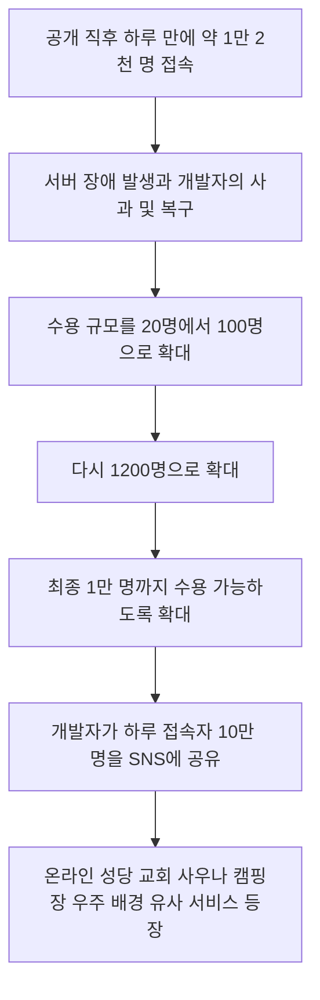
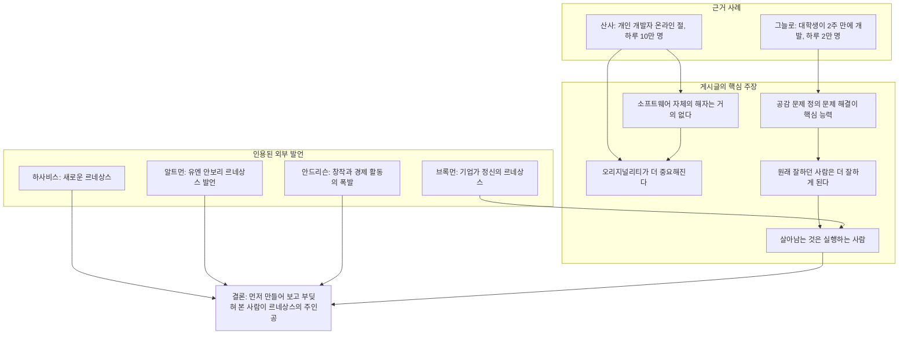

- 작성일: 2026-10-31
- 해설 대상: Threads 계정 choi.openai의 연작 게시글 5편 (공유 링크: https://www.threads.com/share/_6tsLAC18/)
- 작성 원칙: 이 문서는 세 가지를 구분해서 씁니다. 첫째, 검색으로 확인한 **사실**. 둘째, 게시글 작성자가 펼친 **주장**. 셋째, 이 문서의 **해석**입니다. 확인하지 못한 내용은 확인하지 못했다고 명시합니다.

---

## 0. 먼저 읽는 요약

이 연작 게시글은 한마디로 "AI 덕분에 누구나 서비스를 만들 수 있게 된 시대에, 무엇이 차별점이 되는가"를 묻는 글입니다. 출발점은 2026년 10월 말 한국에서 갑자기 화제가 된 온라인 절 서비스 '산사'입니다. 작성자는 이 서비스가 하루 만에 큰 트래픽을 모았다는 사실과, 뜨자마자 온라인 성당·온라인 교회 같은 따라 만든 서비스가 쏟아졌다는 사실을 함께 짚습니다. 그리고 여기서 두 가지 결론을 이끌어 냅니다. 하나는 "며칠 걸리던 개발이 몇 시간이면 가능해졌으니 소프트웨어 자체의 해자(경쟁자가 쉽게 넘볼 수 없는 방어막)는 거의 없다"는 것이고, 다른 하나는 "그렇기 때문에 오히려 무엇을 처음 생각해 내느냐, 즉 오리지널리티가 더 중요해진다"는 것입니다.

이어지는 글에서 작성자는 올여름 화제였던 길찾기 앱 '그늘로'를 두 번째 사례로 들고, AI를 잘 쓰는 사람의 공통 능력을 '공감, 문제 정의, 문제 해결'이라고 정리합니다. 또 "AI 슬롭(저품질 양산물)이다", "그걸 누가 쓰냐", "돈은 벌어 봤냐" 같은 냉소적 반응을 반박하고, 결국 살아남는 사람은 직접 실행하는 사람이라고 말합니다. 마지막에는 오픈AI 공동창업자 그렉 브록먼, 구글 딥마인드 CEO 데미스 하사비스, 오픈AI CEO 샘 알트먼 등이 말해 온 '르네상스'를 끌어와, 지금이 르네상스와 닮은 시기일 가능성이 높고 그 주인공은 "비판을 잘하는 사람보다 먼저 만들어 보고 부딪혀 본 사람"일 것이라고 전망합니다.

제가 검색으로 확인한 결과, 산사와 그늘로에 관한 핵심 사실, 브록먼의 '기업가 정신 르네상스' 발언, 하사비스와 알트먼의 '르네상스' 발언은 모두 근거가 확인됩니다. 반면 "산사 개발자가 비개발자 문과생"이라는 부분과 마크 안드리슨의 구체적 표현은 이번 조사에서 근거를 찾지 못했습니다. 또 '르네상스'라는 같은 단어를 쓰더라도 발언자마다 말하는 대상과 시간표가 다르다는 점은 읽을 때 꼭 구분해야 합니다. 자세한 내용은 아래에서 풀어 설명합니다.

---

## 1. 이 글은 무엇인가

### 1-1. 글의 형식과 구조

이 글은 Threads(메타가 운영하는 짧은 글 중심 SNS)에서 한 사람이 이어서 쓴 5개 게시물로 되어 있습니다. 공유된 글에는 게시 후 21시간이 지난 것으로 표시되어 있었고, 글 속에는 다른 계정의 게시물이 인용되어 있습니다. 인용된 게시물은 산사 개발자 계정(metamong.dev)의 글, 그늘로 개발자 계정(geuneulro)의 2026년 9월 2일자 글, 그리고 작성자 본인이 2026년 10월 4일과 그 이전에 쓴 브록먼·안드리슨 관련 글입니다.

5개 게시물의 역할은 다음과 같이 나눌 수 있습니다.

| 순서 | 표시된 번호 | 역할 |
|---|---|---|
| 첫 글 | 1/5 | 산사 현상 소개, 소프트웨어 해자 소멸, 오리지널리티 강조, AI 슬롭 논쟁에 대한 입장 |
| 둘째 글 | 2/5 ("1/" 로 시작) | 그늘로 사례, 누구나 빌더가 되는 시대, 공감·문제 정의·문제 해결, 격차는 더 벌어진다는 경고 |
| 셋째 글 | 3/5 ("2/" 로 시작) | AI 시장의 냉소적 반응 유형 정리, '그걸 누가 쓰냐'에 대한 반박, 산사 개발자가 얻은 경험의 가치 |
| 넷째 글 | 4/5 ("3/" 로 시작) | 살아남는 것은 실행하는 사람, 브록먼 발언 소개 |
| 다섯째 글 | 5/5 ("4/" 로 시작) | 르네상스 비유, 스레드 커뮤니티 문화에 대한 바람 |

### 1-2. 작성자에 대해

작성자는 Threads 계정 'choi.openai'입니다. 이 문서는 이 계정의 소속이나 직업을 확인하지 않았으며, 그 부분을 전제로 한 해석은 하지 않습니다. 글의 내용은 "작성자의 관점"으로만 다룹니다.

---

## 2. 배경 사실 ①: '산사'는 무엇이고 어떻게 퍼졌나

### 2-1. 서비스의 정체

산사(SANSA)는 개인 개발자 '메타몽'(metamong.dev)이 만든 가상 사찰 웹서비스입니다. 별도 프로그램을 설치하지 않고 스마트폰이나 컴퓨터 브라우저로 접속하면 3차원 법당이 나타나고, 이용자는 승려 모습의 동자승 캐릭터가 됩니다. 캐릭터 이름은 '다정한 이끼', '고요한 구름', '작은 솔잎'처럼 마음을 가라앉히는 단어로 자동 부여됩니다. 이용자는 법당 안을 돌아다니고, 방석에 앉아 절을 올리고, 합장하고, 염주를 굴릴 수 있으며, 반야심경 독송이나 목탁 소리 같은 소리를 들을 수 있습니다. 염주를 몇 번 굴렸는지 세어 주는 표시도 있습니다. 다른 이용자가 합장하면 "합장으로 인사했어요" 같은 알림이 뜹니다.

가장 눈에 띄는 설계 특징은 **이용자 사이의 대화 기능을 완전히 뺐다**는 점입니다. 한경매거진은 이를 기존 온라인 플랫폼과 다른 가장 큰 특징으로 꼽았고, 서비스 스스로를 '말없이 같이 앉아 있는 온라인 절'이라고 소개한다고 농민신문이 전했습니다. 개발자가 서비스를 만든 계기는, 절에 가면 좋을 것 같은 날이 있어도 막상 가려면 부지런해야 한다는 일상의 불편이었다고 보도되었습니다. 이 서비스는 현재 토스 미니앱으로도 이용할 수 있다고 합니다.

### 2-2. 확산 과정

보도를 종합하면 확산 과정은 아래와 같습니다. 이때 일자는 2026년 10월 29일 전후입니다.

농민신문 보도에 따르면 개발자는 10월 29일 Threads에 글을 올려 사이트를 만든 지 하루 만에 약 1만 2천 명이 접속해 서버 장애가 생겼다고 알렸고, 같은 날 밤에는 하루 10만 명이 접속했다고 밝혔습니다. 처음에 자리 20개로 시작한 공간을 100명, 1200명 규모로 늘려도 모자라 1만 명까지 늘렸으며, 이용자는 채널 100개 중 원하는 곳에 들어가면 된다고 안내했다고 합니다. 이 보도 기준으로 30일 오후 6시에는 '청연당' 서버의 법당 100곳에 5,119명이 동시에 접속해 있었다고 합니다.

### 2-3. 숫자를 읽을 때 주의할 점

아래 표는 보도마다 표현이 조금씩 달랐던 숫자를 정리한 것입니다. 확인되는 부분과 그렇지 않은 부분을 구분해 두었습니다.

| 항목 | 보도·자료에서 확인된 내용 | 읽을 때 주의 |
|---|---|---|
| 하루 접속자 10만 명 | 여러 언론이 개발자가 SNS에 밝힌 수치라고 전함 | 제3자 집계가 아니라 **개발자 자체 발표**입니다 |
| 1만 2천 명 접속 후 서버 장애 | 농민신문, 시대 보도 등에서 확인 | 공개 후 하루 만이라는 표현이 일치합니다 |
| 5만 명 | 커뮤니티 글에서 "공개 하루 만에 5만 돌파"라는 표현, 다른 SNS 글에서는 6만 명이라는 표현 | 중간 단계 숫자는 **커뮤니티 전언**이라 매체와 글마다 다릅니다 |
| 시작 규모 20 | 한경은 "동시 접속자 20명", 커뮤니티는 "방석 20개"로 표현 | 같은 사실을 다르게 표현한 것으로 보이며, 시작 규모가 20이었다는 점은 공통됩니다 |
| 최종 수용 규모 | 다수 보도에서 1만 명 규모, 서버당 최대 100명, 채널 100개 | 100명 × 100개 = 1만 명은 **이 문서의 계산**이며 보도가 그렇게 명시한 것은 아닙니다 |

### 2-4. 따라 만든 서비스들

시대 보도에 따르면 산사가 인기를 끌자 비슷한 형태의 가상 공간이 잇따라 나왔습니다. 온라인 성당, 교회, 사우나, 캠핑장, 심지어 우주를 배경으로 한 서비스까지 만들어졌고, 이는 인공지능을 활용해 가상 공간 서비스를 단시간에 구현할 수 있게 되었기 때문이라고 설명되었습니다. 아시아경제는 온라인 성당 버전을 만든 개발자가 "최근 유행하는 온라인 절에서 영감을 받았다"고 밝혔고, 그 버전에 고해성사 기능과 미사포를 쓰는 기능을 넣었다고 전했습니다.

게시글이 말한 "산사가 뜨자마자 카피 서비스가 여기저기서 나오고 있다"는 내용은 이렇게 보도로 뒷받침됩니다.

### 2-5. 아직 열려 있는 질문

한경매거진은 이용자가 급증한 만큼 안정적인 서버 운영이 과제가 되었고, 마음의 안정을 찾으려는 수요가 지속적인 이용으로 이어질지도 관심사라고 지적했습니다. 개발자는 서버 최적화를 진행하고 반야심경 외의 소리 추가, 개인별 목탁 기능, 염주 기능 개선, 맵 확장을 준비 중이라고 밝혔습니다. 즉 산사가 일시적 유행에 그칠지 오래 쓰이는 서비스가 될지는 현재로서는 알 수 없습니다.

---

## 3. 배경 사실 ②: '그늘로'는 무엇이었나

### 3-1. 서비스와 개발자

'그늘로: 뚜벅이의 여름길'은 건물과 가로수가 만드는 그림자, 시간대별 태양 고도를 계산해 그늘이 많은 도보 경로를 안내하는 앱입니다. 버스나 지상 구간이 포함된 지하철을 탈 때는 햇빛을 덜 받는 쪽 창가를 추천해 주는 기능도 있습니다. 기록적인 폭염으로 서울 전역에 사상 처음 폭염중대경보가 내려진 2026년 8월 초에 크게 주목받았습니다.

개발자는 서울대학교 수학교육과 23학번이자 벤처경영학 복수전공생인 유민준 씨(당시 23세)입니다. 뉴스1과 머니투데이 보도에 따르면 군 전역 후 복학을 준비하던 시기에 개발을 시작했고, 경기도 성남에서 서울의 학교까지 통학하며 더위를 겪은 경험이 계기가 되었습니다. 오픈스트리트맵 지도 데이터에 국토교통부와 공공데이터포털의 건물 형상·높이, 가로수 위치, 공원, 대중교통 정보 등을 결합했고, 최초 배포까지 약 2주가 걸렸다고 보도되었습니다. 한 언론은 이를 "AI와 공공데이터를 활용해 2주 만에" 만든 것으로 소개했습니다.

### 3-2. 반응의 규모

- SBS 보도: 8월 5일 하루에 2만 명이 가입했다고 개발자가 밝혔습니다. 이투데이는 4일에 약 2만 명이 이용했다고 전했습니다. 날짜가 보도마다 4일과 5일로 다르지만, 8월 초 하루 2만 명 수준이라는 점은 일치합니다.
- 일요신문 보도: 8월 4일부터 9일까지 6일 연속 애플 앱스토어 무료 앱(내비게이션 부문) 1위를 기록했고, 8월 10일 기준 다운로드가 6만 5천 건을 넘었다고 전했습니다. 다른 보도는 8월 6일 기준 무료 앱 순위 1위라고 표기했습니다. 부문 표기는 보도마다 다릅니다.
- 머니투데이(서플 전재) 보도: 공개 이후 누적 방문 약 3만 건, 누적 안내 경로 약 50만 건이라는 수치가 있습니다. 앞의 수치와 집계 시점이 다르므로 단순 비교는 어렵습니다.
- 당시 이투데이는 안드로이드 앱이 아직 심사 중이라 구글플레이에서는 내려받을 수 없다고 전했습니다.

게시글이 말한 "수학교육과 대학생이 2주 만에 만든 앱, 하루 2만 명"은 이렇게 보도로 확인됩니다. 다만 "혼자 만들었다"는 표현은, 보도들이 한 명의 학생이 AI와 공공데이터로 개발했다고 전하는 선에서 일치합니다.

---

## 4. 연작 글의 논지를 한 편씩 풀어 읽기

### 4-1. 첫 글: 해자는 사라지고, 오리지널리티가 남는다

작성자는 먼저 산사가 비개발자 문과생이 만든 방석 20개짜리 온라인 절에서 출발해 하루 10만 명까지 모였다고 소개합니다. 이 중 "비개발자 문과생"이라는 부분은 제가 확인한 보도에서는 찾지 못했습니다. 보도는 "개인 개발자 메타몽"이라고만 했습니다. 따라서 이 부분은 작성자의 주장으로 분류하며 사실 여부는 확인되지 않았습니다.

작성자가 더 주목한다는 대목은 산사가 뜨자마자 카피 서비스가 쏟아졌다는 점입니다. 여기서 그는 두 가지를 말합니다.

첫째, 예전에는 며칠 걸리던 일을 이제는 AI로 몇 시간이면 따라 만들 수 있으므로, 소프트웨어 자체가 가지는 해자는 거의 없다고 봐야 한다는 것입니다. '해자'는 원래 성 둘레에 판 물길을 뜻하는 말로, 경영에서는 경쟁자가 쉽게 따라 하거나 빼앗을 수 없는 강점을 가리킵니다. 코드를 짜는 데 시간과 인력이 많이 들 때는 "만들 수 있다는 것" 자체가 진입장벽이었는데, 그 장벽이 낮아졌다는 뜻입니다.

둘째, 그래서 오히려 더 강하게 느껴지는 것은 오리지널리티의 중요성이라는 것입니다. 복제는 쉬워졌지만 "무엇을 처음 떠올렸는가"는 복제할 수 없다는 논리입니다. 산사의 경우 보도에서 확인되는 독창적 설계는 '대화 없이 같이 앉아 있는다'는 컨셉입니다. 기능 목록(절, 염주, 소리)은 따라 만들기 쉬워도 그 컨셉을 먼저 떠올리고 시장에 던진 것이 차이를 만들었다는 해석이 가능합니다. 다만 이 해석은 이 문서의 해석이며, 오리지널리티가 장기적 우위를 보장하는지는 이번 조사로 확인되지 않습니다.

마지막으로 작성자는 "누군가는 이 서비스를 또 AI 슬롭이라고 하겠지만, 나는 시대가 바뀌고 있다는 게 더 크게 느껴진다"고 말합니다. 'AI 슬롭'은 AI로 대량 생성한 저품질 결과물을 깎아내리는 표현입니다.

### 4-2. 둘째 글: 그늘로, 그리고 '공감·문제 정의·문제 해결'

작성자는 그늘로를 두 번째 사례로 들며 "이제는 누구나 빌더가 되어야 하는 세상"이라고 말합니다. 그리고 핵심 논지를 내놓습니다. AI를 잘 쓰는 사람은 **공감하고, 문제를 정의하고, 문제를 해결하는** 사람이라는 것입니다. 사업으로 돈을 버는 사람들의 공통점도 이 세 가지를 잘한다는 점이었다고 덧붙입니다.

이 논리를 풀어 쓰면 다음과 같습니다. 폭염 속에서 통학하는 사람의 불편에 공감하고, "그늘로 걸을 수 있는 길을 알려 주면 되겠다"고 문제를 정의하고, 공공 데이터와 AI로 해결했다는 흐름이 그늘로 사례에 들어맞습니다. 실제 보도에서도 개발자는 통학하면서 '그늘로 걸을 수 있으면 좋겠다'는 생각을 자주 했다고 밝혔습니다. 작성자는 과거에는 개발자 중 이런 능력이 뛰어난 사람이 사업에 성공했다면, 이제는 AI 덕분에 비개발자도 이 영역에 도전할 수 있게 되었다고 봅니다.

그러나 곧바로 단서를 붙입니다. "그렇다고 누구나 AI로 성공하는 시대는 아니다." 원래 잘하던 사람은 더 잘하게 되고, 잘할 잠재력이 있던 사람은 그 잠재력을 훨씬 빨리 꺼낼 수 있는 시대라는 뜻이라고 설명합니다. 즉 이 글은 "AI가 모두를 평등하게 만든다"는 낙관론이 아니라, **진입장벽은 낮아지되 격차는 오히려 벌어질 수 있다**는 조건부 낙관론입니다.

### 4-3. 셋째 글: 냉소에 대한 반박과 '경험'이라는 자산

작성자는 AI 시장에서 흔히 보이는 비판 유형을 나열합니다. AI 슬롭이다, 그걸 누가 쓰냐, 아키텍처가 탄탄해야 한다, 돈은 벌어 봤냐, 개발도 모르면서 개발이라고 한다는 말들입니다.

그중 "그걸 누가 쓰냐"는 말이 특히 잘 모르는 시장의 수요를 너무 쉽게 넘겨짚는 경우가 많다고 지적합니다. 온라인 절은 처음 들으면 누가 쓰나 싶지만 하루 10만 명이 들어왔다는 것이 근거입니다. 대중적이지 않아도 수요가 탄탄한 시장은 생각보다 많다는 주장입니다. 이 주장은 산사의 접속자 수(개발자 발표)에 기대고 있으며, 산사가 지속 가능한 서비스인지는 아직 열려 있다는 점은 2-5에서 말씀드린 대로입니다.

이어서 작성자는 산사 개발자가 서버가 터질 때마다 20명, 100명, 1,200명, 1만 명 규모로 늘려 가며 버텼다는 점을 높이 평가합니다. 이 숫자는 보도로 확인됩니다. 그리고 "이런 경험은 어떤 강의로도 얻기 어렵다"며 이 경험이 개발자의 향후 성장에 레버리지가 될 것이라고 예상합니다. 이 부분은 **전망**이므로 사실 확인의 대상이 아닙니다.

### 4-4. 넷째 글: 살아남는 것은 실행하는 사람, 그리고 브록먼

작성자는 이 흐름에서 살아남는 것은 실행하는 사람들이라고 말하고, 오픈AI 공동창업자 그렉 브록먼의 최근 인터뷰를 소개합니다. 소개한 내용은 세 가지입니다.

1. 골동품 시계 가게 사장님은 처음에 AI가 자기 사업과 상관없다고 생각했지만, 이야기를 나눠 보니 웹사이트조차 없다는 문제가 드러났다는 일화
2. 브록먼이 "세계 최고의 프로그래머를 고용한다면 어떤 일을 시킬지 생각해 보라"고 했고, 이제는 실제로 그렇게 할 수 있게 되었다고 말했다는 내용
3. 사람들이 도구의 한계 때문에 너무 좁은 영역에 매몰되어 전문화되어 왔다는 이야기(작성자가 이전에 정리한 글에서 소개)

작성자는 산사와 그늘로가 이와 정반대편에 있는 사례라고 봅니다. 문과생이 온라인 절을, 수학교육과 학생이 그늘 길찾기 앱을 직접 만들어 수만 명을 받았기 때문입니다. 이 논리는 "도구의 한계 때문에 직능이 잘게 쪼개졌다면, 도구의 한계가 풀리면 직능의 경계를 넘어서 만드는 사람이 나온다"는 것으로 읽힙니다. 다만 세 가지 소개 내용이 브록먼 발언과 어디까지 일치하는지는 5-1에서 따로 검증합니다.

### 4-5. 다섯째 글: 르네상스, 그리고 커뮤니티

마지막 글은 앞으로의 시대가 르네상스와 많이 닮았을 가능성이 높다고 말합니다. 브록먼은 "기업가 정신의 거대한 르네상스"가 앞으로 1~2년 안에 본격적으로 시작될 것이라고 했고, 하사비스도 AI가 새로운 르네상스를 열 것이라고 말해 왔으며, 알트먼도 유엔 안전보장이사회에서 AI가 새로운 르네상스가 될 수도 있다고 했다고 소개합니다. 작성자는 이들이 그리는 모습이 결국 같은 그림일 것이라고 믿는다고 하고, 그 르네상스의 주인공은 "비판을 잘하는 사람보다 먼저 만들어 보고 부딪혀 본 사람들"일 것이라고 전망합니다.

끝으로 작성자는 자신이 꿈꾸는 것은 이런 문화가 스레드에서 더 퍼지는 것, 즉 누군가 만든 것을 공유하면 응원하고 거기서 서로 배우는 커뮤니티라고 말합니다. 그런 문화가 커질수록 함께한 사람들에게도 기회가 찾아올 가능성이 높아지리라고 기대합니다.

### 4-6. 논증 구조 한눈에 보기

---

## 5. 인용된 외부 발언 검증

### 5-1. 그렉 브록먼 (오픈AI 공동창업자·사장)

**확인된 사실**

- 브록먼은 유튜브 채널 'Silicon Valley Girl'의 에피소드 "OpenAI Co-Founder: Start Building With AI Before You Feel Ready"에 출연했습니다. 영상은 2026년 9월 30일에 게시되었고 팟캐스트 플랫폼에는 10월 2일자로 올라왔습니다. 영상 설명문은 그가 앞으로 한두 해 사이에 "massive renaissance of entrepreneurship"이 올 수 있다고 말한다고 소개합니다. 이는 게시글의 "1~2년 안에 본격 시작" 표현과 일치합니다.
- 같은 영상의 챕터 목록에는 "작은 시계 가게에 AI가 해 줄 수 있는 일", "The watch store and the world's best programmer"(08:39), "Why domain expertise is an AI advantage"(15:48)가 있습니다. 따라서 시계 가게 일화와 세계 최고의 프로그래머 비유, 도메인 전문성이라는 **주제**는 확인됩니다.
- 브록먼은 2026년 4월 자신의 X 계정에 컴퓨팅 기반 경제로의 전환을 이야기하며, 소프트웨어 공학이 르네상스를 겪고 있고, 예상하지 못했던 기업가 정신의 물결이 나타나고 있다는 취지의 글을 남겼습니다.
- 2025년 Latent Space 팟캐스트에서는 창업자에게 단순한 '래퍼'(남의 AI 모델 위에 얇게 얹은 앱)를 경계하고, 도메인 이해와 전문성, 관계를 쌓으라고 조언했다고 보도되었습니다.

**확인하지 못한 부분**

- 영상 본문(전사)을 열람하지 못해 "골동품"이라는 수식어, 시계 가게 사장이 "처음엔 AI가 자기 사업과 상관없다고 생각했다"는 세부 서사, "세계 최고의 프로그래머를 고용한다면…"이라는 문장의 정확한 표현은 확인하지 못했습니다. 챕터 제목으로 주제는 뒷받침되지만 문구 단위 확인은 아닙니다.
- "사람들이 도구의 한계 때문에 너무 좁은 영역에 매몰되어 전문화되어 왔다"는 내용은 작성자가 별도로 정리한 글에서 소개했다고 하며, 이번 조사에서는 원 출처를 확인하지 못했습니다.

### 5-2. 데미스 하사비스 (구글 딥마인드 CEO)

**확인된 사실**

- 2026년 2월 포춘 인터뷰에서 하사비스는 10~15년 뒤 새로운 발견의 황금기, 즉 새로운 르네상스에 들어설 것이라고 말했습니다. 이 기사 제목은 10~15년의 **격변기(shakeout)를 지난 뒤** 르네상스가 온다는 취지입니다. 그는 AlphaFold 같은 생물학 응용을 핵심 근거로 들었습니다.
- 2026년 4월 29일 서울에서 열린 'Google for Korea 2026' 행사에서도 그는 앞으로 10년간 과학 분야의 돌파구가 새로운 황금기, 즉 인류 번영의 새로운 르네상스를 열 것이라는 취지로 말했다고 코리아헤럴드가 전했습니다.

→ 게시글의 "하사비스도 AI가 새로운 르네상스를 열 거라고 말해 왔다"는 **사실로 확인**됩니다.

### 5-3. 샘 알트먼 (오픈AI CEO)

**확인된 사실**

- 알트먼은 2026년 9월 23일 유엔 안전보장이사회에서 AI를 주제로 연설했습니다(오픈AI 공식 게시, CNBC 등 보도). 핵심 틀은 AI가 "a new Renaissance of creativity and discovery"가 될 수도 있고, 혼란과 무질서를 부르는 새로운 산업혁명이 될 수도 있다는 **두 갈래의 선택**이었습니다.
- 같은 연설에서 그는 AI가 잘못될 수 있는 두 경로(AI에게 미래의 통제권을 잃는 것, 힘이 소수에게 지나치게 집중되는 것)를 경고했고, 국가 및 국제 수준의 AI 안전 기준 필요성을 말했습니다.

→ 게시글의 "AI가 새로운 르네상스가 될 수도 있다고 했다"는 사실에 부합합니다. 다만 알트먼의 연설은 르네상스 낙관론이 중심이 아니라, **르네상스와 산업혁명식 혼란 중 어느 쪽이 될지는 선택에 달렸다**는 조건부 메시지와 안전·통제 논의가 중심이라는 점을 함께 알아 둘 필요가 있습니다.

### 5-4. 마크 안드리슨 (a16z 공동창업자)

게시글은 5/5 아래에 인용한 글에서, 안드리슨이 초기 AI 개발의 시야가 좁았던 한계를 꼬집으며 이제는 "창작과 경제 활동의 전면적인 폭발" 단계에 들어섰다고 진단했다고 소개합니다.

**확인한 범위**

- 이 정확한 표현과 맥락의 원 출처는 이번 조사에서 찾지 못했습니다. 따라서 해당 문구는 **확인되지 않은 것**으로 분류합니다.
- 방향이 비슷한 발언은 확인됩니다. 포춘(2026년 2월)은 안드리슨이 2011년 "소프트웨어가 세상을 먹는다"는 글에서 소프트웨어 도구가 새 스타트업의 창업을 쉽게 만들 것이라고 예측했는데, 오늘날에는 이 창작의 민주화가 기존 소프트웨어 대기업에는 위협으로 받아들여지고 있다고 전했습니다. 또 2차 요약 기사(BigGo)에 따르면 a16z 팟캐스트에서 안드리슨은 비개발자 파트너까지 AI 에이전트로 소프트웨어를 쏟아내고 있다고 말했고, 2026년 10월 a16z Frontier 펀드 출범 방송에서는 AI가 스타트업 형성을 가속한다는 논지를 폈다고 합니다. 이들은 2차 요약이므로 원문 대조가 필요합니다.

---

## 6. 사실 검증 총괄표

| 게시글의 내용 | 판정 | 근거와 비고 |
|---|---|---|
| 산사는 온라인 절 서비스이며 하루 10만 명이 접속했다 | 확인 (자체 발표) | 다수 언론 보도. 10만 명은 개발자 발표 수치 |
| 하루 만에 1만 2천 명이 몰려 서버가 터졌다 | 확인 | 농민신문 등 |
| 복구 후 5만 명 | 부분 확인 | 커뮤니티 전언 중심이며 6만 명이라는 글도 있음 |
| 방석 20개로 시작 | 확인 | 시작 규모 20, 이후 100, 1200, 1만으로 확대 |
| 산사 개발자는 비개발자 문과생 | **미확인** | 확인한 보도는 '개인 개발자'라고만 표기 |
| 산사 직후 온라인 성당·교회 등 유사 서비스 등장 | 확인 | 시대, 아시아경제 보도. 사우나·캠핑장·우주 배경 서비스도 보도됨 |
| 그늘로는 수학교육과 대학생이 2주 만에 만든 앱, 하루 2만 명 | 확인 | SBS, 이투데이, 머니투데이 등 |
| 브록먼: 기업가 정신의 르네상스가 1~2년 안에 시작 | 확인 (설명문 기준) | 영상 설명문. 정확한 발언 전문은 열람하지 못함 |
| 브록먼: 시계 가게 일화, 세계 최고 프로그래머 비유 | 주제 확인 | 챕터 제목으로 확인. 문구 단위는 미확인 |
| 하사비스도 AI가 르네상스를 열 것이라고 말해 왔다 | 확인 | 포춘(2026-02), 코리아헤럴드(2026-04) |
| 알트먼이 유엔 안보리에서 르네상스 가능성을 언급 | 확인 | 오픈AI 공식 게시(2026-09-23) |
| 안드리슨: 창작과 경제 활동의 전면적 폭발 | **미확인** | 표현의 원 출처를 못 찾음. 유사한 방향의 발언은 있음 |
| 이들이 그리는 모습이 결국 같은 그림이다 | 작성자의 믿음 | 사실 확인 대상이 아닌 해석 (7-3 참조) |

---

## 7. 해석: 이 글이 시사하는 것과 유의할 점

이 장은 사실 확인이 아니라 **이 문서의 해석**입니다.

### 7-1. '해자 소멸'과 '오리지널리티'를 함께 보는 법

게시글은 "소프트웨어의 해자는 사라졌다"와 "오리지널리티가 중요하다"를 이어서 말합니다. 이 둘은 모순이 아니라 같은 현상의 양면으로 읽힙니다. 구현 비용이 내려가면 "만들 수 있는가"는 변별력을 잃고, 대신 "무엇을 만들 것인가"와 "누구의 어떤 문제를 풀 것인가"가 변별력이 됩니다.

외부 근거도 이 방향과 일치하는 부분이 있습니다. 브록먼은 2025년에 얇은 래퍼를 피하고 도메인 전문성과 고객 관계를 쌓으라고 조언했습니다. 이는 "코드"가 아니라 "이해와 관계"가 방어막이 된다는 뜻입니다. 반면 포춘은 같은 시기에 기존 소프트웨어 기업들이 AI를 결합해 '빠른 추종자(fast follower)'로 대응하고 있다는 반론도 전했습니다. 복제가 쉬워진 것은 신생 서비스에도 기존 강자에도 똑같이 적용되므로, 오리지널리티만으로 우위가 자동 보장된다고 단정하기는 어렵습니다.

### 7-2. 두 사례의 성격

산사와 그늘로는 공통점이 있습니다. 둘 다 개인이 만들었고, 일상의 불편이나 정서적 필요(더위를 피하고 싶다, 잠깐 마음을 가라앉히고 싶다)라는 구체적 지점에서 출발했으며, SNS 입소문으로 단기간에 크게 퍼졌습니다. 이는 게시글이 말한 '공감·문제 정의·문제 해결'이라는 틀로 설명하기 좋은 사례입니다.

동시에 두 사례는 한계도 함께 보여 줍니다. 두 건은 눈에 띈 성공 사례이고, 같은 방식으로 만들었지만 눈에 띄지 못한 수많은 서비스는 관찰되지 않습니다. 게시글 작성자 스스로도 "누구나 성공하는 시대는 아니다"라고 단서를 달았으므로, 이 글을 "누구든 만들면 성공한다"는 주장으로 읽는 것은 글의 의도와도 맞지 않습니다. 또 그늘로는 폭염이라는 시기적 요인이 컸고, 산사는 지속 이용 여부가 아직 열려 있습니다.

### 7-3. '르네상스'라는 같은 단어, 다른 내용

게시글은 브록먼·하사비스·알트먼이 "결국 같은 그림"을 그린다고 믿는다고 했습니다. 확인된 발언을 나란히 놓으면 공통 단어는 있지만 말하는 대상과 시간표는 다릅니다.

| 발언자 | 말하는 대상 | 시간표 | 함께 언급된 조건 |
|---|---|---|---|
| 브록먼 | 기업가 정신, 창업의 물결 | 1~2년 (영상 설명문 기준) | 도메인 전문성과 고객 이해의 중요성 |
| 하사비스 | 과학·발견의 황금기 | 10~15년 (포춘), 향후 10년 (서울 행사) | 그 사이의 격변기를 거쳐야 함 |
| 알트먼 | 창의성과 발견의 확장 | 특정 시점 없음 | 산업혁명식 혼란이 될 수도 있어 선택과 통제가 필요 |

따라서 "AI가 시대를 바꾼다"는 큰 방향에서는 겹치지만, "같은 그림"인지는 작성자의 해석입니다. 특히 하사비스와 알트먼의 발언에는 격변과 위험에 대한 단서가 붙어 있다는 점이 게시글의 낙관적 어조와 다릅니다.

### 7-4. 글이 던지는 실천적 메시지

이 글의 가장 구체적인 행동 제안은 "비판 이전에 만들어 보라"입니다. 위의 한계를 감안해도, 도구의 장벽이 낮아진 시기에 작은 실험을 직접 해 보는 것이 학습에 유리하다는 주장은 합리적입니다. 산사 개발자가 서버 장애를 겪으며 규모를 단계적으로 키운 경험처럼, 실행에서만 얻을 수 있는 운영 경험이 있다는 지적도 설득력이 있습니다. 다만 서비스가 커질수록 보안, 안정적 운영, 비용 같은 문제가 따라온다는 점은, 산사 사례에서 서버 장애와 규모 확장이 실제로 일어났다는 사실이 보여 줍니다.

---

## 8. 정리

이 연작 게시글은 2026년 10월 말 산사 현상과 올여름 그늘로 사례를 출발점으로 삼아, AI로 구현 비용이 급격히 낮아진 시기에는 소프트웨어 그 자체보다 **무엇을 처음 생각해 내고, 누구의 어떤 문제를 풀며, 실제로 실행하는가**가 중요해진다고 주장합니다. 사실 면에서 산사의 급성장과 유사 서비스 등장, 그늘로의 개발 경위와 반응, 브록먼·하사비스·알트먼의 '르네상스' 발언은 근거가 확인됩니다. 확인되지 않은 것은 산사 개발자의 직업적 배경, 안드리슨 인용문의 정확한 출처, 브록먼 인터뷰의 세부 문구입니다. 그리고 "같은 그림"이라는 종합은 작성자의 믿음이며, 발언자마다 대상과 시간표가 다르다는 점을 감안해 읽을 필요가 있습니다.

---

## 부록 A. 용어 해설

- **산사(SANSA)**: 개인 개발자 메타몽이 만든 가상 사찰 웹서비스. 대화 기능이 없고 합장·절·염주·독송이 핵심입니다.
- **그늘로**: 그림자와 태양 고도를 계산해 그늘 많은 길을 안내하는 앱.
- **해자(moat)**: 경쟁자가 쉽게 넘볼 수 없는 방어적 강점을 가리키는 경영 용어.
- **오리지널리티**: 남이 하지 않은 것을 처음 떠올리는 독창성.
- **AI 슬롭(AI slop)**: AI로 대량 생성한 저품질 결과물을 깎아내릴 때 쓰는 표현.
- **래퍼(wrapper)**: 남의 AI 모델 위에 얇은 기능만 덧입힌 서비스를 가리키는 표현.
- **바이브 코딩**: 코드를 직접 한 줄씩 쓰기보다 AI에게 말로 요구해 만드는 개발 방식.
- **토스 미니앱**: 토스 앱 안에서 별도 설치 없이 실행되는 작은 서비스.

---

## 참고 출처

출처 신뢰도 표기: [공식] 당사자·기관 공식 자료 / [보도] 언론 보도 / [2차] 2차 요약 / [커뮤니티] 커뮤니티·SNS 전언

**산사**
- [보도] 한경매거진&북, "절하고 염주 굴리고…하루 만에 10만명 몰린 '온라인 사찰'" (2026-10-30) https://magazine.hankyung.com/business/article/202610306247b
- [보도] 아시아경제, "'머릿속 번잡한 직장인 모이세요'…하루 10만명 '온라인 사찰' 뭐길래" (2026-10-30) https://view.asiae.co.kr/article/2026103018093877660
- [보도] 네이트뉴스 전재, 같은 제목 (2026-10-30) https://news.nate.com/view/20261030n30724
- [보도] 이데일리, "'출근길에 힐링했어요'…하루 10만명 몰린 이곳, 뭐길래" https://edaily.co.kr/News/Read?mediaCodeNo=257&newsId=08200006645618168
- [보도] 농민신문, "'부장님 몰래 잠시 다녀 올게요'…서버 터졌다는 온라인 절 '산사'" (2026-10-30) https://www.nongmin.com/article/20261030500216
- [보도] sidae.com, "'덕분에 심신의 평화가'…온라인 사찰 하루 10만명 몰렸다" (2026-10-30) https://www.sidae.com/article/2026103018200055530
- [커뮤니티] 더쿠, "공개 하루만에 방문자 수 5만 돌파" https://theqoo.net/square/4390130411
- [커뮤니티] X(@mad_dogdebt) 게시글, 하루 6만 명 언급 https://x.com/mad_dogdebt/status/2115980958830858346

**그늘로**
- [보도] 이투데이, "화제의 '그늘로' 앱, 안드로이드 사용자는?" (2026-08-06경) https://www.etoday.co.kr/news/view/2611524
- [보도] SBS 뉴스, "'그늘 따라서 가세요'…'뚜벅이' 위한 앱까지" https://news.sbs.co.kr/news/endPage.do?newsId=N1008692436
- [보도] 서플(머니투데이 전재), "'극한 폭염' 속 그늘길 알려주는 앱 등장…서울대생 작품이었다" https://supple.kr/news/cmsgooi070032qpx5eltc70xt
- [보도] 파이낸셜뉴스, "'어르신·유모차 끈 엄마들이 고맙대요'...서울대 복학생이 '그늘로' 만든 이유" (2026-08-10) https://www.fnnews.com/news/202608101544315207
- [보도] 파이낸셜뉴스, "폭염 피하는 '그늘로' 따라 걸어보니…" (2026-08-07) https://www.fnnews.com/news/202608071513379379
- [보도] 일요신문(네이트 전재), "그늘길 안내하고 에어컨 정류장 찾아주고…" (2026-08-12) https://m.news.nate.com/view/20260812n23869
- [보도] 네이트(트렌디깅), "회사도 지원도 없이 앱스토어 1위…" (2026-08-08) https://m.news.nate.com/view/20260808n02981

**외부 인사 발언**
- [공식] OpenAI, "Sam Altman's remarks at the United Nations Security Council" (2026-09-23) https://openai.com/index/sam-altman-un-security-council-remarks/
- [보도] CNBC, "OpenAI and Anthropic CEOs push for AI cooperation at UN…" (2026-09-23) https://www.cnbc.com/2026/09/23/altman-amodei-un-ai-safety.html
- [보도] Fortune, "Google's Nobel-winning AI leader sees a 'renaissance' ahead…" (2026-02-11) https://fortune.com/2026/02/11/demis-hassabis-nobel-google-deepmind-predicts-ai-renaissance-radical-abundance
- [보도] Korea Herald, "Hassabis sees AI ushering in new scientific renaissance…" (2026-04-29 행사) https://www.koreaherald.com/article/10728534
- [공식] YouTube, Silicon Valley Girl, "OpenAI Co-Founder: Start Building With AI Before You Feel Ready | Greg Brockman" (2026-09-30, 설명문 기준) https://www.youtube.com/watch?v=qy8Gr27yLMk
- [공식] Greg Brockman X 게시글 (2026-04) https://x.com/gdb/status/2043831031468568734
- [보도] The Hans India, "Greg Brockman Urges Entrepreneurs: It's Not Too Late…" (2025, Latent Space 팟캐스트 인용) https://www.thehansindia.com/technology/tech-news/greg-brockman-urges-entrepreneurs-its-not-too-late-to-build-ai-startups-that-truly-matter-998410
- [보도] Fortune, "Marc Andreessen made a dire software prediction 15 years ago…" (2026-02-13) https://fortune.com/2026/02/13/marc-andreessen-software-eating-the-world-saaspocalypse-morgan-stanley-gut-check-displaced-labor/
- [2차] BigGo Finance, "Andreessen says AI's startup boom is just starting…" (2026-10) https://finance.biggo.com/news/0d4d784358ababcc
- [2차] BigGo Finance, "Marc Andreessen: AI Is Creating Jobs as Programmers See 20x Productivity Gains" https://finance.biggo.com/news/74bb57ec9b4f98fd

---

*작성일: 2026-10-31*
