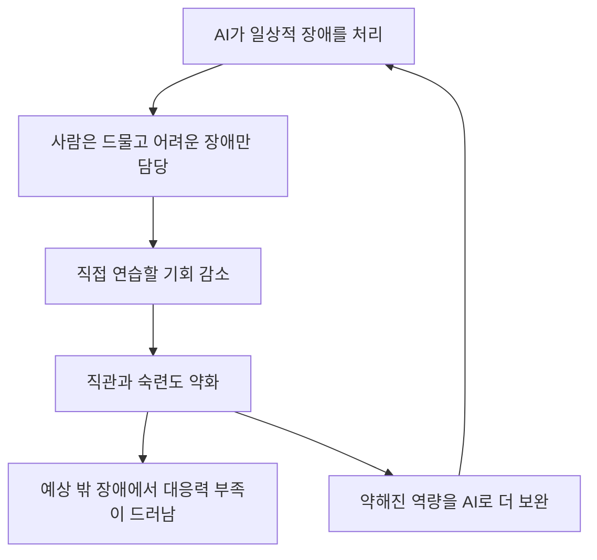
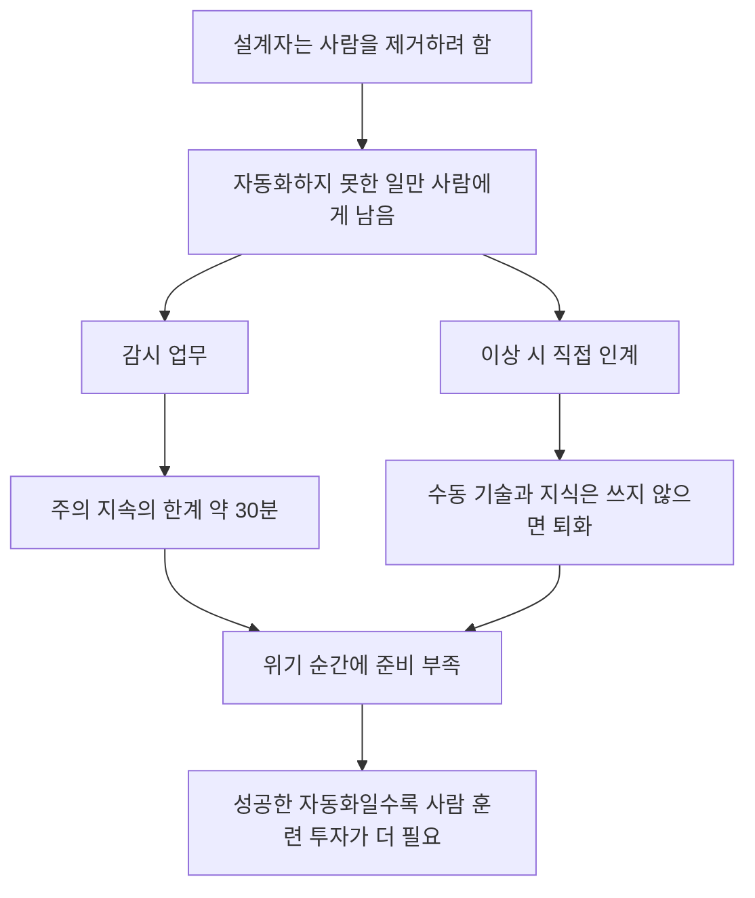
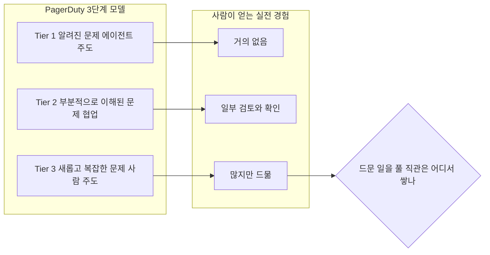
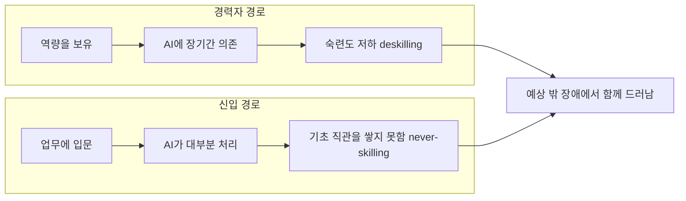
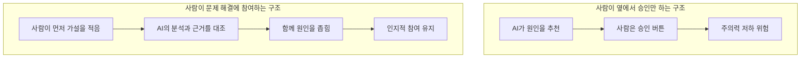
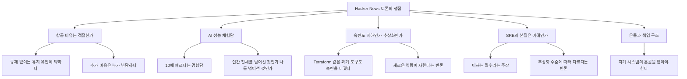
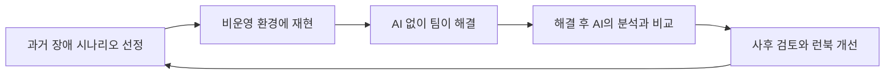
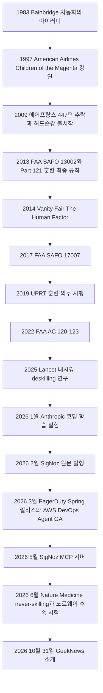

## 자동화의 역설로 읽는 상세 해설

- 작성 일자: 2026-11-01
- 대상 자료: (1) GeekNews 소개글 [「AI는 SRE를 대체하는 게 아니라 숙련도를 떨어뜨리고 있음」](https://news.hada.io/topic?id=36299) (2) SigNoz 뉴스레터 원문 [「AI Isn't Replacing SREs. It's Deskilling Them.」](https://newsletter.signoz.io/p/ai-isnt-replacing-sres-its-deskilling) (3) GeekNews에 함께 실린 Hacker News 토론 요약
- 검증 방식: 2026-11-01에 두 페이지를 직접 열람했고, 글이 인용한 논문·규정·사건·제품 동향을 일차 자료 또는 신뢰할 만한 2차 보도로 다시 대조했습니다. 확인하지 못한 부분은 본문과 14장에 따로 밝혀 두었습니다.

---

## 0. 이 문서를 읽는 방법

이 문서는 세 자료가 말하는 내용을 처음 접하는 사람도 따라올 수 있도록 풀어 쓴 해설입니다. 단순 요약에 그치지 않고, 원문이 인용한 근거를 하나씩 확인하면서 "어디까지가 확인된 사실이고 어디부터가 주장이나 해석인지"를 구분하는 데 비중을 두었습니다. 이렇게 한 이유는 이 주제가 설득력 있는 비유와 인상적인 숫자가 많아서, 확인 없이 읽으면 실제보다 더 단단한 결론처럼 느껴지기 쉽기 때문입니다.

본문에서 근거의 성격은 다음 다섯 가지 표현으로 구분합니다.

| 표기 | 의미 |
|---|---|
| 확인됨 | 논문 원문, 정부·규제기관 문서, 기업 공식 페이지 등 일차 자료를 직접 열어 확인한 내용 |
| 2차 확인 | 일차 자료를 직접 열지는 못했지만, 신뢰할 만한 보도나 학술 사이트의 요약으로 확인한 내용 |
| 업체 주장 | 해당 제품을 파는 회사가 스스로 한 말이어서 독립적으로 검증되지 않은 내용 |
| 커뮤니티 보고 | Hacker News나 댓글 작성자의 개인 경험담이어서 사실 여부를 확인할 수 없는 내용 |
| 해설 의견 | 이 문서 작성자의 해석이나 제안이며, 출처가 있는 사실이 아닌 내용 |

한 가지 밝혀 둘 점이 있습니다. 이 문서를 작성한 AI(Claude)는 Anthropic이 만든 모델이고, 6.4절에서 다루는 코딩 숙련도 실험은 Anthropic 연구진이 수행한 것입니다. 해당 연구를 소개할 때 이 점을 감안해서 읽어 주시기 바랍니다.

---

## 1. 먼저 용어부터

원문은 업계 용어가 많이 나옵니다. Hacker News 댓글에도 "SRE가 무슨 뜻인지 본문이 한 번도 풀어 주지 않았다"는 불만이 있을 정도입니다. 아래 표를 먼저 보면 이후 내용이 훨씬 쉬워집니다.

| 용어 | 쉬운 설명 |
|---|---|
| SRE (Site Reliability Engineering, 사이트 신뢰성 엔지니어링) | 서비스가 멈추지 않고 안정적으로 돌아가도록 만들고 지키는 엔지니어링 직무입니다. 소프트웨어 개발 방식으로 운영 문제를 해결한다는 점이 특징입니다. |
| 인시던트(incident), 장애 | 서비스가 느려지거나 멈추는 등 사용자에게 영향을 주거나 줄 수 있는 문제 상황입니다. |
| 온콜(on-call) | 정해진 기간 동안 장애 알림을 받고 즉시 대응할 수 있도록 대기하는 당번 근무입니다. 밤중에 호출을 받는 일도 여기에 포함됩니다. |
| 런북(runbook) | "이런 장애가 나면 이렇게 조치하라"를 적어 둔 절차서입니다. |
| 트리아지(triage) | 응급실의 환자 분류처럼, 들어온 알림이 진짜 문제인지, 얼마나 급한지 먼저 가려내는 초기 분류 작업입니다. |
| 근본 원인 분석(RCA) | 겉으로 드러난 증상이 아니라 문제가 생긴 진짜 이유를 찾아내는 일입니다. |
| 관측 가능성(observability) | 시스템 내부 상태를 메트릭(수치), 로그(기록), 트레이스(요청 경로 추적)로 들여다볼 수 있는 능력입니다. |
| MTTR | 장애가 발생한 뒤 복구되기까지 걸리는 평균 시간입니다. |
| 에이전트(agent) | 질문에 답하는 데 그치지 않고, 도구를 호출해 조사하고 조치까지 수행하는 AI입니다. |
| 휴먼 인 더 루프(human-in-the-loop) | 사람이 AI의 작업 흐름 안에 들어가 판단과 승인에 관여하는 구조입니다. |
| 숙련도 저하(deskilling) | 한때 갖고 있던 능력을 쓰지 않아서 잃는 현상입니다. |
| 역량 형성 실패(never-skilling) | 능력을 잃는 것이 아니라, 처음부터 쌓지 못하는 현상입니다. |

---

## 2. 세 자료는 어떤 관계인가

세 자료는 서로 다른 시점과 성격을 갖습니다. 이 점을 먼저 정리해 두는 것이 중요한데, 한국어 소개글은 AI가 번역·요약한 것이므로 원문의 뉘앙스나 오류가 그대로 옮겨졌을 수 있고, 반대로 요약 과정에서 단정적인 문장이 생겼을 수도 있기 때문입니다.

| 자료 | 성격 | 게시 시점 | 유의점 |
|---|---|---|---|
| SigNoz 뉴스레터 원문 | 오픈소스 관측 가능성 플랫폼 회사 SigNoz가 발행하는 뉴스레터 글입니다. 저자는 Elizabeth입니다. | Substack 표기 2026-02-28 (같은 글의 블로그 판은 2026-02-27 갱신으로 표기, Substack 쪽 수정 기록은 2026-03-02) | 제품 철학을 소개하는 업체의 글이며, 말미에 창업자가 링크드인에 올린 글이 집필 계기였다고 밝힙니다. |
| GeekNews 소개글 | GeekNews의 GN⁺ 코너가 원문을 한국어로 요약한 글입니다. | 2026-10-31 02:38 (KST) | 사이트가 GN⁺를 AI 번역·요약 코너로 안내합니다. 원문에 없는 표현이 요약 과정에서 생길 수 있습니다. |
| Hacker News 토론 | GeekNews 댓글란에 「Hacker News 의견들」로 요약되어 있습니다. | 소개글과 같은 시기 | 해당 요약이 가리키는 HN 원 토론 페이지(item 50305693)는 이번 조사에서 직접 열람하지 못했습니다. 따라서 11장은 GeekNews의 요약본에 의존합니다. |

원문이 쓰인 시점과 한국어 소개글이 올라온 시점 사이에는 약 8개월의 간격이 있습니다. 그동안 AI SRE 제품 시장이 크게 움직였기 때문에, 5장에서 2026년 11월 기준의 최신 동향을 따로 정리했습니다.

---

## 3. 한 문장 요약과 논지의 구조

**한 문장 요약**: AI가 일상적인 장애 대응을 대부분 맡아 주면 사람 SRE는 드물고 어려운 장애만 만나게 되는데, 바로 그 어려운 장애를 풀 직관은 평소의 반복 경험에서 나오므로, 자동화가 진전될수록 사람의 대응 능력은 오히려 약해질 수 있다는 주장입니다.

원문이 던지는 질문은 이렇습니다. AI가 장애 대응의 95%를 처리한다면, 사람은 정말 중요한 나머지 5%를 다룰 능력을 잃게 되는가. 여기서 짚어 둘 점은 95%라는 숫자가 측정값이 아니라는 것입니다. GeekNews 요약은 이를 "문제를 살펴보기 위한 가정"이라고 명시하고, 원문 본문도 이 비율을 조건문으로만 제시할 뿐 어떤 통계도 제시하지 않습니다. 즉 이 글은 "이미 이런 일이 벌어졌다"는 보고가 아니라 "이런 방향으로 가면 이런 문제가 생길 수 있다"는 논증입니다.

논지는 다음 순서로 전개됩니다. 먼저 1983년 Bainbridge의 논문에서 "자동화의 역설"이라는 이론적 뼈대를 빌려옵니다. 다음으로 SRE 자동화가 어디까지 왔는지 현황을 정리하고, 의료와 항공에서 나온 숙련도 저하 사례를 증거로 듭니다. 그 뒤 SRE에서 사라지는 연습 세 가지를 짚고, 신입이 기초를 쌓지 못하는 역량 형성 실패 문제를 덧붙입니다. 마지막으로 의도적인 비효율과 사람이 문제 해결에 직접 참여하는 설계를 처방으로 내놓습니다.

위 도식에서 눈여겨볼 부분은 A6에서 A1로 돌아가는 고리입니다. 원문은 이를 악순환이라고 부르며, 숙련도가 떨어진 SRE가 그 불안을 AI에 더 의존해서 달래고, 그 의존이 다시 숙련도를 깎는다고 설명합니다.

---

## 4. 이야기의 뿌리: 1983년 Bainbridge의 「자동화의 아이러니」

### 4.1 어떤 논문인가

원문이 기대는 이론은 Lisanne Bainbridge가 쓴 「Ironies of Automation」입니다. 확인됨: 이 글은 학술지 Automatica 19권 6호 775~779쪽에 실린 5쪽짜리 단신(Brief Paper)이며, 저자의 소속은 런던 유니버시티 칼리지(UCL) 심리학과입니다. 1982년 9월 서독 바덴바덴에서 열린 인간-기계 시스템 관련 국제 학술대회(IFAC/IFIP/IFORS/IEA)에서 발표한 원고를 고쳐 실었습니다.

원문은 이 논문이 공장과 산업 시스템을 다뤘다고 소개하는데, 실제로 논문은 공정 산업(process industries)의 제어를 중심으로 하되 항공기 조종실 자동화의 사례도 함께 든다고 스스로 밝힙니다. 따라서 "공장 이야기"라는 요약은 대체로 맞지만, 항공 사례가 처음부터 논의에 들어 있었다는 점은 알아 두면 좋습니다. 또한 원문은 이 논문이 인간 요소 연구에서 가장 많이 인용된 논문 중 하나라고 하지만, 인용 횟수는 이번에 확인하지 못했습니다. 위키백과는 이 논문을 자동화의 본질적 문제를 선구적으로 짚은 글로 평가한다고 설명합니다.

### 4.2 논문의 핵심 논리

Bainbridge는 서론에서 "고전적 자동화"의 아이러니를 두 가지로 정리합니다. 첫째는 설계자 역시 사람이라는 점입니다. 사람을 믿을 수 없는 존재로 보고 시스템에서 빼려는 설계자의 오류가 운영 문제의 큰 원인이 될 수 있다는 지적입니다. 둘째는 설계자가 사람을 없애려 해도, 결국 자동화하는 방법을 떠올리지 못한 일은 사람에게 남는다는 점입니다. 그래서 사람은 "설계자가 자동화하지 못한 일의 잡동사니"를 떠안게 되고, 그 일을 뒷받침할 지원은 거의 고려되지 않습니다.

이렇게 남는 일은 크게 두 가지입니다. 하나는 자동 시스템이 제대로 돌아가는지 감시하는 일이고, 다른 하나는 이상이 생기면 선임을 부르거나 직접 인계받아 처리하는 일입니다. 논문은 인계 쪽부터 이야기하는데, 이 대목이 SRE와 가장 직접적으로 맞닿습니다.

**수동 조작 기술은 쓰지 않으면 퇴화합니다.** 논문은 숙련된 운전원과 미숙한 운전원이 공정을 조정할 때 차이가 난다는 연구를 소개합니다. 숙련자는 최소한의 조작으로 부드럽게 목표에 도달하지만 미숙자는 목표값 주위에서 출렁거립니다. 그런데 신체적 기량, 특히 세밀한 타이밍과 강도 조절은 쓰지 않으면 퇴화합니다. 그래서 자동 공정을 감시만 하던 과거의 숙련자가 막상 인계받는 순간에는 미숙자나 마찬가지가 될 수 있다는 것입니다. 게다가 인계가 필요한 상황은 대개 공정에 뭔가 문제가 생긴 경우라서, 평소보다 더 숙련되어야 하고 더 여유로워야 하는 때입니다.

**인지적 능력도 마찬가지입니다.** 논문은 두 가지 요소를 나눕니다. 첫째는 장기 지식입니다. 공정이 어떻게 움직이는지에 대한 지식은 자주 쓸수록 잘 꺼내 쓸 수 있고, 실제로 써 보며 결과를 피드백받는 과정에서만 쌓입니다. 교실에서 이론만 배운 사람은 그 지식이 맥락에 얹히지 않아 오래 기억하지 못합니다. 논문은 현재의 자동화 시스템이 과거에 수동으로 운전하던 사람들이 쌓은 기량에 "얹혀" 돌아가고 있으며, 다음 세대 운전원에게는 그런 기량을 기대하기 어렵다는 우려까지 적어 두었습니다. 이는 원문이 말하는 역량 형성 실패와 정확히 같은 문제의식입니다. 둘째는 작업 기억(working storage)입니다. 지금 공정이 어떤 상태인지에 대한 감각은 계속 만지고 있어야 유지됩니다. 논문은 수동 운전원이 교대 시간보다 15분에서 30분 일찍 관제실에 나와 상태를 파악한다는 예를 듭니다. 자동 운전을 지켜보다가 갑자기 인계받는 사람에게는 그런 감각이 없습니다.

**감시 업무는 생각보다 어렵습니다.** 아무 일도 일어나지 않는 화면을 계속 보면서 드문 이상을 알아채는 일은, 의욕이 높은 사람이라도 약 30분 이상 효과적으로 지속하기 어렵다고 논문은 지적합니다. 이는 1950년의 주의 지속(vigilance) 연구에 근거합니다. 여기서 아이러니가 하나 더 생깁니다. 자동 시스템이 사람보다 더 잘하니까 도입했는데, 그 자동 시스템이 제대로 하는지를 사람이 확인하라고 하면 사람은 실시간으로 검증할 방법이 없습니다. 컴퓨터가 더 많은 변수를 더 빠르게 고려해 내린 결정을, 사람은 결국 "받아들일 만한가"라는 상위 수준에서만 평가할 수밖에 없고, 논문은 이를 사람에게 불가능한 임무가 주어진 것으로 표현합니다.

**조언을 따르기만 하면 연습이 사라집니다.** 논문은 컴퓨터가 운전원에게 조언을 주는 방식도 다룹니다. 조언을 받아 따르는 운전원은 스스로 행동 순서를 만들어 낼 때보다 반응이 느리고 덜 통합적이며, "지능적으로 판단하는 연습"을 하지 못한다고 지적합니다. 이것은 AI가 근본 원인을 추천하고 사람이 승인하는 구조를 떠올리게 합니다.

### 4.3 논문이 제안한 해법

논문은 문제만 지적한 것이 아니라 해법도 제시합니다. 이 부분은 SigNoz가 내놓은 처방의 선례이기도 해서 중요합니다.

첫째, 기량 유지를 위해 교대 때마다 운전원이 짧은 시간 직접 조작해 보게 하는 방법을 제안합니다. 논문 스스로 "이 제안이 우스꽝스럽게 들린다면 시뮬레이터 훈련을 제공해야 한다"고 덧붙입니다. 둘째, 빠르고 정확한 반응이 필요하다면 충실도 높은 시뮬레이터가 필수라고 봅니다. 셋째, 미지의 고장은 시뮬레이션할 수 없으므로 특정 대응 절차보다 일반적 문제 해결 전략을 훈련해야 한다고 말합니다. 절차서만 따르도록 훈련시켜 놓고 시스템 안에서 지능을 발휘하라고 요구하는 것 자체가 아이러니라는 지적도 있습니다. 마지막으로 논문은 이런 말을 남깁니다. 가장 성공적으로 자동화되어 수동 개입이 거의 필요 없는 시스템일수록 오히려 운전원 훈련에 가장 큰 투자가 필요할지 모른다는 것입니다.

### 4.4 Bainbridge의 개념을 SRE에 옮겨 보면 (해설 의견)

아래 표는 논문의 개념을 오늘날의 SRE 업무에 대응시킨 이 문서의 해석입니다. 논문이 AI나 소프트웨어 운영을 다룬 것은 아니므로, 표의 오른쪽 열은 유추라는 점을 분명히 해 둡니다.

| Bainbridge의 개념 | SRE 현장에서 대응될 수 있는 모습 |
|---|---|
| 자동화하지 못한 일이 사람에게 남는다 | 알려진 장애는 자동 복구되고, 새롭고 복잡한 장애만 사람에게 온다 |
| 수동 조작 기술의 퇴화 | 원시 로그를 읽고 쿼리를 직접 짜는 감각이 무뎌진다 |
| 장기 지식은 사용 빈도와 피드백으로만 쌓인다 | 장애를 직접 풀어 본 경험 없이는 시스템 구조에 대한 직관이 형성되지 않는다 |
| 작업 기억(현재 상태 감각)이 유지되지 않는다 | AI가 정리해 준 요약만 보면 지금 시스템에 무슨 일이 일어나는지 몸으로 알지 못한다 |
| 감시 업무는 30분 이상 효과적으로 지속하기 어렵다 | 거의 틀리지 않는 AI의 추천을 끝없이 승인하는 일은 주의력을 갉아먹는다 |
| 컴퓨터의 결정을 실시간으로 검증할 수 없다 | AI가 제시한 원인 분석을 사람이 같은 속도로 재검증하기 어렵다 |
| 조언을 따르면 판단 연습이 없다 | AI 추천을 승인만 하면 스스로 가설을 세우는 연습이 사라진다 |

---

## 5. 지금 SRE 자동화는 어디까지 왔나 (2026년 11월 기준)

### 5.1 원문이 그리는 현황

원문은 현재 이미 상당 부분 자동화된 일로 알림 잡음 줄이기와 알림 묶기, 알려진 문제의 런북 실행, 로그 패턴 탐지와 이상 징후 표시, 과거 장애 데이터에 기반한 기본 원인 추천, 그리고 죽은 파드를 다시 띄우거나 과부하 서비스를 늘리는 식의 잘 이해된 장애의 자동 복구를 꼽습니다. 가까운 목표로는 메트릭·로그·트레이스를 가로지르는 상관 분석, 부분적으로만 이해된 장애의 자율적 근본 원인 분석, 사용자 영향 전에 장애를 예측하는 일, 변경 위험 평가와 자동 롤백을 듭니다.

### 5.2 PagerDuty의 3단계 모델: 확인됨, 다만 표현 차이가 있습니다

원문은 PagerDuty가 장애를 세 단계로 나눈다고 소개합니다. 확인됨: PagerDuty 공식 블로그에 이 3단계 구분이 실제로 있습니다. 2025년에 게시된 두 글에서 Tier 1은 잘 이해된 문제로 거의 전적으로 AI와 자동화가 처리하고, Tier 2는 부분적으로 이해된 문제, Tier 3은 새롭고 복잡한 문제로 대응자가 주도하고 AI와 자동화가 보조하는 것으로 정리되어 있습니다. 2026년 9월 22일자 PagerDuty 글에서도 AI의 관여 정도를 세 수준으로 나누고, 새로운 유형의 장애는 사람이 주도하고 AI가 소음 줄이기, 초기 분류, 맥락 수집을 돕는다고 설명합니다.

다만 Tier 2의 표현은 약간 다릅니다. 원문(SigNoz)은 "AI가 해결책을 추천하고 사람이 검증"한다고 요약했는데, PagerDuty의 제목 줄은 이 단계를 "AI·자동화 주도 + 대응자 보조"로 적고 있습니다. 즉 PagerDuty 쪽 표현이 자동화에 조금 더 무게를 둡니다. 이 차이가 원문의 논지를 뒤집지는 않지만, "사람이 Tier 3에만 참여한다"는 원문의 전제는 PagerDuty의 설명이 아니라 SigNoz가 끌어낸 추론입니다. PagerDuty의 같은 블로그 글들은 오히려 사람이 루프 안에서 결정을 내린다고 강조하고, 문제가 새롭거나 중대하거나 부분적으로만 이해된 경우에는 사람이 여전히 필수라고 적고 있습니다.

### 5.3 원문 이후의 동향 (확인됨)

원문이 나온 2026년 2월 말 이후 시장은 빠르게 움직였습니다. 아래는 이번 조사에서 일차 자료로 확인한 내용입니다.

| 시점 | 동향 | 근거 성격 |
|---|---|---|
| 2026-03-12 | PagerDuty가 Spring 2026 릴리스를 발표했습니다. SRE 에이전트를 당번표와 에스컬레이션 정책에 넣어 가상 대응자로 쓰는 기능은 2026년 2분기 얼리 액세스로, 사람 개입 없이 대응하는 "완전 자율 대응자"는 2026년 하반기 얼리 액세스로 예고되었습니다. | 확인됨 (회사 보도자료) |
| 2026-03-31 | AWS DevOps Agent가 정식 출시(GA)되었습니다. 장애를 해결하고 예방하며 주문형 SRE 작업을 처리하는 "상시 가동 운영 동료"로 소개됩니다. AWS가 소개한 사례에서 한 고객 SRE 팀은 장애 조사 시간이 추정 2시간에서 28분으로 줄었다고 합니다. | 확인됨 (AWS 공지). 단축 수치는 업체 주장 |
| 2026-05-01 | SigNoz가 자사 MCP 서버를 출시했습니다. Cursor, Claude 같은 AI 도구가 SigNoz의 로그·메트릭·트레이스를 자연어로 조회할 수 있게 하는 기능입니다. | 확인됨 (SigNoz 변경 기록) |
| 2026-10-07 | PagerDuty가 AI 기반 장애 커뮤니케이션 기능을 단계적 정식 출시(rolling GA)한다고 밝혔습니다. 장애 회의의 음성과 채팅을 기록하는 에이전트가 SRE 에이전트의 조율 아래 동작합니다. | 확인됨 (회사 블로그) |

여기서 한 가지를 분명히 해 두겠습니다. 위 자료들은 AI가 장애의 몇 퍼센트를 처리하는지에 대한 독립적인 통계를 제공하지 않습니다. 제품 문서와 사례는 대부분 업체가 직접 공개한 수치입니다. 그래서 "AI가 95%를 처리한다"는 원문의 전제는 2026년 11월에도 여전히 가정이며, 어떤 조직에서 실제로 그 수준에 이르렀는지는 이번 조사에서 확인되지 않았습니다. 다만 업계 방향이 자율성 확대 쪽이라는 점은 위 일정으로 분명히 확인됩니다.

---

## 6. 숙련도 저하의 증거들

원문은 의료와 항공에서 숙련도 저하의 증거를 가져옵니다. 이 장에서는 각각을 원 자료에 비추어 검토하고, 원문이 빠뜨렸거나 부정확하게 옮긴 부분을 짚습니다.

### 6.1 의료: 내시경 연구

**원문의 주장**: AI로 용종 탐지를 보조받던 내시경 의사들이 AI 없이 검사할 때의 탐지율이 28%에서 22%로 떨어졌다.

**확인된 사실**: 이 수치는 실제 논문과 일치합니다. 연구는 Budzyń 등이 2025년 The Lancet Gastroenterology & Hepatology 10권 10호 896~903쪽에 발표한 「Endoscopist deskilling risk after exposure to artificial intelligence in colonoscopy」입니다. 폴란드의 내시경 센터 4곳에서, 2021년 말 AI 용종 탐지 도구가 도입된 뒤 검사를 날짜에 따라 AI 사용과 비사용으로 나눠 진행하던 ACCEPT 시험 환경을 활용한 후향적 관찰 연구입니다.

정확한 내용을 풀어 보면 이렇습니다. 연구진은 AI 도입 전 3개월과 도입 후 3개월 동안 AI를 쓰지 않고 시행한 대장내시경을 비교했습니다. 대상은 2000건 넘는 경험을 가진 숙련 내시경 의사 19명이 AI 없이 수행한 검사 1,443건(도입 전 795건, 도입 후 648건)입니다. 선종 발견율(adenoma detection rate, ADR)은 도입 전 28.4%(226/795)에서 도입 후 22.4%(145/648)로, 절대 6.0%포인트(95% 신뢰구간 −10.5~−1.6, p=0.0089), 상대로는 약 20% 낮아졌습니다. 같은 기간 AI를 쓴 검사의 ADR은 25.3%(186/734)였고, 모든 센터에서 하락했지만 폭은 센터마다 크게 달랐습니다. 반면 선종이 하나라도 발견된 환자에서 검사당 선종 수는 1.91 대 1.92로 변하지 않았습니다. 저자들은 결론을 "AI에 지속적으로 노출되면 AI 없는 검사의 ADR이 낮아질 수 있으며, 이는 내시경 의사의 행동에 부정적 영향을 시사한다"는 조심스러운 표현으로 제시했습니다.

**원문이 단순화한 부분**: 먼저 지표 이름입니다. 원문과 소개글의 "용종 탐지율"은 정확히는 선종 발견율(ADR)입니다. 선종은 대장암으로 이어질 수 있는 전암성 병변이며, ADR은 대장내시경 품질을 가늠하는 대표 지표입니다. 다음으로 연구 설계입니다. 후향적 관찰 연구여서 전후 비교에 다른 요인이 섞였을 가능성을 배제하기 어렵고, 공저자인 Yuichi Mori 교수 자신도 더 많은 연구가 필요하다는 취지로 말했습니다.

**원문이 언급하지 않은 후속 근거**: 이후 상반되거나 보완적인 결과가 나왔습니다. 노르웨이 3개 외래 클리닉에서 2021년 11월부터 2025년 6월까지 진행된 전향적 다기관 시험(Pedersen 등, Endoscopy, 2026-06-03 게재)은 평가 지표가 달라서(5mm 이상 용종 발견 비율) 직접 비교는 어렵지만, 숙련 내시경 의사들에서 AI 노출 뒤 AI 없는 검사의 성적이 오르지도 내리지도 않았다고 보고했습니다. 경험이 적은 의사들은 AI를 쓸 때 발견율이 올랐습니다. 또 일본에서 진행된 전향적 관찰 연구(Okumura 등, Endoscopy 2025)에 대한 논평은, 평소 탐지율이 높은 의사들은 AI 노출 이후 AI 없는 검사에서도 성적이 유지·향상되었고 낮은 의사들은 뚜렷한 향상이 없었다고 요약합니다. 정리하면 "AI가 숙련도를 깎는다"는 가설을 지지하는 연구도, 뒷받침하지 않는 연구도 있습니다. 이 영역은 아직 결론이 나지 않았다고 보는 편이 정확합니다.

### 6.2 항공: 원문의 표현을 정정해야 하는 부분

**원문의 주장**: 자동조종에 의존하는 장거리 조종사들의 상황 인식과 수동 비행 능력이 저하되었고, FAA가 이를 상쇄하기 위해 더 많은 수동 비행 시간을 의무화했다. (Hacker News 첫 댓글도 같은 전제 위에서 "FAA의 의무 규정은 모든 사업자에게 똑같이 적용된다"고 말합니다.)

**정정이 필요한 부분**: 이번 조사에서 FAA 문서를 직접 확인한 결과, "수동 비행 시간의 의무화"라는 표현은 정확하지 않습니다. 실제 문서의 성격은 이렇습니다.

- **SAFO 13002 (2013-01-04)**: FAA 안전 경고(SAFO)의 목적을 "운영자가 적절할 때 수동 비행 운용을 장려하도록 권장"하는 것이라고 명시합니다. 최근 운항 데이터 분석에서 수동 조종 오류가 늘었다는 점이 배경입니다. SAFO는 FAA가 안전 정보와 권고 조치를 담아 보내는 문서이며 규정이 아닙니다.
- **SAFO 17007 (2017-05-04)**: 수동 비행 숙련도를 키우고 유지할 훈련 정책과 노선 운항 정책의 개발을 "권장"합니다. 눈여겨볼 대목이 하나 있습니다. 이 문서는 운항 정책에서 피해야 할 것으로 "과학적 근거가 없는 수동 비행 할당량"을 꼽고, 예로 "월 10시간 이상 수동 비행"을 듭니다. 기장이 여러 요인을 보고 사안별로 판단하도록 두라는 취지입니다.
- **AC 120-123 (2022-11-21)**: 비행경로 관리(Flightpath Management)에 관한 자문 통보문(AC)으로, 수동 비행 운용, 자동 시스템 관리, 감시 업무, 에너지 관리에 대한 지침과 권고 관행을 담습니다. 초안 단계의 업계 보도는 이 AC가 규범적이지 않다고 설명했고, FAA 문서 설명도 지침과 권고 관행이라는 표현을 씁니다.

**구속력이 있는 부분은 따로 있습니다.** 2013년 11월 12일 FAA가 확정한 최종 규칙 「Qualification, Service, and Use of Crewmembers and Aircraft Dispatchers」(14 CFR Part 121)는 항공사 조종사 훈련을 강화하면서 수동 조종 기량의 육성을 강조하고 실속 및 비정상 자세 회복 같은 과제를 추가했습니다. 이상 자세 예방·회복 훈련(UPRT)은 2019년 3월 12일부터 Part 121 항공사에 의무입니다. SAFO 17007과 ICAO 제출 문서는 이 훈련 요건에 수동 조종 과제 여섯 가지(수동 저속 비행, 속도 신뢰 상실 시 수동 조종, 수동 계기 출발·도착, 이상 자세 회복, 실속 예방·회복, 바운스 착륙 회복)가 추가되었다고 정리합니다.

종합하면 **FAA가 의무화한 것은 훈련 항목이고, 실제 운항 중에 수동으로 몇 시간 날라는 숫자 의무는 이번 조사에서 확인되지 않았으며, 운항 중 수동 비행 확대는 권고 수준**입니다. 이 차이는 의미가 있습니다. SRE에 "수동 연습 시간을 일정량 의무화하자"는 처방을 옮길 때, 항공의 선례가 시간 할당이 아니라 훈련 요건과 사안별 판단 쪽에 있다는 점을 알면 설계가 달라집니다.

**항공 쪽 우려 자체는 사실입니다.** 확인됨: 유럽항공안전청(EASA)은 2013년 안전 정보 회보(SIB 2013-05)에서 자동비행 시스템의 지속적 사용이 수동 조종 대응 능력의 저하로 이어질 수 있다고 지적하며 운영자에게 훈련과 노선 운항에서 수동 비행을 강조하도록 권했습니다. 미 교통부 감사관실(OIG)의 보고서는 2013년 아시아나 214편 사고를 포함한 여러 사고가 자동화에 익숙한 조종사가 예상 밖 상황이나 수동 전환에서 오류를 낼 수 있음을 보여 준다고 지적했고, FAA는 자동화 과의존에 대한 우려를 공유한다고 답했습니다. 원문이 링크한 2019년 Flight Safety Foundation 국제 항공안전 서밋(IASS) 발표 자료(Air France 비행안전 연구진 Behrend와 Lafargue의 이름이 붙은 파일)는 이번에 열어 보지 못했으므로, 그 안의 구체적 수치는 검증하지 못했습니다.

### 6.3 "나는 잘하고 있다"는 착시

원문은 "인지 연구에 따르면 AI 덕에 일이 쉬워지고 성과가 좋아질 때 사용자는 자신의 실제 역량을 정확히 판단하지 못한다"고 쓰면서 출처를 달지 않았습니다. 이번 조사에서 이 주장과 가장 가까운 연구를 찾았습니다. Fernandes 등의 「AI makes you smarter but none the wiser: The disconnect between performance and metacognition」(Computers in Human Behavior에 게재, 프리프린트는 2024년 9월 공개)입니다.

확인된 내용은 이렇습니다. 참가자들이 AI의 도움을 받아 LSAT 논리 추론 문제 20개를 풀었는데, 점수는 일반 집단보다 약 3점 높았지만 본인의 성적을 약 4점 과대평가했습니다. AI 활용 지식이 많을수록 자신의 성과를 더 부정확하게 판단했고, 평소 낮은 성과자일수록 자신을 과대평가한다는 더닝-크루거 효과가 AI를 쓸 때는 사라졌습니다. 두 번째 연구(N=452)에서도 결과가 재현되었습니다.

다만 범위를 정확히 해야 합니다. 이 연구가 보인 것은 "AI를 쓰는 동안 자기 성과를 과대평가한다"는 점이지, "AI를 쓴 뒤 실력이 감퇴했다"는 것이 아닙니다. 과제도 논리 추론 문제로 한정되어 있고, 첫 연구는 과거 집단과 비교했다는 한계가 있으며(두 번째 연구에서 보완), 연구 보도들도 장기적 인지 저하를 증명하지는 않는다고 선을 긋습니다. 따라서 원문의 "대시보드는 정상이고 자신은 유능하다고 느끼지만 사실은 약해졌을 수 있다"는 시나리오에 부분적 근거를 주지만, SRE 현장에서 그렇다는 직접 증거는 아닙니다.

### 6.4 소프트웨어 엔지니어링: Anthropic의 무작위 대조 실험

원문은 SRE 안에서의 실증 자료를 제시하지 않지만, 소프트웨어 학습 영역에는 관련 실험이 있습니다. 앞서 밝힌 대로 이 연구는 Claude를 만든 Anthropic의 연구진(Judy Hanwen Shen, Alex Tamkin)이 2026년 1월 29일 공개한 것입니다. 이번에는 원문 페이지가 아니라 여러 매체의 보도와 요약으로 확인했습니다(2차 확인).

실험 설계는 이렇습니다. 파이썬 경험이 있지만 Trio라는 비동기 프로그래밍 라이브러리는 처음 접하는 52명(대부분 주니어)이 코딩 과제 두 개를 수행했고, 절반은 AI 도우미를 썼습니다. 이후 AI 없이 디버깅, 코드 읽기, 개념 이해를 묻는 퀴즈를 풀었습니다. 결과는 AI 사용 집단이 평균 약 50%, 직접 코딩한 집단이 약 67%로, 거의 두 등급 차이였고(Cohen's d=0.738, p=0.01) 가장 큰 격차는 디버깅 문제에서 났습니다. 속도 면에서는 AI 집단이 평균적으로 통계적으로 의미 있게 빠르지 않았습니다. 사용 방식에 따라서도 갈렸는데, 개념을 물어보는 식으로 AI를 쓴 참가자는 65% 이상, 코드 생성을 통째로 맡긴 참가자는 40% 미만이었습니다.

이 결과는 역량 형성 실패(never-skilling) 가설에 힘을 보태는 실험 증거입니다. 그러나 한계도 분명합니다. 표본이 작고, 학습 직후의 이해도를 한 번 측정했을 뿐이며, 에이전트형 코딩 도구가 아니라 사이드바 형태의 도우미를 썼고, 새 라이브러리를 배우는 상황이라는 점에서 장애 대응과는 다른 과제입니다. 이 실험은 "처음 배우는 과정에서 AI에 통째로 맡기면 이해가 덜 쌓인다"는 점을 보여 줄 뿐, "장애 대응 숙련자가 AI를 쓰면 실력이 떨어진다"는 것을 보여 주지는 않습니다.

### 6.5 증거 강도 한눈에 보기

| 주장 | 증거 수준 | 한계 |
|---|---|---|
| 자동화가 운영자의 기량 유지에 문제를 일으킨다는 이론 | 이론·사례 연구가 풍부함 (Bainbridge 1983 이후 40여 년의 연구, 확인됨) | AI 시대의 SRE를 직접 대상으로 한 연구가 아님 |
| 항공에서 자동화 의존이 수동 조종 능력에 우려를 낳는다 | 규제기관 문서·감사 보고서로 우려 확인됨 | "의무화" 같은 표현은 부정확하고, 정량 효과는 이번에 확인 못함 |
| 내시경에서 AI 노출 후 AI 없는 성적이 떨어졌다 | 한 건의 후향적 관찰 연구 (확인됨) | 후속 연구 결과는 엇갈림 |
| AI를 쓰면 자기 성과를 과대평가한다 | 두 차례 실험으로 재현 (확인됨) | 논리 추론 과제 한정, 기량 감퇴를 보인 것은 아님 |
| 학습 단계에서 AI에 위임하면 이해가 덜 쌓인다 | 무작위 대조 실험 1건 (2차 확인) | 표본 52명, 즉시 측정, 장애 대응과 다른 과제 |
| SRE가 AI 때문에 숙련도를 잃고 있다 | 직접 근거 없음 | 현재로서는 유추와 가설 |

마지막 줄이 이 문서에서 가장 중요한 판정입니다. 원문 제목은 "AI는 SRE를 숙련도 저하시키고 있다"고 단정하는 형태이지만, 이번 조사에서 SRE 직군에서 그것을 직접 보인 연구는 확인되지 않았습니다.

---

## 7. SRE 현장에서 사라지는 세 가지 연습

원문이 구체적으로 짚는 세 가지를 쉬운 말로 풀어 보겠습니다. 이는 원문이 든 항목이고, 아래의 설명은 이해를 돕기 위한 해설입니다.

**첫째, 원시 로그를 읽는 연습.** 장애가 나면 수많은 로그 줄이 쏟아집니다. 숙련된 SRE는 그 흐름을 눈으로 훑으며 "이 시각부터 타임아웃이 늘었다", "이 서비스만 재시도가 폭증한다" 같은 패턴을 몸으로 익혀 둡니다. AI가 로그를 요약해 주면 속도는 빨라지지만, 요약에서 빠진 정보를 놓치고 있는지 알아챌 기회도 함께 사라집니다. 비유하자면 길 안내 앱만 따라가던 사람은 도착은 잘하지만 동네 지도가 머릿속에 그려지지 않는 것과 같습니다. (이 비유는 이해를 돕기 위한 것입니다.)

**둘째, 원인 가설을 스스로 세우는 연습.** 장애 대응의 본질은 "아마 이것이 원인일 것이다"라는 가설을 세우고, 증거로 시험하고, 틀리면 버리고 다시 세우는 반복입니다. AI가 근본 원인을 추천해 주면 이 반복 과정이 빠집니다. Bainbridge가 지적한 대로, 조언을 따르기만 하는 사람은 스스로 판단하는 연습을 하지 못합니다.

**셋째, 시스템 구조의 머릿속 지도를 그리는 연습.** 어떤 서비스가 어떤 서비스에 의존하는지, 데이터가 어디를 거쳐 가는지를 직접 추적해 본 사람의 머릿속에는 지도가 생깁니다. AI가 의존성 지도를 그려 주면 편리하지만, 그 지도를 스스로 그린 사람과 받아 본 사람의 이해 깊이는 다를 수 있습니다. Bainbridge는 정보가 너무 잘 정리되어 제공되면 운전원이 공정 구조를 이해하기 위해 따로 생각하지 않게 될 수 있다고 우려했는데, 같은 맥락입니다.

예를 하나 들어 보겠습니다. 이것은 설명을 위한 가상의 시나리오입니다. 어느 날 결제 서비스의 응답이 느려지고, AI는 평소처럼 "데이터베이스 연결 풀 고갈로 보임"이라고 추천합니다. 지난 석 달간 비슷한 장애를 같은 원인으로 처리해 온 터라 사람은 승인을 누릅니다. 그런데 이번 장애는 새로 배포된 라이브러리가 만든 드문 교착 상태가 원인이었습니다. 과거에 로그를 직접 읽고 가설을 세워 본 사람이라면 "연결 풀이 찼다기엔 CPU 사용률이 이상하게 낮다"는 위화감을 느꼈을 수 있습니다. 그 위화감은 AI 요약을 받아 승인만 하던 사람에게는 생기기 어렵습니다. 이 시나리오가 실제로 일어난다는 근거는 없고, 원문이 말하는 위험이 어떤 모양일 수 있는지를 보여 주기 위한 것입니다.

---

## 8. 역량 형성 실패(never-skilling)와 악순환

### 8.1 개념과 출처

원문은 "연구자들이 never-skilling이라 부르기 시작했다"고 말합니다. 확인됨: 이 용어는 의료 교육 문헌에서 널리 쓰입니다. 2026년 Nature Medicine에 실린 관점 논문 「AI-induced never-skilling in medical education」(Ke 등)이 대표적이며, 숙련된 임상의의 숙련도 저하(deskilling)와 구분되는 현상, 그리고 훈련생이 AI의 오류를 사실로 받아들이는 mis-skilling과도 구분되는 현상으로 정의합니다. 호주 매체 Medical Republic은 이 논문이 6월에 게재되었다고 보도하며, 2차 소개 자료들은 세 위험(deskilling, never-skilling, mis-skilling)을 함께 이름 붙인 틀이 2025년 NEJM에서 먼저 제시되었다고 설명합니다(2차 확인).

### 8.2 증거의 현재 상태

여기서 주의할 점이 있습니다. 해당 논문의 초록 자체가 이를 "추가적인 경험적 연구가 필요한 교육학 연구 의제"라고 규정합니다. 가디언 기고를 소개한 매체는 이 틀이 의료 수련 과정에서의 직접 증거 없이 학습 이론과 비의료 분야 연구에 근거한다는 점을 논문이 스스로 인정한다고 전합니다(2차 확인). 앞서 본 Anthropic의 코딩 실험이 그런 비의료 분야의 증거 중 하나입니다. 즉 never-skilling은 설득력 있는 가설이자 연구 의제이지, 이미 입증된 현상이라고 하기는 이릅니다. 원문이 SRE 신입에게 이를 그대로 적용한 것도 같은 층위의 유추입니다.

### 8.3 SRE에서의 의미

그럼에도 이 개념이 SRE에게 던지는 질문은 날카롭습니다. 과거의 SRE는 알려진 장애를 수없이 풀면서 자연스럽게 감각을 쌓았습니다. AI가 알려진 장애를 모두 가져가면 신입이 거쳐 가던 "쉬운 장애로 배우는 단계"가 통째로 사라집니다. 이는 Bainbridge가 지적한 "현재의 자동화 시스템은 과거 수동 운전원들의 기량에 얹혀 있다"는 우려의 현대판입니다. 또 의료 교육 문헌은 이런 학습이 비효율에서 오는 이점, 즉 막히고 실수하는 과정에서 개념이 자리 잡는 효과를 강조하는데, Anthropic 실험도 오류를 겪는 과정이 학습에 중요하다는 해석을 내놓습니다.

원문이 말하는 "훈련 파이프라인이 망가지고 스스로 복구되지 않는다"는 표현은 이 도식의 오른쪽 경로를 가리킵니다. 경력자의 숙련도는 의식적으로 연습하면 되돌릴 수 있지만, 신입이 한 번 지나친 학습 시기는 조직이 의도적으로 설계해 주지 않으면 다시 오지 않는다는 것이 핵심입니다. 이 해석은 원문의 취지를 풀어 쓴 것입니다.

---

## 9. 처방: 거부가 아니라 설계

원문은 AI 도구를 거부하자고 하지 않습니다. 오히려 더 깊이 도입하되 숙련도를 유지하는 방법을 찾자고 합니다. 처방은 두 가지입니다.

### 9.1 의도적인 비효율

조종사가 자동조종으로 충분히 날 수 있어도 수동 비행을 연습하듯, SRE 팀도 AI가 풀 수 있는 장애 일부를 사람의 연습 기회로 지정하자는 제안입니다. 해결 속도의 일부를 포기하는 대신 장기적인 역량 유지에 투자하는 셈입니다.

이 처방은 선례가 꽤 풍부합니다. 첫째, Bainbridge 본인이 교대마다 직접 조작하는 시간을 두거나 시뮬레이터를 쓰자고 제안했습니다. 둘째, Google이 SRE 신입에게 쓰는 "Wheel of Misfortune" 훈련이 있습니다. 확인됨: Google의 SRE 책 28장 「Accelerating SREs to On-Call and Beyond」의 "재난 역할극" 항목과 SRE 워크북 8장이 이를 설명하며, 팀이 최근 장애를 재연하며 운영 환경 문제를 디버깅하는 연습을 합니다. Google Cloud 블로그에는 신입이 매주 이 세션에 참여했다는 경험담이 있고, 영국 정부의 GOV.UK PaaS 팀도 이 방식을 빌려 팀 단위로 장애를 연습했다고 공개했습니다. Hacker News 댓글이 소개한 "진행자가 비운영 환경에 장애를 심고 돌림판으로 담당자를 뽑는다"는 형식과도 일치합니다.

셋째, 항공의 선례에서 얻을 설계 교훈이 있습니다. 앞서 본 SAFO 17007은 훈련 과정에서는 수동 비행을 기본기로 삼고 숙련도를 평가하라고 하면서도, 운항 정책에는 근거 없는 할당량을 넣지 말라고 권합니다. 이를 SRE에 옮겨 보면(해설 의견) "AI 없이 처리할 장애를 월 몇 건으로 정한다" 같은 숫자 목표는 효과가 입증되기 전까지 신중해야 하고, 연습의 목적과 평가 방식을 먼저 설계하는 편이 낫다는 이야기가 됩니다.

### 9.2 옆에서 승인만 하는 구조가 아니라 함께 푸는 구조

원문은 사람이 AI의 추천을 승인하는 구조와 사람이 AI와 함께 문제를 푸는 구조를 구분합니다. 전자는 Bainbridge가 말한 감시 역할의 함정, 즉 주의력 저하로 이어지고, 후자는 사람의 인지적 참여를 유지한다는 것입니다.

오른쪽 구조의 첫 단계, 즉 "사람이 먼저 가설을 적는다"는 순서는 원문이 구체적으로 제시한 것이 아니라 이 문서가 구체화해 본 한 가지 형태입니다. 근거가 되는 사례는 있습니다. Medical Republic이 소개한 의료 교육 현장의 한 사례에서는 학습자가 자기 판독을 먼저 확정한 뒤에야 기계의 의견을 보게 하는 순서를 쓰고, 이것이 never-skilling을 막는 핵심이라고 설명합니다. 또 Anthropic 실험에서 개념을 물어보며 AI를 쓴 사람의 이해도가 높았던 것도 같은 방향의 단서입니다. 내시경 연구의 저자들도 AI를 쓸 때와 쓰지 않을 때의 성적을 각각 점검해 변화를 일찍 발견하라고 권했습니다(이는 연구진의 제안이며, 일차 논문이 아닌 보도로 확인했습니다).

### 9.3 처방 정리

| 처방 | 선례 | 근거 수준 | 주의점 |
|---|---|---|---|
| 일부 장애를 사람의 연습 기회로 지정 | Bainbridge의 직접 조작·시뮬레이터 제안, Google의 Wheel of Misfortune | 선례는 확인됨, SRE에서의 효과 검증은 미확인 | 운영 중 장애에서 하면 복구 지연 비용이 생김 |
| 사람이 먼저 가설을 쓰고 AI를 대조 | 의료 교육 사례(2차 확인), 코딩 실험의 사용 방식별 차이(2차 확인) | 직접 검증 미확인 | 속도 저하를 팀이 감수할 수 있어야 함 |
| 숫자 할당량으로 연습 강제 | 항공은 근거 없는 할당량을 피하라고 권고 (SAFO 17007, 확인됨) | — | 숫자 자체가 목적이 되기 쉬움 |
| AI 없는 상태의 성과를 정기 측정 | 내시경 연구 저자들의 권고(2차 확인) | 제안 수준 | 측정 설계가 어렵고 부담이 될 수 있음 |

---

## 10. 소프트웨어 엔지니어링 전반과 SigNoz의 입장

원문은 말미에서 이 문제가 SRE에만 해당하지 않으며, AI가 코드를 쓰고 PR을 검토하고 디버깅까지 더 많이 맡는 소프트웨어 엔지니어링 전반에도 같은 긴장이 있다고 말합니다. 6.4절의 코딩 실험이 이 부분의 근거와 맞닿아 있습니다.

그런 다음 SigNoz는 자사의 접근을 설명합니다. 먼저 사람이 통제하는 AI 보조 도구로 시작하고, 신뢰가 쌓이는 만큼 분명한 안전장치 안에서 자율성을 늘리겠다는 것입니다. 또한 자신들이 메트릭·트레이스·로그 데이터 계층을 직접 보유한 관측 가능성 플랫폼이라는 점을 강점으로 내세웁니다. 대부분의 AI SRE 제품은 API를 통해 제한적이고 간접적인 정보만 얻는 반면, 자신들은 더 깊고 맥락을 이해하는 기능을 만들 수 있다는 주장입니다.

이 대목은 독자가 조심해서 읽어야 합니다. 원문은 SigNoz라는 회사가 자기 제품의 방향을 설명하는 뉴스레터이고, 데이터 계층을 직접 보유하면 더 낫다는 비교는 업체 주장이며 이번에 독립적으로 검증되지 않았습니다. 이는 SigNoz만의 문제가 아니라, 같은 주제의 글을 내는 PagerDuty나 Rootly 같은 업체들도 모두 "AI는 SRE를 대체하는 것이 아니라 보강한다"는 비슷한 결론을 냅니다. 이런 일치는 업계의 공통 인식일 수도 있지만 각 회사의 사업 방향과도 맞닿아 있어서, 결론의 일치를 독립적 증거로 읽어서는 안 됩니다. 아울러 SigNoz의 2026년 5월 MCP 서버 출시는, 외부 AI 도구가 SigNoz 데이터를 질의하게 하는 방향이라는 사실만 확인되었고, 원문이 말한 "사람 통제 중심의 AI 보조 도구"가 제품 안에서 어떻게 구현되었는지는 이번에 확인하지 않았습니다.

---

## 11. Hacker News 토론 읽기

이 장은 GeekNews가 요약한 Hacker News 의견을 바탕으로 하며, 원 토론 페이지는 직접 열람하지 못했습니다. 댓글은 크게 다섯 갈래로 나눌 수 있고, 각각에서 확인 가능한 부분과 그렇지 않은 부분을 구분했습니다.

**항공 비유 논쟁.** 첫 댓글 묶음은 "FAA가 수동 비행 시간을 의무화하듯 SRE도 연습을 지정할 수 있다"는 비유가 적절하다고 보면서, 항공은 모든 사업자에게 같은 규정이 적용되므로 비용이 드는 안전 조치를 누구도 생략할 수 없지만 일반 기업은 숙련도 유지에 그만한 유인이 없다고 말합니다. 반론은 비유가 좋지 않다는 쪽입니다. 비행기는 자동조종이든 수동이든 착륙 시간이 같지만, 사람 SRE에게 맡기면 AI보다 오래 걸릴 수 있어 그 추가 비용을 누가 부담하느냐는 것입니다. 앞서 확인한 대로, 이 논쟁의 전제인 "FAA 의무"는 훈련 요건에는 해당하지만 운항 중 수동 비행 시간에는 해당하지 않습니다. 따라서 "규제가 있어서 항공은 가능했다"는 주장은 부분적으로만 맞고, "비용을 누가 부담하느냐"는 반론은 여전히 유효한 질문으로 남습니다.

**AI 성능 체험담.** 여러 댓글은 Claude가 Postgres 잠금 대기열 적체의 근본 원인을 찾았다거나, 읽기 전용 권한만 주면 AWS 조사를 10배 빠르게 해낸다거나, Jenkins API 토큰만 주면 CI 실패 원인을 몇 분 만에 찾아낸다는 식의 경험을 공유합니다(커뮤니티 보고). 이런 경험은 개별 사례로서는 흥미롭지만 이번에 사실 여부를 확인할 수 없고, 일반화하기도 어렵습니다. 한편 한 댓글은 "인간 전체를 넘어선 능력인지 아니면 본인의 능력을 넘어선 것인지 확신할 수 있느냐"고 되묻는데, 이는 6.3절의 자기 평가 착시 문제와 같은 질문입니다. 다른 댓글은 숙련도 저하가 "이해를 생산성과 맞바꾸는 선택의 결과이며 피할 수도 있다"고 하면서, 인턴이 에이전트로 낸 해법을 설명하게 하고 이해 확인용 퀴즈를 만들어 쓰는 방법을 소개합니다.

**추상화와 새로운 역량.** Terraform이나 Docker 같은 도구도 과거에는 수동으로 하던 숙련을 줄였지만 "기술을 잊지 않도록 가끔 수동으로 하라"고는 하지 않았다는 댓글이 있습니다. 이에 대해 "사내 승인 모듈만 호출하고 HCL을 한 줄도 써 본 적 없는 SRE가 있어서, 자기는 Terraform을 안다고 생각하지만 모듈 아래에서 무슨 일이 일어나는지 모른다"는 재반론이 달렸습니다. 이 논쟁은 이 주제의 가장 중요한 쟁점을 드러냅니다. 어떤 숙련은 사라져도 괜찮고, 어떤 숙련은 위기의 순간을 위해 유지해야 하는가라는 질문입니다. 해설 의견으로, Bainbridge의 관점을 따르면 기준은 "그 숙련이 낡았는가"가 아니라 "자동화가 실패할 때 사람이 그 숙련으로 개입해야 하는가"입니다. 반복적인 Terraform 코드 작성은 AI가 가져가도 되지만, 장애 시 인프라 상태를 읽고 판단하는 능력은 따로 지켜야 할 대상이 됩니다.

**SRE의 본질은 이해.** 한 댓글은 SRE의 핵심은 언제나 이해이고 AI가 생성한 애플리케이션에는 그런 이해가 없다고 주장하지만, 다른 댓글은 필요한 이해의 깊이와 범위는 경력 수준에 따라 다르고 수백 개 서비스를 다루는 상급 엔지니어에게 모든 내부 세부를 알라고 기대할 수 없다고 반박합니다. 또 AI가 이해를 대체하기보다 추상화 수준을 끌어올린다는 의견도 있습니다. 이 논쟁은 어느 쪽이 맞다기보다, 개인의 경력 단계와 맡은 범위에 따라 "지켜야 할 숙련의 목록"이 달라진다는 점을 보여 줍니다.

**온콜과 책임 구조.** "자기가 만든 시스템의 온콜을 맡는 것이 DevOps"라는 댓글은 AI 에이전트가 쓴 코드를 검토하고 작동 원리를 이해하게 하는 데도 효과가 크다고 말합니다. 이는 5장에서 본 자동화 흐름과 별개로, 책임 구조 자체가 숙련 유지의 유인이 될 수 있음을 시사합니다(커뮤니티 의견).

### 11.1 댓글이 인용한 사실 확인

| 댓글의 인용 | 확인 결과 |
|---|---|
| Sully Sullenberger가 "42년 동안 경험·교육·훈련이라는 은행에 조금씩 예금했고, 1월 15일에 큰 금액을 인출할 잔고가 충분했다"고 말했다 | 확인됨. 42년과 "경험·교육·훈련의 은행" 비유 및 1월 15일 표현이 여러 매체에 같은 취지로 실려 있습니다. 허드슨강 불시착은 2009년 1월 15일입니다. |
| 함무라비 법전 제229조: 집이 무너져 주인이 죽으면 목수를 처형 | 확인됨. 영역본 229조는 부실하게 지은 집이 무너져 집주인이 죽으면 건축업자를 사형에 처한다고 규정합니다. 230조는 주인의 아들이 죽으면 건축업자의 아들을 사형에 처한다고 합니다. |
| William Langewiesche의 Vanity Fair 기사 「The Human Factor」(AF447 추락) | 확인됨. 2014년 10월 기사이며 2009년 에어프랑스 447편 추락(228명 사망)을 다룹니다. 다만 이 기사의 핵심 논지, 즉 자동화로 조종사의 경험이 오랜 기간 벗겨졌다는 해석에는 반론도 있습니다. 조종사이자 작가인 Patrick Smith는 자동화와 조종 기량 저하가 핵심 원인이라는 데 동의하지 않았습니다. 한편 AOPA는 Langewiesche가 항공이 자동화 덕에 훨씬 안전해졌다고 보면서도 전통적 조종 기량이 약해졌다는 증거를 인정하는 쪽이었다고 정리합니다. |
| "Children of the Magenta Line" 강연 | 확인됨. 1997년 American Airlines의 기장 Warren Vanderburgh가 한 강연으로 알려져 있습니다. "마젠타"는 비행관리 컴퓨터가 계획 경로를 표시하는 색을 가리킵니다. 댓글이 링크한 영상 ID는 항공 운영 커뮤니티 ops.group이 이 강연 영상으로 소개한 링크와 같습니다. |
| Wheel of Misfortune 훈련 | 확인됨. Google SRE 책 28장과 SRE 워크북에 근거가 있습니다. |
| Terraform 코드 생성이 "Opus 5.5"로 상당히 잘된다 | 확인할 수 없음 (개인 경험담) |
| US Navy 제독의 "기계가 제안하되 사람이 실행해야 한다" 일화 (원문 Substack 댓글) | 확인할 수 없음 (개인 경험담) |

원문 Substack 페이지의 댓글 중에는 균형을 맞춰 주는 의견도 있습니다. 한 독자는 새로운 장애에서도 사람이 녹슨 기량만으로 홀로 싸우는 것이 아니라 AI와 함께 질문하고 후보 원인을 지워 나간다고 말하며, 통합된 AI가 곁에 있을 때 오히려 더 자신 있게 심각 장애에 임한다고 합니다(커뮤니티 보고). 이 시각은 원문이 Tier 3을 "AI 없이 사람이 홀로 하는 일"로 그리는 데 대한 의미 있는 반론입니다. 또 GeekNews 댓글에는 AI가 "확인했다"고 해서 넘어갔다가 실제로는 보지 않았던 경험 뒤에, 결과가 맞아 보여도 원본 하나는 직접 열어 보는 습관을 들였다는 사용자의 이야기가 있습니다(커뮤니티 보고). 이는 승인만 하는 자리로 밀려나지 않으려는 작은 실천의 예로 읽을 수 있습니다.

---

## 12. 비판적 종합: 원문이 옳은 점과 조심할 점

**옳은 점.** 자동화가 늘수록 사람의 개입 능력이 연습 부족으로 약해질 수 있다는 구조적 통찰은 Bainbridge 이후 40여 년간 항공, 공정 산업, 의료에서 논의되어 온 견고한 이론입니다. 원문이 이 이론을 AI 시대의 SRE로 가져온 것은 유용한 문제 제기입니다. 또 AI를 거부하자는 것이 아니라 도입을 전제로 설계를 바꾸자고 한 결론은 균형 잡혀 있고, Bainbridge 논문 자체의 제안(직접 조작 시간, 시뮬레이터)과도 일관됩니다. 신입의 역량 형성이라는 문제를 숙련자의 숙련도 저하와 구분해서 짚은 점도 가치가 큽니다.

**조심할 점은 다섯 가지입니다.**

첫째, 제목은 단정적이지만 근거는 유추입니다. SRE에서 AI가 숙련도를 떨어뜨리고 있다는 직접 연구는 이번 조사에서 확인되지 않았습니다. 95%라는 전제도 측정값이 아닌 가정입니다.

둘째, 인용한 근거 중 일부는 단순화되거나 부정확합니다. 내시경 연구의 지표는 용종 탐지율이 아니라 선종 발견율이고, 단일 관찰 연구이며, 후속 연구에서 엇갈린 결과가 나왔습니다. "FAA가 수동 비행 시간을 의무화했다"는 표현은 FAA 문서에 비추어 정확하지 않습니다. 훈련 요건은 의무이고, 운항 중 수동 비행은 권고입니다. 참고로 원문의 현재 판은 Bainbridge를 "40년쯤 전에 논문을 쓴 여성"이라고 적어 정확하지만, 검색 색인에 남은 이전 판본에는 "20년쯤 전, 남성(the guy)"으로 적혀 있었고 이후 고쳐진 흔적이 있습니다. 연도는 1983년에서 2026년까지 43년입니다.

셋째, 출처 없는 문장이 있습니다. "인지 연구에 따르면…"은 출처가 없고, 6.3절에서 본 것처럼 근접한 연구는 있으나 그 범위는 훨씬 좁습니다.

넷째, Tier 3을 "사람만 하는 일"로 그리는 전제는 업계 자료와 완전히 맞지 않습니다. PagerDuty도 Tier 3에서 AI가 맥락을 모으고 소통을 맡는다고 설명하며, 독자 댓글처럼 AI와 함께 새로운 장애를 푸는 경험도 보고됩니다. 그렇다면 문제는 "사람이 AI 없이 Tier 3을 푸는가"보다 "AI와 함께 풀 때 사람이 충분히 비판적으로 개입할 수 있는가"에 더 가깝습니다. 이는 Bainbridge가 말한 컴퓨터 결정의 검증 불가능성 문제와 이어집니다.

다섯째, 글쓴이의 이해관계가 있습니다. SigNoz는 AI 보조 도구와 데이터 계층 보유를 강점으로 내세우는 업체이고, 이 글은 그 제품 철학의 도입부 역할도 합니다. 숙련도 저하 우려가 사실이라고 해도, 그 해법이 특정 제품이라는 보장은 없습니다.

종합하면 이 글은 "이미 입증된 사실의 보고"가 아니라 "오래된 이론이 새 환경에서 다시 나타날 가능성을 경고하는, 근거가 부분적으로 뒷받침되는 가설적 논증"으로 읽는 편이 정확합니다. 그리고 그 가설은 방치하기에는 비용이 큰 위험을 가리키므로, 입증을 기다리며 작은 규모의 대비책을 시험해 볼 가치는 충분합니다. 이 마지막 문장은 해설 의견입니다.

---

## 13. 팀 단위로 적용한다면 (해설 의견)

아래는 위의 선례와 근거를 바탕으로 이 문서가 구성해 본 시험적 아이디어이며, 검증된 처방이 아닙니다.

첫째, 장애 대응 기록 양식에 "AI 요약을 보기 전 나의 가설" 항목을 추가해 보는 방법이 있습니다. 한두 줄이면 충분합니다. 이후 AI 분석과 대조하면서 맞았는지 틀렸는지를 기록하면, 가설 세우기 연습이 남고 승인만 하는 구조로 흐르는 것을 막을 수 있습니다. 근거로는 9.2절의 의료 교육 사례와 코딩 실험이 있습니다.

둘째, 분기에 한 번 정도 Wheel of Misfortune 방식의 연습을 해 볼 수 있습니다. 과거 장애를 비운영 환경에 재현하고, AI 도구 없이 팀이 함께 풀고, 끝난 뒤 AI의 분석과 비교하며 사후 검토를 합니다. 실제 서비스에 영향을 주지 않으므로 복구 지연 비용 논쟁에서 자유롭습니다.

셋째, 신입 온보딩에서는 AI를 쓰기 전에 원시 로그와 트레이스를 직접 읽고 장애를 푸는 과제를 먼저 거치게 하고, 그 뒤에 AI 도구를 도입하는 순서를 시험해 볼 수 있습니다. 의료 교육 문헌이 기초적 추론을 먼저 단련해야 한다고 권하는 논리를 옮긴 것입니다.

넷째, AI 없는 연습의 성과를 정기적으로 기록해 변화를 추적하는 방법이 있습니다. 내시경 연구 저자들의 권고, 즉 AI를 쓸 때와 쓰지 않을 때의 성적을 각각 점검하라는 제안을 SRE식으로 바꾼 것입니다.

다섯째, 승인 화면을 설계할 때 근거 확인 단계를 넣는 방법을 생각해 볼 수 있습니다. AI의 추천이 어떤 로그와 지표에서 나왔는지를 열어 보게 하는 정도의 작은 마찰이라도, 감시 업무가 단순한 클릭으로 변질되는 것을 줄일 수 있습니다. 이는 Bainbridge가 지적한 감시의 어려움에 대한 설계 차원의 대응으로 제안한 것입니다.

---

## 14. 사실 확인 결과 한눈에 보기

| 번호 | 원문·소개글·댓글의 진술 | 판정 | 비고 |
|---|---|---|---|
| 1 | Bainbridge가 1983년에 「Ironies of Automation」을 발표했다 | 확인됨 | Automatica 19(6), 775~779쪽, UCL 심리학과 |
| 2 | 그 논문은 공장과 산업 시스템을 다뤘다 | 대체로 맞음 | 공정 산업 중심이며 항공 조종실 사례도 포함 |
| 3 | PagerDuty가 3단계 모델로 장애를 구분한다 | 확인됨 | Tier 2 표현이 SigNoz 요약과 약간 다름 |
| 4 | 내시경 의사의 AI 없는 탐지율이 28%에서 22%로 하락했다 | 수치는 확인됨 | 지표는 ADR(28.4→22.4), 후향적 관찰 연구, 후속 연구는 엇갈림 |
| 5 | FAA가 수동 비행 시간을 의무화했다 | 부정확 | 훈련 요건은 의무(2013 최종 규칙), 운항 중 수동 비행은 권고(SAFO, AC) |
| 6 | "인지 연구에 따르면 사용자는 자기 역량을 정확히 판단하지 못한다" | 출처 없음 | 근접 연구(Fernandes 등)는 있으나 성과 과대평가에 한정 |
| 7 | 연구자들이 never-skilling이라 부르기 시작했다 | 확인됨 | Nature Medicine 2026 등. 다만 직접 증거가 부족한 연구 의제 |
| 8 | AI가 장애 대응의 95%를 처리한다 | 가정 | 측정값 아님 |
| 9 | SigNoz는 데이터 계층 보유로 더 깊은 AI 기능을 만들 수 있다 | 업체 주장 | 독립 검증 없음 |
| 10 | SRE에서 AI가 숙련도 저하를 일으키고 있다 | 직접 근거 없음 | 유추와 가설 단계 |
| 11 | 댓글: Sully의 42년 은행 비유 | 확인됨 | |
| 12 | 댓글: 함무라비 법전 229조 | 확인됨 | |
| 13 | 댓글: AF447 기사와 Children of the Magenta | 확인됨 | 해석에는 반론 존재 |
| 14 | 댓글: FAA 규정이 모든 사업자에게 동일 적용 | 부분적 | 훈련 규칙은 Part 121 전체 적용, 운항 중 수동 비행은 권고 |
| 15 | 댓글: Claude, Opus 5.5 관련 체험담 | 확인 불가 | 개인 경험담 |

확인하지 못한 항목은 다음과 같습니다. Hacker News 원 토론 페이지(item 50305693), 원문이 링크한 2019년 IASS 항공 발표 자료의 본문, Vanity Fair 기사의 원문, Anthropic 코딩 실험의 원문 페이지(보도와 요약으로 확인), Nature Medicine 논문 전문(초록과 보도로 확인)입니다.

---

## 15. 한눈에 보는 연표

---

## 16. 참고 자료

모든 링크는 2026-11-01 기준으로 조회했습니다. 직접 열람 여부를 함께 표시했습니다.

### 대상 자료
- GeekNews 소개글 (직접 열람): https://news.hada.io/topic?id=36299
- SigNoz 뉴스레터 원문 (직접 열람): https://newsletter.signoz.io/p/ai-isnt-replacing-sres-its-deskilling
- SigNoz 블로그 판: https://signoz.io/blog/ai-isnt-replacing-sres-its-deskilling-them
- Hacker News 토론 (GeekNews가 링크, 직접 열람 못함): https://news.ycombinator.com/item?id=50305693

### 자동화의 아이러니
- Bainbridge 논문 PDF (직접 열람): https://gwern.net/doc/sociology/technology/1983-bainbridge.pdf
- 위키백과 항목: https://en.wikipedia.org/wiki/Ironies_of_Automation
- 서지 정보: https://swov.nl/nl/publicatie/ironies-automation

### 내시경 연구
- Lancet Gastroenterol Hepatol 2025;10(10):896-903, DOI 10.1016/S2468-1253(25)00133-5, 초록(Warwick 저장소): https://wrap.warwick.ac.uk/id/eprint/191005
- 연구 해설 (MDedge): https://mdedge.com/content/ai-use-causing-endoscopists-lose-their-skills
- 연구 해설 (HMP): https://www.hmpgloballearningnetwork.com/site/gastro/news/ai-exposure-may-reduce-polyp-detection-skills-endoscopists
- 공저자 발언이 포함된 보도 (ASCO Post): https://ascopost.com/news/august-2025/routine-ai-assistance-may-lead-to-loss-of-skills-in-endoscopists-study-shows/
- 노르웨이 전향적 시험, Endoscopy 2026-06-03 (PMC): https://www.ncbi.nlm.nih.gov/pmc/articles/PMC13552228/
- Okumura 연구에 대한 논평 (Thieme): https://www.thieme-connect.de/products/ejournals/html/10.1055/a-2710-3248

### 항공
- FAA SAFO 13002 (직접 열람 아님, 검색 결과에서 내용 확인): https://www.faa.gov/sites/faa.gov/files/other_visit/aviation_industry/airline_operators/airline_safety/SAFO13002.pdf
- FAA SAFO 17007 (직접 열람): https://www.faa.gov/sites/faa.gov/files/2022-11/SAFO17007.pdf
- FAA AC 120-123 안내 페이지: https://www.faa.gov/regulations_policies/advisory_circulars/index.cfm/go/document.information/documentID/1041433
- AC 120-123 사본: https://skybrary.aero/sites/default/files/bookshelf/34420.pdf
- 2013년 최종 규칙 (Federal Register): https://www.federalregister.gov/documents/2013/11/12/2013-26845/qualification-service-and-use-of-crewmembers-and-aircraft-dispatchers
- FAA AC 120-111 (UPRT, 2019-03-12 시행 명시): https://www.faa.gov/documentLibrary/media/Advisory_Circular/AC_120-111.pdf
- EASA SIB 2013-05R1: https://ad.easa.europa.eu/blob/EASA_SIB_2013_05_R1.pdf/SIB_2013-05R1_1
- ICAO 총회 제출 문서 WP/296: https://www.icao.int/sites/default/files/sp-files/Meetings/a40/Documents/WP/wp_296_en.pdf
- SAFO 17007 해설 (Flight Safety Foundation): https://flightsafety.org/asw-article/maintaining-manual-skills/
- 초안 AC 보도 (AvWeb): https://avweb.com/?p=126363
- 미 교통부 OIG 보고서 보도: https://www.businessinsurance.com/insurers-regulators-want-commercial-airline-pilots-to-get-more-manual-flying-ex/
- Children of the Magenta: https://99percentinvisible.org/episode/children-of-the-magenta-automation-paradox-pt-1/ , https://www.schneier.com/blog/archives/2018/03/dan_geer_on_the.html , https://ops.group/blog/danger-club-grandchildren-of-the-magenta/
- AF447 관련: https://www.loopinsight.com/2014/09/24/the-human-factor/ , https://www.eugenewei.com/blog/2014/9/24/f-were-dead , https://www.aopa.org/news-and-media/all-news/2025/june/18/william-langewiesche-dies-at-70
- Sullenberger 발언: https://livinglegendsofaviation.org/pages/chesley-sully-sullenberger
- 함무라비 법전 영역본: https://courses.wccnet.edu/~jrush/121source2.html

### SRE 훈련
- Google SRE 워크북 On-Call 장: https://sre.google/workbook/on-call/
- Google Cloud 블로그: https://cloud.google.com/blog/products/gcp/incident-management-at-google-adventures-in-sre-land
- GOV.UK PaaS 팀 사례: https://technology.blog.gov.uk/2021/03/04/wheel-of-misfortune-incident-rehearsal-for-gov-uk-paas/

### 제품 동향
- PagerDuty 3단계 (2025): https://www.pagerduty.com/blog/ai/when-sres-get-ai-agents/ , https://www.pagerduty.com/blog/ai/transforming-the-incident-lifecycle-with-ai-agents/
- PagerDuty 2026-09-22 글: https://www.pagerduty.com/blog/ai/ai-operations-process-map/
- PagerDuty Spring 2026 보도자료: https://www.pagerduty.com/newsroom/pagerduty-operations-cloud-spring-2026-release/
- PagerDuty SRE 에이전트 블로그: https://www.pagerduty.com/blog/ai/new-enhancements-to-pagerdutys-sre-agent-triage-faster-without-waking-a-human/
- PagerDuty 2026-10-07 글: https://www.pagerduty.com/blog/chatops/stop-rewriting-the-same-update-with-ai-powered-incident-communications/
- AWS DevOps Agent GA 공지: https://aws.amazon.com/about-aws/whats-new/2026/03/aws-devops-agent-generally-available
- AWS 블로그: https://aws.amazon.com/jp/blogs/mt/announcing-general-availability-of-aws-devops-agent/
- InfoQ 보도: https://infoq.com/news/2026/04/aws-devops-agent-ga
- SigNoz MCP 서버 출시 기록: https://signoz.io/changelog/2026-05-01-introducing-the-signoz-mcp-server-r5iwnkpxtsz88akwt6abqddn/
- SigNoz MCP 문서: https://signoz.io/docs/signoz-mcp-server/

### 역량 형성 실패와 자기 평가
- Nature Medicine 「AI-induced never-skilling in medical education」 서지 (UCL): https://discovery.ucl.ac.uk/id/eprint/10225785
- Medical Republic 보도: https://www.medicalrepublic.com.au/?p=128787
- 가디언 기고 소개 (AI Weekly): https://aiweekly.co/alerts/guardian-op-ed-ai-risks-never-skilling-medical-trainees
- 세 위험 개념 설명: https://www.onlinemeded.com/blog/deskilling-never-skilling-mis-skilling-ai-medical-education
- 의료 교육 리뷰 (Frontiers in Medicine): https://www.frontiersin.org/journals/medicine/articles/10.3389/fmed.2026.1867722/full
- Fernandes 등 연구 (Aalto): https://research.aalto.fi/en/publications/ai-makes-you-smarter-but-none-the-wiser-the-disconnect-between-pe/
- Fernandes 등 프리프린트: https://arxiv.org/abs/2409.16708v1
- 연구 해설: https://www.psypost.org/users-of-generative-ai-struggle-to-accurately-assess-their-own-competence/
- Anthropic 코딩 학습 실험 보도: https://infoq.com/news/2026/02/ai-coding-skill-formation/ , https://thenextweb.com/news/ai-never-skilling-critical-thinking-research , https://devops.com/anthropic-research-shows-trade-off-between-ai-productivity-and-developer-mastery/
- SRE 숙련도 저하를 다룬 관련 에세이 보도 (Rootly 소속 Kalache, 2차 자료): https://explainx.ai/blog/ai-sre-incident-response-skill-atrophy-kalache-2026

---

작성 일자: 2026-11-01
