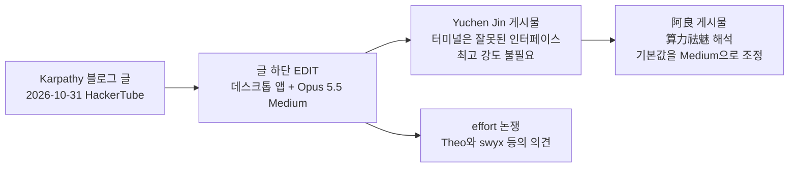
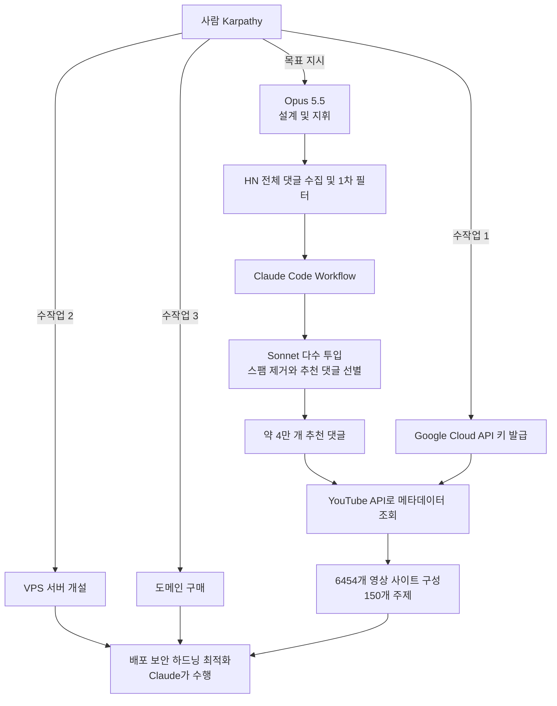
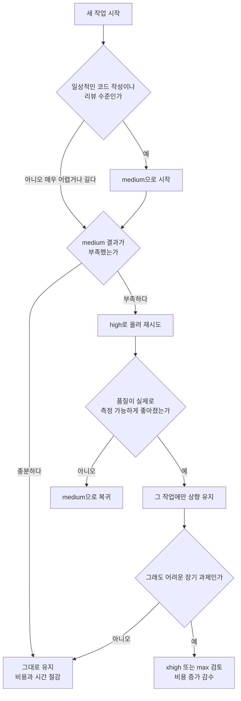

- 작성 기준일: 2026-11-01
- 대상: 제공해주신 두 개의 X 게시물([@RealYDT](https://x.com/realydt/status/2116765922509934829), [@Yuchenj_UW](https://x.com/yuchenj_uw/status/2116748026924638637))과 그 근거가 되는 Andrej Karpathy의 블로그 글(2026-10-31)

---

## 0. 먼저 읽는 요약

한 문장으로 줄이면 이렇습니다. **"AI 코딩 분야의 대표 인물인 Andrej Karpathy가, 터미널이 아닌 Mac용 Claude Code 데스크톱 앱을 쓰고, 모델은 Opus 5.5를 쓰되 추론 강도(effort)는 최고가 아닌 Medium을 기본값으로 둔다고 밝혔고, 이를 두고 'AI는 항상 최대 성능으로 돌려야 한다'는 통념을 되돌아보자는 반응이 나왔다"** 는 이야기입니다.

이 내용이 퍼진 경로는 세 단계입니다.

1. 2026-10-31, Karpathy가 자신의 블로그(Bear Blog)에 **HackerTube**라는 사이트를 약 2시간 만에 만든 과정을 공개했습니다. 글에는 본문 뒤에 자신의 작업 방식을 덧붙인 **EDIT** 항목이 있었고, 여기에 "Claude Code 데스크톱 앱(Mac)을 쓰고, Opus 5.5를 Medium effort로 기본 사용한다"는 문장이 들어 있었습니다.
2. 투자자·창업가 **Yuchen Jin(@Yuchenj_UW)** 이 이 EDIT를 인용하면서 "코딩 에이전트에게 터미널은 잘못된 인터페이스이고, 지금은 데스크톱 앱이 최선이다. 대부분의 작업에 가장 똑똑한 모델을 최고 추론 강도로 쓸 이유는 없다"는 자신의 의견을 붙였습니다.
3. 중국어권 계정 **阿良 | AI 工作流(@RealYDT)** 가 이를 다시 받아서 "이것이 가장 현실적인 연산력 탈신화(算力祛魅)"라고 해석하고, 자신의 기본 강도도 Medium으로 돌리겠다고 썼습니다.

아래에서는 (1) 원문이 무엇이었는지, (2) HackerTube가 무엇인지, (3) effort라는 설정이 무슨 의미인지, (4) 왜 Medium이 합리적인 기본값으로 받아들여지는지, (5) 반대로 높은 강도가 필요한 경우는 언제인지, (6) 이 사례를 어떻게 읽어야 하는지를 차례로 설명합니다. 각 항목에서 **확인된 사실**과 **해석·의견**을 구분해 두었습니다.

---

## 1. 게시물 두 개의 내용을 정확히 읽기

### 1-1. Yuchen Jin(@Yuchenj_UW)의 게시물

Yuchen Jin은 Karpathy의 HackerTube 블로그 글을 인용하는 형식으로 다음을 적었습니다.

- Karpathy가 "Claude Code(Mac용 데스크톱 앱)를 쓴다"고 밝혔다는 점.
- 자신이 계속 말해 온 대로 **터미널은 코딩 에이전트에게 맞지 않는 인터페이스이고, 현 시점에서는 데스크톱 앱이 최고의 인터페이스**라는 주장.
- Karpathy가 "Opus 5.5를 Medium effort 기본값으로 쓴다"고 밝혔다는 점.
- 그리고 **"대부분의 작업에서 가장 똑똑한 모델을 최고 추론 강도로 쓸 이유는 없다"** 는 자기 의견.

여기서 앞의 두 가지 인용은 Karpathy가 한 말이고, "터미널은 잘못된 인터페이스", "최고 강도로 쓸 이유 없다"는 부분은 Yuchen Jin 본인의 견해입니다. 이 둘을 섞어서 "Karpathy가 터미널은 틀렸다고 말했다"처럼 읽으면 정확하지 않습니다.

게시물 아래쪽에는 Karpathy 블로그의 EDIT 부분이 그대로 인용되어 있습니다. 그 내용을 한국어로 풀면 다음과 같습니다.

> 제 작업 방식을 조금 더 설명하자면, 저는 Mac용 Claude Code 데스크톱 앱을 쓰고, 기본값으로 Opus 5.5를 Medium effort에 놓고 씁니다. 저는 이제 전통적인 의미의 엔지니어링(코드를 읽고 쓰거나 터미널에서 명령을 실행하는 일)을 사실상 하지 않습니다. Claude에게 말을 걸고 모든 일을 시킬 뿐입니다. 이번 프로젝트에서 제가 직접 한 "수작업"은 세 가지였습니다. 첫째, YouTube 영상 메타데이터를 조회하기 위해 Google Cloud 화면에서 API 키를 만든 것. 둘째, VPS 서버를 띄운 것. 셋째, 도메인을 산 것. 이 일들은 Claude가 실제로 작업하는 사이사이에 했기 때문에 여전히 팀워크 같은 느낌이 났습니다. 서버가 뜬 뒤에는 Claude에게 IP를 알려주고 "업데이트, 배포, 보안 설정, 하드닝, 코드 최적화"를 하라고 했더니 전부 해냈습니다.

### 1-2. 阿良(@RealYDT)의 게시물

중국어로 쓰인 이 게시물의 요지는 다음과 같습니다.

- Karpathy가 오늘 공개한 일상 설정을 보고 "솔직히 나도 어리둥절했다"고 합니다. 최상급 인물이 코딩을 하면서 **검은 터미널에 매달리지도, 모델 추론 출력을 최대로 올리지도 않고**, Mac용 Claude Code 데스크톱 앱에 Opus 5.5를 Medium effort 기본값으로 쓰고 있었기 때문입니다.
- 작성자는 "왜 최고수가 풀파워를 쓰지 않을까"를 오래 고민했고, 이것이 **가장 현실적인 '연산력 탈신화'** 라고 결론 냈습니다.
- 비유로 **출퇴근길의 자동차**를 듭니다. 시내 통근에는 시야가 편한 승용차를 반쯤 밟고 다니는 것이 가장 자연스럽고, 전투기 조종석 같은 검은 터미널에서 매번 슈퍼카 가속 페달을 끝까지 밟는 것은 스스로를 괴롭히는 일이라는 것입니다. "파라미터를 최대로 올리는 사람이 고수가 아니라, **도구가 사람의 직관을 따라 일하게 만드는 사람**이 고수"라고 정리합니다.
- 결론적으로 작성자 본인은 **기본 단계를 곧바로 Medium으로 내리겠다**고 합니다. 이유는 "마음도 편하고 돈도 아낀다"는 것입니다.

중요한 구분이 하나 있습니다. **"비용을 아끼려고 Medium을 쓴다"는 설명은 阿良 본인의 해석이고, Karpathy 본인이 Medium을 고른 이유를 밝혔다는 근거는 이번에 확인한 자료에서 찾지 못했습니다.** Karpathy의 글에서 확인되는 것은 "Medium이 기본값이다"라는 사실까지입니다. 이유에 대한 설명은 전부 읽는 사람들의 추정입니다.

---

## 2. 배경: Karpathy는 무엇을 만들었나 — HackerTube

Medium이라는 설정이 이야기된 계기는 HackerTube라는 작은 프로젝트였습니다. 여러 보도가 Karpathy의 블로그 글을 인용해 전한 내용을 종합하면 다음과 같습니다.

### 2-1. 시작한 이유

Karpathy는 금요일 밤에 YouTube를 열었다가 추천 화면이 마음에 들지 않았고, 홈 화면을 "enshittified wall of slop"(질이 떨어진 쓰레기 더미 같은 벽)이라고 표현했다고 전해집니다. 추천 알고리즘이 평균적인 인터넷 사용자에게는 맞을지 몰라도 자신에게는 맞지 않는다는 취지였습니다. 그리고 토요일 아침에 Opus 5.5에게 "Hacker News에서 추천된 영상만으로 우리만의 YouTube 클론을 만들자"는 방향으로 일을 맡겼습니다.

### 2-2. 사이트의 정체

- **HackerTube**는 Hacker News 댓글에서 사람들이 추천한 YouTube 영상만 모아 보여주는 YouTube 스타일 사이트입니다. 주소는 hackertube.org로 보도되었습니다.
- 규모는 영상 **6,454개**, 기간은 **2007~2026년**, 주제는 약 **150개**입니다.
- 이 영상들은 영상을 추천하는 **약 40,000개의 HN 댓글**에서 뽑아냈습니다.
- 계정 가입이 없고, 개인화 추천은 서버가 아니라 **브라우저에 저장된 상태**로 동작한다고 알려져 있습니다.
- 썸네일은 업로더가 정한 대표 이미지가 아니라 **영상의 50% 지점에서 뽑은 장면**을 쓴다고 합니다. 과장된 썸네일을 피하려는 설계로 읽힙니다.
- 키보드 단축키가 있고, 데이터를 내보내 자기 에이전트에게 주면 각자 자기 버전을 만들 수 있게 해 두었다고 합니다.
- Karpathy는 이런 작업이 이제 "약 2시간"이면 된다고 썼습니다.

### 2-3. 어떻게 만들었나 (작업 구조)

보도된 설명에 따르면 흐름은 이렇습니다. 먼저 **Opus가** Hacker News의 전체 댓글을 내려받고 걸러냈습니다. 그다음 Claude Code의 **Workflow 기능**으로 **Sonnet**을 대량 투입해 스팸을 제거하고, YouTube 영상을 추천하는 댓글 약 4만 개로 좁혔습니다. 영상 메타데이터는 YouTube의 공식 API로 가져왔습니다. 즉 비싸고 똑똑한 모델(Opus)이 전체 설계와 지휘를 맡고, 단순 반복 필터링은 더 가볍고 싼 모델(Sonnet)에게 맡기는 **역할 분담**이 있었습니다. 이 구조는 나중에 "왜 Medium이 합리적인가"를 이해하는 데 중요한 단서가 됩니다.

### 2-4. 사람이 직접 한 일 세 가지

Karpathy가 직접 했다고 밝힌 일은 **Google Cloud API 키 발급, VPS 서버 개설, 도메인 구매**가 전부입니다. 서버가 열린 뒤에는 Claude에게 IP를 건네고 업데이트, 배포, 보안, 하드닝, 최적화를 맡겼고 Claude가 전부 처리했다고 합니다. 계정 생성이나 결제, 외부 서비스의 콘솔 조작처럼 사람이 해야 하는 관문만 사람이 맡고 나머지는 에이전트가 처리하는 방식입니다.

### 2-5. 이 숫자들을 읽을 때 주의할 점

2시간, 4만 댓글, 6,454개 영상이라는 수치는 **Karpathy 본인의 진술**이고, 보도한 매체도 사이트의 데이터를 따로 검증하지는 않았다고 밝히고 있습니다. 또한 그의 글에는 **토큰 사용량, 비용, 어떤 요금제를 썼는지**가 나와 있지 않다고 합니다. 따라서 "Medium으로 얼마를 절약했다" 같은 수치는 이 사례에서 확인되지 않습니다.

---

## 3. 용어 정리: 모델, 하네스, effort

이 이야기를 이해하려면 세 가지가 서로 다른 층이라는 점을 알아야 합니다.

- **모델(Model)**: Opus 5.5 같은 두뇌 자체입니다.
- **하네스/인터페이스(Harness, Surface)**: 그 두뇌를 사람과 연결해 파일을 읽고 명령을 실행하게 하는 도구입니다. 여기서는 **Claude Code**이고, 같은 Claude Code라도 터미널(CLI) 형태와 **Mac용 데스크톱 앱** 형태가 있습니다.
- **effort(추론 강도)**: 같은 모델이 한 번의 응답을 만들 때 **얼마나 깊게, 오래 생각할지**를 조절하는 다이얼입니다. 생각을 많이 할수록 시간이 걸리고 토큰 비용이 늘어납니다.

Karpathy의 설정은 이 세 층에서 각각 선택을 한 것입니다. 모델은 Opus 5.5(상위 모델), 인터페이스는 데스크톱 앱(터미널 아님), 강도는 Medium(최고 아님)입니다.

### 3-1. Opus 5.5는 어떤 모델인가 (Anthropic 공식 문서 기준)

- 출시일은 **2026년 9월 22일**이고, API 모델 ID는 `claude-opus-5-5`입니다.
- 컨텍스트 창 **100만 토큰**, 최대 출력 **12.8만 토큰**입니다.
- 가격은 입력 100만 토큰당 **$4**, 출력 100만 토큰당 **$20**입니다.
- 같은 세대의 다른 모델과 비교하면, 상위인 Fable 5.1은 $10/$50이고 Sonnet 5.5는 $2/$10입니다.
- **적응형 사고(adaptive thinking)가 항상 켜져 있고 끌 수 없습니다.** 대신 effort 파라미터로 사고 깊이를 조절합니다.
- **기본 effort가 medium**입니다. 그 이전 세대인 Opus 5의 기본값은 high였습니다.
- 지식 기준 시점은 2026년 6월로 표기되어 있습니다.

### 3-2. effort 단계

Opus 5.5의 effort는 **low, medium, high, xhigh, max**의 다섯 단계입니다. Claude Code의 `/effort` 슬라이더에서는 이름이 Low, Medium, High, Extra, Max로 표시되고, 여기서 "Extra"가 API의 xhigh에 해당한다고 설명한 글이 있습니다. 설정은 세션 안에서 `/effort medium`처럼 입력하거나 실행 옵션 `--effort`로 바꿀 수 있습니다.

Opus 5.5를 쓰려면 Claude Code 버전이 **2.1.280 이상**이어야 한다는 안내가 있습니다. 또한 흔히 놓치는 점으로, 예전 방식의 전역 `effortLevel` 설정은 Opus 5.5에 적용되지 않고 모델별 설정을 따로 해야 한다는 설명이 있습니다. "settings 파일에 high라고 써 두었는데 왜 medium으로 시작하지?" 하는 상황이 여기서 나옵니다.

Anthropic의 가이드는 **"medium에서 시작하고, 명시적으로 설정하고, 자기 평가 세트로 여러 단계를 직접 비교해 보라"** 는 취지입니다. 또 **xhigh와 max는 품질 향상이 실제로 측정된 작업에만 쓰라**고 권고하며, Opus 5.5는 Opus 5보다 같은 단계에서 턴당 생각을 더 많이 하는 경향이 있어 특히 xhigh와 max에서 비용과 시간이 더 늘어난다고 설명합니다. 즉 Medium은 "대충 쓰는 단계"가 아니라 **공급사가 직접 기본값으로 정한 표준 단계**입니다.

---

## 4. 전체 흐름을 한눈에 보기

### 4-1. 이야기가 퍼진 경로

### 4-2. HackerTube의 제작 구조

---

## 5. 왜 Medium이 "합리적인 기본값"으로 읽히는가

이 장은 **공급사 문서와 외부 측정 결과**를 근거로 한 설명입니다. Karpathy 본인이 이 이유를 말한 것은 아니라는 점을 다시 강조합니다.

### 5-1. 공급사가 기본값으로 정했다

가장 단순한 사실부터입니다. Anthropic은 Opus 5.5의 기본 effort를 medium으로 정했고, Claude Code 문서도 모든 모델의 기본이 high인데 Opus 5.5만 medium이라고 안내합니다. Anthropic은 홍보 문구에서 "기본 effort(medium)의 Opus 5.5가 경쟁사 모델을 최대 강도로 돌린 것보다 우수하면서 작업당 비용은 약 5분의 1"이라는 취지의 주장을 한 것으로 소개됩니다. 한 코딩 에이전트 업체(Factory)의 담당자는 이 모델이 "처음으로 기본을 medium으로 쓰겠다고 생각한 모델"이라고 평했다고 인용됩니다. 그렇다면 Karpathy가 Medium을 쓰는 것은 **괴짜 선택이 아니라 제품의 표준 사용법을 따르는 것**입니다.

### 5-2. 단계를 올려도 성능 상승 폭이 작을 수 있다

외부 글들이 소개한 측정 결과 몇 가지입니다. 모두 **2차 출처의 보고**이므로 참고 수치로만 보시기 바랍니다.

- **CursorBench 4.0 보고**: Opus 5.5가 max에서 57.8%, high에서 56.0%(작업당 약 $4), medium에서 52.5%(작업당 약 $3)였다고 합니다. 같은 보고에서 Fable 5.1을 max로 돌렸을 때는 51.8%에 작업당 $17.28이었다고 하므로, 가격이 더 높은 상위 모델을 최고 강도로 쓰는 것보다 Opus 5.5를 medium으로 쓰는 편이 이 벤치마크에서는 점수와 비용 양쪽에서 유리했다는 이야기가 됩니다. 반대로 max와 medium의 차이는 5점 정도로, 그 5점이 필요한지는 작업에 달려 있습니다.
- **개인 실험(Claude Code Hub 팁)**: 숨은 예외 상황이 있는 과제 세 개(오픈 리다이렉트, 월간 갱신, CSV 임포터)를 medium, high, xhigh로 각각 세 번씩, 총 27회 돌렸더니 **모두 정답**이었고, 총비용은 각각 $1.69, $2.30, $4.99, API 시간 중앙값은 31초, 42초, 95초였다고 합니다. 다만 작성자 스스로 과제가 작아서 누구든 풀 수 있는 수준이었다고 한계를 밝혔습니다.

두 사례가 공통으로 보여주는 것은 **"강도를 올리면 비용과 시간은 확실히 늘지만, 품질 향상은 작업에 따라 다르다"** 는 점입니다.

### 5-3. 일상 작업에서는 속도와 흐름이 곧 생산성이다

HackerTube처럼 사람이 계속 지시를 주고받는 작업에서는 한 번의 응답이 95초 걸리는 것과 31초 걸리는 것의 차이가 큽니다. 阿良가 비유한 "반쯤 밟는 시내 운전"이 의미하는 바도 여기에 가깝습니다. 최고 속도를 낼 수 있는 것과, 매번 그 속도가 필요한 것은 다른 문제입니다. 단, 이 비유는 阿良의 해석이고 이 비유 자체가 측정 결과는 아닙니다.

### 5-4. 지휘와 단순 반복을 분리하면 전체 비용이 달라진다

앞서 본 HackerTube의 구조를 다시 보면, 4만 건 규모의 반복 필터링은 Sonnet이 맡았고 Opus는 설계와 지휘를 맡았습니다. 이렇게 **작업의 무게에 따라 모델과 강도를 나눠 쓰는 습관**이 있으면, 지휘 역할의 Opus는 medium으로도 충분하다고 판단하기 쉬워집니다. 이것은 구조에서 끌어낸 해석이며, Karpathy가 그렇게 설명한 것은 아닙니다.

---

## 6. 반대 증거: 높은 강도가 이기는 경우도 있다

Medium이 정답이라고 단정하면 안 됩니다. 같은 기간에 나온 다른 측정과 의견을 함께 봐야 균형이 맞습니다.

- **긴 자율 작업 실험**: 한 영상 기반 분석에서는 약 105GB 분량의 행사 녹화본을 탐색 가능한 3D 컨퍼런스로 바꾸는 긴 자율 작업을 `/goal` 기능으로 모든 effort 단계에서 돌렸다고 합니다. 비용은 low에서 약 $3.91, max에서 $50 수준이었고, 제목이 말하듯 **결과적으로 xhigh가 가장 좋았다**고 합니다. 긴 호흡의 자율 작업에서는 중간 단계 이상이 유리할 수 있다는 사례입니다.
- **앱 제작 비교 실험**: 같은 프롬프트로 단계만 바꿔 앱을 여섯 번 만들어 본 글에서도 "Extra(xhigh)가 이겼다"는 제목이 붙어 있습니다.
- **개발자들 사이의 논쟁**: 보도에 따르면 10월 31일에 Theo가 Opus 5.5에서 extra high를 쓰다 high로 내렸더니 거의 항상 더 낫다고 말했고, swyx는 low effort에 비판(critique) 루프를 붙이는 방식을 선호하며 effort 단계를 두고 벌이는 논쟁을 "탭 대 스페이스" 같은 취향 논쟁에 비유했다고 합니다. 즉 개발자 커뮤니티의 합의는 "항상 Medium"이 아니라 **"작업과 워크플로에 맞춰 직접 시험해서 정하라"** 에 가깝습니다. 이는 Anthropic의 가이드와도 같은 방향입니다.

이 증거들을 합치면 **"Medium이 기본값으로 좋은 출발점이다. 그러나 어려운 장기 작업이나 측정된 이득이 있을 때는 올려 쓰는 것이 맞다"** 는 정도가 근거로 지지되는 결론입니다.

---

## 7. 작업 유형별로 어떻게 정할까 (판단 흐름)

아래 흐름은 공급사 가이드의 원칙(medium에서 시작, 측정된 이득이 있을 때만 상향)을 의사결정 형태로 옮긴 **실용적 정리**입니다. 특정 수치 기준이 공식으로 정해져 있다는 뜻은 아닙니다.

핵심은 **"기본은 Medium, 올리는 것은 예외, 올릴 때는 효과를 확인"** 이라는 순서입니다.

---

## 8. 인터페이스 이야기: 터미널 대 데스크톱 앱

Yuchen Jin이 강조한 또 하나의 축은 인터페이스입니다. 이 부분은 **의견의 영역**입니다.

Karpathy가 사실로 밝힌 것은 "Claude Code 데스크톱 앱(Mac)을 쓴다"까지입니다. 그리고 자신이 이제 코드를 읽고 쓰거나 터미널에서 명령을 치지 않고, Claude에게 말로 시키는 방식으로 일한다고 설명했습니다. 이 설명이 곧 "터미널은 틀렸다"는 주장은 아닙니다. 터미널이 틀렸다는 주장은 Yuchen Jin이 자기 견해로 덧붙였고, 阿良도 이를 받아 "검은 터미널에 매달리지 않는다"고 표현했습니다.

이 논쟁을 이해하는 한 가지 방법은, 사람이 **코드를 직접 보는 시간이 줄어들수록** 터미널의 장점(텍스트 기반의 빠른 조작)보다 데스크톱 앱의 장점(대화 중심, 진행 상황과 결과를 보기 편한 구성)이 커진다고 보는 것입니다. 다만 이것은 이해를 돕기 위한 설명이고, 어느 쪽이 보편적으로 우월하다는 근거가 확인된 것은 아닙니다. 터미널을 선호하는 개발자도 많고, 작업 환경(원격 서버, 자동화 스크립트, CI)에 따라 터미널이 필수인 경우도 많습니다.

---

## 9. 이 사례를 어떻게 읽어야 하나

### 확인된 사실

1. Karpathy는 2026-10-31 블로그 글에서 HackerTube를 약 2시간 만에 Opus 5.5로 만들었다고 밝혔습니다.
2. 글의 EDIT에서 Claude Code 데스크톱 앱(Mac)과 Opus 5.5 Medium effort 기본 사용을 밝혔습니다.
3. 자신이 직접 한 수작업은 API 키 발급, VPS 개설, 도메인 구매 세 가지라고 밝혔습니다.
4. Opus 5.5의 공식 기본 effort는 medium이고, Opus 5의 기본은 high였습니다.
5. effort는 low, medium, high, xhigh, max 다섯 단계입니다.

### 해석과 의견 (근거가 약하거나 개인 견해)

1. "Karpathy가 비용을 아끼려고 Medium을 쓴다" — 그가 이유를 밝힌 근거는 확인하지 못했습니다.
2. "터미널은 코딩 에이전트에 잘못된 인터페이스" — Yuchen Jin의 의견입니다.
3. "이것이 연산력 탈신화" — 阿良의 해석입니다. 방향성은 공감할 만하지만 측정된 결론은 아닙니다.
4. "모든 사람이 Medium으로 충분하다" — 근거가 지지하지 않습니다. 작업에 따라 high 이상이 낫다는 측정도 있습니다.

### 실무에 가져갈 만한 것

- **기본값을 의식적으로 정하기**: 최고 강도가 기본이어야 한다는 가정을 점검해 보세요. 새 모델이 나오면 기본 effort도 달라질 수 있으니 이전 설정을 그대로 가져오지 말고 다시 시험하라는 것이 공급사의 권고입니다.
- **작업별로 올리고 내리기**: 일상 작업은 Medium, 막히는 어려운 작업만 High 이상으로 올려 보고, 효과가 없으면 되돌립니다.
- **역할 분담 설계하기**: 지휘는 상위 모델에, 대량 반복 작업은 가벼운 모델에 맡기는 HackerTube의 구조는 비용과 속도를 함께 관리하는 한 방식입니다.
- **사람의 몫을 관문에 두기**: 계정, 결제, 키 발급처럼 책임이 따르는 단계는 사람이 맡고 나머지를 에이전트에게 맡기는 분업이 사례에서 확인됩니다.

---

## 10. 한계와 확인하지 못한 부분

- 이번 조사에서 X 게시물과 Karpathy 블로그 원문에 **직접 접속해 읽지는 못했습니다.** X는 자동 접근이 차단되어 있었고, 블로그는 검색·보도에 인용된 내용으로 확인했습니다. 따라서 Karpathy의 발언은 **여러 보도가 일관되게 인용한 내용과, 제공해주신 게시물에 담긴 EDIT 인용문**을 근거로 정리했습니다. 문장 하나하나의 원문 표현까지 확인한 것은 아닙니다.
- HackerTube의 수치(2시간, 4만 댓글, 6,454개 영상, 150개 주제)는 Karpathy의 진술이며 독립적으로 검증되지 않았습니다.
- 벤치마크 수치(CursorBench 등)와 개인 실험 결과는 **2차 출처의 보고**이며, 같은 조건에서 재현했다는 뜻이 아닙니다.
- Karpathy가 어떤 요금제를 쓰는지, 실제 비용이 얼마였는지는 알려져 있지 않습니다.
- effort 단계의 정확한 표기(예: Extra와 xhigh의 대응)는 소프트웨어 버전에 따라 달라질 수 있으니, 사용 중인 Claude Code에서 `/effort`를 열어 확인하시기 바랍니다.

---

## 11. 출처

- Karpathy의 HackerTube 블로그 글(2026-10-31, karpathy.bearblog.dev/hacker-tube) — 직접 열람은 못 했고 아래 보도와 인용을 통해 확인
- FourWeekMBA, "Karpathy Has Claude Build HackerTube From 6,454 HN Videos" (2026-11-01) — https://fourweekmba.com/ai-karpathy-has-claude-build-hackertube-from-6454-hn-videos/
- Runtime Wire, "Andrej Karpathy builds HackerTube from 6,454 videos recommended on Hacker News" — https://runtimewire.com/article/andrej-karpathy-hackertube-hacker-news-youtube
- AI Weekly, "Karpathy ships HackerTube in ~2 hours with Claude Opus 5.5" — https://aiweekly.co/alerts/karpathy-ships-hackertube-in-2-hours-with-claude-opus-55
- AGTP(X) 게시물, effort 논쟁(Theo, swyx) 소개 — https://x.com/AGTPinsights/status/2116813932207735029
- Jurly(X) 게시물, 제품 설계 요약 — https://x.com/jurlycat/status/2116710997121700318
- Claude Platform Docs, "Claude Opus 5.5" 모델 개요 — https://platform.claude.com/docs/en/models/opus-5-5/overview
- claudefa.st, "How to Use Opus 5.5 in Claude Code: Best Practices" — https://claudefa.st/blog/guide/development/opus-5-5-best-practices
- DevelopersDigest, "Claude Opus 5.5 Developer Guide" — https://www.developersdigest.tech/blog/claude-opus-5-5-release-guide-2026
- Codersera, "Claude Opus 5.5: Complete Guide to Specs, Pricing and Benchmarks (2026)" — https://codersera.com/blog/claude-opus-5-5-complete-guide-2026/amp/
- wmedia.es, Claude Code 팁 #216(effort 비교 실험), #206(Opus 5.5 설정) — https://wmedia.es/es/tips/claude-code-effort-medium-high-xhigh , https://wmedia.es/en/tips/claude-code-opus-5-5-not-showing-up
- OpenClawDatabase, "Opus 5.5 at every effort level on one /goal build" — https://openclawdatabase.com/news/videos/2026-09-24-opus-55-every-effort-level-cost-comparison/
- AI Fire, "Claude Opus 5.5 Changes A LOT at Each Effort Level" — https://www.aifire.co/p/claude-opus-5-5-built-the-same-app-6-times-and-extra-won
- 제공해주신 X 게시물: @RealYDT(阿良), @Yuchenj_UW(Yuchen Jin)

---

작성 일자: 2026-11-01
